# 1주차 · 선박 운동학과 Otter 운동 모델

> [!note] 이 문서는 한글본이다
> 영어본 [`W01_Vessel_Kinematics_and_the_Otter_Model.md`](W01_Vessel_Kinematics_and_the_Otter_Model.md) 와
> **같은 내용**이고, 수식·코드·그림·수치는 한 글자도 다르지 않다. 러너가 찍는 출력은
> 영어 그대로 둔다 — 실제로 화면에 그렇게 나오기 때문이다.

> [!note] 이번 학기 수업 실시간 녹화
> <span style="font-size:0.88em">이 강의의 모든 시간은 진행되는 그대로 녹화되어 아래 재생목록에 올라간다. 여기 적힌 글이 기준이고, 녹화는 실제로 전달된 속도의 강의다. 유도를 다시 볼 때, 또는 빠진 주를 실습 전에 따라잡을 때 쓴다.</span>
>
> | | 어디에 |
> |---|---|
> | **[충남대] 2026 센서신호처리** — 이 강의의 2026년 실시간 녹화 | [재생목록](https://youtube.com/playlist?list=PLCxINRGlWUrk) |

> [!important] 참고자료 — 먼저 읽을 것
> <span style="font-size:0.88em">아래 다섯 강의는 **이 강의의 강사가 직접 한 강의**이고, 이 강의가 전제하는 배경이다. 기초부터 대학원 내용까지 이어지므로 모자란 곳부터 시작하면 된다. 여기서 쓰는 좌표계·기호·유도는 전부 그 강의들에서 길게 다룬다. 선수 지식이 얇은 사람은 그쪽을 먼저 보고 돌아오는 편이 빠르다.</span>
>
> | # | 강의 | 수준 | 언어 | 영상 | 자료와 코드 |
> |---|---|---|---|---|---|
> | 1 | **제어공학** — 기초: 전달함수, 되먹임, 안정도, 근궤적, PID | 학부 | KO | [재생목록](https://youtube.com/playlist?list=PLFaUxNRM4BvJMpF9HZS-Mp8tDv9dTdglk) | [드라이브](https://drive.google.com/drive/folders/1TNIPDNtS_Iy8li-olka5WJslSXDYf0aT) |
> | 2 | **제어시스템설계** — 해석이 아니라 설계: 사양, 루프 성형, 이산 구현 | 학부 | KO | [재생목록](https://youtube.com/playlist?list=PLFaUxNRM4BvIGroZ5rgn7x08F7C79d9WZ) | [드라이브](https://drive.google.com/drive/folders/11m5Xxl_PHJvxgHghLSP-jhCpmRpbvoXh) |
> | 3 | **제어공학특론** — 좌표계, 6자유도 운동방정식, 회전행렬과 오일러각, 선형화와 트림, 운동체 제어 설계 | 대학원 | EN | [재생목록](https://youtube.com/playlist?list=PLFaUxNRM4BvJmvF2ljx4KM5dj1P5jEcw0) | [드라이브](https://drive.google.com/drive/folders/1GUxbbONl916lNd0ggnFnXrNwNkd13-2-) |
> | 4 | **센서신호처리 및 융합** — 센서 모델, 잡음, 추정과 다중센서 융합 | 대학원 | EN | [재생목록](https://youtube.com/playlist?list=PLFaUxNRM4BvK-aP2Gdoyp5-AWvMn7Fo8E) | [드라이브](https://drive.google.com/drive/folders/1MEVJP7TzMcm8w6TZwUjhWJtL34WeNY3u) |
> | 5 | **캡스톤디자인** — 운동체 과제를 처음부터 끝까지 | 학부 | KO | [재생목록](https://youtube.com/playlist?list=PLFaUxNRM4BvLu7L0pDoLzDXTv8mm6rCmj) | [드라이브](https://drive.google.com/drive/folders/1haIQejlJfrdhtOuof-MpffR9ydVscXZS) |
>
> <span style="font-size:0.88em">**MATLAB 과 Simulink 가 아직 익숙하지 않다면 Part 2 전에 이것부터.** 이 강의의 실습은 전부 Simulink 이고, Onramp 는 무료이며 각각 몇 시간이면 끝난다.</span>
>
> | 도구 | 시작할 곳 |
> |---|---|
> | MATLAB | [MATLAB Onramp](https://matlabacademy.mathworks.com/kr/details/matlab-onramp/gettingstarted) · [Core MATLAB Skills](https://matlabacademy.mathworks.com/details/core-matlab-skills/lpmlcms) |
> | Simulink | [Simulink Onramp](https://matlabacademy.mathworks.com/kr/details/simulink-onramp/simulink) · 강사의 Simulink 강의 [1편](https://youtu.be/a-afHg_fSaU) · [2편](https://youtu.be/070Yn0Hw5a0) |


> [!tip] 수업 파일 받기와 최신으로 유지하기 (Windows)
> <span style="font-size:0.88em">강의노트·모델·스크립트는 한 Git 저장소에 들어 있고 학기 내내 갱신된다. 한 번 clone 하고, 수업 전마다 pull 한다. pull 은 지난번 이후 **바뀐 것만** 내려받는다.</span>
>
> | 언제 | 어디서 | 명령 |
> |---|---|---|
> | 한 번 | PowerShell — Git for Windows 설치 | `winget install --id Git.Git -e` |
> | 한 번 | 강의 폴더를 둘 자리, 예를 들어 `Documents` | `git clone https://github.com/wkyouncnu/Sensor-Signal-Processing-and-Fusion.git` |
> | 수업 전마다 | clone 한 폴더 `Sensor-Signal-Processing-and-Fusion` 안에서 | `git pull` |
>
> - 바뀐 것이 없으면 `git pull` 은 `Already up to date.` 를 찍고, 있으면 갱신한 파일을 나열한다.
> - 저장소는 비공개다. Git 이 물으면 강사가 접근 권한을 준 GitHub 계정으로 로그인한다.
> - 실험은 복사본에서 한다. 그 주차의 `WXX_simulink` 폴더를 다른 곳에 복사해 두면 pull 이 내 수정과 부딪칠 일이 없다. 이미 부딪쳤다면 `git stash` → `git pull` → `git stash pop` 이 수정을 치워 두고 갱신한 뒤 되돌려 놓는다.
> - MSS 툴박스는 저장소에 들어 있지 않다. Otter 를 시뮬레이션하는 주차는 clone 한 폴더 안 `Tools\MSS` 에 MSS 가 있어야 하고, `Tools\MSS\VESSELS\otter.m` 이 보이도록 두어야 한다 — `_tools\mss_path.m` 이 그 파일 하나를 찾아 MSS 를 MATLAB 경로에 얹는다. 최신 MSS 릴리스는 `otter.m` 을 `CRAFT\USV\models\` 아래에 두므로 강의 스크립트가 찾지 못한다.
> - **2026-10-27 이후 처음 pull 할 때 118 MB 폴더 하나가 사라진다.** `lectures\MSS-master` 가 그때까지 MSS 사본을 담고 있었다. 위의 새 구조여서 강의 스크립트가 닿을 수 없었고 clone 만 느리게 했다. 삭제는 정상이며 오류가 아니다. 그 폴더 안에 둔 파일이 있으면 pull 하기 전에 다른 곳으로 옮긴다.

- **과목**: USV 유도·항법·제어 (대학원)
- **학과**: 충남대학교 자율운항시스템공학과
- **이번 주**: ① 두 기준 좌표계와 열두 상태 ② 운동방정식과 각 항이 어디서 오는가 ③ 정착 속력을 재기 전에 종이 위에서 예측하는 개루프 Simulink 모델

> [!important] 시작하기 전에
> - Simulink 가 포함된 MATLAB R2024b 가 설치되어 있고 라이선스가 있다.
> - MSS 툴박스가 `Tools/MSS` 에 있다. 이 강의의 모든 스크립트가 그것을 스스로 경로에 더하므로 설치는 필요하지 않다.
> - 명령 하나로 확인한다.
>
> ```matlab
> which otter
> ```
>
> 예상되는 응답은 `Tools\MSS\VESSELS\otter.m` 을 가리킨다. 응답이 비어 있으면 작업 폴더가 잘못된 것이다.

---

## 학습 성과

이 주를 마치면 다음을 할 수 있다.

1. `otter.m` 의 열두 상태가 각각 무엇을 나타내는지, 그리고 어느 기준 좌표계로 표현되어 있는지 말한다.
2. MSS `euler2q` 와 `q2euler` 로 자세를 오일러각과 단위 쿼터니언 사이에서 변환하고, 각 표현이 어디서 특이해지는지 말한다.
3. 6자유도 운동방정식을 쓰고 각 항이 어떤 물리적 효과를 모델링하는지 알아낸다.
4. 그 방정식을, 이 강의의 나머지가 쓰는 수평 3자유도로 줄이고 무엇을 버렸는지 정당화한다.
5. 시뮬레이션을 하기 전에, 프로펠러 곡선과 선형 감쇠계수에서 배의 종단 전진속력을 예측한다.
6. 이 배의 횡방향 힘이 왜 항등적으로 0 인지 설명하고, 선회 중에 0 이 아닌 횡방향 *속도*를 만드는 코리올리 항을 유도한다.
7. 이번 주의 Simulink 모델을 깨뜨린 뒤 그 빌더 스크립트에서 다시 만든다.
8. 쌍축 Otter 의 구동기 모델을 손으로 역으로 푼다 — 요구된 전진력과 요 모멘트에서 추력 둘로, 추력 둘에서 축 회전수 둘로 — 그리고 포화가 전달되는 힘에 무엇을 하는지 말한다.

## 준비물

| 항목 | 필요한 것 |
|---|---|
| MATLAB | R2024b, Simulink 포함 |
| 툴박스 | 이번 주는 Simulink 말고는 없다. 선택 과제인 실험 1-10c 는 Simulink 3D Animation 과 USB 조이스틱 모드가 있는 송신기도 필요하다 |
| MSS | `Tools/MSS`. 준비 스크립트가 더한다 |
| 강의 폴더 | `GradCourse/lectures/W01_simulink` |
| 예상 소요 | 이론 60분, 실습 60분 |

---

# Part 1 · 원리와 실험, 절 하나씩

절마다 무엇을 서술하는지 말하고, 그것을 유도하고, 그 다음 **그것을 재는 실험**을 돌린다. 짧은 것은 Command Window 두 줄이고, 긴 것은 이번 주의 Simulink 모델이다. 본문의 어느 것도 실행이 아닌 곳에서 인용되지 않았다.

| 절의 구성 | 무엇이 들어가나 |
|---|---|
| 본문 | 그 양이 왜 필요한가, 유도, 그리고 대조하는 출처 |
| **실험 N-x** | 명령, 실제로 받은 출력, 그리고 — 그림이 있으면 — 그것을 유도로 되돌려 읽는 표 |

§1-1 부터 §1-8 까지는 운동의 서술을 세우고, 그 실험은 그것을 확인하는 짧은 계산이다. §1-9 부터 §1-13 까지는 Otter 자체를 돌리고, 그 실험이 이번 주의 실습이다.

### 이번 주가 가는 길

열세 절은 지도 없이 들어가기에 많다. 그것들은 네 질문에 이 순서로 답하고, 뒤의 어느 것도 이미 답하지 않은 것을 필요로 하지 않는다.

| | 질문 | 절 |
|---|---|---|
| 1 | **배가 어디 있고 어느 쪽을 가리키는가?** 좌표계 둘, 각 셋, 그리고 그 사이를 변환하는 행렬 | 1-1 ~ 1-5 |
| 2 | **무엇이 그것을 움직이는가?** 힘과 모멘트, 그리고 수상 운동체가 왜 여섯 중 셋만 필요한가 | 1-6, 1-7 |
| 3 | **`otter.m` 은 정확히 무엇을 계산하는가?** 운동방정식을 항 단위로, 열두 상태, 그리고 프로펠러 | 1-8 ~ 1-10 |
| 4 | **놀랄 만한 것 셋.** 전진은 1차다. 선체는 횡방향 힘 없이 횡으로 흐른다. 조류는 밀지 않고 배를 움직인다 | 1-11 ~ 1-13 |

**이 주 전체가 기대는 하나의 생각**은 1-4 에 있다 — 선체 좌표 속도는 위치의 변화율이 아니다. 회전행렬에서 조류까지 모든 것이 그 한 문장의 결과다.

시간이 없는 사람은 1-1 → 1-3 → 1-4 → 1-9 로 가도 실습을 따라갈 수 있다.

## 1-0. 준비와 실행 (15분)

### 1단계 — 작업 폴더를 연다

```matlab
cd GradCourse/lectures/W01_simulink
W01_0_setup
```

나오는 출력:

```
  W01 setup complete
    configuration   base, 2 thrusters, rank(B) = 2
    manoeuvre       n0 = 60, dn = 3.5 rad/s
                    port 30..60 s, starboard 90..120 s
    n limits        -101.7 .. 103.9 rad/s
    current         0.00 m/s at 0 deg
    simulation      150 s at h = 0.02 s
```

- `W01_0_setup.m` 이 **이번 주에 고칠 유일한 파일**이다. 모델의 모든 Constant 블록이 거기 정의된 변수를 읽는다.

> [!warning] 모델은 값이 아니라 변수를 읽는다
> `W01_0_setup.m` 이 아니라 Simulink 블록 안의 수를 바꾸면, 스크립트가 서술하는 것과 다르게 움직이는 모델이 나온다. 스크립트를 고친다.

### 2단계 — 이번 주의 파일들, 절이 쓰는 순서로

| 순서 | 파일 | 절 | 무엇을 만드나 |
|---|---|---|---|
| 0 | `W01_0_setup.m` | 1-0 | 기본 작업공간. 그래야 모델을 Simulink 에서 돌릴 수 있다 |
| 1 | `W01_1_build_openloop.m` | 1-9 | `W01_openloop.slx` 와 `img/W01_openloop.png` |
| 2 | `W01_C_terminal_speed.m` | 1-11 | `img/W01_result_speed.png` |
| 3 | `W01_D_the_manoeuvre.m` | 1-12 | `img/W01_result_track.png` |
| 4 | `W01_E_build_current.m` | 1-13 | `W01_current.slx` 와 `img/W01_current.png` |
| 5 | `W01_E_current_run.m` | 1-13 | `img/W01_result_current.png` |
| 6 | `W01_F_build_interactive.m` | 1-10a | `W01_interactive.slx` 와 `img/W01_interactive.png` |
| 7 | `W01_F_button_check.m` | 1-10a | 실험 1-10a 의 표 — 버튼마다 무인 실행 하나 |
| 8 | `W01_G_build_rc.m`, `W01_G_rc_check.m` | 1-10b | `W01_rc.slx`, `img/W01_rc.png`, 그리고 실험 1-10b 의 표 |
| 9 | `W01_H_build_rc_usb.m`, `W01_H_usb_check.m` | 1-10c | `W01_rc_usb.slx` 와 그 표 (선택, 실물 장비) |
| — | `W01_frames.m` | 1-4 | §1-4 의 표. 그림을 그리고 아무것도 저장하지 않는다 |

- **실험마다 스크립트 하나와 모델 하나다.** 그것을 돌리면 그 절이 논하는 수치와 그림이 정확히 남으므로, 수업이 한 쪽씩 이 주를 따라갈 수 있다.
- 실험 1-11, 1-12, 1-13 은 필요한 모델이 없으면 스스로 만든다. 그래서 그중 어느 것이든 먼저 돌릴 수 있다.
- 폴더의 나머지 파일들 — `W01_vars.m`, `W01_read.m`, `W01_plot.m`, `W01_cur_plot.m`, `W01_animate.m`, `W01c_animate.m`, `W01i_animate.m`, `W01i_control.m` — 은 위의 스크립트들과 모델들이 **부르는** 것이다. 손으로 돌리는 일이 없다.
- `W01_frames.m` 은 실험 1-4 의 스크립트다. §1-4 의 예제 계산과 그 그림의 네 칸을 찍고 아무것도 저장하지 않는다. `W01_cur_plot.m` 안의 세 칸 그림과 표류 장미 그림도 같다 — 그 파일은 여전히 조류 모델의 `StopFcn` 이지만, 실험 1-13 은 더 이상 그 두 그림을 부르지 않는다.
- 두 번째 시간의 실습은 `W01_simulink/problems/` 와 `solutions/` 에 살고, 이것들과 별개다.

### 3단계 — 모델이 깨졌으면 되돌린다

```matlab
W01_1_build_openloop
```

- 모델은 코드로 생성하고 손으로 그리지 않는다. 아무리 실험해도 이 명령 하나로 되돌릴 수 있으므로, 도면을 마음껏 해체해도 된다.

## 1-1. 두 기준 좌표계

- 이 강의의 모든 양은 두 좌표계 중 정확히 하나에 속한다. 어느 쪽인지 밝히는 것은 깐깐함이 아니라, 조종되는 모델과 그렇지 않은 모델의 차이다.

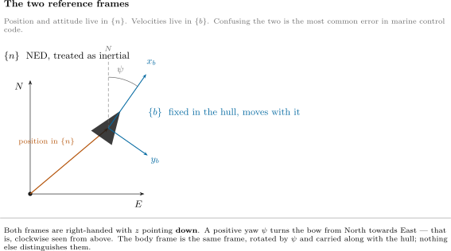

**그림을 읽기**

| 요소 | 뜻 |
|---|---|
| $x_n, y_n$ | 북과 동. 물에 고정되어 있다 |
| $o_n$ 의 $\otimes$ | $z_n$, 아래. 지면 안으로 들어간다 |
| $x_b, y_b$ | 앞과 우현. 선체에 그려져 있고 함께 돈다 |
| 회색 파선 | 배의 위치. $\{n\}$ 으로 표현된 벡터 |
| $\psi$ | 선수각. 북에서 $x_b$ 까지 잰 것 |

| 좌표계 | 기호 | 원점 | $x$ | $y$ | $z$ |
|---|---|---|---|---|---|
| 북-동-하 | $\{n\}$ | 수면 위의 고정된 점 | 북 | 동 | 아래 |
| 선체 | $\{b\}$ | 선체에 고정된 점. `otter.m` 은 선체 중앙 수선면을 쓴다 | 앞 | 우현 | 용골을 지나 아래 |

- $\{n\}$ 은 **관성계**로 취급한다. 평평한 지구, 자전 없음. 수백 미터를 3 노트로 움직이는 2 미터 배에 대해 이것은 모델의 다른 어느 것보다 훨씬 더 정확하다.
- $\{b\}$ 는 **배와 함께 움직인다.** 센서가 사는 좌표계다. 자이로는 $\{b\}$ 에서 $p, q, r$ 을 재고, 가속도계는 $\{b\}$ 에서 가속도를 재고, 프로펠러는 $x_b$ 를 따라 민다.
- 두 좌표계 모두 $z$ 를 **아래로** 둔다. 그것은 해양의 관습이고 한 번 말해 둘 만한 결과가 있다. 양의 요는 선수를 북에서 동 쪽으로 돌리고, 그것은 위에서 보면 **시계방향**이다. 항공우주의 ENU 관습은 반대로 돌고, 둘을 섞는 것이 배가 거꾸로 조종되는 흔한 원인이다.

> [!important] 역할의 분담
> **위치와 자세는 $\{n\}$ 으로, 속도는 $\{b\}$ 로 표현한다.**
> $$\boldsymbol{\eta} = \begin{bmatrix} x & y & z & \phi & \theta & \psi \end{bmatrix}^{\!\top} \text{ in } \{n\}, \qquad \boldsymbol{\nu} = \begin{bmatrix} u & v & w & p & q & r \end{bmatrix}^{\!\top} \text{ in } \{b\}$$
> §1-2 부터 §1-5 까지는 이 두 벡터를 잇기 위해 존재한다. 그 절들의 어느 것에도 질량이나 힘이 끼어들지 않는다 — 기하뿐이고, 그것이 **운동학(kinematics)** 이라는 말의 뜻이다.

> [!important] 이 강의 전체에서 두 위치 좌표를 쓰는 방식
> NED 에서 **$x$ 는 북이고 $y$ 는 동**이다. 이 강의는 그것을 $x^n$ 과 $y^n$ 으로, 위첨자가 좌표계를 가리키게 해서 모든 주차와 모든 그림에서 쓴다.
>
> $$\mathbf{p}^n = \begin{bmatrix} x^n \\[2pt] y^n \end{bmatrix}, \qquad \dot{\mathbf{p}}^n = \begin{bmatrix} \dot{x}^n \\[2pt] \dot{y}^n \end{bmatrix} .$$
>
> 해양 교재는 흔히 대신 $N$ 과 $E$ 로 쓰고, 좌표계가 하나뿐일 때는 그것이 자연스럽게 읽힌다. **이 강의는 그러지 않고**, 이유가 둘이다.
>
> | | |
> |---|---|
> | $N$ 은 이미 쓰이고 있다 | $N$ 은 $\boldsymbol{\tau} = [X\ \ Y\ \ N]^{\!\top}$ 의 **요 모멘트**이고 §1-7 부터 그리고 그 뒤 모든 주차에서 쓴다. 글자 하나가 같은 문서에서 위치이면서 모멘트일 수는 없다 |
> | 좌표계가 보여야 한다 | 5주차에는 좌표계 셋이 한 방정식에 나타난다 — $\{n\}$, $\{b\}$, 그리고 경로 좌표계 $\{p\}$ — 그리고 위첨자가 없는 기호는 자기가 어디에 속하는지 말할 수 없다 |
>
> 이것이 Fossen 의 표기이므로 Handbook 과 강의가 기호 하나까지 일치한다. **위첨자**가 좌표계를 표시한다. 아래첨자는 $x_g$, $y_{\text{pont}}$, $N_r$ 처럼 성분과 계수가 이미 차지하고 있다.
>
> MATLAB 코드는 이 둘을 `N` 과 `E` 로 쓴다. 식별자에는 위첨자를 둘 자리가 없기 때문이다. 그 대응은 각 주차의 기호 표에 적혀 있고, 두 표기가 만나는 유일한 자리다.

> [!important] 과적되기 쉬운 글자 셋, 그리고 각각의 규칙
> 이만큼 긴 강의는 글자가 모자란다. 이 셋이 그러지 않으면 두 가지를 뜻하게 될 것들이고, 각각 `otter.m` 자신의 이름짓기를 따라서 문서와 코드가 어긋나지 않게 한다.
>
> | 기호 | 뜻 | 결코 뜻하지 않는 것 | 출처 |
> |---|---|---|---|
> | $\boldsymbol{\tau}$, $\tau_N$ | **일반화 힘** — 힘이면 N, 모멘트면 N·m | 시정수 | `otter.m` 이 `tau`, `tau_damp`, `tau_crossflow` 로 쓰고 모두 힘이다 |
> | $T_u$, $T_{\text{yaw}}$, $T_{\text{sway}}$ — **이름 붙은** 아래첨자 | **시정수**, 초 단위 | 추력 | `otter.m` 이 `T_yaw = 1; % time constant in yaw (s)` 로 쓴다 |
> | $T$, $T_1$, $T_2$ — 맨 것이나 **번호** 아래첨자 | **추력**, 뉴턴 단위 | 시정수 | `otter.m` 이 정확히 이 양에 대해 `Thrust(i)` 로 쓴다 |
>
> 의도한 예외 하나는 §4-2 의 Nomoto 2차 모델이고, 거기서는 문헌 자신의 $T_1, T_2, T_3$ 이 시정수다. 그것은 콜아웃 하나에 가두어 두고 그 자리에서 그렇게 밝힌다.
>
> 3주차의 전진 시정수는 2026-09-10 까지 $\tau_u$ 로 썼고 이제 강의와 스크립트 양쪽에서 $T_u$ 다. 옛 인쇄물에 `tau_u = 1.1025 s` 가 보이면 옛 이름으로 적힌 같은 수다.

### NED 와 ENU — 다른 관습

- 모두가 NED 를 쓰지는 않는다. 대부분의 로보틱스 소프트웨어 — ROS, Gazebo, 그리고 이 강의가 끝에 닿는 VRX 시뮬레이터 — 는 **ENU** 를 쓴다. $x$ 가 동, $y$ 가 북, $z$ 가 **위**다.

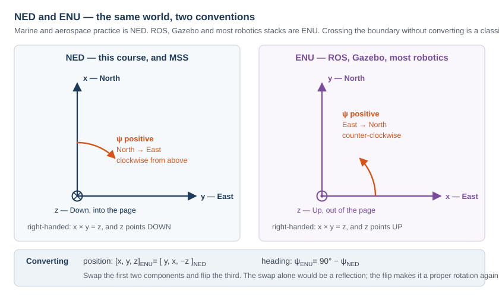

**그림을 읽기**

| 요소 | 뜻 |
|---|---|
| 왼쪽 칸 | NED. 이 강의와 MSS 와 Fossen 의 Handbook 이 쓴다 |
| 오른쪽 칸 | ENU. ROS, Gazebo, 그리고 대부분의 로보틱스 스택이 쓴다 |
| $\otimes$ / $\odot$ | 세 번째 축이 지면 안으로 / 밖으로 |
| 주황 호 | 양의 선수각을 재는 방향 |

| | NED | ENU |
|---|---|---|
| $x$ | 북 | 동 |
| $y$ | 동 | 북 |
| $z$ | **아래** | **위** |
| $\psi = 0$ 이 가리키는 곳 | 북 | 동 |
| 양의 $\psi$ | 북 → 동, 위에서 보아 시계방향 | 동 → 북, 반시계방향 |

- 변환은 연산 둘이다.

$$
\begin{bmatrix} x \\ y \\ z\end{bmatrix}_{\text{ENU}}
=
\underbrace{\begin{bmatrix} 0 & 1 & 0 \\ 1 & 0 & 0 \\ 0 & 0 & -1 \end{bmatrix}}_{\mathbf{T},\ \det \mathbf{T} = +1}
\begin{bmatrix} x \\ y \\ z\end{bmatrix}_{\text{NED}},
\qquad
\psi_{\text{ENU}} = 90^\circ - \psi_{\text{NED}} .
$$

- 앞의 두 축만 바꾸면 **반사**이고 $\det = -1$ 이다. 세 번째를 뒤집으면 $\det = +1$ 이 되돌아오고 $\mathbf{T}$ 가 제대로 된 회전이 된다 — 사실 축 $(1,1,0)/\sqrt2$ 둘레의 $180°$ 회전이다.

> [!caution] 이것은 교재의 호기심거리가 아니라 현장의 사고다
> 오토파일럿은 NED 로 쓰였고 시뮬레이터는 ENU 로 보고하는 배는 반대쪽으로 돌고 자기 웨이포인트의 거울상으로 간다. 아무것도 오류를 내지 않고, 아무것도 `NaN` 이 아니며, 항적을 계획과 겹쳐 그려 볼 때까지는 그럴듯해 보인다. **한** 자리, 곧 경계에서 변환하고, 모든 인터페이스가 어느 관습을 쓰는지 밝힌다.

## 1-2. 자세 — 횡동요, 종동요, 선수동요

- 각 셋이 $\{b\}$ 를 $\{n\}$ 에 대해 방향 짓는다. 각각은 배의 한 축 둘레의 회전이다.

| 각 | 기호 | 어느 축 둘레 | 양의 방향 | 어떻게 보이나 |
|---|---|---|---|---|
| 횡동요 | $\phi$ | $x_b$, 앞뒤 축 | 우현 쪽이 내려간다 | 배가 선회에서 기운다 |
| 종동요 | $\theta$ | $y_b$, 좌우 축 | 선수가 **올라간다** | 배가 선미로 트림된다 |
| 선수동요 | $\psi$ | $z_b$, 수직 축 | 선수가 우현으로 돈다 | 배가 선수각을 바꾼다 |

- 셋을 함께 모은 것이 **오일러각**이다.

$$
\boldsymbol{\Theta} = \begin{bmatrix} \phi & \theta & \psi \end{bmatrix}^{\!\top} .
$$

> [!caution] $z$ 가 아래를 가리키는데도 종동요의 양은 선수가 올라가는 쪽이다
> $z$ 가 아래이고 오른손 좌표계이면, $y_b$ 둘레의 양의 회전은 $z_b$ 를 $x_b$ 쪽으로 나르고 — 그것이 선수를 들어 올린다. 부호는 처음에는 틀린 것처럼 느껴지고 맞다. `otter.m` 은 정지에서 작은 음의 $\theta$ 를 보고한다. 적재가 배를 선수 쪽으로 살짝 트림시키기 때문이다.

## 1-3. 회전행렬

- 회전행렬은 질문 하나에 답한다. **같은 물리적 벡터를 다른 좌표계로 표현하면 성분이 무엇인가?**

$$
\mathbf{v}^{n} = \mathbf{R}_b^n(\boldsymbol{\Theta})\, \mathbf{v}^{b}
$$

- 위첨자는 답이 들어 있는 좌표계이고, 아래첨자는 입력이 온 좌표계다. $\mathbf{R}_b^n$ 을 "$b$ 에서 $n$ 으로" 로 읽으면 첨자 셈이 저절로 된다. 붙은 첨자가 지워지기 때문이다 — $\mathbf{R}_1^n\mathbf{R}_2^1\mathbf{R}_b^2 = \mathbf{R}_b^n$.

### 기본 회전 셋

$$
\mathbf{R}_x(\phi) =
\begin{bmatrix} 1 & 0 & 0 \\ 0 & c\phi & -s\phi \\ 0 & s\phi & c\phi \end{bmatrix},
\quad
\mathbf{R}_y(\theta) =
\begin{bmatrix} c\theta & 0 & s\theta \\ 0 & 1 & 0 \\ -s\theta & 0 & c\theta \end{bmatrix},
\quad
\mathbf{R}_z(\psi) =
\begin{bmatrix} c\psi & -s\psi & 0 \\ s\psi & c\psi & 0 \\ 0 & 0 & 1 \end{bmatrix}
$$

이고 $c\cdot = \cos(\cdot)$, $s\cdot = \sin(\cdot)$ 다. 각각은 자기 축을 그대로 둔다 — 그것이 $\pm 1$ 의 열이다 — 그리고 나머지 둘을 섞는다.

### 합성, zyx 순서로

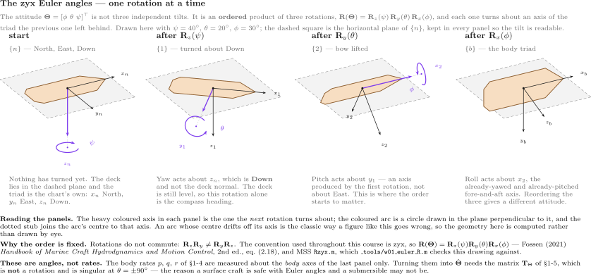

**그림을 읽기**

| 그림에서 | 뜻 |
|---|---|
| 갑판판 | 배 자체. 거기까지 도달한 자세로 그려져 있다 |
| 회색 파선 정사각형 | **NED 의 수평면**. 네 칸 모두에서 같다. 그것이 자다. 갑판은 종동요와 횡동요가 들어오고서야 그것을 떠난다 |
| 파란 축 | **다음** 회전의 축. 그 축에 수직인 평면 위의 원으로 회전을 그렸다 |
| {n} → {1} | $z_n$ 둘레의 요 $\psi$. 갑판이 돌지만 평면 안에서 평평하게 있다 |
| {1} → {2} | $y_1$, 곧 **이미 요한** 좌우 축 둘레의 종동요 $\theta$. 선수가 평면 밖으로 들린다 — $z_b$ 가 아래이므로 양의 $\theta$ 는 선수가 올라가는 것이다 |
| {2} → {b} | $x_2$, 곧 **이미 요하고 종동요한** 앞뒤 축 둘레의 횡동요 $\phi$. 양의 $\phi$ 는 우현을 내린다 |

- 이 그림은 실제 회전행렬에서 그린 것이고 스케치가 아니다. 각 칸의 축은 그 단계 행렬의 열이다. 세 축은 공간에서 길이가 같으므로, 쪽 위에서 길이가 다른 것은 단축(foreshortening) 이다.
- 그림이 말하려는 요점: **두 번째와 세 번째 축은 그 앞의 회전이 일어나기 전에는 존재하지 않는다.** $y_1$ 은 $y_n$ 이 아니고, $x_2$ 는 $x_n$ 도 $x_1$ 도 아니다.

$$
\boxed{\ \mathbf{R}_b^n(\boldsymbol{\Theta}) = \mathbf{R}_z(\psi)\,\mathbf{R}_y(\theta)\,\mathbf{R}_x(\phi)\ }
$$

- 풀어 쓰면

$$
\mathbf{R}_b^n =
\begin{bmatrix}
c\psi\,c\theta & -s\psi\,c\phi + c\psi\,s\theta\,s\phi & s\psi\,s\phi + c\psi\,c\phi\,s\theta \\
s\psi\,c\theta & c\psi\,c\phi + s\phi\,s\theta\,s\psi & -c\psi\,s\phi + s\theta\,s\psi\,c\phi \\
-s\theta & c\theta\,s\phi & c\theta\,c\phi
\end{bmatrix}
$$

- 이것이 MSS 가 `Rzyx(phi, theta, psi)` 에서 만드는 것이고, `otter.m` 이 `eulerang` 을 통해 부르는 것이다.

> [!warning] 순서는 정의의 일부다
> 행렬 곱은 교환되지 않으므로 $\mathbf{R}_z\mathbf{R}_y\mathbf{R}_x \neq \mathbf{R}_x\mathbf{R}_y\mathbf{R}_z$ 다. 같은 세 수가 다른 관습에서는 **다른 자세**를 서술한다. 해양과 항공우주의 관행은 $zyx$ 이고, 어떤 로보틱스 라이브러리는 다른 것을 기본으로 둔다. 밝혀진 관습은 밝혀진 자세의 일부다.

### 성질 셋, 그리고 각각의 값

| 성질 | 진술 | 왜 중요한가 |
|---|---|---|
| 직교 | $\mathbf{R}^{\!\top}\mathbf{R} = \mathbf{I}$ | 역이 **전치**다 — $\mathbf{R}_n^b = (\mathbf{R}_b^n)^{-1} = (\mathbf{R}_b^n)^{\!\top}$ |
| 행렬식 1 | $\det(\mathbf{R}) = +1$ | 반사가 아니라 회전이다 |
| 길이 보존 | $\lVert\mathbf{R}\mathbf{v}\rVert = \lVert\mathbf{v}\rVert$ | 좌표계를 바꾸는 것이 속력을 바꾸는 일은 결코 없다 |

- MSS 구현으로 $\phi = 10°$, $\theta = 7°$, $\psi = 50°$ 에서 잰 값:

$$
\det(\mathbf{R}) = 1.0000000000,
\qquad
\max\left|\mathbf{R}^{\!\top}\mathbf{R} - \mathbf{I}\right| = 2.2\times10^{-16},
\qquad
\max\left|\mathbf{R}^{-1} - \mathbf{R}^{\!\top}\right| = 1.1\times10^{-16} .
$$

> [!tip] 회전행렬에 `inv` 를 부르지 않는다
> 전치는 정확하고, 비용이 없고, 조건수가 나빠질 수 없다. 이 강의의 모든 유도 법칙은 $\{n\}$ 에서 오차를 만들어 $\{b\}$ 에서 일하는 제어기에 넘기므로, $(\mathbf{R}_b^n)^{\!\top}$ 이 $\mathbf{R}_b^n$ 자체보다 훨씬 자주 나타난다.

### 수평면

- 3주차부터 배를 3자유도 운동체로 다루고 요 회전만 살아남는다.

$$
\mathbf{R}(\psi) =
\begin{bmatrix}
\cos\psi & -\sin\psi \\
\sin\psi & \phantom{-}\cos\psi
\end{bmatrix},
\qquad
\begin{bmatrix} \dot{x}^n \\[2pt] \dot{y}^n \end{bmatrix}
= \mathbf{R}(\psi)\begin{bmatrix} u \\ v \end{bmatrix} .
$$

### 실험 1-3 · 성질 셋을, 실제 행렬에서 (5분)

**무엇을 재는가.** 위에 나열한 성질 셋을 회전행렬 하나에서 — 그 역이 그 전치임, 행렬식이 $+1$ 임, 그리고 길이를 바꾸지 않음. 모델도 시뮬레이션도 없다. 행렬은 뒤의 모든 주차가 쓰는 MSS 함수가 만든다.

**열고 돌리기.**

```matlab
W01_0_setup                                   % MSS 를 경로에 올린다 / puts MSS on the path
R = Rzyx(deg2rad(10), deg2rad(20), deg2rad(30))   % roll 10, pitch 20, yaw 30 deg
det(R)                                        % 1 이어야 한다 / must be 1
max(max(abs(R'*R - eye(3))))                  % 0 이어야 한다 / must be 0
v = [2; 0.5; 0];  [norm(v) norm(R*v)]         % 길이가 변하지 않는다 / the length is unchanged
```

나오는 출력:

```
det(R) = 1.000000000000000
max|R'R - I| = 2.220e-16
max|R^-1 - R'| = 1.110e-16
|v| = 2.061553   |R v| = 2.061553
```

| 찍힌 것 | 어느 성질을 확인하나 | 나중에 왜 중요한가 |
|---|---|---|
| $\det \mathbf{R} = 1$ | 반사가 아니라 회전 | $-1$ 로 그린 좌표계는 축이 거울상이 되고, 강의의 모든 부호가 뒤집힌다 |
| $\lvert \mathbf{R}^\top\mathbf{R} - \mathbf{I}\rvert \approx 10^{-16}$ | 직교성 | 역이 공짜다. NED 에서 선체로 돌아가는 데 행렬 역산이 필요하지 않고 전치만 필요하다 |
| $\lvert \mathbf{R}^{-1} - \mathbf{R}^\top\rvert \approx 10^{-16}$ | 같은 성질을, MATLAB 이 쓰는 방식으로 쓴 것 | 모델이 쓰는 것이 `R'` 이고, 그것은 정확하기만 한 것이 아니라 엄밀하다 |
| $\lvert \mathbf{v}\rvert = \lvert \mathbf{R}\mathbf{v}\rvert$ | 길이가 보존된다 | 속력은 어느 좌표계에서나 같은 속력이다. 성분만 바뀐다(§1-4) |

| 해 볼 것 | 볼 것 |
|---|---|
| `R2 = Rzyx(0,0,deg2rad(30)); R2(1:2,1:2)` | 위의 평면 행렬. 3~5주차가 쓰는 유일한 것이다 |
| `det(Rzyx(1,2,3))` | 여전히 $1$ 이다. 그 성질들은 작은 각에서만이 아니라 모든 자세에서 성립한다 |

## 1-4. 선체 좌표 속도는 위치의 변화율이 아니다

- 이번 주에서 가장 중요한 한 줄이고, 코드에서 가장 자주 틀리는 것이다.

$$
u \neq \dot{x}^n, \qquad v \neq \dot{y}^n .
$$

- $u$ 와 $v$ 는 **자기 자신이 돌고 있는 축**을 따라 잰 성분이다. $\dot{x}^n$ 과 $\dot{y}^n$ 은 결코 움직이지 않는 축을 따라 잰 성분이다. 둘은 $\psi = 0$ 에서만 일치한다.

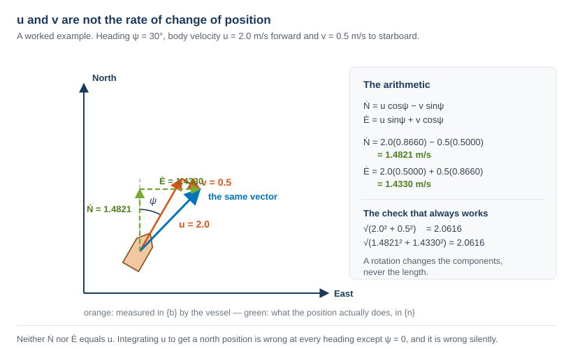

**그림을 읽기**

| 요소 | 뜻 |
|---|---|
| 주황 | $u$ 와 $v$, 배가 $\{b\}$ 에서 재는 성분 |
| 초록 실선 | 속도 자체 — 하나의 물리적 벡터이고 한 번만 그렸다 |
| 초록 파선 | $\dot{x}^n$ 과 $\dot{y}^n$, 위치가 실제로 변하는 만큼의 성분 |
| 오른쪽 칸 | 그 산술, 그리고 길이 확인 |

- $\psi = 30°$, $u = 2.0$ m/s, $v = 0.5$ m/s 에 대해 계산하면

$$
\begin{aligned}
\dot{x}^n &= u\cos\psi - v\sin\psi = 2.0(0.8660) - 0.5(0.5000) = 1.4821\ \text{m/s}, \\[3pt]
\dot{y}^n &= u\sin\psi + v\cos\psi = 2.0(0.5000) + 0.5(0.8660) = 1.4330\ \text{m/s}.
\end{aligned}
$$

| 양 | 값 |
|---|---|
| $\{b\}$ 에서의 속력, $\sqrt{u^2+v^2}$ | $2.0616$ m/s |
| $\{n\}$ 에서의 속력, $\sqrt{(\dot{x}^n)^2+(\dot{y}^n)^2}$ | $2.0616$ m/s |

- 회전이 길이를 보존하므로 둘이 일치한다. **그 등식이 어떤 좌표계 변환에도 쓸 수 있는 가장 값싼 확인**이고, 전치되거나 부호가 틀린 행렬을 즉시 잡아낸다.

### 하나의 속도를, 두 좌표계로 읽기

- 위의 예제 계산은 선수각과 횡방향 속도를 동시에 바꾸므로, 둘 중 어느 것이 무엇을 책임지는지 보일 수 없다. 아래 그림이 그것을 분리한다. (1) 부터 (3) 까지는 $u = 1$ m/s, $v = 0$ 을 유지하고 선수각만 돌린다. (4) 는 (1) 의 선수각을 유지하고 횡방향 속도를 더한다.

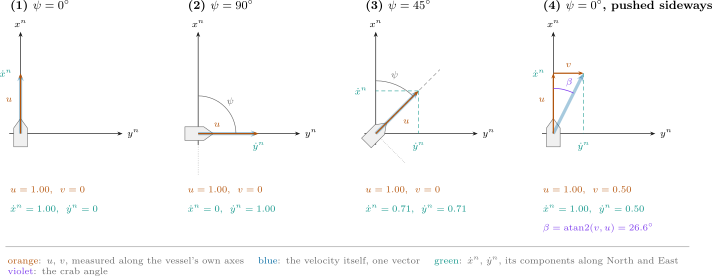

**그림을 읽기**

| 요소 | 뜻 |
|---|---|
| 주황 | $u$ 와 $v$, 배 자신의 축을 따라 잰 것. (1)~(3) 에서는 $v = 0$ 이므로 $u$ 가 정확히 속도 위에 놓인다 |
| 연한 파랑 | 속도 자체 — 하나의 벡터, 한 번만 그렸다 |
| 초록 파선 | $\dot x^n$ 과 $\dot y^n$, 그 벡터를 북과 동을 따라 잰 성분 — 위 그림과 같은 초록이다 |
| 회색 파선, 회색 점선 | 선체 축. $x_b$ 는 선수를 지나고 $y_b$ 는 우현으로 |
| 보라 | 선수가 가리키는 쪽과 배가 가는 쪽 사이의 각 |

| 칸 | 조건 | $u$ | $v$ | $\dot x^n$ | $\dot y^n$ | 읽기 |
|---|---|---|---|---|---|---|
| (1) | $\psi = 0°$ | $1.00$ | $0$ | $1.00$ | $0$ | 북을 가리키고 북으로 간다 |
| (2) | $\psi = 90°$ | $1.00$ | $0$ | $0$ | $1.00$ | $u$ 는 그대로인데 $\dot x^n$ 이 0 이다 |
| (3) | $\psi = 45°$ | $1.00$ | $0$ | $0.71$ | $0.71$ | 하나의 $u$ 가 두 성분으로 나뉘었다 |
| (4) | $\psi = 0°$, 옆으로 밀림 | $1.00$ | $0.50$ | $1.00$ | $0.50$ | 북을 가리키고 북동으로 간다 |

- (1), (2), (3) 에서 $u$ 는 매번 $1.00$ 이다. 바뀐 것은 선수각뿐이고, 그것만으로 $\dot x^n$ 과 $\dot y^n$ 이 바뀌었다. $u$ 와 $v$ 는 선체에 고정되어 함께 돌고, $\dot x^n$ 과 $\dot y^n$ 은 지구에 고정되어 돌지 않는다.
- (4) 는 그 역이다. 선수각은 (1) 의 것인데 $\dot y^n$ 이 더 이상 0 이 아니다. 배가 이제 앞으로만이 아니라 옆으로도 움직이고 있기 때문이다.

**그림이 말하는 것**

기호 넷, 화살표 하나. $u$, $v$, $\dot x^n$, $\dot y^n$ 은 네 가지 다른 양처럼 보이고, 하나의 속도를 두 가지로 읽은 것이다 — 하나는 배와 함께 도는 축에 대해, 하나는 지구와 함께 머무는 축에 대해 잰 것이다. 예제 계산의 길이 확인이 모든 칸에서 성립한다 — 앞의 셋에서 $\sqrt{u^2 + v^2} = \sqrt{(\dot x^n)^2 + (\dot y^n)^2} = 1.00$, 넷째에서 $1.118$ 이다.

(4) 번 칸이 이 강의의 나머지가 기대는 생각을 지고 있다. 선수각 $\psi$ 는 선수가 가리키는 곳을 말한다. 배가 실제로 가는 방향은 **침로**다.

$$
\chi = \operatorname{atan2}\!\left(\dot y^n, \dot x^n\right),
$$

그리고 (1)~(3) 에서는 $v = 0$ 이므로 둘이 일치한다. (4) 에서는 다음만큼 갈라진다.

$$
\chi - \psi = \beta = \operatorname{atan2}(v, u) = \operatorname{atan2}(0.50,\ 1.00) = 26.6° ,
$$

그것이 **크랩각**이다. §1-12 가 횡방향 힘을 걸지 않았는데 횡방향 속도가 어디서 오는지 보이고, 5주차는 선수가 경로에서 $\beta$ 만큼 벗어난 쪽을 가리키는 동안 배를 그 경로를 따라 조종해야 한다. `W01_frames` 가 위 표의 네 줄을 찍는다.

> [!caution] 이것을 틀렸을 때의 증상
> $u$ 를 적분해 북쪽 위치를 얻으면 $\psi = 0$ 에서는 맞고 작은 선수각에서는 그럴듯하고 배가 돌수록 점점 더 틀려지는 항적이 나온다 — 오류도, 경고도, `NaN` 도 없이. 1주차의 모델은 일부러 세 가지 다른 선수각에서 돌려, 그 결함이 있었다면 눈에 보이도록 해 둔다.

### 실험 1-4 · 하나의 속도를, 두 좌표계로 읽기 (5분)

**무엇을 재는가.** 위의 예제 계산과 그림의 네 칸을, 인용하는 대신 계산해서 — 두 좌표계, 길이 확인, 그리고 크랩각.

**열고 돌리기.**

```matlab
W01_0_setup
W01_frames                     % 표를 찍고 그림을 그린다 / prints the table and draws the figure
```

나오는 출력(둘째 표가 네 칸이다):

```
  §1-4  one velocity, read in two frames

    panel    psi      u      v   xn_dot   yn_dot      |V|      beta       chi
    --------------------------------------------------------------------------
        1      0   1.00   0.00   1.0000   0.0000   1.0000     0.000     0.000
        2     90   1.00   0.00   0.0000   1.0000   1.0000     0.000    90.000
        3     45   1.00   0.00   0.7071   0.7071   1.0000     0.000    45.000
        4      0   1.00   0.50   1.0000   0.5000   1.1180    26.565    26.565
```

**출력을 이 절과 대조해 읽기.**

| 볼 곳 | 거기 있는 것 | 무엇을 보이나 |
|---|---|---|
| $u$ 열, 1~3 칸 | 매번 $1.00$ | $u$ 는 선체를 따라 재고, 선체가 도는 것이 그것을 바꾸지 않는다 |
| $\dot x^n$ 열, 1~3 칸 | $1.00$, $0.00$, $0.71$ | 같은 운동을, 돌지 않는 축에 대해 읽은 것 |
| $\lvert V\rvert$ 열 | 세 번 $1.0000$ | 회전은 길이를 보존한다 — 어떤 좌표계 변환에도 쓸 수 있는 가장 값싼 확인 |
| 4 칸을 1 칸과 | 같은 $\psi$, 다른 $\dot y^n$ | 배가 선수 방향에서 벗어나 가게 만드는 것은 선수각이 아니라 횡방향 속도다 |
| 4 칸의 $\beta$ 와 $\chi$ 열 | $26.565°$, $\psi = 0$ 에서 서로 같다 | 크랩각: 배가 가는 곳은 가리키는 곳이 아니다 |

| 해 볼 것 | 볼 것 |
|---|---|
| `W01_frames.m` 을 열고 4 칸을 `v = -0.5` 로 바꾼다 | $\beta$ 가 $-26.565°$ 가 된다. 좌현으로의 횡방향 속도가 배를 선수의 좌현 쪽으로 나른다 |
| 먼저 찍힌 예제 계산과 비교 | $\psi = 30°$, $u = 2$, $v = 0.5$ 가 $\beta = 14.036°$, $\chi = 44.036°$ 를 주고, `atan2(yn_dot, xn_dot)` 이 같은 $44.036°$ 를 돌려준다 |

## 1-5. 각속도, 그리고 회전행렬이 아닌 행렬

- 먼저 $p$, $q$, $r$ 이 무엇인가. 각각은 **선체의 한 축** 둘레의 회전율이고, 각각은 그 선체에 볼트로 고정된 자이로가 실제로 보고하는 것이다.

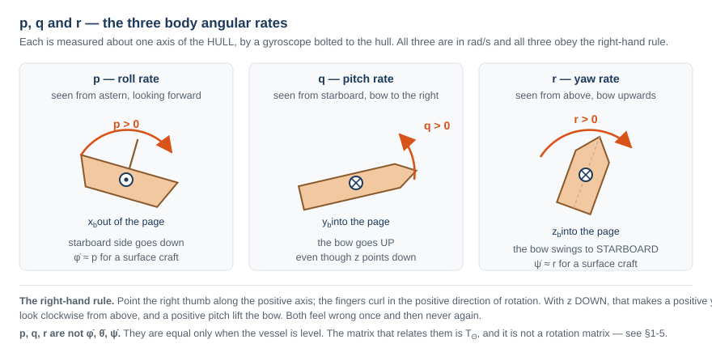

**그림을 읽기**

| 칸 | 회전율 | 어느 축 둘레 | 양이 뜻하는 것 |
|---|---|---|---|
| 왼쪽 | $p$ | $x_b$ | 우현 쪽이 내려간다 |
| 가운데 | $q$ | $y_b$ | 선수가 올라간다 |
| 오른쪽 | $r$ | $z_b$ | 선수가 우현으로 돈다 |

| 기호 | 양 | 단위 | 무엇이 재나 |
|---|---|---|---|
| $p$ | 횡동요율 | rad/s | 자이로, $x$ 축 |
| $q$ | 종동요율 | rad/s | 자이로, $y$ 축 |
| $r$ | 선수동요율 | rad/s | 자이로, $z$ 축 |

- 이제 오일러각 변화율로의 변환이고, 그것은 회전행렬이 **아니다.** 이유는 짧다. $p$, $q$, $r$ 은 §1-3 의 서로 **다른** 세 중간 좌표계에 속한 축 둘레로 재어진 것이고, 그 세 축은 서로 직교하지 않는다.

$$
\dot{\boldsymbol{\Theta}} = \mathbf{T}_{\Theta}(\boldsymbol{\Theta})\,\boldsymbol{\omega}_{b/n}^{b},
\qquad
\mathbf{T}_{\Theta}(\boldsymbol{\Theta}) =
\begin{bmatrix}
1 & s\phi\,t\theta & c\phi\,t\theta \\
0 & c\phi & -s\phi \\
0 & s\phi / c\theta & c\phi / c\theta
\end{bmatrix}
$$

이고 $t\theta = \tan\theta$ 다. 성분별로 쓰면

$$
\dot\phi = p + q\,s\phi\,t\theta + r\,c\phi\,t\theta,
\qquad
\dot\theta = q\,c\phi - r\,s\phi,
\qquad
\dot\psi = \frac{q\,s\phi + r\,c\phi}{c\theta} .
$$

| 기호 | 양 | 단위 |
|---|---|---|
| $p, q, r$ | 선체 각속도. 자이로가 잰다 | rad/s |
| $\dot\phi, \dot\theta, \dot\psi$ | 오일러각 변화율 | rad/s |
| $\mathbf{T}_{\Theta}$ | 둘 사이의 사상 | 무차원 |

- MSS `Tzyx` 로 $\phi = 10°$, $\theta = 7°$, $[p, q, r] = [2, 5, 10]$ rad/s 에서 잰 값:

$$
\dot{\boldsymbol{\Theta}} = [3.3158,\ 3.1876,\ 10.7968]^{\!\top}\ \text{rad/s} .
$$

- $\dot\psi = 10.7968 \neq r = 10$ 임을 보라. **배가 횡동요하거나 종동요하고 있으면 언제나 회두율과 선수각의 변화율은 다른 수다.**

> [!warning] $\mathbf{T}_{\Theta}$ 는 $\theta = \pm 90°$ 에서 특이하다
> $1/\cos\theta$ 성분들이 폭발한다. $\theta = 89.9°$ 에서 $\mathbf{T}_{\Theta}$ 의 최대 성분이 이미 $573$ 이다. 이것이 **김벌 락**이고, 배의 성질이 아니라 오일러각 표현의 성질이다. 수상 운동체는 거기에 결코 가까이 가지 않고, 그래서 이 강의는 내내 오일러각을 쓴다. 수직 기동을 하는 AUV 는 거기에 가까이 가고, 거기서 쿼터니언이 제 자리를 번다.

> [!note] 이 배에 대해 성립하는 단순화 둘. 가정하는 대신 밝혀 둔다
> 수상 운동체에서는 $\phi$ 와 $\theta$ 가 몇 도 안에 머물므로 $\mathbf{T}_{\Theta} \approx \mathbf{I}$ 이고 $\dot\psi \approx r$ 이다. 4주차는 정확히 그 근거로 $r$ 을 적분해 $\psi$ 를 제어한다. 열두 상태의 플랜트는 그 근사를 **하지 않는다.** 설계 방정식만이 한다.

### 단위 쿼터니언 — 특이점 없는 자세

- **왜 두 번째 표현인가.** $\mathbf{T}_\Theta$ 의 특이점은 세 각에 속하고 배에 속하지 않는다. 같은 자세를 네 파라미터로 서술하는 **단위 쿼터니언**에는 그런 점이 없다(Fossen 2021, §2.2.2).
- 이 강의는 오일러각을 유지한다. 수상 운동체는 결코 $90°$ 근처로 종동요하지 않기 때문이다. 쿼터니언을 소개하는 것은 MSS 가 그 가정이 깨지는 곳에서 그것을 쓰기 때문이다 — 관성항법 필터 `ins_mekf.m` 과 자세 추정기 `quest.m` — 스트랩다운 관성항법이 대체로 그러하듯이.
- 원리는 오일러의 회전 정리다. 어떤 자세 변화든 고정된 단위축 $\boldsymbol{\lambda}$ 둘레의 각 $\beta$ 만큼의 단일 회전으로 만들 수 있다. 쿼터니언은 그 한 회전을 그 각의 절반의 코사인과 사인으로 저장한다.

$$
\mathbf{q} = \begin{bmatrix} \eta \\ \boldsymbol{\varepsilon} \end{bmatrix}
= \begin{bmatrix} \cos(\beta/2) \\ \boldsymbol{\lambda}\,\sin(\beta/2) \end{bmatrix},
\qquad
\boldsymbol{\varepsilon} = \begin{bmatrix} \varepsilon_1 & \varepsilon_2 & \varepsilon_3 \end{bmatrix}^{\!\top},
\qquad
\mathbf{q}^{\!\top}\mathbf{q} = \eta^2 + \boldsymbol{\varepsilon}^{\!\top}\boldsymbol{\varepsilon} = 1
$$

| 기호 | 양 | 비고 |
|---|---|---|
| $\mathbf{q}$ | 단위 쿼터니언, $\{b\}$ 에서 $\{n\}$ 으로 | 굵은 글자다 — 위 표의 종동요율 $q$ 가 아니다 |
| $\eta$ | 스칼라부 | $\cos(\beta/2)$ |
| $\boldsymbol{\varepsilon}$ | 벡터부 | $\boldsymbol{\lambda}\sin(\beta/2)$ |
| $\beta$, $\boldsymbol{\lambda}$ | 등가인 단일 회전의 각과 단위축 | $\boldsymbol{\lambda}^{\!\top}\boldsymbol{\lambda} = 1$. 이 $\beta$ 는 Fossen 의 기호이고 **이 소절에만** 산다. §1-12 부터, 그리고 뒤의 모든 주차에서 $\beta$ 는 크랩각 $\operatorname{atan2}(v,u)$ 다 |
| $\mathbf{S}(\mathbf{a})$ | 반대칭 행렬, $\mathbf{S}(\mathbf{a})\,\mathbf{b} = \mathbf{a}\times\mathbf{b}$ | MSS `Smtrx` |

- 제약 하나로 묶인 네 수는 셋을 자유롭게 남긴다 — $\boldsymbol{\Theta}$ 가 지고 있는 바로 그 세 자유도다. $\cos^2 + \sin^2 = 1$ 이므로 단위 노름은 저절로 성립한다.

> [!caution] MSS 에서는 스칼라가 먼저 온다
> MSS 는 $\mathbf{q} = [\eta\ \ \varepsilon_1\ \ \varepsilon_2\ \ \varepsilon_3]^{\!\top}$ 로 저장한다. ROS 메시지는 스칼라를 마지막에, $x, y, z, w$ 로 나열한다. 순서를 바꾸지 않고 둘 사이에서 복사한 쿼터니언은 다른 자세를 서술하고, 아무것도 오류를 보고하지 않는다.

### 회전행렬을, 축과 반각에서

- 회전의 축–각 형태(Fossen 2021, §2.2.2) 에서 시작해 각 삼각함수 인자를 반각으로 바꾼다. 한 줄에 한 연산이다.

$$
\begin{aligned}
\mathbf{R} &= \mathbf{I}_3 + \sin\beta\;\mathbf{S}(\boldsymbol{\lambda}) + (1 - \cos\beta)\,\mathbf{S}^2(\boldsymbol{\lambda}) && \text{axis–angle form} \\
&= \mathbf{I}_3 + 2\sin\tfrac{\beta}{2}\cos\tfrac{\beta}{2}\;\mathbf{S}(\boldsymbol{\lambda}) + 2\sin^2\tfrac{\beta}{2}\;\mathbf{S}^2(\boldsymbol{\lambda}) && \sin\beta = 2\sin\tfrac{\beta}{2}\cos\tfrac{\beta}{2},\ \ 1-\cos\beta = 2\sin^2\tfrac{\beta}{2} \\
&= \mathbf{I}_3 + 2\cos\tfrac{\beta}{2}\;\mathbf{S}\!\left(\boldsymbol{\lambda}\sin\tfrac{\beta}{2}\right) + 2\,\mathbf{S}^2\!\left(\boldsymbol{\lambda}\sin\tfrac{\beta}{2}\right) && \mathbf{S}(\cdot)\ \text{is linear} \\
&= \mathbf{I}_3 + 2\eta\,\mathbf{S}(\boldsymbol{\varepsilon}) + 2\,\mathbf{S}^2(\boldsymbol{\varepsilon}) && \text{definition of } \eta \text{ and } \boldsymbol{\varepsilon}
\end{aligned}
$$

- 풀어 쓰면, 대각에 $\eta^2 + \boldsymbol{\varepsilon}^{\!\top}\boldsymbol{\varepsilon} = 1$ 을 쓴 것이다.

$$
\mathbf{R}(\mathbf{q}) =
\begin{bmatrix}
1 - 2(\varepsilon_2^2 + \varepsilon_3^2) & 2(\varepsilon_1\varepsilon_2 - \varepsilon_3\eta) & 2(\varepsilon_1\varepsilon_3 + \varepsilon_2\eta) \\
2(\varepsilon_1\varepsilon_2 + \varepsilon_3\eta) & 1 - 2(\varepsilon_1^2 + \varepsilon_3^2) & 2(\varepsilon_2\varepsilon_3 - \varepsilon_1\eta) \\
2(\varepsilon_1\varepsilon_3 - \varepsilon_2\eta) & 2(\varepsilon_2\varepsilon_3 + \varepsilon_1\eta) & 1 - 2(\varepsilon_1^2 + \varepsilon_2^2)
\end{bmatrix}
$$

- 모든 성분이 두 성분의 곱이다. $\mathbf{R}(\mathbf{q})$ 에는 삼각함수가 전혀 없다.
- $\mathbf{R}(-\mathbf{q}) = \mathbf{R}(\mathbf{q})$ 다. 모든 성분이 $\mathbf{q}$ 에 대해 2차이기 때문이다. 쿼터니언 $-\mathbf{q}$ 는 $-\boldsymbol{\lambda}$ 둘레의 $2\pi - \beta$ 회전 — 같은 회전을 반대로 돌아 닿은 것 — 이므로 각 자세에 쿼터니언이 정확히 둘 있다.
- 이것이 MSS `Rquat` 이고, 줄 하나까지 그대로다.

```matlab
% MSS, GNC/Rquat.m (2021 release) — LIBRARY/kinematics/Rquat.m in 2022 and later
% Author: Thor I. Fossen. MIT License.
tol = 1e-6;
if abs(norm(q)-1)>tol; error('norm(q) must be equal to 1'); end

eta = q(1);
eps = q(2:4);

S = Smtrx(eps);
R = eye(3) + 2*eta*S + 2*S^2;
```

- `_tools/verify_w01_theory.m` 이 §1-3 의 자세인 $\phi = 10°$, $\theta = 7°$, $\psi = 50°$ 에서 잰 값:

| 확인 | 결과 |
|---|---|
| `euler2q` 에서 나온 $\mathbf{q}$ | $[0.903424,\ 0.053141,\ 0.091883,\ 0.415403]^{\!\top}$ |
| $\lVert\mathbf{q}\rVert - 1$ | $2.2\times10^{-16}$ |
| $\max\lvert\mathbf{R}(\mathbf{q}) - \mathbf{R}_b^n(\boldsymbol{\Theta})\rvert$, `Rquat` 대 `Rzyx` | $2.2\times10^{-16}$ |
| $\max\lvert\mathbf{R}(-\mathbf{q}) - \mathbf{R}(\mathbf{q})\rvert$ | $0$ |

### 쿼터니언 운동학 — 나눗셈 없는 변화율 방정식

- 쿼터니언은 $\mathbf{q}$ 와, 스칼라부가 0 인 쿼터니언으로 쓴 각속도의 곱의 절반으로 변한다(Fossen 2021, §2.2.2). 두 쿼터니언의 곱, 곧 MSS `quatprod` 는

$$
\mathbf{q}_1 \otimes \mathbf{q}_2 =
\begin{bmatrix}
\eta_1\eta_2 - \boldsymbol{\varepsilon}_1^{\!\top}\boldsymbol{\varepsilon}_2 \\
\eta_1\boldsymbol{\varepsilon}_2 + \eta_2\boldsymbol{\varepsilon}_1 + \mathbf{S}(\boldsymbol{\varepsilon}_1)\,\boldsymbol{\varepsilon}_2
\end{bmatrix}
$$

- 이 절의 자이로 회전율 $\boldsymbol{\omega} = \boldsymbol{\omega}^b_{b/n} = [p\ \ q\ \ r]^{\!\top}$ 로 $\mathbf{q}_2 = [0\ \ \boldsymbol{\omega}^{\!\top}]^{\!\top}$ 를 넣으면

$$
\begin{aligned}
\dot{\mathbf{q}} &= \tfrac12\,\mathbf{q} \otimes \begin{bmatrix} 0 \\ \boldsymbol{\omega} \end{bmatrix} && \text{the kinematic equation} \\
&= \tfrac12 \begin{bmatrix} \eta\cdot 0 - \boldsymbol{\varepsilon}^{\!\top}\boldsymbol{\omega} \\ \eta\,\boldsymbol{\omega} + 0\cdot\boldsymbol{\varepsilon} + \mathbf{S}(\boldsymbol{\varepsilon})\,\boldsymbol{\omega} \end{bmatrix} && \text{product rule with } \eta_2 = 0,\ \boldsymbol{\varepsilon}_2 = \boldsymbol{\omega} \\
&= \underbrace{\tfrac12 \begin{bmatrix} -\boldsymbol{\varepsilon}^{\!\top} \\ \eta\,\mathbf{I}_3 + \mathbf{S}(\boldsymbol{\varepsilon}) \end{bmatrix}}_{\mathbf{T}_q(\mathbf{q})} \boldsymbol{\omega} && \text{factor out } \boldsymbol{\omega}
\end{aligned}
$$

$$
\mathbf{T}_q(\mathbf{q}) = \frac12
\begin{bmatrix}
-\varepsilon_1 & -\varepsilon_2 & -\varepsilon_3 \\
\eta & -\varepsilon_3 & \varepsilon_2 \\
\varepsilon_3 & \eta & -\varepsilon_1 \\
-\varepsilon_2 & \varepsilon_1 & \eta
\end{bmatrix}
$$

- 이것이 네 성분 입력에 대한 MSS `Tquat` 이다. 대신 세 성분 $\boldsymbol{\omega}$ 를 주면 `Tquat` 은 $\dot{\mathbf{q}} = \mathbf{T}_\omega\,\mathbf{q}$ 인 $4\times4$ 행렬 $\mathbf{T}_\omega$ 를 돌려준다 — 같은 방정식을 다르게 배열한 것이다.

```matlab
% MSS, GNC/Tquat.m (2021 release) — the branch taken when the input is q
% Author: Thor I. Fossen. MIT License.
eta  = u(1); eps1 = u(2); eps2 = u(3); eps3 = u(4);

T = 0.5 * [...
    -eps1 -eps2 -eps3
     eta  -eps3  eps2
     eps3  eta  -eps1
    -eps2  eps1  eta   ];
```

- 이 절의 $\mathbf{T}_\Theta$ 와 나란히 놓고, `verify_w01_theory` 가 $\phi = \psi = 0$ 에서 잰 최대 성분과 함께 보면

| | $\mathbf{T}_\Theta(\boldsymbol{\Theta})$, 오일러각 | $\mathbf{T}_q(\mathbf{q})$, 단위 쿼터니언 |
|---|---|---|
| 성분 | $1/\cos\theta$ 와 $\tan\theta$ 를 품는다 | $\pm\tfrac12$ 곱하기 $\mathbf{q}$ 의 성분 하나 |
| 어디서 실패하나 | $\theta = \pm 90°$ | 어디서도 아니다. 모든 단위 $\mathbf{q}$ 에 대해 $\mathbf{T}_q^{\!\top}\mathbf{T}_q = \tfrac14\mathbf{I}_3$ |
| 최대 성분, $\theta = 0°$ | $1.00$ | $0.5000$ |
| 최대 성분, $\theta = 89°$ | $57.30$ | $0.3566$ |
| 최대 성분, $\theta = 89.9°$ | $572.96$ | $0.3539$ |
| 한 스텝의 일 | 삼각함수 | 곱과 합뿐 |

- 측정: $\tfrac12\,\mathbf{q}\otimes[0\ \ \boldsymbol{\omega}^{\!\top}]^{\!\top}$ 가 `Tquat(q)*w` 와 $3.5\times10^{-18}$ 까지 일치한다. $\mathbf{T}_q^{\!\top}\mathbf{T}_q - \tfrac14\mathbf{I}_3$ 은 $5.6\times10^{-17}$ 이다. 그리고 오일러각 경로를 따라 `euler2q` 를 수치미분하면 $\lVert\dot{\mathbf{q}}\rVert = 5.68\times10^{-2}$ 에 대해 `Tquat(q)*w` 를 $2.4\times10^{-9}$ 까지 재현한다.
- **대가는 제약이다.** 이산화하면 $\dot{\mathbf{q}} = \mathbf{T}_q\boldsymbol{\omega}$ 의 어느 것도 $\mathbf{q}^{\!\top}\mathbf{q}$ 를 1 에 붙들어 두지 않는다. $\boldsymbol{\omega} = [0.3,\ -0.2,\ 0.5]$ rad/s 로 $h = 0.02$ s 의 전진 오일러를 $100$ s 돌리면 $\lVert\mathbf{q}\rVert - 1 = 0.0997$ 이 남고, `Rquat` 은 단위 길이에서 $10^{-6}$ 보다 멀어진 쿼터니언을 거부한다. 쓰이는 처방이 셋이다.

| 처방 | 어떻게 | 어디에서 |
|---|---|---|
| 스텝마다 재정규화 | $\mathbf{q} \leftarrow \mathbf{q}/\lVert\mathbf{q}\rVert$ | `q2euler` 의 첫 줄 |
| 방정식 안의 복원 항 | $\gamma \ge 0$ 으로 $\dot{\mathbf{q}} = \mathbf{T}_q(\mathbf{q})\boldsymbol{\omega} + \tfrac{\gamma}{2}\left(1 - \mathbf{q}^{\!\top}\mathbf{q}\right)\mathbf{q}$. 노름 오차가 시정수 $1/\gamma$ 로 사그라든다 | Fossen (2021), §2.2.2 |
| 엄밀한 이산화 | $\mathbf{q}_{k+1} = \exp(\mathbf{T}_\omega h)\,\mathbf{q}_k$. $\mathbf{T}_\omega$ 가 반대칭이므로 그 지수는 직교이고 노름을 유지한다 | `ins_mekf.m`, 157행 |

### 오일러각에서 쿼터니언으로 — `euler2q`

- §1-3 의 zyx 순서 $\mathbf{R}_b^n = \mathbf{R}_z(\psi)\mathbf{R}_y(\theta)\mathbf{R}_x(\phi)$ 가 그대로 이어진다. 쿼터니언 곱이 행렬과 같은 순서로 회전을 합성하기 때문이다 — $\mathbf{R}(\mathbf{q}_1\otimes\mathbf{q}_2) = \mathbf{R}(\mathbf{q}_1)\,\mathbf{R}(\mathbf{q}_2)$ 이고 $2.2\times10^{-16}$ 까지 쟀다. 각 기본 회전은 좌표축 하나 둘레의 반각이다(Fossen 2021, §2.2.3).

$$
\mathbf{q} = \mathbf{q}_z(\psi) \otimes \mathbf{q}_y(\theta) \otimes \mathbf{q}_x(\phi),
\qquad
\mathbf{q}_x = \begin{bmatrix} \bar c_\phi \\ \bar s_\phi \\ 0 \\ 0 \end{bmatrix},\quad
\mathbf{q}_y = \begin{bmatrix} \bar c_\theta \\ 0 \\ \bar s_\theta \\ 0 \end{bmatrix},\quad
\mathbf{q}_z = \begin{bmatrix} \bar c_\psi \\ 0 \\ 0 \\ \bar s_\psi \end{bmatrix}
$$

이고 윗줄이 **반**각을 표시한다 — $\bar c_\phi = \cos(\phi/2)$, $\bar s_\phi = \sin(\phi/2)$ 이고 §1-3 의 $c\phi = \cos\phi$ 가 아니다.

- 첫 번째 곱. 그 교차항은 $\mathbf{S}(\boldsymbol{\varepsilon}_z)\,\boldsymbol{\varepsilon}_y = [0\ \ 0\ \ \bar s_\psi]^{\!\top} \times [0\ \ \bar s_\theta\ \ 0]^{\!\top} = [-\bar s_\psi\bar s_\theta\ \ 0\ \ 0]^{\!\top}$ 이므로

$$
\mathbf{q}_z \otimes \mathbf{q}_y =
\begin{bmatrix}
\bar c_\psi\,\bar c_\theta \\
-\bar s_\psi\,\bar s_\theta \\
\bar c_\psi\,\bar s_\theta \\
\bar s_\psi\,\bar c_\theta
\end{bmatrix}
$$

- 두 번째 곱, $\mathbf{q}_x$ 와. 한 줄에 한 성분이다.

$$
\begin{aligned}
\eta &= \bar c_\psi\bar c_\theta\bar c_\phi + \bar s_\psi\bar s_\theta\bar s_\phi \\
\varepsilon_1 &= \bar c_\psi\bar c_\theta\bar s_\phi - \bar s_\psi\bar s_\theta\bar c_\phi \\
\varepsilon_2 &= \bar s_\psi\bar c_\theta\bar s_\phi + \bar c_\psi\bar s_\theta\bar c_\phi \\
\varepsilon_3 &= \bar s_\psi\bar c_\theta\bar c_\phi - \bar c_\psi\bar s_\theta\bar s_\phi
\end{aligned}
$$

- §1-3 의 자세에서 중간 곱은 $[0.904617,\ -0.025800,\ 0.055329,\ 0.421830]^{\!\top}$ 이고, 최종 곱은 `euler2q` 와 $1.1\times10^{-16}$ 까지 일치한다. 이 네 줄이 MSS `euler2q` 그대로이고, `cy` $= \bar c_\psi$, `cp` $= \bar c_\theta$, `cr` $= \bar c_\phi$ 다.

```matlab
% MSS, GNC/euler2q.m (2021 release) — LIBRARY/kinematics/euler2q.m in 2022 and later
% Author: Thor I. Fossen. MIT License. Algorithm after NASA Mission Planning and
% Analysis Division, "Euler Angles, Quaternions, and Transformation Matrices".
cy = cos(psi * 0.5);
sy = sin(psi * 0.5);
cp = cos(theta * 0.5);
sp = sin(theta * 0.5);
cr = cos(phi * 0.5);
sr = sin(phi * 0.5);

q = [cy * cp * cr + sy * sp * sr
     cy * cp * sr - sy * sp * cr
     sy * cp * sr + cy * sp * cr
     sy * cp * cr - cy * sp * sr];

q = q/(q'*q);
```

- 마지막 줄은 $\mathbf{q}^{\!\top}\mathbf{q}$, 곧 노름의 **제곱**으로 나눈다. 여기서는 아무것도 바꾸지 않는다. 네 줄이 이미 반올림 수준까지 단위 쿼터니언을 주기 때문이다. 그러나 그것은 정규화기가 아니다. `q/norm(q)` 가 그것이다.

### 쿼터니언에서 오일러각으로 — `q2euler`

- 되돌리는 변환은 $\mathbf{R}(\mathbf{q})$ 의 성분 다섯을 읽고 §1-3 에 풀어 쓴 zyx 행렬을 역으로 푼다(Fossen 2021, §2.2.4).

$$
\begin{aligned}
R_{31} = -\sin\theta \quad &\Longrightarrow\quad \theta = -\arcsin R_{31} \\
\frac{R_{32}}{R_{33}} = \frac{\cos\theta\,\sin\phi}{\cos\theta\,\cos\phi} \quad &\Longrightarrow\quad \phi = \operatorname{atan2}\!\left(R_{32},\ R_{33}\right) \\
\frac{R_{21}}{R_{11}} = \frac{\sin\psi\,\cos\theta}{\cos\psi\,\cos\theta} \quad &\Longrightarrow\quad \psi = \operatorname{atan2}\!\left(R_{21},\ R_{11}\right)
\end{aligned}
$$

- 성분들은 위의 $\mathbf{R}(\mathbf{q})$ 에서 오고, $\lvert\theta\rvert < 90°$ 인 동안 $\cos\theta > 0$ 이므로 `atan2` 가 올바른 사분면을 유지한다. 오일러각에서 쿼터니언으로, 그리고 되돌리면 출발 각이 $6.4\times10^{-15}$ 도까지 돌아온다.
- **특이점이 여기서 되돌아온다.** $\theta = \pm 90°$ 에서 네 성분 $R_{11}$, $R_{21}$, $R_{32}$, $R_{33}$ 이 모두 사라지고 `atan2(0,0)` 은 뜻이 없으며, 조합 $\phi \mp \psi$ 만이 정의된다. 쿼터니언은 특이점을 가진 적이 없다. 그것이 변환되어 들어가는 각들이 가진다. 실무 규칙이 따라 나온다 — $\mathbf{q}$ 에서 적분하고, 표시하거나 명령할 때만 $\boldsymbol{\Theta}$ 로 변환한다.
- 이 강의가 돌리는 2021 릴리스:

```matlab
% MSS, GNC/q2euler.m (2021 release)
% Author: Thor I. Fossen. MIT License.
q = q / norm(q);            % normalize q, handle round-off errors
R = Rquat(q);

phi = atan2(R(3,2),R(3,3));

if (abs( R(3,1 )) > 1)      % handle NaN due to round-off errors
    R(3,1) = sign(R(3,1));
else
    theta = -asin(R(3,1));
end

psi = atan2(R(2,1),R(1,1));
```

> [!warning] 2021 년판 `q2euler` 는 $\theta = \pm 90°$ 에서 실패한다
> 반올림이 $\lvert R_{31}\rvert$ 을 1 너머로 밀면 `if` 가지가 $R_{31}$ 을 제한하고 그 다음 `theta` 를 **결코 계산하지 않으며**, MATLAB 이 *출력 인수 "theta" 가 할당되지 않았습니다* 로 멈춘다. `verify_w01_theory` 는 $\theta = 90°$ 에서 네 번째 무작위 자세에서 $R_{31} = 1.0000000000000002$ 를 만난다. 2022-04-15 의 개정판은 `theta = -asin(R(3,1));` 을 `end` 아래로 옮겨 제한 뒤에 실행되게 한다. 수상 운동체는 이 가지에 결코 닿지 않고, 2021 릴리스의 AUV 스크립트는 닿을 수 있다.

### MSS 함수들, 그리고 각각이 사는 곳

| 함수 | 계산하는 것 | 호출 | 2021 릴리스 (이 강의) | 2022 이후 |
|---|---|---|---|---|
| `euler2q` | $\boldsymbol{\Theta} \to \mathbf{q}$, Fossen §2.2.3 | `q = euler2q(phi,theta,psi)` | `GNC/euler2q.m` | `LIBRARY/kinematics/` |
| `q2euler` | $\mathbf{q} \to \boldsymbol{\Theta}$, Fossen §2.2.4 | `[phi,theta,psi] = q2euler(q)` | `GNC/q2euler.m` | `LIBRARY/kinematics/`, 반올림 가지 수정됨 |
| `Rquat` | $\mathbf{R}(\mathbf{q})$ | `R = Rquat(q)` | `GNC/Rquat.m` | `LIBRARY/kinematics/` |
| `Tquat` | $\mathbf{T}_q(\mathbf{q})$, $4\times3$. 또는 $\mathbf{T}_\omega(\boldsymbol{\omega})$, $4\times4$ | `T = Tquat(q)` | `GNC/Tquat.m` | `LIBRARY/kinematics/` |
| `quatprod` | $\mathbf{q}_1 \otimes \mathbf{q}_2$ | `q = quatprod(q1,q2)` | `GNC/quatprod.m` | `LIBRARY/kinematics/` |
| `quatern` | $\operatorname{blkdiag}\!\left(\mathbf{R}(\mathbf{q}),\ \mathbf{T}_q(\mathbf{q})\right)$, $7\times6$ | `[J,J1,J2] = quatern(q)` | `GNC/quatern.m` | `LIBRARY/kinematics/` |

| | 오일러각 $\boldsymbol{\Theta}$ | 단위 쿼터니언 $\mathbf{q}$ |
|---|---|---|
| 파라미터 | 셋 | 넷, $\mathbf{q}^{\!\top}\mathbf{q} = 1$ 로 묶여 있다 |
| 특이해지는 곳 | $\theta = \pm 90°$ | 없다 |
| 한 자세는 | 각 범위 안에서 삼중쌍 하나 | 쿼터니언 둘, $\mathbf{q}$ 와 $-\mathbf{q}$ |
| 한눈에 읽히나 | 그렇다 — 횡동요, 종동요, 선수각 | 아니다 — 축 하나와 반각 |
| 수치적으로 주의할 것 | 없다 | 노름을 복원해야 한다 |
| 이 강의에서 | 플랜트와 모든 제어기. `otter.m` 이 `eulerang` 을 부른다(200행) | MSS 의 관성항법과 자세 추정, 그리고 크게 종동요하는 모든 운동체 |

### 실험 1-5 · 특이점, 그리고 그것을 갖지 않는 쿼터니언 (5분)

**무엇을 재는가.** 이 절의 두 주장 — 종동요가 $90°$ 로 다가가면 $\mathbf{T}_\Theta$ 가 폭발하고 $\mathbf{R}$ 은 결코 그렇지 않다는 것, 그리고 쿼터니언이 같은 자세를 거기 통과해 나르며 원래 각을 정확히 돌려준다는 것.

**열고 돌리기.**

```matlab
W01_0_setup
for th = [0 45 80 89 89.9]
    T = Tzyx(deg2rad(10), deg2rad(th));
    fprintf('  theta = %5.1f deg   largest |T| entry = %8.2f\n', th, max(max(abs(T))));
end
q = euler2q(deg2rad(10), deg2rad(20), deg2rad(30));   % 각도 -> 쿼터니언
[phi, theta, psi] = q2euler(q);                       % 다시 각도로 / and back
[rad2deg(phi) rad2deg(theta) rad2deg(psi)]
norm(q)
```

나오는 출력:

```
  theta =   0.0 deg   largest |T| entry =     1.00
  theta =  45.0 deg   largest |T| entry =     1.39
  theta =  80.0 deg   largest |T| entry =     5.67
  theta =  89.0 deg   largest |T| entry =    56.43
  theta =  89.9 deg   largest |T| entry =   564.25

ans =
   10.0000   20.0000   30.0000

ans =
     1
```

**출력을 이 절과 대조해 읽기.**

| 볼 곳 | 거기 있는 것 | 무엇을 보이나 |
|---|---|---|
| 첫 숫자 열 | $1.00$, $1.39$, $5.67$, $56.43$, $564.25$ | 행렬 안의 $\tan\theta$. $90°$ 에 $10$ 배 가까워질 때마다 성분이 약 $10$ 배가 된다 |
| 같은 열의 $\theta = 0$ | 정확히 $1.00$ | 수평이면 $\mathbf{T}_\Theta$ 가 항등이고 오일러 변화율이 자이로 회전율이다 |
| 왕복 변환 | $10$, $20$, $30$ 이 자리까지 돌아온다 | 쿼터니언은 아무것도 잃지 않는다. 잃을 특이한 자세를 애초에 갖지 않을 뿐이다 |
| $\lvert \mathbf{q}\rvert = 1$ | 정확히 1 | 세 번째 오일러각의 자유를 대신하는 제약 |

- Otter 는 결코 크게 종동요하지 않으므로 이 강의는 내내 오일러각을 쓴다. 똑바로 위를 가리킬 수 있는 쿼드로터나 AUV 는 그럴 수 없고, §1-5 가 그 선택을 발견하는 대신 내리는 자리다.

| 해 볼 것 | 볼 것 |
|---|---|
| `Tzyx(deg2rad(10), deg2rad(90))` | MATLAB 이 `Inf` 를 돌려준다. 특이점에서 그 행렬은 존재하지 않고, 어떤 수치적 주의로도 되살릴 수 없다 |
| `max(max(abs(Rzyx(deg2rad(10), deg2rad(90), 0))))` | $1$ — 같은 자세에서 **회전**행렬은 완벽하게 얌전하다. 실패하는 것은 자세가 아니라 변화율 변환이다 |

## 1-6. 운동학과 운동역학

- **동역학(dynamics)** 이라는 말은 서로 다른 두 질문을 덮고, 그것을 가르는 것이 모델을 다룰 수 있게 만든다.

| | 질문 | 무엇에 기대나 | 절 |
|---|---|---|---|
| **운동학** | 배가 *이렇게* 움직이면 어디에 이르는가? | 기하뿐 — 질량도 힘도 없다 | §1-2 ~ §1-5 |
| **운동역학** | 무엇이 그렇게 움직이게 하는가? | 질량, 부가질량, 감쇠, 추력 | §1-7 부터 |

- 둘은 포개져 있고, 모델 전체가 이 두 줄이다.

$$
\underbrace{\dot{\boldsymbol{\eta}} = \mathbf{J}_{\Theta}(\boldsymbol{\eta})\,\boldsymbol{\nu}}_{\text{kinematics}},
\qquad
\underbrace{\mathbf{M}\dot{\boldsymbol{\nu}} + \mathbf{C}(\boldsymbol{\nu})\boldsymbol{\nu} + \mathbf{D}(\boldsymbol{\nu})\boldsymbol{\nu} + \mathbf{g}(\boldsymbol{\eta}) = \boldsymbol{\tau}}_{\text{kinetics}}
$$

$$
\mathbf{J}_{\Theta}(\boldsymbol{\eta}) =
\begin{bmatrix}
\mathbf{R}_b^n(\boldsymbol{\Theta}) & \mathbf{0}_{3\times3} \\
\mathbf{0}_{3\times3} & \mathbf{T}_{\Theta}(\boldsymbol{\Theta})
\end{bmatrix}
$$

- $\mathbf{J}_{\Theta}$ 는 §1-3 과 §1-5 를 포개 놓은 것일 뿐이다. 속도에는 $\mathbf{R}_b^n$, 변화율에는 $\mathbf{T}_{\Theta}$ 다.

> [!note] 이 구분이 실무에서 중요한 이유
> 운동학은 **엄밀하다** — 기하이고, 그 안의 어느 계수도 측정된 적이 없다. 해양 모델의 모든 불확실성은 운동역학에 산다. $\mathbf{M}$, $\mathbf{C}$, $\mathbf{D}$, $\boldsymbol{\tau}$ 에. 시뮬레이션이 시운전과 어긋날 때 들여다볼 곳은 운동학이 아니다.

## 1-7. 6자유도, 4자유도, 그리고 3자유도

- 자유로운 강체는 자유도가 **여섯**이다. 해양의 관행이 그것들에 이름을 붙인다.

| 자유도 | 운동 | 선형인가 각인가 | 상태 | 단위 |
|---|---|---|---|---|
| 1 | 전진 (surge) | $x_b$ 를 따른 병진 | $u$ | m/s |
| 2 | 횡동요 (sway) | $y_b$ 를 따른 병진 | $v$ | m/s |
| 3 | 상하동요 (heave) | $z_b$ 를 따른 병진 | $w$ | m/s |
| 4 | 횡요 (roll) | $x_b$ 둘레의 회전 | $p$ | rad/s |
| 5 | 종요 (pitch) | $y_b$ 둘레의 회전 | $q$ | rad/s |
| 6 | 선수요 (yaw) | $z_b$ 둘레의 회전 | $r$ | rad/s |

- 각 자유도는 **함께 묶이는 양 셋**을 지고 있다. 그것을 구동하는 힘 또는 모멘트, 그 힘이 만드는 속도, 그리고 그 속도가 적분되어 되는 위치다.

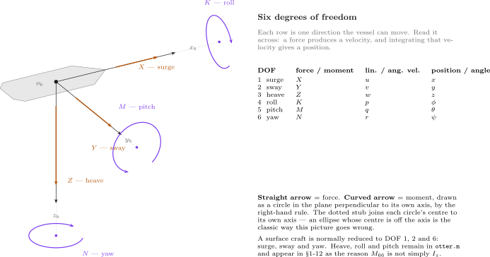

| 그림에서 | 뜻 |
|---|---|
| 곧은 주황 화살표 | 그 선체 축을 따른 **힘** — $X$, $Y$, $Z$, 뉴턴 단위 |
| 굽은 보라 화살표 | 그 선체 축 둘레의 **모멘트** — $K$, $M$, $N$, 뉴턴미터 단위. **자기 축에 수직인** 평면에 놓인 원으로 그렸고, 그래서 세 타원이 다르게 보인다. $K$ 는 거의 측면에서 보이고 $N$ 은 갑판과 평행하게 평평히 놓인다 |
| 회색 파선 | 선체 축. 자기 모멘트 타원의 중심까지 이어 둔 것이다. 중심이 축 **위에** 앉는다 — 그것이 "이 축 둘레의 모멘트" 가 뜻하는 바다 |
| 오른쪽의 표 | 자유도마다 한 줄. 가로로 읽는다 |
| $\{b\}$ 와 $\{n\}$ | $\boldsymbol{\tau}$ 와 $\boldsymbol{\nu}$ 는 선체 좌표계의 양이다. $\boldsymbol{\eta}$ 만이 NED 에 있고, 그것이 §1-4 의 요점이다 |

- 한 줄씩 읽는다. 전진력 $X$ 가 전진속도 $u$ 를 만들고, $u$ 는 북쪽 위치 $x$ 로 적분된다 — 그런데 §1-3 의 회전행렬을 거쳐서이고, 결코 직접은 아니다.
- 오른손 법칙이 모든 부호를 한꺼번에 고정한다. $z_b$ 가 **아래**를 가리키므로 양의 요 모멘트 $N$ 은 선수를 우현으로 돌리고, 그래서 위에서 보면 $\psi$ 가 시계방향으로 커진다.
- 각 축의 화살표 셋이 이름짓기도 설명한다. $X, Y, Z$ 가 힘이고 $K, M, N$ 이 모멘트이며, 전진–횡동요–상하동요–횡요–종요–선수요 순서다. 그 순서는 고정되어 있고 모든 해양 교재가 그것을 쓴다.

### 6자유도 방정식, 풀어 쓴 것

$$
\mathbf{M}\dot{\boldsymbol{\nu}}_r + \mathbf{C}(\boldsymbol{\nu}_r)\boldsymbol{\nu}_r + \mathbf{D}(\boldsymbol{\nu}_r)\boldsymbol{\nu}_r + \mathbf{g}(\boldsymbol{\eta}) = \boldsymbol{\tau},
\qquad
\boldsymbol{\nu} = [u\ v\ w\ p\ q\ r]^{\!\top}
$$

이고 모든 행렬이 $6\times6$ 이다.

$$
\mathbf{M} = \underbrace{\mathbf{M}_{RB}}_{\text{the hull}} + \underbrace{\mathbf{M}_{A}}_{\text{the water it drags}},
\qquad
\mathbf{C} = \mathbf{C}_{RB} + \mathbf{C}_{A},
\qquad
\mathbf{D} = \underbrace{\mathbf{D}_{L}}_{\text{linear}} + \underbrace{\mathbf{D}_{NL}(\boldsymbol{\nu}_r)}_{\text{quadratic}}
$$

| 항 | 무엇인가 | 어디서 오나 |
|---|---|---|
| $\mathbf{M}_{RB}$ | 배의 질량과 관성 | 무게를 재고 치수를 재서 |
| $\mathbf{M}_{A}$ | 부가질량 — 선체와 함께 가속되는 물 | 유체역학. 작은 보정이 **아니다** |
| $\mathbf{C}_{RB}$, $\mathbf{C}_{A}$ | 코리올리와 구심 | $\boldsymbol{\nu}$ 를 회전하는 좌표계에서 쓴 결과 |
| $\mathbf{D}$ | 감쇠 — 표면 마찰, 그 다음 횡류 항력 | 측정하거나 스트립 이론으로 추정 |
| $\mathbf{g}(\boldsymbol{\eta})$ | 복원 | 무게와 부력이 서로 다른 점에 작용해서 |
| $\boldsymbol{\tau}$ | 제어력 | $\mathbf{B}\mathbf{f}$, §1-10 과 부록 A1 |

- $\boldsymbol{\nu}_r = \boldsymbol{\nu} - \boldsymbol{\nu}_c$ 는 **물에 대한** 상대속도다. 유체역학적 힘은 대지속도가 아니라 상대속도를 느낀다. 이번 주에는 잠들어 있고($V_c = 0$), §1-13 이 그것이 `otter.m` 에 정확히 어디서 들어오는지 보인다.

### 3자유도로 줄이기

- 대부분의 배는 여섯 방향 전부로 구동되지 않으므로, 대부분의 제어 설계는 줄인 모델에서 한다. 표준적인 줄임은 이렇다.

| 모델 | 상태 | 어디에 쓰나 |
|---|---|---|
| 1자유도 | $u$ 하나, 또는 $r$ 하나, 또는 $p$ 하나 | 속도 제어기, 선수각 오토파일럿, 횡요 감쇠 |
| **3자유도 수평** | $u, v, r$ | **DP, 경로추종, 궤적추종 — 선박과 수상 운동체** |
| 3자유도 종방향 | $u, w, q$ | 잠수정의 잠항과 종요 제어 |
| 3자유도 횡방향 | $v, p, r$ | 횡요하는 배의 선회와 선수각 |
| 4자유도 | $u, v, p, r$ | **횡요를 능동적으로 감쇠해야 하는** 조함 — 핀, 타, 감요 탱크 |
| 6자유도 | 전부 | 시뮬레이션, 그리고 여섯 방향 전부로 구동되는 운동체의 제어 — AUV |

- 3자유도 수평 모델은 전진·횡동요·선수요를 지킨다.

$$
\mathbf{M}\dot{\boldsymbol{\nu}} + \mathbf{C}(\boldsymbol{\nu})\boldsymbol{\nu} + \mathbf{D}(\boldsymbol{\nu})\boldsymbol{\nu} = \boldsymbol{\tau},
\qquad
\boldsymbol{\nu} = \begin{bmatrix} u \\ v \\ r \end{bmatrix},
\qquad
\boldsymbol{\tau} = \begin{bmatrix} X \\ Y \\ N \end{bmatrix}
$$

$$
\mathbf{M} =
\begin{bmatrix}
m - X_{\dot u} & 0 & 0 \\
0 & m - Y_{\dot v} & m x_g - Y_{\dot r} \\
0 & m x_g - N_{\dot v} & I_z - N_{\dot r}
\end{bmatrix},
\qquad
\mathbf{D} = -
\begin{bmatrix}
X_u & 0 & 0 \\
0 & Y_v & Y_r \\
0 & N_v & N_r
\end{bmatrix}
$$

$$
\mathbf{C}(\boldsymbol{\nu}) =
\begin{bmatrix}
0 & 0 & -m\left(x_g r + v\right) \\
0 & 0 & m u \\
m\left(x_g r + v\right) & -m u & 0
\end{bmatrix}
$$

> [!important] 이 세 행렬을 Otter 에서 읽기
> 그것들은 Fossen 의 일반 3자유도 조함 행렬이고(Fossen 2021, *Handbook*, 2nd ed., 3자유도 조함 모델), 수를 넣기 전에 기호 셋을 못 박아 둘 필요가 있다. 아래 수치는 `otter.m` 에서 오고 `verify_constants` 와 `verify_w01_theory` 가 확인한다.
>
> | 행렬 안의 기호 | 여기서 뜻하는 것 | Otter 값 |
> |---|---|---|
> | $m$ | **전체** 강체 질량 — 선체 더하기 적재, §1-9 표의 $m + m_p$ | $80.0$ kg |
> | $I_z$ | **$\{b\}$ 의 원점** 둘레의 요 관성이고, 무게중심 둘레가 아니다. §1-9 의 표는 무게중심 값을 적고, 그 아래 콜아웃이 이동 항을 더한다 | 무게중심 둘레의 $15.1021$ 에 대해 원점 둘레로 $16.9779$ kg·m² |
> | $\mathbf{C}(\boldsymbol{\nu})$ | 찍힌 그대로는 **강체** 부분 $\mathbf{C}_{RB}$ 뿐이다. `otter.m` 은 부가질량 부분 $\mathbf{C}_A$ 도 더한다 | — |
>
> 마지막 줄이 §1-12 가 위 행렬만으로 나올 $m\,u\,r = 80.00\,u\,r$ 이 아니라 $[\mathbf{C}\boldsymbol{\nu}]_2 = M_{11}\,u\,r = 85.50\,u\,r$ 을 찾는 이유다. 남는 $5.50\,u\,r = -X_{\dot u}\,u\,r$ 이 $\mathbf{C}_A$ 다. `verify_w01_theory` 가 그 나눔 $80.00 + 5.50$ 을 찍는다.
>
> 그렇게 읽으면 $(3,3)$ 성분이 확인된다 — $I_z - N_{\dot r} = 16.9779 + 25.6736 = 42.6515$ kg·m² $= M_{66}$.

- 구조를 보라. 전진은 횡동요와 선수요에서 분리되고, **횡동요와 선수요는 결합되어 남는다** — $x_g$, 곧 무게중심이 원점에서 벗어나 있음을 통해서다. 부록 A1 이 이 배에서 바로 그 결합을 잰다.
- $\mathbf{g}(\boldsymbol{\eta})$ 가 사라진다. 수상 운동체는 전진·횡동요·선수요에 복원력이 없다. 그것을 어떤 선호되는 선수각이나 위치로 되밀어 주는 것이 없다.

> [!important] 자유도 셋을 버리는 것을 정당화하는 것
> 편의가 아니다. 조건 셋이고, Otter 에서는 셋 다 성립한다.
> 1. **구동되지 않는다.** 프로펠러는 상하동요·횡요·종요 모멘트를 만들지 않으므로 그 운동들을 명령할 수 없다.
> 2. **강한 복원.** 상하동요·횡요·종요는 단단하고, 잘 감쇠되고, 스스로 바로 선다. 부력이 그것들을 되돌린다. 잠깐 진동하고 돌아온다. 전진·횡동요·선수요에는 복원력이 전혀 없으므로 자유롭게 적분되고 제어되어야 한다.
> 3. **약한 결합.** 수평면으로 남는 결합은 추력과 감쇠에 비해 작다.
>
> 그것들을 그대로 유지하는 모델이 틀린 것은 아니고 더 큰 것뿐이다. `otter.m` 은 바로 그 이유로 여섯을 모두 유지하고, 이번 주는 버린 것들이 얼마나 작은지를 가정하는 대신 잰다.

> [!note] 4자유도가 옳은 답인 때
> 무게중심이 높은 배가 횡파를 받으면 횡요가 더 이상 빠르고 스스로 바로잡히는 거추장거리가 아닐 만큼 흔들린다. 3자유도 모델에 횡요 방정식을 더하면 4자유도가 되고, 타-횡요 감쇠나 감요 탱크를 설계할 때 쓰는 모델이 그것이다. Otter 는 쌍동선이다. 넓고, 얕고, 횡요에 단단하다. 셋으로 충분하다.

### 실험 1-7 · 어느 세 줄이 살아남는가 (5분)

**무엇을 재는가.** 위 콜아웃의 조건 1 을, 배 자체에서 — 두 프로펠러를 똑같이 구동하고 `otter.m` 에 $\dot{\boldsymbol{\nu}}$ 를 물어 여섯 줄을 읽는다. 아무것도 가정하지 않는다. 버린 자유도를 잰다.

**열고 돌리기.** 모델도 시뮬레이션도 없다. 손으로 고른 상태에서 플랜트 함수를 한 번 부른다.

```matlab
W01_0_setup
x = zeros(12,1);  x(1) = 2.0;              % 2 m/s 로 직진 중 / running ahead at 2 m/s
xdot = otter(x, [80; 80], mp, rp, 0, 0);   % 양현 같은 회전수 / both propellers alike
xdot(1:6)'                                 % u v w p q r 의 시간변화율
```

나오는 출력:

```
ans =
   -0.1732         0   -0.0070         0   -0.0771         0
```

**출력을 조건 셋과 대조해 읽기.**

| 줄 | 값 | 무엇을 말하나 |
|---|---|---|
| $\dot u$ | $-0.1732$ | 전진은 살아 있다. 2 m/s 에서 항력이 80 rad/s 의 추력을 넘으므로 배는 아직 자기 종단속력을 향해 느려지고 있다(§1-11) |
| $\dot v$, $\dot r$ | 정확히 $0$ | 프로펠러가 같으면 횡동요나 선수요를 구동하는 것이 없다 — **조건 1**, 구동되지 않고, 그것들을 시작할 비대칭도 없다 |
| $\dot w$, $\dot q$ | $-0.0070$, $-0.0771$ | 0 은 아니지만 $\dot u$ 보다 한두 자리 아래다. 배가 부력에 되당겨져 자기 트림으로 자리잡고 있다 — **조건 2** |
| $\dot p$ | $0.0000$ | 대칭으로 구동되는 쌍동선에는 횡요할 이유가 없다 |

- 버린 줄들은 **작은 것이고 없는 것이 아니며**, `otter.m` 은 그 크기를 가정하는 대신 읽을 수 있도록 여섯을 모두 유지한다.

| 해 볼 것 | 볼 것 |
|---|---|
| `x(6) = 0.3` 으로 `otter(x, [90; 60], mp, rp, 0, 0)` | 선회: $\dot v = -0.2339$, $\dot r = -0.9618$ — 횡동요와 선수요가 함께 깨어나고, 그것이 §1-12 가 설명하는 결합이다 |
| 적재를 뺀 `otter(x, [80; 80], 0, rp, 0, 0)` | 종요 줄이 거의 움직이지 않는다 — $-0.0771$ 에 대해 $-0.0711$. 그 트림의 대부분은 배 위의 25 kg 이 아니라 선체가 구동되고 있는 것에 속한다 |

## 1-8. 운동방정식, `otter.m` 이 구현한 그대로

- Fossen 의 Handbook 전체가 쓰는 형태로 쓴 해양 운동체의 6자유도 방정식:

$$
\mathbf{M}\dot{\boldsymbol{\nu}}_r
+ \mathbf{C}(\boldsymbol{\nu}_r)\boldsymbol{\nu}_r
+ \mathbf{D}(\boldsymbol{\nu}_r)\boldsymbol{\nu}_r
+ \mathbf{g}(\boldsymbol{\eta})
= \boldsymbol{\tau}
$$

| 항 | 이름 | 무엇을 모델링하나 |
|---|---|---|
| $\mathbf{M} = \mathbf{M}_{RB} + \mathbf{M}_A$ | 질량 | 선체 자신의 관성, 더하기 그것과 함께 가속되는 물 |
| $\mathbf{C}(\boldsymbol{\nu}_r)$ | 코리올리와 구심 | 회전하는 좌표계에서 운동을 서술해서 생기는 겉보기 힘 |
| $\mathbf{D}(\boldsymbol{\nu}_r)$ | 감쇠 | 선형 표면 마찰, 더하기 2차 횡류 항력 |
| $\mathbf{g}(\boldsymbol{\eta})$ | 복원 | 부력과 무게가 서로 다른 점을 지나 작용해서 |
| $\boldsymbol{\tau}$ | 제어력 | 추진기가 만드는 것 |

- $\boldsymbol{\nu}_r = \boldsymbol{\nu} - \boldsymbol{\nu}_c$ 는 **물에 대한** 상대속도다. 유체역학적 힘은 대지속도가 아니라 상대속도에 기댄다. 이번 주에는 조류를 0 으로 두므로 이 구별이 잠들어 있다. §1-13 이 그것을 줄 단위로 따라가고, 5주차 §5-5 가 그 대가를 상주 경로 오차로 치르며, 8주차가 그 옆에 바람과 파랑을 더한다.

> [!important] 부가질량은 보정 항이 아니다
> Otter 에서 $-X_{\dot u} = 5.50$ kg 이고 선체 더하기 적재 질량이 $80.0$ kg 이므로, 물이 유효 전진 관성의 $6.4\%$ 를 보탠다. 횡동요에서는 훨씬 더 많이 보탠다 — 같은 $80.0$ kg 에 대해 $-Y_{\dot v} = 82.5$ kg 이다. 그것은 모델의 일부이고 모델의 개선이 아니다.

### 항 단위로, 소스와 대조

- 위의 방정식은 `otter.m` 에 대한 서술이 아니다. 그것이 `otter.m` **이다.** 모든 기호에 코드 한 줄이 있고, 아래 표는 그 파일 전체를 실행되는 순서로 적은 것이다. 행 번호는 `Tools/MSS/VESSELS/otter.m` 을 가리킨다.

| 행 | 수식 | `otter.m` |
|---|---|---|
| 79–81 | $u_c = V_c\cos(\beta_c - \psi)$, $v_c = V_c\sin(\beta_c-\psi)$, $\boldsymbol{\nu}_r = \boldsymbol{\nu} - \boldsymbol{\nu}_c$ | `u_c = V_c*cos(beta_c-eta(6));`  `nu_r = nu - [u_c v_c 0 0 0 0]';` |
| 88 | 무게중심에서 구한, 원점 둘레의 $\mathbf{I}_g$ | `Ig = Ig_CG - m*Smtrx(rg)^2 - mp*Smtrx(rp)^2;` |
| 103–109 | $\mathbf{M}_{RB}$, $\mathbf{C}_{RB}$ 를 무게중심에서 CO 로 옮긴다 | `MRB = H'*MRB_CG*H;`  `CRB = H'*CRB_CG*H;` |
| 112–119 | $\mathbf{M}_A = -\operatorname{diag}(X_{\dot u},\dots,N_{\dot r})$ | `MA = -diag([Xudot, Yvdot, Zwdot, Kpdot, Mqdot, Nrdot]);` |
| 120 | $\mathbf{M}_A$ 에서 나오는 $\mathbf{C}_A(\boldsymbol{\nu}_r)$ | `CA = m2c(MA, nu_r);` |
| 124–126 | $\mathbf{M} = \mathbf{M}_{RB}+\mathbf{M}_A$, $\mathbf{C} = \mathbf{C}_{RB}+\mathbf{C}_A$ | `M = MRB + MA;`  `C = CRB + CA;` |
| 174–181 | $\boldsymbol{\tau} = \mathbf{B}\mathbf{K}\mathbf{u}$, §1-10 | `tau = [Thrust(1)+Thrust(2) 0 0 0 0 -l1*Thrust(1)-l2*Thrust(2)]';` |
| 184–191 | 선형 감쇠, $N_h = N_r(1+10\lvert r\rvert)r$ | `Xh = Xu*nu_r(1);` … `Nh = Nr*(1+10*abs(nu_r(6)))*nu_r(6);` |
| 194 | 2차 횡류 항력 | `tau_crossflow = crossFlowDrag(L,B_pont,T,nu_r);` |
| 197 | 트림, 밸러스트 모멘트 $\mathbf{g}_0$ | `g_0 = [0 0 0 0 trim_moment 0]';` |
| 200 | $\mathbf{J}(\boldsymbol{\eta})$, §1-3 의 운동학 변환 | `J = eulerang(eta(4),eta(5),eta(6));` |

### 마지막 줄: 방정식에서 $\dot{\mathbf{x}}$ 로

- 운동방정식을 가속도에 대해 풀고 그것을 운동학 위에 쌓으면 적분기가 필요한 열두 성분 미분이 나온다.

$$
\dot{\mathbf{x}} =
\begin{bmatrix} \dot{\boldsymbol{\nu}} \\[4pt] \dot{\boldsymbol{\eta}} \end{bmatrix}
=
\begin{bmatrix}
\mathbf{M}^{-1}\left(\boldsymbol{\tau} + \boldsymbol{\tau}_{\text{damp}} + \boldsymbol{\tau}_{\text{cross}} - \mathbf{C}\boldsymbol{\nu}_r - \mathbf{G}\boldsymbol{\eta} - \mathbf{g}_0\right) \\[4pt]
\mathbf{J}(\boldsymbol{\eta})\,\boldsymbol{\nu}
\end{bmatrix}
$$

```matlab
xdot = [ M \ ( tau + tau_damp + tau_crossflow - C * nu_r - G * eta - g_0)
         J * nu ];
```

| 수식에서 | 코드에서 | 비고 |
|---|---|---|
| $\mathbf{M}^{-1}(\cdot)$ | `M \ (...)` | **풀이**이고 결코 `inv(M)*(...)` 가 아니다 — 더 빠르고 조건수가 좋다 |
| $-\mathbf{C}\boldsymbol{\nu}_r$, $\boldsymbol{\tau}_{\text{damp}}$, $\boldsymbol{\tau}_{\text{cross}}$ | `nu_r` 에서 계산 | 힘은 **물**을 느낀다 |
| $\mathbf{J}(\boldsymbol{\eta})\boldsymbol{\nu}$ | `J * nu` | 위치는 **대지** 위를 움직인다 |

> [!important] 한 줄 안의 두 속도가 1주차의 전부다
> 위쪽 블록은 $\boldsymbol{\nu}_r$ 을 쓰고 아래쪽 블록은 $\boldsymbol{\nu}$ 를 쓴다. §1-4 가 선체 좌표 속도는 위치 변화율이 아니라고 한 모든 것과, §1-13 이 조류에 대해 말할 모든 것이 그 하나의 비대칭에 담겨 있다. 두 블록이 같은 속도를 쓴다면 조류가 배를 움직일 수 없고 선수각이 침로와 다를 수 없다.

- 부호 관습을 보라. 코드는 $X_u < 0$ 으로 `tau + tau_damp` 를 쓰므로 $u > 0$ 일 때 감쇠 항이 음수이고, 코드의 플러스 부호는 부호 오류가 아니다. Fossen 의 교재 형태는 대신 $\mathbf{D}\boldsymbol{\nu}_r$ 을 왼쪽 변으로 옮긴다. 둘은 같은 방정식이다.

### 실험 1-8 · 마지막 줄을, §1-4 와 대조해 (5분)

**무엇을 재는가.** 마지막 줄의 운동학 절반 $\dot{\boldsymbol{\eta}} = \mathbf{J}(\boldsymbol{\eta})\boldsymbol{\nu}$ — `otter.m` 이 돌려주는 위치 변화율이 §1-3 의 회전행렬을 선체 좌표 속도에 적용한 것이고, 그것이 §1-4 가 손으로 구한 바로 그 수라는 것.

**열고 돌리기.** §1-4 예제의 상태에서 플랜트를 한 번 부른다.

```matlab
W01_0_setup
x = zeros(12,1);  x(1) = 2.0;  x(2) = 0.5;  x(12) = deg2rad(30);   % §1-4 의 상태
xdot = otter(x, [80; 80], mp, rp, 0, 0);
xdot(7:8)'                                     % 위치의 시간변화율 / the position rates
(Rzyx(x(10), x(11), x(12)) * x(1:3))'          % 같은 것을 손으로 / the same thing by hand
```

나오는 출력:

```
ans =
    1.4821    1.4330

ans =
    1.4821    1.4330    0.0000
```

**출력을 읽기.**

| 볼 곳 | 거기 있는 것 | 무엇을 보이나 |
|---|---|---|
| 두 줄 | 모든 자리까지 같다. 차이 $0.00\times10^{0}$ | `otter.m` 의 마지막 줄은 정확히 $\mathbf{J}(\boldsymbol{\eta})\boldsymbol{\nu}$ 이고 숨은 단계가 없다 |
| §1-4 의 같은 두 수 | $1.4821$ 과 $1.4330$ m/s | 그 예제 계산은 예시가 아니었다. 플랜트가 계산하는 것이다 |
| 그것이 $u = 2.0$, $v = 0.5$ 에서 왔다는 것 | 어느 변화율도 어느 속도와도 같지 않다 | §1-4 의 요점 전부가, 이제 플랜트 안에서 |

- 그 줄의 다른 절반 $\dot{\boldsymbol{\nu}} = \mathbf{M}^{-1}(\cdot)$ 은 실험 1-7 이 줄 단위로 읽은 것이다. `verify_w01_theory` 는 `otter.m` 의 같은 줄들에서 $\mathbf{M}$ 을 다시 만들고 §1-12 가 쓰는 코리올리 계수를 확인한다.

| 해 볼 것 | 볼 것 |
|---|---|
| `x(12) = 0;` 으로 다시 돌린다 | 변화율이 $2.0$ 과 $0.5$ 가 된다. 북을 가리키면 선체 성분과 NED 성분이 일치하고, 그것이 $u$ 를 적분해도 맞았을 유일한 경우다 |
| `x(12) = deg2rad(90);` | $-0.5$ 와 $2.0$. 전진속도가 이제 전부 **동쪽** 변화율로 나타난다 |

## 1-9. Otter, 그리고 그 열두 상태

- `otter.m` 은 줄인 6자유도 모델을 적분하고 **열두** 성분의 상태 미분을 돌려준다. 상태는 포개 놓은 쌍 $[\boldsymbol{\nu}^{\!\top}, \boldsymbol{\eta}^{\!\top}]^{\!\top}$ 이다.

$$
\mathbf{x} =
\begin{bmatrix}
\underbrace{u\;\; v\;\; w\;\; p\;\; q\;\; r}_{\boldsymbol{\nu},\ \text{in } \{b\}} \;\;
\underbrace{x\;\; y\;\; z}_{\text{position},\ \{n\}} \;\;
\underbrace{\phi\;\; \theta\;\; \psi}_{\text{attitude},\ \{n\}}
\end{bmatrix}^{\!\top}
$$

| 번호 | 기호 | 뜻 | 좌표계 | 단위 | 이번 주에 깨어나나 |
|---|---|---|---|---|---|
| 1 | $u$ | 전진속도 | $\{b\}$ | m/s | 그렇다 |
| 2 | $v$ | 횡동요속도 | $\{b\}$ | m/s | 그렇다, 간접으로 — §1-12 참조 |
| 3 | $w$ | 상하동요속도 | $\{b\}$ | m/s | 무시할 만하다 |
| 4 | $p$ | 횡요율 | $\{b\}$ | rad/s | 무시할 만하다 |
| 5 | $q$ | 종요율 | $\{b\}$ | rad/s | 작다, 트림 모멘트를 통해 |
| 6 | $r$ | 선수요율 | $\{b\}$ | rad/s | 그렇다 |
| 7 | $x$ | 북쪽 위치 | $\{n\}$ | m | 그렇다 |
| 8 | $y$ | 동쪽 위치 | $\{n\}$ | m | 그렇다 |
| 9 | $z$ | 아래쪽 위치 | $\{n\}$ | m | 무시할 만하다 |
| 10 | $\phi$ | 횡동요 | $\{n\}$ | rad | 무시할 만하다 |
| 11 | $\theta$ | 종동요 | $\{n\}$ | rad | 작다 |
| 12 | $\psi$ | 선수동요 | $\{n\}$ | rad | 그렇다 |

> [!warning] 상태 벡터의 모든 각은 **라디안**이다
> `otter.m` 은 내내 라디안으로 일한다. 도를 쓰는 것은 준비 스크립트와 그림뿐이다. `deg2rad(60)` 이 아니라 `60` 으로 입력한 선수각은 $60$ 라디안, 곧 아홉 바퀴 반의 명령이다. 이 강의의 모델은 명령 블록에서 한 번 변환하고 그 뒤로는 하지 않는다.

- 따라서 유도와 제어에 중요한 상태는 $\{u, v, r, x, y, \psi\}$ — 열둘 중 여섯이다. 3주차부터 배를 3자유도 운동체로 다루고, 버린 상태는 가정이 아니라 그 크기로 정당화된다.
- 상하동요·횡동요·종동요 상태는 복원과 트림 항에 보태므로 플랜트에 남겨 둔다. 계산되고 그 다음 쓰이지 않는다.

### 선체 상수

아래의 모든 값은 `Tools/MSS/VESSELS/otter.m` 에서 직접 읽은 것이다.

| 기호 | 값 | 뜻 | 출처 |
|---|---|---|---|
| $m + m_p$ | $80.0$ kg | 선체 질량 더하기 적재 | `otter.m`, `m = 55`, `mp = 25` |
| $L$ | $2.00$ m | 길이 | `otter.m` |
| 폭 | $1.08$ m | 전폭 | `otter.m`, `B` |
| 흘수 | $0.195$ m | 수선 아래 깊이. 배수량에서 계산 | `otter.m`, `T` |
| $y_{\text{pont}}$ | $0.395$ m | 폰툰 간격의 절반 | `otter.m` |
| $-X_{\dot u}$ | $5.50$ kg | 전진 부가질량 | `Xudot = -0.1*m`, 여기서 $m = 55$ 는 **선체만** |
| $M_{11}$ | $85.50$ kg | 부가질량을 포함한 전진 질량 | $(m + m_p) - X_{\dot u}$ |
| $I_z$ | $15.10$ kg·m² | 무게중심 둘레의 요 관성 | `Ig(3,3)` |
| $-N_{\dot r}$ | $25.67$ kg·m² | 요 부가관성 | `Nrdot = -1.7*Ig(3,3)` |
| $M_{66}$ | $42.65$ kg·m² | 부가관성을 포함한 원점 둘레의 요 관성 | `M(6,6)` |
| $X_u$ | m/s 당 $-77.55$ N | 선형 전진 감쇠 | $-24.4\,g / U_{\max}$ |
| $Y_v$ | $0$ | 선형 횡동요 감쇠 — **없다** | `Yv = 0` |
| $N_r$ | rad/s 당 $-42.65$ N·m | 선형 요 감쇠 | $-M_{66}/T_{\text{yaw}}$, $T_{\text{yaw}} = 1$ s |
| $U_{\max}$ | $3.086$ m/s | 설계 속력, 6 노트 | `otter.m` |

> [!caution] $M_{66}$ 은 $I_z - N_{\dot r}$ 이 아니다
> 두 관성 성분을 더하면 $15.1021 + 25.6736 = 40.7757$ kg·m² 이고, 그것은 `otter.m` 이 쓰는 값이 **아니다.** 강체 행렬은 무게중심에서 만들어 $\{b\}$ 의 원점으로 옮기고, 적재가 무게중심을 원점이 아니라 $x_g = (55 \times 0.2 + 25 \times 0.05)/80 = 0.153125$ m — 정확히 — 에 둔다. 그 이동이 $(m + m_p)x_g^2 = 80 \times 0.153125^2 = 1.8758$ kg·m² 를 더하고, $40.7757 + 1.8758 = 42.6515$ kg·m² 가 `otter.m` 이 쓰는 수다. 그것은 $N_r$ 에도 번져 간다. 4주차가 이 수에서 제어기의 크기를 잡으므로 그 $4.6\%$ 차이는 겉치레가 아니다.
>
> 여기서 소수 넷을 유지하는 것은 일부러다. 둘로 반올림하면 같은 산술이 $15.10 + 25.67 = 40.77$, 그리고 $40.78 + 1.88 = 42.66$ 으로 읽히고 — 어느 것도 닫히지 않는다. 각 항을 따로 반올림했기 때문이다. 4주차 §4-1 이 같은 네 수에서 $M_{66}$ 을 한 단계씩 만든다.

> [!note] 감쇠 항 하나는 선형이 아니다
> `otter.m` 이 적용하는 요 감쇠는 $N_r r$ 이 아니라 $N_h = N_r\!\left(1 + 10|r|\right) r$ 이다. 그 여분의 인자는 낮은 회두율에서 잠들어 있고 높은 곳에서 지배한다. 여기 기록해 두고 4주차에서 활용하며, 거기서 그것은 큰 선수각 변화가 작은 것보다 **덜** 오버슛하게 만든다 — 선형 모델로는 만들 수 없는 거동이다.

### 실험 1-9 · 모델 읽기 (15분)

> [!note] 이 그림을 만들려면
> `W01_1_build_openloop` 이 빌드 끝에 `W01_simulink/img/W01_openloop.png` 을 쓴다. 도면은 빌더에 속하고 그 밖의 어느 것에도 속하지 않으므로, 모델이 바뀔 때 바뀌고 게인이 바뀔 때 바뀌지 않는다.

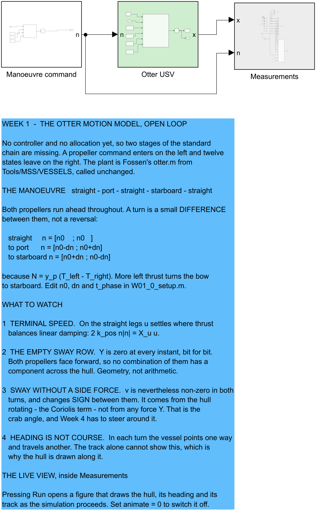

**그림을 읽기**

| 요소 | 뜻 |
|---|---|
| `Manoeuvre command` | rad/s 단위의 프로펠러 명령 $[n_L; n_R]$ 을 **시간의 함수로** — Clock 하나와 MATLAB Function 하나이고, `n0`, `dn`, `t_phase` 가 `W01_0_setup.m` 에서 Constant 로 배선되어 있다 |
| `Otter USV` (초록) | Fossen 의 `otter.m` 을 바꾸지 않고 부른 것, 그리고 상태를 만드는 적분기 |
| `Measurements` (회색) | 선택기들, 스코프, 작업공간 로그, 그리고 실시간 화면 |

### 신호 사슬

- 이 강의의 모든 모델은 왼쪽에서 오른쪽으로 같은 순서로 배치되고, 그 순서는 `Tools/MSS/SIMULINK/mssSimulinkDemos` 의 MSS 데모 모델들이 쓰는 순서다.

$$
\text{command} \rightarrow \text{reference} \rightarrow \text{controller} \rightarrow \text{allocation} \rightarrow \text{plant} \rightarrow \text{measurement}
$$

| 단계 | 무엇에 답하나 | 색 |
|---|---|---|
| command | 무엇을 요구하는가 | 흰색 |
| reference | 무엇이 가능하고, 얼마나 빠른가 | 연보라 |
| controller | 어떤 힘이 필요한가 | 파랑 |
| allocation | 어느 추진기가 그것을 만드나 | 모래색 |
| plant | 배가 어떻게 응답하나 | 초록 |
| measurement | 무엇이 기록되나 | 회색 |

- **이번 주는 여섯 중 셋을 가진다.** 아직 루프가 없으므로 제어기도 없고 배분할 것도 없다. 남은 단계들은 순서를 유지하고, 없는 것들은 자리를 메운다.
- 각 단계는 **서브시스템**이다. 최상위는 사슬만 보이고 그 밖에는 아무것도 보이지 않는다. 한 단계를 여는 것이 그 내용을 읽는 방법이다. 모든 포트에 이름이 있으므로 `n` 과 `x` 가 주석 하나 없이 선에 이름을 붙인다.

> [!tip] 무엇이든 돌리기 전에 `Measurements` 를 열어 본다
> 그 안에는 열두 성분 상태 벡터에서 $u$, $v$, $r$, $N$, $E$, $\psi$ 를 꺼내는 선택기 여섯, $\psi$ 를 도로 바꾸는 변환, 작업공간 로그, 그리고 실시간 화면을 그리는 `Animate` 블록이 있다. 이 강의의 모든 주차가 같은 블록을 가지고 같은 함수가 만들므로, 한 번 읽어 둘 가치가 있다.

### 실시간 화면

- **Run** 을 누르면 시뮬레이션이 진행되는 동안 배를 그리는 그림창이 열린다. 두 가지를 그리고, 둘째가 그것이 존재하는 이유다.

| 그려지는 것 | 무엇에 답하나 |
|---|---|
| 항적 | 선체가 **어디로** 갔는가 |
| 선체 윤곽과 그 선수를 떠나는 선 | 그렇게 가는 동안 선체가 **어디를 가리키고** 있었는가 |

- 그 둘은 같은 질문이 아니다. 해양 운동체는 횡동요속도를 지니므로 그 선수각 $\psi$ 와 대지침로가 크랩각 $\beta = \operatorname{atan2}(v, u)$ 만큼 다르다. 실험 1-12 의 선회에서 둘은 $7.05°$ 차이가 나고, 실험 1-13 의 횡조류에서는 $25.8°$ 차이가 난다. 혼자 그려진 어떤 항적도 둘 중 어느 것도 보일 수 없다. 5주차는 바로 이 차이를 둘러 조종해야 한다.
- MATLAB Function 블록은 그릴 수 없다. 그래서 그리는 함수를 extrinsic 으로 선언해, Simulink 가 그것에 대해 코드를 생성하는 대신 호출을 MATLAB 에 되넘기게 한다.

```matlab
coder.extrinsic('W01_animate');
ok = 1;
if en > 0.5
    W01_animate(N, E, psi, t);
end
```

- 축은 실행이 시작되기 전에 `W01_0_setup.m` 의 `track_Nmin` … `track_Emax` 에서 고정된다. 배가 상자를 벗어나면 그것을 넓힌다. `animate = 0` 으로 두면 실시간 화면이 꺼진다. 긴 실행은 그것 없이 눈에 띄게 빠르다.

> [!tip] 윤곽은 창에 맞게 그려지고 축척에 맞지 않는다
> 160 m 항적에서 실제 2.00 m Otter 는 1 화소도 되지 않으므로, 실시간 화면은 윤곽을 축 범위의 약 4 % 로 비례한다. 그림이 실제 크기로 그렸다고 말하는 곳에서는 그렇게 밝힌다.

### 플랜트 안쪽

- 플랜트 서브시스템은 `otter.m` 을 부르는 MATLAB Function 블록 하나와 $\dot{\mathbf{x}}$ 를 $\mathbf{x}$ 로 바꾸는 적분기를 품고 있다.

```matlab
coder.extrinsic('otter');

xdot = zeros(12,1);
xdot = otter(x, u_thr, mp, rp, V_c, beta_c);
```

- `otter.m` 은 코드 생성을 위해 쓰인 것이 아니므로 그 호출을 extrinsic 으로 선언하고 Simulink 가 그것을 MATLAB 에 되넘긴다. 그 결과로 출력의 크기를 미리 정해 두어야 하고, `zeros(12,1)` 줄이 그것을 위한 것이다.
- 상태는 캔버스를 가로지르는 선이 아니라 Goto/From 태그 쌍을 통해 함수로 돌아온다. 적분기가 루프를 끊으므로 이것은 대수 루프가 아니다.

## 1-10. 프로펠러 회전수에서 힘으로

- 어떤 산술보다 먼저 배치다. Otter 는 폰툰마다 프로펠러 하나를, 둘 다 앞을 향해 볼트로 고정한 쌍동선이다.

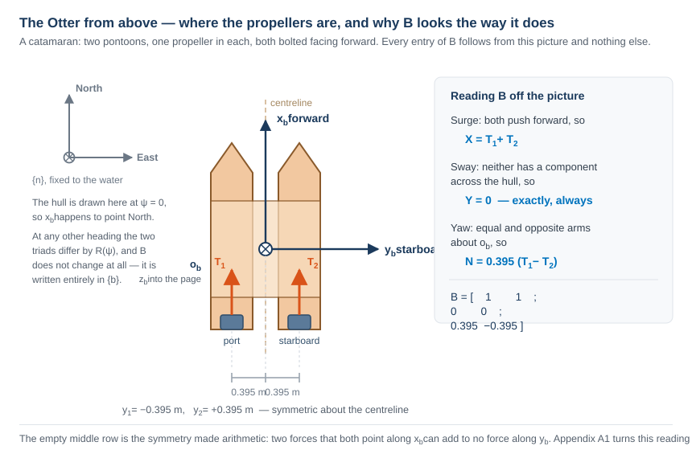

**그림을 읽기**

| 요소 | 뜻 |
|---|---|
| $x_b$, $y_b$ | 선체 축. 원점 $o_b$ 가 중심선 위 선체 중앙에 있다 |
| 파란 직사각형 | 두 프로펠러, 폰툰마다 하나 |
| 주황 화살표 | 그 추력. 둘 다 $+x_b$ 를 따라 있다 — 어느 쪽도 옆으로 밀 수 없다 |
| $\mp 0.395$ m | 모멘트 팔. 중심선에 대해 같고 반대다 |
| 회색 삼축 | $\{n\}$. $\psi = 0$ 에서 그려서 두 좌표계가 마침 일치한다 |

- 그림에서 바로 읽히는 것이 셋이고, 그것이 $\mathbf{B}$ 의 세 줄이다.

| 줄 | 왜냐하면 | 결과 |
|---|---|---|
| 전진 | 두 추력 모두 $+x_b$ 를 가리킨다 | $X = T_1 + T_2$ |
| 횡동요 | 어느 쪽도 $y_b$ 를 따른 성분이 없다 | $Y = 0$, 정확히 그리고 언제나 |
| 선수요 | 팔이 $o_b$ 에 대해 $\mp y_{\text{pont}}$ 다 | $N = y_{\text{pont}}(T_1 - T_2)$ |

> [!important] $\mathbf{B}$ 는 전부 $\{b\}$ 에서 쓰여 있다
> 배치 도면은 배가 돌아도 바뀌지 않으므로 $\mathbf{B}$ 도 바뀌지 않는다. 선수각은 이 문제에 한 번, §1-4 의 운동학에서 들어오고 구동기 모델 안에서는 결코 들어오지 않는다. 그 분리가 $\mathbf{B}$ 를 애초에 상수 행렬일 수 있게 만든다.

- 각 프로펠러는 축 회전수의 제곱으로 비례하는 추력을 만들고, **방향마다 계수가 다르다.**

$$
T_i =
\begin{cases}
k_{\text{pos}}\, n_i |n_i|, & n_i \ge 0 \\[2pt]
k_{\text{neg}}\, n_i |n_i|, & n_i < 0
\end{cases}
$$

| 기호 | 값 | 뜻 | 출처 |
|---|---|---|---|
| $k_{\text{pos}}$ | $0.011080$ | 전진 계류 추력 계수, 프로펠러 하나 | `otter.m`, `0.02216/2` |
| $k_{\text{neg}}$ | $0.006445$ | 후진 계류 추력 계수 | `otter.m`, `0.01289/2` |
| $k_{\text{pos}}/k_{\text{neg}}$ | $1.719$ | 전진 대 후진 비대칭 | 유도된 값 |
| $n_{\max}$ | $103.9$ rad/s | 포화, 전진 | `otter.m` |
| $n_{\min}$ | $-101.7$ rad/s | 포화, 후진 | `otter.m` |
- 비대칭은 물리적인 것이다. 해양용 프로펠러에는 캠버가 있고 앞날이 정해져 있으므로, 거꾸로 돌리면 흐름에 잘못된 면을 내민다. 날개를 거꾸로 날리면 나쁜 날개가 되는 것과 같은 이유다.

- 두 프로펠러가 $y = \pm y_{\text{pont}}$ 의 폰툰에 둘 다 앞을 향해 앉아 있으므로

$$
\boldsymbol{\tau} =
\begin{bmatrix} X \\ Y \\ N \end{bmatrix}
=
\begin{bmatrix}
1 & 1 \\
0 & 0 \\
y_{\text{pont}} & -y_{\text{pont}}
\end{bmatrix}
\begin{bmatrix} T_1 \\ T_2 \end{bmatrix}
= \mathbf{B}\,\mathbf{f}
$$

- 가운데 줄이 **정확히 0** 이고 $\operatorname{rank}(\mathbf{B}) = 2$ 다. 부록 A1 이 이 행렬을 일반 규칙에서 유도하고 그것이 무엇을 비용으로 치르는지 보인다. 이번 주는 그 줄이 비어 있다는 것만 기록한다.

> [!important] 0 은 작은 수가 아니다
> $Y = 0$ 은 프로펠러가 어디에 볼트로 박혀 있는지에 대한 진술이고, 그것들이 얼마나 큰 힘을 만드는지에 대한 진술이 아니다. 어떤 게인도, 어떤 제어기도, 어떤 프로펠러 회전수도 이 선체에 횡방향 힘을 만들 수 없다. 11주차가 이 사실을 제어할 수 있는 것에 대한 단단한 한계로 다시 만난다.

### 전체 사슬, 회전수에서 일반화 힘까지

- 위의 두 단계가 해양 문헌 전체가 쓰는 형태로 합성된다. 거기서 모든 인자에 이름이 있고 마지막 것만이 명령에 기댄다.

$$
\boldsymbol{\tau}
= \underbrace{\mathbf{B}}_{\substack{\text{actuator} \\ \text{configuration}}}
\;\underbrace{\mathbf{K}}_{\substack{\text{thrust} \\ \text{coefficients}}}
\;\underbrace{\mathbf{u}}_{\substack{\text{control} \\ \text{variable}}},
\qquad
\mathbf{u} = \begin{bmatrix} n_1|n_1| \\ n_2|n_2| \end{bmatrix},
\qquad
\mathbf{K} = \begin{bmatrix} k_1 & 0 \\ 0 & k_2 \end{bmatrix}
$$

- Otter 에 대해 풀어 쓰면, 이것이 *축 회전수가 배에 무엇을 하는가* 에 대한 완전한 답이다.

$$
\begin{bmatrix} X \\ Y \\ N \end{bmatrix}
=
\begin{bmatrix} 1 & 1 \\ 0 & 0 \\ y_{\text{pont}} & -y_{\text{pont}} \end{bmatrix}
\begin{bmatrix} k_1 & 0 \\ 0 & k_2 \end{bmatrix}
\begin{bmatrix} n_1|n_1| \\ n_2|n_2| \end{bmatrix}
=
\begin{bmatrix}
k_1 n_1|n_1| + k_2 n_2|n_2| \\
0 \\
y_{\text{pont}}\left(k_1 n_1|n_1| - k_2 n_2|n_2|\right)
\end{bmatrix}
$$

| 인자 | 무엇인가 | 무엇에 기대나 |
|---|---|---|
| $\mathbf{B}$ | 추진기가 어디에 있고 어느 쪽을 가리키는가 | **기하** — 주어진 선체에 대해 고정 |
| $\mathbf{K}$ | $n\lvert n\rvert$ 한 단위가 추력을 얼마나 사는가 | **프로펠러** — 그리고 $k_i$ 는 $n_i$ 의 부호와 함께 바뀐다 |
| $\mathbf{u}$ | 부호를 지닌 제곱 축 회전수 — **굵은 글자**이고 전진속도 $u$ 가 아니다. 이 이름은 Fossen 의 것이고 이 소절에서만 쓴다 | **명령** — 제어기가 바꾸는 유일한 것 |

> [!note] 왜 $n^2$ 이 아니라 $n\lvert n\rvert$ 인가
> $n^2$ 은 부호를 버리고, 역전한 프로펠러가 여전히 앞으로 밀 것이다. 곱 $n\lvert n\rvert$ 은 2차의 크기와 $n$ 의 부호를 함께 유지하고, 그래서 $n$ 자체가 아니라 그것을 제어변수라 부른다.

- 결과 둘이 즉시 따라 나오고, 둘 다 Part 2 에서 측정된다.

| | |
|---|---|
| **이 사상은 비선형이다** | $n$ 을 두 배 하면 추력이 네 배가 된다. 구동기가 선형이라고 가정하는 제어기는 고속에서 저속의 두 배로 과격해진다 |
| **이 사상은 홀함수가 아니다** | 부호가 다르면 $k_1 \neq k_2$ 이므로, $n = [+60, -60]$ 은 $X = 0$ 을 **주지 않는다** |

- MSS 소스가 모멘트 팔 $l_1 = -y_{\text{pont}}$, $l_2 = +y_{\text{pont}}$ 로 같은 것을 한 줄에 쓴다(`otter.m` 181행).

```matlab
tau = [Thrust(1) + Thrust(2)  0 0 0 0  -l1*Thrust(1) - l2*Thrust(2)]';
```

- 팔을 넣으면 $N = y_{\text{pont}} T_1 - y_{\text{pont}} T_2$ 가 되고, 그것이 위의 셋째 줄이다. 강의와 소스가 항 단위로 일치한다.

### 실험 1-10a · 배를 손으로 운전하기 (15분)

- 실험 1-11 부터 1-13 까지는 각각 미리 고정된 명령을 돌렸다. 이 절은 그 명령을 넘겨준다. 모델 하나, 버튼 다섯, 슬라이더 둘, 그리고 실험 1-9 와 같은 실시간 화면이다.
- `W01_interactive.slx` 를 열고 캔버스의 **START** 를 누른다. 툴스트립의 Run 도 같은 일을 한다. 준비 스크립트가 필요하지 않다. 모델이 읽는 모든 변수가 자기 모델 작업공간에 저장되어 있고, 모델이 열릴 때 스스로 `_tools` 와 MSS 를 경로에 올린다.
- 시뮬레이션은 실제 시간으로 돌고 — Simulation Pacing 비율 1 — 스스로 멈추지 않는다. **STOP** 이 그것을 끝낸다. **START** 는 언제나 원점에서 다시 시작한다. 진행 중인 실행이 먼저 멈추고, 배와 그 항적과 그림들이 초기 상태로 돌아온다. 툴스트립의 Pause 와 Continue 는 대신 상태를 유지한다.
- START 는 두 창을 나란히 놓기도 한다. 모델은 화면의 왼쪽 절반에, 실시간 화면은 오른쪽에. 어느 버튼을 눌러도 모델 창이 앞으로 온다. 둘이 겹쳐 있으면 클릭마다 그림이 가려질 것이다.

```matlab
W01_F_build_interactive      % only if W01_interactive.slx is missing or broken
```

> [!note] 이 그림을 만들려면
> `W01_F_build_interactive` 이 빌드 끝에 `W01_simulink/img/W01_interactive.png` 을 쓴다. 이 강의의 모든 빌더가 그렇게 한다.

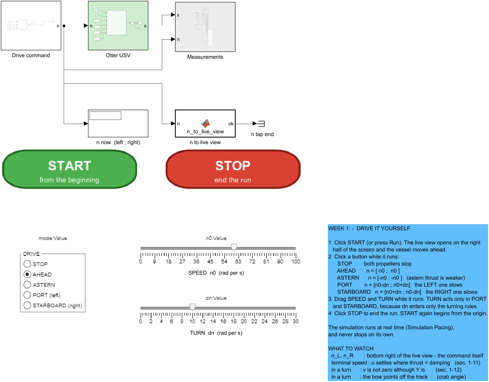

**그림을 읽기**

| 요소 | 뜻 |
|---|---|
| `DRIVE` 버튼들 | `Drive command` 안의 Constant `mode` 에 묶인 Dashboard Radio Button. 시뮬레이션이 도는 동안 클릭이 그 Constant 를 바꾼다 |
| `n0` 슬라이더 | Constant `n0` 에 묶여 있다 — 공통 축 회전수, $0$ 에서 $100$ rad/s |
| `dn` 슬라이더 | Constant `dn` 에 묶여 있다 — 선회에서 두 프로펠러의 차이, $0$ 에서 $30$ rad/s |
| `Drive command` (흰색) | Constant 셋과, 버튼을 $[n_L;\ n_R]$ 로 바꾸는 MATLAB Function 하나 |
| `Otter USV`, `Measurements` | `W01_openloop.slx` 의 플랜트와 계측 단계, 바뀌지 않았다. 실시간 화면은 `W01i_animate.m` 이 그린다. 항적 창이 배를 따라가고, 오른쪽 아래 칸이 $n_L$ 과 $n_R$ 를 그린다 |
| `n now` | 이 순간 플랜트가 받고 있는 두 축 회전수 |
| `n to live view` | 매 스텝 $[n_L;\ n_R]$ 를 실시간 화면에 넘겨, 명령이 그것이 일으킨 운동 옆에 그려지게 한다 |
| START, STOP | 주석으로 놓은 버튼 그림 둘. 각각 클릭 콜백이 있고, 한 번 누르면 `W01i_control('start')` 나 `W01i_control('stop')` 을 부른다 |

- 각 버튼은 규칙 하나를 적용한다 — 실험 1-12 의 시간표와 같은 규칙이다.

| 버튼 | $[n_L;\ n_R]$ | 배가 하는 일 |
|---|---|---|
| STOP | $[0;\ 0]$ | 타력으로 멈춘다. 감쇠만 작용한다 |
| AHEAD | $[n_0;\ n_0]$ | §1-11 의 종단속력에 정착한다 |
| ASTERN | $[-n_0;\ -n_0]$ | 후진하고, 더 느리다. $k_{\text{neg}} < k_{\text{pos}}$ 이기 때문이다(§1-10) |
| PORT | $[n_0 - dn;\ n_0 + dn]$ | 좌로 돈다 — **왼쪽** 프로펠러가 느려진다 |
| STARBOARD | $[n_0 + dn;\ n_0 - dn]$ | 우로 돈다 |

- 두 슬라이더는 `Drive command` 안의 Constant `n0` 과 `dn` 에 **묶여** 있다. 하나를 끌면 그 Constant 가 다시 쓰이고, 다음 적분 스텝이 이미 새 값을 쓴다 — 실행 전에도, 실행 중에도. 실행 도중에 `n0` 을 $60$ 에서 $30$ 으로 바꾸면 기록되는 명령이 한 스텝 안에 $[60;\ 60]$ 에서 $[30;\ 30]$ 으로 움직인다.
- AHEAD, ASTERN, STOP 이 선택되어 있는 동안 TURN 은 눈에 보이는 효과가 없다. `dn` 은 선회 규칙 둘에만 들어오기 때문이다. 실시간 화면의 오른쪽 아래 칸이 $n_L$ 과 $n_R$ 을 보이므로 어느 슬라이더의 움직임이든 거기서 즉시 보인다.

### 측정

```matlab
W01_F_button_check
```

- 사람이 버튼을 누르면 같은 실행이 두 번 나오지 않으므로, 아래 수치는 `W01_F_button_check.m` 에서 온다. 그것은 버튼마다 한 번씩 모델을 정지에서 시작해 그 버튼을 $40$ s 유지하고, 페이싱과 실시간 화면을 끈다. 슬라이더는 초기값 $n_0 = 60$, $dn = 10$ rad/s 에 머문다.

| 버튼 | $n_L$, $n_R$ [rad/s] | $u$ [m/s] | $v$ [m/s] | $r$ [deg/s] | $\beta$ [deg] |
|---|---|---|---|---|---|
| AHEAD | $60,\ 60$ | $1.0286$ | $0.0000$ | $0.000$ | — |
| ASTERN | $-60,\ -60$ | $-0.5983$ | $0.0000$ | $0.000$ | — |
| PORT | $50,\ 70$ | $1.0251$ | $+0.1827$ | $-4.989$ | $+10.11$ |
| STARBOARD | $70,\ 50$ | $1.0251$ | $-0.1827$ | $+4.989$ | $-10.11$ |
| STOP | $0,\ 0$ | $0.0000$ | $0.0000$ | $0.000$ | — |

- AHEAD 는 §1-11 의 종단속력 $1.0286$ m/s 를 재현한다. ASTERN 은 $-2k_{\text{neg}}n_0^2/\lvert X_u\rvert = -0.5983$ m/s 를 재현하므로, 배는 전진 속력의 $60\%$ 도 안 되는 속도로 뒤로 물러난다.
- PORT 와 STARBOARD 는 거울상이다. 실험 1-12 의 $3.5$ 가 아니라 $dn = 10$ 이므로 선회가 약 두 배 빠르고 크랩각 $\beta$ 가 $7.05°$ 에서 $10.11°$ 로 자란다.

### 해 볼 것들, 이 순서로

| 이렇게 한다 | 볼 것 | 절 |
|---|---|---|
| AHEAD, 그 다음 5초 기다린다 | $u$ 가 $1.03$ m/s 에 정착해 머문다 | §1-11 |
| SPEED 를 $60$ 에서 $30$ 으로 끈다 | $u$ 가 반이 아니라 4분의 1, $0.26$ m/s 로 떨어진다 | §1-11, 2차 추력 대 선형 감쇠 |
| PORT, 그 다음 STARBOARD | $v$ 의 부호가 바뀐다. 선수가 항적에서 $\beta$ 만큼 벗어나 가리킨다 | §1-12 와 실험 1-12 |
| PORT, 그 다음 TURN 을 $0$ 으로 끈다 | 배가 직진한다. 선회는 두 프로펠러의 차이뿐이다 | §1-10 |
| 정지에서 ASTERN | $u$ 가 $-0.60$ m/s 에만 닿는다 | §1-10 |
| 전속에서 STOP | $u$ 가 시정수 $T_u = 1.10$ s 로 사그라든다 | §1-11 |

> [!tip] 항적 창이 배를 따라간다
> `W01_openloop.slx` 는 자기 경로를 미리 알고 있으므로 그 창은 실행 전에 고정된다. 손으로 운전되는 배는 어디로든 갈 수 있으므로, `W01i_animate.m` 은 선체가 어느 가장자리의 $20\%$ 안으로 들어올 때마다 창을 옮긴다. 창의 크기는 결코 바뀌지 않으므로 윤곽이 한 축척을 유지하고, 쪽 위를 지나는 속도를 눈으로 가늠할 수 있다.

### 실험 1-10b · RC 송신기, 그리고 그 뒤의 배분 (25분)

- 실험 1-10a 에서 조작자는 축 회전수를 명령했다. 고른 속력으로 직진하려면 조작자가 프로펠러 곡선 $T = k\,n\lvert n\rvert$ 을 알아야 했다. 돌려면 요 모멘트가 $N = y_{\text{pont}}(T_L - T_R)$ 임을 알아야 했다. 실제 조작자 — 송신기를 든 사람, 위치유지 콘솔의 조이스틱, 또는 뒤의 주차들의 오토파일럿 — 는 대신 **힘과 모멘트**를 요구한다. 그 요구를 축 회전수로 바꾸는 것이 **제어 배분**이다.
- 이 절은 배분 앞에 RC 송신기를 놓는다. 스로틀 스틱이 전진력을 요구하고, 러더 스틱이 요 모멘트를 요구하고, 모델은 §1-10 의 두 사상을 역순으로 역산해 $n_L$ 과 $n_R$ 을 구한다.

| | 실험 1-10a `W01_interactive.slx` | 실험 1-10b `W01_rc.slx` |
|---|---|---|
| 조작자가 고르는 것 | 축 회전수 $[n_L;\ n_R]$ | 일반화 힘 $[X;\ N]$ |
| 누가 $\mathbf{B}$ 와 프로펠러 곡선을 역산하나 | 조작자가, 머릿속에서 | `Control allocation` 블록 |
| 스틱을 절반 밀면 | $n$ 의 절반, 추력의 4분의 1 | 힘의 절반 |
| 구동기 한계를 넘으면 무엇이 일어나나 | `otter.m` 안에서 $n$ 이 조용히 잘린다 | 모델이 요구된 $\boldsymbol{\tau}_d$ 옆에 전달된 $\boldsymbol{\tau}_a$ 를 보고한다 |

### 송신기 — 모드 1 과 모드 2

- 두 스틱 송신기에는 축이 넷 있다. 어느 축이 스로틀인지는 송신기의 **모드**가 정하고, 그것은 모형 항공기에서 물려받은 관습이다. 모드 2 가 흔한 것이고, 모드 1 은 스로틀을 오른손으로 옮긴다.

| 스틱 축 | 채널 | 모드 1 | 모드 2 | 실제 송신기에서 |
|---|---|---|---|---|
| 왼쪽, 위–아래 | `LY` | 엘리베이터 — 배에서는 쓰지 않는다 | **스로틀** | 스프링이 중앙으로 되돌린다. 스로틀일 때만 예외이고, 그때는 둔 자리에 머문다 |
| 왼쪽, 좌–우 | `LX` | **러더** | **러더** | 스프링이 중앙으로 되돌린다 |
| 오른쪽, 위–아래 | `RY` | **스로틀** | 엘리베이터 — 배에서는 쓰지 않는다 | `LY` 와 같고 모드가 뒤바뀐 것 |
| 오른쪽, 좌–우 | `RX` | 에일러론 — 배에서는 쓰지 않는다 | 에일러론 — 배에서는 쓰지 않는다 | 스프링이 중앙으로 되돌린다 |

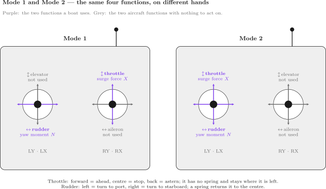

**그림을 읽기**

| 요소 | 뜻 |
|---|---|
| 보라 화살표와 이름표 | 배가 쓰는 기능 둘: 전진력 $X$ 가 되는 스로틀, 그리고 요 모멘트 $N$ 이 되는 러더 |
| 회색 화살표와 이름표 | 엘리베이터와 에일러론. 배에서는 작용할 대상이 없는 항공기 기능이다 |
| `LY · LX`, `RY · RX` | 각 스틱 아래의 채널들. `W01_rc.slx` 의 슬라이더 이름이다 |

- 러더는 **두 모드 모두** 왼쪽 스틱의 좌–우다. 손을 바꾸는 것은 스로틀뿐이다.
- 이 모델의 스로틀은 중앙 기준이다. 스틱을 앞으로 밀면 전진, 뒤로 당기면 후진, 중앙이면 두 프로펠러가 멈춘다. 배의 송신기가 역전 가능한 속도 제어기를 구동하는 방식이 이것이다. 항공기 스로틀에는 역전이 없고 대신 맨 아래에서 시작한다.
- 러더 왼쪽이 배를 좌현으로, 러더 오른쪽이 우현으로 돌린다.

### 채널에서 요구된 힘으로

- 수신기는 각 채널을 $1000$ 에서 $2000$ µs 의 펄스로, 중앙은 $1500$ µs 로 넘긴다. 모델에서 각 채널은 $0$ 에서 $100$ 까지의 Dashboard 슬라이더이고 중앙이 $50$ 이며, 블록 `receiver` 가 그것을 스틱 변위 $s \in [-1, 1]$ 로 바꾼다.

$$
s = \operatorname{sign}(c - 50)\;\frac{\max\!\left(\lvert c - 50\rvert - d_b,\ 0\right)}{50 - d_b}
$$

| 기호 | 양 | 값 |
|---|---|---|
| $c$ | 날 것의 채널, 슬라이더 하나 | $0$ 에서 $100$ |
| $d_b$ | 중앙 양쪽의 중립 구간 | $3$ |
| $s$ | 스틱 변위 | $-1$ 에서 $1$. 중립 구간 안에서는 정확히 $0$ |

- 중립 구간이 있는 것은 속도 제어기에 그것이 있는 것과 같은 이유다. 중앙에서 조금 벗어난 채 놓인 스틱이 배를 기어가게 만들어서는 안 된다.
- 블록 `Mode 1 or 2` 가 네 변위에서 스로틀 $s_T$ 와 러더 $s_R$ 을 골라낸다. 그 다음 블록 `Joystick` 이 그것들을 요구된 일반화 힘으로 비례한다.

$$
\boldsymbol{\tau}_d =
\begin{bmatrix} X_d \\ N_d \end{bmatrix}
=
\begin{bmatrix} X_{\max} & 0 \\ 0 & N_{\max} \end{bmatrix}
\begin{bmatrix} s_T \\ s_R \end{bmatrix},
\qquad
X_{\max} = 2\,T_{\max},
\qquad
N_{\max} = 2\,y_{\text{pont}}\,\lvert T_{\min}\rvert
$$

| 기호 | 양 | 값 | 출처 |
|---|---|---|---|
|---|---|---|---|
| $T_{\max} = k_{\text{pos}}\,n_{\max}^2$ | 프로펠러 하나의 최대 전진 추력 | $119.68$ N | `otter.m` 93–96행 |
| $T_{\min} = -k_{\text{neg}}\,n_{\min}^2$ | 프로펠러 하나의 최대 후진 추력 | $-66.71$ N | `otter.m` 93–96행 |
| $X_{\max}$ | 전속 스로틀: 두 프로펠러 모두 전진 최대 | $239.36$ N | `W01_G_rc_check` |
| $N_{\max}$ | 전타: $X = 0$ 에서의 최대 요 모멘트. 프로펠러 하나는 후진 최대, 다른 하나는 그것에 맞춘 전진 | $52.70$ N·m | `W01_G_rc_check` |
| $y_{\text{pont}}$ | 각 프로펠러의 모멘트 팔 — 중심선에서 폰툰까지의 횡거리 | $0.395$ m | `otter.m` 69행, `y_pont` |

### 배분, 1단계 — 배치행렬을 역산한다

- §1-10 은 두 프로펠러의 힘을, 횡동요 줄이 정확히 0 인 $\boldsymbol{\tau} = \mathbf{B}\mathbf{f}$ 로 썼다. 횡방향 힘에 대한 요구는 결코 만족될 수 없으므로 배분은 만족될 수 있는 두 줄을 지킨다(Fossen 2021, §11.2).

$$
\begin{bmatrix} X \\ N \end{bmatrix}
=
\underbrace{\begin{bmatrix} 1 & 1 \\ y_{\text{pont}} & -y_{\text{pont}} \end{bmatrix}}_{\mathbf{B}_{XN}}
\begin{bmatrix} T_L \\ T_R \end{bmatrix}
$$

- $\mathbf{B}_{XN}$ 은 정사각이고 $\det \mathbf{B}_{XN} = -2y_{\text{pont}} \neq 0$ 이므로 역이 정확히 하나다. $2\times 2$ 행렬에서는 대각을 바꾸고 비대각에 음을 붙여 행렬식으로 나눈다.

$$
\mathbf{B}_{XN}^{-1}
= \frac{1}{-2y_{\text{pont}}}\begin{bmatrix} -y_{\text{pont}} & -1 \\ -y_{\text{pont}} & 1 \end{bmatrix}
= \begin{bmatrix} \tfrac12 & \tfrac{1}{2y_{\text{pont}}} \\[3pt] \tfrac12 & -\tfrac{1}{2y_{\text{pont}}} \end{bmatrix}
= \begin{bmatrix} 0.5000 & 1.2658 \\ 0.5000 & -1.2658 \end{bmatrix}
$$

- 줄 단위로 쓰면, 이것이 쌍축 배의 배분 법칙 전부다.

$$
T_L = \frac{X_d}{2} + \frac{N_d}{2y_{\text{pont}}},
\qquad
T_R = \frac{X_d}{2} - \frac{N_d}{2y_{\text{pont}}}
$$

| 항 | 무엇을 하나 |
|---|---|
| $X_d/2$ | 전진 요구를 똑같이 나눈다. 3주차 §3-1 처럼 |
| 왼쪽의 $+N_d/(2y_{\text{pont}})$, 오른쪽의 $-N_d/(2y_{\text{pont}})$ | 차이 $T_L - T_R = N_d/y_{\text{pont}}$ 를 만들고, 그것이 정확히 요구된 모멘트다. 그 차이는 $X$ 를 바꾸지 않는다 |

- §1-10 과 대조해 부호를 확인한다. 우현 요구 $N_d > 0$ 은 $T_L > T_R$ 을 주고, $N = y_{\text{pont}}(T_L - T_R) > 0$ 이다. 모델의 블록 `B inverse` 가 이 행렬이고, `W01_G_build_rc.m` 에서 `_tools/otter_B.m` 의 $\mathbf{B}$ 로부터 `inv(Bxn)` 으로 계산한다.
- 같은 답이 전체 $3\times 2$ 행렬의 무어–펜로즈 유사역행렬 $\mathbf{f} = \mathbf{B}^{+}[X;\ 0;\ N]$ 에서도 나오고, 그것이 Fossen (2021, §11.2) 의 제약 없는 배분이다. $X = 100$ N, $N = 20$ N·m 에 대해 둘은 $4.3\times10^{-14}$ N 만큼 다르다. 여기서 $2\times 2$ 역을 쓰는 것은 그것을 손으로 적을 수 있기 때문이다.

### 배분, 2단계 — 프로펠러 곡선을 역산한다

- 각 추력을 따로 축 회전수로 바꾸고, 계수는 추력의 부호가 고른다(§1-10. 3주차 §3-1 과 같은 역산을 프로펠러마다 적용한 것이다).

$$
n_i = \operatorname{sign}(T_i)\sqrt{\frac{\lvert T_i\rvert}{k_i}},
\qquad
k_i = \begin{cases} k_{\text{pos}}, & T_i \ge 0 \\ k_{\text{neg}}, & T_i < 0 \end{cases}
$$

### 배분, 3단계 — 포화시키고, 전달된 것을 보고한다

- 축 회전수는 블록 `shaft limits` 가 $[n_{\min},\ n_{\max}] = [-101.74,\ 103.93]$ rad/s 로 자른다. 그 다음 블록 `delivered thrust` 가 `otter.m` 165–177행의 프로펠러 곡선을 잘린 회전수에 대해 앞으로 돌리고, `B` 가 그 결과를 $\boldsymbol{\tau}_a = \mathbf{B}_{XN}\,\mathbf{T}(\mathbf{n}_{\text{sat}})$ 로 되돌려 사상한다.
- 부록 A1-6 의 도달 가능 집합 안에서는 $\boldsymbol{\tau}_a = \boldsymbol{\tau}_d$ 가 반올림 수준까지 성립한다. 그 밖에서는 둘이 다르고, 그 차이가 조작자가 요구했는데 받지 못한 것이다.

> [!warning] 포화는 힘의 크기만이 아니라 방향을 바꾼다
> 각 프로펠러는 따로 잘린다. 하나가 포화되고 다른 하나가 그렇지 않으면, 비 $N_a/X_a$ 는 더 이상 스틱이 요구한 비가 아니다. 아래 5번 경우에서 스틱은 $N_d/X_d = 0.220$ 을 요구하고 $0.153$ 을 받는다. 배가 명령보다 덜 날카롭게 도는 것이고, 단지 더 느리게 도는 것이 아니다. 무엇을 먼저 포기하느냐 — 전진이냐 요냐 — 는 설계 결정이고, 뒤의 배분 방법은 그것을 명시해야 한다.

### 모델

```matlab
W01_G_build_rc      % only if W01_rc.slx is missing or broken
```

> [!note] 이 그림을 만들려면
> `W01_G_build_rc` 이 빌드 끝에 `W01_simulink/img/W01_rc.png` 을 쓴다. 이 강의의 모든 빌더가 그렇게 한다.

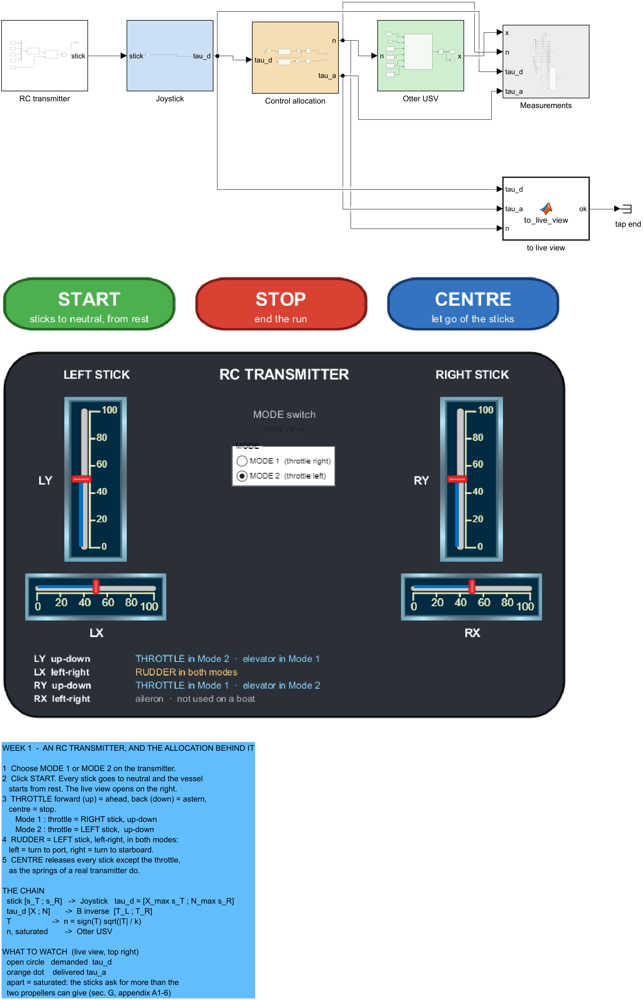

**그림을 읽기**

| 요소 | 뜻 |
|---|---|
| `RC transmitter` (흰색) | Constant 넷 `LX`, `LY`, `RX`, `RY` 와 Constant `mode`, 그 다음 `receiver` 와 `Mode 1 or 2`. 출력은 $[s_T;\ s_R]$ |
| `Joystick` (파랑) | 행렬 이득 하나, $\operatorname{diag}(X_{\max}, N_{\max})$. 출력은 $\boldsymbol{\tau}_d$ |
| `Control allocation` (모래색) | `B inverse` → `thrust to n` → `shaft limits` → $\mathbf{n}$. 그리고 `delivered thrust` → `B` → $\boldsymbol{\tau}_a$ |
| `Otter USV`, `Measurements` | 실험 1-9 의 플랜트와 계측 단계. 로그는 $[u\ v\ r\ N\ E\ \psi]$, 그 다음 $\mathbf{n}$, $\boldsymbol{\tau}_d$, $\boldsymbol{\tau}_a$ 를 담는다 |
| `to live view` | 매 스텝 $\boldsymbol{\tau}_d$, $\boldsymbol{\tau}_a$, $\mathbf{n}$ 을 `W01rc_animate.m` 에 넘긴다 |
| 어두운 패널 | 송신기. 채널마다 하나씩 세로 슬라이더 둘과 가로 슬라이더 둘이 각자의 Constant 에 묶여 있고, MODE 스위치가 `mode` 에 묶여 있다. 패널 아래의 범례가 각 모드에서 각 채널의 역할을 준다 |
| START, STOP, CENTRE | START 는 네 채널 전부를 $50$ 으로 두고 정지에서 시작한다. 송신기의 스로틀 점검이 하는 일이다. CENTRE 는 스로틀을 뺀 모든 채널을 $50$ 으로 되돌린다 — 슬라이더에는 없는 스프링이다 |

- 화면 오른쪽 절반에 `W01rc_animate.m` 이 그리는 실시간 화면은 실험 1-10a 의 화면에 칸 하나를 더한다. 도달 가능 집합이고, 요구된 힘이 빈 원으로, 전달된 힘이 주황 점으로 찍힌다. 스틱 방향으로 그려져 있다 — 전진력이 위, 우현 모멘트가 오른쪽 — 그래서 스로틀을 앞으로 밀면 원이 올라간다. 그 아래에 예측 $X_a/\lvert X_u\rvert$ 와 함께 $u$, 그리고 $r$, 그리고 포화 한계와 함께 $n_L$, $n_R$ 가 있다.

### 측정

```matlab
W01_G_rc_check
```

- 실험 1-10a 와 같이 스틱을 잡은 사람은 실행을 되풀이하지 못하므로, 수치는 스크립트에서 온다. `W01_G_rc_check.m` 은 모드 2 에서 각 스틱 위치를 정지에서 $60$ s 유지하고, 페이싱과 실시간 화면을 끈다.

| 경우 | 스틱 | $X_d$ [N] | $N_d$ [N·m] | $n_L$, $n_R$ [rad/s] | $X_a$ [N] | $N_a$ [N·m] | $u$ [m/s] | $r$ [deg/s] |
|---|---|---|---|---|---|---|---|---|
| 1 | 반 전진 | $119.7$ | $0.00$ | $73.49,\ 73.49$ | $119.7$ | $0.00$ | $1.5432$ | $0.000$ |
| 2 | 전속 전진 | $239.4$ | $0.00$ | $103.93,\ 103.93$ | $239.4$ | $0.00$ | $3.0864$ | $0.000$ |
| 3 | 반 전진, 반 우타 | $119.7$ | $26.35$ | $91.71,\ 48.89$ | $119.7$ | $26.35$ | $1.4542$ | $+8.845$ |
| 4 | 전 우타, 스로틀 중앙 | $0.0$ | $52.70$ | $77.59,\ -101.74$ | $0.0$ | $52.70$ | $0.0106$ | $+16.493$ |
| 5 | 전속 전진, 전 우타 | $239.4$ | $52.70$ | $103.93,\ 69.15$ | $172.7$ | $26.35$ | $2.1265$ | $+8.252$ |
| 6 | 전속 후진 | $-239.4$ | $0.00$ | $-101.74,\ -101.74$ | $-133.4$ | $0.00$ | $-1.7203$ | $0.000$ |
| 7 | 반 전진, 반 좌타 | $119.7$ | $-26.35$ | $48.89,\ 91.71$ | $119.7$ | $-26.35$ | $1.4542$ | $-8.845$ |

- 방향은 의도한 대로다. 스로틀 앞은 $u > 0$, 스로틀 뒤는 $u < 0$, 러더 오른쪽은 $r > 0$(우현), 러더 왼쪽은 $r < 0$(좌현) 이다. 3번과 7번 경우는 찍힌 모든 자리까지 거울상이다.
- 3번 경우를 모드 1 — 스로틀이 `RY` — 과 모드 2 — 스로틀이 `LY` — 로 돌리면 로그가 정확히 $0$ 만큼 다르다. 모드는 스로틀을 다른 손으로 옮기고 그 아래로는 아무것도 바꾸지 않는다.
- 1, 2, 3, 4, 7번 경우는 도달 가능 집합 안에 놓이고 $\boldsymbol{\tau}_a = \boldsymbol{\tau}_d$ 다. 4번 경우는 $N_{\max}$ 의 구성상 정확히 그 경계에 앉는다. 오른쪽 프로펠러가 $n_{\min} = -101.74$ rad/s 에 있다.
- 5번 경우는 왼쪽 프로펠러를 $n_{\max}$ 에서 포화시키고, 6번 경우는 두 프로펠러를 $n_{\min}$ 에서 포화시킨다. 후진에서 스틱은 $-239.4$ N 을 요구하고 프로펠러는 $-133.4$ N 을 전달한다. 스로틀 뒤쪽 행정의 마지막 $44\%$ 는 아무 일도 하지 않는다.

> [!important] 배분이 제곱을 되돌린다
> 모든 직진 경우에서 정착 속력이 소수 넷까지 $X_a/\lvert X_u\rvert$ 와 같다 — $1.5432$, $3.0864$, $-1.7203$ m/s — 그래서 속력이 **스로틀에 비례한다.** 반 스로틀이면 반 속력이다. 실험 1-10a 에서 SPEED 슬라이더를 절반으로 하면 속력의 4분의 1 이 나왔다. 명령이 $n$ 이었고 추력이 $n\lvert n\rvert$ 로 자라기 때문이다. 배분이 그 곡선을 역산하므로, 그 위에 무엇이 앉든 — 스틱 위의 엄지든 속도 제어기든 — 자기 명령에 대해 선형인 플랜트에 작용한다.

```matlab
W01_G_rc_check      % also writes the figure below
```

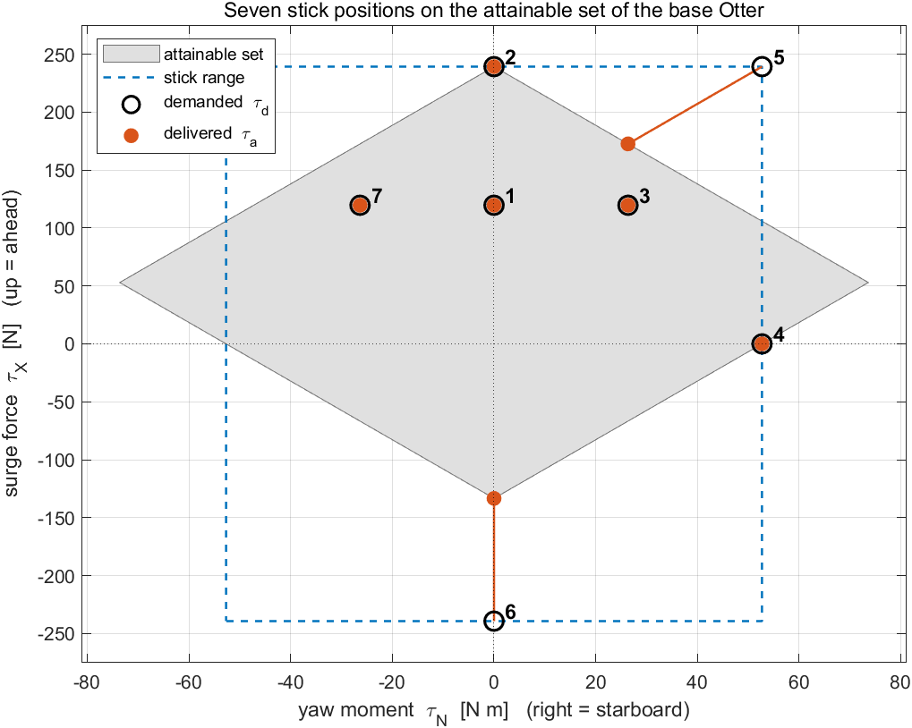

**그림을 읽기**

| 요소 | 뜻 |
|---|---|
| 회색 영역 | 부록 A1-6 의 도달 가능 집합. 두 프로펠러가 만들 수 있는 모든 $[X;\ N]$ 이고, $N$ 을 가로로 $X$ 를 위로 그렸다 |
| 파란 파선 직사각형 | 스틱이 요구할 수 있는 모든 것, $\lvert X\rvert \le X_{\max}$ 와 $\lvert N\rvert \le N_{\max}$ |
| 빈 원 | 각 경우의 요구된 힘 $\boldsymbol{\tau}_d$. 번호는 위 표의 경우 번호다 |
| 주황 점 | 전달된 힘 $\boldsymbol{\tau}_a$ |
| 주황 선 | 요구에서 전달까지. 프로펠러가 포화되는 곳 — 5번과 6번 경우 — 에서만 보인다 |

- 이 집합은 앞뒤로 대칭이 아니다. $T_{\min}$ 의 크기가 $T_{\max}$ 보다 작기 때문이다(§1-10, A1-5). 그래서 직사각형이 집합보다 아래로 더 멀리 뻗는다.
- 집합은 $X = 0$ 이 아니라 $X = T_{\max} + T_{\min} = 52.97$ N 에서 가장 넓다. 최대 요 모멘트 $\pm 73.62$ N·m 는 프로펠러 하나가 전진 최대, 다른 하나가 후진 최대여야 한다. 스로틀을 중앙에 두면 러더는 $N_{\max} = 52.70$ N·m 로 제한된다.

### 해 볼 것들, 이 순서로

| 이렇게 한다 | 볼 것 | 절 |
|---|---|---|
| START, 그 다음 스로틀을 약 $75$ 까지 앞으로 | 원이 올라간다. $u$ 가 파선 예측에 정착한다 | 위, 그리고 §1-11 |
| 스로틀을 맨 위로 | $u \to 3.09$ m/s, 두 프로펠러 모두 $n_{\max}$ | 2번 경우 |
| 거기서 러더를 우측 전타 | 원이 회색 영역을 떠난다. 점은 그 경계에 남고 제목이 붉어진다 | 5번 경우 |
| CENTRE | 러더가 되돌아온다. 스로틀은 머문다 | 위의 송신기 표 |
| 스로틀을 맨 아래로 | 원은 $-239.4$ N 까지 가는데 점은 $X = -133.4$ N 에서 멈춘다 | 6번 경우 |
| MODE 1 로 바꿔 되풀이 | 스로틀이 이제 오른쪽 스틱이다. 배는 똑같이 움직인다 | 위의 모드 확인 |

### 실험 1-10c · 실물 송신기를 USB 로 (선택, 실물 장비, 15분)

- 슬라이더에는 스프링도 짐벌의 감촉도 없다. 실물 송신기에는 둘 다 있고, EdgeTX 나 OpenTX 를 돌리는 많은 송신기가 USB 조이스틱(HID) 모드로 연결하면 PC 에 USB 게임 컨트롤러로 나타난다. Simulink 3D Animation 의 Joystick Input 블록이 그런 장치를 읽고, `W01_rc_usb.slx` 가 그것을 실험 1-10b 의 화면 위 송신기 자리에 놓는다.
- 사슬의 첫 블록만 바뀐다. `Joystick`, `Control allocation`, `Otter USV`, `Measurements`, 그리고 실시간 화면은 실험 1-10b 와 같은 코드가 만든다.

| 필요한 것 | 무엇을 위해 |
|---|---|
| Simulink 3D Animation | Joystick Input 블록, 라이브러리 `vrlib` |
| USB 조이스틱(HID) 모드가 있는 송신기, 또는 아무 USB 게임 컨트롤러 | 그 블록이 읽는 장치 |
| `W01_rc_usb.slx` | `W01_H_build_rc_usb` 이 만든다. 모델은 장치 없이도 만들어지고 열린다. START 만이 장치를 필요로 한다 |

### 스틱이 아니라 채널

- USB 로 송신기는 자기 **채널**을 보낸다 — 에일러론, 엘리베이터, 스로틀, 러더 — 각각 $-1$ 에서 $+1$ 까지의 축 하나로. 실험 1-10b 의 모드는 무엇이 송신기를 떠나기 전에 송신기 안에서 적용된다. 그래서 어느 손이 움직이든 스로틀이 같은 축으로 도착하고, `W01_rc_usb.slx` 에는 MODE 스위치가 없다.

| | 실험 1-10b `W01_rc.slx` | 실험 1-10c `W01_rc_usb.slx` |
|---|---|---|
| 모델에 들어오는 것 | 스틱 넷, 각각 슬라이더 하나 | USB 장치의 축들 |
| 모드가 적용되는 곳 | 모델 안의 블록 `Mode 1 or 2` | 송신기 안 |
| 모델에 알려 주어야 하는 것 | 모드 1 인가 모드 2 인가 | 어느 축이 스로틀이고 어느 축이 러더인지, 그리고 각각 어느 쪽이 양인지 |
| 스틱을 중앙으로 되돌리기 | CENTRE 버튼 | 송신기의 스프링 |

- 축 순서는 송신기의 채널 순서 설정에 기댄다. EdgeTX 와 OpenTX 의 기본값 AETR 은 스로틀을 3번 축에, 러더를 4번 축에 둔다. 보정하기 전까지는 그것이 모델의 기본값이다.
- 블록 `USB receiver` 가 고른 두 축을, 같은 중립 구간을 거쳐 실험 1-10b 의 스틱 변위로 바꾼다.

$$
s = \operatorname{sign}(d)\,\frac{\max\!\left(\lvert d\rvert - d_b,\ 0\right)}{50 - d_b},
\qquad
d = 50\,\sigma\,a_k
$$

| 기호 | 양 | 값 / 출처 |
|---|---|---|
| $a_k$ | 장치의 $k$ 번 축 | $-1$ 에서 $1$, Joystick Input 에서 |
| $k$ | 스로틀은 `js_thr`, 러더는 `js_rud` | CALIBRATE 가 찾는다. 기본값 $3$ 과 $4$ (AETR) |
| $\sigma$ | `js_sgn`, 앞과 오른쪽을 양으로 만드는 부호 | CALIBRATE 가 찾는다. 기본값 $+1$ |
| $d_b$ | 중립 구간, 실험 1-10b 와 같다 | $3$ |

### 보정, 송신기마다 한 번

- CALIBRATE 버튼이 `W01_H_usb_setup` 을 돌린다. 대화창 셋을 열고 각각이 확인될 때 축을 읽는다.

| 대화창 | 무엇을 요구하나 | 무엇을 주나 |
|---|---|---|
| 1 | 모든 스틱을 중앙에 | 기준 읽기 $\mathbf{a}_0$ |
| 2 | 스로틀을 완전히 앞으로 | `js_thr`: $\lvert a - a_0\rvert$ 가 가장 큰 축. `js_sgn(1)`: 그 변화의 부호 |
| 3 | 스로틀 중앙, 러더를 완전히 오른쪽으로 | `js_rud` 와 `js_sgn(2)` 를 같은 방식으로, 스로틀 축을 제외하고 |

- 자기 행정의 4분의 1 보다 적게 움직인 축은 받아들이지 않으므로, 스틱을 움직이지 않고 확인한 대화창은 잘못된 설정 대신 오류를 낸다. 결과는 모델 작업공간에 쓰이고 모델이 저장된다.
- START 는 시작하기 전에 스로틀을 확인한다. 송신기가 켜질 때 하는 일이다. 설정된 조이스틱 번호에 장치가 없거나 스로틀이 중앙에서 $10\%$ 넘게 벗어나 있으면, START 는 대화창을 열고 시뮬레이션을 시작하지 않는다.

```matlab
W01_H_build_rc_usb      % only if W01_rc_usb.slx is missing or broken
```

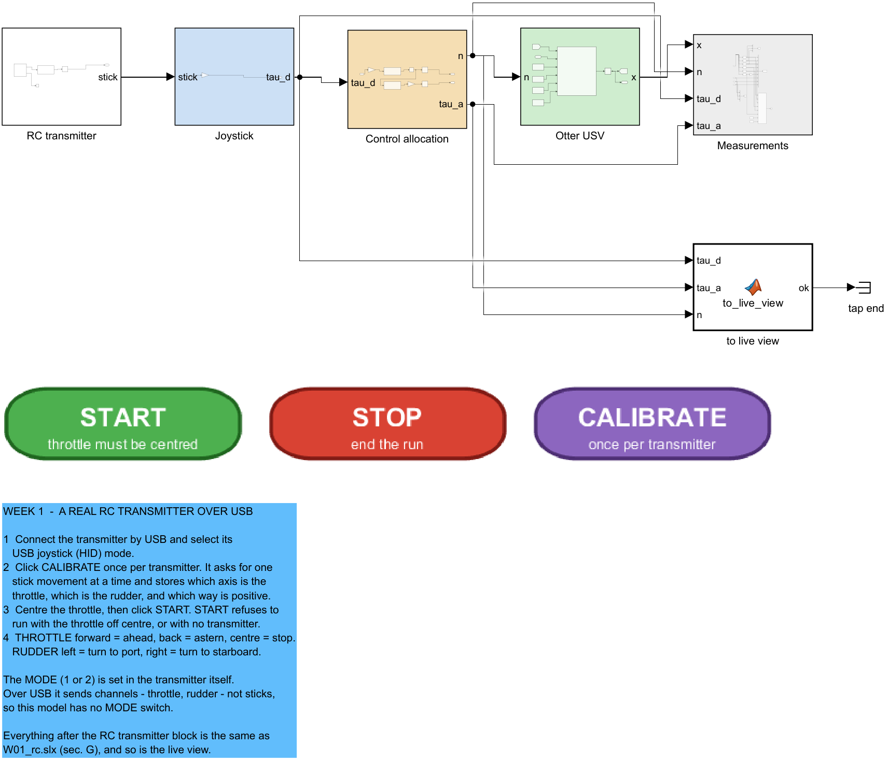

**그림을 읽기**

| 요소 | 뜻 |
|---|---|
| `RC transmitter` (흰색) | Joystick Input, 그 다음 `USB receiver`, 그 다음 벡터 `stick` 으로의 reshape. 장치의 buttons 출력은 종단된다 |
| 사슬의 나머지 | 실험 1-10b 의 모델과 동일하다 |
| START, STOP, CALIBRATE | START 는 장치와 스로틀을 확인하고 정지에서 시작한다. CALIBRATE 는 `W01_H_usb_setup` 을 돌린다 |

### 송신기 없이 검증한 것

```matlab
W01_H_usb_check
```

- 송신기가 보태는 유일한 신호는 Joystick Input 출력의 축 벡터다. `W01_H_usb_check.m` 은 그 블록을 같은 모양의 Constant — 축 여덟을 가진 가짜 송신기 — 로 바꾼 `W01_rc_usb.slx` 의 임시 복사본을 만들고, 경우마다 정지에서 $60$ s 돌린다.

| 가짜 송신기 | $s_T$ | $s_R$ | $n_L$, $n_R$ [rad/s] | $u$ [m/s] | $r$ [deg/s] |
|---|---|---|---|---|---|
| AETR, 스로틀 완전 앞 | $1.000$ | $0.000$ | $103.93,\ 103.93$ | $3.0864$ | $0.000$ |
| AETR, 스로틀 완전 뒤 | $-1.000$ | $0.000$ | $-101.74,\ -101.74$ | $-1.7203$ | $0.000$ |
| AETR, 반 전진, 반 좌타 | $0.500$ | $-0.500$ | $48.89,\ 91.71$ | $1.4542$ | $-8.845$ |
| AETR, 반 전진, 반 우타 | $0.500$ | $0.500$ | $91.71,\ 48.89$ | $1.4542$ | $+8.845$ |
| TAER, 반 전진, 반 좌타 | $0.500$ | $-0.500$ | $48.89,\ 91.71$ | $1.4542$ | $-8.845$ |
| 스로틀 축을 뒤집고, 같은 스틱 | $0.500$ | $-0.500$ | $48.89,\ 91.71$ | $1.4542$ | $-8.845$ |

- 스로틀 앞이 전진을, 뒤가 후진을 몬다. 러더 왼쪽이 좌현으로, 오른쪽이 우현으로 돌린다.
- 반 전진에 반 좌타는 채널 순서와 스로틀 축의 방향이 무엇이든, 모델에 어느 것이 어느 것인지 알려 주기만 하면 실험 1-10b 의 7번 경우를 찍힌 모든 자리까지 재현한다.
- CALIBRATE 의 축 찾기는 모의 읽기를 받아 AETR, TAER, 뒤집힌 축에 대해 스로틀과 러더 축과 그 부호를 찾아냈고, 어느 축도 자기 행정의 4분의 1 만큼 움직이지 않은 읽기는 거부했다.
- 장치를 연결하지 않은 START 는 대화창 *No transmitter on joystick 1: Joystick is not connected* 을 열고 시뮬레이션을 멈춘 채로 두었다.

> [!warning] 검증되지 않은 것
> Joystick Input 블록 자체 — 실물 장치를 읽는 것 — 은 이 절을 쓸 때 송신기가 연결되어 있지 않아 시험되지 않았다. 그 아래의 모든 것은 시험되었다. 실물 송신기로 하는 첫 실행이 아래의 확인이다.

### 실물 송신기로 하는 첫 실행

- 송신기를 조이스틱 모드로 USB 로 연결하고, `W01_rc_usb.slx` 를 열고, CALIBRATE 를 눌러 대화창 셋을 따르고, 그 다음 스로틀을 중앙에 두고 START 를 누른다. 아래가 모두 성립할 때 그 실행이 옳다.

| 이렇게 한다 | 옳은 경우 |
|---|---|
| CALIBRATE | 마지막 대화창이 서로 다른 축 둘을 지목하고, CALIBRATE 를 되풀이하면 같은 둘을 지목한다 |
| 스로틀을 중앙에 두고 START | 실시간 화면이 열리고 배가 원점에 머문다 |
| 스로틀 앞으로 | 실시간 화면의 빈 원이 올라가고 $u > 0$ |
| 스로틀 뒤로 | $u < 0$, 그리고 원이 $X = -133.4$ N 아래에서 따라오기를 멈춘다 |
| 러더 왼쪽, 그 다음 놓는다 | $r < 0$ 이고 항적이 좌현으로 휜다. 놓은 뒤 스프링이 스틱을 중앙으로 돌리고 $r \to 0$ |
| 송신기 자신의 메뉴에서 모드를 바꾼다 | 모델에서 아무것도 바뀌지 않는다. 채널이 같기 때문이다 |

## 1-11. 전진만 — 1차 시스템

- 3주차의 속도 제어기는 스칼라 방정식 하나 위에서 설계된다. 이 절은 그 방정식을 전체 모델의 전진 줄에서 유도하고, 그 길에서 버린 모든 항을 밝히고, 버린 것이 무엇을 비용으로 치르는지 잰다.

### 전진 줄, `otter.m` 이 적분하는 그대로

- 6자유도 방정식의 1번 줄(`otter.m` 203행, 2021 릴리스). $\mathbf{M}$ 과 $\mathbf{C}$ 의 성분은 `_tools/verify_w01_theory.m` 이 줄 단위로 다시 만든 행렬에서 읽었다.

$$
M_{11}\,\dot u + M_{15}\,\dot q + \left[\mathbf{C}(\boldsymbol{\nu}_r)\boldsymbol{\nu}_r\right]_1
= X + X_u\,u_r + \tau_{\text{cross},1} - \left[\mathbf{G}\boldsymbol{\eta}\right]_1 - g_{0,1}
$$

$$
\left[\mathbf{C}\boldsymbol{\nu}\right]_1 = -M_{22}\,v\,r - M_{26}\,r^2 + (\text{terms in } p,\ q,\ w)
$$

| 기호 | 값 | 출처 |
|---|---|---|
| $M_{11} = (m+m_p) - X_{\dot u}$ | $85.50$ kg | `M(1,1)`. 108, 112, 125행 |
| $M_{15} = (m+m_p)\,z_g$ | $-19.75$ kg·m — 전진–종동요 결합. 무게중심이 원점보다 $0.247$ m **위**에 있기 때문이다($z$ 는 아래를 가리킨다) | `M(1,5)` |
| $X$ | $T_1 + T_2$ | 181행, §1-10 |
| $X_u$ | m/s 당 $-77.554$ N | 157행, $-24.4\,g/U_{\max}$ |
| $\tau_{\text{cross},1}$ | $0$ — `crossFlowDrag` 은 횡동요와 요만 돌려준다 | 194행 |
| $[\mathbf{G}\boldsymbol{\eta}]_1$, $g_{0,1}$ | $0$ — 전진에 복원이 없다 | §1-7 |

- $\mathbf{M}$ 의 전진 줄의 다른 성분은 0 이다. 선체가 좌우 대칭이므로 $M_{16} = -(m+m_p)\,y_g$ 가 사라지고, $M_{12}$, $M_{13}$, $M_{14}$ 는 $\mathbf{M}_{RB}$ 의 구조상 0 이다.

| 버린 항 | $n = [60, 60]$ 으로 정지에서 직진할 때의 크기 | 왜 가나 | 언제 돌아오나 |
|---|---|---|---|
| $M_{15}\,\dot q$ | $X = 79.78$ N 에 대해 최대 $9.14$ N | 선체가 종동요하는 동안에만, 많아야 $0.39°$ 만큼 작용한다. 여기서 항등적으로 0 이 아닌 유일한 버린 항이다 | 설계 모델에서는 결코. 아래에서 재는 잔차의 전부가 그것이다 |
| $-M_{22}\,v\,r - M_{26}\,r^2$ | 정확히 $0$ | 대칭 선체에 같은 추력은 $v = r = 0$ 을 준다 | 모든 선회 — 4주차 |
| $\mathbf{C}$ 의 $p$, $q$, $w$ 항 | 최대 $0.012$ N | 작은 과도 둘의 곱 | 이 선체에서는 아니다 |
| $X_u\,(u_r - u)$ | $0$ | $V_c = 0$ | §1-13 과 5주차 |

### 1차 모델, 한 단계씩

$$
\begin{aligned}
M_{11}\,\dot u &= X + X_u\,u && \text{the terms that survive} \\
M_{11}\,\dot u &= X - \lvert X_u\rvert\,u && X_u < 0\ \text{because it is damping} \\
M_{11}\,\dot u + \lvert X_u\rvert\,u &= X && \text{collect the terms in } u \\
\frac{M_{11}}{\lvert X_u\rvert}\,\dot u + u &= \frac{1}{\lvert X_u\rvert}\,X && \text{divide by } \lvert X_u\rvert \\
T_u\,\dot u + u &= K_u\,X && \text{the standard first-order form}
\end{aligned}
$$

- 수 둘이 그것을 완전히 서술한다.

$$
T_u = \frac{M_{11}}{\lvert X_u\rvert} = \frac{85.50}{77.55} = 1.1025\ \text{s},
\qquad
K_u = \frac{1}{\lvert X_u\rvert} = 0.012894\ \frac{\text{m/s}}{\text{N}}
$$

- 전달함수로, 그리고 정지에서의 계단응답으로:

$$
\frac{u(s)}{X(s)} = \frac{K_u}{T_u\,s + 1},
\qquad
u(t) = K_u X\left(1 - e^{-t/T_u}\right)
$$

- $t = T_u$ 에서 괄호가 $1 - e^{-1} = 0.632$ 다. 그래서 아래의 확인이 $u$ 가 최종값의 $63.2\%$ 에 닿는 순간을 읽는다. 그 순간이 곧 측정된 $T_u$ 다.

| 확인 | 결과 |
|---|---|
| 차원 | $M_{11}/\lvert X_u\rvert$: kg ÷ (N·s/m) = s. $K_u$: N 당 (m/s) |
| 극한 $X_u \to 0$ | $T_u \to \infty$ 이고 $M_{11}\dot u = X$ 다. 뉴턴의 법칙만 남고 속도가 한없이 자란다 |
| 극한 $M_{11} \to 0$ | 즉시 $u = K_u X$ 다. 관성이 없으면 지연도 없다 |
| 부호 | $X = 0$ 이고 $u > 0$ 이면 $\dot u = -\lvert X_u\rvert u / M_{11} < 0$ 이다. 선체가 느려진다 |
| 플랜트와 대조 | `W01_openloop.slx` 에서(ode4, $h = 0.02$ s) $63.2\%$ 에 $1.1057$ s, `otter.m` 에 ode45 로 $1.1056$ s — $T_u$ 보다 $0.29\%$ 위다. 플랜트의 $u(t)$ 와 1차 곡선의 최대 차이는 $0.0063$ m/s 다 |

- 잔차는 $M_{15}\dot q$ 항이고, 첫 순간이 그것을 직접 보인다. 이 선체에서 전진력은 선체를 종동요시키기도 하므로, 플랜트의 초기 가속도는 $X$ 를 $85.50$ kg 이 아니라 $76.71$ kg 으로 나눈 것이다. 그 $76.71$ kg 이 $1/[\mathbf{M}^{-1}]_{11}$ 이고 — 종동요 결합이 자기 몫을 가져간 뒤 남는 관성이다. 종동요각은 $0.39°$ 를 결코 넘지 않고, 그것이 정착하면 1차 모델이 인수한다.

### 종단속력

- **종단속력**은 일정한 명령 아래에서 배가 가속을 멈추는 속력이다. 그때 추력이 정확히 감쇠에 흡수되기 때문이다. 같은 양을 정상상태 속력 또는 정착 속력이라고도 한다. $\dot u = 0$ 으로 두면

$$
u_{ss} = K_u\,X = \frac{X}{\lvert X_u\rvert} = \frac{2\,k_{\text{pos}}\, n\lvert n\rvert}{\lvert X_u\rvert}
$$

| $n$ [rad/s] | $X$ [N] | $u_{ss}$ [m/s] | $u_{ss}$ [kn] |
|---|---|---|---|
| 30 | 19.944 | 0.2572 | 0.500 |
| 60 | 79.776 | 1.0286 | 2.000 |
| 90 | 179.496 | 2.3145 | 4.499 |
| $n_{\max} = 103.93$ | 239.364 | 3.0864 | 6.000 |

- 배는 그것에 점근적으로 다가가고 $4T_u = 4.41$ s 뒤에 $2\%$ 안에 든다.
- 마지막 줄은 구성상 정확하다. `otter.m` 은 $n_{\max}$ 를 $2k_{\text{pos}}n_{\max}^2 = 24.4\,g$ 로(95행), $X_u$ 를 $\lvert X_u\rvert = 24.4\,g/U_{\max}$ 로(157행) 정의하므로 전추력이 $u_{ss} = U_{\max} = 6$ 노트에서 끝난다. 선형 감쇠계수는 스로틀의 전 행정이 정확히 설계 속력을 덮도록 보정된 것이다.

> [!important] 2차 추력 대 선형 감쇠
> 균형의 두 쪽이 서로 다른 속도로 자란다. 추력은 축 회전수의 **제곱**으로 자라고 $X = 2k_{\text{pos}}n\lvert n\rvert$ 다(§1-10). 감쇠는 속도에 **비례**해서만 자라고 $\lvert X_u\rvert u$ 다. 그래서 균형이 $u_{ss} \propto n\lvert n\rvert$ 을 주고, $n$ 을 두 배 하면 종단속력이 네 배가 된다 — $30 \to 60$ rad/s 가 $0.2572 \to 1.0286$ m/s 를 준다. 저항이 2차인 선체 $X_{\lvert u\rvert u}\lvert u\rvert u$ 라면 대신 $u_{ss} \propto n$ 을 줄 것이다. 2021년판 `otter.m` 에는 선형 항만 있다(184행). 실험 1-11 이 그 예측을 시험한다.

### 실험 1-11 · 종단속력을 예측하고, 그 다음 재기 (30분)

### 1단계 — 종이 위에서 예측한다

- 무엇을 돌리기 전에, 두 프로펠러 모두 $n = 60$ rad/s 에 대한 종단 전진속력을 §1-11 로 계산한다.

$$
X = 2\,k_{\text{pos}}\,n|n| = 2 \times 0.011080 \times 60^2 = 79.776\ \text{N}
$$

$$
u_{ss} = \frac{X}{|X_u|} = \frac{79.776}{77.554} = 1.0286\ \text{m/s}
$$

### 2단계 — 잰다

```matlab
W01_C_terminal_speed
```

> [!note] 이 절의 모든 그림을 만들려면
> `W01_C_terminal_speed.m` 이 `dn = 0` 으로 `W01_openloop.slx` 를 네 번 돌리고, 아래 표를 찍고, `img/W01_result_speed.png` 을 쓴다.

네 명령에 대해 잰 값:

| $n$ [rad/s] | $X$ [N] | 예측 $u_{ss}$ [m/s] | 측정 $u$ [m/s] |
|---|---|---|---|
| 20 | 8.864 | 0.1143 | 0.1143 |
| 40 | 35.456 | 0.4572 | 0.4572 |
| 60 | 79.776 | 1.0286 | 1.0286 |
| 80 | 141.824 | 1.8287 | 1.8287 |

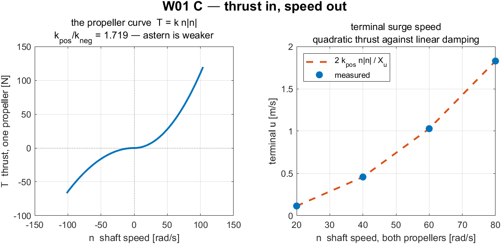

**그림을 읽기**

| 요소 | 뜻 |
|---|---|
| 왼쪽 칸 | 프로펠러 곡선 $T = k\,n\lvert n\rvert$. $k$ 가 바뀌는 $n = 0$ 에 꺾임이 있다 |
| 오른쪽 칸, 파선 | 손 예측 $2k_{\text{pos}}n\lvert n\rvert / \lvert X_u\rvert$ |
| 오른쪽 칸, 표식 | 시뮬레이션에서 잰 정착 속력 |

**그림이 말하는 것**

왼쪽 칸은 프로펠러 혼자다 — 축 회전수가 들어가고 추력이 나온다. 오른쪽 칸은 배 전체를 명령마다 수 하나로 줄인 것이다. 결국 얼마나 빠르게 가게 되는가.

두 곡선이 같은 쪽으로 휘고, 그것이 발견이다. 축 회전수를 $20$ 에서 $40$ rad/s 로 두 배 해도 배의 속력은 두 배가 되지 않고 **네 배**가 된다 — $0.1143 \to 0.4572$ m/s. $80$ rad/s 로 다시 두 배 하면 또 네 배가 되어 $1.8287$ m/s 다. 표식을 지나는 선은 포물선이다.

이유는 정상상태에서 서로 다른 두 법칙이 만나기 때문이다. 추력은 축 회전수의 *제곱*으로 자라고 $T = k\,n\lvert n\rvert$ 이며, 감쇠는 속도에 비례해서만 자란다. 둘을 같게 두면

$$2k_{\text{pos}}\,n\lvert n\rvert = \lvert X_u\rvert\,u \qquad\Longrightarrow\qquad u \propto n^2 .$$

파선 예측과 측정된 표식이 소수 네 자리까지 일치하고, 그 일치는 잠깐 멈춰 볼 가치가 있다. 예측은 스칼라 방정식 하나에서 왔고, 측정은 열두 상태의 비선형 모델에서 왔다. 둘이 맞는 것은 다른 것이 움직이지 않을 때 **`otter.m` 의 전진 감쇠가 정말로 선형이기** 때문이다 — 방법에 대한 사실이 아니라 이 배에 대한 사실이다. 4주차가 같은 연습을 요 축에서 하고 근사만 얻는데, 두 주차의 차이는 선체의 성질이다.

여기에는 제어기가 끼어들지 않는다. 아직 없기 때문이다. 이 네 점이 뒤의 모든 주차가 그 아래에서 일하는 천장이다. 어떤 속도 제어기도 프로펠러가 만들 수 없는 속력을 요구할 수 없다.

## 1-12. 횡방향 힘 없는 횡방향 속도

- §1-10 은 $Y \equiv 0$ 을 세웠다. 그런데도 선회하는 배의 시뮬레이션은 $v \neq 0$ 을 보인다. 두 진술은 충돌하지 않고, 운동방정식의 횡동요 줄이 왜 그런지를 보인다.

### 횡동요 줄, `otter.m` 이 적분하는 그대로

- 6자유도 방정식의 2번 줄(`otter.m` 203행, 2021 릴리스). 모든 항을 썼다.

$$
M_{22}\,\dot v + M_{24}\,\dot p + M_{26}\,\dot r + \left[\mathbf{C}(\boldsymbol{\nu}_r)\boldsymbol{\nu}_r\right]_2
= Y + Y_v\,v_r + Y_{\text{cf}} - \left[\mathbf{G}\boldsymbol{\eta}\right]_2
$$

| 기호 | 값 | 출처 |
|---|---|---|
| $M_{22} = (m+m_p) - Y_{\dot v}$ | $162.50$ kg | `M(2,2)`. 108, 113, 125행 |
| $M_{24}$ | $19.75$ kg·m — 횡동요–횡요 결합, 무게중심 높이 $z_g$ 를 통해 | `M(2,4)` |
| $M_{26} = (m+m_p)\,x_g$ | $12.25$ kg·m — 횡동요–요 결합, $x_g = 0.153$ m 를 통해 | `M(2,6)` |
| $\left[\mathbf{C}\boldsymbol{\nu}\right]_2$ | $85.50\,u\,r$, 더하기 $p$, $q$, $w$ 항 | 104–126행, 아래에서 유도 |
| $Y$ | 모든 명령에 대해 $0$ | §1-10, $\mathbf{B}$ 의 빈 줄 |
| $Y_v$ | 이 강의가 돌리는 2021 릴리스에서 $0$ | 158행 |
| $Y_{\text{cf}}(v, r)$ | 횡류 항력. `crossFlowDrag` 이 돌려주는 힘 | 194행 |
| $\left[\mathbf{G}\boldsymbol{\eta}\right]_2$ | $0$ — 횡방향 위치를 복원하는 것이 없다 | §1-7 |

- $\mathbf{M}$ 의 성분들은 `_tools/verify_w01_theory.m` 이 줄 단위로 다시 만든 행렬에서 읽었고, 유한차분으로 잰 것이 아니다.

| 버린 항 | 왜 가나 | 언제 돌아오나 |
|---|---|---|
| $M_{24}\,\dot p$ | 횡요는 구동되지 않고 부력이 복원한다(§1-7) | 횡요를 감쇠해야 할 때의 4자유도 모델 |
| $\mathbf{C}$ 의 $p$, $q$, $w$ 항 | 횡요·종요·상하동요 속도와의 곱. 그것들 없이도 아래의 정상선회 균형이 $2.6\times10^{-5}$ N 까지 닫힌다 | 이 선체에서는 아니다 |
| $Y_v\,v_r$ | 2021년판 `otter.m` 에서 $Y_v = 0$ | MSS 의 2024년 재보정은 $Y_v = -M_{22}/T_{\text{sway}}$ 를 쓴다 |
| $Y$ | $\mathbf{B}$ 의 기하상 0 | 횡방향 성분을 가진 구동기 — 부록 A1 |

- 남는 것은 평면 횡동요 방정식이다.

$$
\boxed{\ M_{22}\,\dot v + M_{26}\,\dot r + M_{11}\,u\,r = Y_{\text{cf}}(v, r)\ }
$$

### $M_{11}\,u\,r$ 은 어디서 오는가

- 횡동요의 코리올리 계수는 **전진 관성** $M_{11}$ 자체다. 그 두 부분이 각각 한 행렬에서 온다.
- **강체**(`otter.m` 104행과 107–109행). $\mathbf{C}_{RB}$ 는 무게중심에서 만들어 원점으로 옮긴다. $\boldsymbol{\nu}_2 = [0\ \ 0\ \ r]^{\!\top}$, $\mathbf{r}_g = [x_g\ \ 0\ \ z_g]^{\!\top}$ 로

$$
\begin{aligned}
\boldsymbol{\nu}_1 + \boldsymbol{\nu}_2 \times \mathbf{r}_g
&= \begin{bmatrix} u \\ v \\ 0 \end{bmatrix} + \begin{bmatrix} 0 \\ x_g\,r \\ 0 \end{bmatrix}
= \begin{bmatrix} u \\ v + x_g r \\ 0 \end{bmatrix}
&& \text{velocity of the CG} \\[4pt]
(m + m_p)\,\boldsymbol{\nu}_2 \times \begin{bmatrix} u \\ v + x_g r \\ 0 \end{bmatrix}
&= (m + m_p)\begin{bmatrix} -r\,(v + x_g r) \\ u\,r \\ 0 \end{bmatrix}
&& \text{Coriolis force at the CG}
\end{aligned}
$$

- $\mathbf{H}^{\!\top}$ 로 원점으로 옮기면 세 힘 줄이 바뀌지 않으므로, 횡동요 줄은 $(m+m_p)\,u\,r = 80.00\,u\,r$ 을 유지한다.
- **부가질량**(`otter.m` 120–122행). `m2c` 가 $\mathbf{M}_A$ 에서 $\mathbf{C}_A$ 를 만들고, 그 횡동요 줄은 $-X_{\dot u}\,u\,r + Z_{\dot w}\,w\,p$ 다. 요 성분 둘 `CA(6,1)` 과 `CA(6,2)` 만 0 으로 되므로 이 항은 살아남는다 — 평면에서 $5.50\,u\,r$ 이다.
- 합치면

$$
\left[\mathbf{C}\boldsymbol{\nu}\right]_2 = \left(m + m_p - X_{\dot u}\right) u\,r = M_{11}\,u\,r = 85.50\,u\,r
$$

- 읽기: 배는 전진 운동량 $M_{11}u$ 를 지닌다. $r$ 로 도는 선체 좌표계는 그 운동량이 $M_{11}u\,r$ 의 속도로 방향을 바꾸는 것을 보고, 선체 좌표계에서 그 변화가 횡방향 힘으로 나타난다. 그래서 앞으로 가면서 **그리고** 도는 배는 어디에도 횡방향 힘이 없는데 횡방향 속도를 얻는다.

> [!warning] 그 계수는 $m - X_{\dot u}$ 가 아니라 $m + m_p - X_{\dot u}$ 다
> 교재의 3자유도 형태는 강체 질량 전체를 $m$ 으로 쓴다. 이 배에서 그것은 $m + m_p = 80.0$ kg 이다. §1-9 가 $m = 55$ kg 을 선체만을 위해 남겨 두기 때문이다. $m$ 을 선체 질량으로 읽으면 $85.50$ kg 대신 $60.5$ kg 이 나온다. §1-7 에 찍힌 3자유도 행렬 $\mathbf{C}(\boldsymbol{\nu})$ 는 강체 부분뿐이고, $\mathbf{C}_A$ 가 남는 $5.50$ kg 을 더한다.

### 정상선회

- 정상선회에서 $\dot v = \dot r = 0$ 이므로 $\mathbf{M}$ 이 방정식을 떠나고 균형은

$$
Y_{\text{cf}}(v, r) = M_{11}\,u\,r
$$

- 횡류 항력이 그 표류에 맞서는 유일한 항이므로, $v$ 는 그것이 만드는 항력이 $M_{11}ur$ 와 같아질 때까지 자란다. `_tools/verify_w01_theory.m` 이 실험 1-12 의 정상 좌선회 $n = [56.5,\ 63.5]$ rad/s 에서 잰 값:

| 양 | 값 |
|---|---|
| $u$, $v$, $r$ | $1.0218$ m/s, $0.1264$ m/s, $-2.2941$ deg/s |
| $M_{11}\,u\,r$ | $-3.4980$ N |
| 같은 상태에서 `crossFlowDrag` 의 $Y_{\text{cf}}$ | $-3.4980$ N |
| 잔차 | $2.6\times10^{-5}$ N |

> [!note] 이 선체에는 선형 횡동요 감쇠가 없다
> 2021년판 `otter.m` 은 `Yv = 0` 으로 둔다. 횡방향 운동에 저항하는 모든 것이 횡류 항력 적분 `crossFlowDrag` 에서 오고, 그것은 선체를 따라 국소 횡방향 속도 $v + x\,r$ 에 대해 2차다. 정상 횡방향 속도는 코리올리 힘과 횡류 항력이 균형을 이루는 점이고, 어떤 선형 항도 거기에 참여하지 않는다.

- 남은 항 $M_{26}\,\dot r$ 은 $r$ 이 변하는 동안에만 작용한다 — 각 선회의 진입과 이탈에서다. 적재가 무게중심을 원점보다 $0.153$ m 앞에 두므로, **순수한 요 모멘트가 횡방향 가속도를 만든다.** N·m 당 $\dot v = [\mathbf{M}^{-1}]_{26}\,N = -1.305\times10^{-3}$ m/s² 이고, 어디에도 횡방향 힘이 없다. 부록 A1 이 이것을 직접 잰다.
- 그래서 둘은 서로 다른 영역을 차지한다. $M_{26}\dot r$ 은 선회의 첫 순간들을 모양 짓고, $M_{11}ur$ 은 정상 표류를 정한다.
- 배가 가리키는 곳과 실제로 가는 곳 사이의 각이 **크랩각**이다.

$$
\beta = \operatorname{atan2}(v, u), \qquad \chi = \psi + \beta
$$

여기서 $\chi$ 는 침로각이다. 5주차 §5-5 가, 배가 $\chi$ 를 따라 이동하는 동안 $\psi$ 를 조절하는 유도 법칙이 영구적인 경로 오차를 남긴다는 것을 보이고, 그것을 $\Delta\tan\beta$ 로 잰다.

### 실험 1-12 · 조함 하나: 직진, 좌선회, 직진, 우선회, 직진 (30분)

- 배가 실제 USV 에게 처음 주어질 조함을 돌린다. 침로를 유지하고, 좌로 돌고, 유지하고, 우로 돌고, 유지한다. 150 s 가 걸리고, 그 안의 어느 것도 제어되지 않는다 — 두 축 회전수가 그저 시간표를 따른다.
- 이 실행은 질문 넷에 답하기 위해 있고, 직진 실행은 그 어느 것에도 답할 수 없다.

| 질문 | 답을 읽는 곳 | 이 실행에서의 답 |
|---|---|---|
| 축 회전수의 작은 차이가 배를 돌리는가? | 실시간 대시보드의 $\psi$ | 그렇다 — $3.5$ rad/s 의 차이에서 $-70.2°$ 와 $+70.6°$ |
| 좌선회를 위해 어느 프로펠러가 느려지는가? | 아래 시간표 | **왼쪽** 것 |
| 선체가 횡방향 힘 없이 옆으로 움직일 수 있는가? | $Y$ 에 대한 $v$ | $Y$ 가 정확히 0 인 동안 $v = \pm 0.1264$ m/s — §1-12 |
| 선수가 배가 가는 곳을 가리키는가? | 항적을 따라 그린 선체 윤곽 | 아니다 — 둘이 크랩각만큼 다르고, 각 선회에서 $7.05°$ 다 |
- **아무것도 역전하지 않는다.** 두 프로펠러 모두 실행 내내 전진으로 돈다. 선회는 둘 사이의 작은 차이다. 요 모멘트가 다음이기 때문이다.

$$
N = y_{\text{pont}}\left(T_{\text{left}} - T_{\text{right}}\right), \qquad y_{\text{pont}} = 0.395\ \text{m}
$$

| 구간 | $t$ [s] | $n_L$ | $n_R$ | 선회 |
|---|---|---|---|---|
| 직진 1 | 0 – 30 | 60.0 | 60.0 | — |
| 좌선회 | 30 – 60 | 56.5 | 63.5 | 좌로, $\psi$ 가 줄어든다 |
| 직진 2 | 60 – 90 | 60.0 | 60.0 | — |
| 우선회 | 90 – 120 | 63.5 | 56.5 | 우로, $\psi$ 가 커진다 |
| 직진 3 | 120 – 150 | 60.0 | 60.0 | — |

> [!note] 좌선회를 위해 어느 프로펠러가 느려지는가
> **왼쪽**에 추력이 더 많으면 양의 $N$ 이 나오고, 그것이 선수를 **우현**으로 돌린다. 그래서 좌현으로의 선회는 오른쪽이 아니라 **왼쪽** 프로펠러를 느리게 한다. 이것을 거꾸로 아는 것이 이번 주 전체에서 가장 흔한 부호 오류이고, 항적이 그것을 즉시 보인다.

### 측정

```matlab
W01_D_the_manoeuvre
```

> [!note] 이 절의 모든 그림을 만들려면
> `W01_D_the_manoeuvre.m` 이 `W01_openloop.slx` 을 150 s 전체로 한 번 돌리고, 아래 표를 찍고, `img/W01_result_track.png` 을 쓴다. 세 선체 좌표 속도는 여기서 다시 그리지 않는다 — 모델 안의 실시간 대시보드가 실행 중에 $u$, $v$, $r$, $x$, $y$, $\psi$ 를 그린다.

- 각 줄은 그 구간의 **마지막 5분의 1** 에 대한 평균이고, 구간 경계의 과도가 사그라든 뒤다. 구간 전체를 평균하면 과도가 정상 수치에 섞인다.

| 구간 | $u$ [m/s] | $v$ [m/s] | $r$ [deg/s] | $\beta$ [deg] |
|---|---|---|---|---|
| 직진 1 | 1.0286 | 0.0000 | 0.0000 | 0.0000 |
| 좌선회 | 1.0218 | +0.1264 | −2.2942 | +7.0528 |
| 직진 2 | 1.0287 | 0.0215 | 0.0085 | 1.1955 |
| 우선회 | 1.0218 | −0.1264 | +2.2942 | −7.0526 |
| 직진 3 | 1.0287 | −0.0215 | −0.0085 | −1.1948 |

- 선수각 변화: 좌선회에서 **−70.2°**, 우선회에서 **+70.6°**. 둘이 $0.41°$ 만큼 다르므로 선체는 중심선에 대해 대칭이고 `otter.m` 의 어느 것도 한쪽을 편애하지 않는다.
- 우선회에서 명령된 요 모멘트는 $N = +3.676$ N·m 다. 느린 프로펠러도 여전히 $35.37$ N 으로 **앞으로** 밀고, 빠른 쪽은 $44.68$ N 으로 민다.

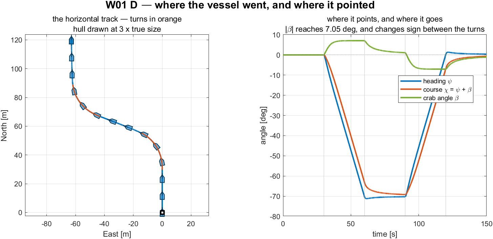

**그림을 읽기**

| 요소 | 뜻 |
|---|---|
| 왼쪽 칸, 파랑 / 주황 | 직진 구간 / 선회 둘 |
| 왼쪽 칸, 윤곽 | 실제 크기의 3배로 그린 선체, 그 선수각 선과 함께 |
| 오른쪽 칸, 파랑 | 선수각 $\psi$ — 배가 **가리키는** 곳 |
| 오른쪽 칸, 주황 | 침로 $\chi = \psi + \beta$ — 실제로 **가는** 곳 |
| 오른쪽 칸, 초록 | 크랩각 $\beta$, 둘 사이의 간격 |

**그림이 말하는 것**

왼쪽 칸은 *어디로 갔는가* 에 답한다. 오른쪽 칸은 *그렇게 가는 동안 어디를 가리키고 있었는가* 에 답한다. 그 둘이 서로 다른 질문으로 드러난다.

각 선회 동안 두 답이 $7.05°$ 만큼 다르다. 배가 한쪽을 가리키고 다른 쪽으로 가며, 그 간격에는 이름이 있다.

$$\chi = \psi + \beta, \qquad \beta = \operatorname{atan2}(v, u) = \operatorname{atan2}(0.1264,\ 1.0218) = +7.05° .$$

도는 배는 언제나 얼마쯤의 횡방향 속도 $v$ 를 지니므로, 언제나 자기 중심선에 비스듬한 방향으로 움직인다. **선수각은 침로가 아니고, 그 차이는 오차가 아니다** — 크랩각이고, 그것이 맨 선 대신 선체 윤곽을 항적을 따라 그리는 이유다. 맨 선은 선수가 어디를 가리키고 있었는지 보일 수 없다.

선회 자체는 거의 공짜다. 전진이 $1.0286$ 에서 $1.0218$ m/s 로 떨어진다 — 1 퍼센트의 10분의 7 이다. $n\lvert n\rvert$ 이 위로 휘기 때문에 빨라지는 프로펠러가 느려진 쪽이 잃는 것보다 더 얻고, 그래서 전체 추력이 거의 바뀌지 않는다. 그것이 차동 선회가 쌍축 운동체를 조종하는 값싼 방법인 이유이고, 프로펠러를 역전시키는 것을 정지 상태의 조함용으로 남겨 두는 이유다.

`W01_0_setup.m` 의 `dn` 을 올리면 크랩각이 넓어진다. $\beta$ 가 회두율과 함께 자라기 때문이다. 4주차 §4-4 가 그것을 둘러 조종해야 하고, 5주차의 시선 유도가 결국 그 대가를 치르는 자리다.

> [!important] 횡방향 힘은 0 이고 횡방향 속도는 0 이 아니다
> 조함의 모든 명령에 걸쳐 $\max\lvert Y\rvert = 0.0 \times 10^{0}$ N 이다 — 작은 것이 아니라 **구조적으로** 0 이다. 두 프로펠러가 앞을 향하고 §1-10 의 $\mathbf{B}$ 에 횡동요 줄이 없기 때문이다. 그런데도 배는 $\pm 0.1264$ m/s 로 횡으로 흐르고, $v$ 가 두 선회 사이에 **부호를 바꾼다.** 그 횡방향 운동은 선체가 회전하는 동안 작용하는 §1-12 의 코리올리 항 $M_{11}\,u\,r$ 이고 힘이 아니다. $Y \approx 0$ 과 $Y = 0$ 을 같은 관측으로 보고하는 것은 §1-10 의 내용 전체를 잃는 것이다.

## 1-13. 조류 — 힘이 아니라 속도

- §1-12 는 배 자신의 회전에서 표류를 만들어 냈다. 조류는 배가 아무것도 하지 않아도 표류를 만들고, Part 2 앞에 필요한 마지막 것이다.

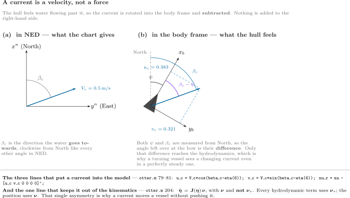
**그림을 읽기**

| 요소 | 뜻 |
|---|---|
| 왼쪽 칸 | 해도가 주는 그대로의 조류. 속력 $V_c$ 와, NED 의 다른 모든 각처럼 **북에서 시계방향으로** 잰 방향 $\beta_c$ |
| $\beta_c$ | 물이 **향해 가는** 방향. $\beta_c = 0$ 은 물을 북으로 보낸다 |
| 오른쪽 칸 | 같은 조류를 $\{b\}$ 로 회전시켜 $u_c$ 와 $v_c$ 로 분해한 것 |
| $\beta_c - \psi$ | 흐름이 선체와 이루는 각. 유체역학에 중요한 것은 이 차이뿐이다 |
| 상자 | 조류를 모델에 넣는 세 줄, 그리고 그것을 운동학에서 빼 두는 한 줄 |

### 조류가 힘일 수 없는 이유

가장 자연스러운 첫 짐작은 조류가 선체를 밀고, 따라서 프로펠러처럼 $\boldsymbol{\tau}$ 에 더해야 한다는 것이다. 사고실험 하나가 그것을 배제한다.

**강에 통나무를 떨어뜨린다.** 그것은 물의 속력과 정확히 같은 속력으로 하류로 떠내려간다. 이제 물이 그것에 어떤 힘을 가하는지 물어보자. 답은 **없다** 다. 통나무와 물이 함께 움직이므로 통나무 옆으로 흐르는 물이 없고, 항력은 무엇 옆으로 물이 흐를 때 일어나는 것이다. 통나무는 대지 위를 움직이면서 아무것도 느끼지 않는다.

조류가 힘이라면 그 통나무는 강에 있는 동안 계속 가속할 것이다. 그러지 않는다. 그래서 조류가 무엇이든, 그것은 $\mathbf{M}\dot{\boldsymbol{\nu}} + \ldots = \boldsymbol{\tau}$ 의 오른쪽 변의 항이 아니다.

**선체가 실제로 반응하는 것은 자기 옆으로 흐르는 물**이다 — 자기 속도와 물의 속도의 차이다. 그 차이에 이름과 기호가 있다.

$$
\boldsymbol{\nu}_r = \boldsymbol{\nu} - \boldsymbol{\nu}_c
\qquad
\begin{array}{l}
\boldsymbol{\nu}\ \ \text{velocity over the ground} \\
\boldsymbol{\nu}_c\ \text{velocity of the water} \\
\boldsymbol{\nu}_r\ \text{velocity through the water}
\end{array}
$$

모든 유체역학 항 — 감쇠, 횡류 항력, 부가질량 코리올리 — 은 $\boldsymbol{\nu}$ 가 아니라 $\boldsymbol{\nu}_r$ 에서 계산된다. 떠내려가는 통나무처럼 $\boldsymbol{\nu} = \boldsymbol{\nu}_c$ 로 두면 $\boldsymbol{\nu}_r = \mathbf{0}$ 이고, 모든 유체역학 힘이 사라진다. 그래야 하는 대로다.

### 그 각이 $\beta_c - \psi$ 인 이유

조류는 정확히 수 둘로 서술되고, 둘 다 배가 아니라 **물**의 성질이다.

| 기호 | 정의 | 단위 | 어디서 정하나 | 부호 관습 |
|---|---|---|---|---|
| $V_c$ | 대지에 대한 **물의 속력**. 언제나 $\ge 0$ 이다. 조류에는 음의 속력이 없고 방향만 있다 | m/s | `WXX_0_setup.m` 의 `V_c` | $V_c = 0$ 은 정수다 |
| $\beta_c$ | 물이 **흘러가는 방향**. $\{n\}$ 에서 북에서 시계방향으로 잰다 | rad (준비 출력에서는 도) | `WXX_0_setup.m` 의 `beta_c` | $\beta_c = 0$ 은 물을 **북**으로 보낸다. $\beta_c = 90°$ 는 **동**으로 보낸다 |

> [!warning] $\beta_c$ 는 물이 **가는** 곳이고 **오는** 곳이 아니다
> 기상학은 바람을 그것이 불어 *오는* 방향으로 이름 짓는다. "북풍" 은 북에서 나와 남으로 분다. `otter.m` 은 조류에 대해 반대로 한다. $\beta_c = 0$ 은 물이 북을 **향해** 간다는 뜻이다. 두 관습이 정확히 $180°$ 다르므로, 하나를 다른 것으로 잘못 보면 모델의 모든 표류가 뒤집히고 항적이 거울상으로 나온다.
>
> $\beta_c$ 는 크랩각도 **아니다.** 크랩각은 $\beta$ 이고, 실행의 입력이 아니라 *결과*이며, §1-12 는 조류가 전혀 없는데도 그것을 하나 쟀다. 모델의 어느 것도 크랩각을 명령하게 하지 않는다.

둘 다 힘이 아니고, 둘 다 프로펠러와 아무 관계가 없다. 그것들은 다음 두 줄을 통해서만 모델에 들어온다.

조류는 $\{n\}$ 에서 주어진다 — 물이 $\beta_c$ 를 향해 $V_c$ 로 달린다.

$$
\boldsymbol{\nu}_c^{\,n} = V_c\begin{bmatrix} \cos\beta_c \\[2pt] \sin\beta_c \end{bmatrix} .
$$

그런데 $\boldsymbol{\nu}$ 는 $\{b\}$ 에 살므로, 둘이 같은 좌표계에 올 때까지 뺄셈을 할 수 없다. $\{n\}$ 에서 $\{b\}$ 로 회전시키는 것이 $\mathbf{R}(\psi)^{\!\top}$ 의 일이고 — §1-3 의 전치이며 새로운 것이 아니다.

$$
\begin{bmatrix} u_c \\[2pt] v_c \end{bmatrix}
= \mathbf{R}(\psi)^{\!\top}\,\boldsymbol{\nu}_c^{\,n}
= \begin{bmatrix} \phantom{-}\cos\psi & \sin\psi \\[2pt] -\sin\psi & \cos\psi \end{bmatrix}
  V_c\begin{bmatrix} \cos\beta_c \\[2pt] \sin\beta_c \end{bmatrix}
= V_c\begin{bmatrix} \cos\beta_c\cos\psi + \sin\beta_c\sin\psi \\[2pt]
                     \sin\beta_c\cos\psi - \cos\beta_c\sin\psi \end{bmatrix} .
$$

그 두 성분이 각 차이 항등식이고, 그것들이 접힌다.

$$
\boxed{\;
u_c = V_c\cos(\beta_c - \psi),
\qquad
v_c = V_c\sin(\beta_c - \psi)
\;}
$$

그래서 $\beta_c - \psi$ 는 **외울 새 관습이 아니다.** 그것은 $\mathbf{R}(\psi)^{\!\top}$ 이 작용하는 벡터를 크기와 각으로 썼을 때 그것이 되는 모양이다. $\beta_c$ 와 $\psi$ 를 둘 다 북에서 재므로, 그것들을 빼면 **선수**에서 잰 각이 남고 — 선체가 반응할 수 있는 것은 그것뿐이다. 그림의 (b) 칸이 세 호를 모두 같은 북선에서 그려, 그 뺄셈이 주장이 아니라 보이게 한다.

| 확인 | |
|---|---|
| $\psi = 0$ | $u_c = V_c\cos\beta_c$, $v_c = V_c\sin\beta_c$ — 선체 좌표계가 NED 좌표계다. 그래야 한다 |
| $\beta_c = \psi$ | $u_c = V_c$, $v_c = 0$ — 물이 선체를 따라 곧장 달린다. 정선미에서 정선수로 |
| $\beta_c = \psi + 90°$ | $u_c = 0$, $v_c = V_c$ — 순수 횡조류, 앞뒤 성분이 없다 |
| 그림의 수치 | $V_c = 0.5$, $\beta_c = 70°$, $\psi = 30°$ 이면 $\beta_c - \psi = 40°$ 이므로 $u_c = 0.383$, $v_c = 0.321$ m/s |

- $\psi$ 가 그 회전 안에 앉아 있기 때문에, **조류가 완벽히 일정해도 도는 배는 자기 좌표계에서 변하는 조류를 본다.** 물에 대해 바뀐 것은 없다. 그것이 재어지는 좌표계가 바뀐 것이다.

### 표류를 가능하게 만드는 비대칭

- §1-8 에서처럼 `otter.m` 은 두 속도를 서로 다른 자리에서 쓰고, 그것이 기작의 전부다.

| $\boldsymbol{\nu}_r$ 을 쓰는 것 — 물을 통해 | $\boldsymbol{\nu}$ 를 쓰는 것 — 대지 위로 |
|---|---|
| 선형 감쇠 $\mathbf{D}\boldsymbol{\nu}_r$ | 운동학 $\dot{\boldsymbol{\eta}} = \mathbf{J}(\boldsymbol{\eta})\boldsymbol{\nu}$ |
| 횡류 항력 | |
| 코리올리 $\mathbf{C}\boldsymbol{\nu}_r$ | |

> [!important] 조류는 배를 밀지 않고 움직인다
> 모델의 모든 힘이 $\boldsymbol{\nu}_r$ 에서 계산되므로, 일정한 조류에서 힘의 균형은 정수에서의 것과 **동일하고** 배는 *물에 대해* 같은 속력에 정착한다. 그런데 위치는 $\boldsymbol{\nu}$ 를 적분하고, 그것은 더 크거나 더 작거나 옆으로 향한다. 배는 밀리는 것이 아니라 실려 간다. 실험 1-13 이 그 문장의 두 절을 모두 잰다.

- 결과 둘이고, 둘 다 실험 1-13 에서 잰다.

| 조류 | 무엇이 일어나나 |
|---|---|
| 앞뒤 방향 ($\beta_c = 0°$ 또는 $180°$) | 항적은 곧게 남는다. **대지속력**만 정확히 $\pm V_c$ 만큼 바뀐다 |
| 횡방향 | 항적이 선수각에서 표류각만큼 벗어나고, $v_r$ 에 대한 횡류 항력이 요 모멘트를 만들어 선체를 서서히 **흐름 쪽으로 돌린다** — 아무 명령 없이 |

- 둘째는 §1-12 와 같은 크랩각이고 다른 길로 도착한 것이다. 5주차는 그 둘을 한꺼번에 둘러 조종해야 한다.

### 같은 것을 `otter.m` 에서, 줄 단위로

- 위의 네 단계가 한 파일의 코드 네 덩어리다. 행 번호는 MSS 2021 릴리스의 `VESSELS/otter.m`, 곧 `_tools/mss_path.m` 이 경로에 올리는 사본에서 온 것이다.

**1단계 — 선체 좌표계에서 조류를 만든다** (79–81행)

$$
u_c = V_c\cos(\beta_c - \psi),
\qquad
v_c = V_c\sin(\beta_c - \psi),
\qquad
\boldsymbol{\nu}_c = \begin{bmatrix} u_c & v_c & 0 & 0 & 0 & 0\end{bmatrix}^\top
$$

```matlab
u_c = V_c * cos(beta_c - eta(6));           % current surge velocity
v_c = V_c * sin(beta_c - eta(6));           % current sway velocity
nu_r = nu - [u_c v_c 0 0 0 0]';             % relative velocity vector
```

| 코드의 조각 | 무엇을 하고 있나 |
|---|---|
| `eta(6)` | 선수각 $\psi$. 조류는 NED 에서 주어지고 $\beta_c - \psi$ 가 그것을 $\{b\}$ 로 회전시킨다 |
| 행렬 없이 `cos`, `sin` | 이것이 §1-3 의 $\mathbf{R}(\psi)^\top$ **그 자체**이고, 존재하는 두 성분에 대해 풀어 쓴 것이다 |
| 0 네 개 | 조류는 **수평이고 비회전**이다. 상하동요가 없고 물을 회전시키지 않는다. 그 가정을 3단계에서 다시 쓴다 |
| 마이너스 부호 | $\boldsymbol{\nu}_r = \boldsymbol{\nu} - \boldsymbol{\nu}_c$. 뒤에서 오는 조류는 선체가 느끼는 속도를 *줄인다* |

**2단계 — 모든 유체역학 힘을 $\boldsymbol{\nu}_r$ 에서 계산한다** (184–194행)

$$
X_h = X_u u_r, \quad Y_h = Y_v v_r, \quad
N_h = N_r\big(1 + 10\lvert r\rvert\big) r
$$

```matlab
Xh = Xu * nu_r(1);
Yh = Yv * nu_r(2);
Nh = Nr * (1 + 10 * abs(nu_r(6))) * nu_r(6);
tau_crossflow = crossFlowDrag(L,B_pont,T,nu_r);
```

- 이들 하나하나가 `nu` 가 아니라 `nu_r` 을 읽는다. **파일에서 `nu_r` 을 찾으면, "어느 힘이 조류를 느끼는가" 의 답이 그 검색 결과 목록이다.**

**3단계 — 코리올리 항, 그리고 그것이 $\boldsymbol{\nu}_r$ 도 쓸 수 있는 이유** (104, 120, 126행)

```matlab
CRB_CG = [ (m+mp) * Smtrx(nu2)         O3
           O3                  -Smtrx(Ig*nu2) ];
CA  = m2c(MA, nu_r);
C = CRB + CA;
```

- $\mathbf{C}_{RB}$ 는 **각**속도인 `nu2` $= [p\ q\ r]^\top$ 에서 만들어지고, $\mathbf{C}_A$ 는 `nu_r` 에서 만들어진다. 일관되지 않아 보이지만 그렇지 않다. 1단계가 조류에 회전 성분을 주지 않았으므로 $\boldsymbol{\nu}_{2r} = \boldsymbol{\nu}_2$ 이고, $\mathbf{C}_{RB}$ 를 쓰는 두 방식이 같은 행렬이다.
- 이것이 **일정하고 비회전인** 조류에 대한 Fossen 의 결과다. 운동방정식 전체를 상대속도로 쓸 수 있다.

$$
\mathbf{M}\dot{\boldsymbol{\nu}}_r + \mathbf{C}(\boldsymbol{\nu}_r)\boldsymbol{\nu}_r + \mathbf{D}(\boldsymbol{\nu}_r)\boldsymbol{\nu}_r + \mathbf{g}(\boldsymbol{\eta}) = \boldsymbol{\tau}
$$

- 그리고 그것이 정확히 203행이 계산하는 것이다. 조류가 비정상이거나 회전이라면 이 단계가 실패하고 $\dot{\boldsymbol{\nu}}_c$ 항이 나타날 것이다.

**4단계 — 운동학은 $\boldsymbol{\nu}$ 를 쓰고, 이것이 비결의 전부다** (200–204행)

$$
\dot{\boldsymbol{\eta}} = \mathbf{J}(\boldsymbol{\eta})\,\boldsymbol{\nu}
\qquad\text{---}\qquad
\boldsymbol{\nu},\ \textbf{not}\ \boldsymbol{\nu}_r
$$

```matlab
J = eulerang(eta(4),eta(5),eta(6));

xdot = [ M \ ( tau + tau_damp + tau_crossflow - C * nu_r - G * eta - g_0)
         J * nu ];
```

- **`xdot` 의 두 줄을 서로 대조해 읽는다.** 위 줄 — 힘 — 은 `nu_r` 을 품고 있다. 아래 줄 — 위치 — 은 `nu` 를 품고 있다. 한 파일, 한 줄 차이, 서로 다른 두 속도다.
- 그 하나의 비대칭이 실험 1-13 의 모든 결과를 만든다. 선체는 네 실행 모두에서 *물에 대해* 같은 속력에 정착하고, 네 군데 다른 곳에서 끝난다.

> [!note] 기작 전체를, 명령 하나로 확인
> ```matlab
> x = zeros(12,1); x(1) = 1.0286;              % 1 m/s ahead, no current yet
> a = otter(x, [60;60], 25, [0.05 0 -0.35]', 0.0, 0);
> b = otter(x, [60;60], 25, [0.05 0 -0.35]', 0.5, 0);
> [a(1) b(1)]      % surge ACCELERATION differs — the hull feels the current
> [a(7) b(7)]      % north RATE is identical — both integrate the same nu
> ```
> $\dot u = 0.000046$ 에 대해 $0.505557$ m/s² — 차이 $0.51$ — 그리고 $\dot{x}^n = 1.028600$ 에 대해 $1.028600$ m/s, 차이 **정확히 0** 을 찍는다.
> 첫 쌍이 다른 것은 뒤에서 오는 조류가 $u_r$ 을 줄이고, 그것이 감쇠를 줄여 알짜 가속력을 남기기 때문이다. 둘째 쌍이 같은 것은 $\dot{x}^n$ 을 조류가 건드리지 않은 $\boldsymbol{\nu}$ 에서 읽기 때문이다. **출력 두 줄, 그리고 이 절 전체가 그 안에 있다.**

### 그리고 같은 것을 Simulink 모델에서

- 플랜트 블록은 이것의 어느 것도 다시 구현하지 않는다. `_tools/add_otter_plant.m` 이 그 파일 자체를 감싼다.

```matlab
function xdot = otter_hull(x, u_thr, mp, rp, V_c, beta_c)
coder.extrinsic('otter');
xdot = zeros(12,1);
xdot = otter(x, u_thr, mp, rp, V_c, beta_c);
end
```

| 그 두 수가 어디서 오나 | |
|---|---|
| `V_c`, `beta_c` | 플랜트 서브시스템 안의 Constant 블록이고 **이름** `V_c` 와 `beta_c` 를 들고 있다 |
| 그 이름들 | `WXX_vars.m` 에서 온 것을 `WXX_0_setup.m` 이 기본 작업공간에 설정한다 |
| 한 실행만 그것을 바꾸기 | `run_sim('W01_current', V, 'V_c', 0.5, 'beta_c', pi/2)` — 어느 블록도 고치지 않는다 |

- 그래서 조류는 수 하나와 각 하나이고, 한 자리에서 들어오며, 이 절의 다른 모든 것은 그것을 빼는 두 줄의 결과다.

### 실험 1-13 · 같은 명령을 네 조류에서 (25분)

- 두 번째 모델 `W01_current.slx` 는 명령을 고정해 둔다 — 두 프로펠러 모두 $n_0 = 60$ rad/s, **조향은 전혀 없다** — 그리고 물만 바꾼다.

```matlab
W01_E_build_current
W01_E_current_run
```

> [!note] 이 절의 모든 그림을 만들려면
> `W01_E_build_current.m` 이 빌드 끝에 `img/W01_current.png` 을 쓴다. `W01_E_current_run.m` 이 `W01_current.slx` 을 **네 번** — 조류마다 한 번 — 돌리고, 아래 표를 찍고, `img/W01_result_current.png` 을 쓴다.

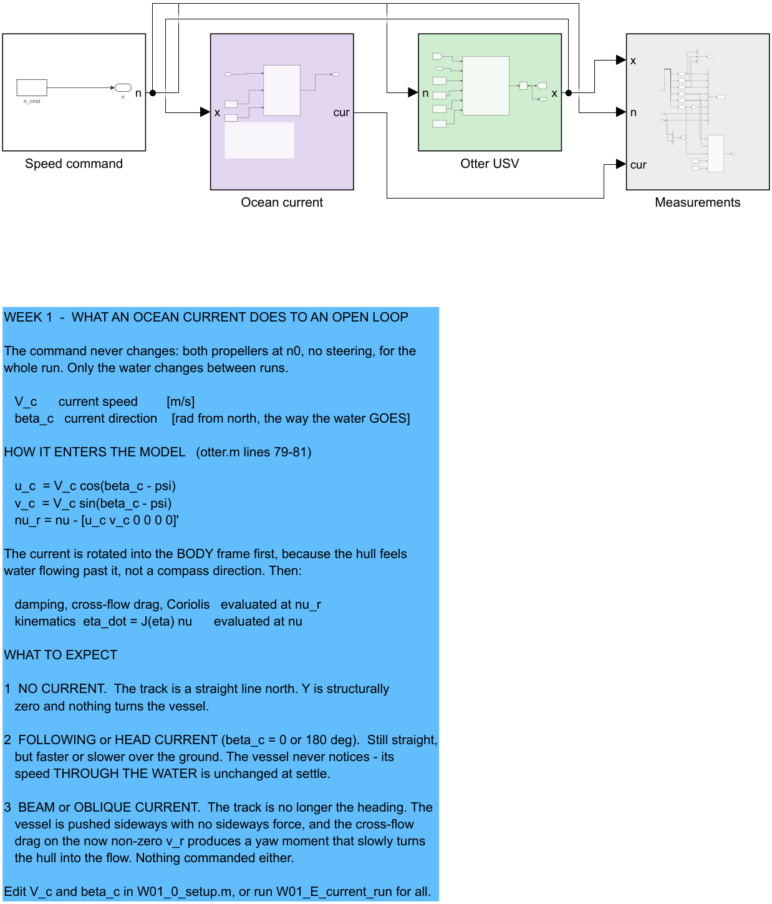

**그림을 읽기**

| 요소 | 뜻 |
|---|---|
| `Speed command` (흰색) | 상수 하나, 두 프로펠러 동일. 이 모델의 어느 것도 조향하지 않는다 |
| `Ocean current` (연보라) | 상태에서 $u_c$, $v_c$, $u_r$, $v_r$ 를 다시 계산해 **신호**가 되게 한다. 아무것도 구동하지 않는다 |
| `Otter USV` (초록) | $V_c$ 와 $\beta_c$ 를 가진 `otter.m`. 조류는 §1-13 이 서술한 그대로 안에서 적용된다 |
| `Measurements` (회색) | 표준 여섯 열에 $u_c\ v_c\ u_r\ v_r$ 를 더해 기록한다 |

- `Ocean current` 단계가 있는 것은, 모델의 모든 힘이 계산되는 그 양 — 상대속도 — 이 숨은 중간값으로 남는 대신 그려질 수 있게 하기 위해서다.

### 네 실행이 주는 것

| 조류 | 대지속력 [m/s] | 항적 [deg] | 선수각 [deg] |
|---|---|---|---|
| 정수 | $1.0286$ | $0.00$ | $0.00$ |
| 뒤에서, $\beta_c = 0°$ | $1.5286$ | $0.00$ | $0.00$ |
| 횡방향, $\beta_c = 90°$ | $1.1091$ | $21.80$ | $-4.00$ |
| 앞에서, $\beta_c = 180°$ | $0.5286$ | $-0.00$ | $-0.00$ |

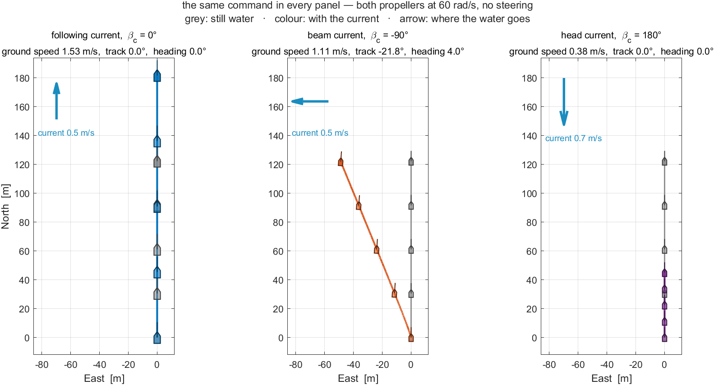

**그림을 읽기**

| 요소 | 뜻 |
|---|---|
| 칸 셋 | 조류마다 하나 — 뒤에서($\beta_c = 0°$), 횡방향($90°$), 앞에서($180°$) — **같은 축**에 그려서 거리를 칸에서 칸으로 바로 비교할 수 있다 |
| 회색 항적 | 정수. 모든 칸에서 같고, 색깔 항적을 거기에 대해 재는 기준이다 |
| 색깔 항적 | 그 칸의 조류에서 같은 명령으로, 같은 $120$ s 동안 |
| 왼쪽 위의 파란 화살표 | 조류. 물이 **가는** 곳을 가리키고, 길이가 축척에 맞다 — 1 m/s 당 $50$ m |
| 선체 윤곽 | 각 항적을 따라간 배. 횡방향 칸에서는 항적이 동으로 기울어지는데도 선수가 여전히 북을 가리킨다 |
| 칸 제목 | 실행 마지막 5분의 1 에 대한 대지속력, 항적각, 선수각 — 위 표의 줄들이다 |

**그림이 말하는 것**

- **명령 하나, 답 넷.** 축 회전수는 네 실행에서 동일하고 아무것도 조향하지 않는다. 그림의 모든 차이는 물이 만든 것이다.
- **앞뒤 조류는 속력만 바꾼다.** 왼쪽과 오른쪽 칸에서 색깔 항적이 회색 위에 놓이고 정북으로 달린다. 더 멀리 가거나 덜 가는 것으로만 끝나고, 그래서 선체 윤곽의 간격이 다르다. 뒤에서 오는 조류는 대지속력에 정확히 $V_c = 0.5$ m/s 를 더하고, 앞에서 오는 조류는 같은 만큼 뺀다.
- **횡조류는 방향을 바꾼다.** 주황 항적이 자오선을 떠나 동쪽으로 약 $50$ m 에서 끝난다 — **그 선수는 여전히 북을 가리키면서.** 항적과 선수각이 $25.8°$ 다르고, 어떤 힘도 선체를 옆으로 밀지 않았다.
- **왜 그렇게 되는가** 는 §1-13 을 한 줄로 쓴 것이다. `otter.m` 은 모든 힘을 물을 통한 속도 $\boldsymbol{\nu}_r = \boldsymbol{\nu} - \boldsymbol{\nu}_c$ 에서 계산하고, 위치는 대지 위의 속도 $\boldsymbol{\nu}$ 로 적분한다. **힘은 물을 느끼고, 항적은 대지 위에 있다.**

> [!note] 이것이 5주차가 풀기 위해 존재하는 문제다
> 완벽하게 조종되었는데도 다른 곳에서 끝나는 배는 더 세게 조종해서 고칠 수 없다. 5주차 §5-5 가 그 결과의 경로 오차를 재고 적분(ILOS) 으로 없앤다.

---

# Part 2 · 실습 실행 순서

Part 1 의 실험들을 순서대로 따라간 것이다. 이 표는 무엇을 돌렸는지의 색인이고, 집에서 그 주차를 되짚을 때 쓴다.

| 실험 | 모델 | 스크립트 | 무엇을 보이나 |
|---|---|---|---|
| 1-0 | — | `W01_0_setup` | 모든 블록이 읽는 파라미터 |
| 1-3 | 없음 — Command Window | — | 회전행렬의 성질 셋 |
| 1-4 | 없음 — Command Window | `W01_frames` | 하나의 속도를 두 좌표계로 읽기 |
| 1-5 | 없음 — Command Window | — | $\mathbf{T}_\Theta$ 의 특이점, 그리고 쿼터니언 왕복 |
| 1-7 | 없음 — `otter.m` 호출 하나 | — | $\dot{\boldsymbol{\nu}}$ 의 어느 세 줄이 살아남나 |
| 1-8 | 없음 — `otter.m` 호출 하나 | — | 마지막 줄을 §1-4 와 대조해 확인 |
| 1-9 | `W01_openloop` | `W01_1_build_openloop` | 모델을 블록 단위로 읽기 |
| 1-10a | `W01_interactive` | `W01_F_build_interactive`, `W01_F_button_check` | 버튼으로 운전하는 배 |
| 1-10b | `W01_rc` | `W01_G_build_rc`, `W01_G_rc_check` | RC 송신기와 그 뒤의 배분 |
| 1-10c | `W01_rc_usb` | `W01_H_build_rc_usb`, `W01_H_usb_check` | 실물 송신기를 USB 로 (선택, 실물 장비) |
| 1-11 | `W01_openloop` | `W01_C_terminal_speed` | 종단속력을 예측하고, 그 다음 재기 |
| 1-12 | `W01_openloop` | `W01_D_the_manoeuvre` | 조함 하나, 그리고 그것이 만드는 횡방향 운동 |
| 1-13 | `W01_current` | `W01_E_build_current`, `W01_E_current_run` | 같은 명령을 네 조류에서 |

- 실험 1-3 부터 1-8 까지는 짧은 계산이다. Command Window 몇 줄이고, 모델도 없고 저장되는 그림도 없다.
- 실험 1-11 과 1-12 는 `W01_openloop` 을 함께 쓴다. **한** 개루프 실행에 두 질문을 하기 때문이다 — 구간을 따라간 속력, 그리고 선회에서의 횡방향 운동. 이 강의의 다른 모든 실험은 자기 모델을 따로 가진다.

---

# 정리

## 주차 정리

| 단계 | 한 일 | 어떻게 검증했나 |
|---|---|---|
| 1 | 열두 상태와 그 좌표계를 짚었다 | `otter.m` 과 선택기 블록에 대조해 나열 |
| 2 | 오일러각을 단위 쿼터니언과 연결했다 | 왕복이 $6.4\times10^{-15}$ 도까지. `Rquat` 대 `Rzyx` 가 $2.2\times10^{-16}$ 까지 |
| 3 | 6자유도 방정식을 1차 전진으로 줄였다 | 플랜트에서 잰 $1.1057$ s 에 대해 $T_u = 1.1025$ s |
| 4 | 시뮬레이션 전에 종단속력을 예측했다 | 명령 넷, 소수 네 자리까지 일치 |
| 5 | 두 프로펠러 모두 전진으로 좌–우 선회 조함을 돌렸다 | 선수각이 $-70.2°$ 그 다음 $+70.6°$ 변했고, $0.41°$ 까지 대칭 |
| 6 | 횡방향 힘과 횡방향 속도를 분리하고 코리올리 항을 유도했다 | $Y = 0$ 정확히. 정상선회에서 $Y_{\text{cf}} = -3.4980$ N 에 대해 $M_{11}ur = -3.4980$ N |
| 7 | Simulink 만으로, 실제 시간에, 버튼으로 배를 운전했다 | AHEAD $1.0286$ m/s 와 ASTERN $-0.5983$ m/s, 둘 다 손 예측과 같다 |
| 8 | 제어 배분을 통해 RC 송신기로 운전했다 | 도달 가능 집합 안에서 $\boldsymbol{\tau}_a = \boldsymbol{\tau}_d$. $u = X_a/\lvert X_u\rvert$ 가 소수 넷까지. 모드 1 과 모드 2 의 로그가 동일 |
| 9 | 화면 위 송신기를 USB 송신기로 바꾸었다 | 가짜 송신기가 AETR, TAER, 뒤집힌 스로틀 축에 대해 실험 1-10b 의 7번 경우를 정확히 재현한다. 실물 장치는 첫 연결에서 확인한다 |

- 2, 3, 6번 줄은 `_tools/verify_w01_theory.m` 이 재현한다.

---

## 진도 점검

> [!important] 3주차를 따라가기 위한 최소 조건

### 이론

- [ ] 열두 상태 중 어느 것이 $\{b\}$ 로, 어느 것이 $\{n\}$ 으로 표현되어 있는지 말할 수 있다
- [ ] $\dot{\boldsymbol{\eta}} = \mathbf{J}_{\Theta}(\boldsymbol{\eta})\boldsymbol{\nu}$ 를 쓰고 $\mathbf{T}_{\Theta}$ 가 왜 회전행렬이 아닌지 말할 수 있다
- [ ] `euler2q` 와 `q2euler` 로 $\boldsymbol{\Theta}$ 를 $\mathbf{q}$ 로, 그리고 되돌려 변환할 수 있고, $\dot{\mathbf{q}} = \mathbf{T}_q(\mathbf{q})\boldsymbol{\omega}$ 에는 특이점이 없는데 오일러각으로 되돌리는 변환에는 있는 이유를 말할 수 있다
- [ ] 6자유도 방정식의 1번 줄에서 1차 전진 모델을 유도하고 버린 항마다 이름을 댈 수 있다
- [ ] 횡동요 코리올리 계수가 $M_{11}$ 임을, 그리고 그중 어느 부분이 $\mathbf{C}_{RB}$ 에서 어느 부분이 $\mathbf{C}_A$ 에서 오는지 보일 수 있다
- [ ] 시뮬레이션하지 않고 주어진 $n$ 에 대한 $u_{ss}$ 를 계산할 수 있다
- [ ] 선회 중에 $Y = 0$ 인데 $v \neq 0$ 인 이유, 그리고 좌선회와 우선회 사이에 $v$ 가 부호를 바꾸는 이유를 설명할 수 있다

### 실습

- [ ] `W01_0_setup` 이 `rank(B) = 2` 를 찍었다
- [ ] 일부러 깨뜨린 뒤 `W01_1_build_openloop` 이 모델을 다시 만들었다
- [ ] C, D, E 절을 그 순서로 돌렸고 함께 결과 PNG 여섯 개를 `W01_simulink/img/` 에 썼다
- [ ] `W01_interactive.slx` 를 Simulink 만으로 열고 돌렸으며, 다섯 버튼을 각각 최소 한 번 썼다
- [ ] `W01_rc.slx` 를 두 모드로 운전했고, 요구된 힘을 적어도 한 번 도달 가능 집합 밖으로 밀었다

### 기록한 관측

- [ ] $n = 60$ 에 대한 정착 $u$ 를 소수 네 자리로 기록
- [ ] **두** 선회 모두의 크랩각 $\beta$ 를 그 부호와 함께 기록
- [ ] 각 선회에 걸친 선수각 변화를 기록하고 둘을 비교
- [ ] 두 선회 내내 실시간 화면을 지켜보고, 선체가 **가리킨** 방향을 **움직인** 방향과 대조해 적었다

---

## 수업 실습 — 개루프를 손으로 만든다

1주차 수업의 두 번째 시간은 이 강의가 스크립트로 만든 모델을 Simulink 로 직접 만드는 데 쓴다. 문제 셋, 한 시간, 그리고 결과를 위에서 잰 수치와 대조하는 체커.

```matlab
cd lectures/W01_simulink/problems
W01_P1_start                 % creates W01_P1.slx — the hull, and nothing else
W01_check(1)                 % run this whenever, as often as needed
```

| | 문제 | 시간 | 재현해야 하는 수 |
|---|---|---|---|
| 1 | 개루프 — 일정한 명령이 선체로 들어가고 로그가 나온다 | 25분 | 종단 $u = 1.0286$ m/s, 그리고 $v = r = 0$ |
| 2 | 조함 — 상수를 시간표로 바꾼다 | 20분 | 좌선회 $r = -2.2942$ deg/s, 선수각 변화 $-70.2$ deg |
| 3 | 조류 — **아무것도** 더할 필요가 없는 이유를 알아낸다 | 15분 | 표류 $25.809$ deg, 대지속력 $1.1091$ m/s |

- 전체 문제지는 [`W01_simulink/problems/README.md`](W01_simulink/problems/README.md) 이고, 모범답안은 [`W01_simulink/solutions/`](W01_simulink/solutions/README.md) 에 있다.
- 선체가 주어지는 것은 `otter.m` 을 적분하는 것이 이번 주의 주제가 아니기 때문이다. 그 밖의 모든 것 — 명령, 배선, 기록 — 은 손으로 만든다.
- **정답 도면은 하나가 아니다.** 체커는 물리를 시험한다. 잰 수치를 재현하는 모델은 캔버스 위에서 어떻게 보이든 강의의 모델이 하는 일을 하고 있는 것이다.

---

## 과제 1

- **기한**: 3주차 수업 전
- **제출물**: 수정한 `W01_0_setup.m`, 아래에서 요구하는 수치, 그리고 짧은 분석

### ① 요구사항

1. 전진 방정식에서 종단 전진속력 관계 $u_{ss}(n)$ 을, 각 단계를 보이면서 유도한다.
2. 손으로, 종단속력 정확히 $1.500$ m/s 를 내는 축 회전수 $n^\star$(두 프로펠러 동일) 를 구한다.
3. 손으로, $n_0 = 60$ rad/s 에서 명령 요 모멘트 정확히 $N = 5.000$ N·m 를 내는 차이 $dn^\star$ 를, $y_{\text{pont}} = 0.395$ m 와 $T = k_{\text{pos}} n|n|$ 로 $N = y_{\text{pont}}(T_L - T_R)$ 를 써서 구한다. 두 프로펠러 모두 전진으로 남아야 한다 — 결과의 $n_L$ 과 $n_R$ 을 밝히고 둘 다 양수임을 확인한다.

### ② 검증 — 필수

> [!important] 주장은 결과가 아니다. 수치가 필요하고, 평균 구간을 함께 적는다

1. ①.2 의 $n^\star$ 로 `dn = 0` 에서 시뮬레이션을 돌리고, 측정된 정착 $u$ 를 소수 네 자리로, 평균한 시간 구간과 함께 보고한다.
2. ①.3 의 $dn^\star$ 로 조함을 돌리고, **두** 선회 모두에 대해 정착 $u$, $v$, $r$, $\beta$ 를 각각 그 평균 구간과 함께 보고한다.
3. 각 선회가 만든 선수각 변화를 보고한다. 둘이 크기에서 같은지, 몇 도까지 같은지 밝힌다.
4. $dn$ 을 $0$ 에서 $12$ rad/s 까지 최소 여섯 값으로 훑고, $dn$ 에 대한 정착 회두율 $r$ 의 그림 하나를 만든다. 명령된 $N$ 을 **선형** 요 감쇠 $N_r$ 만과 균형 잡아 얻은 예측을 겹쳐 그린다.

### ③ 분석 (5–10줄)

- ②.4 의 그림은 직선이 아닐 것이고, 선형 예측은 큰 $dn$ 에서 측정값 위에 앉을 것이다. `otter.m` 의 어느 항이 책임인지 짚고, 그것이 작은 $dn$ 에서만 튜닝된 선수각 제어기에 무엇을 뜻하는지 밝힌다.
- 또한 두 선회 모두에서 $Y$ 가 정확히 0 으로 남는데 $v$ 는 두 선회 사이에 부호를 바꾸는 이유를 밝힌다.

### 배점

| 기준 | 배점 |
|---|---|
| ① 의 유도가 완전하고 옳다 | 20% |
| **검증을 수행하고 구간을 밝힌 수치를 보고했다** | 40% |
| ②.4 의 그림이 옳고 읽을 수 있다 | 15% |
| ③ 의 분석이 그 기작을 짚는다 | 25% |

---

## 문제 해결

| 증상 | 원인 | 조치 |
|---|---|---|
| `Undefined function 'otter'` | MSS 가 경로에 없다 | `W01_0_setup` 을 돌린다. 그것이 `genpath` 로 `Tools/MSS` 를 더한다 |
| Simulink 에서 Run 을 누를 때 `Undefined variable 'n0'` | 모델이 준비 스크립트가 정의하는 기본 작업공간 변수를 읽는다 | `W01_0_setup` 을 먼저 돌리거나, 자기 변수를 설정하는 아무 절 스크립트를 돌린다 |
| 좌선회를 기대했는데 배가 우로 돈다 | 요 모멘트가 $N = y_{\text{pont}}(T_L - T_R)$ 이므로 **오른쪽** 프로펠러를 느리게 하면 선수가 우로 돈다 | 좌선회에는 **왼쪽** 프로펠러를 느리게 한다 — $n = [n_0 - dn;\ n_0 + dn]$ |
| 내보낸 블록도가 수천 화소 폭이다 | 주석이 한 긴 줄로 편집되었다. Simulink 는 주석 글을 자동 줄바꿈하지 않는다 | `W01_1_build_openloop.m` 의 손 줄바꿈을 유지한다 |
| 종단속력이 예측과 몇 퍼센트 다르다 | 과도가 끝나기 전에 시뮬레이션을 멈췄다 | `T_final` 이 대략 $5T_u \approx 5.5$ s 를 넘어야 한다. 기본값은 120 s 다 |
| 선수각이 360° 를 넘게 읽힌다 | $\psi$ 는 $r$ 의 감지 않은 적분이고 이 모델의 어느 것도 그것을 감지 않는다 | 정상이다. 4주차가 감기를 도입하고 그것 없이 무엇이 일어나는지 보인다 |
| 실행이 시뮬레이션 시간보다 훨씬 느리다 | 실시간 화면이 너무 자주 다시 그려진다 | `W01_0_setup.m` 의 `animate_every` 를 올리거나 `animate = 0` 으로 둔다 |
| 배가 실시간 화면을 떠나 사라진다 | 축이 실행 전에 고정되고 자동 범위 조정을 하지 않는다 | `W01_0_setup.m` 의 `track_Nmin` … `track_Emax` 를 넓힌다 |
| `W01_rc.slx` 에서 스틱을 움직였는데 배가 움직이지 않는다 | 움직인 스틱이 선택된 모드의 스로틀이 아니거나, 아직 중립 구간 $50 \pm 3$ 안에 있다 | MODE 를 확인한다. 스로틀은 모드 2 에서 `LY`, 모드 1 에서 `RY` 다 |
| `W01_rc_usb.slx`: START 가 *No transmitter on joystick 1* 을 띄운다 | 송신기가 연결되지 않았거나, USB 조이스틱 모드가 아니거나, 이 PC 에서 조이스틱 2 다 | 조이스틱 모드로 연결한다. 게임 컨트롤러가 둘 이상이면 `W01_H_usb_setup(2)` 를 돌린다 |
| `W01_rc_usb.slx`: START 가 *Throttle is not at the centre* 를 띄운다 | START 의 스로틀 확인 | 스로틀 스틱을 중앙으로 두고 다시 START |
| `W01_rc_usb.slx`: 스로틀 앞이 후진을 몰거나 어떤 스틱이 아무것도 하지 않는다 | 모델의 축 설정이 이 송신기와 맞지 않는다 | CALIBRATE 를 누른다 |
| `W01_rc.slx` 에서 러더를 놓았는데도 배가 계속 돈다 | Dashboard 슬라이더에는 스프링이 없다. 둔 자리에 머문다 | CENTRE 를 누른다. 스로틀을 뺀 모든 채널을 $50$ 으로 되돌린다 |
| 실시간 화면의 선체가 반대로 돈다 | 윤곽의 NED 회전에서 두 부호가 뒤바뀌었다 | $N = N_0 + x_b\cos\psi - y_b\sin\psi$ 와 $E = E_0 + x_b\sin\psi + y_b\cos\psi$, 곧 $\mathbf{R}_b^n$ 의 평면 블록이다. `_tools/draw_ship.m` 참조 |

---

## 참고문헌

### 원전

- Fossen, T. I. *Handbook of Marine Craft Hydrodynamics and Motion Control*, 2nd ed. 2장(운동학), 3장(강체 동역학), 6장(조함 모델, 횡류 항력 모델 포함). §2.2.2 단위 쿼터니언, §2.2.3 오일러각에서 쿼터니언, §2.2.4 쿼터니언에서 오일러각, §11.2 제어 배분(실험 1-10b). 절 번호는 1판과 2판의 2020년 원고에 대조해 확인했다. 이 강의가 가진 2판 인쇄본이 검색 가능한 글자가 없는 스캔이기 때문이다.
- MSS 툴박스, `Tools/MSS/VESSELS/otter.m` — 이번 주 모델에서 바꾸지 않고 쓰는 플랜트. 이 문서의 행 번호는 `mss_path` 가 경로에 올리는 2021 릴리스를 가리킨다.
- MSS 툴박스, `Tools/MSS/GNC/` — `Rzyx`, `Tzyx`, `Smtrx`, `m2c`, `crossFlowDrag`. `otter.m` 이 내부에서 부른다.
- MSS 툴박스, `Tools/MSS/GNC/` — §1-5 를 위한 `euler2q`, `q2euler`, `Rquat`, `Tquat`, `quatprod`, `quatern`. 2022 이후 릴리스에서는 `LIBRARY/kinematics/` 다. MIT 라이선스, © Thor I. Fossen.

### 강의 파일

- `W01_simulink/W01_1_build_openloop.m`, `W01_E_build_current.m` — 모델 생성기 둘
- `W01_simulink/W01_0_setup.m` — 파라미터
- `W01_simulink/W01_C_terminal_speed.m` · `W01_D_the_manoeuvre.m` · `W01_E_current_run.m` — 실습 절마다 스크립트 하나
- `W01_simulink/W01_vars.m` · `W01_read.m` — 같은 수치를 struct 로, 그리고 이름 붙은 필드를 가진 로그
- `W01_simulink/W01_animate.m` — 실시간 화면. 모델의 `Animate` 블록이 부른다
- `W01_simulink/W01_F_build_interactive.m` · `W01_interactive.slx` · `W01i_animate.m` · `W01i_control.m` · `W01_F_button_check.m` — 버튼으로 운전하는 모델, 따라가는 창과 축 회전수 칸을 가진 그 실시간 화면, 그 START 와 STOP 버튼의 처리기, 그리고 실험 1-10a 의 표 뒤에 있는 무인 확인
- `W01_simulink/W01_G_build_rc.m` · `W01_rc.slx` · `W01rc_animate.m` · `W01rc_control.m` · `W01_G_rc_check.m` — 제어 배분을 통해 RC 송신기로 운전하는 모델, 도달 가능 집합을 가진 그 실시간 화면, 그 START·STOP·CENTRE 버튼의 처리기, 그리고 실험 1-10b 의 표와 그림 뒤에 있는 무인 확인
- `W01_simulink/W01_H_build_rc_usb.m` · `W01_rc_usb.slx` · `W01_H_usb_setup.m` · `W01rc_usb_axis.m` · `W01_H_usb_check.m` — USB 송신기에서 읽는 같은 사슬, 그 보정, 보정이 쓰는 축 찾기, 그리고 실험 1-10c 의 표 뒤에 있는 가짜 송신기 확인
- `_tools/hmi_bind.m`, `_tools/image_button.m` — Constant 에 묶인 Dashboard 블록, 그리고 캔버스 위의 클릭 가능한 버튼 그림. 실험 1-10a 와 1-10b 의 모델이 쓴다
- `W01_simulink/W01_plot.m` — 요약 그림. 모델의 `StopFcn` 이 부른다. `W01_cur_plot.m` 이 조류 모델에 대해 같은 것이다
- `_tools/otter_config.m`, `_tools/otter_B.m` — 구동기 구성과 열 규칙
- `_tools/verify_w01_theory.m` — `otter.m` 에서 $\mathbf{M}$ 과 $\mathbf{C}$ 를 다시 만들고 §1-5 의 쿼터니언 부분, §1-11, §1-12 의 모든 수를 재현한다
- `_tools/draw_ship.m`, `_tools/track_ships.m`, `_tools/ship_marks.m` — 이 강의의 모든 항적에 그려지는 선체 윤곽

### 감사

- 선체 다각형 — 삼각형 선수로 닫은 직사각형 선미 — 은 학과 학부 유도 강의에서 쓰는 `shipModel.m` (J. Hong, KRISO, 2022) 을 따랐다.

---

## 다음 주

- **2주차 — PID 제어의 기초**
- 배를 제어 아래 두기 전에, PID 의 세 항을 진동할 수 있는 가장 단순한 플랜트에서 떼어 본다 — 질량 하나, 스프링 하나, 댐퍼 하나. 각 항을 따로 재고, 그 다음 실물 제어기가 없이는 돌지 않는 추가 셋 — 미분 필터, 부드러운 설정값, 안티와인드업 — 그리고 한 단계씩 따라갈 수 있는 튜닝 순서.
- 준비: 이번 주 모델에서 가져갈 것은 없다. 2주차는 Simulink 만 필요하고 MSS 툴박스는 쓰지 않는다.
- **3주차 — 전진속도 제어** 가 그 다음 Otter 에 첫 루프를 닫는다. §1-11 의 $T_u = 1.1025$ s 와 $K_u = 0.012894$ (m/s)/N, 그리고 과제 1 의 $u_{ss}(n)$ 유도를 가져온다.

> [!note] 부록 A1 은 있지만 아직 필요하지 않다
> 어떤 추진기 배치에 대해서든 $\mathbf{B}$ 를 만들어 내는 일반 규칙, 그리고 도달 가능 제어 집합과 구동 계급이 무엇을 비용으로 치르는지는 **부록 A1** 로 써 두었다. 3·4주차가 필요한 곳에서 그 두 결과를 인용한다. 7주차 전에는 필독이 된다.
