# 2주차 · PID 제어의 기초

> [!note] 이 문서는 한글본이다
> 영어본 [`W02_PID_Control_Fundamentals.md`](W02_PID_Control_Fundamentals.md) 와 **같은 내용**이고,
> 수식·코드·그림·수치는 한 글자도 다르지 않다. 러너가 찍는 출력은 영어 그대로 둔다 —
> 실제로 화면에 그렇게 나오기 때문이다.

> [!note] 이번 학기 수업 실시간 녹화
> <span style="font-size:0.88em">이 강의의 모든 시간은 진행되는 그대로 녹화되어 아래 재생목록에 올라간다. 여기 적힌 글이 기준이고, 녹화는 실제로 전달된 속도의 강의다. 유도를 다시 볼 때, 또는 빠진 주를 실습 전에 따라잡을 때 쓴다.</span>
>
> | | 어디에 |
> |---|---|
> | **[충남대] 2026 센서신호처리** — 이 강의의 2026년 실시간 녹화 | [재생목록](https://youtube.com/playlist?list=PLCxINRGlWUrk) |

> [!important] 참고자료 — 먼저 읽을 것
> <span style="font-size:0.88em">아래 다섯 강의는 **이 강의의 강사가 직접 한 강의**이고, 이 강의가 전제하는 배경이다. 기초부터 대학원 내용까지 이어지므로 모자란 곳부터 시작하면 된다. 여기서 쓰는 좌표계·기호·유도는 전부 그 강의들에서 길게 다룬다. 선수 지식이 얇은 사람은 그쪽을 먼저 보고 돌아오는 편이 빠르다.</span>
>
> | # | 강의 | 수준 | 언어 | 영상 | 자료와 코드 |
> |---|---|---|---|---|---|
> | 1 | **제어공학** — 기초: 전달함수, 되먹임, 안정도, 근궤적, PID | 학부 | KO | [재생목록](https://youtube.com/playlist?list=PLFaUxNRM4BvJMpF9HZS-Mp8tDv9dTdglk) | [드라이브](https://drive.google.com/drive/folders/1TNIPDNtS_Iy8li-olka5WJslSXDYf0aT) |
> | 2 | **제어시스템설계** — 해석이 아니라 설계: 사양, 루프 성형, 이산 구현 | 학부 | KO | [재생목록](https://youtube.com/playlist?list=PLFaUxNRM4BvIGroZ5rgn7x08F7C79d9WZ) | [드라이브](https://drive.google.com/drive/folders/11m5Xxl_PHJvxgHghLSP-jhCpmRpbvoXh) |
> | 3 | **제어공학특론** — 좌표계, 6자유도 운동방정식, 회전행렬과 오일러각, 선형화와 트림, 운동체 제어 설계 | 대학원 | EN | [재생목록](https://youtube.com/playlist?list=PLFaUxNRM4BvJmvF2ljx4KM5dj1P5jEcw0) | [드라이브](https://drive.google.com/drive/folders/1GUxbbONl916lNd0ggnFnXrNwNkd13-2-) |
> | 4 | **센서신호처리 및 융합** — 센서 모델, 잡음, 추정과 다중센서 융합 | 대학원 | EN | [재생목록](https://youtube.com/playlist?list=PLFaUxNRM4BvK-aP2Gdoyp5-AWvMn7Fo8E) | [드라이브](https://drive.google.com/drive/folders/1MEVJP7TzMcm8w6TZwUjhWJtL34WeNY3u) |
> | 5 | **캡스톤디자인** — 운동체 과제를 처음부터 끝까지 | 학부 | KO | [재생목록](https://youtube.com/playlist?list=PLFaUxNRM4BvLu7L0pDoLzDXTv8mm6rCmj) | [드라이브](https://drive.google.com/drive/folders/1haIQejlJfrdhtOuof-MpffR9ydVscXZS) |
>
> <span style="font-size:0.88em">**MATLAB 과 Simulink 가 아직 익숙하지 않다면 Part 2 전에 이것부터.** 이 강의의 실습은 전부 Simulink 이고, Onramp 는 무료이며 각각 몇 시간이면 끝난다.</span>
>
> | 도구 | 시작할 곳 |
> |---|---|
> | MATLAB | [MATLAB Onramp](https://matlabacademy.mathworks.com/kr/details/matlab-onramp/gettingstarted) · [Core MATLAB Skills](https://matlabacademy.mathworks.com/details/core-matlab-skills/lpmlcms) |
> | Simulink | [Simulink Onramp](https://matlabacademy.mathworks.com/kr/details/simulink-onramp/simulink) · 강사의 Simulink 강의 [1편](https://youtu.be/a-afHg_fSaU) · [2편](https://youtu.be/070Yn0Hw5a0) |


> [!important] 이번 주의 핵심 영상 자료
> <span style="font-size:0.88em">이번 주는 위의 강의들과 더불어 아래 두 영상 자료 위에 세워져 있다. 강의 시간 전이나 후에 본다. 각각을 쓰는 절에서 쓰는 자리를 밝힌다.</span>
>
> | 출처 | 편 | 여기에 무엇을 보태나 |
> |---|---|---|
> | MATLAB Tech Talk, **Understanding PID Control** (B. Douglas, MathWorks) — [재생목록](https://www.youtube.com/playlist?list=PLn8PRpmsu08pQBgjxYFXSsODEF3Jqmm-y) | [1 What is PID control](https://www.youtube.com/watch?v=wkfEZmsQqiA) | 현재·과거·미래의 오차 — §2-5 ~ §2-8 |
> | | [2 Anti-windup](https://www.youtube.com/watch?v=NVLXCwc8HzM) | 와인드업, 클램핑과 그 두 조건 — §2-11 |
> | | [3 Noise filtering](https://www.youtube.com/watch?v=7dUVdrs1e18) | 필터를 건 미분과 그 적분기-루프 형태 — §2-10 |
> | | [4 A PID tuning guide](https://www.youtube.com/watch?v=sFOEsA0Irjs) | 요구사항부터, "얌전한" 플랜트, 튜닝 방법의 지도 — §2-12 |
> | | [5 Three ways to build a model](https://www.youtube.com/watch?v=qhIjIu-Zk10) | 제1원리, 시스템 식별, 선형화 — §2-1 |
> | | [6 Manual and automatic tuning](https://www.youtube.com/watch?v=qj8vTO1eIHo) | 영점 둘과 극점 하나로서의 PID. 제어 노력을 언제나 본다 — §2-9, §2-12 |
> | | [7 Important PID concepts](https://www.youtube.com/watch?v=tbgV6caAVcs) | 종속 루프와 샘플링된 제어 — §2-13 |
> | 제어조교 Ctrl튜브, **PID 제어기 짬튜닝** (KO) — [영상](https://www.youtube.com/watch?v=KJkqNujb6h4) | 전체 | P 를 먼저 튜닝해 거기서 플랜트를 읽는다, 남는 오차에만 I 를 더한다, 미분에 필터를 건다, 설정값을 부드럽게 한다 — §2-10, §2-12 |
> | **제어시스템설계** (위 표의 강의 2), 강의노트와 실습 (KO) | 2, 4, 5주차 | 자유물체도에서 전달함수와 상태공간으로, 표준 2차 시스템, 시간영역 지표, 정상상태 오차와 시스템 형식 — §2-2 ~ §2-4 |

> [!tip] 수업 파일 받기와 최신으로 유지하기 (Windows)
> <span style="font-size:0.88em">강의노트·모델·스크립트는 한 Git 저장소에 들어 있고 학기 내내 갱신된다. 한 번 clone 하고, 수업 전마다 pull 한다. pull 은 지난번 이후 **바뀐 것만** 내려받는다.</span>
>
> | 언제 | 어디서 | 명령 |
> |---|---|---|
> | 한 번 | PowerShell — Git for Windows 설치 | `winget install --id Git.Git -e` |
> | 한 번 | 강의 폴더를 둘 자리, 예를 들어 `Documents` | `git clone https://github.com/wkyouncnu/Sensor-Signal-Processing-and-Fusion.git` |
> | 수업 전마다 | clone 한 폴더 `Sensor-Signal-Processing-and-Fusion` 안에서 | `git pull` |
>
> - 바뀐 것이 없으면 `git pull` 은 `Already up to date.` 를 찍고, 있으면 갱신한 파일을 나열한다.
> - 저장소는 비공개다. Git 이 물으면 강사가 접근 권한을 준 GitHub 계정으로 로그인한다.
> - 실험은 복사본에서 한다. 그 주차의 `WXX_simulink` 폴더를 다른 곳에 복사해 두면 pull 이 내 수정과 부딪칠 일이 없다. 이미 부딪쳤다면 `git stash` → `git pull` → `git stash pop` 이 수정을 치워 두고 갱신한 뒤 되돌려 놓는다.
> - MSS 툴박스는 저장소에 들어 있지 않다. Otter 를 시뮬레이션하는 주차는 clone 한 폴더 안 `Tools\MSS` 에 MSS 가 있어야 한다. 이번 주는 필요하지 않다.

- **과목**: USV 유도·항법·제어 (대학원)
- **학과**: 충남대학교 자율운항시스템공학과
- **이번 주**: ⓪ 플랜트를 세 가지로 쓰는 법, 2차 시스템의 두 수, 그리고 응답을 판정하는 다섯 수 ① 하나의 오차를 세 가지로 읽는다 — P·I·D 를 각각 따로 재서 ② 실물 PID 가 없이는 돌지 않는 추가 셋: 필터를 건 미분, 부드러운 설정값, 안티와인드업 ③ 튜닝 순서, 각 게인을 그 앞의 측정에서 고른다

> [!important] 지난 주차에서 가져오는 것
> - 1주차는 Otter 를 제1원리에서 만들고 **개루프**로 돌렸다. 축 회전수가 들어가고 운동이 나오며, 아무것도 재지 않고 아무것도 보정하지 않았다.
> - 이번 주는 처음으로 루프를 닫는데, 일부러 배 둘레에서는 닫지 않는다. 여기의 플랜트는 응답의 변화를 제어기 말고는 아무것도 설명할 수 없도록 고른 것이다. 3주차가 같은 제어기를 Otter 둘레에 놓는다.
> - 기초 제어에서: 라플라스 변환, 전달함수, 그리고 2차 시스템의 계단응답. 위 표의 강의 1 이 그 셋을 모두 다룬다.

---

## 학습 성과

이 주를 마치면 다음을 할 수 있다.

1. 질량-스프링-댐퍼의 운동방정식을 자유물체도에서 유도하고, 그것을 전달함수와 상태공간 형태로 쓴다.
2. 2차 전달함수에서 감쇠비, 고유진동수, 극점을 읽어내고, 각각이 오버슛·빠르기·대역폭을 어느 쪽으로 움직이는지 말한다.
3. 계단응답의 상승시간, 첨두시간, 오버슛, 정착시간, 정상상태 오차를 정의하고 측정한다.
4. PID 법칙을 시간영역과 전달함수로 쓰고, 세 항이 각각 오차에서 무엇을 읽는지 한 문장으로 말한다.
5. 2차 플랜트 둘레의 비례 루프에 대해, 시뮬레이션하기 **전에** 정상값·감쇠비·오버슛을 예측하고 소수 세 자리까지 확인한다.
6. 비례 제어기가 왜 오차를 남기는지, 적분이 왜 그것을 없애는지 설명하고, 루프가 불안정해지는 $K_i$ 값을 유도한다.
7. Gain·Integrator·Transfer Fcn 블록으로 Simulink PID 블록과 반올림 수준까지 일치하는 PID 를 만들고, PID 블록 대화창의 각 항목이 어느 블록에 속하는지 이름을 댄다.
8. 순수 미분이 센서 잡음에 무엇을 하는지, 계단 설정값이 힘에 무엇을 하는지, 구동기가 포화인 동안 적분기가 무엇을 하는지 정량화하고, 각각의 처방을 적용한다.
9. PID 를 정해진 순서로 튜닝하면서 모든 게인을 그 앞의 측정에서 고르고, 결과를 구동기가 낼 수 있는 힘과 대조해 확인한다.

## 준비물

| 항목 | 필요한 것 |
|---|---|
| MATLAB | R2024b, Simulink 와 Control System Toolbox (`tf`, `step`, `c2d`) 포함 |
| MSS | **이번 주는 필요하지 않다** — 플랜트가 전달함수다 |
| 강의 폴더 | `lectures/W02_simulink` |
| 모델 | **실험마다 하나** — `W02_B_three_ways`, `W02_B_second_order`, `W02_C_metrics`, `W02_C_P`, `W02_D_PD`, `W02_E_PID`, `W02_F_block_vs_hand`, `W02_G_lowpass`, `W02_G_derivative_bench`, `W02_G_noise_kick`, `W02_H_antiwindup`, `W02_I_tuning`. 전부 `W02_1_build_pid` 가 생성하며 손으로 고치지 않는다 |
| 시간 | 강의 1시간, 실습 1시간 (Part 1 의 실험은 집에서도 되풀이한다) |

---

# Part 1 · 원리와 실험, 절 하나씩

이 Part 의 모든 절은 같은 네 부분으로 되어 있고, 넷째는 첫째에서 한 화면 넘게 떨어지는 일이 없다. 원리를 말하고, 유도하고, 그 다음 **그 절의 모델에서 잰다.** 그래서 유도 안의 수와 Scope 위의 수를 쪽을 넘기지 않고 비교할 수 있다.

| 절의 구성 | 무엇이 들어가나 |
|---|---|
| **무엇이 관측되는가** | 현상 그 자체를 한두 줄로, 그것이 내는 수와 함께 |
| **결과** | 그 절의 나머지가 벌어 내는 식 |
| **유도** | 번호를 단 줄들, 한 줄에 한 단계. 운동방정식에서 결과까지 |
| **실험** | 모델, 명령, 실제로 받은 출력, 그림, 그리고 그림의 모든 특징을 **그것을 예측한 유도의 번호 줄**로 되돌려 읽는 표 |

실험은 자기 절의 번호를 따른다. 실험 2-6 은 §2-6 이 유도하는 것을 잰다. 각 실험은 **수업에서** 노트로 끝난다 — 목적, 가리킬 곳, 질문과 그 답, 그리고 남길 한 문장.

## 2-0. 준비 (10분)

```matlab
cd lectures/W02_simulink
W02_0_setup
W02_1_build_pid
```

나오는 출력:

```
  W02_0_setup
    plant    G(s) = 1/(1 s^2 + 2 s + 2)
    gains    Kp = 10   Ki = 8   Kd = 4   Nf = 20
    step     y_d = 0 -> 1 at t = 1 s
    limit    |tau| <= 1e+06,  Kb = 2
    noise    std 0 m every 0.01 s
```

- 손으로 고치는 파일은 `W02_0_setup.m` 하나뿐이다. 모든 블록이 그 파일의 변수 이름을 들고 있다.
- $\tau_{\max} = 10^6$ N 은 "한계 없음" 을 뜻한다. F 와 H 의 모델은 $2.5$ N 으로 돌린다.

> [!warning] `W02_0_setup` 의 첫 줄은 `clear` 다
> 작업공간을 강의의 값으로 되돌린다. Scope 가 이 노트와 다르게 나오면 언제든 다시 실행한다.

`W02_1_build_pid` 은 **실험마다 모델 하나**를 쓰고 각각을 보고한다.

```
  built  W02_C_metrics.slx      (overlapping lines: 0)
  built  W02_C_P.slx            (overlapping lines: 0)
  built  W02_D_PD.slx           (overlapping lines: 0)
  built  W02_E_PID.slx          (overlapping lines: 0)
  built  W02_F_block_vs_hand.slx (overlapping lines: 0)
  built  W02_G_noise_kick.slx   (overlapping lines: 0)
  built  W02_H_antiwindup.slx   (overlapping lines: 0)
  built  W02_I_tuning.slx       (overlapping lines: 0)
  built  W02_G_derivative_bench.slx (overlapping lines: 0)
  built  W02_B_three_ways.slx   (overlapping lines: 0)
  built  W02_B_second_order.slx (overlapping lines: 0)
  built  W02_G_lowpass.slx      (overlapping lines: 0)
```

모든 PID 모델은 같은 배치를 가진다. `open_system('W02_E_PID')` 가 그중 가장 꽉 찬 것을 보인다.

## 2-1. 첫 제어기를 배 둘레에 놓지 않는 이유

이 절은 질문 하나에 답한다. 제어기는 무엇 위에서 배워야 하는가?

- 게인 하나가 바뀌면 배는 여러 가지를 한꺼번에 바꾼다. 항력은 속도와 함께 자라고, 추력은 축 회전수의 제곱을 따르고, 선회는 전진·횡동요·요를 결합한다. 응답의 변화를 게인 하나에 돌릴 수 없다.
- 그래서 제어기는 먼저 **진동할 수 있는 가장 단순한 플랜트** 위에서 배운다. 스프링 하나에 달린 질량 하나, 댐퍼 하나. 그 응답에서 바뀌는 것은 무엇이든 제어기가 한 일이다.

- 같은 플랜트를 캡스톤디자인 강의 6주차 E 절이 쓰고, 이번 주가 그 측정값을 재현한다.

제어기 앞에 기초 세 절이 온다. 뒤의 모든 절이 그 셋에 기대기 때문이다.

| 절 | 무엇에 답하나 | 이 주의 나머지에 무엇을 주나 |
|---|---|---|
| §2-2 | 플랜트 모델을 어떻게 적는가? | 운동방정식, 그 전달함수, 그리고 상태공간 형태 |
| §2-3 | 응답의 모양을 정하는 두 수는 무엇인가? | 감쇠비 $\zeta$, 고유진동수 $\omega_n$, 극점, 대역폭 |
| §2-4 | 응답을 어떻게 판정하는가? | 상승시간, 첨두시간, 오버슛, 정착시간, 정상상태 오차 |

이 세 절은 *제어시스템설계* 강의(위 표의 강의 2) 2·4·5주차를 따르고, 거기서 같은 내용을 한국어로 길게 다룬다.

> [!note] 플랜트 모델은 어디서 오는가
> MATLAB Tech Talk 5편이 길 셋을 이름 짓고, 이 강의는 그 셋을 모두 쓴다.
>
> | 길 | 무엇을 아는가 | 이 강의의 어디에서 |
> |---|---|---|
> | 제1원리 ("화이트 박스") | 물리를, 방정식으로 적어 | 이 절. 1주차의 Otter, Fossen 의 방정식에서 |
> | 시스템 식별 ("블랙 박스") | 입력과 출력 기록뿐 | 3주차 §3-2 가 계단 입력 하나로 전진 축을 읽는다 — 이득, 시정수, 천장 |
> | 선형화 | 비선형 모델을, 어떤 동작점 둘레에서 | 4주차, 직진 둘레의 요 축 |

## 2-2. 제1원리에서 나오는 플랜트: 자유물체도, 운동방정식, 전달함수, 상태공간

이 절이 답하는 것: 플랜트 모델은 어떻게 얻고, 어느 세 형태로 쓸 수 있는가?

이 강의의 모든 모델은 같은 단계로 얻고, 어느 것도 건너뛰지 않는다. 힘을 그리기 전에 방정식을 쓰는 것이 항의 부호를 잃는 방법이다.

| 단계 | 하는 일 | 결과 |
|---|---|---|
| 1 | 장치를 그리고 양의 방향을 고른다 | 각 부분이 어디에 붙어 있는지, 그리고 어느 쪽이 $+$ 인지 |
| 2 | **자유물체도**를 그린다. 그 물체 하나만, 그것에 걸린 모든 힘과 함께 | 힘마다 화살표 하나. 그 방향이 그 부호다 |
| 3 | 뉴턴의 제2법칙 $\sum F = m\,a$ 를 적용한다 | 시간에 대한 미분방정식 |
| 4 | 초기조건을 0 으로 두고 라플라스 변환하고 출력을 입력으로 나눈다 | **전달함수** $G(s)$ |
| 5 | 기억해야 하는 양을 고르고 그 미분을 쓴다 | **상태공간** 모델 |

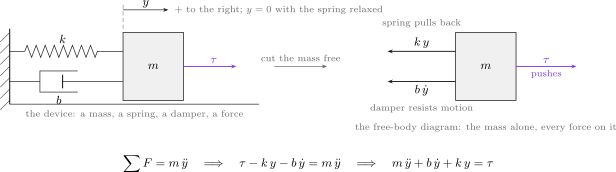

| 그림에서 | 뜻 |
|---|---|
| 왼쪽의 사선 빗금 벽 | 위치 $y$ 를 재는 고정 기준 |
| 스프링 $k$ | 질량이 움직인 거리에 비례해 당긴다. **위치**에 비례하는 힘 |
| 댐퍼 $b$ | 질량이 움직이는 속도에 비례해 저항한다. **속도**에 비례하는 힘 |
| 회색 상자 $m$ | 뉴턴의 법칙을 적용하는 그 물체 하나 |
| 보라 화살표 $\tau$ | 밖에서 걸린 힘 — 입력이고, 나중에는 제어기의 출력 |
| 맨 위의 화살표 $y$ | 양의 방향은 오른쪽이다. 스프링이 늘어나지 않은 상태가 $y = 0$ |
| 오른쪽 절반 | 떼어낸 질량. $\tau$ 는 $+$ 를 가리키고, 스프링 힘 $k\,y$ 와 댐퍼 힘 $b\,\dot y$ 는 $-$ 를 가리킨다 |

**3단계 — 운동방정식.** 질량에 세 힘이 걸린다. $y > 0$, $\dot y > 0$ 이면 스프링과 댐퍼가 둘 다 $-$ 쪽으로 밀므로 둘 다 마이너스 부호로 들어온다.

$$
\sum F = m\,\ddot y
\quad\Longrightarrow\quad
\tau - k\,y - b\,\dot y = m\,\ddot y
\quad\Longrightarrow\quad
m\,\ddot y + b\,\dot y + k\,y = \tau
$$

- 가장 높은 미분이 2차이므로 이 방정식은 **2차**다. 이유는 물리적이다. 이 계는 에너지를 두 곳에 저장한다 — 움직이는 질량(운동)과 늘어난 스프링(위치). 댐퍼는 아무것도 저장하지 않고 소산시킨다.
- 정지에서 $\dot y = \ddot y = 0$ 이고 방정식은 $k\,y = \tau$ 로 줄어든다. 1 N 의 일정한 힘이 질량을 $1/k = 0.5$ m 에 붙잡는다.

**4단계 — 전달함수.** 라플라스 변환은 각 미분을 $s$ 의 곱으로 바꾸고, 초기값은 별도의 항으로 나타난다.

$$
\mathcal{L}\{\dot y\} = s\,Y(s) - y(0), \qquad
\mathcal{L}\{\ddot y\} = s^2\,Y(s) - s\,y(0) - \dot y(0)
$$

두 줄 모두 정의 $Y(s) = \int_0^\infty y(t)\,e^{-st}\,\mathrm{d}t$ 에서 부분적분을 한 번 — $\dot y$ 에 한 번, $\ddot y$ 에 두 번 — 적용해 따라 나온다. 전달함수는 계를 **정지에서부터** 서술하므로 초기값을 0 으로 두고, 방정식을 항별로 변환한다.

| 시간영역 | 라플라스 영역 | 왜 |
|---|---|---|
| $m\,\ddot y(t)$ | $m\,s^2\,Y(s)$ | 미분 둘, $s$ 의 인자 둘 |
| $b\,\dot y(t)$ | $b\,s\,Y(s)$ | 미분 하나, $s$ 의 인자 하나 |
| $k\,y(t)$ | $k\,Y(s)$ | 미분 없음 |
| $\tau(t)$ | $T(s)$ | 미분 없음 |

$$
\left(m s^2 + b s + k\right) Y(s) = T(s)
\qquad\Longrightarrow\qquad
G(s) = \frac{Y(s)}{T(s)} = \frac{1}{m s^2 + b s + k} = \frac{1}{s^2 + 2s + 2}
$$

| 기호 | 양 | 값 · 출처 |
|---|---|---|
| $y$ | 질량의 위치, 제어되는 출력 | m |
| $\tau$ | 질량에 걸린 힘, 제어 입력 | N |
| $m$ | 질량 | $1$ kg, `W02_0_setup.m` |
| $b$ | 감쇠계수 | $2$ N·s/m |
| $k$ | 스프링 강성 | $2$ N/m |
| $G(0) = 1/k$ | 정적 이득: 뉴턴당 미터 | $0.5$ m/N |

- 분모를 0 으로 둔 $m s^2 + b s + k = 0$ 이 **특성방정식**이고, 그 근이 **극점**이며 여기서는 $s = -1 \pm j$ 다. 분자가 상수이므로 **영점**은 없다.
- $G(0)$ 은 정적 이득이다. 일정한 입력이 모든 것이 정착한 뒤 만들어 내는 값이다. 3단계의 결과 $y = \tau/k$ 를 되풀이한다.
- 이 플랜트는 안정하고, 거의 선형이고, 지연이 없다 — MATLAB Tech Talk 4편의 뜻으로 "얌전하다". §2-12 의 튜닝 규칙이 겨누는 플랜트의 부류가 그것이다.

**5단계 — 상태공간 모델.** 전달함수는 구성상 초기값을 잊는다. 질량을 0.5 m 로 당겨 힘 없이 놓으면 무엇이 일어나느냐고 물으면 $Y(s) = G(s)\cdot 0 = 0$ 이라고 답한다 — 아무 일도 없다고, 그리고 그것은 틀렸다. 처방은 방정식을 시간영역에 두고 2차 방정식을 1차 둘로 쪼개는 것이다. 지켜야 할 양은 그것 없이는 다음 순간을 계산할 수 없는 것들이다. 위치만으로는 부족하고(질량이 멈춰 있을 수도, 속도로 지나가고 있을 수도 있다) 위치와 속도를 함께 들면 충분하다. 그것이 **상태**다.

$$
x_1 = y, \quad x_2 = \dot y
\qquad\Longrightarrow\qquad
\begin{aligned}
\dot x_1 &= x_2\\
\dot x_2 &= -\frac{k}{m}\,x_1 - \frac{b}{m}\,x_2 + \frac{1}{m}\,\tau
\end{aligned}
$$

둘째 줄은 3단계의 운동방정식을 $\ddot y$ 에 대해 푼 것이다. 행렬로 모으면

$$
\dot{\mathbf{x}} = \mathbf{A}\,\mathbf{x} + \mathbf{B}\,\tau, \quad y = \mathbf{C}\,\mathbf{x}, \qquad
\mathbf{A} = \begin{bmatrix} 0 & 1 \\ -k/m & -b/m \end{bmatrix} = \begin{bmatrix} 0 & 1 \\ -2 & -2 \end{bmatrix}, \quad
\mathbf{B} = \begin{bmatrix} 0 \\ 1/m \end{bmatrix}, \quad
\mathbf{C} = \begin{bmatrix} 1 & 0 \end{bmatrix}
$$

- $\mathbf{A}$ 의 고유값이 $G(s)$ 의 극점 $-1 \pm j$ 이고, $\mathbf{C}(s\mathbf{I} - \mathbf{A})^{-1}\mathbf{B} = G(s)$ 다(`verify_w02_pid` 검사 9, $8.9\times10^{-16}$ 까지 정확).
- 1주차의 Otter 는 같은 종류의 상태공간 모델이고, 상태가 둘이 아니라 열둘이며 오른쪽 변이 비선형이다.

세 형태가 한 플랜트를 서술한다. 아래 실험이 셋을 나란히 Simulink 로 만든다.

| 형태 | 어떻게 쓰나 | Simulink 블록 | 정지가 아닌 곳에서 시작할 수 있나? | 이 강의가 어디서 쓰나 |
|---|---|---|---|---|
| 미분방정식 | $m\ddot y + b\dot y + k y = \tau$ | 루프 안의 Integrator 둘과 Gain 둘 | 된다. 적분기의 초기조건 | 1주차, Otter 를 그 물리에서 만들 때 |
| 전달함수 | $G(s) = 1/(m s^2 + b s + k)$ | Transfer Fcn | **안 된다** — 구성상 초기조건이 0 이다 | 이번 주: 제어기 설계와 PID 법칙 자체 |
| 상태공간 | $\dot{\mathbf{x}} = \mathbf{A}\mathbf{x} + \mathbf{B}\tau$ | State-Space | 된다. 초기 상태 벡터 | MSS: `otter.m` 이 상태 열둘에 대해 $\dot{\mathbf{x}}$ 를 돌려준다 |

아래 실험 2-2 가 잰 값: 1 N 계단 힘에서 세 줄이 $1.1\times10^{-16}$ m 까지 일치하고 $0.5$ m 에 정착한다. $y = 0.5$ m 에서 힘 없이 놓으면 미분방정식과 상태공간 줄은 되돌아 흔들리고, 전달함수 줄은 0 에 머문다.

### 실험 2-2 · 한 플랜트, 세 가지 방식 (8분)

**무엇을 재는가.** 위 표의 3·4·5단계를 나란히 — 미분방정식과 전달함수와 상태공간 모델이 한 플랜트이고, 전달함수가 그 셋 중 정지가 아닌 곳에서 시작할 수 없는 유일한 것이다.

**모델.** `W02_B_three_ways` — 제어기가 아예 없다. 계단 힘 하나가 세 줄을 몬다. Integrator 와 Gain 으로 만든 운동방정식, Transfer Fcn 블록, 그리고 State-Space 블록.

**열고 돌리기.**

```matlab
W02_0_setup
open_system('W02_B_three_ways')   % Run — 세 곡선이 겹친다 / the three curves lie on one another
F_step = 0; x0_pos = 0.5;         % 힘을 끄고 0.5 m 에서 놓는다 / no force, released from 0.5 m
                                  % Run — 전달함수 행만 0 에 머문다 / only the TF row stays at zero
W02_B_plant_three_ways            % 두 실행을 한 번에 / both runs at once
```

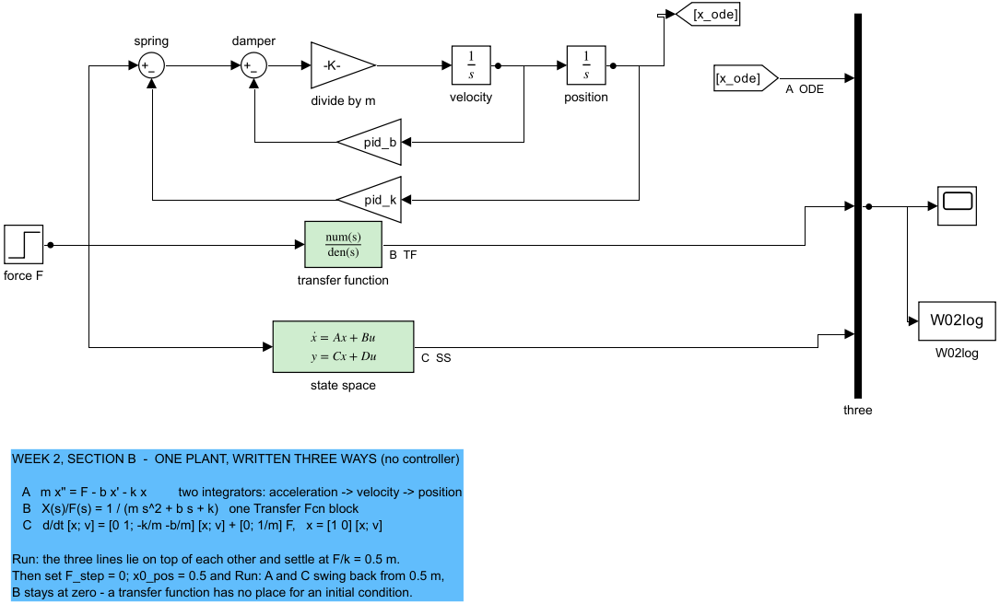

| 그림에서 | 뜻 |
|---|---|
| 위 줄: `spring`, `damper`, `divide by m`, `velocity`, `position` | 가속도에 대해 푼 운동방정식 $\ddot y = (\tau - k\,y - b\,\dot y)/m$, 그 다음 두 번 적분 |
| 왼쪽을 가리키는 `pid_b`, `pid_k` | 속도와 위치에서 되먹인 댐퍼와 스프링 힘 — 자유물체도의 왼쪽을 가리키는 화살표 둘 |
| `transfer function` | 블록 하나, $1/(m s^2 + b s + k)$ |
| `state space` | §2-2 의 $\mathbf{A}$, $\mathbf{B}$, $\mathbf{C}$ 와 초기 상태 `[x0_pos; x0_vel]` 를 가진 블록 하나 |
| `three` → Scope | 세 위치를 한 그림에 |

나오는 출력:

```
  W02 Experiment 2-2  one plant, three ways
    run                     ODE end   TF end   SS end   max|ODE-SS|  max|ODE-TF|
    1 N step force           0.5000   0.5000   0.5000      1.1e-16      1.1e-16
    released from 0.5 m      0.5000   0.0000   0.5000      0.0e+00      5.0e-01
    (second row: values at t = 0)
```

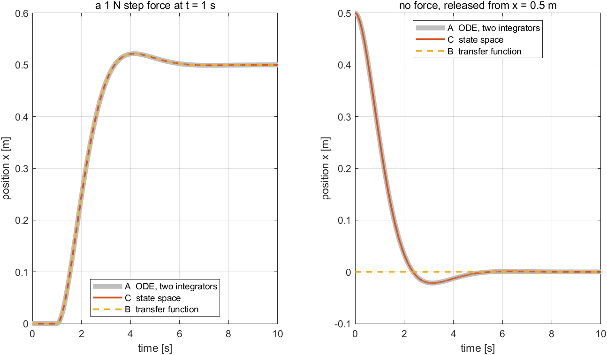

| 그림에서 | 뜻 |
|---|---|
| 왼쪽 | $t = 1$ s 의 1 N 계단 힘. 세 선이 하나이고, $4.3\,\%$ 오버슛($\zeta = 0.707$) 뒤 $F/k = 0.5$ m 에 정착한다 |
| 오른쪽 | 힘 없이 0.5 m 에서 놓음. 미분방정식과 상태공간은 되돌아 흔들리고, 전달함수는 0 에 머문다 |

**그림을 유도와 대조해 읽기.**

| 볼 곳 | 거기 있는 것 | §2-2 의 어느 단계가 예측했나 |
|---|---|---|
| 왼쪽 칸, **세 곡선이 한 선이다** | $1.1\times10^{-16}$ m 까지 일치 | 3~5단계: 운동방정식 하나, 표기 셋 |
| 왼쪽 칸, **정착하는 높이** | 1 N 에 대해 $0.5$ m | 정지에서의 3단계 $k\,y = \tau$, 그리고 4단계의 정적 이득 $G(0) = 1/k$ |
| 왼쪽 칸, **작은 오버슛** | $4.3\,\%$ | §2-3: $\zeta = b/(2\sqrt{mk}) = 0.707$ |
| 오른쪽 칸, **되돌아 흔들리는 두 곡선** | 미분방정식과 상태공간 | 5단계: 둘 다 위치와 속도를 상태로 들고 있고, 둘 다 $y(0) = 0.5$ m 를 받았다 |
| 오른쪽 칸, **0 의 평평한 선** | 전달함수 | 4단계: 라플라스 변환을 초기조건 0 으로 취했으므로 $0.5$ m 를 둘 곳이 없다 |

**그림이 말하는 것**

- 형태 셋, 플랜트 하나. 상태를 들고 있는 형태만 정지가 아닌 곳에서 시작할 수 있다.

| 해 볼 것 | 볼 것 |
|---|---|
| `x0_vel = 1; F_step = 0;` Run | $y = 0$ 에서 시작하지만 1 m/s 로 움직이고 있다. 같은 두 줄이 $0.322$ m 까지 나가고, 전달함수는 또 움직이지 않는다 |
| `pid_k = 8;` Run | 셋 다 $1/8$ m 에 정착하고 더 울린다 — 수 하나를 바꾸면 세 군데가 한꺼번에 바뀐다. 한 플랜트이기 때문이다 |

> [!tip] 수업에서
> - **목적** — 이 주의 나머지가 쓰는 전달함수가 새 대상이 아니라 자유물체도를 다른 표기로 쓴 것임을 보이고, 그것이 할 수 없는 한 가지를 보인다.
> - **가리킬 곳** — 위 줄에서 왼쪽을 가리키는 게인 둘. 그것이 자유물체도의 화살표 $k\,y$ 와 $b\,\dot y$ 이고, 합산점의 마이너스 부호가 그 방향이다.
> - **질문** — "놓을 때 어느 줄이 실패하고 왜인가?" 전달함수다. 초기조건 0 으로 유도했으므로 0.5 m 를 저장할 곳이 없다.
> - **남길 것** — 설계는 전달함수로, 시뮬레이션은 상태로.

## 2-3. 표준 2차 시스템: 감쇠비, 고유진동수, 극점

이 절이 답하는 것: 2차 응답의 모양을 정하는 두 수는 무엇이고, 그것을 어디서 볼 수 있는가?

**표준형.** 제어공학은 모든 2차 시스템을 한 형태로, 정적 이득을 1 로 두고 쓴다.

$$
G_2(s) = \frac{\omega_n^2}{s^2 + 2\zeta\omega_n s + \omega_n^2}
$$

플랜트의 분모를 $m$ 으로 나누고 계수를 비교하면 두 수의 이름이 나온다.

$$
\frac{1}{m s^2 + b s + k} = \frac{1/m}{s^2 + \frac{b}{m}\,s + \frac{k}{m}}
\qquad\Longrightarrow\qquad
\omega_n^2 = \frac{k}{m},\quad 2\zeta\omega_n = \frac{b}{m}
\qquad\Longrightarrow\qquad
\omega_n = \sqrt{\frac{k}{m}},\quad \zeta = \frac{b}{2\sqrt{m k}}
$$

| 기호 | 이름 | 물리적 읽기 | 이 플랜트 |
|---|---|---|---|
| $\omega_n$ | 고유진동수 [rad/s] | 더 센 스프링이나 더 가벼운 질량이 더 빠르게 만든다 | $\sqrt{2} = 1.414$ rad/s |
| $\zeta$ | 감쇠비 [–] | 더 센 댐퍼가 덜 울리게 만든다 | $2/(2\sqrt{2}) = 0.707$ |

- 플랜트는 $G_2$ 와 정적 이득만 다르다 — 1 대신 $1/k$ 다. 그 응답의 모양은 $\zeta$ 와 $\omega_n$ 만으로 정해진다. 파라미터 셋 $m$, $b$, $k$ 가 수 둘로 무너지는 것은, 질량과 스프링을 함께 두 배 해도 모양이 아무것도 바뀌지 않기 때문이다.

**극점.** $s^2 + 2\zeta\omega_n s + \omega_n^2 = 0$ 의 근을 근의 공식으로 구하면

$$
s = -\zeta\omega_n \pm \omega_n\sqrt{\zeta^2 - 1}
\qquad\xrightarrow{\ \zeta < 1\ }\qquad
s = -\underbrace{\zeta\omega_n}_{\sigma} \pm j\,\underbrace{\omega_n\sqrt{1-\zeta^2}}_{\omega_d}
$$

근호 안의 부호가 세 경우를 가른다.

| 조건 | 극점 | 이름 | 계단응답 |
|---|---|---|---|
| $\zeta < 1$ | 복소쌍 $-\sigma \pm j\omega_d$ | 부족감쇠 | 정착하는 동안 오버슛하고 울린다 |
| $\zeta = 1$ | $-\omega_n$ 의 중근 | 임계감쇠 | 오버슛 없는 가장 빠른 응답 |
| $\zeta > 1$ | 서로 다른 실근 둘 | 과도감쇠 | 오버슛 없고 더 느리다. 원점에 가까운 극점이 지배한다 |

**극점이 응답을 정하는 이유.** 부분분수 전개가 응답을 극점마다 한 항으로 쪼개고, 각 항은 지수함수 $e^{p t}$ 다. 극점 $p = -\sigma + j\omega_d$ 에 대해

$$
e^{p t} = e^{-\sigma t}\,\bigl(\cos\omega_d t + j\sin\omega_d t\bigr)
$$

- 실수부 $\sigma$ 가 **포락선** $e^{-\sigma t}$ 를 정한다. 운동이 얼마나 빨리 사그라드는가다. 허수축 오른쪽의 극점($\sigma < 0$)은 대신 자라고, 그 시스템은 불안정하다.
- 허수부 $\omega_d$ 가 응답이 얼마나 빨리 **진동하는지**를 정한다. 감쇠진동수다.
- 극형식으로 읽으면 극점은 원점에서 거리 $\omega_n$ 에, 음의 실축에서 각 $\theta$ 에 놓이고 $\cos\theta = \zeta$ 다. 거리가 빠르기이고, 각이 울림이다.

**기억할 두 관계.** 아래 실험 2-3 이 모델 `W02_B_second_order` 에서 한 번에 수 하나를 바꿔 잰 값:

| $\zeta$ | $\omega_n$ [rad/s] | 오버슛 [%] (식) | 첨두시간 [s] (식) | 상승 [s] | 정착 [s] | 대역폭 [rad/s] |
|---|---|---|---|---|---|---|
| 0.2 | 2 | 52.7 (52.7) | 1.603 (1.603) | 0.602 | 8.59 | 3.02 |
| 0.5 | 2 | 16.3 (16.3) | 1.814 (1.814) | 0.819 | 4.04 | 2.54 |
| 0.707 | 2 | 4.3 (4.3) | 2.221 (2.221) | 1.074 | 2.98 | 2.00 |
| 1 | 2 | 0.0 (0.0) | 없음 | 1.679 | 2.92 | 1.29 |
| 2 | 2 | 0.0 (0.0) | 없음 | 4.115 | 7.44 | 0.53 |
| 0.5 | 1 | 16.3 (16.3) | 3.627 (3.628) | 1.637 | 8.08 | 1.27 |
| 0.5 | 4 | 16.3 (16.3) | 0.907 (0.907) | 0.410 | 2.02 | 5.09 |

- **감쇠비가 크면 오버슛이 작다.** 오버슛은 $\zeta$ **만**에 기대고 $M_p = 100\,e^{-\pi\zeta/\sqrt{1-\zeta^2}}$ 이며, $\zeta$ 가 자라면 단조로 떨어진다 — $52.7 \to 16.3 \to 4.3 \to 0\,\%$. $\zeta = 1$ 부터는 0 이다. $\zeta = 1$ 을 넘으면 감쇠를 더해도 응답만 느려진다 — $\zeta = 1$ 에서 정착 $2.92$ s, $\zeta = 2$ 에서 $7.44$ s.
- **고유진동수가 크면 응답이 빠르고, 오버슛은 같다.** $\zeta$ 를 고정하면 모든 시간이 $1/\omega_n$ 으로 비례한다. $\omega_n$ 을 두 배 하면 첨두시간($3.627 \to 1.814 \to 0.907$ s), 상승시간, 정착시간이 반이 되고 오버슛은 $16.3\,\%$ 에 머문다. s 평면에서 극점은 같은 반직선을 따라 바깥으로 움직인다.

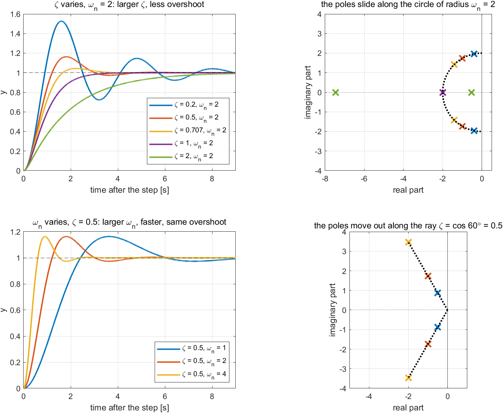

| 그림에서 | 뜻 |
|---|---|
| 왼쪽 위 | $\omega_n = 2$ 에서 감쇠비 다섯에 대한 계단응답 |
| 오른쪽 위 | 그 극점들. $\zeta \le 1$ 인 동안 반지름 $\omega_n = 2$ 의 원 위에, $\zeta = 2$ 에서는 실축 위에 하나는 원점 근처, 하나는 멀리 |
| 왼쪽 아래 | $\zeta = 0.5$ 에서 $\omega_n = 1, 2, 4$ 에 대한 계단응답 |
| 오른쪽 아래 | 그 극점들. 음의 실축에서 $60^\circ$ 인 한 반직선 위에 있고($\cos 60^\circ = 0.5$), $\omega_n$ 이 자라면 더 멀리 |

**대역폭.** 같은 빠르기를 주파수영역에서 읽을 수 있다. 사인파 설정값으로 구동하면 시스템은 느린 사인파를 진폭 그대로 따라가고 빠른 것은 줄인다. **대역폭** $\omega_B$ 는 출력 진폭이 정적 값의 $1/\sqrt{2}$ ($-3$ dB) 로 떨어지는 주파수다. 표준형에 대해

$$
\omega_B = \omega_n\,\sqrt{1 - 2\zeta^2 + \sqrt{4\zeta^4 - 4\zeta^2 + 2}}
$$

- $\zeta$ 를 고정하면 대역폭은 $\omega_n$ 에 **비례한다** — $\zeta = 0.5$ 에서 $\omega_n = 1, 2, 4$ 에 대해 $1.27$, $2.54$, $5.09$ rad/s. $\zeta = 0.707$ 에서는 정확히 $\omega_n$ 과 같다(`verify_w02_pid` 검사 10).
- 넓은 대역폭과 짧은 상승시간은 같은 성질을 두 쪽에서 본 것이다. 계단은 모든 주파수를 품고 있고, 그 모서리는 시스템이 통과시키는 가장 높은 주파수만큼만 빠르게 따라간다. 위 표의 모든 줄에서 곱 $t_r\,\omega_B$ 가 1.8 과 2.2 사이에 머문다.
- 대역폭은 §2-13 에서 디지털 제어기가 얼마나 자주 샘플해야 하는지를 정하면서, 그리고 5주차에서 안쪽 루프가 그 바깥 루프보다 몇 배 넓어야 한다는 데서 다시 나온다.

> [!note] 영점은 모양을 바꾸고 극점을 바꾸지 않는다
> 위의 식들은 극점 둘과 영점 없음을 가정한다. 분자의 영점은 응답의 미분을 그 안에 섞어 넣는다. 극점과 정착은 바뀌지 않지만 초기 응답이 들리고, 영점이 원점에 가까울수록 오버슛이 커진다. §2-7 의 미분 항이 정확히 그런 영점을 더하고, 그래서 그것의 측정된 오버슛이 식에서 벗어난다.

### 실험 2-3 · 감쇠비와 고유진동수 (7분)

**무엇을 재는가.** 이 절의 두 주장을, 한 번에 손잡이 하나씩 — 오버슛은 $\zeta$ 만을 따르고, 응답의 모든 시간은 $1/\omega_n$ 으로 비례하면서 오버슛은 제자리에 있다.

**모델.** `W02_B_second_order` — 표준형 자체를 든 Transfer Fcn 하나. 그 안의 수는 `zeta` 와 `wn` 뿐이다. 여기에는 플랜트도 제어기도 없다. 무엇이 그것을 만들어 내라고 요구받기 전에 모양을 공부하는 것이다.

**열고 돌리기.**

```matlab
W02_0_setup
open_system('W02_B_second_order')  % Run
zeta = 0.2;                        % Run — 크게 출렁인다 / it rings hard
zeta = 1;                          % Run — 넘침이 사라진다 / the overshoot disappears
zeta = 0.5; wn = 4;                % Run — 모양은 그대로, 시간만 반으로 / same shape, half the time
W02_B_zeta_and_wn                  % 두 스윕을 한 번에 / both sweeps at once
```

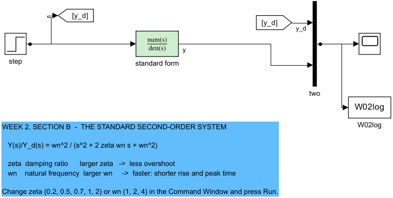

| 그림에서 | 뜻 |
|---|---|
| `step` | 설정값 $y_d$: $t = 1$ s 에 0 → 1. 태그 `[y_d]` 로 Scope 에도 보낸다 |
| `standard form` | 작업공간에서 읽은 `zeta` 와 `wn` 을 가진 $\omega_n^2/(s^2 + 2\zeta\omega_n s + \omega_n^2)$ |
| `two` → Scope, `W02log` | $y_d$ 와 $y$ 를 한 그림에, 그리고 같은 두 신호를 기록 |

나오는 출력:

```
  W02 Experiment 2-3  the standard second-order system
    zeta varies, wn = 2
      zeta    wn   overshoot % (formula)  peak time [s] (formula)  rise [s]  settle [s]  bandwidth [rad/s]
      0.200     2      52.7 ( 52.7)          1.603 ( 1.603)        0.602       8.59         3.02
      0.500     2      16.3 ( 16.3)          1.814 ( 1.814)        0.819       4.04         2.54
      0.707     2       4.3 (  4.3)          2.221 ( 2.221)        1.074       2.98         2.00
      1.000     2       0.0 (  0.0)           none                  1.679       2.92         1.29
      2.000     2       0.0 (  0.0)           none                  4.115       7.44         0.53
    wn varies, zeta = 0.5
      zeta    wn   overshoot % (formula)  peak time [s] (formula)  rise [s]  settle [s]  bandwidth [rad/s]
      0.500     1      16.3 ( 16.3)          3.627 ( 3.628)        1.637       8.08         1.27
      0.500     2      16.3 ( 16.3)          1.814 ( 1.814)        0.819       4.04         2.54
      0.500     4      16.3 ( 16.3)          0.907 ( 0.907)        0.410       2.02         5.09
```

그림은 §2-3 에 있다.

**그림이 말하는 것**

- $\zeta$ 는 얼마나 울리는지를 정하고 오버슛에 대해 그 밖의 아무것도 정하지 않는다. $\omega_n$ 은 얼마나 빠른지를 정하고 오버슛에 대해서는 아무것도 정하지 않는다.

> [!tip] 수업에서
> - **목적** — 어떤 제어기가 그것을 돌리기 전에, 뒤의 모든 결과를 읽는 데 쓸 손잡이 둘을 수업에 준다.
> - **가리킬 곳** — 위 칸에서 $\zeta$ 가 자라며 떨어지는 봉우리들. 아래 칸에서 $\omega_n$ 이 자라며 같은 봉우리 높이에 더 일찍 닿는 것. 극점 그림에서는 원(같은 빠르기, 다른 각)과 반직선(같은 각, 다른 빠르기).
> - **질문** — "$\zeta = 2$ 에서는 오버슛이 없다. 왜 그것이 최선이 아닌가?" 극점 하나가 원점 쪽으로 움직여 지배한다. $\zeta = 1$ 의 $2.92$ s 에 대해 정착에 $7.44$ s 가 걸린다.
> - **질문** — "대역폭을 정하는 수는?" 주어진 $\zeta$ 에서 $\omega_n$ 이고, 비례해서다. 넓은 대역폭은 짧은 상승시간이다.
> - **남길 것** — 극점의 각이 오버슛이고, 원점에서의 거리가 빠르기다.

## 2-4. 시간영역 성능 지표: 응답을 어떻게 판정하는가

이 절이 답하는 것: 응답이 얼마나 좋은지를 말하는 수는 무엇이고, 그것을 Scope 에서 어떻게 읽는가?

"빠르고 너무 출렁이지 않는다" 는 확인할 수 없고, "오버슛 10 % 이하, 3 s 안에 정착" 은 확인할 수 있다. 요구사항은 수로 오고, 제어기는 그 측정된 수가 요구사항을 만족할 때 끝난다. 여기서 강의 끝까지 모든 결과는 아래 다섯 수로 말하고, §2-12 의 튜닝 순서는 그것을 적는 것으로 시작한다.

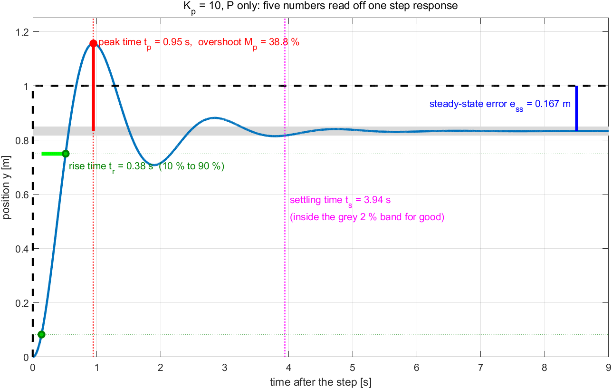

| 그림에서 | 뜻 |
|---|---|
| 파란 곡선, 검은 점선 | $K_p = 10$ 에서 P 루프의 응답(§2-6) 과 1 m 의 설정값 |
| 초록 막대와 점들 | 상승시간: 최종값의 10 % 에서 90 % 까지 |
| 붉은 점과 붉은 수직 막대 | 봉우리. 그 시각이 첨두시간이고, 최종값 위의 높이가 오버슛이다 |
| 회색 띠 | 최종값의 $\pm 2\,\%$ |
| 자홍 점선 | 정착시간. 그 뒤로 응답이 회색 띠 안에 머문다 |
| 오른쪽의 파란 막대 | 정상상태 오차: 설정값과 최종값 사이에 남은 간격 |

| 지표 | 정의 | 무엇에 답하나 | 표준 2차 |
|---|---|---|---|
| 상승시간 $t_r$ | 최종값의 10 % 에서 90 % 까지의 시간 | 얼마나 빠른가 | $1/\omega_n$ 으로 떨어진다 |
| 첨두시간 $t_p$ | 가장 높은 봉우리의 시각 | 얼마나 빠른가 | $\pi/\omega_d = \pi/\bigl(\omega_n\sqrt{1-\zeta^2}\bigr)$ |
| 오버슛 $M_p$ | $100\,(y_{\max} - y_{ss})/y_{ss}$ [%] | 얼마나 울리는가 | $100\,e^{-\pi\zeta/\sqrt{1-\zeta^2}}$, $\zeta$ 만 |
| 정착시간 $t_s$ | 응답이 $y_{ss}$ 의 $\pm 2\,\%$ 밖에 있던 마지막 시각 | 언제 끝나는가 | $\approx 4/(\zeta\omega_n) = 4/\sigma$ |
| 정상상태 오차 $e_{ss}$ | $y_d - y_{ss}$ | 얼마나 정확한가 | 아래의 최종값 정리 |

- **모든 시간은 계단이 걸린 순간에서 잰다.** 이번 주 모든 모델에서 그것은 $t = 1$ s 다. `_tools/step_metrics.m` 이 이 강의의 모든 스크립트에 대해 그렇게 하고, MATLAB 의 `stepinfo` 는 전달함수에 대해 같은 양을 계산한다.
- **오버슛은 설정값이 아니라 최종값에 대해 잰다.** $K_p = 2$ 에서 P 루프는 0.5 m 에 정착하고 0.58 m 에서 꼭대기를 찍는다. 자기 최종값을 $16.3\,\%$ 넘고, 요구받은 1 m 에는 결코 닿지 않는다. 오버슛과 정상상태 오차는 별개의 질문이다.
- **띠를 밝혀야 한다.** 2 % 띠가 이 강의의 기본값이다. §2-12 의 튜닝 순서는 1 % 를 쓰고 그렇게 밝힌다. 띠 없이 인용된 정착시간은 비교할 수 없다.
- 여섯째 수는 응답 안에 아예 없다 — **가장 큰 제어 입력**이다. §2-6 이 위의 모든 지표에서 좋아 보이면서 구동기에 가진 것보다 더 요구하는 게인을 보인다.

**식을 측정과 대조.** §2-6 의 P 루프는 $\omega_n = \sqrt{k + K_p}$, $\zeta = b/\bigl(2\sqrt{k+K_p}\bigr)$ 인 정확한 표준 2차 시스템이므로 식을 그것에서 확인할 수 있다. 아래 실험 2-4 가 잰 값:

| $K_p$ | $\zeta$ | $\omega_n$ [rad/s] | 첨두시간 [s] (식) | 정착 [s] (식 $4/\zeta\omega_n$) | $e_{ss}$ [m] |
|---|---|---|---|---|---|
| 2 | 0.500 | 2.000 | 1.814 (1.814) | 4.04 (4.00) | 0.500 |
| 10 | 0.289 | 3.464 | 0.947 (0.947) | 3.94 (4.00) | 0.167 |
| 50 | 0.139 | 7.211 | 0.440 (0.440) | 3.64 (4.00) | 0.038 |

- 첨두시간은 정확하다. 정착 식은 포락선에서 나온 추정이고 10 % 안에 들어온다.
- 모든 $K_p$ 에서 $\zeta\omega_n = b/(2m) = 1$ 이다. 비례 게인은 극점을 수직선 $\mathrm{Re}(s) = -1$ 을 따라 **위로** 움직이고 결코 왼쪽으로 움직이지 않는다. 울림은 자라고 정착시간은 좋아지지 않는다. 극점을 왼쪽으로 움직이려면 감쇠가 필요하고, 그것이 §2-7 의 미분이 더하는 것이다.

**정상상태 오차와 시스템 형식.** 단위 계단 설정값과 루프 이득 $L(s) = C(s)\,G(s)$ 에 대해 오차는 $E(s) = Y_d(s)/\bigl(1 + L(s)\bigr)$ 이고, 최종값 정리가 준다

$$
e_{ss} = \lim_{s\to 0} s\,E(s) = \frac{1}{1 + L(0)}
\qquad\text{for P control:}\qquad
L(0) = K_p\,G(0) = \frac{K_p}{k}
\quad\Longrightarrow\quad
e_{ss} = \frac{k}{k + K_p}
$$

- $L(s)$ 가 인자 $1/s$ — 적분기 — 를 품지 않으면 $L(0)$ 은 유한하게 남는다. $L(s)$ 안의 적분기 수가 **시스템 형식**이다.

| 루프 | 형식 | 계단 설정값 | 램프 설정값 |
|---|---|---|---|
| 이 플랜트 둘레의 P 또는 PD | 0 | 오차 $1/(1 + L(0))$, 유한 | 오차가 한없이 자란다 |
| 이 플랜트 둘레의 PID | 1 | 오차 **0** (§2-8) | 유한한 오차 |

- 이 식은 안정한 루프에 대해서만 성립한다. 불안정한 루프에는 잴 정상상태가 없다.

**응답 전체를 수 하나로.** 자동 튜너는 정해진 창에서 오차의 적분 하나로 여러 실행을 비교한다.

| 기준 | 정의 | 무엇을 벌하나 |
|---|---|---|
| IAE | $\int_0^T \lvert e \rvert\,\mathrm{d}t$ | 모든 오차를 똑같이 |
| ISE | $\int_0^T e^2\,\mathrm{d}t$ | 큰 오차, 따라서 오버슛 |
| ITAE | $\int_0^T t\,\lvert e \rvert\,\mathrm{d}t$ | 오래 가는 오차, 따라서 느린 정착 |

- 실험 2-6 이 계단 뒤 9 s 에 대해 잰 IAE 는 $K_p = 2, 10, 50$ 에 대해 $4.750$, $1.761$, $0.837$ m·s 다. 결코 사라지지 않는 오차가 있으면 적분의 대부분은 그 오차 곱하기 창이다 — $K_p = 2$ 의 $4.750$ 중 $0.5 \times 9 = 4.5$ — 그래서 적분 기준은 고정된 창과 형식 1 루프에서만 뜻이 있다. 이 강의는 위의 다섯 수를 쓴다.

**각 게인이 지표에 무엇을 하는가.** 실험 2-6 부터 2-8 까지가 한 번에 게인 하나를 올려 잰 값:

| 올린 것 | 상승시간 | 오버슛 | 정착시간 | 정상상태 오차 | 어디서 쟀나 |
|---|---|---|---|---|---|
| $K_p$: 2 → 50 | 짧아진다, $0.819 \to 0.158$ s | 커진다, $16.3 \to 64.4\,\%$ | 거의 그대로, $4.04 \to 3.64$ s | 작아진다, $0.500 \to 0.038$ | 실험 2-6 |
| $K_d$: 0 → 6 | — | 작아진다, $38.8 \to 8.6\,\%$ | 짧아진다, $3.94 \to 1.27$ s | 그대로, $0.167$ | 실험 2-7 |
| $K_i$: 0 → 4 → 12 | — | $9.8 \to 0.0 \to 4.7\,\%$ | $1.32 \to 4.84 \to 1.49$ s | 사라진다 | 실험 2-8 |

- 앞의 두 줄은 어느 교재의 표에나 있는 경향이다(예: *Control Tutorials for MATLAB and Simulink* 의 "Introduction: PID Controller Design"). 세 번째 줄은 그런 표가 법칙이 아니라 경향인 이유를 보인다. 작은 $K_i$ 는 오차를 느리게 없애고, 큰 것은 빠르게 없애지만 오버슛과 함께다. 판단하는 것은 측정뿐이다.

### 실험 2-4 · 응답 하나에서 읽어낸 다섯 수 (5분)

**무엇을 재는가.** 위의 정의들을 곡선 하나에 적용한다 — $K_p = 10$ 의 P 루프이고, 그 다섯 수가 이 절의 그림에 표시되어 있다.

**모델.** `W02_C_metrics` — $K_p = 10$ 의 P 루프. 이 절의 그림이 주석을 붙인 그 응답이다. §2-6 이 공부할 루프이고, 여기서는 그 응답을 **읽는 것**만 연습한다.

**열고 돌리기.**

```matlab
W02_0_setup
open_system('W02_C_metrics')  % Run — 위 칸에 이 절의 응답이 그려진다 / the response of this section
W02_C_five_numbers            % 다섯 숫자를 재고 그림에 표시한다 / measures them and marks them
```

`_tools/step_metrics.m` 이 읽은, 나오는 출력:

```
  W02 Experiment 2-4  the five numbers of one response
    Kp = 10:  rise 0.377 s  peak time 0.947 s  overshoot 38.8 %  settle 3.94 s  error 0.167 m  IAE 1.761 m s
```

**출력을 정의와 대조해 읽기.**

| 찍힌 것 | 어느 정의에서 왔나 | 이 절의 그림에서 어떻게 보나 |
|---|---|---|
| `rise 0.377 s` | 최종값의 10 % 에서 90 % 까지 | 초록 막대, 초록 점 둘 사이 |
| `peak time 0.947 s` | 가장 높은 봉우리의 시각 | 붉은 점. $t = 1$ s 의 계단에서 잰 것 |
| `overshoot 38.8 %` | $100\,(y_{\max} - y_{ss})/y_{ss}$ | 붉은 막대: 봉우리의 **최종값 위** 높이이고, 설정값 위가 아니다 |
| `settle 3.94 s` | $y_{ss}$ 의 $\pm 2\,\%$ 를 마지막으로 벗어난 시각 | 곡선이 회색 띠로 완전히 들어가는 곳, 자홍 선 |
| `error 0.167 m` | $y_d - y_{ss}$ | 오른쪽의 파란 막대, 점선 설정값과 최종값 사이 |
| `IAE 1.761 m s` | 계단 뒤 9 s 에 대한 $\int \lvert e\rvert\,\mathrm{d}t$ | 길이로 보이지 않는다. 둘 사이의 면적이다 |

- **모든 시간은 계단에서 잰다.** $t = 0$ 에서가 아니다. 이번 주 모든 모델에서 계단은 $t = 1$ s 이므로, 시간축에서 $1.947$ s 로 읽히는 봉우리는 첨두시간 $0.947$ s 다.
- 오버슛과 오차는 별개의 질문이다. 이 응답은 자기 최종값을 $38.8\,\%$ 넘고도 요구받은 것에서 $0.167$ m 못 미친 채 끝난다.

> [!tip] 수업에서
> - **목적** — 무엇을 판정하는 데 쓰이기 전에 다섯 단어를 못 박고, 오독을 가장 많이 일으키는 관습 둘을 못 박는다 — 시간은 계단에서 재고, 오버슛은 최종값에 대해 잰다.
> - **가리킬 곳** — 이 절 그림의 붉은 막대와 파란 막대. 하나는 오버슛이고 다른 하나는 정상상태 오차이며, 서로 다른 선에서 잰다.
> - **질문** — "응답이 설정값 $1$ m 에 대해 $1.15$ m 에서 꼭대기를 찍고 $0.833$ m 에서 끝난다. 오버슛은?" $100\,(1.15 - 0.833)/0.833 = 38\,\%$ 이고, $15\,\%$ 가 아니다.
> - **남길 것** — 결과는 다섯 수와 띠 하나다. 그 밖의 것은 인상이다.

## 2-5. 되먹임, 그리고 하나의 오차를 세 가지로 읽기

이 절이 답하는 것: 제어기는 무엇을 보고, 그것으로 무엇을 하는가?

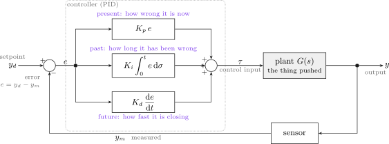

| 그림에서 | 뜻 |
|---|---|
| $y_d$, 설정값 | 출력이 있어야 할 곳 — 명령 또는 기준이라고도 한다 |
| $+$ 와 $-$ 가 있는 원 | 설정값에서 측정값을 뺀다. 그 출력이 **오차** $e$ 다 |
| 점선 틀 안의 상자 셋 | 제어기: 같은 오차를 세 가지로 읽는다. 각 상자 위아래에 보라색으로 |
| $\tau$, 제어 입력 | 셋의 합. 플랜트로 밀어 넣는다 |
| 센서, $y_m$ | 되먹여진 측정 출력. 이번 주에는 $y_m = y$ 이고, 잡음을 켜면 거기에 잡음이 더해진다 |

제어기는 신호 **하나**, 곧 오차를 받고, PID 는 그것을 세 가지로 읽는다.

$$
e(t) = y_d(t) - y_m(t), \qquad
\tau(t) = \underbrace{K_p\,e(t)}_{\text{present}}
+ \underbrace{K_i\!\int_0^t e(\sigma)\,\mathrm{d}\sigma}_{\text{past}}
+ \underbrace{K_d\,\frac{\mathrm{d}e(t)}{\mathrm{d}t}}_{\text{future}}
$$

| 항 | 오차에서 무엇을 읽나 | 말로 (Tech Talk 1편) | 혼자서는 할 수 없는 것 |
|---|---|---|---|
| P, $K_p e$ | **지금** 얼마나 틀렸는가 | "멀리 있으면 세게 밀어라" | 스프링에 맞서 위치를 유지하기. 오차 0 은 힘 0 을 준다 |
| I, $K_i\!\int e$ | 얼마나 오래 틀려 **있었는가** | "아직 못 갔으면 더 밀어라" | 빠르게 작용하기. 늦게 응답하고 늦게 멈춘다 |
| D, $K_d\,\dot e$ | 오차가 얼마나 빠르게 **닫히고 있는가** | "곧 도착한다, 제동해라" | 목표가 어디인지 알기. 일정한 오차는 미분을 주지 않는다 |

**간직할 그림.** 이 플랜트에서 각 항은 정비사가 알아볼 만한 일을 하고, §2-6 부터 §2-8 까지가 그것을 운동방정식에서 증명한다.

| 항 | 무엇처럼 작용하나 | 그래서 |
|---|---|---|
| P | 질량을 $y_d$ 쪽으로 당기는 **스프링** | 루프를 빠르고 더 통통 튀게 만든다. 스프링 혼자서는 늘어나지 않고 다른 스프링에 맞서 버틸 수 없다 |
| D | **완충기**(댐퍼) | 튐을 가라앉힌다. 위치가 아니라 운동에 저항한다 |
| I | 오차가 오래갈수록 더 세게 미는 **참을성 있는 손** | 스프링들이 남기는 오차를 없앤다. 참을성이 있으니 느리기도 하고 지나칠 수도 있다 |

| 기호 | 양 | 이 플랜트에서의 단위 |
|---|---|---|
| $K_p$ | 비례 게인 | N/m |
| $K_i$ | 적분 게인 | N/(m·s) |
| $K_d$ | 미분 게인 | N·s/m |

> [!warning] 교재의 글자 $r$ 과 $u$ 를 쓰지 않는 이유
> 제어 교재는 설정값을 $r$, 제어 입력을 $u$ 로 쓴다. 이 강의에서 $u$ 는 **전진속도**이고 $r$ 은 **회두율**이다 — 3주차의 속도 루프가 $u_d - u$ 다 — 그래서 $u$ 가 속도이기도 하고 제어 입력이기도 한 쪽은 읽을 수 없다. 그래서 설정값은 $y_d$, 제어 입력은 $\tau$ 이고, Fossen 의 표기와 같다. 이번 주의 $y$ 는 일반적인 출력이고 동쪽 위치 $y^n$ 이 아니다.

### 실험 2-5 · 루프 전체를 한 캔버스에 (5분)

**무엇을 재는가.** 아직 아무것도 — 이 실험은 위의 그림을 블록 하나하나 모델과 맞춰 본다. 그래야 뒤따르는 세 절이 각각 항 하나를 켤 수 있다.

**캔버스.** `W02_E_PID` — 이번 주에서 가장 꽉 찬 모델이다. 여기서는 읽고, 재는 것은 실험 2-8 이다. 뒤의 모든 절이 그것의 특수한 경우다. $K_i = K_d = 0$ 이면 §2-6, $K_i = 0$ 이면 §2-7 이다.

**열고 돌리기.**

```matlab
W02_0_setup
open_system('W02_E_PID')          % Run — 위 칸 위치, 아래 칸 힘 / position above, force below
```

캔버스의 각 블록이 위 법칙의 기호 하나다.

| 법칙에서 | 캔버스에서 | 무엇을 지나나 |
|---|---|---|
| $e = y_d - y_m$ | $+$ 와 $-$ 가 있는 원 `e` | 제어기가 받는 그 한 신호 |
| $K_p\,e$ | `Kp` | 현재 |
| $K_i\!\int e$ | `Ki` → `I` | 쌓인 과거 |
| $K_d\,\dot e$ | `D filter` | 미래. §2-10 이 실제로 구현하는 그대로 |
| $\tau = P + I + D$ | `p+d` → `u` → `plant` | 질량에 걸리는 힘 |

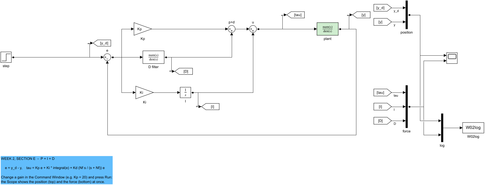

| 그림에서 | 뜻 |
|---|---|
| `step` → `e` | 설정값과 오차 $e = y_d - y$ |
| `Kp`, `D filter`, `Ki` → `I` | 세 항, 블록 하나씩 |
| `p+d`, `u` → `plant` | 그 합이 질량-스프링-댐퍼에 걸리는 힘 $\tau$ 다 |
| 아래를 따라가는 긴 선 | 되먹임: 위치가 `e` 로 |
| Goto 태그 `[y_d]`, `[y]`, `[tau]`, `[I]`, `[D]` | 루프를 가로지르지 않고 신호를 오른쪽으로 나른다 |
| `position`, `force` → Scope | Scope 하나, 칸 둘. 위에 $y_d$ 와 $y$, 아래에 $\tau$, $I$, $D$ |

- 해 보기: `Kp = 30`, Run — 위 칸이 더 울린다. `Ki = 0`, Run — 응답이 1 에 못 미쳐 정착한다.

> [!tip] 수업에서
> - **목적** — 뒤의 모든 절은 Command Window 에서 수 하나를 바꾸고 Run 을 누른다. 이 절은 제어를 논하기 전에 그 흐름이 모두에게 되는지 확인한다.
> - **가리킬 곳** — 블록 안의 변수 이름(`Kp`, `Kd*Nf`, `pid_m`). 캔버스 위의 어느 것도 수가 아니므로, 캔버스와 `W02_0_setup.m` 은 한 모델의 두 가지 모습이다.
> - **질문** — "`Kp` 를 바꿔 가며 실험한 뒤 Scope 가 왜 노트와 더 이상 맞지 않는가?" 바꾼 값이 아직 작업공간에 있다. `W02_0_setup` 이 전부를 되돌린다.
> - **남길 것** — 예제마다 모델 하나, 모델마다 Scope 하나, 그리고 Run 이 이미 보여 주는 것만 되풀이하는 스크립트.

## 2-6. P — 현재의 오차: 더 빠르고, 더 출렁이고, 결코 정확하지 않다

이 절이 답하는 것: 비례 제어기는 이 플랜트에서 무엇을 이루고, 무엇은 결코 이룰 수 없는가?

**무엇이 관측되는가.** 실험 2-6 은 $K_p$ 를 2 에서 10 으로, 50 으로 올리고 그 밖에는 아무것도 바꾸지 않는다.

- 응답이 단계마다 더 빨라지고 더 울린다. 그리고
- 매번 **요구받은 1 m 에 못 미쳐** 멈춘다 — $0.500$, $0.833$, $0.962$ m 에서.
- 남기는 간격은 $0.500$, $0.167$, $0.038$ m 이고, 줄어들지만 결코 닫히지 않는다.
- 한편 계단이 걸리는 순간 요구된 힘은 $2$, $10$, $50$ N 이다.

이 절의 나머지가 이 넷을 모두, 나타난 순서대로 유도한다.

**결과.**

$$
y_{ss} = \frac{K_p}{k + K_p}\,y_d, \qquad
e_{ss} = \frac{k}{k + K_p}\,y_d, \qquad
\omega_n = \sqrt{\frac{k + K_p}{m}}, \qquad
\zeta = \frac{b}{2\sqrt{m\,(k + K_p)}}
$$

**유도, 한 줄씩.**

1. 비례 제어기는 현재의 오차만으로 힘을 만들고 그 밖에는 아무것도 쓰지 않는다 — $\tau = K_p\,e = K_p\,(y_d - y)$.
2. §2-2 의 운동방정식에 넣으면 $m\,\ddot y + b\,\dot y + k\,y = K_p\,(y_d - y)$.
3. $y$ 에 대한 모든 항을 왼쪽에 모으면 $m\,\ddot y + b\,\dot y + (k + K_p)\,y = K_p\,y_d$, 곧
$$
T(s) = \frac{Y(s)}{Y_d(s)} = \frac{K_p}{m s^2 + b s + k + K_p}
$$
4. **$K_p$ 가 $k$ 옆에 내려앉았고, 그 밖의 어느 것 옆에도 앉지 않았다.** 비례 제어기는 $y_d$ 쪽으로 당기는, 조절 가능한 두 번째 스프링이다. 감쇠 $b$ 는 있던 그대로 남는다.
5. 3번 줄은 $k$ 를 $k + K_p$ 로 바꾼 §2-3 의 표준형이므로 $\omega_n = \sqrt{(k+K_p)/m}$, $\zeta = b/\bigl(2\sqrt{m(k+K_p)}\bigr)$ 다. 그래서 $K_p$ 를 올리면 $\omega_n$ 이 오르고 $\zeta$ 는 **내려간다.** 더 빠르고 **그리고** 더 출렁이며, 오버슛은 §2-3 의 $M_p = 100\,e^{-\pi\zeta/\sqrt{1-\zeta^2}}$ 다.
6. 응답의 끝에서는 아무것도 움직이지 않으므로 $\dot y = \ddot y = 0$ 이고 3번 줄은 앞의 두 항을 잃는다 — $(k + K_p)\,y_{ss} = K_p\,y_d$.
7. $k + K_p$ 로 나누면 $y_{ss} = K_p\,y_d/(k + K_p)$ 이고, 남은 간격은 $e_{ss} = y_d - y_{ss} = k\,y_d/(k + K_p)$ — **어떤 유한한 $K_p$ 에서도 0 이 아니다.**
8. 계단이 걸리는 순간 명령 전체가 아직 오차이므로 $e = y_d$ 이고, 힘은 $\tau = K_p\,y_d$ 에서 시작한다. 힘 칸의 첫 첨두 높이가 게인 자체다.

7번 줄은 두 번째 유도와 이름을 받을 만큼 중요하고, 둘 다 뒤따른다.

**길 1, s 영역: 최종값 정리.** 정착하는 신호의 최종값은 그 라플라스 변환을 $s \to 0$ 에서 읽어 얻는다.

$$
\lim_{t\to\infty} y(t) = \lim_{s\to 0} s\,Y(s)
$$

단위 계단 설정값은 $Y_d(s) = 1/s$ 이므로 $Y(s) = T(s)\,Y_d(s) = T(s)/s$ 이고,

$$
y_{ss} = \lim_{s\to 0} s \cdot \frac{T(s)}{s} = T(0) = \frac{K_p}{m\cdot 0 + b\cdot 0 + k + K_p} = \frac{K_p}{k + K_p}
$$

- 정리의 인자 $s$ 가 계단의 $1/s$ 를 지우고, 남는 것은 $s = 0$ 에서 계산한 전달함수다.
- $s \to 0$ 이 $t \to \infty$ 를 뜻하는 이유: $s$ 는 주파수의 역할을 하고, 계단응답의 끝은 그중 가장 느린 영주파수 부분이다.
- 이 정리는 응답이 정착할 때, 곧 모든 폐루프 극점이 왼쪽 반평면에 있을 때에만 성립한다. 불안정하거나 감쇠 없는 루프에서는 시뮬레이션이 결코 닿지 않는 수를 돌려준다.

**길 2, 시간영역: 끝에서는 아무것도 움직이지 않는다.** 이것이 유도의 6번과 7번 줄을 풀어 쓴 것이다. 응답이 정착하면 $\dot y = 0$, $\ddot y = 0$ 이고 폐루프 운동방정식은 앞의 두 항을 잃는다.

$$
m\cdot 0 + b\cdot 0 + (k + K_p)\,y_{ss} = K_p\,y_d
\qquad\Longrightarrow\qquad
y_{ss} = \frac{K_p}{k + K_p}\,y_d
$$

- 같은 답을, 모든 미분을 0 으로 두어 얻었다. 물리로 말하면 정지에서 댐퍼와 질량은 힘을 내지 않고, 제어기의 스프링 $K_p$ 와 플랜트의 스프링 $k$ 가 짐을 나눈다. 전달함수에서 $s$ 를 $0$ 으로 바꾸는 것이 정확히 이것이다. $s$ 는 $\mathrm{d}/\mathrm{d}t$ 를 뜻하고, "모든 미분이 0" 이 "$s = 0$" 이다.

**DC 이득.** $T(0)$ 에는 이름이 있다 — **DC 이득**(정적 이득). 일정한 입력이 작용할 시간을 가진 뒤의 출력 대 입력의 비다. "DC" 는 전기공학에서 빌려 온 것으로, 거기서 직류는 일정한 영주파수 신호다.

| 전달함수 | DC 이득 | 뜻 |
|---|---|---|
| 플랜트, $G(s) = 1/(m s^2 + b s + k)$ | $G(0) = 1/k = 0.5$ m/N | 일정하게 유지된 1 N 이 질량을 0.5 m 움직인다(§2-2) |
| P 루프, 위의 $T(s)$ | $T(0) = K_p/(k + K_p)$ | $K_p = 10$ 에서 $10/12 = 0.833$ — 1 m 명령이 0.833 m 에서 끝난다 |
| §2-3 의 표준형 $G_2(s)$ | $G_2(0) = 1$ | 출력이 명령에서 끝나도록 정규화되었다 |

- MATLAB 에서 `dcgain(sys)` 가 $G(0)$ 을 바로 돌려준다. 실험 2-6 은 $K_p = 10$ 에서 $0.833$, 곧 DC 이득을 세 자리까지 잰다.
- 명령에서 정확히 끝나야 하는 루프는 폐루프 DC 이득이 정확히 1 이어야 한다. P 루프는 어떤 유한한 $K_p$ 에서도 그것을 가질 수 없고, §2-8 이 루프 안의 적분기가 그것을 정확히 1 로 만드는 것을 보인다.

따라서 단위 계단에 대한 정상값과 남는 오차는

$$
y_{ss} = \frac{K_p}{k + K_p}, \qquad e_{ss} = 1 - y_{ss} = \frac{k}{k + K_p}
$$

| 확인 | 결과 |
|---|---|
| 차원 | $K_p$ 와 $k$ 가 둘 다 N/m 이므로 $y_{ss}$ 는 설정값 1 미터당 무차원이다 |
| 극한 $K_p \to 0$ | $y_{ss} \to 0$: 제어기가 없으면 움직임도 없다 |
| 극한 $K_p \to \infty$ | $y_{ss} \to 1$ 이지만 $\zeta \to 0$ 이다. 오차는 감쇠가 사라지면서만 사라진다 |
| 수치 | `verify_w02_pid` 검사 2: 식을 $T(s)$ 의 계단응답과 대조, 최대 차이 $2.0\times10^{-9}$ |

**오차가 결코 0 에 닿지 않는 이유.** 스프링에 맞서 질량을 $y$ 에 붙잡아 두려면 꾸준한 힘 $k\,y$ 가 든다. 비례 제어기는 오차에서만 힘을 만들므로 $\tau = K_p e$ 이고, $k\,y$ 를 만들려면 오차가 얼마쯤 남아 있어야 한다 — $e_{ss} = k\,y_{ss}/K_p$ 이고, 그것을 정리하면 위의 식이다. Tech Talk 1편이 제자리에 떠 있으려면 일정한 프로펠러 회전수가 필요한 드론으로 같은 논증을 한다.

아래 실험 2-6 이 잰 값:

| $K_p$ | $y_{ss}$ | $M_p$ | $e_{ss}$ | 상승 [s] | 정착 [s] | 최대 $\tau$ [N] |
|---|---|---|---|---|---|---|
| 2 | 0.500 | 16.3 % | 0.500 | 0.819 | 4.04 | 2.0 |
| 10 | 0.833 | 38.8 % | 0.167 | 0.377 | 3.94 | 10.0 |
| 50 | 0.962 | 64.4 % | 0.038 | 0.158 | 3.64 | 50.0 |

- 측정된 모든 $y_{ss}$ 와 $M_p$ 가 보인 자리까지 식과 같다. $K_p = 2$ 는 $\zeta = 0.5$, $\omega_n = 2$ rad/s 를 주고, 교재의 $16.3\,\%$ 다.
- 마지막 열이 대가다. 계단에서 오차 전체가 1 m 이고 힘이 $K_p$ 뉴턴으로 뛴다. 응답만 보고 고른 게인은 구동기에 가진 것보다 더 요구할 수 있다 — Tech Talk 6편이 350 V 명령이 24 V 모터를 만날 때까지 완벽해 보였던 설계를 보인다.

### 실험 2-6 · 세 게인에서 P 만 (10분)

**무엇을 재는가.** 유도의 5, 7, 8번 줄을 세 게인에서 — 정상값 $K_p/(k+K_p)$, $\zeta$ 가 떨어지며 자라는 오버슛, 그리고 계단에서의 힘 $K_p\,y_d$.

**모델.** `W02_C_P` — §2-5 의 루프에서 적분기와 미분을 끈 것($K_i = K_d = 0$). 그래서 캔버스 위의 양은 $K_p$ 뿐이다.

**열고 돌리기.**

```matlab
W02_0_setup                      % 강의 값으로 되돌린다 / back to the lecture values
open_system('W02_C_P')           % Run 을 누르고, Kp = 2; Run, Kp = 50; Run
W02_C_proportional_only          % 같은 것을 세 게인에 대해 한 번에 / all three at once
```

나오는 출력:

```
    Kp    y_ss (formula)   overshoot % (formula)   rise [s]  settle [s]  peak tau [N]
    2     0.500 (0.500)      16.3 ( 16.3)         0.819       4.04          2.0
    10    0.833 (0.833)      38.8 ( 38.8)         0.377       3.94         10.0
    50    0.962 (0.962)      64.4 ( 64.4)         0.158       3.64         50.0
    Kp    zeta     wn   peak time [s] (pi/wd)   settle [s] (4/(zeta wn))   IAE over 9 s [m s]
    2     0.500  2.000     1.814 ( 1.814)           4.04 ( 4.00)              4.750
    10    0.289  3.464     0.947 ( 0.947)           3.94 ( 4.00)              1.761
    50    0.139  7.211     0.440 ( 0.440)           3.64 ( 4.00)              0.837
    Kp = 10:  rise 0.377 s  peak time 0.947 s  overshoot 38.8 %  settle 3.94 s  error 0.167 m  IAE 1.761 m s
```

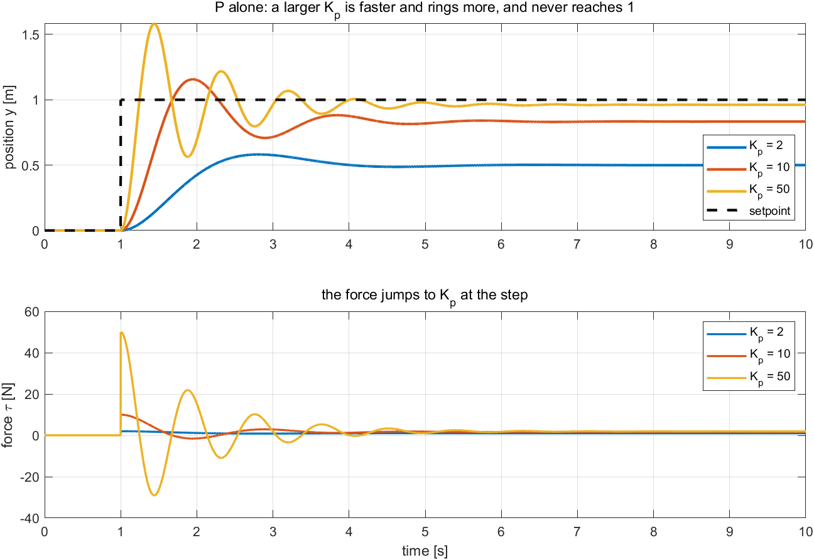

**그림을 유도와 대조해 읽기.** 그림의 모든 특징이 위 유도의 한 줄이다.

| 볼 곳 | 거기 있는 것 | 어느 줄이 예측했나 |
|---|---|---|
| 위 칸, 각 곡선의 **최종값** | $0.500$, $0.833$, $0.962$ | 7번 줄, $y_{ss} = K_p/(k+K_p)$: $2/4$, $10/12$, $50/52$ |
| 위 칸, 점선 설정값까지의 **간격** | $0.500$, $0.167$, $0.038$ m | 7번 줄, $e_{ss} = k/(k+K_p)$ — $K_p$ 와 함께 줄어들고 어느 값에서도 0 에 닿지 않는다 |
| 위 칸, 각 곡선이 **얼마나 울리는가** | 게인이 클수록 더 | 5번 줄: $\zeta = b/\bigl(2\sqrt{m(k+K_p)}\bigr)$ 가 $1/\sqrt{k+K_p}$ 로 떨어진다 |
| 위 칸, 첫 봉우리가 **얼마나 일찍** 오는가 | 게인이 클수록 더 일찍 | 5번 줄: $\omega_n = \sqrt{(k+K_p)/m}$ 가 오르고, 모든 시간이 $1/\omega_n$ 으로 비례한다(§2-3) |
| 아래 칸, 첫 첨두의 **높이** | $2$, $10$, $50$ N | 8번 줄, $\tau(0^+) = K_p\,y_d$ |
| 아래 칸, **최종** 힘 | $1$, $1.7$, $1.9$ N 근처 | 정지에서의 6번 줄: 필요한 힘은 $k\,y_{ss}$ 이고, 그것을 $K_p\,e_{ss}$ 가 만들어 낸다 |

**그림이 말하는 것**

- 게인이 클수록 더 빠르고 더 울리며, 각각 1 아래의 $K_p/(k+K_p)$ 에 정착한다. 측정 열과 식 열이 보인 자리까지 일치한다.
- 아래 칸이 위 칸이 숨기는 요점을 지고 있다. **끝에서 필요한 힘은 거의 바뀌지 않고**, 그것을 만들어 내는 데 필요한 오차만 바뀐다.

| 해 볼 것 | 볼 것 |
|---|---|
| `Kp = 200`, Run | 오버슛이 어디까지 가는지, 그리고 5번 줄이 여전히 그것을 예측하는지 |
| `y_step = 2`, Run | 남는 오차도 두 배가 된다 — 7번 줄은 $y_d$ 에 비례한다 |
| `Kp = 0.5`, Run | 응답이 $0.2$ m 에서 끝난다. 스프링보다 약한 제어기는 스프링에 진다 |

> [!tip] 수업에서
> - **목적** — 첫 폐루프. 비례 제어기가 사 주는 것(빠르기, 더 작은 오차)과 비용으로 치르는 것(울림, 힘)을 보고, §2-4 의 다섯 수를 Scope 에서 읽는 연습을 한다.
> - **가리킬 곳** — 점선 설정값 아래의 최종값 셋. 게인이 25 배 자라는데도 거의 움직이지 않는 정착시간($4.04 \to 3.64$ s). 그리고 계단에서의 힘이 $K_p$ 와 같은 힘 칸.
> - **질문** — "P 만으로 오차가 왜 0 이 될 수 없는가?" 스프링에 맞서 질량을 $y$ 에 붙잡아 두려면 꾸준한 힘 $k\,y$ 가 들고, P 제어기는 오차에서만 힘을 만든다.
> - **질문** — "정착시간이 왜 좋아지지 않는가?" 모든 $K_p$ 에서 $\zeta\omega_n = b/(2m) = 1$ 이다. 게인은 극점을 왼쪽으로 옮기는 대신 $\mathrm{Re}(s) = -1$ 을 따라 들어 올린다.
> - **남길 것** — P 는 스프링이다. 더 단단하면 더 빠르고 더 통통 튀며, 스프링은 결코 끝까지 가지 못한다.

## 2-7. D — 미래의 오차: 브레이크

이 절이 답하는 것: 미분 항은 무엇을 더하고, 왜 오차를 없애지 못하는가?

**무엇이 관측되는가.** 실험 2-7 은 $K_p = 10$ 을 유지하고 $K_d$ 를 0 에서 2 로, 6 으로 올린다.

- 오버슛이 $38.8$ 에서 $16.9$ 로, $8.6\,\%$ 로 떨어지고 정착시간도 함께 $3.94$ 에서 $1.27$ s 로 떨어진다.
- 한편 세 응답 모두 정확히 같은 자리, $0.833$ m 에서 끝난다 — **§2-6 의 간격은 건드려지지 않았다.**
- 그리고 계단에서 요구된 힘이 $10$ 에서 $129.6$ N 으로 오른다.

**결과.**

$$
m\,\ddot y + (b + K_d)\,\dot y + (k + K_p)\,y = K_p\,y_d + K_d\,\dot y_d,
\qquad
\zeta = \frac{b + K_d}{2\sqrt{m\,(k + K_p)}},
\qquad
T(s) = \frac{K_d s + K_p}{m s^2 + (b + K_d)s + k + K_p}
$$

**유도, 한 줄씩.**

1. 법칙이 이제 오차를 두 번 읽는다 — $\tau = K_p\,e + K_d\,\dot e$, 전과 같이 $e = y_d - y$ 다.
2. $\dot e = \dot y_d - \dot y$ 이므로 §2-2 의 운동방정식에 넣으면 $m\,\ddot y + b\,\dot y + k\,y = K_p(y_d - y) + K_d(\dot y_d - \dot y)$ 다.
3. §2-6 처럼 모으고, 이제 $\dot y$ 의 항도 왼쪽으로 옮기면 $m\,\ddot y + (b + K_d)\,\dot y + (k + K_p)\,y = K_p\,y_d + K_d\,\dot y_d$ 다.
4. **$K_d$ 가 감쇠 $b$ 옆에 내려앉았다.** $K_p$ 가 강성 $k$ 옆에 앉은 것과 정확히 같다. 미분 항은 조절 가능한 두 번째 댐퍼다. 물리로는 위치가 아니라 운동에 저항한다. 질량이 설정값으로 달려드는 동안 오차는 닫히고 있으므로 $\dot e < 0$ 이고, 그 항은 설정값에 닿기 **전에** 힘을 덜어낸다.
5. 그래서 감쇠비가 분자에 $K_d$ 를 얻어 $\zeta = (b + K_d)/\bigl(2\sqrt{m(k+K_p)}\bigr)$ 가 되고, $\omega_n$ 은 §2-6 이 놓은 자리에 남는다. s 평면에서 극점이 **왼쪽으로** 움직이고, 그것이 §2-6 이 줄일 수 없었던 정착시간을 줄인다.
6. 응답의 끝에서는 아무것도 움직이지 않으므로 $\dot y = \dot e = 0$ 이고 3번 줄은 §2-6 의 6번 줄로 그대로 줄어든다 — $y_{ss} = K_p\,y_d/(k+K_p)$. **미분은 간격을 없앨 수 없다.** 운동이 멈추면 아무것도 보태지 않는다.
7. $T(s)$ 의 분자가 $s$ 의 항을 얻었다. 곧 $s = -K_p/K_d$ 에 **영점**이 생겼다. 영점은 응답 자신의 미분의 복사본을 거기에 더해 초기 부분을 들어 올리므로, 영점을 가진 루프는 $\zeta > 1$ 인 곳에서도 오버슛할 수 있다(§2-3 의 마무리 노트).
8. 계단의 모서리에서 오차가 점프하고, 구현된 미분은 필터를 거친 것이다(§2-10). 그 출력은 점프의 $K_d N_f$ 배에서 시작한다. 그것이 $129.6$ N 이고, §2-10 의 주제다.

> [!note] 같은 항이 다른 축에서는 다른 자리에 내려앉는다
> 이 플랜트에서 $K_d$ 는 감쇠 옆에 앉는다. 출력이 위치이고 그 미분이 속도이기 때문이다. 3주차에서는 출력이 속도이고 그 미분이 가속도이므로 같은 항이 **질량** 옆에 앉는다(3주차 §3-3). 4주차에서는 출력이 각이고 $K_d$ 가 다시 댐퍼다. 항이 바뀌는 것이 아니라 축이 바뀐다.

아래 실험 2-7 이 $K_p = 10$, $K_i = 0$ 으로 잰 값:

| $K_d$ | $\zeta$ | 영점 위치 | $M_p$ | 정착 [s] | $e_{ss}$ | 최대 $\tau$ [N] |
|---|---|---|---|---|---|---|
| 0 | 0.289 | 없음 | 38.8 % | 3.94 | 0.167 | 10.0 |
| 2 | 0.577 | $-5.00$ | 16.9 % | 1.40 | 0.167 | 49.9 |
| 6 | 1.155 | $-1.67$ | 8.6 % | 1.27 | 0.167 | 129.6 |

- 오버슛과 정착시간이 함께 떨어진다. 남는 오차는 움직이지 않는다.
- $K_d = 6$ 에서 감쇠비가 1 을 넘는데도 응답이 여전히 오버슛한다. 이상적인 미분이면 극점이 실수 $-2$ 와 $-6$ 이고, $-1.67$ 의 영점만으로 $5.55\,\%$ 를 만든다. 모델의 필터를 건 미분(§2-10)이 측정된 $8.6\,\%$ 를 준다.
- 최대 힘이 $K_d$ 와 함께 자란다. 계단의 모서리에서 필터를 건 미분이 계단 높이의 $K_d N_f$ 배로 뛴다. 그 첨두가 §2-10 의 미분 킥이다.

### 실험 2-7 · 세 게인에서의 미분 (10분)

**무엇을 재는가.** 유도의 5, 6, 7번 줄 — $K_d$ 가 더하는 감쇠, 그것이 건드리지 않는 정상값, 그리고 $-K_p/K_d$ 에 두는 영점.

**모델.** `W02_D_PD` — §2-6 의 모델에 `D filter` 블록을 켠 것. 실행 사이에 바뀌는 것은 $K_d$ 뿐이다.

**열고 돌리기.**

```matlab
W02_0_setup                      % Kp = 10 으로 되돌린다 / back to Kp = 10
open_system('W02_D_PD')          % Run; 그 다음 Kd = 2; Run, Kd = 6; Run
W02_D_derivative                 % 세 값을 한 번에 / all three at once
```

나오는 출력:

```
    Kd   zeta   zero    overshoot %  settle [s]  error left  peak tau [N]
    0    0.289    none        38.8        3.94       0.167         10.0
    2    0.577   -5.00        16.9        1.40       0.167         49.9
    6    1.155   -1.67         8.6        1.27       0.167        129.6
```

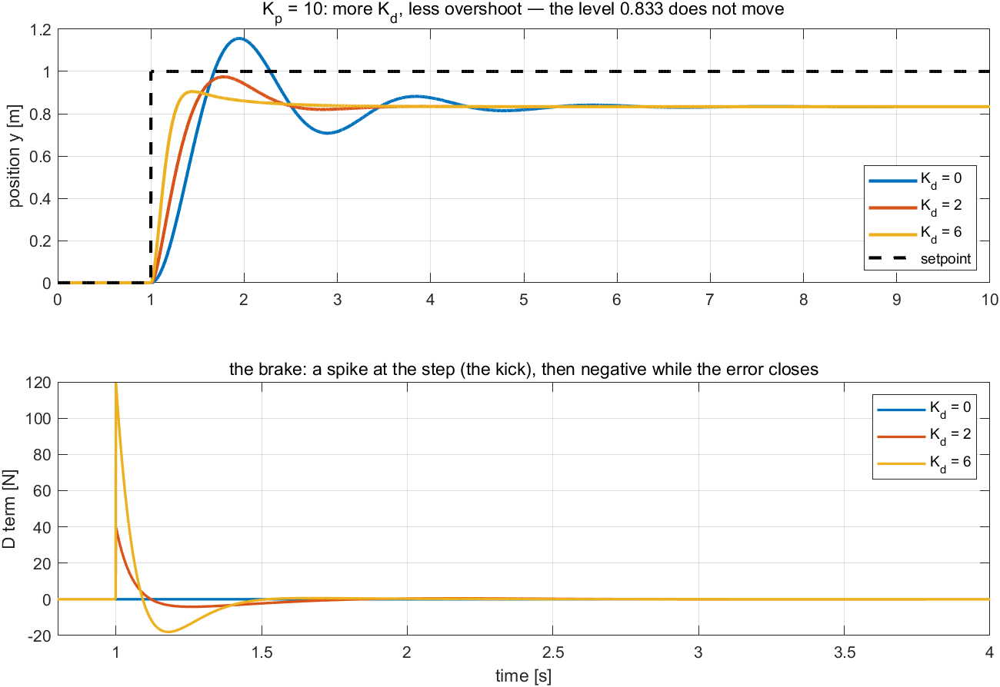

**그림을 유도와 대조해 읽기.**

| 볼 곳 | 거기 있는 것 | 어느 줄이 예측했나 |
|---|---|---|
| 위 칸, 첫 봉우리의 **높이** | 떨어진다, $38.8 \to 16.9 \to 8.6\,\%$ | 5번 줄: $\zeta$ 가 $K_d$ 와 함께 자란다, $0.289 \to 0.577 \to 1.155$ |
| 위 칸, 울림이 **얼마나 오래 가는가** | $3.94 \to 1.40 \to 1.27$ s | 5번 줄: 극점이 왼쪽으로 움직이고 포락선이 $e^{-\zeta\omega_n t}$ 다 |
| 위 칸, 세 곡선의 **최종값** | $0.833$, 동일하다 | 6번 줄: $\dot e = 0$ 이면 미분은 아무것도 보태지 않는다 |
| 위 칸, $K_d = 6$ 에서 **살아남은 오버슛** | $\zeta = 1.155 > 1$ 인데도 $8.6\,\%$ | 7번 줄: $-K_p/K_d = -1.67$ 의 영점이 초기 응답을 들어 올린다 |
| 아래 칸, $t = 1$ s 의 **첨두** | $129.6$ N 까지 | 8번 줄: 점프의 필터를 건 미분은 $K_d N_f$ 에서 시작한다 |
| 아래 칸, 봉우리 뒤로 **0 아래의** 곡선 | 질량이 접근하는 동안의 음의 밀기 | 4번 줄: 들어가는 길에 $\dot e < 0$ 이다 — 도착 전에 거는 브레이크 |

**그림이 말하는 것**

- 완충기가 튐을 가라앉힌다 — 오버슛 $38.8 \to 8.6\,\%$ — 그리고 모든 곡선이 여전히 $0.833$ 에 정착한다. D 는 오차를 없앨 수 없다.

| 해 볼 것 | 볼 것 |
|---|---|
| `Kd = 20`, Run | 오버슛이 **되돌아** $28.1\,\%$ 로 자라고 정착이 $3.21$ s 로 늘어난다. 최적을 지나면 $-K_p/K_d = -0.5$ 의 영점이 극점보다 원점에 가까워지고, 7번 줄이 5번 줄을 이긴다 |
| `Nf = 5`, `Kd = 6`, Run | 계단에서의 힘이 $129.6$ 에서 $40.0$ N 으로 떨어진다 — P 의 $10$ N 더하기 천장 $K_d N_f = 30$ N — 그리고 오버슛이 $29.9\,\%$ 로 돌아온다. 필터가 이제 브레이크를 늦춘다. 그 절충이 §2-10 이다 |

> [!tip] 수업에서
> - **목적** — 미분이 댐퍼임을 보인다. $b$ 에 더해지고, 극점을 왼쪽으로 옮기고, P 가 줄일 수 없었던 정착시간을 줄인다.
> - **가리킬 곳** — $3.94 \to 1.27$ s 로 떨어지는 정착시간. 그리고 $D$ 곡선 — 계단에서의 첨두 뒤에, 질량이 설정값으로 접근하는 동안의 음의 밀기(도착 전의 제동).
> - **질문** — "$K_d = 6$ 에서 감쇠비가 $1.155$, 1 을 넘는다. 왜 여전히 $8.6\,\%$ 오버슛이 있는가?" 미분이 $-K_p/K_d = -1.67$ 에 영점을 더하고, 원점 근처의 영점은 초기 응답을 들어 올린다(§2-3 노트). §2-3 의 식은 영점이 없다고 가정한다.
> - **질문** — "계단에서의 힘이 왜 129.6 N 까지 자라는가?" 점프의 필터를 건 미분은 그 높이의 $K_d N_f$ 배에서 시작한다(§2-10).
> - **남길 것** — D 는 완충기다. 튐이 덜하고 정착이 빠르며, 질량이 어디서 끝나는지에는 영향이 없다.

## 2-8. I — 과거의 오차: 시간이 그것을 없애고, 지나치면 불안정해진다

이 절이 답하는 것: 적분은 P 와 D 가 남기는 오차를 어떻게 없애고, 그것은 무엇을 비용으로 치르는가?

**무엇이 관측되는가.** 실험 2-8 은 $K_p = 10$ 과 $K_d = 4$ 를 유지하고 $K_i$ 를 0 에서 4 로, 12 로 올린다.

- P 와 D 가 닫을 수 없던 $0.167$ m 의 간격이 **사라진다.** 응답이 $0.9957$, 그 다음 $1.0000$ m 에서 끝난다.
- 적분 항이 두 경우 모두 $2.000$ N 에 정착한다 — 매번 같은 수다.
- 그리고 대가가 두 번 나타난다. $K_i = 4$ 에서 정착시간이 $1.32$ 에서 $4.84$ s 로 자라고, $K_i = 12$ 에서 오버슛이 돌아온다.
- 더 올려 $K_i = 87.07$ 을 넘으면 루프가 아예 정착하지 않는다.

**결과.**

$$
m s^3 + (b + K_d)\,s^2 + (k + K_p)\,s + K_i = 0 ,
\qquad
\frac{E(s)}{Y_d(s)} = \frac{s\,(m s^2 + b s + k)}{m s^3 + (b + K_d)s^2 + (k + K_p)s + K_i}
$$

**유도, 한 줄씩.**

1. 세 번째 항이 오차의 과거를 읽는다 — $\tau = K_p e + K_i\!\int_0^t\! e\,\mathrm{d}\sigma + K_d\,\dot e$ 이고, 그 라플라스 변환은 $C(s) = K_p + K_i/s + K_d s$ 다.
2. 루프에 넣고 $1/s$ 를 정리하면 특성다항식이 차수 하나를 얻는다 — 이제 **3차**이고, $K_i$ 가 그 상수항이다(위의 결과).
3. 오차 변환의 분자가 인자 $s$ 를 지니고, 그것을 거기 둔 것은 $C(s)$ 안의 적분기의 $1/s$ 다.
4. §2-6 의 최종값 정리를 그것에 적용하면 $e_{ss} = \lim_{s\to0} s\,E(s) = 0$ 이다. **간격이 정확히 닫히고**, 어떤 $K_i > 0$ 에서나 그러하며 근사적으로가 아니다. 적분기를 품은 루프를 **형식 1** 이라 부른다(§2-4).
5. 적분이 어디서 멈추는지는 아무것도 풀지 않고 읽을 수 있다. 적분기는 그 입력이 0 일 때에만 변하기를 멈추고, 그 입력은 오차다. 그래서 $e = 0$ 일 때 멈춘다 — 곧 자기 출력이 질량을 설정값에 붙잡는 힘 $k\,y_d = 2$ N 이 되었을 때다. **제어기는 이 수를 들은 적이 없다.** 오차가 사라질 때까지 찾았고, 남은 것이 답이었다.
6. 비용은 2번 줄에 있다. 3차는 §2-7 의 2차가 가질 수 없었던 오른쪽 반평면의 근을 가질 수 있으므로, 충분히 큰 적분 게인은 루프를 불안정하게 만든다 — 아래의 Routh 조건이다.

**적분이 지나치면 불안정해진다.** 위 3차의 Routh 배열은 모든 계수가 양수이고 다음이 성립할 때에만 안정이다.

$$
(b + K_d)(k + K_p) > m\,K_i
\qquad\Longrightarrow\qquad
K_i < \frac{(b + K_d)(k + K_p)}{m} = \frac{(2+4)(2+10)}{1} = 72
$$

- 한계에서 3차는 허수축 위 $s = \pm j\sqrt{(k + K_p)/m} = \pm j\,3.464$ rad/s 에 근 쌍을 가진다(`verify_w02_pid` 검사 4, $10^{-9}$ 까지 정확).
- 실제로 만든 제어기는 §2-10 의 필터를 건 미분을 쓰고, 그것이 극점 하나를 더한다. 폐루프 극점에 대한 이분법으로 찾은 그 한계는 $K_i = 87.07$ 이고 $3.856$ rad/s 로 진동한다. 중요한 한계는 구현된 법칙의 한계다.

| 기호 | 양 | 값 |
|---|---|---|
| $K_p,\ K_d$ | 실험 2-8 에서 고정 | $10$ N/m, $4$ N·s/m |
| $K_i^{\max}$, 이상적 미분 | Routh 한계 | $72$ N/(m·s) |
| $K_i^{\max}$, 필터, $N_f = 20$ | 극점 교차 한계 | $87.07$ N/(m·s) |

아래 실험 2-8 이 잰 값:

| $K_i$ | 10 s 의 $y$ | $M_p$ | 정착 [s] | 남은 오차 | 10 s 의 $I$ [N] |
|---|---|---|---|---|---|
| 0 | 0.8333 | 9.8 % | 1.32 | $1.67\times10^{-1}$ | 0.000 |
| 4 | 0.9957 | 0.0 % | 4.84 | $4.33\times10^{-3}$ | 1.958 |
| 12 | 1.0000 | 4.7 % | 1.49 | $3.39\times10^{-6}$ | 2.000 |

- $K_i = 4$ 는 오차를 없애지만 느리다. 정착시간이 1.32 s 에서 4.84 s 로 자란다. $K_i = 12$ 는 빠르게 없애고 오버슛을 되돌려 놓는다.
- 한계의 $0.9$ 배와 $1.1$ 배로 돌리면 30 s 와 40 s 사이의 최대 오차가 $0.046$ m 와 $13.353$ m 다. 같은 진동이 한쪽에서는 사그라들고 다른 쪽에서는 자란다. 적분은 늦게 작용하고, 충분히 큰 늦은 밀기는 그것이 바로잡으려던 흔들림과 위상이 맞아 도착한다.

### 실험 2-8 · 적분, 그리고 그것이 불안정해지는 게인 (15분)

**무엇을 재는가.** 유도의 4, 5, 6번 줄 — 간격이 정확히 닫히는 것, 적분이 5번 줄의 $2$ N 에서 멈추는 것, 그리고 루프가 6번 줄의 한계를 넘어 안정성을 잃는 것.

**모델.** `W02_E_PID` — §2-5 의 전체 루프, 세 항 모두 켬. 실행 사이에 바뀌는 것은 $K_i$ 뿐이다.

**열고 돌리기.**

```matlab
W02_0_setup                      % Kp = 10, Kd = 4 로 되돌린다 / back to Kp = 10, Kd = 4
open_system('W02_E_PID')         % Ki = 0; Run, Ki = 4; Run, Ki = 12; Run
W02_E_integral                   % 세 값과 안정 한계까지 / the three gains and the limit
```

나오는 출력:

```
    Ki   y at 10 s  overshoot %  settle [s]  error left   I at 10 s [N]
    0       0.8333         9.8        1.32    1.67e-01         0.000
    4       0.9957         0.0        4.84    4.33e-03         1.958
    12      1.0000         4.7        1.49    3.39e-06         2.000
    Routh, ideal derivative:  Ki < (b + Kd)(k + Kp) = 72
    the filtered law of the model is unstable above Ki = 87.07
    largest error between 30 and 40 s:
      Ki = 0.9 x 87.07   0.046 m
      Ki = 1.1 x 87.07   13.353 m
```

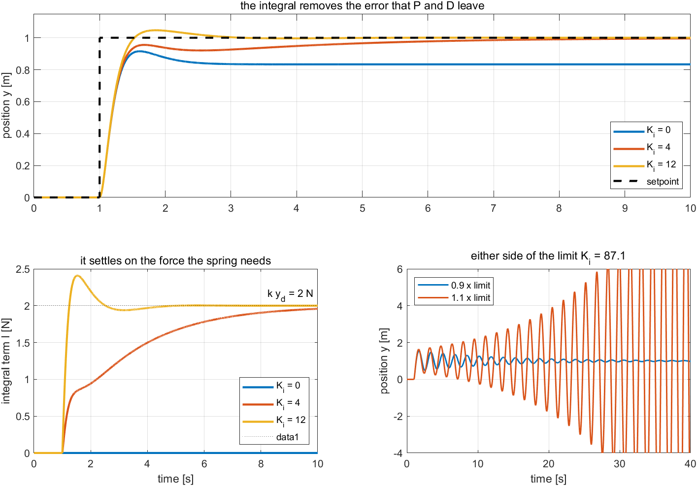

| 그림에서 | 뜻 |
|---|---|
| 위 | $K_p = 10$, $K_d = 4$ 에서 $K_i = 0, 4, 12$ 의 위치 |
| 왼쪽 아래 | 적분 항. 점선이 $k\,y_d = 2$ N |
| 오른쪽 아래 | 안정 한계의 $0.9$ 배와 $1.1$ 배에서 40 s |

**그림을 유도와 대조해 읽기.**

| 볼 곳 | 거기 있는 것 | 어느 줄이 예측했나 |
|---|---|---|
| 위 칸, $K_i = 0$ 의 **최종값** | $0.833$, 설정값에 못 미친다 | §2-6 의 7번 줄 — $K_i = 0$ 에서는 아무것도 바뀌지 않았다 |
| 위 칸, $K_i = 4$ 와 $12$ 의 **최종값** | $0.9957$ 와 $1.0000$ | 4번 줄: $E(s)$ 안의 인자 $s$ 가 $e_{ss}$ 를 0 으로 보낸다 |
| 위 칸, $K_i = 4$ 에서 마지막 부분이 **얼마나 걸리는가** | 정착 $1.32 \to 4.84$ s | 5번 줄: 적분이 먼저 빠진 $2$ N 을 쌓아야 하고, 작은 $K_i$ 는 느리게 쌓는다 |
| 왼쪽 아래 칸, 적분이 **멈추는** 곳 | 점선 위의 $2.000$ N | 5번 줄: $k\,y_d = 2 \times 1$ 을, 알려 주지 않았는데 찾아냈다 |
| 오른쪽 아래 칸, 한계의 $0.9$ 배 | 흔들림이 사그라든다, $0.046$ m | 6번 줄: 3차의 근이 아직 왼쪽 반평면에 있다 |
| 오른쪽 아래 칸, 한계의 $1.1$ 배 | 흔들림이 자란다, $13.353$ m | 6번 줄: 근 한 쌍이 오른쪽으로 건너갔다 |

**그림이 말하는 것**

- 참을성 있는 손은 오차가 사라질 때까지 계속 밀고, 스프링에 필요한 정확히 $2$ N 에서 멈춘다. 너무 세게 밀면 루프가 정착하는 대신 자라게 만든다.

| 해 볼 것 | 볼 것 |
|---|---|
| `Ki = 1; T_final = 30;` Run | 간격은 여전히 닫힌다 — 4번 줄은 어떤 $K_i > 0$ 에서나 성립한다 — 그러나 느리다. $30$ s 에도 $0.013$ m 가 남고, 정착시간은 $K_i = 4$ 의 $4.84$ s 에 대해 $18.6$ s 다 |
| `y_step = 2; Ki = 4;` Run | 적분이 $2$ 가 아니라 $4.000$ N 에서 멈춘다. 5번 줄은 $k\,y_d$ 이고 설정값이 두 배가 되었다 |

> [!tip] 수업에서
> - **목적** — 적분만이 할 수 있는 한 가지, 곧 정상상태 오차의 제거와 그 대가를 보인다 — 더 느리거나 덜 안정한 루프.
> - **가리킬 곳** — 왼쪽 아래 칸에서 2 N 의 점선까지 올라가 거기서 멈추는 적분 항. 그것이 1 m 에서 스프링에 필요한 힘이고, 알려 주지 않았는데 찾아낸 것이다. 오른쪽 아래 칸에서, 한계의 $0.9$ 배에서 사그라들고 $1.1$ 배에서 자라는 같은 진동.
> - **질문** — "$K_i = 4$ 가 왜 $K_i = 0$ 보다 정착이 느린가?" 정착시간은 각 실행 자신의 최종값에 대해 잰다(§2-4). $K_i = 0$ 에서 그 값은 $0.833$ m 이고, 빠르게 닿고 틀렸다. $K_i = 4$ 에서는 1 m 에 가깝고, 마지막 $0.167$ m 를 느리게 없앤다. 정착시간은 남는 오차와 함께 읽고, 결코 혼자 읽지 않는다.
> - **질문** — "Routh 가 $72$ 라고 하는데 모델은 왜 $K_i = 87.07$ 까지 견디는가?" Routh 를 이상적인 미분에 적용했고, 모델의 미분은 필터를 거친 것이며 그것은 다른 루프다. 중요한 한계는 구현된 법칙의 한계다.
> - **남길 것** — I 는 참을성 있는 손이다. 결국은 언제나 도착하고, 너무 세게 밀면 오버슛하고 흔들린다.

## 2-9. 전달함수 하나: 영점 둘, 극점 하나, 그리고 Simulink 블록

이 절이 답하는 것: 튜닝을 전달함수로 보면 무엇이고, Simulink PID 블록은 위의 법칙과 같은 것인가?

$$
C(s) = K_p + \frac{K_i}{s} + K_d\,s = \frac{K_d s^2 + K_p s + K_i}{s}
$$

- PID 는 **원점의 극점 하나**(적분기, 고정)와, $K_p$·$K_i$·$K_d$ 가 그 자리를 정하는 **영점 둘**, 그리고 전체 이득이다. PID 를 튜닝하는 것은 그 영점 둘을 어디에 둘지와 이득을 얼마로 할지를 고르는 것이다(Tech Talk 6편).
- 구현된 미분은 필터를 거친 것이고(§2-10), 그것이 $s = -N_f$ 에 극점 하나를 더한다.

$$
C(s) = K_p + \frac{K_i}{s} + K_d\,\frac{N_f\,s}{s + N_f}
$$

이것이 Simulink **PID Controller** 블록(병렬형) 대화창에 찍히는 바로 그 식이고, P·I·D·N 이 그 네 칸이다. 모델 `W02_F_block_vs_hand` 는 위 줄에 보통 블록으로 같은 법칙을 만들고 아래 줄에 라이브러리 블록을 두며, 둘을 힘 한계와 센서 잡음에 함께 통과시킨다.

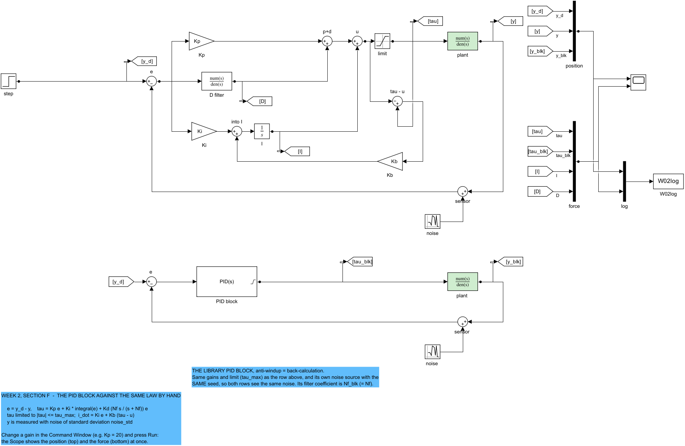

| 그림에서 | 뜻 |
|---|---|
| `Kp`, `D filter`, `Ki` + `I` | 세 항, 블록 하나씩. `D filter` 는 전달함수 $K_d N_f s/(s+N_f)$ 다 |
| `p+d`, `u` | 요구 $u = P + D + I$ 를 만드는 합들 |
| `limit` | 구동기: $\tau = \mathrm{sat}(u)$, $\lvert\tau\rvert \le \tau_{\max}$ |
| `tau - u`, `Kb`, 그리고 `into I` 로 돌아가는 선 | §2-11 의 back-calculation |
| 아래 줄의 `PID block` | 같은 게인, 같은 한계, 같은 $K_b$ 를 가진 라이브러리 블록 |
| 오른쪽의 Goto 태그들과 Scope | 모든 신호가 Scope 하나에 닿는다. 위에 위치, 아래에 힘 |

아래 실험 2-9 가 $\lvert\tau\rvert \le 2.5$ N 과 5 mm 의 센서 잡음으로 잰 값:

| 비교 | 최대 $\lvert\Delta y\rvert$ [m] | 최대 $\lvert\Delta\tau\rvert$ [N] |
|---|---|---|
| 블록으로 만든 것 대 PID 블록 | $9.99\times10^{-16}$ | $6.35\times10^{-14}$ |
| 대조: 블록의 $N_f$ 를 20 에서 19 로 | $1.20\times10^{-3}$ | $0.187$ |

- 두 줄이 한계와 안티와인드업과 잡음을 통과해도 반올림 수준까지 일치한다.
- 대조 줄은 그 비교가 눈 감고 한 것이 아님을 보인다. 수 하나의 5 % 변화가 즉시 드러난다.

| PID 블록 대화창의 칸 | 손으로 만든 법칙의 블록 |
|---|---|
| Proportional (P) | `Kp` |
| Integral (I) | 적분기 앞의 `Ki` |
| Derivative (D), Filter coefficient (N) | `D filter`, 분자 `[Kd*Nf 0]`, 분모 `[1 Nf]` |
| Back-calculation coefficient (Kb) | `Kb` |

### 실험 2-9 · 손으로 만든 법칙 대 라이브러리 PID 블록 (10분)

**무엇을 재는가.** PID 블록 대화창의 네 칸이 위 법칙의 네 블록이고 그 밖의 아무것도 아니라는 것 — 같은 게인이 같은 두 신호를 반올림 수준까지 주고, 힘 한계와 센서 잡음을 거쳐도 그렇다.

**모델.** `W02_F_block_vs_hand` — 한 캔버스의 두 줄이고, 같은 설정값·같은 잡음·같은 한계가 먹인다. 위 줄은 `Kp`, `Ki`, `D filter` 와 Sum 으로 만들었고, 아래 줄은 라이브러리 블록이다.

**열고 돌리기.**

```matlab
W02_0_setup
open_system('W02_F_block_vs_hand')   % PID 블록을 더블클릭해 P·I·D·N 칸을 본다 / open its dialog
W02_F_block_vs_handbuilt             % 두 줄을 비교하고, 대조 실험까지 / compares, with a control run
```

나오는 출력:

```
    comparison                             max |y diff|   max |tau diff|
    hand-built vs PID block                    9.99e-16         6.35e-14
    control: block with Nf = 19                1.20e-03         1.87e-01
```

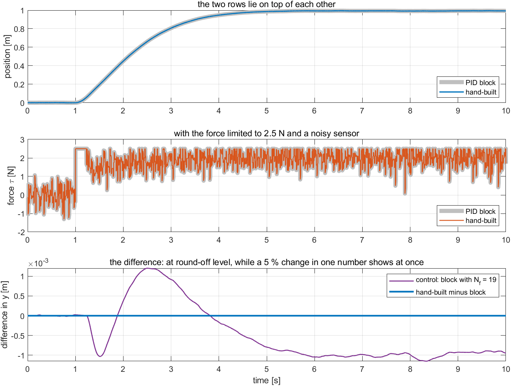

| 그림에서 | 뜻 |
|---|---|
| 위와 가운데 | 굵은 회색: PID 블록. 얇은 선: 블록으로 만든 법칙 — $2.5$ N 한계와 5 mm 잡음과 함께 |
| 아래 | 그 차이, 반올림 수준. 그리고 보라색의 대조 실행 |

**그림이 말하는 것**

- 두 선을 구별할 수 없다. PID 블록의 대화창은 §2-9 의 블록들 그 이상이 아니다.

> [!tip] 수업에서
> - **목적** — PID 블록에서 신비를 걷어낸다. 그 대화창의 모든 칸이 손으로 만든 법칙의 블록 하나다.
> - **가리킬 곳** — PID 블록 대화창을 위 줄 옆에 열고, P·I·D·N·Kb 를 `Kp`, `Ki`, `D filter`, `Kb` 와 맞춘다.
> - **질문** — "$N_f = 19$ 의 대조 실험을 왜 돌리는가?" $10^{-15}$ 를 보고하는 비교는 어떤 신호를 자기 자신과 비교하고 있을 수도 있다. 대조는 파라미터 하나의 5 % 변화가 즉시 보인다는 것($1.2\times10^{-3}$ m) 을 보인다.
> - **남길 것** — 실무에서는 블록을 쓰되, 그 안에 무엇이 있는지는 안다.

## 2-10. 실무에서의 미분: 잡음, 그리고 계단의 모서리

이 절이 답하는 것: 교과서의 미분은 왜 적힌 대로 구현되지 않고, 무엇이 그것을 대신하는가?

**미분은 크기가 아니라 빠르기로 증폭한다.** 어떤 신호의 한 주파수 성분에 대해

$$
\frac{\mathrm{d}}{\mathrm{d}t}\,A\sin(\omega t) = A\,\omega\,\cos(\omega t)
$$

- 진폭에 $\omega$ 가 곱해진다. 센서 잡음은 거기 있는 가장 빠른 신호이므로, 미분은 잡음을 골라내 한없이 증폭한다(Tech Talk 3편).

**처방은 미분 앞에 두는 1차 저역통과 필터다.**

$$
D(s) = K_d\,\frac{N_f\,s}{s + N_f}
\qquad
\lvert D(j\omega)\rvert \approx
\begin{cases}
K_d\,\omega, & \omega \ll N_f \quad\text{(a derivative)}\\[2pt]
K_d\,N_f, & \omega \gg N_f \quad\text{(a ceiling)}
\end{cases}
$$

| 기호 | 양 | 값 |
|---|---|---|
| $N_f$ | 필터 계수: 미분하기를 멈추는 자리 | $20$ rad/s. PID 블록의 "Filter coefficient (N)" 이고 3주차에서는 $N$ 으로 쓴다 |
| $K_d N_f$ | 미분 이득의 천장 | $K_d = 4$ 에서 $80$ N·s/m |

- `verify_w02_pid` 검사 5: $\lvert D(j\,0.01)\rvert/K_d = 0.01000$, $\lvert D(j\,10^5)\rvert/K_d = 20.000$.

Simulink 에서 이것은 **Transfer Fcn** 블록 하나이고 분자 `[Kd*Nf 0]`, 분모 `[1 Nf]` 다 — 이번 주 모든 모델의 `D filter` 블록이다. Tech Talk 3편은 같은 것을 이득 $N_f$ 와 그 되먹임 경로의 적분기로 만들어 $N_f/(1 + N_f/s)$ 로 보인다. 둘은 한 전달함수다(`verify_w02_pid` 검사 5).

**$N_f/(s+N_f)$ 가 저역통과 필터인 이유.** 필터를 건 미분은 순수 미분과 1차 블록 하나의 직렬이다.

$$
D(s) = K_d\, s \cdot \underbrace{\frac{N_f}{s + N_f}}_{L(s)}
\qquad\qquad
\lvert L(j\omega)\rvert = \frac{N_f}{\sqrt{\omega^2 + N_f^2}}, \qquad
\angle L(j\omega) = -\arctan\frac{\omega}{N_f}
$$

그 크기를 세 주파수에서 읽은 것이 이야기 전부다.

| 주파수 | $\lvert L(j\omega)\rvert$ | dB | 위상 | 뜻 |
|---|---|---|---|---|
| $\omega \ll N_f$ | $\approx 1$ | 0 dB | $\approx 0^\circ$ | 느린 신호는 그대로 지나간다 |
| $\omega = N_f$ | $1/\sqrt{2} = 0.707$ | $-3$ dB | $-45^\circ$ | 모서리. §2-3 의 정의에 따라 **대역폭이 $N_f$** 다 |
| $\omega \gg N_f$ | $\approx N_f/\omega$ | 10 배마다 20 dB 떨어진다 | $\approx -90^\circ$ | 빠른 신호는 잘린다. 열 배 빠르면 열 배 작다 |

낮은 주파수를 통과시키고 높은 것을 없애므로 **저역통과 필터**(LPF) 다. $s$ 를 곱하면 미분의 이득 $K_d\,\omega$ 가 $N_f$ 까지만 계속 오르고, 그 너머에서는 필터의 하강이 미분의 상승을 지우며 곱이 $K_d N_f$ 에 머문다 — 위 표의 천장이다.

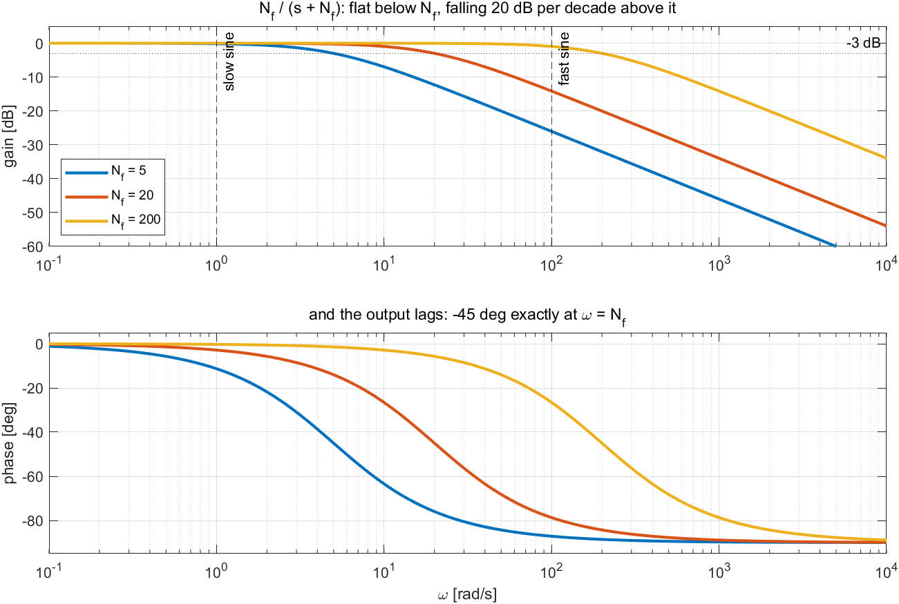

| 그림에서 | 뜻 |
|---|---|
| 위, 세 곡선 | $N_f = 5$, $20$, $200$ rad/s 의 이득. 각각 평평하다가 자기 모서리 $\omega = N_f$ 에서 떨어진다 |
| $-3$ dB 의 점선 | 각 곡선이 그것을 지나는 곳이 그 대역폭 $\omega = N_f$ 다 |
| 1 과 100 rad/s 의 파선 | 아래 실험의 사인파 둘 |
| 아래 | 위상 지연. $\omega = N_f$ 에서 정확히 $-45^\circ$ |

- **$N_f$ 가 모서리를 옮긴다.** $N_f$ 가 크면 대역폭이 넓어진다. 신호가 더 많이 지나가고 잡음도 그만큼 더 지나간다. $N_f$ 가 작으면 잡음을 더 자르고, 그 위상 지연이 더 낮은 주파수까지 내려온다 — 아래에서 재는, 루프에서 감쇠를 비용으로 치르는 그 지연이다.

**Simulink 에서 지켜보기.** 모델 `W02_G_lowpass` 가 필터에 느린 사인파 $\sin t$ 와, 센서 잡음을 대신하는 빠른 사인파 $0.3\sin 100t$ 를 먹인다. `Nf` 를 바꾸고 Run 을 누르면 Scope 가 입력과 출력을 함께 보인다.

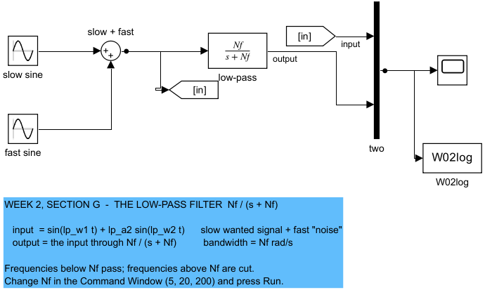

| 그림에서 | 뜻 |
|---|---|
| `slow sine`, `fast sine` → `slow + fast` | 신호: 원하는 1 rad/s, 원하지 않는 100 rad/s |
| `low-pass` | $N_f/(s + N_f)$, `D filter` 안의 것과 같은 필터 |
| `two` → Scope | 입력과 출력을 한 그림에 |

아래 실험 2-10a 가 사인파를 하나씩 넣어, 나온 진폭 나누기 들어간 진폭으로 잰 값:

| $N_f$ [rad/s] | 느림, 1 rad/s: 측정 (식) | 빠름, 100 rad/s: 측정 (식) |
|---|---|---|
| 5 | 0.981 (0.981) | 0.050 (0.050) |
| 20 | 0.999 (0.999) | 0.196 (0.196) |
| 200 | 1.000 (1.000) | 0.894 (0.894) |

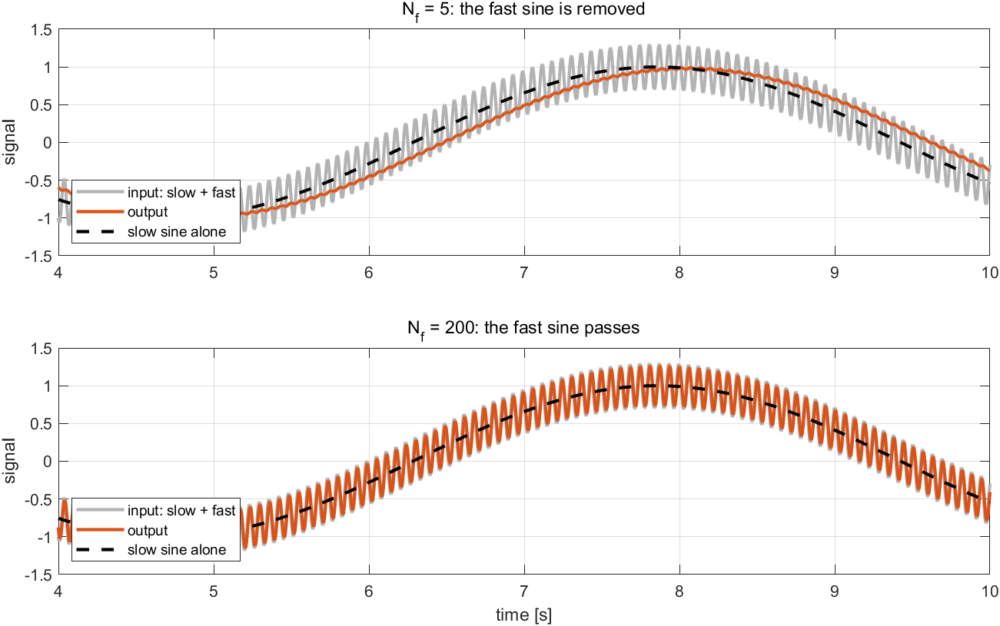

| 그림에서 | 뜻 |
|---|---|
| 회색 | 입력, 느림 더하기 빠름 |
| 주황 | 필터의 출력 |
| 검은 파선 | 느린 사인파만. 완벽한 필터가 돌려줄 것 |

- $N_f = 5$ 에서 출력은 깨끗해지고 약간 늦어진 느린 사인파다. $N_f = 200$ 에서는 빠른 사인파가 거의 건드려지지 않고 지나간다. 측정된 모든 비가 $N_f/\sqrt{\omega^2 + N_f^2}$ 와 세 자리까지 같다.


### 실험 2-10a · 저역통과 필터 혼자 (8분)

**무엇을 재는가.** 위 크기 표의 가운데 줄을, 실제 신호에서 — 1 rad/s 사인파와 100 rad/s 사인파의 어느 만큼이 $N_f/(s+N_f)$ 를 살아 넘는지, $N_f/\sqrt{\omega^2 + N_f^2}$ 와 대조해.

**모델.** `W02_G_lowpass` — 루프도 플랜트도 제어기도 없다. 느린 사인파 하나와 빠른 사인파 하나가 들어가고 필터의 출력이 나오며, 둘이 한 Scope 에 있다.

**열고 돌리기.**

```matlab
W02_0_setup
open_system('W02_G_lowpass')       % Run — Nf = 20: 잔물결이 줄어든다 / the ripple shrinks
Nf = 5;                            % Run — 잔물결이 거의 사라진다 / almost gone
Nf = 200;                          % Run — 잔물결이 그대로 통과한다 / it passes untouched
W02_G_lowpass_filter               % 세 값을 재고 공식과 대조 / measures all three
```

나오는 출력:

```
  W02 Experiment 2-10a  the low-pass filter Nf/(s+Nf)  (bandwidth = Nf)
    Nf     slow 1 rad/s: out/in (formula)    fast 100 rad/s: out/in (formula)
    5              0.981 (0.981)                       0.050 (0.050)
    20             0.999 (0.999)                       0.196 (0.196)
    200            1.000 (1.000)                       0.894 (0.894)
```

보데 선도와 두 시간 곡선은 §2-10 에 있다.
> [!tip] 수업에서
> - **목적** — 필터가 미분 안에 숨기 전에, 그것이 한 가지 일을 드러내 놓고 하는 것을 본다. 느린 것은 남기고 빠른 것은 없앤다.
> - **가리킬 곳** — $N_f = 5$ 의 Scope 에서, 잔물결이 사라진 채 느린 파를 따라가는 주황 출력. $N_f = 200$ 에서 돌아온 잔물결. 보데 선도에서는 각 곡선의 모서리가 자기 $N_f$ 에 앉아 있는 것.
> - **질문** — "100 rad/s 잔물결의 어느 만큼이 $N_f = 20$ 을 살아 넘는가?" $20/\sqrt{100^2 + 20^2} = 0.196$ 이고, Simulink 실행이 $0.196$ 을 잰다.
> - **남길 것** — $N_f$ 는 그 필터의 대역폭이다. 그보다 느린 신호는 지나가고, 빠른 것은 10 배마다 20 dB 로 잘린다.


**작업대에서 보기.** 모델 `W02_G_derivative_bench` 에는 루프가 아예 없다. 참미분 $0.5\cos(0.5t)$ 가 결코 $0.5$ 를 넘지 않는 $\sin(0.5t)$ 에 표준편차 5 mm 의 잡음을 더하고, 그 결과를 두 번 미분한다 — 한 번은 순수하게, 한 번은 필터를 거쳐.

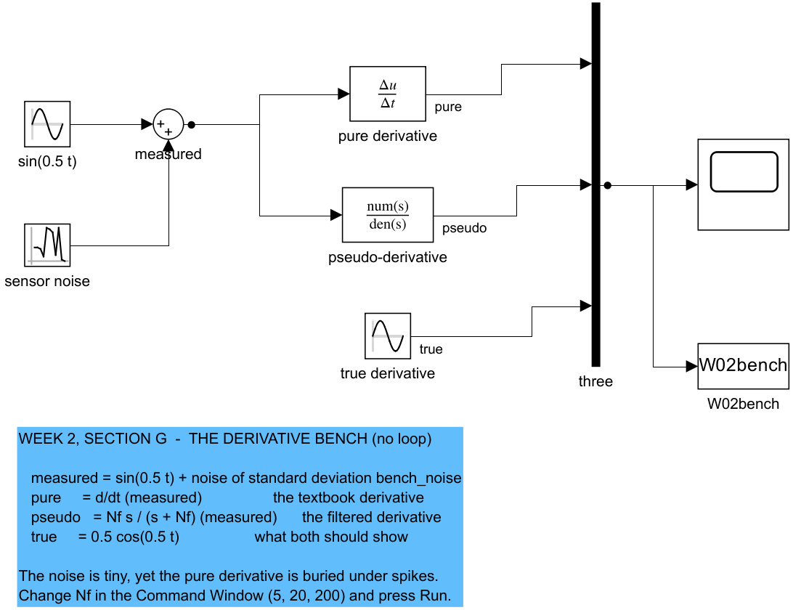

| 그림에서 | 뜻 |
|---|---|
| `sin(0.5 t)` + `sensor noise` → `measured` | 센서가 보고할 신호 |
| `pure derivative` | 교과서의 $\mathrm{d}/\mathrm{d}t$ |
| `pseudo-derivative` | $N_f s/(s + N_f)$, $K_d = 1$ 로 둔 `D filter` 와 같은 필터 |
| `true derivative` | $0.5\cos(0.5t)$, 둘 다 보여야 하는 것 |

| $N_f$ | 최대 순수 미분 | 최대 유사 미분 | 참값 |
|---|---|---|---|
| 5 | 26.55 | 0.56 | 0.5 |
| 20 | 26.55 | 0.75 | 0.5 |
| 200 | 26.55 | 5.18 | 0.5 |

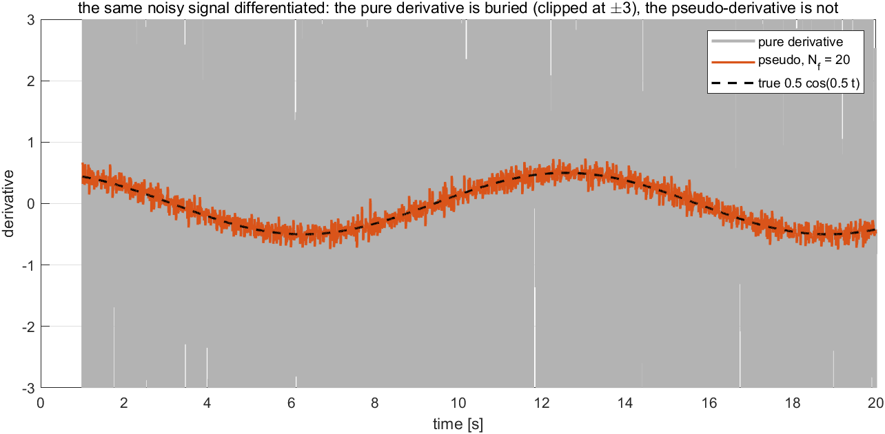

| 그림에서 | 뜻 |
|---|---|
| 회색 | 순수 미분. 나머지가 보이도록 $\pm 3$ 에서 잘랐다. 26.55 까지 간다 |
| 주황 | $N_f = 20$ 의 유사 미분 |
| 검은 파선 | 참미분 $0.5\cos(0.5t)$ |

- 5 mm 의 잡음이 순수 미분을 참값의 53 배인 첨두로 바꾼다. 유사 미분은 참값을 따라가고, 그 천장 $N_f$ 가 높을수록 잡음을 더 통과시킨다.

**계단의 모서리.** 계단 설정값은 오차를 점프하게 만든다. 높이 $\Delta$ 의 점프에 대한 필터를 건 미분은 $K_d N_f \Delta$ 에서 시작해 시정수 $1/N_f$ 로 사그라든다 — **미분 킥**이다(`verify_w02_pid` 검사 6: $K_d = 4$, $N_f = 20$, $\Delta = 1$ 에 대해 $80.000$ N). 필터 없는 계단의 미분은 충격이다. 제어조교 Ctrl튜브 영상의 처방은 설정값을 1차 필터 $1/(T_f s + 1)$ 에 통과시켜 모서리를 깎아, 그 기울기가 많아야 $\Delta/T_f$ 가 되게 하는 것이다.

> [!note] 나중에 쓰는 다른 처방 둘
> 오차 대신 측정을 미분하는 것 — 설정값 가중 $c_d = 0$ 으로 두는 것 — 은 킥을 아예 없애고, 4주차가 그 선택을 한다. 부드러운 설정값을 그 미분과 함께 만들어 내는 기준모델이 완전한 답이고, 그것이 8주차의 주제다.

루프 안에서(`W02_G_noise_kick`, $K_p = 10$, $K_i = 8$, $K_d = 4$), 아래 실험 2-10c 가 잰 값:

| 미분 | 천장 $K_d N_f$ | $t>6$ s 의 힘 표준편차 [N] | $t>6$ s 의 $y$ 표준편차 [mm] | 잡음 없을 때 $M_p$ |
|---|---|---|---|---|
| $N_f = 5$ | 20 | 0.16 | 0.59 | 16.0 % |
| $N_f = 20$ | 80 | 0.45 | 0.57 | 0.0 % |
| $N_f = 200$ | 800 | 3.06 | 0.54 | 0.0 % |
| 순수 미분 | 없음 | 9.29 | 0.60 | 9.0 % |

| 설정값 | 최대 힘 [N] | 최대 D 항 [N] |
|---|---|---|
| 계단 | 89.7 | 79.7 |
| 부드럽게, $T_f = 0.3$ s | 10.5 | 8.1 |

- 힘은 천장에 비례해 떨리는 한편, 위치는 네 실행 모두에서 $0.54$ ~ $0.60$ mm 를 헤맨다. 더 쓴 힘은 질량이 아니라 잡음에 쓰인 것이다.
- 천장이 너무 낮으면 대신 감쇠를 비용으로 치른다. $N_f = 5$ 에서 필터가 미분을 너무 늦춰 제때 제동하지 못하고, 오버슛이 $16\,\%$ 로 돌아온다. $N_f$ 는 응답의 주파수보다 위, 잡음의 주파수보다 아래에 앉는다.
- 설정값을 부드럽게 하면 최대 힘이 $8.5$ 배 줄어든다. 응답은 부드러워진 설정값만큼 늦게 도착하는 것으로만 대가를 치른다.

### 실험 2-10b · 작업대에서의 유사 미분 (6분)

**무엇을 재는가.** 5 mm 의 잡음이 순수 미분에 무엇을 하는지, 그리고 이 절의 필터가 그것에 대해 무엇을 하는지 — 루프가 끼어들지 않은 채로.

**모델.** `W02_G_derivative_bench` — 잡음 섞인 사인파 하나를 두 번 미분해 참미분과 대조한다. 여기에는 플랜트도 되먹임도 없고 미분 둘뿐이다.

**열고 돌리기.**

```matlab
W02_0_setup
open_system('W02_G_derivative_bench')   % Run — 순수 미분이 스파이크로 덮인다 / the pure one is buried
Nf = 5;                                 % Run — 천장 K_d N_f 가 낮아진다 / a lower ceiling
Nf = 200;                               % Run — 잡음이 다시 올라온다 / the noise returns
W02_G_bench                             % 세 값을 한 번에 / all three values at once
```

나오는 출력:

```
  W02 Experiment 2-10b  the bench: derivative of sin(0.5 t) + 5 mm noise (true peak 0.5)
    Nf     largest |pure|   largest |pseudo|
    5              26.55              0.56
    20             26.55              0.75
    200            26.55              5.18
```

작업대 그림은 위 §2-10 에 있다.

> [!tip] 수업에서
> - **목적** — 어떤 루프도 그것을 숨길 수 있기 전에, 미분이 잡음에 무엇을 하는지 본다.
> - **가리킬 곳** — 참미분이 결코 $0.5$ 를 넘지 않는데도 $\pm 3$ 에서 잘린 회색 곡선. 그리고 참값을 따라가는 주황 곡선.
> - **질문** — "5 mm 의 잡음이 왜 참미분의 53 배인 첨두를 만드는가?" 미분은 각 주파수에 $\omega$ 를 곱하고, 잡음은 거기 있는 가장 빠른 신호다.
> - **남길 것** — 순수 미분은 신호가 아니라 잡음을 잰다.

### 실험 2-10c · 같은 미분을 루프 안에서, 그리고 킥 (8분)

**무엇을 재는가.** 미분이 힘을 비용으로 치르는 루프 안에 들어왔을 때 필터가 무엇을 비용으로 하고 무엇을 아끼는지, 그리고 계단에서의 힘 중 얼마가 과제가 아니라 **설정값**의 모서리에 속하는지.

**모델.** `W02_G_noise_kick` — §2-5 의 루프에 센서 잡음을 켜고, 순수 미분으로 가는 스위치와 설정값을 부드럽게 하는 스위치를 둔 것.

**열고 돌리기.**

```matlab
W02_0_setup
open_system('W02_G_noise_kick')
noise_std = 0.005;                      % Run — 힘이 떨린다 / the force chatters
d_filtered = 0;                         % Run — 순수 미분: 훨씬 더 떤다 / far worse
d_filtered = 1; ref_filter = 1;         % Run — 목표의 모서리를 깎는다 / the corner taken off
W02_G_noise_and_kick                    % 네 미분과 두 목표를 한 번에 / four derivatives, two setpoints
```

나오는 출력:

```
  W02 Experiment 2-10c  1) the loop, 5 mm of noise (Kp 10, Ki 8, Kd 4)
    derivative  force std [N]  y std [mm]  overshoot % (no noise)
    pure                 9.29        0.60           9.0
    Nf = 200             3.06        0.54           0.0
    Nf = 20              0.45        0.57           0.0
    Nf = 5               0.16        0.59          16.0

  2) the kick: step setpoint against a smoothed one (Tf = 0.3 s)
    setpoint    peak force [N]  peak D [N]
    step                  89.7        79.7
    smoothed              10.5         8.1
```

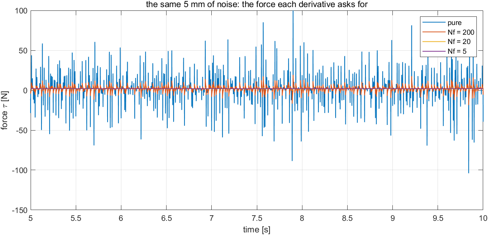

| 그림에서 | 뜻 |
|---|---|
| 곡선들 | 5 mm 센서 잡음과 함께 5 s 동안의 힘. 순수 미분, $N_f = 200$, $20$, $5$ |

**그림이 말하는 것**

- 순수 미분은 $2$ N 이 필요한 질량을 붙잡으려고 수십 뉴턴을 요구한다. 미분을 애초에 쓸 수 있게 만드는 것이 필터다.

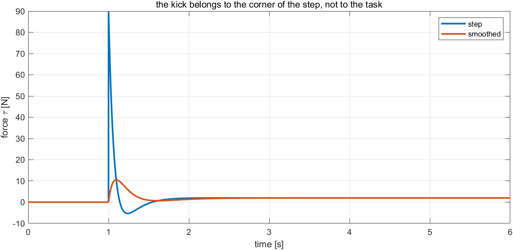

| 그림에서 | 뜻 |
|---|---|
| 곡선들 | 계단 설정값에 대한 힘과, 같은 계단을 $1/(0.3s+1)$ 로 부드럽게 한 것에 대한 힘 |

**그림이 말하는 것**

- 계단의 모서리에서 $90$ N, 모서리가 없으면 $10.5$ N 이다. 킥은 과제가 아니라 설정값의 것이다.

> [!tip] 수업에서
> - **목적** — 작업대의 결과가 루프 안에서 무엇을 비용으로 하는지 보인다. 힘은 지불되고, 위치는 좋아지지 않고, 설정값의 모서리는 따로 청구된다.
> - **가리킬 곳** — 천장 $K_d N_f$ 에 비례해 떨리는 힘, 그러면서 거의 바뀌지 않는 위치 열. 그 다음 두 봉우리 $89.7$ N 과 $10.5$ N.
> - **질문** — "$N_f$ 를 아주 작게 하면 안 되는가?" $N_f = 5$ 에서 필터가 미분을 너무 늦춰 제동이 늦고, 오버슛이 $16\,\%$ 로 돌아온다.
> - **질문** — "$89.7$ N 은 누구의 잘못인가?" 설정값의 것이다. 계단은 기울기가 무한이고, 과제가 그런 것을 요구한 적은 없다.
> - **남길 것** — 미분에 필터를 걸고 설정값의 모서리를 깎는다. 응답은 거의 알아채지 못하고 구동기는 알아챈다.

## 2-11. 실무에서의 적분: 구동기에는 한계가 있다

이 절이 답하는 것: 구동기가 포화되면 무엇이 잘못되고, 적분기는 어떻게 보호하는가?

- 실물 구동기는 모두 포화된다. 모터에는 최대 속도가, 추진기에는 최대 추력이 있다. 선형 모델에서는 어떤 힘이든 쓸 수 있고, 하드웨어에서는 그렇지 않다(Tech Talk 2편).
- 구동기가 한계에 앉아 있는 동안 오차는 크게 남고, 한계를 모르는 적분기는 계속 쌓는다. 출력이 드디어 설정값에 닿으면 저장된 전하가 계속 밀고, 그것은 **음의** 오차로만, 곧 오버슛해서만 덜어낼 수 있다. 이것이 **적분기 와인드업**이다.

흔히 쓰는 처방이 둘 있다.

| 방식 | 포화인 동안 적분기가 하는 일 | 출처 |
|---|---|---|
| 클램핑 (조건부 적분) | 출력이 포화이고 **그리고** 오차가 출력과 같은 부호일 때 적분을 멈춘다 — 그때 적분은 상황을 나쁘게만 만든다 | Tech Talk 2편 |
| back-calculation | $K_i e + K_b(\tau - u)$ 를 적분한다. 구동기가 잘라낸 초과분을 되먹여 적분기를 끌어내린다 | Åström & Murray, 11장 |

Back-calculation 에서 적분기의 입력은

$$
\dot I = K_i\,e + K_b\,(\tau - u),
\qquad u = P + I + D,
\qquad \tau = \mathrm{sat}(u)
$$

이고, 구동기가 $\tau_{\max}$ 에서 포화인 동안 $\dot I = 0$ 으로 두면 적분기가 어디로 몰리는지 보인다.

$$
I^\star = \tau_{\max} - P - D + \frac{K_i}{K_b}\,e
$$

- $I^\star$ 는 요구를 한계와 같게 만드는 값이다. $P$ 만으로 이미 $\tau_{\max}$ 보다 더 요구하고 있으면 $I^\star$ 는 **음수**다. 적분기가 0 아래로 내려가고, 그것은 식이 작동하는 것이지 결함이 아니다.
- Tech Talk 2편이 실무 규칙을 하나 더한다. 제어기의 한계를 구동기의 물리적 한계보다 조금 아래에 둔다. 물리적 한계는 온도와 마모에 따라 흐르기 때문이다.
- 3주차 §3-4 가 닿을 수 없는 목표 실험을 Otter 에서 되풀이하고, 거기서 와인드업은 배가 느려지라는 지시를 무시하게 만든다.

**와인드업을 분명하게 만드는 실험.** 모델 `W02_H_antiwindup` 은 힘을 $\lvert\tau\rvert \le 2.5$ N 으로 제한한다. $k = 2$ N/m 의 스프링에 맞서 그것은 질량을 많아야 $2.5/2 = 1.25$ m 에 붙잡을 수 있다. 목표는 $t = 1$ 에서 15 s 까지 **닿을 수 없는** 2 m 로 두고, 그 다음 닿을 수 있는 0.5 m 로 내린다. 위 줄은 back-calculation 을 갖춰 블록으로 만든 법칙이고($K_b = 0$ 이 그것을 끈다), 아래 줄은 라이브러리 PID 블록이며 스크립트가 그 안티와인드업 방식을 없음·클램핑·back-calculation 사이에서 바꾼다.

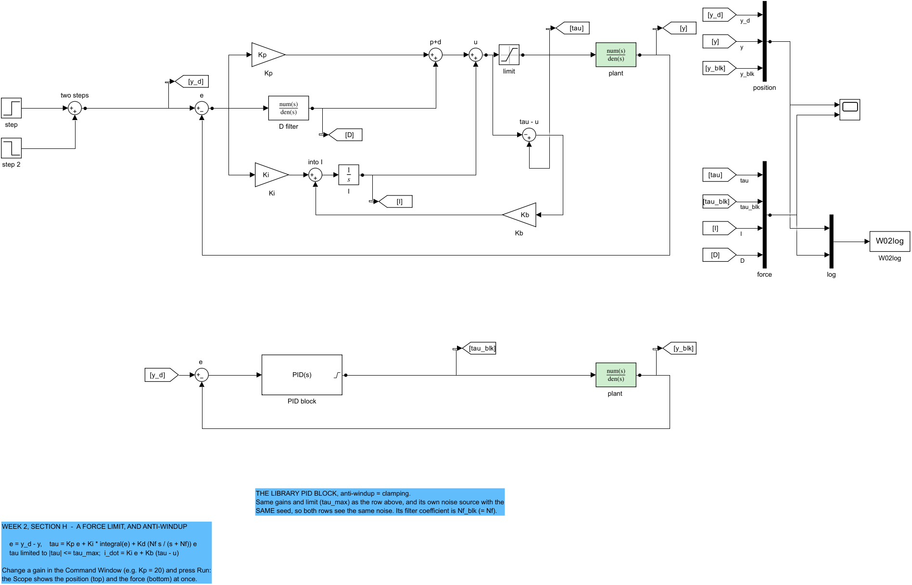

| 그림에서 | 뜻 |
|---|---|
| `step`, `step 2`, `two steps` | 설정값: $t = 1$ s 에 2 m, $t = 15$ s 에 0.5 m |
| `limit`, `tau - u`, `Kb` | 힘 한계와 `into I` 로 들어가는 back-calculation 경로 |
| `PID block` | 라이브러리 블록. 안티와인드업 방식은 실행마다 스크립트가 설정한다 |

아래 실험 2-11 이 $K_p = 10$, $K_i = 8$, $K_d = 4$ 로 잰 값:

| 안티와인드업 | 15 s 의 $y$ [m] | 0.5 m 의 2 % 안으로 돌아오는 시각 [s] |
|---|---|---|
| 없음 | 1.250 | **결코** (남은 15 s 안에는) |
| 클램핑 | 1.250 | 4.41 |
| back-calculation | 1.250 | 4.06 |

- 안티와인드업이 없으면 적분기가 $t = 15$ s 까지 **94.0 N** 을 저장한다 — 구동기는 2.5 N 을 줄 수 있다. 목표가 내려가면 그 전하가 남은 실행 동안 힘을 한계에 붙들어 둔다. 질량이 돌아오지 않는다. 배에서는 이것이 정지 명령을 무시하는 것으로 보인다.
- Back-calculation 이 있으면 적분기가 $t = 15$ s 에 $-1.96$ N 에 앉아 있다. 식이 그것을 예측한다. $e = 2 - 1.25 = 0.75$, $P = 7.5$ N, $D = 0$ 이므로 $I^\star = 2.5 - 7.5 + (8/2)(0.75) = -2.0$ N 이다.
- 클램핑과 back-calculation 모두 약 4 s 에 회복한다. Back-calculation 은 라이브러리 블록을 $6.66\times10^{-16}$ m 까지 재현하기도 한다.
- 여기서 back-calculation 게인은 거의 중요하지 않다. $K_b = 0.5, 2, 10, 50$ 이 4.26, 4.06, 4.37, 4.28 s 에 회복한다.

### 실험 2-11 · 닿을 수 없는 목표, 그리고 안티와인드업 세 방식 (15분)

**무엇을 재는가.** 불가능한 지시 14 s 뒤에 적분기가 무엇을 들고 있는지, 그리고 각 처방이 그것을 돌려주는 데 얼마나 걸리는지 — 식 $I^\star = \tau_{\max} - P - D + (K_i/K_b)\,e$ 를 측정된 $-1.96$ N 과 대조해.

**모델.** `W02_H_antiwindup` — §2-5 의 루프에 힘을 $2.5$ N 으로 제한한 것. $k = 2$ N/m 에 맞서 그것은 질량을 $1.25$ m 보다 높이 붙잡을 수 없다. 설정값이 2 m 를 요구하고, 그 다음 닿을 수 있는 0.5 m 로 내려간다.

**열고 돌리기.**

```matlab
W02_0_setup
y_step = 2; t_step2 = 15; T_final = 30; tau_max = 2.5;
open_system('W02_H_antiwindup')
Kb = 0;                            % Run — 안티와인드업 없음 / no anti-windup: it never comes back
Kb = 2;                            % Run — 되감기 / back-calculation: back in about 4 s
W02_H_windup                       % 세 방식과 Kb 스윕까지 / the three schemes and a Kb sweep
```

나오는 출력:

```
  W02 Experiment 2-11  unreachable 2 m for 14 s, then a reachable 0.5 m  (|tau| <= 2.5 N)
    anti-windup                     y at 15 s [m]  back within 2 % of 0.5 m after [s]
    none (block)                           1.250             Inf
    clamping (block)                       1.250            4.41
    back-calculation (block)               1.250            4.06
    none (by hand, Kb = 0)                 1.250             Inf
    back-calc (by hand, Kb = 2)            1.250            4.06
    by hand vs block, back-calculation: max |y diff| = 6.66e-16
    integrator at t = 15 s: 94.0 N without anti-windup, -1.96 N with back-calculation

    the back-calculation gain Kb (by hand)
    Kb     back within 2 % after [s]
    0.5          4.26
    2            4.06
    10           4.37
    50           4.28
```

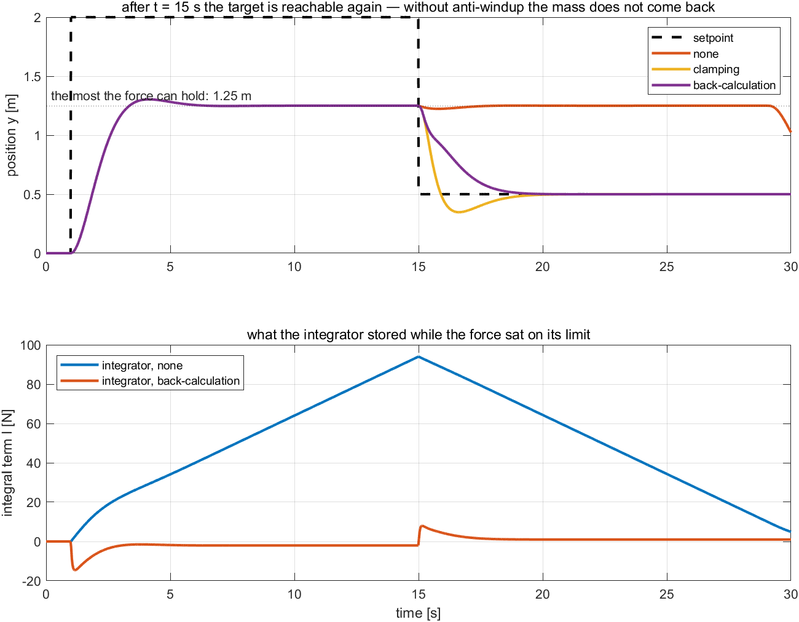

| 그림에서 | 뜻 |
|---|---|
| 위 | 세 방식에 대한 위치. 점선이 1.25 m, 제한된 힘이 붙잡을 수 있는 최대다 |
| 아래 | 안티와인드업이 없을 때와 back-calculation 이 있을 때의 적분기 |

**그림이 말하는 것**

- 1 에서 15 s 까지 모든 방식이 1.25 m 에 앉아 있다. 목표에 닿을 수 없다. 다른 것은 기억이다. 안티와인드업이 없으면 적분기가 94 N 을 쌓았고, 15 s 뒤 질량은 0.5 m 로 가는 대신 제자리에 머문다. 클램핑과 back-calculation 은 약 4 s 에 돌아온다.

> [!tip] 수업에서
> - **목적** — 와인드업을 눈에 보이게 만든다. 선형 모델에는 한계가 없고 실물 구동기에는 있으며, 적분기는 그것을 모른다.
> - **가리킬 곳** — 15 s 까지 1.25 m 에서 서로 겹쳐 있다가 갈라지는 세 곡선. 차이는 질량이 한 일이 아니라 적분기가 기억하는 것에 있다. 아래 칸에서, 2.5 N 을 줄 수 있는 구동기를 상대로 저장된 94 N.
> - **질문** — "back-calculation 의 적분기가 왜 음수로 가는가?" $P$ 만으로 2.5 N 한계에 대해 7.5 N 을 요구하므로, 요구를 한계에 붙들어 두기 위해 적분기가 $I^\star = -2.0$ N 으로 몰린다(§2-11).
> - **질문** — "배에서 와인드업은 어디에 나타나는가?" 추진기가 만족시킬 수 없는 속도 명령, 그리고 그 뒤 무시되는 정지 명령 — 3주차다.
> - **남길 것** — 구동기가 포화될 수 있는 곳에서는 안티와인드업을 켠다. 어느 방식이든 되고, 없는 것은 안 된다.

## 2-12. 튜닝 순서 — 한 번에 게인 하나

이 절이 답하는 것: 세 게인을 어떤 순서로, 무엇에서 고르는가?

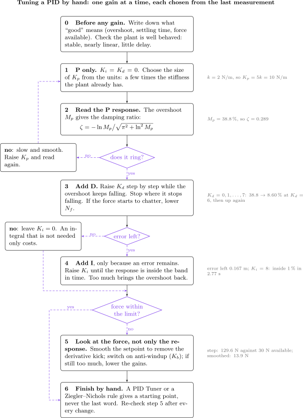

| 그림에서 | 뜻 |
|---|---|
| 번호를 단 상자들, 위에서 아래로 | 단계. 이 순서로, 한 번에 하나씩 |
| 보라 마름모 | 다음 단계를 정하는 질문 셋 — 울리는가, 오차가 남는가, 힘이 한계 안인가 |
| 보라 점선 화살표 | 분기: $K_p$ 로 되돌아가기, 적분 건너뛰기, 힘 보정 건너뛰기 |
| 오른쪽의 회색 글자 | 실험 2-12 에서 각 단계가 이 플랜트에서 잰 것 |

| 단계 | 하는 일 | 왜 이 순서인가 |
|---|---|---|
| 0 | "좋다" 가 무슨 뜻인지 적는다 — 오버슛, 정착시간, 쓸 수 있는 힘 — 그리고 플랜트가 얌전한지 확인한다 | 요구사항이 없으면 멈출 지점이 없다. 불안정하거나 강하게 비선형이거나 지연이 있는 플랜트에는 이 규칙들이 적용되지 않을 수 있다(Tech Talk 4편) |
| 1 | P 만, $K_i = K_d = 0$. $K_p$ 의 **자리수**를 단위에서 고른다 | 오차는 미터이고 힘은 뉴턴이다. $K_p$ 는 플랜트가 이미 가진 강성, 여기서는 $k = 2$ N/m 의 몇 배여야 하므로 $K_p = 5k$ 다(Ctrl튜브) |
| 2 | P 응답을 읽는다. 오버슛이 감쇠비를 준다 | $\zeta = -\ln M_p/\sqrt{\pi^2 + \ln^2 M_p}$. 울린다는 것은 다음 항이 I 가 아니라 D 라는 뜻이다(Ctrl튜브. `verify_w02_pid` 검사 3 이 그 식이 정확한 역임을 확인한다) |
| 3 | 오버슛이 계속 떨어지는 동안 $K_d$ 를 올린다. 떨어지기를 멈추는 자리에서 멈춘다 | 미분에는 최적이 있다. $-K_p/K_d$ 의 영점이 원점 쪽으로 움직여 응답을 다시 들어 올린다(§2-7). 힘이 떨리면 $N_f$ 를 낮춘다 |
| 4 | 오차가 남으면 그때만 $K_i$ 를 더하고, 응답이 시간 안에 띠에 들 때까지 올린다 | 필요하지 않은 적분은 비용만 치른다 — 느린 정착, 돌아오는 오버슛, 와인드업(§2-8) |
| 5 | 응답만이 아니라 **힘**을 본다 | 설정값을 부드럽게 하거나, 안티와인드업을 켜거나, 게인을 낮춘다(Tech Talk 6편) |
| 6 | 손으로 마무리한다 | PID Tuner 나 Ziegler–Nichols 규칙은 출발점을 주고 결코 최종 결론을 주지 않는다(Tech Talk 4·6편). 바꿀 때마다 5단계를 되풀이한다 |

아래 실험 2-12 에서 "3 s 안에 1 % 이내" 와 "쓸 수 있는 힘 30 N" 을 목표로 이 플랜트에 적용한 것:

| 단계 | $K_p$ | $K_d$ | $K_i$ | $M_p$ | 1 % 안에 드는 시각 | 최대 힘 |
|---|---|---|---|---|---|---|
| 1–2 P 만 | 10 | 0 | 0 | 38.77 % | 결코 | 10.0 N |
| 3 P + D | 10 | 6 | 0 | 8.60 % | 결코 | 129.6 N |
| 4 P + I + D | 10 | 6 | 8 | 0.16 % | 2.77 s | 129.6 N |
| 5 같은 것, 설정값을 부드럽게 | 10 | 6 | 8 | 0.15 % | 3.11 s | 13.9 N |

- 2단계는 $M_p = 38.8\,\%$ 를 $\zeta = 0.289$ 로 읽었고, 그것은 $b/(2\sqrt{k+K_p})$ 가 예측하는 값이다.
- 3단계는 $K_d$ 를 $0, 1, \dots, 7$ 로 올렸다. 오버슛이 $38.77 \to 24.95 \to 16.94 \to 12.34 \to 9.83 \to 8.71 \to 8.60$ 으로 떨어지고 $K_d = 7$ 에서 $9.22$ 로 올랐으므로 $K_d = 6$ 이다.
- 4단계는 3 s 안에 1 % 이내에 드는 첫 정수 게인으로 $K_i = 8$ 을 찾았다.
- 5단계는 응답이 결코 묻지 않는 질문의 답을 찾았다. 계단이 쓸 수 있는 $30$ N 에 대해 $129.6$ N 을 요구한다. 설정값을 부드럽게 하면 $0.34$ s 의 대가로 $13.9$ N 이 된다.

### 실험 2-12 · 튜닝 순서, 한 단계씩 (15분)

**무엇을 재는가.** 위 표의 여섯 단계를 이 플랜트에서 수행하고, 각 게인을 그 앞의 측정에서 읽는다 — 그리고 다른 모든 시험을 통과한 결과를 뒤집는 힘 확인.

**모델.** `W02_I_tuning` — §2-5 의 루프를 다시 한 번. 그 안에 특별한 것은 없다. 돌리고 있는 것은 방법이다.

**열고 돌리기.**

```matlab
W02_0_setup
W02_I_tuning_by_hand         % 단계마다 무엇을 읽고 무엇을 정했는지 출력한다 / prints each decision
```

나오는 출력:

```
    1-2  Kp = 10: overshoot 38.8 % -> damping ratio 0.289 (formula 0.289): it rings, so D next
    3    Kd = 0,1,...: overshoot 38.77 24.95 16.94 12.34 9.83 8.71 8.60 9.22  %  -> stops falling at Kd = 6
    4    error left 0.167 -> Ki = 8: inside 1 % after 2.77 s, overshoot 0.16 %
    5    peak force 129.6 N against 30 N available -> smoothed setpoint: 13.9 N, inside 1 % after 3.11 s
```

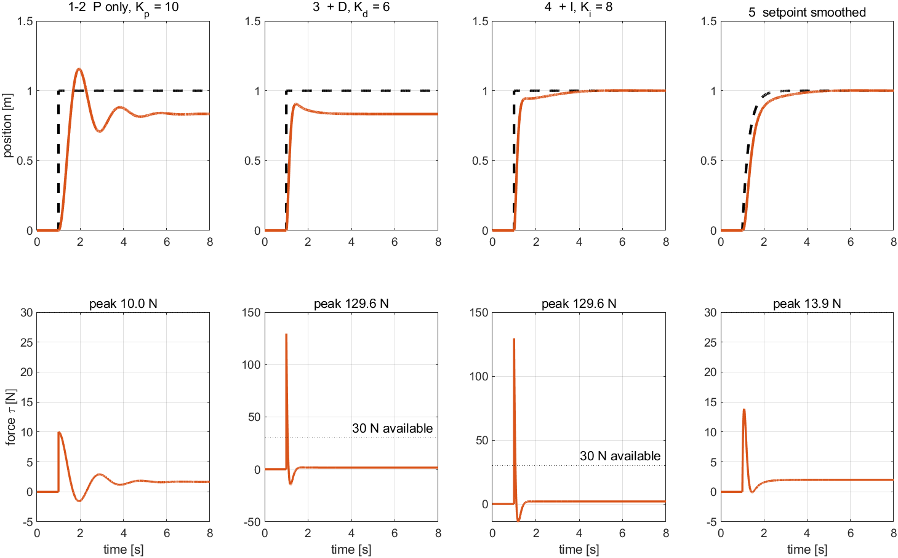

| 그림에서 | 뜻 |
|---|---|
| 1 열부터 4 열까지 | P 만, + D, + I, 그리고 같은 것에 설정값을 부드럽게 한 것 |
| 위 줄 / 아래 줄 | 위치 / 쓸 수 있는 $30$ N 에 대한 힘 |

**그림이 말하는 것**

- 각 열이 그 앞의 열이 보여 준 것을 고친다. P 가 울림을 드러내고, D 가 그것을 가라앉히고, I 가 오차를 없애고, 그리고 4단계가 쓸 수 있는 힘의 네 배를 요구한다는 것은 아래 줄만이 드러낸다.

> [!tip] 수업에서
> - **목적** — 이 주를 하나로 모은다. 게인은 결코 짐작하는 것이 아니라 그 앞의 측정에서 읽는 것이고, 튜닝은 힘을 확인한 뒤에야 끝난다.
> - **가리킬 곳** — 열의 순서와 각 단계의 이유(§2-12 표). $K_d$ 가 오르며 나열된 오버슛 — 6 에서 $8.60\,\%$ 로 떨어지고 7 에서 다시 오른다.
> - **질문** — "$K_i$ 를 더하기 전에 왜 $K_d$ 를 올리는가?" P 가 울림을 드러냈고 그것은 감쇠의 문제다. 적분은 울림을 없애는 것이 아니라 더한다.
> - **질문** — "4단계에서 모든 응답 지표가 통과했다. 무엇이 실패했는가?" 힘이다. 쓸 수 있는 $30$ N 에 대해 $129.6$ N 이다. 설정값을 부드럽게 하면 정착 $0.34$ s 의 대가로 고쳐진다.
> - **남길 것** — 요구사항부터, 한 번에 게인 하나, 그리고 구동기는 마지막에 그리고 늘 본다.

## 2-13. 이 강의의 나머지가 기대는 생각 둘

이 절이 답하는 것: 제어기가 컴퓨터에서 돌면 무엇이 바뀌고, 루프 하나가 다른 루프 안에 앉으면 무엇이 바뀌는가?

**샘플링된 제어.** 디지털 제어기는 센서를 읽고, 계산하고, 다음 샘플까지 자기 출력을 유지한다(Tech Talk 7편). 샘플시간 $T_s$ 가 폐루프의 빠르기에 비해 짧은 동안에는 아무것도 바뀌지 않는다. 그것을 넘으면 제어기가 낡은 정보에 작용한다.

| 규칙 | 진술 | 출처 |
|---|---|---|
| 충분히 빠르게 샘플한다 | 폐루프 대역폭의 최소 20 배로 샘플한다 — $T_s\,\omega_B \le 2\pi/20 = 0.31$ | Franklin, Powell & Workman, *Digital Control of Dynamic Systems*, 11장 |
| 연속시간에서 튜닝한다 | $s$ 에서 설계하고 $z$ 로 바꾼 뒤 샘플시간을 확인한다 | Tech Talk 7편 |

아래 실험 2-13 이 기본 게인으로, $\omega_B = 6.11$ rad/s 에서 잰 값:

| $T_s$ [s] | $T_s\,\omega_B$ | 최대 $\lvert z\rvert$ | $M_p$ | 정착 [s] |
|---|---|---|---|---|
| 연속 | — | — | 0.0 % | 2.06 |
| 0.01 | 0.06 | 0.9868 | 0.2 % | 2.05 |
| 0.05 | 0.31 | 0.9364 | 1.4 % | 2.00 |
| 0.1 | 0.61 | 0.8779 | 5.0 % | 1.90 |
| 0.2 | 1.22 | 0.7734 | 25.6 % | 1.80 |
| 0.3 | 1.83 | 0.6830 | 37.9 % | 2.70 |
| 0.4 | 2.44 | 0.8105 | 67.8 % | 7.20 |

- 연속시간에서는 괜찮은 그 같은 게인이 $T_s = 0.511$ s 에서 불안정해진다. 거기서 폐루프 극점 하나가 단위원에 닿는다(`verify_w02_pid` 검사 7 이 촘촘한 격자에서 $0.5115$ s 를 찾는다).
- 이 강의는 MSS 가 하듯 제어기를 연속시간에서 시뮬레이션한다. 위 표는 게인이 정해진 주기로 도는 컴퓨터에 올라가기 전에 해 둘 확인이다.

**종속 루프.** 어떤 루프의 출력이 다른 루프의 설정값이면, 안쪽 루프를 먼저 튜닝하고 바깥 루프는 안쪽이 즉시 반응하는 것처럼 설계할 수 있다 — 안쪽 루프가 대역폭에서 대략 **5 ~ 7 배 빠르다**는 조건에서다(Tech Talk 7편). 이득은 안쪽 루프가 바깥 루프가 보기 전에 자기 빠른 외란을 물리친다는 것이다. 5주차가 이 강의의 첫 종속 구조다. 유도 법칙이 바깥 루프이고 4주차의 선수각 오토파일럿이 안쪽 루프다.

### 실험 2-13 · 같은 게인을 컴퓨터에서 (10분)

**무엇을 재는가.** 규칙 $T_s\,\omega_B \le 0.31$ — 같은 게인을 점점 드물게 적용해, 연속시간에서는 괜찮았던 루프가 더 이상 정착하지 않을 때까지.

**모델.** 없다 — 이번 주에서 Simulink 모델이 없는 유일한 실험이다. §2-5 의 플랜트와 제어기를 전달함수로 쓰고 `c2d` 로 이산화한다. 플랜트는 영차 홀드로, 제어기는 Tustin 으로, 컴퓨터가 돌리는 그대로다. $T_s$ 말고는 아무것도 바뀌지 않는다.

**열고 돌리기.**

```matlab
W02_0_setup
W02_J_sample_time            % 연속시간과 여섯 개의 샘플시간 / continuous, then six sample times
```

나오는 출력:

```
    Ts [s]   Ts*wB   overshoot %   settle [s]
    cont.    -            0.0        2.06
    0.01      0.06        0.2        2.05
    0.05      0.31        1.4        2.00
    0.1       0.61        5.0        1.90
    0.2       1.22       25.6        1.80
    0.3       1.83       37.9        2.70
    0.4       2.44       67.8        7.20
    unstable from Ts = 0.511 s  (Ts*wB = 3.12)
```

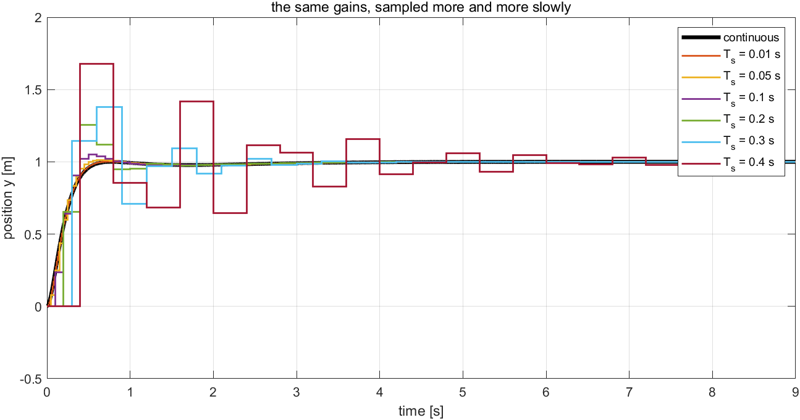

| 그림에서 | 뜻 |
|---|---|
| 검정 | 연속시간 응답 |
| 계단 곡선들 | 샘플링된 응답. 각 단이 유지된 샘플 하나다 |

**그림이 말하는 것**

- $T_s\,\omega_B = 0.31$ 까지는 계단 곡선들이 검은 곡선 위에 놓인다. 그것을 넘으면 제어기가 점점 더 낡은 오차에 작용하고, $T_s = 0.511$ s 에서 루프가 불안정해진다.

> [!tip] 수업에서
> - **목적** — 이번 주의 연속시간 설계를 그것을 돌릴 컴퓨터와 잇는다. 같은 게인이 너무 드물게 적용된다는 것만으로 실패할 수 있다.
> - **가리킬 곳** — $T_s$ 말고는 아무것도 바뀌지 않았는데 $0.2\,\%$ 에서 $67.8\,\%$ 로 오르는 오버슛 열. 그 옆의 곱 $T_s\,\omega_B$, 거기서 $\omega_B$ 는 §2-3 의 대역폭이다.
> - **질문** — "그 규칙이 왜 대역폭으로 쓰여 있는가?" 대역폭은 루프가 얼마나 빠르게 응답하는가다. 샘플링 주파수 $2\pi/T_s$ 가 그것의 최소 20 배여야 하고, 그것이 규칙 $T_s\,\omega_B \le 2\pi/20$ 이다.
> - **남길 것** — 연속시간에서 설계하고, 게인이 시뮬레이션을 떠나기 전에 샘플 주기를 대역폭과 대조해 확인한다.

---

# Part 2 · 실습 실행 순서

Part 1 의 실험들을 나타난 순서대로 따라간 것이다. 이 표는 무엇을 돌렸는지의 색인이고, 집에서 그 주차를 되짚을 때와 모델을 다시 찾을 때 쓴다.

실험마다 **자기 모델**이 있고 모든 모델이 같은 모양이다. 루프가 왼쪽에, 최상위에서 보통 블록으로 만들어져 있고, **Scope 하나**가 오른쪽에 있으며 위에 위치, 아래에 힘이 있다. 모델을 열고 **Run** 을 누르면 Scope 가 응답을 보인다. Command Window 에서 게인을 바꾸고 다시 Run 을 누른다 — 그 밖에는 필요한 것이 없다.

| 실험 | 모델 | 스크립트 | 무엇을 보이나 |
|---|---|---|---|
| 2-0 | 전부 | `W02_0_setup`, `W02_1_build_pid` | 파라미터, 그리고 코드로 쓰인 모든 모델 |
| 2-2 | `W02_B_three_ways` | `W02_B_plant_three_ways` | 한 플랜트를 미분방정식·전달함수·상태공간 모델로 |
| 2-3 | `W02_B_second_order` | `W02_B_zeta_and_wn` | $\zeta$ 와 $\omega_n$ 을 한 번에 하나씩 바꾼다 |
| 2-4 | `W02_C_metrics` | `W02_C_five_numbers` | 응답 하나에서 읽어낸 다섯 지표 |
| 2-5 | `W02_E_PID` | — | 법칙 전체를 한 캔버스에, 블록 단위로 |
| 2-6 | `W02_C_P` | `W02_C_proportional_only` | P 만, 세 게인에서 |
| 2-7 | `W02_D_PD` | `W02_D_derivative` | P + D |
| 2-8 | `W02_E_PID` | `W02_E_integral` | P + I + D, 그리고 루프가 깨지는 게인 |
| 2-9 | `W02_F_block_vs_hand` | `W02_F_block_vs_handbuilt` | 같은 법칙을 블록으로 만든 것과 라이브러리 PID 블록으로 |
| 2-10a | `W02_G_lowpass` | `W02_G_lowpass_filter` | 저역통과 필터 혼자 |
| 2-10b | `W02_G_derivative_bench` | `W02_G_bench` | 작업대에서의 유사 미분 |
| 2-10c | `W02_G_noise_kick` | `W02_G_noise_and_kick` | 같은 미분을 루프 안에서, 그리고 킥 |
| 2-11 | `W02_H_antiwindup` | `W02_H_windup` | 닿을 수 없는 목표, 그리고 안티와인드업 세 방식 |
| 2-12 | `W02_I_tuning` | `W02_I_tuning_by_hand` | §2-12 의 튜닝 순서 |
| 2-13 | 없음 — 전달함수만 | `W02_J_sample_time` | 같은 게인을 점점 드물게 적용한다 |

- 스크립트는 Run 이 이미 보여 주는 것을 여러 게인에 대해 한꺼번에 되풀이하고, Part 1 이 인용한 수치를 찍는다. Part 1 의 어느 것도 다른 데서 오지 않았다.
- 각 실험은 **수업에서** 노트로 끝난다 — 그 목적, Scope 에서 가리킬 곳, 수업에 던질 질문과 그 답, 그리고 남길 한 문장.

---

# 정리

## 주차 정리

| 단계 | 한 일 | 어떻게 검증했나 |
|---|---|---|
| 0a | 플랜트를 자유물체도에서 미분방정식, 전달함수 $G(s) = 1/(s^2+2s+2)$, 상태공간 모델로 썼다 | 실험 2-2: 셋이 $1.1\times10^{-16}$ m 까지 일치한다. 전달함수만 0.5 m 에서 시작할 수 없다. `verify_w02_pid` 검사 9 |
| 0b | 2차 시스템의 두 수 $\zeta$ 와 $\omega_n$, 그리고 대역폭을 이름 지었다 | 실험 2-3: $\zeta$ 가 오르며 오버슛 $52.7 \to 0\,\%$. $\omega_n$ 이 두 배가 되면 첨두시간이 반이 된다. `verify_w02_pid` 검사 10 |
| 0c | 시간영역 지표 다섯을 정의했다 | 실험 2-4: 첨두시간과 정착의 식을 측정과 대조. §2-4 의 주석 붙은 그림 |
| 1 | 플랜트 자신의 수들: 극점 $-1 \pm j$, $\zeta = 0.707$, $\omega_n = 1.414$ rad/s | 정적 이득 $0.5$ m/N. 계단 힘에 $4.3\,\%$ 오버슛 |
| 2 | 스프링으로서의 P: $y_{ss} = K_p/(k+K_p)$ | 실험 2-6: 식과 측정이 세 자리까지 일치한다. `verify_w02_pid` 검사 2 |
| 3 | 완충기로서의 D, 그리고 그 영점 | 실험 2-7: 오버슛 $38.8 \to 8.6\,\%$, 남는 오차는 $0.167$ 그대로 |
| 4 | I 가 오차를 없앤다. Routh 한계 $K_i < 72$ | `verify_w02_pid` 검사 4. 실험 2-8: 구현된 한계 $87.07$ 의 $0.9$ 배에서 감쇠, $1.1$ 배에서 성장 |
| 5 | 블록으로 만든 법칙이 Simulink PID 블록과 같다 | 실험 2-9: 한계와 잡음 아래에서 차이 $10^{-15}$. 대조 실행 $1.2\times10^{-3}$ m |
| 6 | 유사 미분 | 실험 2-10b 와 2-10c: 작업대에서 참값 0.5 에 대해 26.55 대 0.75. 힘 표준편차 $9.29 \to 0.45$ N. 킥 $89.7 \to 10.5$ N |
| 7 | 닿을 수 없는 목표에 대한 안티와인드업 | 실험 2-11: 없음은 결코 돌아오지 않는다(94 N 저장). 클램핑 4.41 s. back-calculation 4.06 s |
| 8 | 튜닝 순서를 따랐다 | 실험 2-12: $K_p = 10$, $K_d = 6$, $K_i = 8$, 각각 그 앞의 측정에서 |
| 9 | 제어기를 샘플링했다 | 실험 2-13: $T_s = 0.511$ s 에서 불안정. `verify_w02_pid` 검사 7 |

## 진도 점검

> [!important] 3주차를 따라가기 위한 최소 조건

### 이론

- [ ] 질량-스프링-댐퍼의 자유물체도를 그리고 그 운동방정식·전달함수·상태공간 모델을 유도할 수 있다.
- [ ] $\zeta$ 와 $\omega_n$ 이 각각 오버슛·첨두시간·대역폭에 무엇을 하는지, 그리고 그것이 s 평면에서 어디에 보이는지 말할 수 있다.
- [ ] 상승시간·첨두시간·오버슛·정착시간·정상상태 오차를 정의하고 각각이 무엇에 답하는지 말할 수 있다.
- [ ] P·I·D 가 이 플랜트에서 각각 무엇을 하는지 기계적인 말로 할 수 있다 — 스프링, 완충기, 참을성 있는 손.
- [ ] $y_{ss} = K_p/(k+K_p)$ 를 유도하고 그것이 왜 결코 1 이 아닌지 설명할 수 있다.
- [ ] 2차 플랜트 둘레의 PID 에 대한 $K_i$ 의 Routh 한계를 유도할 수 있다.
- [ ] 천장 $K_d N_f$, 미분 킥, 그리고 back-calculation 의 $I^\star$ 를 설명할 수 있다.

### 실습

- [ ] `W02_1_build_pid` 이 돌았고 모든 모델이 `overlapping lines: 0` 을 보고했다.
- [ ] Command Window 에서 게인을 바꾸었고 모델의 Scope 가 새 응답을 보였다.
- [ ] `W02_P1_start` 로 만든 모델에서 `W02_check(1)`, `(2)`, `(3)` 이 통과한다.

### 기록한 관측

- [ ] 실험 2-2 에서 0.5 m 에서 놓을 때 전달함수 줄이 무엇을 하는지, 그리고 왜인지.
- [ ] $K_p = 2$ 에서 측정된 오버슛과 식의 값.
- [ ] 실험 2-12 에서 오버슛이 떨어지기를 멈춘 $K_d$.
- [ ] 실험 2-11 에서 각 안티와인드업 방식이 돌아오는 데 걸린 시간.

---

## 과제 2

- **기한**: 3주차 수업 전
- **제출물**: 모델, 모든 수를 만들어 내는 스크립트, 그리고 분석

### ① 요구사항

`W02_0_setup.m` 과 `W02_vars.m` 에서 플랜트를 $G(s) = 1/(s^2 + 0.5\,s + 4)$ — 더 단단한 스프링에 감쇠는 훨씬 적은 것 — 으로 바꾸고($b = 0.5$, $k = 4$), 다음 목표로 §2-12 의 튜닝 순서를 따른다: 단위 계단의 2 % 안에 4 s 이내, 오버슛 10 % 이하, 최대 힘 40 N 이하.

### ② 검증 — 필수

> [!important] 주장은 결과가 아니다. 수치가 필요하고, 평균 구간을 함께 적는다

- 2단계에 대해, P 응답에서 읽은 감쇠비를 값 $b/(2\sqrt{m(k+K_p)})$ 옆에 나란히.
- 3단계에 대해, $K_d$ 대 오버슛의 표와 고른 $K_d$.
- 4단계에 대해, 고른 $K_i$ 와 그 결과의 정착시간. `step_metrics` 로 잰다.
- 5단계에 대해, 설정값을 부드럽게 했을 때와 하지 않았을 때의 최대 힘.
- 이상적인 미분에 대한 $K_i$ 의 Routh 한계, 그리고 실험 2-8 처럼 찾은 필터를 건 법칙의 한계.

### ③ 분석 (5–10줄)

게인을 이 플랜트의 것과 비교한다. $K_p$ 와 $K_d$ 가 운동방정식의 어디에 내려앉는지에서, 감쇠가 적은 플랜트가 왜 제어기에서 감쇠를 더 많이 받아야 하는지 설명한다.

### 배점

| 기준 | 배점 |
|---|---|
| 모델이 돌고 요구한 출력을 낸다 | 25% |
| **검증을 수행하고 수치를 보고했다** | 40% |
| 분석의 정확성 | 25% |
| 코드의 가독성 | 10% |

---

## 문제 해결

- 이번 주를 준비하면서 실제로 겪은 결함만 적었다.

| 증상 | 원인 | 조치 |
|---|---|---|
| `run(...)` 으로 부른 스크립트가 다른 함수 안에서 멈추거나 "중괄호 인덱싱이 지원되지 않습니다" | 어떤 스크립트가 작업공간에 `run` 이나 `s` 라는 이름의 변수를 남겨 같은 이름의 함수를 가렸다(실험 2-8 이 `s = tf('s')` 를 정의한다) | `W02_0_setup` 을 다시 실행하거나 스크립트를 하나씩 부른다 |
| `W02_check(2)` 가 `PID blocks 1` 을 보고하고 실패한다 | PID Controller 블록을 썼다. 문제 2 는 블록으로 만든 법칙을 요구한다 | D 를 Transfer Fcn 하나로, `[Kd*Nf 0]` 나누기 `[1 Nf]` 로 만든다 |
| Scope 의 힘이 수십 뉴턴짜리 첨두의 띠다 | `W02_G_noise_kick` 의 `d_filtered = 0` 이 순수 미분을 고른다 | `d_filtered = 1` |
| 실험한 뒤 Scope 가 이 노트와 맞지 않는다 | 바꾼 변수가 아직 작업공간에 있다 | `W02_0_setup` 을 다시 실행한다 |

---

## 참고문헌

### 원전

- Åström, K. J. and Murray, R. M. *Feedback Systems: An Introduction for Scientists and Engineers*, 2nd ed., Princeton University Press, 2021, 11장 (PID 제어: 기본 기능, 튜닝, 적분기 와인드업, 구현).
- Åström, K. J. and Hägglund, T. *Advanced PID Control*, ISA, 2006, 3장 (설정값 가중, 미분 필터링, 와인드업).
- Franklin, G. F., Powell, J. D. and Emami-Naeini, A. *Feedback Control of Dynamic Systems*, 8th ed., Pearson, 2019, §3.3–3.4 (극점 위치의 효과, 시간영역 사양), §4.2 (정상상태 오차와 시스템 형식), §4.3 (3항 제어기).
- Nise, N. S. *Control Systems Engineering*, 8th ed., Wiley, 2019, 2장 (주파수영역에서의 기계계 모델링), 3장 (상태공간), 4장 (2차 시스템의 시간응답), 7장 (정상상태 오차).
- Messner, W. C. and Tilbury, D. M. *Control Tutorials for MATLAB and Simulink*, University of Michigan — "Introduction: System Modeling", "Introduction: System Analysis", "Introduction: PID Controller Design".
- Franklin, G. F., Powell, J. D. and Workman, M. L. *Digital Control of Dynamic Systems*, 3rd ed., Addison-Wesley, 1998, 11장 (샘플 주기 선택).

### 영상

- Douglas, B. *Understanding PID Control*, 1–7편, MATLAB Tech Talk, MathWorks, 2018 — [재생목록](https://www.youtube.com/playlist?list=PLn8PRpmsu08pQBgjxYFXSsODEF3Jqmm-y).
- 제어조교 Ctrl튜브, *[제어공학] PID 제어기 짬튜닝 — Simulink 시뮬레이션*, 2022 — [영상](https://www.youtube.com/watch?v=KJkqNujb6h4).

### 이 강의 안에서

- 제어시스템설계(강의 2) 2주차(모델링: 자유물체도, 전달함수, 상태공간, 세 가지 방식의 Simulink 모델), 4주차(시간응답과 사양), 5주차(정상상태 오차와 시스템 형식) — §2-2 부터 §2-4 까지의 출처.
- 캡스톤디자인 6주차 E–G 절 — 같은 플랜트, 그리고 §2-6 부터 §2-11 까지의 학부판.
- 강사의 *선형제어시스템* 13장, MATLAB 과 Simulink 를 쓴 실용 PID 제어기 설계.
- 3주차 §3-3 (속도 루프에서의 미분) 과 §3-4 (Otter 에서의 와인드업).
- `_tools/verify_w02_pid.m` — Part 1 이 인용한 열 가지 검사.

---

## 다음 주

- **3주차 — 전진속도 제어**
- 배에서의 첫 폐루프. 이번 주의 제어기를 바뀌지 않은 채로 Otter 의 전진속도 둘레에 놓고 **모델 없이** 튜닝한다. 플랜트는 계단 입력 하나에서 읽고, 모든 게인은 §2-12 의 튜닝 순서로 Scope 에서 읽는다.
- 미분 항은 여분의 질량처럼 작용해 루프를 나쁘게 만드는 것으로 드러나고, 추진기 한계가 §2-11 의 와인드업을 실제로 만든다.
- 준비: MSS 툴박스를 `Tools\MSS` 에.
