# 3주차 · 전진속도 제어

> [!note] 이 문서는 한글본이다
> 영어본 [`W03_Surge_Speed_Control.md`](W03_Surge_Speed_Control.md) 와 **같은 내용**이고,
> 수식·코드·그림·수치는 한 글자도 다르지 않다. 러너가 찍는 출력은 영어 그대로 둔다 —
> 실제로 화면에 그렇게 나오기 때문이다.

> [!note] 이번 학기 수업 실시간 녹화
> <span style="font-size:0.88em">이 강의의 모든 시간은 진행되는 그대로 녹화되어 아래 재생목록에 올라간다. 여기 적힌 글이 기준이고, 녹화는 실제로 전달된 속도의 강의다. 유도를 다시 볼 때, 또는 빠진 주를 실습 전에 따라잡을 때 쓴다.</span>
>
> | | 어디에 |
> |---|---|
> | **[충남대] 2026 센서신호처리** — 이 강의의 2026년 실시간 녹화 | [재생목록](https://youtube.com/playlist?list=PLCxINRGlWUrk) |

> [!important] 참고자료 — 먼저 읽을 것
> <span style="font-size:0.88em">아래 다섯 강의는 **이 강의의 강사가 직접 한 강의**이고, 이 강의가 전제하는 배경이다. 기초부터 대학원 내용까지 이어지므로 모자란 곳부터 시작하면 된다. 여기서 쓰는 좌표계·기호·유도는 전부 그 강의들에서 길게 다룬다. 선수 지식이 얇은 사람은 그쪽을 먼저 보고 돌아오는 편이 빠르다.</span>
>
> | # | 강의 | 수준 | 언어 | 영상 | 자료와 코드 |
> |---|---|---|---|---|---|
> | 1 | **제어공학** — 기초: 전달함수, 되먹임, 안정도, 근궤적, PID | 학부 | KO | [재생목록](https://youtube.com/playlist?list=PLFaUxNRM4BvJMpF9HZS-Mp8tDv9dTdglk) | [드라이브](https://drive.google.com/drive/folders/1TNIPDNtS_Iy8li-olka5WJslSXDYf0aT) |
> | 2 | **제어시스템설계** — 해석이 아니라 설계: 사양, 루프 성형, 이산 구현 | 학부 | KO | [재생목록](https://youtube.com/playlist?list=PLFaUxNRM4BvIGroZ5rgn7x08F7C79d9WZ) | [드라이브](https://drive.google.com/drive/folders/11m5Xxl_PHJvxgHghLSP-jhCpmRpbvoXh) |
> | 3 | **제어공학특론** — 좌표계, 6자유도 운동방정식, 회전행렬과 오일러각, 선형화와 트림, 운동체 제어 설계 | 대학원 | EN | [재생목록](https://youtube.com/playlist?list=PLFaUxNRM4BvJmvF2ljx4KM5dj1P5jEcw0) | [드라이브](https://drive.google.com/drive/folders/1GUxbbONl916lNd0ggnFnXrNwNkd13-2-) |
> | 4 | **센서신호처리 및 융합** — 센서 모델, 잡음, 추정과 다중센서 융합 | 대학원 | EN | [재생목록](https://youtube.com/playlist?list=PLFaUxNRM4BvK-aP2Gdoyp5-AWvMn7Fo8E) | [드라이브](https://drive.google.com/drive/folders/1MEVJP7TzMcm8w6TZwUjhWJtL34WeNY3u) |
> | 5 | **캡스톤디자인** — 운동체 과제를 처음부터 끝까지 | 학부 | KO | [재생목록](https://youtube.com/playlist?list=PLFaUxNRM4BvLu7L0pDoLzDXTv8mm6rCmj) | [드라이브](https://drive.google.com/drive/folders/1haIQejlJfrdhtOuof-MpffR9ydVscXZS) |
>
> <span style="font-size:0.88em">**MATLAB 과 Simulink 가 아직 익숙하지 않다면 Part 2 전에 이것부터.** 이 강의의 실습은 전부 Simulink 이고, Onramp 는 무료이며 각각 몇 시간이면 끝난다.</span>
>
> | 도구 | 시작할 곳 |
> |---|---|
> | MATLAB | [MATLAB Onramp](https://matlabacademy.mathworks.com/kr/details/matlab-onramp/gettingstarted) · [Core MATLAB Skills](https://matlabacademy.mathworks.com/details/core-matlab-skills/lpmlcms) |
> | Simulink | [Simulink Onramp](https://matlabacademy.mathworks.com/kr/details/simulink-onramp/simulink) · 강사의 Simulink 강의 [1편](https://youtu.be/a-afHg_fSaU) · [2편](https://youtu.be/070Yn0Hw5a0) |


> [!tip] 수업 파일 받기와 최신으로 유지하기 (Windows)
> <span style="font-size:0.88em">강의노트·모델·스크립트는 한 Git 저장소에 들어 있고 학기 내내 갱신된다. 한 번 clone 하고, 수업 전마다 pull 한다. pull 은 지난번 이후 **바뀐 것만** 내려받는다.</span>
>
> | 언제 | 어디서 | 명령 |
> |---|---|---|
> | 한 번 | PowerShell — Git for Windows 설치 | `winget install --id Git.Git -e` |
> | 한 번 | 강의 폴더를 둘 자리, 예를 들어 `Documents` | `git clone https://github.com/wkyouncnu/Sensor-Signal-Processing-and-Fusion.git` |
> | 수업 전마다 | clone 한 폴더 `Sensor-Signal-Processing-and-Fusion` 안에서 | `git pull` |
>
> - 바뀐 것이 없으면 `git pull` 은 `Already up to date.` 를 찍고, 있으면 갱신한 파일을 나열한다.
> - 저장소는 비공개다. Git 이 물으면 강사가 접근 권한을 준 GitHub 계정으로 로그인한다.
> - 실험은 복사본에서 한다. 그 주차의 `WXX_simulink` 폴더를 다른 곳에 복사해 두면 pull 이 내 수정과 부딪칠 일이 없다. 이미 부딪쳤다면 `git stash` → `git pull` → `git stash pop` 이 수정을 치워 두고 갱신한 뒤 되돌려 놓는다.
> - MSS 툴박스는 저장소에 들어 있지 않다. Otter 를 시뮬레이션하는 주차는 clone 한 폴더 안 `Tools\MSS` 에 MSS 가 있어야 하고, `_tools\mss_path.m` 이 두 릴리스 구조를 다 찾는다 — 구 릴리스의 `Tools\MSS\VESSELS\otter.m`, 그리고 최신 master 의 `Tools\MSS\CRAFT\USV\models\otter.m`.
> - **두 릴리스의 Otter 는 같은 배가 아니다.** 이 자료에 실린 수치는 구 구조로 재었다. 종단 전진속도는 1.0286 m/s 로 같지만, 최신 master 는 차동 추력에서 25.5 % 빠르게 선회한다 — 0.1276 rad/s 대 0.1017 rad/s. 그래서 `mss_path` 는 둘이 함께 있으면 구 구조를 고르고, 신 구조만 있으면 경고를 낸다. 재현되지 않는 수치를 조용히 넘기지 않는다.
> - **2026-10-27 이후 처음 pull 할 때 118 MB 폴더 하나가 사라진다.** `lectures\MSS-master` 가 그때까지 MSS 사본을 담고 있었다. `Tools\MSS` 바깥에 있어 강의 스크립트가 닿을 수 없었고 clone 만 느리게 했다. 삭제는 정상이며 오류가 아니다. 그 폴더 안에 둔 파일이 있으면 pull 하기 전에 다른 곳으로 옮긴다.

- **과목**: USV 유도·항법·제어 (대학원)
- **학과**: 충남대학교 자율운항시스템공학과
- **이번 주**: ① 배의 모델 없이, 2주차의 제어기를 Otter 의 전진속도에 얹는다 ② Scope 를 읽어 P·I·D 를 하나씩 정한다 ③ 닿을 수 없는 속도와 안티와인드업 ④ 2주차의 튜닝 순서를 배 위에서 한 단계씩 따라간다

> [!important] 지난 주차에서 가져오는 것
> - 2주차에서: 시간영역 지표 다섯(§2-4), P·I·D 각각이 하는 일(§2-6 ~ §2-8), 필터를 건 미분, back-calculation 안티와인드업(§2-11), 튜닝 순서(§2-12). 이번 주는 그것들을 **그대로** 쓴다.
> - 1주차에서: Otter 모델과 프로펠러 곡선 $T = k\,n\lvert n\rvert$ — 축 회전수가 추력을 만든다.
> - 그 밖에는 없다. 이번 주는 **플랜트의 모델 없이** 튜닝한다. 모든 게인은 Scope 가 보여 주는 것에서 고른다.

---

## 학습 성과

이 주를 마치면 다음을 할 수 있다.

1. 계단 입력을 넣고 Scope 를 읽어, 플랜트를 바깥에서 특성화한다 — 정상 이득, 빠르기, 한계.
2. 돌려 보기 **전에**, 2주차에서 배운 것과 플랜트의 차이 하나만으로 P·I·D 가 속도 응답을 각각 어떻게 바꿀지 예측한다.
3. 속도 루프에서 미분 항이 왜 응답을 나쁘게 하는지 설명하고, 측정을 근거로 그것을 빼기로 결정한다.
4. 닿을 수 없는 속도 명령으로 배 위에서 적분기 와인드업을 재현하고, back-calculation 으로 없앤다.
5. 2주차의 튜닝 순서로 속도 루프를 튜닝하면서 각 게인을 정한 **측정**을 함께 말하고, 추력이 한계 안에 있는지 확인한다.
6. 전진력과 요 모멘트를 고정 프로펠러 둘에 배분하는 식을 유도하고, 나오는 $2\times2$ 행렬을 역으로 풀고, 각 추력을 제곱법칙 프로펠러 곡선으로 축 회전수로 바꾼다.

## 준비물

| 항목 | 필요한 것 |
|---|---|
| MATLAB | R2024b, Simulink 포함 |
| MSS | `Tools/MSS` — `W03_0_setup` 이 `mss_path` 로 찾는다 |
| 강의 폴더 | `lectures/W03_simulink` |
| 모델 | 예제마다 하나 — `W03_C_open_loop`, `W03_D_P`, `W03_E_PID`, `W03_F_windup`, `W03_G_tuning`. 전부 `W03_1_build_speed` 가 생성하며 손으로 고치지 않는다 |
| 시간 | 강의 40분, 실습 1시간 20분 |

## 이 주차가 놓이는 자리

2주차는 스프링에 달린 질량에 PID 를 튜닝했다. 이번 주에는 플랜트가 배가 되고, 그와 함께 스프링에는 없던 것이 하나 들어온다 — 제어기의 출력은 **힘**인데, 배의 구동기가 받는 것은 **축 회전수**다. 아래 그림이 전체 구성이고, 이번 주는 그 위쪽 줄과 오른쪽 블록을 만든다.

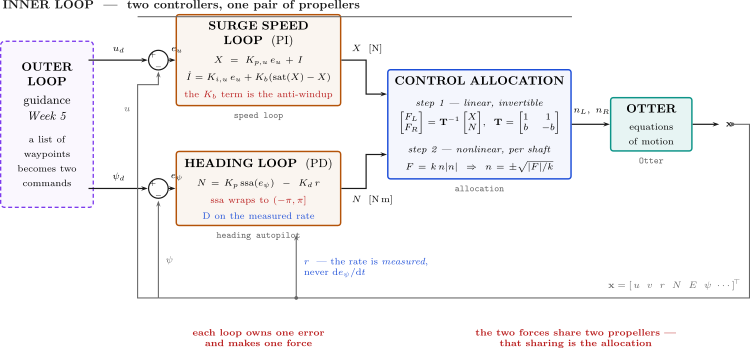

| 다이어그램에서 | 무엇인가 | 어디서 만드나 |
|---|---|---|
| **위쪽 줄, `speed loop`** | **속도 오차에 대한 PI, 안티와인드업 포함, 출력은 전진력 $X$** | **이번 주, §3-3 과 §3-4** |
| **`allocation`** | **$(X, N)$ 을 두 축 회전수로, 두 단계에 걸쳐** | **이번 주, §3-6** |
| 아래쪽 줄, `heading autopilot` | 요 모멘트 $N$ 을 내는 PD. 이번 주에는 $N = 0$ | 4주차 |
| `Otter` | 운동방정식 | 1주차 |
| 왼쪽 점선 상자 | 경로가 생기면 $u_d$ 와 $\psi_d$ 가 오는 곳 | 5주차 |
| 아래쪽 되먹임 버스 | 상태 벡터. 속도 루프는 그중 $u$ 하나만 읽는다 | — |

- §3-1 부터 §3-5 까지는 2주차가 스프링을 다루듯 속도 루프를 다루고, §3-6 은 그 출력을 프로펠러까지 따라간다.
- 두 번째 제어기는 비어 있는 채로 지금 그려 둔다. 4주차가 그것을 채울 때 아무것도 다시 배치하지 않아도 되게 하기 위해서다.

---

# Part 1 · 원리와 실험, 절 하나씩

절마다 무엇이 관측되는지 말하고, 거기서 무엇이 따라 나오는지 적고, 그것을 **재는 실험**을 그 절의 모델로 돌린다. 다른 데를 찾아볼 필요가 없다 — 본문이 인용하는 수치는 몇 줄 아래의 실행이 찍는 수다.

| 절의 구성 | 무엇이 들어가나 |
|---|---|
| **무엇이 관측되는가** | 현상 그 자체와, 그것이 내는 수 |
| **거기서 무엇이 따라 나오는가** | 번호를 단 줄들, 한 줄에 한 단계. 이번 주의 추론은 모델 없이 하므로, 각 줄은 배의 방정식이 아니라 **측정**에 기댄다 |
| **실험 N-x** | 모델, 명령, 실제로 받은 출력, 그림, 그리고 그림의 모든 특징을 **그것을 예측한 번호 줄**로 되돌려 읽는 표 |

## 3-0. 준비 (10분)

```matlab
cd lectures/W03_simulink
W03_0_setup
W03_1_build_speed
```

나오는 출력:

```
  W03_0_setup
    thrust   X in [-133.42, 239.36] N
    gains    Kp = 200   Ki = 200   Kd = 0   Nf = 20   Kb = 1
    command  u_d = 0 -> 1.5 m/s at t = 5 s

  built  W03_C_open_loop.slx  (overlapping lines: 0)
  built  W03_D_P.slx          (overlapping lines: 0)
  built  W03_E_PID.slx        (overlapping lines: 0)
  built  W03_F_windup.slx     (overlapping lines: 0)
  built  W03_G_tuning.slx     (overlapping lines: 0)
```

- 손으로 고치는 파일은 `W03_0_setup.m` 하나뿐이다. 이 파일이 MSS 도 찾는다. `mss_path` 에서 오류로 멈추면 MSS 툴박스가 `Tools\MSS` 에 없는 것이다.
- `W03_0_setup` 의 첫 줄은 `clear` 다. Scope 가 이 노트와 다르게 나오면 언제든 다시 실행한다.

## 3-1. 같은 제어기, 새 플랜트

이 절이 답하는 것: 2주차의 제어기를 배 둘레에 놓으면 무엇이 바뀌고 무엇이 바뀌지 않는가?

**제어기는 아무것도 바뀌지 않는다.** 이번 주의 모든 모델은 2주차 모델에서 질량-스프링-댐퍼를 빼고 그 자리에 배를 넣은 것이다. 오차, 세 항, 미분 필터, 한계, back-calculation 경로 — 같은 블록이 같은 자리에 있다.

**플랜트가 블록들의 사슬이 된다.** 제어기는 전진력 $X$ 를 계산하는데, 배에는 프로펠러가 둘 있고 각각은 축 회전수 $n$ 으로 돈다. 그 사이의 사슬은 이렇다.

| 모델 안의 블록 | 하는 일 | 어디서 왔나 |
|---|---|---|
| `thrust limit` | $X$ 를 $[-133.42,\ 239.36]$ N 안에 가둔다 | 두 프로펠러가 앞뒤로 낼 수 있는 가장 큰 추력. 부록 A1 에서 유도한다 |
| `allocation` | 줄마다 주석이 달린 MATLAB Function 블록이다. ① 프로펠러 하나가 $X$ 의 절반씩, $T = X/2$ ② 그 추력을 내는 축 회전수로 바꾼다, $n = \mathrm{sign}(T)\sqrt{\lvert T\rvert/k}$ ③ 두 축에 같은 회전수 | 똑바로 갈 때 두 프로펠러는 같은 일을 한다. 1주차의 프로펠러 곡선 $T = k\,n\lvert n\rvert$ 을 $n$ 에 대해 푼 것이고, $k$ 는 앞으로와 뒤로가 다르다 |
| `Otter` | MSS 의 `otter.m`, 상태 12개 | 1주차 |
| `surge speed u` | 첫 번째 상태, 전진속도 $u$ 를 꺼낸다 | 1주차: $\mathbf{x} = [u\ v\ w\ p\ q\ r\ \dots]$ |

**제어기는 이 사슬의 모델 없이 튜닝한다.** 1주차가 모델을 줄 수 있지만, 플랜트를 정확히 알아야만 동작하는 제어기는 약하다. 이번 주는 현장의 방식을 따른다 — 계단을 넣고, Scope 를 읽고, 측정에서 게인을 고른다. **모델 없는 튜닝(model-free tuning)** 이다. 2주차 §2-4 의 지표 다섯이 그 언어이고, 2주차 §2-12 의 튜닝 순서가 그 절차다.

### 실험 3-1 · 스프링 대신 배를 놓은 2주차 제어기 (10분)

**무엇을 재는가.** 아직 아무것도 재지 않는다. 이 실험은 위 문단들을 캔버스와 맞춰 보는 것이다 — 제어기와 배 사이의 블록 셋을, 그것들이 중요해지기 전에 눈에 익힌다.

**캔버스.** `W03_E_PID` — 이번 주에서 가장 꽉 찬 모델이다. 여기서는 읽기만 하고, 재는 것은 실험 3-3b 다. 왼쪽 절반은 2주차 캔버스 그대로이고, 오른쪽 절반이 위 표의 사슬이다.

**열고 돌리기.**

```matlab
W03_0_setup
open_system('W03_E_PID')           % Run — 위 칸 속도, 아래 칸 힘 / speed above, force below
```

| 식에서 | 캔버스에서 | 2주차 대비 바뀐 것 |
|---|---|---|
| $e = u_d - u$ | 원 `e` | 글자뿐이다. 위치 대신 속도 |
| $K_p e + K_i\!\int e + K_d \dot e$ | `Kp`, `Ki` → `I`, `D filter`, `p+d`, `u` | 없음 |
| 구동기의 한계 | `thrust limit` | 숫자만. $\pm\tau_{\max}$ 대신 $[-133.42,\ 239.36]$ N |
| 플랜트 | `allocation` → `Otter` → `surge speed u` | **전부** — 이번 주의 새 부분이다 |

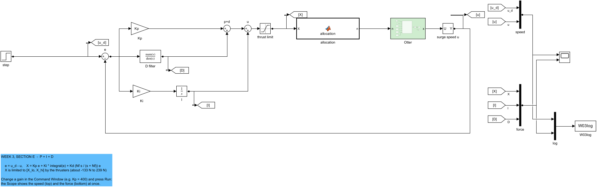

| 그림에서 | 뜻 |
|---|---|
| `step` → `e` | 속도 명령 $u_d$ 와 오차 $e = u_d - u$ |
| `Kp`, `D filter`, `Ki` → `I`, `p+d`, `u` | 2주차의 PID, 블록 하나까지 그대로. `u` 는 세 항의 합, 곧 요구한 힘이다 |
| `thrust limit` | 프로펠러가 낼 수 있는 힘, $[-133.42,\ 239.36]$ N |
| `allocation` | 힘을 두 프로펠러에 나누고 축 회전수로 바꾼다. 두 번 누르면 주석 달린 코드가 보인다 |
| 초록색 `Otter` | MSS 의 선체 모델 |
| `surge speed u` 와 아래를 따라가는 긴 선 | 속도, `e` 로 되먹임 |
| `speed`, `force` → Scope | 위: $u_d$ 와 $u$. 아래: 힘 $X$, 적분 $I$, 미분 $D$ |

> [!tip] 수업에서
> - **목적** — 제어기가 말 그대로 2주차의 제어기임을 보인다. 새 것은 초록 블록과 그 앞의 블록들뿐이다.
> - **가리킬 곳** — 모든 모델에 들어 있는 `thrust limit`. 실제 구동기는 결코 무한하지 않으므로, 모델도 무한한 척하지 않는다.
> - **질문** — "왜 힘을 반으로 나눈 다음 제곱근을 씌우는가?" 프로펠러 둘이 힘을 나눠 내고, 각 프로펠러의 추력은 축 회전수의 제곱으로 자라기 때문이다.
> - **남길 것** — 제어기는 플랜트에 묶여 있지 않다. 같은 블록이 스프링에서 배로 옮겨 간다.

## 3-2. 배가 하는 일을, 바깥에서 재기

이 절이 답하는 것: 계단 입력 하나로, 방정식 없이, 플랜트에 대해 무엇을 알 수 있는가?

모델 `W03_C_open_loop` 에는 제어기가 없다. $t = 5$ s 에 두 프로펠러에 일정한 전체 힘 $X$ 를 요구하고, Scope 가 속도를 보여 준다. 아래 실험 3-2 가 잰 값이다.

| $X$ [N] | 최종 $u$ [m/s] | 뉴턴당 $u$ [(m/s)/N] | 최종 속도의 63 % 까지 [s] |
|---|---|---|---|
| 50 | 0.645 | 0.01289 | 1.12 |
| 100 | 1.289 | 0.01289 | 1.12 |
| 200 | 2.579 | 0.01289 | 1.12 |

**거기서 무엇이 따라 나오는가, 한 줄씩.** 이 세 줄이 이번 주 튜닝에 필요한 전부이고, 그중에 배의 방정식은 하나도 없다.

1. **속도는 힘에 비례한다.** 가운데 열은 어느 힘에서나 같은 수, 뉴턴당 $0.0129$ m/s 다. 출력이 입력에 비례하는 플랜트는 이 범위에서 **선형**이므로, 한 속도에서 고른 게인이 다른 속도에서 어긋나지 않는다.
2. **속도를 유지하려면 힘이 들고, 그 수를 안다.** 1번을 거꾸로 읽으면 $1.5$ m/s 에는 $1.5/0.0129 = 116$ N 이 든다 — 그 속도에서의 항력이다. 제어기는 속도를 유지하는 내내 그 힘을 계속 내야 하는데, 오차에서만 힘을 만드는 항은 그럴 수 없다. 이것이 적분의 일이다(§3-3).
3. **응답은 1차다.** 오버슛 없이 올라가 최종값의 63 % 에 $1.12$ s 에 닿는다 — **시정수**다. 2주차 §2-3 의 말로 하면 이 플랜트는 에너지를 한 곳에만 저장한다. 움직이는 질량이다. 스프링이 위치로 끌어당기듯 배를 어떤 속도로 끌어당기는 것이 없기 때문이다. 주고받을 상대가 없으므로 **P 만으로는 진동하지 않고**, 2주차의 튜닝 순서는 그래서 D 를 건너뛰게 된다.
4. **속도에는 천장이 있다.** 프로펠러가 내는 가장 큰 힘 $239.36$ N 은 많아야 $239.36 \times 0.01289 = 3.09$ m/s 를 유지한다. 게인이 무엇이든 어떤 제어기도 그보다 더 명령할 수 없다. §3-4 는 일부러 그보다 더 요구한다.

### 실험 3-2 · 바깥에서 본 플랜트 (10분)

**무엇을 재는가.** 위 네 줄을, 계단 입력 하나씩으로. (m/s)/N 의 이득, 원하는 속도가 드는 힘, 시정수, 그리고 천장.

**모델.** `W03_C_open_loop` — **제어기가 아예 없다.** $t = 5$ s 에 일정한 힘이 들어가고 속도가 나온다. 바다에서 플랜트를 재는 방식이 이것이다. 밀어 보고 지켜본다.

**열고 돌리기.**

```matlab
W03_0_setup
open_system('W03_C_open_loop')     % Run — 50 N: 0.645 m/s 로 눕는다 / it levels off at 0.645 m/s
X_open = 200;                      % Run — 네 배 힘에 네 배 속도 / four times the force, four times the speed
W03_C_plant_from_outside           % 세 힘을 한 번에 재고 표를 찍는다 / all three forces, and the table
```

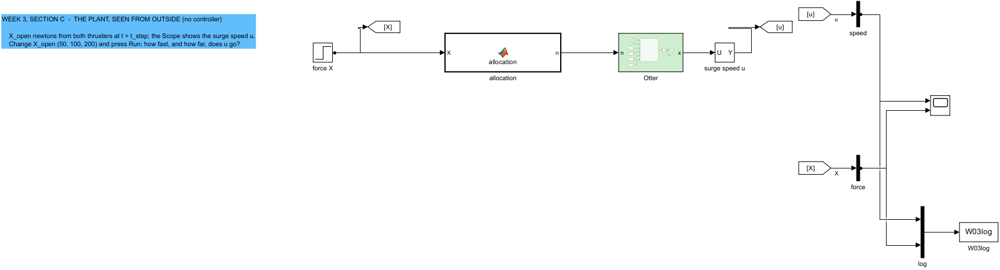

| 그림에서 | 뜻 |
|---|---|
| `force X` | $t = 5$ s 의 계단 힘 `X_open` 뉴턴 |
| `allocation` → `Otter` → `surge speed u` | §3-1 의 플랜트 사슬 |
| Scope | 위: 속도 $u$. 아래: 힘 $X$ |

나오는 출력:

```
  W03 Experiment 3-2  the plant seen from outside (no controller)
    X [N]   final u [m/s]   u per newton [(m/s)/N]   time to 63 % [s]
    50              0.645                  0.01289               1.12
    100             1.289                  0.01289               1.12
    200             2.579                  0.01289               1.12
```

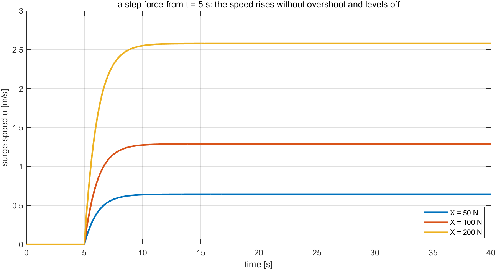

**그림을 네 줄과 대조해 읽기.**

| 볼 곳 | 거기 있는 것 | 어느 줄을 주는가 |
|---|---|---|
| 각 곡선의 **최종 높이** | $0.645$, $1.289$, $2.579$ m/s — 힘과 함께 두 배가 된다 | 1번: 플랜트는 선형이고 이득은 $0.0129$ (m/s)/N |
| 같은 높이를 **거꾸로** 읽기 | $1.5$ m/s 는 두 번째와 세 번째 사이에 놓인다 | 2번: $116$ N 이 $1.5$ m/s 를 유지한다 |
| 모든 곡선의 **모양** | 오버슛 없는 꺾임, 세 힘 모두 같다 | 3번: 1차, 시정수 $1.12$ s |
| 가장 큰 곡선이 **얼마나 더** 올라갈 수 있는가 | $239.36$ N 은 $200$ N 보다 $20\,\%$ 클 뿐이다 | 4번: 천장은 $3.09$ m/s |

**그림이 말하는 것**

- 힘을 두 배로 하면 속도가 두 배가 되고, 모양은 전혀 바뀌지 않는다. 이득 $0.0129$ (m/s)/N, 시정수 $1.12$ s 의 1차 플랜트다.

| 해 볼 것 | 볼 것 |
|---|---|
| `X_open = -100;` Run | 배가 $-1.289$ m/s 로 뒤로 간다. 같은 $0.01289$ (m/s)/N 이다. 선체는 여기서 대칭이고, 뒤로 갈 때 다른 것은 1 뉴턴이 드는 **축 회전수**다. 1주차의 프로펠러 계수 $k$ 가 뒤로 갈 때 더 작기 때문이다 |
| `X_open = 300;` Run | 300 N 을 요구했는데 속도가 $3.086$ m/s 에서 멈춘다. 추력 한계가 명령을 $239.36$ N 에 묶는다 — 4번이다 |

> [!tip] 수업에서
> - **목적** — 현장 기술자가 하듯 플랜트를 배운다. 밀어 보고 지켜본다.
> - **가리킬 곳** — 어느 곡선에도 오버슛이 없다는 것, 세 힘 모두 63 % 지점이 같은 $1.12$ s 라는 것.
> - **질문** — "1.5 m/s 를 유지하려면 힘이 얼마나 드나?" 약 $1.5/0.0129 = 116$ N. 그 수는 실험 3-3b 에서 적분이 멈추는 값으로 다시 나온다.
> - **질문** — "어떤 제어기든 낼 수 있는 가장 빠른 속도는?" $239.36 \times 0.0129 = 3.09$ m/s.
> - **남길 것** — 계단 입력 하나가 이득과 빠르기와 천장을 준다. 튜닝에는 그것으로 충분하다.
## 3-3. 속도 루프에서의 P, I, D

이 절이 답하는 것: 여기서 각 항은 무슨 일을 하고, 왜 그중 하나는 2주차와 다르게 움직이는가?

**무엇이 관측되는가.** 2주차와 같은 세 항을 이 플랜트에 걸면,

- P 만으로는 어떤 게인에서도 오차가 남는다 — $K_p = 50$ 에서 $0.912$ m/s, $K_p = 800$ 에서도 아직 $0.133$ m/s — 그리고 **결코 진동하지 않는다**. 오버슛은 많아야 $0.2\,\%$ 다.
- I 를 더하면 어떤 양의 게인에서나 오차가 닫히고, 적분은 언제나 같은 수에서 멈춘다 — $116.3$ N.
- D 를 더하면 어떤 게인에서나 결과가 **나빠진다**. 오버슛 $0.90 \to 8.28\,\%$, 정착 $1.30 \to 4.86$ s.

셋 중 마지막은 2주차와 반대다. 2주차에서 D 는 처방이었다. 빠진 것 하나가 셋을 전부 설명한다.

**거기서 무엇이 따라 나오는가, 한 줄씩.**

1. **스프링이 없다.** 질량-스프링-댐퍼에서는 플랜트가 어떤 위치로 끌어당겼지만, 전진 방향으로 자유롭게 달리는 배를 어떤 속도로 끌어당기는 것은 없다. 에너지를 한 곳, 그 운동에만 저장한다 — §3-2 의 3번 줄이다.
2. **그래서 P 는 진동할 수 없다.** 진동은 에너지가 두 저장소 사이를 오가는 것이다. 저장소가 하나면 넘길 상대가 없고, 비례 게인은 접근을 빠르게 하는 것밖에 할 수 없다. 오버슛 열이 $0.0\,\%$ 인 이유이고, 튜닝 순서에서 **D 가 감쇠할 것이 없는** 이유다.
3. **그러나 P 는 여전히 오차를 남긴다.** 2주차 §2-6 의 7번 줄 그대로 — 힘이 오차에서만 나오는데 속도를 유지하는 데는 힘이 들기 때문이다(§3-2 의 2번 줄). $K_p = 200$ 에서 배는 $1.081$ m/s 에 정착하고, 거기서 $200 \times 0.419 = 84$ N 은 그 낮아진 속도에서의 항력과 정확히 같다 — $1.081/0.0129 = 84$ N.
4. **적분이 항력을 찾아낸다.** 2주차 §2-8 의 5번 줄로, 적분기는 오차가 0 인 곳에서 멈추므로 명령한 속도를 유지하는 힘에서 멈춘다 — §3-2 의 2번 줄에 따라 $116$ N 이다. 2주차에서 스프링 힘을 두고 한 **같은 논증**이며, 스프링 대신 항력이 들어간 것뿐이다.
5. **여기서 미분은 속도가 아니라 가속도에 작용한다.** 출력이 속도이므로 $\dot e$ 는 가속도이고, 가속도에 저항하는 항은 **부가질량(added mass)** 처럼 작용한다. 배가 둔해지고, 둔한 동안 적분은 계속 충전되고, 결과는 오버슛한다. 항이 바뀐 것이 아니라 축이 바뀐 것이다. 4주차는 위치에 가까운 출력인 선수각으로 돌아가고, 거기서 $K_d$ 는 다시 감쇠한다.
6. **위의 어느 줄도 배의 모델을 쓰지 않았다.** 각 줄은 2주차와 §3-2 의 측정 하나에 기댄다.

| 항 | 질량-스프링-댐퍼에서 (2주차) | 배의 속도에서 (이번 주) | 측정값 |
|---|---|---|---|
| P | 스프링: 빨라지고, 더 진동하고, 오차를 남긴다 | 빨라지고, 오차를 남기고, **진동하지 않는다** — 1차 플랜트에는 함께 진동할 상대가 없다 | 실험 3-3a: $K_p$ 가 $50 \to 800$ 으로 오르는 동안 오차 $0.912 \to 0.133$ m/s, 오버슛은 많아야 $0.2\,\%$ |
| I | 스프링 힘을 찾아내는 참을성 있는 손 | **항력**을 찾아내는 참을성 있는 손 | 실험 3-3b: 모든 적분이 $116.3$ N 에서 멈춘다 — $1.5$ m/s 에서의 항력 |
| D | 위치에 달린 완충기 | **가속도**에 작용한다: 배가 빨라질 때마다 밀어내므로 배가 무거워진 것과 같다 | 실험 3-3b: $K_d$ 가 $0 \to 100$ 으로 오르는 동안 오버슛 $0.90 \to 8.28\,\%$, 정착 $1.30 \to 4.86$ s |

### 실험 3-3a · P 만 (10분)

**무엇을 재는가.** 2번과 3번 줄 — 어떤 게인에서도 남는 오차와, 어떤 게인에서도 없는 진동. 그리고 게인이 있는 추력보다 더 요구하기 시작하면 무엇이 일어나는지.

**모델.** `W03_D_P` — §3-1 의 루프에 $K_i = K_d = 0$.

**열고 돌리기.**

```matlab
W03_0_setup
open_system('W03_D_P')             % Run — 1.081 m/s 에서 멈춘다 / it stops at 1.081 m/s
Kp = 800;                          % Run — 더 가까워지지만 여전히 못 미친다 / closer, still short
W03_D_proportional_only            % 다섯 게인을 한 번에 / all five gains at once
```

나오는 출력:

```
  W03 Experiment 3-3a  P only  (u_d = 1.5 m/s at t = 5 s)
    Kp    final u   error left   overshoot %   rise [s]   settle [s]   time at thrust limit [s]
    50      0.588        0.912           0.0       1.46         2.60                       0.00
    100     0.845        0.655           0.0       1.06         1.86                       0.00
    200     1.081        0.419           0.0       0.70         1.18                       0.12
    400     1.256        0.244           0.1       0.54         0.84                       0.38
    800     1.367        0.133           0.2       0.52         0.72                       0.56
```

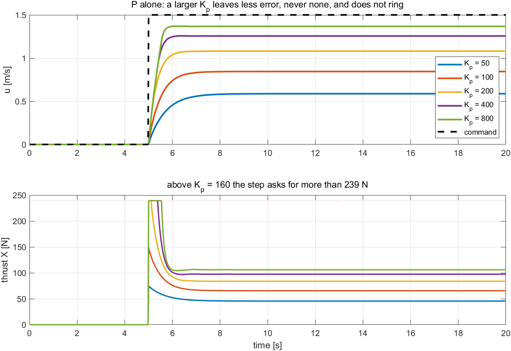

| 그림에서 | 뜻 |
|---|---|
| 위 | $K_p = 50$ 부터 $800$ 까지의 속도와 점선 명령 |
| 아래 | 힘. 붉은 점선은 $239.36$ N 한계 |

**그림을 유도와 대조해 읽기.**

| 볼 곳 | 거기 있는 것 | 어느 줄이 예측했나 |
|---|---|---|
| 위 칸, 점선 명령까지의 **간격** | $0.912 \to 0.133$ m/s, 결코 0 이 아니다 | 3번 줄: 힘은 오차에서 나오고, 속도 유지에는 힘이 든다 |
| 위 칸, **어느 곡선도 오버슛하지 않는다** | 모든 게인에서 $0.0$ ~ $0.2\,\%$ | 2번 줄: 에너지 저장소가 하나, 함께 진동할 상대가 없다 |
| 위 칸, $K_p = 200$ 의 최종 속도 | $1.081$ m/s | 3번 줄을 수로: $200 \times 0.419 = 84$ N, $1.081$ m/s 에서의 항력 |
| 아래 칸, 붉은 선 위의 **납작한 꼭대기** | $K_p = 200$ 부터 나타나고, 게인이 클수록 길어진다 | §3-2 의 4번 줄: 추력 천장. 게인은 더 요구할 수 있지만 프로펠러는 못 준다 |
| 위 칸, 상승시간 $0.70 \to 0.54 \to 0.52$ s | 더 이상 좋아지지 않는다 | 같은 천장: 그 너머의 게인은 한계를 벗어나지 않는 요구에 쓰인다 |

**그림이 말하는 것**

- 게인이 크면 오차가 작아지지만 0 이 되지는 않고, 어떤 게인도 속도를 진동시키지 못한다. $K_p = 200$ 부터는 계단이 추력을 한계까지 밀고, 게인을 더 올려도 속도를 사는 폭이 점점 줄어든다.

| 해 볼 것 | 볼 것 |
|---|---|
| `Kp = 2000;` Run | 오버슛 $0.12\,\%$, 상승시간 $0.56$ s — $K_p = 800$ 보다 **낫지 않다.** 2번 줄은 어떤 게인에서나 성립하고, 천장을 넘으면 게인은 아무것도 사지 못한다 |
| `u_step = 0.5; Kp = 200;` Run | 간격이 $0.140$ m/s 로 줄어든다. 3번 줄을 다시 수로 — $200 \times 0.140 = 28$ N, 도달한 $0.360$ m/s 에서의 항력 |

> [!tip] 수업에서
> - **목적** — 스프링 없는 플랜트에서의 P. 2주차의 오차는 남고, 진동은 남지 않는다.
> - **가리킬 곳** — 오차 열이 줄지만 0 에 닿지 않는 것, 추력이 한계에 닿으면서 상승시간 열이 납작해지는 것($0.70$, $0.54$, $0.52$ s).
> - **질문** — "$K_p = 800$ 에서도 왜 오버슛이 없는가?" 배는 에너지를 운동으로만 저장하고, 그것을 되던질 스프링이 없다.
> - **질문** — "$K_p$ 를 400 에서 800 으로 올려도 상승시간이 왜 거의 안 좋아지는가?" 추진기가 이미 낼 수 있는 전부를 내고 있다. 게인은 더 요구할 수 있지만 배는 내놓을 수 없다.
> - **남길 것** — P 만으로는 항상 속도 오차가 남고, 구동기의 손이 닿지 않는 게인은 낭비다.

### 실험 3-3b · I 를 더하고, D 를 시험한다 (15분)

**무엇을 재는가.** 4번과 5번 줄 — 오차를 닫고 §3-2 의 2번 줄의 항력에서 멈추는 적분, 그리고 축이 속도이기 때문에 모든 수를 나쁘게 만드는 미분.

**모델.** `W03_E_PID` — 전체 루프. 먼저 $K_d = 0$ 으로 두고 $K_i$ 를 올리고, 그 다음 게인을 고정한 채 $K_d$ 를 올린다.

**열고 돌리기.**

```matlab
W03_0_setup
open_system('W03_E_PID')
Ki = 0;                            % Run — 1.081 m/s: 실험 3-3a 그대로 / as in Experiment 3-3a
Ki = 50;                           % Run — 오차는 사라지지만 느리다 / the gap closes, slowly
Ki = 200;                          % Run — 1.30 s 에 정착 / settled in 1.30 s
Kd = 50;                           % Run — 나빠진다 / it gets worse
W03_E_integral_and_derivative      % 두 스윕을 한 번에 / both sweeps at once
```

나오는 출력:

```
  W03 Experiment 3-3b  1) the integral  (Kp = 200, Kd = 0)
    Ki    u at 40 s   overshoot %   settle [s]   I at 40 s [N]
    0        1.0809           0.0          Inf             0.0
    50       1.4995           0.0        13.14           116.2
    100      1.5000           0.0         5.54           116.3
    200      1.5000           0.9         1.30           116.3
    400      1.5000          12.8         2.42           116.3

  2) the derivative  (Kp = 200, Ki = 200)
    Kd    overshoot %   rise [s]   settle [s]
    0            0.90       0.86         1.30
    20           2.60       0.94         2.92
    50           4.97       1.06         3.96
    100          8.28       1.24         4.86
```

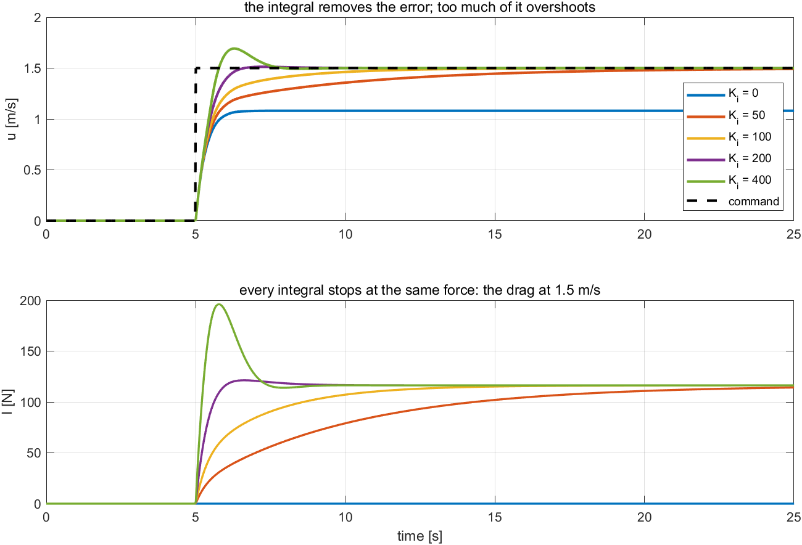

| 그림에서 | 뜻 |
|---|---|
| 위 | $K_p = 200$ 에서 $K_i = 0$ 부터 $400$ 까지의 속도 |
| 아래 | 적분 항. $K_i > 0$ 인 모든 곡선이 같은 힘에서 눕는다 |

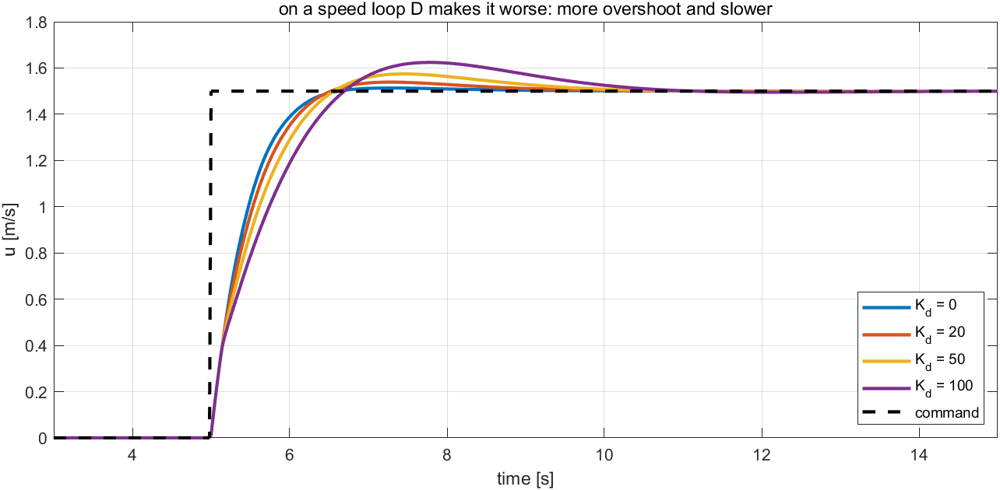

| 그림에서 | 뜻 |
|---|---|
| 곡선들 | $K_p = K_i = 200$ 에서 $K_d = 0, 20, 50, 100$ 의 속도 |

**그림을 유도와 대조해 읽기.**

| 볼 곳 | 거기 있는 것 | 어느 줄이 예측했나 |
|---|---|---|
| 첫 그림 위 칸, $K_i > 0$ 인 모든 곡선 | $1.5000$ m/s 에 닿는다 | 4번 줄: 적분기는 오차가 0 인 곳에서만 멈춘다 |
| 첫 그림 아래 칸, 곡선들이 **눕는 높이** | $116.2$, $116.3$, $116.3$, $116.3$ N — 모든 $K_i$ 에서 같다 | 4번 줄과 §3-2 의 2번 줄: $1.5$ m/s 에서의 항력을, 알려 주지 않았는데 찾아냈다. $K_i$ 는 **얼마나 빨리** 찾는지를 정하고 **어디서** 멈추는지는 정하지 않는다 |
| 첫 그림 위 칸, $K_i = 400$ | 오버슛 $12.8\,\%$ | 2주차 §2-8 의 6번 줄: 적분이 지나치면 늦은 힘이 되고, 늦은 힘은 흔들림과 위상이 맞는다 |
| 둘째 그림, $K_d > 0$ 인 모든 곡선 | 늦은 상승, 더 큰 오버슛, 긴 정착 | 5번 줄: 속도 축에서 미분은 **가속도**에 저항한다 — 부가질량처럼 작용한다 |

**그림이 말하는 것**

- 적분은 어떤 양의 게인에서나 오차를 없애고 $116.3$ N 에서 멈춘다 — 1.5 m/s 에서의 항력을, 알려 주지 않았는데 찾아낸 것이다. 지나치면($K_i = 400$) $12.8\,\%$ 오버슛한다.
- 미분 게인은 어느 값이든 응답을 나쁘게 만든다. 오버슛은 커지고 정착은 길어진다.

| 해 볼 것 | 볼 것 |
|---|---|
| `Ki = 200; Kd = 0; u_step = 2.5;` Run | 적분이 $116.3$ N 이 아니라 $193.9$ N 에서 눕는다. 이것은 $2.5/0.01289$ 다 — 4번 줄은 **명령한** 속도가 드는 힘을 무엇이든 찾아낸다 |
| `Ki = 10; T_final = 120;` Run | 간격은 여전히 닫히지만 $2\,\%$ 안에 드는 것은 $71.8$ s 뒤다. 4번 줄의 적분은 언제나 도착하고, $K_i$ 는 그 인내심일 뿐이다 |

> [!tip] 수업에서
> - **목적** — 이 축에서 달라지는 유일한 항을 보고, 판단을 측정에 맡긴다.
> - **가리킬 곳** — 적분이 116 N 에서 눕는 것 — §3-2 가 개루프에서 예측한 그 수다. 그리고 $K_d$ 가 커질수록 늦게 올라가고 더 오버슛하는 곡선들.
> - **질문** — "2주차에서 미분은 질량을 제동했다. 왜 여기서는 해가 되는가?" 속도 루프의 오차는 가속도와 함께 변하고, 가속도에 저항하는 것은 질량을 더하는 것과 같다. 무거워진 배는 느리고, 적분이 오버슛하게 둔다.
> - **질문** — "'3 s 안에 2 % 이내' 를 만족하는 $K_i$ 는?" $K_i = 200$ — $1.30$ s 다. $100$ 은 $5.54$ s 가 걸리고, $400$ 은 오버슛한다.
> - **남길 것** — 속도 제어기는 PI 이고, D 를 빼는 것은 Scope 가 그렇게 말하기 때문이다.

## 3-4. 추진기에는 한계가 있다: 배 위에서의 와인드업

이 절이 답하는 것: 명령이 추진기가 줄 수 있는 것보다 더 요구하면 무엇이 일어나는가?

**무엇이 관측되는가.** 명령이 $t = 5$ s 에 $3.5$ m/s 를 요구한다 — §3-2 의 4번 줄의 천장 $3.09$ m/s 보다 빠르다 — 그리고 $t = 30$ s 에 닿을 수 있는 $1.5$ m/s 로 내려온다.

- 어떤 실행이든 같은 최고 속도 약 $3.08$ m/s 에 닿는다. 안티와인드업과 무관하다.
- 그러나 안티와인드업이 없으면 배는 그 뒤로 **약 7초 더 그 속도를 유지한** 뒤에야 느려지기 시작한다.
- 그리고 $t = 30$ s 에 적분은 $2747$ N 을 들고 있다 — $239$ N 밖에 못 내는 추진기를 상대로.

**거기서 무엇이 따라 나오는가, 한 줄씩.**

1. 5 s 부터 30 s 까지 추진기는 한계에 앉아 있고, 그래서 오차가 닫힐 수 없다. 배는 낼 수 있는 만큼 빠른데 명령은 아직 그 위에 있다.
2. 적분기는 한계를 모른다. 그 입력은 오차이고 오차는 약 $0.4$ m/s 에 머물러 있으므로 25 s 동안 계속 쌓는다 — 그래서 $2747$ N 이다. 이것이 **와인드업**이고, 2주차 §2-11 의 실험을 배 위에서 한 것이다.
3. 쌓인 힘은 반대 부호의 오차로만, 곧 배가 **명령보다 빠르게** 달려야만 덜어낼 수 있다. 그래서 명령이 내려간 뒤에도 추력은 저장이 소진될 때까지 한계에 머물고, 배는 느려지라는 지시를 무시한다.
4. Back-calculation 은 구동기가 포화인 동안 저장을 흘려 버린다. 적분기는 $K_i\,e + K_b\,(X - u)$ 를 받는데, $u = P + I + D$ 는 요구이고 $X$ 는 실제로 주어진 추력이므로 $X - u$ 는 한계가 잘라낸 바로 그만큼이다. 구동기가 포화가 아니면 0 이고, 그래서 다른 모든 실험에서 이 처방은 보이지 않는다.
5. $K_b$ 는 저장을 얼마나 세게 흘려보낼지 정하고, **크면 좋은 것이 아니다.** 루프에 필요한 것보다 빠르게 빼면 적분이 순항에 드는 항력 아래로 내려가고, 배는 명령에 못 미친다.

아래 실험 3-4 가 잰 값, $K_p = 200$, $K_i = 200$:

| $K_b$ | 30 s 의 $u$ [m/s] | 30 s 의 적분 [N] | $1.5$ m/s 의 2 % 안으로 돌아오는 시간 [s] | 그 뒤 최저 $u$ [m/s] |
|---|---|---|---|---|
| 0 (안티와인드업 없음) | 3.086 | **2747.2** | **11.20** | 1.500 |
| 0.2 | 3.086 | 570.0 | 4.34 | 1.500 |
| 1 | 3.073 | 238.3 | 1.38 | 1.491 |
| 5 | 3.070 | 172.3 | 3.10 | 1.405 |

- 첫 열에서 1번 줄: 어떤 실행이든 같은 최고 속도에 닿는다. 추력과 배가 같기 때문이다. 다른 것은 적분이 **무엇을 기억하는가** 뿐이다.
- 둘째 열에서 2번 줄: $2747$ N 이 쌓였다. 추진기가 줄 수 있는 것의 열한 배다.
- 넷째 열에서 4번 줄: $K_b = 1$ 은 $11.20$ s 가 아니라 $1.38$ s 에 명령한 속도로 돌아온다.
- 마지막 열에서 5번 줄: $K_b = 5$ 에서는 저장을 너무 세게 빼서 배가 $1.405$ m/s 까지 내려간다.

> [!note] 이 쪽에서 기호 $u$ 가 두 번 나온다
> `u = P + I + D` 에서 그것은 제어기의 **요구**이고 모델에서 합산 블록의 이름이다 — 2주차와 같다. 이번 주의 다른 곳에서 $u$ 는 **전진속도**다. 둘이 함께 나오는 곳은 유도의 4번 줄뿐이고, 구별이 필요한 곳도 거기뿐이다.

### 실험 3-4 · 닿을 수 없는 속도와 안티와인드업 (15분)

**무엇을 재는가.** 2번부터 5번 줄까지 — 불가능한 지시 25 s 동안 적분이 얼마나 쌓는지, 그 뒤 가능한 지시를 얼마나 오래 무시하는지, 그리고 각 $K_b$ 가 그것에 대해 무엇을 하는지.

**모델.** `W03_F_windup` — 튜닝된 루프에 §3-2 의 4번 줄의 천장을 넘는 명령을 주고, 그 다음 닿을 수 있는 명령을 준다. Back-calculation 경로는 2주차와 같고, $K_b = 0$ 이 그것을 끈다.

**열고 돌리기.**

```matlab
W03_0_setup
u_step = 3.5; t_step2 = 30; u_step2 = 1.5; T_final = 60;
open_system('W03_F_windup')
Kb = 0;                            % Run — 30 s 뒤에도 속도가 안 준다 / it does not slow after 30 s
Kb = 1;                            % Run — 1.38 s 만에 돌아온다 / back in 1.38 s
W03_F_unreachable_speed            % 네 개의 Kb 를 한 번에 / all four values of Kb
```

나오는 출력:

```
  W03 Experiment 3-4  3.5 m/s from 5 s (unreachable), 1.5 m/s from 30 s
    Kb     u at 30 s   I at 30 s [N]   back within 2 % of 1.5 m/s after [s]   lowest u [m/s]
    0          3.086          2747.2                                   11.20            1.500
    0.2        3.086           570.0                                    4.34            1.500
    1          3.073           238.3                                    1.38            1.491
    5          3.070           172.3                                    3.10            1.405
```

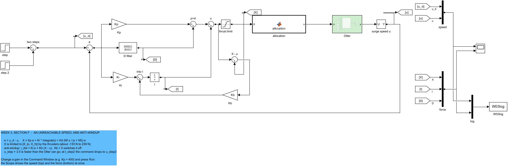

| 그림에서 | 뜻 |
|---|---|
| `step`, `step 2`, `two steps` | 명령: 5 s 에 `u_step`, 그 다음 `t_step2` 에 `u_step2` |
| `X - u`, `Kb`, `into I` 로 돌아가는 선 | Back-calculation: 한계가 잘라낸 힘을 적분기로 되먹여 저장을 흘려보낸다 |

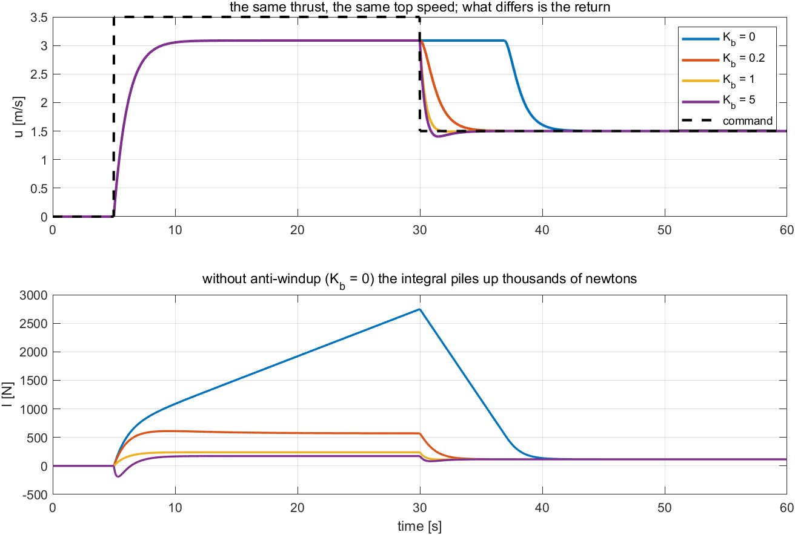

| 그림에서 | 뜻 |
|---|---|
| 위 | 네 개의 $K_b$ 에 대한 속도와 점선 명령 |
| 아래 | 적분 항 |

**그림을 유도와 대조해 읽기.**

| 볼 곳 | 거기 있는 것 | 어느 줄이 예측했나 |
|---|---|---|
| 위 칸, 5 s ~ 30 s: **네 곡선이 한 줄의 평평한 선이다** | 약 $3.08$ m/s | 1번 줄: 추진기가 한계에 앉아 있고, 그 한계는 모든 실행에서 같다 |
| 아래 칸, 5 s ~ 30 s: $K_b = 0$ 곡선이 **꾸준히 올라간다** | $2747$ N 까지 | 2번 줄: 오차가 닫히지 않고, 적분기는 25 s 동안 그것을 더한다 |
| 위 칸, 30 s 뒤: $K_b = 0$ 곡선이 **꼭대기에 머문다** | 약 7초 동안 | 3번 줄: 저장은 명령보다 빠르게 달려야만 소진된다 |
| 아래 칸, 추력이 잘리는 동안 $K_b > 0$ 곡선들이 **꺾여 눕는다** | 30 s 에 $570$, $238$, $172$ N | 4번 줄: $X - u$ 는 한계가 자르는 동안만 0 이 아니고, 그동안 저장을 흘려보낸다 |
| 위 칸, $K_b = 5$ 곡선이 명령 **아래로 내려간다** | $1.405$ m/s 까지 | 5번 줄: 순항에 드는 $116$ N 보다 더 빼냈다 |

**그림이 말하는 것**

- 30 s 까지 네 실행은 하나다. 그 뒤, 안티와인드업이 없는 배는 $2747$ N 의 저장을 쓰면서 약 7초 더 전추력을 유지한다. $K_b = 1$ 이면 $1.38$ s 에 돌아온다.

| 해 볼 것 | 볼 것 |
|---|---|
| `u_step = 2.5;` 로 `Kb = 0`, 그 다음 `Kb = 1` Run | 닿을 수 있는 명령: 적분이 **두 실행 모두** $193.2$ N 을 들고 있고, 이것은 $2.5$ m/s 에서의 항력이다. $K_b$ 는 아무 차이도 만들지 않는다 — 한계가 자르지 않으면 4번 줄은 침묵한다 |
| `t_step2 = 10;` 으로 `Kb = 0` Run | 불가능한 지시가 25 s 가 아니라 5 s: $2747.2$ N 대신 $1085.6$ N 이 쌓이고, 배는 $11.20$ s 대신 $6.00$ s 뒤에 띠 안으로 돌아온다. 피해는 구동기가 **얼마나 오래** 포화였는지와 함께 커진다 |

> [!tip] 수업에서
> - **목적** — 결과가 따라오는 자리에서 와인드업을 본다. 무시된, 느려지라는 지시다.
> - **가리킬 곳** — 속도가 평평한 5 s ~ 30 s 동안 파란 적분이 꾸준히 올라가는 것. 그리고 30 s 뒤의 평평한 파란 속도.
> - **질문** — "속도가 변하지 않는데 적분은 왜 계속 커지는가?" 오차 $3.5 - 3.09$ 가 결코 닫히지 않고, 적분은 25 s 동안 그것을 더한다.
> - **질문** — "$K_b = 5$ 가 왜 $K_b = 1$ 보다 나쁜가?" 1.5 m/s 에 필요한 $116$ N 아래로 적분을 빼내고, 배가 $1.405$ m/s 까지 내려간다.
> - **남길 것** — 실물 구동기가 달린 모든 루프에는 안티와인드업이 필요하고, 적당한 $K_b$ 로 충분하다.

## 3-5. 튜닝 순서를, 배에 적용한다

이 절이 답하는 것: 모델 없이, 이 플랜트에 대해 세 게인을 어떻게 고르는가?

절차는 2주차 §2-12 를 한 단계씩 따른 것이다. 요구사항: 계단 뒤 3 s 안에 $1.5$ m/s 의 2 % 이내, 오버슛 5 % 이하, 추력은 $[-133.42,\ 239.36]$ N 안.

| 단계 | 하는 일 | 측정한 것 | 결정 |
|---|---|---|---|
| 0 | 요구사항을 적는다. 플랜트가 얌전한지 본다 | §3-2: 안정, 1차, 지연 없음 | 진행 |
| 1 | P 만. $K_p$ 의 자리수를 단위에서 고른다 | 플랜트는 1.5 m/s 에서 약 116 N 이 들므로 $K_p$ 는 m/s 당 100 N 자리수다. $K_p = 239.36/1.5 = 160$ 을 넘으면 계단이 이미 전추력을 요구한다 | $K_p = 200$ 에서 시작 |
| 2 | P 응답을 읽는다 | 오버슛 $0.0\,\%$, 상승 $0.70$ s, 남은 오차 $0.419$ m/s. $K_p$ 를 400 이나 800 으로 올려도 상승이 거의 안 빨라진다($0.54$, $0.52$ s) — 추력이 이미 한계에 있기 때문이다 | $K_p = 200$ 유지 |
| 3 | P 응답이 진동하면 D 를 더한다 | 진동하지 않는다. 실험 3-3b 는 D 가 오버슛만 더한다는 것을 보였다 | $K_d = 0$ |
| 4 | 시간 안에 띠에 들 때까지 I 를 더한다 | $K_i = 50$: 13.34 s, $100$: 5.70 s, $200$: 오버슛 $0.6\,\%$ 로 1.40 s | $K_i = 200$ |
| 5 | 추력을 본다 | 계단에서 추력이 $0.20$ s 동안 한계에 앉는다. 안티와인드업($K_b = 1$)이 있으면 무해하다. 명령을 $1/(s + 1)$ 로 부드럽게 하면 $119.4$ N 에 머무는 대신 정착이 $4.24$ s 가 된다 | 계단 명령 유지, $K_b = 1$ |

결과는 $K_p = 200$, $K_i = 200$, $K_d = 0$, $K_b = 1$ — 오버슛 $0.56\,\%$, $1.40$ s 뒤 2 % 이내다. `W03_0_setup.m` 의 기본값이 이것이다. 이것을 찾는 데 배의 전달함수는 한 번도 적지 않았다.

> [!note] 모델이 없다는 것이 이론이 없다는 뜻은 아니다
> 이 튜닝은 이론에서 배운 둘을 썼다. 각 항이 무슨 일을 하는가(2주차), 그리고 언제 멈출지 말해 주는 시간영역 지표(2주차 §2-4). 쓰지 않은 것은 **이** 플랜트의 모델이다. 현장에서 튜닝되는 제어기 대부분이 이 상황에 있고, 튜닝 순서가 존재하는 이유가 그것이다.

### 실험 3-5 · 튜닝 순서, 한 단계씩 (15분)

**무엇을 재는가.** 위 표의 다섯 단계를 순서대로, 각 결정을 그것을 끌어낸 측정과 함께 찍는다. 그리고 응답만으로는 결코 보이지 않는 5단계, 추력.

**모델.** `W03_G_tuning` — 튜닝된 루프에, 계단 명령을 부드러운 것으로 바꾸는 스위치(`ref_filter`)가 달려 있다.

**열고 돌리기.**

```matlab
W03_0_setup
open_system('W03_G_tuning')        % Run — 0.56 % 오버슛, 1.40 s / the tuned result
ref_filter = 1;                    % Run — 추력은 낮아지고 정착은 늦어진다 / less thrust, later
W03_G_tuning_by_hand               % 단계마다의 근거를 찍는다 / prints the reason for each step
```

나오는 출력:

```
  W03 Experiment 3-5  the tuning order on the Otter
    1-2  Kp = 200: overshoot 0.0 %, rise 0.70 s, error left 0.419 m/s
    3    no ringing, so nothing for D to damp: Kd = 0 (Exp 3-3b: D only adds overshoot)
    4    Ki = 50: 13.34 s (0.0 %)   100: 5.70 s (0.0 %)   200: 1.40 s (0.6 %)   -> Ki = 200
    5    force: 239.4 N, on the thrust limit for 0.20 s (anti-windup on); smoothed command: 119.4 N, settle 4.24 s
         final: Kp = 200, Ki = 200, Kd = 0, Kb = 1: overshoot 0.56 %, inside 2 % after 1.40 s
```

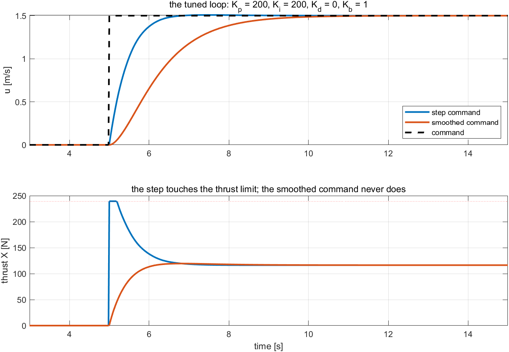

| 그림에서 | 뜻 |
|---|---|
| 위 | 계단 명령과 $1/(s+1)$ 로 부드럽게 한 명령에 대한 속도 |
| 아래 | 추력. 붉은 점선이 한계 |

**그림이 말하는 것**

- 튜닝된 루프는 요구사항을 여유 있게 만족한다. 계단은 5분의 1초 동안 추력 한계에 닿고, 부드러운 명령은 결코 닿지 않으며 그 대가로 늦게 도착한다.

> [!tip] 수업에서
> - **목적** — 전체 절차를 배 위에서 돌려 한 주를 닫고, 2주차와 비교한다. 같은 단계, 다른 결정 — 플랜트가 다르기 때문이다.
> - **가리킬 곳** — 여기서는 건너뛰고 2주차에서는 필요했던 3단계. 그리고 요구사항을 만족할 때까지만 $K_i$ 를 올리는 4단계.
> - **질문** — "같은 게인인데 여기서는 정착이 1.40 s, 실험 3-3b 에서는 1.30 s 였다. 왜인가?" 이 모델은 안티와인드업이 켜져 있고 계단이 한계에 닿는다. Back-calculation 이 첫 1초를 조금 바꾼다. 둘 다 요구사항을 만족한다.
> - **질문** — "부드러운 명령이 옳은 선택이 되는 때는?" 추력이 한계 아래에 머물러야 할 때 — 전력을 아끼려 할 때, 캐비테이션을 피하려 할 때, 또는 승객이 충격을 느끼기 때문에.
> - **남길 것** — 요구사항, P, 진동하면 D, 띠를 만족할 때까지 I, 그 다음 구동기. 어느 플랜트에서나 같은 순서다.

---
## 3-6. 힘은 실제로 어디로 가는가: 프로펠러 둘, 두 단계

**무엇이 관측되는가.** 지금까지의 모든 실험은 $X$ 라는 수에서 끝났다 — 뉴턴 단위의 전진력이고, `speed loop` 블록이 만들어 Scope 아래 칸에 그려진 것이다. 그런데 Otter 에는 뉴턴을 받는 구동기가 없다. **프로펠러가 둘** 있고, 각각이 받는 것은 rad/s 단위의 축 회전수다. 제어기와 배 사이에서 무엇인가가 하나를 다른 하나로 바꾸고 있고, 그 무엇인가는 이번 주 모든 모델에서 `allocation` 이라는 이름으로 돌고 있었다.

**결과.** 그것은 두 가지를 이 순서로 하고, 둘은 종류가 다르다.

| | 단계 | 무엇인가 |
|---|---|---|
| 1 | $(X, N) \to (F_L, F_R)$ | **선형**이고 정확히 역을 가진다 — $2\times2$ 행렬 |
| 2 | $F \to n$, 각 축마다 따로 | **비선형** — 제곱법칙 곡선을 거꾸로 읽는다 |

이번 주에는 $N = 0$ 이다. 아직 배에게 돌라고 요구한 것이 없다. 그래서 1단계는 "각자 절반" 으로 줄어든다. 4주차가 빠진 $N$ 을 공급하면 전체 행렬이 제 몫을 한다. 구조를 지금 적어 두는 것은 두 번 소개하지 않기 위해서다.


| 다이어그램에서 | 무엇인가 | 어느 주차 |
|---|---|---|
| 위쪽 줄, `speed loop` | §3-3 의 PI 와 §3-4 의 안티와인드업. $X$ 를 만든다 | **이번 주** |
| 아래쪽 줄, `heading autopilot` | $N$ 을 만드는 PD. 자기 오차와 자기 되먹임을 가진다 | 4주차 |
| `allocation` | 이 절의 두 단계 | 이번 주, $N = 0$ 으로 |
| `Otter` | 1주차의 운동방정식 | 1주차 |
| 왼쪽 점선 상자 | 경로가 생기면 $u_d$ 와 $\psi_d$ 가 오는 곳 | 5주차 |
| 아래쪽 되먹임 버스 | 상태 벡터. 각 루프는 자기에게 필요한 한둘만 읽는다 | — |

- 두 제어기는 서로 말을 하지 않는다. **배분기에서만** 만나고, 그 상호작용의 전부는 프로펠러 둘을 나눠 쓰는 것이다.

**유도.**

1. **프로펠러 둘이 만들 수 있는 두 힘.** 선체 $x$ 가 앞이고 선체 $y$ 가 우현이므로, 좌현 프로펠러는 $y = -b$, 우현 프로펠러는 $y = +b$ 에 있다. $b$ 는 두 폰툰 간격의 절반이다. 두 추력은 모두 $x$ 를 따라 작용한다. $y$ 에 걸린 힘 $F$ 는 요 모멘트 $-yF$ 를 만들므로,

$$
X = F_L + F_R, \qquad N = b\,(F_L - F_R)
$$

| 기호 | 양 | 값 · 출처 |
|---|---|---|
| $F_L, F_R$ | 좌현·우현 프로펠러의 추력 | N |
| $b$ | 폰툰 간격의 절반 | $0.3950$ m, `otter.m` |
| $X$ | 전진력, `speed loop` 의 출력 | N |
| $N$ | 요 모멘트, 이번 주에는 0 | N·m |

   횡방향 힘까지 넣어 셋을 함께 쓰면,

$$
\begin{bmatrix} X \\ Y \\ N \end{bmatrix}
= \begin{bmatrix} F_L + F_R \\ 0 \\ b\,(F_L - F_R) \end{bmatrix}
$$


| 그림에서 | 뜻 |
|---|---|
| 위에서 본 선체 | 두 프로펠러가 앞을 향해 고정되어 양쪽에 하나씩, 중심선에서 $b$ 만큼 |
| 붉은 화살표 $F_L$, $F_R$ | 두 프로펠러가 만드는 것 |
| 청록 화살표 $X$, $N$ | **배가** 받는 것 — 합, 그리고 차가 만드는 회전 모멘트 |
| 1행 | 그림에서 읽어낸 그 셋 |
| 2행 | 빈 줄을 지우고 남은 정사각 $\mathbf{T}$ |
| 3행 | $\mathbf{T}$ 의 역. `allocation` 블록이 계산하는 것이 이것이다 |

**그림을 유도와 대조해 읽기.**

| 볼 곳 | 거기 있는 것 | 무엇을 말하나 |
|---|---|---|
| 두 붉은 화살표가 같은 쪽을 가리킨다 | 프로펠러가 앞을 향해 **고정**되어 있다 | 첫 줄이 $F_L + F_R$ 인 이유. 전진은 그냥 더해진다 |
| 1행의 가운데 성분 | 정확히 $0$ | 이 선체는 어떤 추력 쌍으로도 **옆으로 밀릴 수 없다.** 4·5주차가 움직이기 위해 배를 돌리는 이유가 이 줄이다 |
| $b$ 로 표시된 두 팔 | 같고, 반대쪽에 있다 | 셋째 줄이 빼는 이유. 같은 추력은 모멘트를 만들지 않고, 차이가 만든다 |
| 2행, 중괄호 아래 | $\mathbf{T}$ 에는 $1$ 과 $b$ 만 있다 | 이 행렬은 **기하**다. 속도도, 게인도, 제어기가 무엇을 하고 있는지도 들어 있지 않다 |
| 3행, "known" | 프로펠러를 볼트로 박는 순간 $\mathbf{T}^{-1}$ 이 정해진다 | 배분기는 실행 중에 아무것도 풀지 않는다. 상수 행렬을 곱할 뿐이다 |
| 3행, "what the two controllers asked for" | $(X, N)$ 은 밖에서 온다 | 배분기는 그 요구가 타당한지에 대해 의견이 없다. 그것을 판단하는 자리는 §3-4 의 한계다 |

> [!note] 이것이 어디서 오고, 어디서 증명되는가
> 그림에서 힘들이 저런 모양으로 읽히는 것은 이 선체만의 우연이 아니다. $(x_i, y_i)$ 에서 단위벡터 $\mathbf{e}_i$ 를 따라 미는 추진기 하나는 정확히 열 하나, $\mathbf{b}_i = [\,e_x\ \ e_y\ \ x_i e_y - y_i e_x\,]^\top$ 를 보탠다 — **열 규칙(column rule)** 이고, 부록 A1 §A1-2 에서 유도해 그림과 대조하며, 1주차의 `w01-otter-layout` 그림에서 이 선체에 적용한다. `_tools/otter_B.m` 이 그것을 계산해 $[\,1\ 1;\ 0\ 0;\ b\ {-b}\,]$ 를, 차이 0 으로 같은 행렬을 돌려준다. 이 강의에서 $\mathbf{B}$ 를 손으로 베껴 쓰는 곳은 없다.

2. **빈 줄을 지우면 정사각 연립이 남는다.** 남은 둘을 쌓으면,

$$
\begin{bmatrix} X \\ N \end{bmatrix}
= \underbrace{\begin{bmatrix} 1 & 1 \\ b & -b \end{bmatrix}}_{\mathbf{T}}
  \begin{bmatrix} F_L \\ F_R \end{bmatrix},
\qquad
\det \mathbf{T} = -2b \neq 0
$$

   행렬식이 0 이 아니므로 $\mathbf{T}$ 는 역을 가지고 **분배가 유일하다.** 요구된 $(X, N)$ 을 만드는 추력 쌍이 정확히 하나이고, 고를 것이 남지 않는다. 구동기 둘, 제어할 것 둘이다. 역을 취하면,

$$
\begin{bmatrix} F_L \\ F_R \end{bmatrix}
= \mathbf{T}^{-1}\begin{bmatrix} X \\ N \end{bmatrix}
= \begin{bmatrix} \tfrac12 & \tfrac{1}{2b} \\[2pt] \tfrac12 & -\tfrac{1}{2b} \end{bmatrix}
  \begin{bmatrix} X \\ N \end{bmatrix}
\qquad\Longrightarrow\qquad
F_{L,R} = \frac{X}{2} \pm \frac{N}{2b}
$$

   말로 하면 **프로펠러 하나가 전진력의 절반을 지고, 모멘트는 한쪽에 더하고 다른 쪽에서 뺀다.** 이번 주는 $N = 0$ 이므로 둘 다 $X/2$ 를 받는다 — `allocation` 블록이 하는 일이 정확히 이것이고, §3-1 의 표가 그것을 한 줄로 쓸 수 있었던 이유다.

3. **추력에서 축 회전수로.** 프로펠러의 추력은 축 회전수의 제곱으로 가고, 뒤로 갈 때는 날개가 거꾸로 돌기 때문에 계수가 다르다.

$$
F = \begin{cases} k_{pos}\, n\lvert n\rvert, & n \ge 0\\[2pt] k_{neg}\, n\lvert n\rvert, & n < 0\end{cases}
\qquad\Longrightarrow\qquad
n = \begin{cases} +\sqrt{F/k_{pos}}, & F \ge 0\\[2pt] -\sqrt{\lvert F\rvert/k_{neg}}, & F < 0\end{cases}
$$

   $n^2$ 이 아니라 $n\lvert n\rvert$ 로 쓰는 것이 곡선을 원점을 지나게 하면서 양쪽에서 부호를 맞게 만든다. $n^2$ 으로 쓰면 역전하는 프로펠러가 배를 앞으로 밀게 된다.

| 기호 | 양 | 값 · 출처 |
|---|---|---|
| $k_{pos}$ | 추력계수, 전진 | (rad/s)² 당 $0.011080$ N, `otter.m` |
| $k_{neg}$ | 추력계수, 후진 | (rad/s)² 당 $0.006445$ N, `otter.m` |
| $n_{\max}, n_{\min}$ | 축 회전수 한계 | $+103.9$, $-101.7$ rad/s |
| $F_{\max}, F_{\min}$ | 그 한계가 닿는 추력 | $+119.7$, $-66.7$ N |

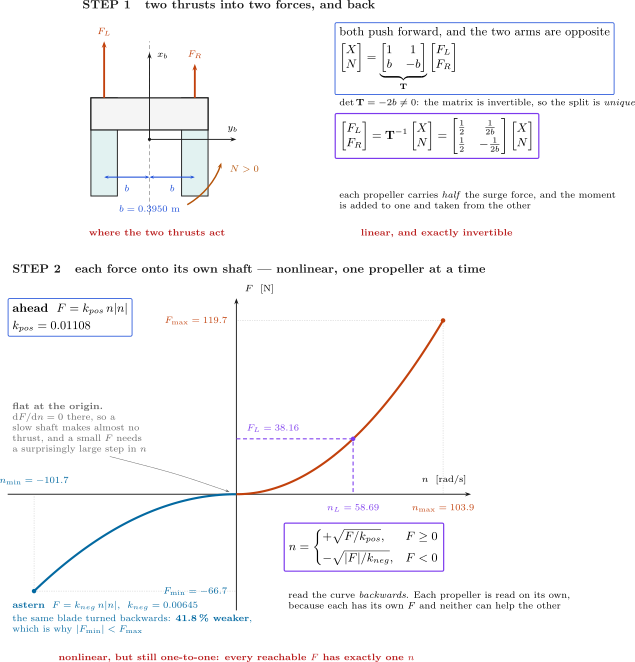

| 그림에서 | 뜻 |
|---|---|
| 왼쪽 위 | 두 추력이 작용하는 자리, 그리고 그 차이를 모멘트로 바꾸는 지레 $b$ |
| 오른쪽 위 | 2번 줄의 행렬과 그 역 |
| 아래, 주황 가지 | 전진: $F = k_{pos}n\lvert n\rvert$ |
| 아래, 파란 가지 | 후진: 같은 날개를 거꾸로. 눈에 보이게 더 완만하다 |
| 아래, 보라 점선 | 곡선에서 읽어낸 역산: $F_L = 38.16$ N 은 $n_L = 58.69$ rad/s 에서 닿는다 |

**그림을 유도와 대조해 읽기.**

| 볼 곳 | 거기 있는 것 | 어느 줄을 정하나 |
|---|---|---|
| 왼쪽 위, 위로 향한 두 화살표 | 두 추력 모두 $+x$ 를 따라 작용한다 | 1번 줄: $\mathbf{T}$ 의 첫 줄이 $[\,1\ \ 1\,]$ 인 이유 |
| $b$ 로 표시된 두 팔 | 같고 중심선 반대쪽에 있다 | 1번 줄: 둘째 줄이 부호가 반대인 $[\,b\ \ {-b}\,]$ 인 이유 |
| 오른쪽 위의 $\mathbf{T}^{-1}$ | 첫 열의 두 줄 모두 $\tfrac12$ | 2번 줄: 모멘트가 무엇을 하든 전진력은 각자 절반 |
| 원점에서의 곡선 | **납작하다** — 거기서 $\mathrm{d}F/\mathrm{d}n = 0$ | 3번 줄: 0 근처에서는 $n$ 을 크게 바꿔도 추력이 거의 안 늘어난다. 프로펠러가 저속에서 나쁜 구동기인 이유다 |
| 두 가지를 비교하면 | 같은 축 회전수에서 후진이 $41.8\,\%$ 약하다 | 3번 줄: $k_{neg} < k_{pos}$ 이므로 $\lvert F_{\min}\rvert = 66.7 < 119.7 = F_{\max}$ |
| 표시된 점들 | $(103.9,\ 119.7)$ 과 $(-101.7,\ -66.7)$ | 한계. 이 범위 밖은 배가 만들 수 없는 힘이고, §3-4 의 와인드업이 그 결과다 |
| 보라색 읽기 | $58.69$ rad/s 에서 $38.16$ N | $\sqrt{38.16/0.011080} = 58.69$ — 역을 계산한 것 |

**같은 두 단계를, 모델 안에서**

그림은 블록 하나를 그린 것이다. 아래는 그 블록이 실제로 들고 있는 코드이고, `W03_F_windup.slx` 에서 그대로 복사한 것이다. 이번 주 어느 모델에서든 `allocation` 을 두 번 누르면 정확히 이 글이 보인다. 주석은 블록 자신의 것이다.

```matlab
function n = allocation(X, k_pos, k_neg)
%#codegen
%ALLOCATION  전진력 X [N] 를 두 프로펠러의 축 회전수 n [rad/s] 로 바꾼다.
%            Turn the surge force X [N] into the shaft speeds n [rad/s] of the two propellers.
%
%   k_pos, k_neg 는 작업공간 변수 (W03_0_setup) 에서 온다 — 블록의 포트가 아니다.
%   k_pos and k_neg come from the workspace (W03_0_setup), not from ports.

% 1) 똑바로 갈 때 두 프로펠러는 같은 일을 한다: 각자 X 의 절반.
%    Going straight, both propellers do the same work: half of X each.
T = X/2;

% 2) 프로펠러 곡선 T = k n|n| (1주차) 을 n 에 대해 푼다.
%    앞으로 밀 때와 뒤로 당길 때 계수가 다르다 (k_pos > k_neg).
%    Solve the propeller curve T = k n|n| (Week 1) for n; the coefficient
%    differs ahead and astern (k_pos > k_neg).
if T >= 0
    n1 =  sqrt( T / k_pos);      % 앞으로 / ahead
else
    n1 = -sqrt(-T / k_neg);      % 뒤로 / astern
end

% 3) 두 축에 같은 회전수. Otter 는 [좌현; 우현] 순서로 받는다.
%    The same speed on both shafts; the Otter takes [port; starboard].
n = [n1; n1];
end
```

| 코드에서 | 그림에서 | 비고 |
|---|---|---|
| `T = X/2;` | $\mathbf{T}^{-1}$ 두 줄의 $\tfrac12$, STEP 1 | $N = 0$ 이면 행렬 전체가 이 한 줄로 줄어든다. 4주차가 둘째 열을 되살린다 |
| `if T >= 0` 가지 | STEP 2 의 주황 가지 | $n = +\sqrt{F/k_{pos}}$ |
| `else` 가지 | STEP 2 의 파란 가지 | $n = -\sqrt{\lvert F\rvert/k_{neg}}$ 이고, 마이너스 부호가 역전하는 프로펠러를 뒤로 당기게 유지한다 |
| `n = [n1; n1];` | STEP 1 의 같은 화살표 둘 | Otter 의 입력은 `[좌현; 우현]`, 그 순서다 |
| 인자로 들어온 `k_pos`, `k_neg` | 그림의 $k_{pos} = 0.01108$, $k_{neg} = 0.00645$ | 신호가 아니라 작업공간 변수다. `W03_0_setup` 에서 바꾸면 도면을 건드리지 않고 곡선이 바뀐다 |

이 블록에는 $n$ 에 대한 제한이 없다. 여기서는 필요하지 않다. `otter.m` 이 내부에서 제한하고(167–170행), 이번 주는 $n$ 을 기록하지 않기 때문이다. 5주차 §5-7 이 그것을 기록하는 주차를 위해 제한을 더한다.

**그림이 말하는 것**

- 배분기는 하나의 연산이 아니라 둘이고, 그중 첫째만 선형이다. §3-4 의 한계는 둘째에 산다.

> [!note] 역이 애초에 존재하는 이유와, 존재하지 않게 되는 때
> 프로펠러 둘, 요구된 양 둘, 정사각이고 비특이인 $\mathbf{T}$ — 역은 정확하고 유일하다. 그것이 쉬운 경우이고, 3주차부터 5주차까지의 모든 배에서 성립한다. 7주차가 그것을 없앤다. 요구된 힘보다 추진기가 많으면 행렬이 더 이상 정사각이 아니고, 역이 없으며, 어느 조합을 쓸지 고르는 일이 한 주차의 주제가 된다.

**이 절의 모든 수를 확인하려면**

```matlab
cd _tools
verify_w03_speed        % check 2 is the thrust range, check 5 the inversion
```

여기서 중요한 두 줄의 실제 출력:

```
    2 thrust limits [-133.42, 239.36] N          OK    [-133.42, 239.36]
    5 allocation inverts T = k n|n|              OK    1.4e-14 N
```

- 검사 5 는 추력을 $n(F)$ 로 보내고 다시 $F(n)$ 으로 되돌려 비교한다. 둘이 $1.4\times10^{-14}$ N 까지 일치하므로 역산은 근사가 아니라 기계 정밀도까지 정확하다.
- 검사 2 의 한계는 $2F_{\max}$ 와 $2F_{\min}$ 의 **쌍**, 곧 두 프로펠러를 합친 것이다. 그것이 배가 만들 수 있는 전진력이고, 따라서 §3-4 의 적분기가 부딪치는 포화다.

| 해 볼 것 | 볼 것 |
|---|---|
| `k_neg = k_pos;` 로 두고 `W03_F_unreachable_speed` 재실행 | 후진 가지가 전진 가지의 거울상이 되고, 배가 가속하는 만큼 세게 제동할 수 있다. 그것은 Otter 가 아니지만, 비대칭이 무엇을 비용으로 치르는지 보여 준다 |
| `W03_F_windup` 에서 `allocation` 을 두 번 누르기 | 이 절의 두 단계가 주석 달린 아홉 줄로. $N = 0$ 이 그것을 $X/2$ 로 만들기 때문에 행렬은 적혀 있지 않다 |

> [!tip] 수업에서
> - **목적** — "제어기가 100 N 을 요구한다" 와 "프로펠러가 67 rad/s 로 돈다" 사이의 틈을 닫는다.
> - **가리킬 곳** — 곡선 원점의 납작한 자리. 제자리를 유지하는 배에게 그것이 무슨 뜻인지 물어본다.
> - **질문** — "제어기가 $-80$ N 을 요구한다. 무엇이 일어나는가?" 후진 가지가 거기에 닿을 수 없다. 프로펠러당 $F_{\min} = -66.7$ N 이므로 요구가 잘리고, §3-4 의 안티와인드업이 제 몫을 한다.
> - **질문** — "그냥 2 로 나누지 않고 왜 행렬의 역을 쓰는가?" 4주차가 $N$ 을 더하면 두 프로펠러가 같지 않게 되기 때문이다. 지금 역을 써 두면 다음 주에 바뀌는 것은 $N$ 이 0 이 아니게 되는 것뿐이다.
> - **남길 것** — 제어기는 힘을 만들고, 배분기는 구동기 명령을 만든다. 둘은 같은 것이 아니고, 그 차이가 한계가 사는 자리다.

---

# Part 2 · 실습 실행 순서

Part 1 의 실험들을 순서대로 따라간 것이다. 이 표는 무엇을 돌렸는지의 색인이고, 집에서 그 주차를 되짚을 때 쓴다.

예제마다 **자기 모델**이 있고, 모든 모델은 2주차와 같은 모양이다. 제어기가 왼쪽, 배가 가운데, **Scope 하나**가 오른쪽에 있고 위에 속도, 아래에 힘이 있다. 모델을 열고 **Run** 을 누르면 Scope 가 응답을 보여 준다. Command Window 에서 게인을 바꾸고 다시 Run 을 누른다.

| 실험 | 모델 | 스크립트 | 무엇을 보이나 |
|---|---|---|---|
| 3-0 | 전부 | `W03_0_setup`, `W03_1_build_speed` | 파라미터, 그리고 코드로 쓰인 모든 모델 |
| 3-1 | `W03_E_PID` | — | 스프링 대신 배가 들어간 2주차 캔버스 |
| 3-2 | `W03_C_open_loop` | `W03_C_plant_from_outside` | 계단 힘, 제어기 없음 |
| 3-3a | `W03_D_P` | `W03_D_proportional_only` | P 만 |
| 3-3b | `W03_E_PID` | `W03_E_integral_and_derivative` | P + I, 그 다음 D |
| 3-4 | `W03_F_windup` | `W03_F_unreachable_speed` | 닿을 수 없는 속도, 그 다음 닿을 수 있는 속도 |
| 3-5 | `W03_G_tuning` | `W03_G_tuning_by_hand` | 튜닝된 루프, 부드러운 명령으로 가는 스위치 포함 |
| 3-6 | 아무 것이나 | `verify_w03_speed` | 배분기: 행렬, 그 역, 그리고 프로펠러 곡선 |

- 스크립트는 Run 이 이미 보여 주는 것을 여러 게인에 대해 한꺼번에 되풀이하고, Part 1 이 인용한 수치를 찍는다.
- 각 실험은 **수업에서** 노트로 끝난다 — 목적, 가리킬 곳, 질문과 그 답, 그리고 남길 한 문장.

---

# 정리

## 주차 정리

| 단계 | 한 일 | 어떻게 검증했나 |
|---|---|---|
| 1 | 2주차 제어기를 Otter 의 전진속도 둘레에 놓았다 | 모델이 2주차와 다른 곳은 플랜트 사슬뿐이다. `check_overlaps` 0 |
| 2 | 플랜트를 바깥에서 쟀다 | 실험 3-2: 모든 힘에서 $0.01289$ (m/s)/N, 63 % 까지 $1.12$ s, 천장 $3.09$ m/s |
| 3 | P 만 | 실험 3-3a: 오차는 결코 0 이 아니다. 진동하지 않는다. 추력 한계를 넘는 게인은 낭비다 |
| 4 | I 가 항력을 찾고, D 는 해가 된다 | 실험 3-3b: 모든 $K_i$ 에서 적분 $116.3$ N, $K_d$ 와 함께 오버슛 $0.90 \to 8.28\,\%$ |
| 5 | 배 위에서의 와인드업 | 실험 3-4: $2747$ N 이 쌓이고 안티와인드업 없이 복귀에 $11.20$ s. $K_b = 1$ 이면 $1.38$ s |
| 6 | 튜닝 순서 | 실험 3-5: $K_p = 200$, $K_i = 200$, $K_d = 0$, $K_b = 1$. 오버슛 $0.56\,\%$, $1.40$ s 에 정착 |

## 진도 점검

> [!important] 4주차를 따라가기 위한 최소 조건

### 이론

- [ ] 계단 입력 하나가 배에 대해 준 세 가지 사실과, 1.5 m/s 를 유지하는 데 드는 힘을 말할 수 있다.
- [ ] 이 플랜트에서 P 가 진동하지 않는 이유와 D 가 더 나쁘게 만드는 이유를 설명할 수 있다.
- [ ] 닿을 수 없는 명령 동안 적분이 무엇을 기억하는지, $K_b$ 가 그것에 무엇을 하는지 설명할 수 있다.

### 실습

- [ ] `W03_1_build_speed` 가 돌았고 모든 모델이 `overlapping lines: 0` 을 보고했다.
- [ ] Command Window 에서 게인을 바꾸었고 모델의 Scope 가 새 응답을 보였다.
- [ ] `W03_P1_start` 로 만든 모델에서 `W03_check(1)`, `(2)`, `(3)` 이 통과한다.

### 기록한 관측

- [ ] 실험 3-3b 에서 적분이 정착한 힘, 그리고 같은 수가 실험 3-2 의 어디에 나왔는지.
- [ ] 실험 3-4 에서 안티와인드업이 있을 때와 없을 때 1.5 m/s 로 돌아오는 시간.

---

## 수업 실습 — 속도 루프를 손으로 닫는다

3주차 수업의 두 번째 시간은 배만 들어 있는 모델에서 루프를 Simulink 로 만드는 데 쓴다. 문제 셋, 한 시간, 그리고 결과를 위에서 잰 수치와 대조하는 체커.

```matlab
cd lectures/W03_simulink/problems
W03_P1_start                 % creates W03_P1.slx — hull and thrust map only
W03_check(1)                 % run this whenever, as often as needed
```

| | 문제 | 시간 | 재현해야 하는 수 |
|---|---|---|---|
| 1 | 개루프 — 일정한 힘을 넣고 로그를 뽑는다 | 20분 | 50, 100, 200 N 에 대해 $0.6447$, $1.2894$, $2.5788$ m/s |
| 2 | 비례 제어 — 그리고 닫히지 않는 오차 | 20분 | $u_d = 1.5$ 에 대해 $K_p = 100$ 에서 $0.8448$ m/s |
| 3 | 적분을 더한다 — §3-5 의 튜닝된 게인 | 20분 | 오차 없이 $1.5$ m/s, 오버슛 5 % 이하 |

- 문제지는 [`W03_simulink/problems/README.md`](W03_simulink/problems/README.md) 이고, 모범답안은 [`W03_simulink/solutions/`](W03_simulink/solutions/README.md) 에 있다.

---

## 과제 3

- **기한**: 4주차 수업 전
- **제출물**: 수정한 `W03_0_setup.m`, 아래에서 요구하는 수치, 그리고 그림 둘

### ① 요구사항

`W03_0_setup.m` 과 `W03_vars.m` 에서 적재를 두 배로, `mp = 50` kg 으로 바꾸고, §3-5 의 튜닝 순서로 속도 루프를 다시 튜닝한다. 요구사항은 $2.0$ m/s 의 2 % 안에 3 s 이내, 오버슛 5 % 이하, 안티와인드업 켬.

### ② 검증 — 필수

> [!important] 주장은 결과가 아니다. 수치가 필요하고, 허용 범위를 함께 적는다

1. 새 적재로 실험 3-2 를 되풀이해 뉴턴당 속도와 63 % 까지의 시간을 보고한다. 둘 중 무엇이 바뀌었고 얼마나 바뀌었는지 밝힌다.
2. 튜닝 순서의 각 단계에 대해, 그것을 결정한 측정값을 §3-5 의 표처럼 적는다.
3. 최종 게인, 오버슛, 2 % 정착시간. `step_metrics` 로 잰다.
4. 최종 게인으로 F 절을 $K_b = 0$ 과 $K_b = 1$ 에서: 복귀 시간.

### ③ 분석 (5–10줄)

최종 게인을 §3-5 의 것과 비교한다. ②.1 의 측정값 하나만으로, 게인이 왜 그 방향으로 움직였는지 설명한다.

### 배점

| 기준 | 배점 |
|---|---|
| 모델이 돌고 요구한 출력을 낸다 | 25% |
| **검증을 수행하고 수치를 보고했다** | 40% |
| 분석의 정확성 | 25% |
| 코드의 가독성 | 10% |

---

## 문제 해결

| 증상 | 원인 | 조치 |
|---|---|---|
| `W03_0_setup` 이 `mss_path` 에서 멈춘다 | MSS 툴박스가 `Tools\MSS` 에 없다 | 거기에 둔다. 첫 장 참조 |
| 게인을 아무리 올려도 속도가 명령에 닿지 않는다 | 명령이 $3.09$ m/s 천장을 넘었다 | 정상이다. 그것이 §3-4 의 실험이다 |
| 낮은 명령 뒤에 속도가 몇 초 늦게 돌아온다 | $K_b = 0$ | `Kb = 1` 로 둔다 |
| Scope 가 이 노트와 맞지 않는다 | 바꾼 변수가 아직 작업공간에 있다 | `W03_0_setup` 을 다시 실행한다 |
| `.slx` 를 손으로 고쳐서 달라졌다 | 모델은 생성되는 것이다 | `W03_1_build_speed` 를 다시 실행한다 |
| `allocation` 이 `k_pos` 가 정의되지 않았다고 한다 | `W03_0_setup` 을 돌리지 않아 블록의 파라미터에 값이 없다 | `W03_0_setup` 을 실행한다. 블록은 작업공간에서 `k_pos` 와 `k_neg` 를 읽는다 |

---

## 참고문헌

### 원전

- Fossen, T. I. *Handbook of Marine Craft Hydrodynamics and Motion Control*, 2nd ed., Wiley, 2021, §12.2 (해양 운동체의 PID 제어) 와 §12.2.6 (적분기 안티와인드업).
- Åström, K. J. and Hägglund, T. *Advanced PID Control*, ISA, 2006, 3장 (미분 필터링과 안티와인드업).
- MSS 툴박스, `Tools/MSS/VESSELS/otter.m` — 선체 모델.

### 이 강의 안에서

- 2주차 §2-4 (지표), §2-6 ~ §2-8 (P, D, I), §2-11 (안티와인드업), §2-12 (튜닝 순서).
- 부록 A1 — 추력 한계 $[-133.42,\ 239.36]$ N 이 어디서 오는가.
- 이 주차의 이전 판, 곧 모델에 기반한 판 — 플랜트 식별, 극배치, 라이브러리 블록과 비교한 세 가지 안티와인드업 — 은 참고용으로 `W03_simulink/_previous_version/` 에 남겨 두었다.

---

## 다음 주

- **4주차 — 선수각 제어**
- 같은 제어기를 선수각 둘레에. 선수각은 각도이고 회두율의 적분이므로 플랜트는 다시 위치 같은 것을 가지게 되고, §3-3 의 속도 루프에서 해가 되었던 미분 항이 다시 감쇠한다.
- 각도는 $\pm 180^\circ$ 에서 돌아 감기고, 최소 부호 각 함수 `ssa` 가 제어기를 먼 쪽으로 돌지 않게 막는다.
