# 4주차 · 선수각 제어

> [!note] 이 문서는 한글본이다
> 영어본 [`W04_Heading_Control.md`](W04_Heading_Control.md) 와 **같은 내용**이고,
> 수식·코드·그림·수치는 한 글자도 다르지 않다. 러너가 찍는 출력은 영어 그대로 둔다 —
> 실제로 화면에 그렇게 나오기 때문이다.

> [!note] 이번 학기 수업 실시간 녹화
> <span style="font-size:0.88em">이 강의의 모든 시간은 진행되는 그대로 녹화되어 아래 재생목록에 올라간다. 여기 적힌 글이 기준이고, 녹화는 실제로 전달된 속도의 강의다. 유도를 다시 볼 때, 또는 빠진 주를 실습 전에 따라잡을 때 쓴다.</span>
>
> | | 어디에 |
> |---|---|
> | **[충남대] 2026 센서신호처리** — 이 강의의 2026년 실시간 녹화 | [재생목록](https://youtube.com/playlist?list=PLCxINRGlWUrk) |

> [!important] 참고자료 — 먼저 읽을 것
> <span style="font-size:0.88em">아래 다섯 강의는 **이 강의의 강사가 직접 한 강의**이고, 이 강의가 전제하는 배경이다. 기초부터 대학원 내용까지 이어지므로 모자란 곳부터 시작하면 된다. 여기서 쓰는 좌표계·기호·유도는 전부 그 강의들에서 길게 다룬다. 선수 지식이 얇은 사람은 그쪽을 먼저 보고 돌아오는 편이 빠르다.</span>
>
> | # | 강의 | 수준 | 언어 | 영상 | 자료와 코드 |
> |---|---|---|---|---|---|
> | 1 | **제어공학** — 기초: 전달함수, 되먹임, 안정도, 근궤적, PID | 학부 | KO | [재생목록](https://youtube.com/playlist?list=PLFaUxNRM4BvJMpF9HZS-Mp8tDv9dTdglk) | [드라이브](https://drive.google.com/drive/folders/1TNIPDNtS_Iy8li-olka5WJslSXDYf0aT) |
> | 2 | **제어시스템설계** — 해석이 아니라 설계: 사양, 루프 성형, 이산 구현 | 학부 | KO | [재생목록](https://youtube.com/playlist?list=PLFaUxNRM4BvIGroZ5rgn7x08F7C79d9WZ) | [드라이브](https://drive.google.com/drive/folders/11m5Xxl_PHJvxgHghLSP-jhCpmRpbvoXh) |
> | 3 | **제어공학특론** — 좌표계, 6자유도 운동방정식, 회전행렬과 오일러각, 선형화와 트림, 운동체 제어 설계 | 대학원 | EN | [재생목록](https://youtube.com/playlist?list=PLFaUxNRM4BvJmvF2ljx4KM5dj1P5jEcw0) | [드라이브](https://drive.google.com/drive/folders/1GUxbbONl916lNd0ggnFnXrNwNkd13-2-) |
> | 4 | **센서신호처리 및 융합** — 센서 모델, 잡음, 추정과 다중센서 융합 | 대학원 | EN | [재생목록](https://youtube.com/playlist?list=PLFaUxNRM4BvK-aP2Gdoyp5-AWvMn7Fo8E) | [드라이브](https://drive.google.com/drive/folders/1MEVJP7TzMcm8w6TZwUjhWJtL34WeNY3u) |
> | 5 | **캡스톤디자인** — 운동체 과제를 처음부터 끝까지 | 학부 | KO | [재생목록](https://youtube.com/playlist?list=PLFaUxNRM4BvLu7L0pDoLzDXTv8mm6rCmj) | [드라이브](https://drive.google.com/drive/folders/1haIQejlJfrdhtOuof-MpffR9ydVscXZS) |
>
> <span style="font-size:0.88em">**MATLAB 과 Simulink 가 아직 익숙하지 않다면 Part 2 전에 이것부터.** 이 강의의 실습은 전부 Simulink 이고, Onramp 는 무료이며 각각 몇 시간이면 끝난다.</span>
>
> | 도구 | 시작할 곳 |
> |---|---|
> | MATLAB | [MATLAB Onramp](https://matlabacademy.mathworks.com/kr/details/matlab-onramp/gettingstarted) · [Core MATLAB Skills](https://matlabacademy.mathworks.com/details/core-matlab-skills/lpmlcms) |
> | Simulink | [Simulink Onramp](https://matlabacademy.mathworks.com/kr/details/simulink-onramp/simulink) · 강사의 Simulink 강의 [1편](https://youtu.be/a-afHg_fSaU) · [2편](https://youtu.be/070Yn0Hw5a0) |


> [!tip] 수업 파일 받기와 최신으로 유지하기 (Windows)
> <span style="font-size:0.88em">강의노트·모델·스크립트는 한 Git 저장소에 들어 있고 학기 내내 갱신된다. 한 번 clone 하고, 수업 전마다 pull 한다. pull 은 지난번 이후 **바뀐 것만** 내려받는다.</span>
>
> | 언제 | 어디서 | 명령 |
> |---|---|---|
> | 한 번 | PowerShell — Git for Windows 설치 | `winget install --id Git.Git -e` |
> | 한 번 | 강의 폴더를 둘 자리, 예를 들어 `Documents` | `git clone https://github.com/wkyouncnu/Sensor-Signal-Processing-and-Fusion.git` |
> | 수업 전마다 | clone 한 폴더 `Sensor-Signal-Processing-and-Fusion` 안에서 | `git pull` |
>
> - 바뀐 것이 없으면 `git pull` 은 `Already up to date.` 를 찍고, 있으면 갱신한 파일을 나열한다.
> - 저장소는 비공개다. Git 이 물으면 강사가 접근 권한을 준 GitHub 계정으로 로그인한다.
> - 실험은 복사본에서 한다. 그 주차의 `WXX_simulink` 폴더를 다른 곳에 복사해 두면 pull 이 내 수정과 부딪칠 일이 없다. 이미 부딪쳤다면 `git stash` → `git pull` → `git stash pop` 이 수정을 치워 두고 갱신한 뒤 되돌려 놓는다.
> - MSS 툴박스는 저장소에 들어 있지 않다. Otter 를 시뮬레이션하는 주차는 clone 한 폴더 안 `Tools\MSS` 에 MSS 가 있어야 한다.

- **과목**: USV 유도·항법·제어 (대학원)
- **학과**: 충남대학교 자율운항시스템공학과
- **이번 주**: ① 2주차의 제어기를 Otter 의 선수각 둘레에 놓고, 배의 모델 없이 Scope 로 튜닝한다 ② 여기서는 P 만으로 명령에 닿고 D 가 다시 감쇠하는 이유 — 3주차와 반대다 ③ 크랩각: 선수각은 침로가 아니다 ④ 모멘트 한계, back-calculation 게인, 그리고 $\pm 180°$ 에서의 감김

> [!important] 지난 주차에서 가져오는 것
> - 2·3주차에서: 시간영역 지표 다섯, P·I·D 가 하는 일, 필터를 건 미분, back-calculation 안티와인드업, 튜닝 순서. 이번 주에 제어기에 새로 더하는 것은 없다.
> - 3주차 §3-3 에서: 위치 루프를 감쇠하던 그 미분 항이 속도 루프를 나쁘게 만들었다. 항의 효과는 축에서 읽는 것이고, 가정하는 것이 아니다.
> - 1주차에서: 두 프로펠러가 중심선 양쪽으로 $y_{\text{pont}} = 0.395$ m 에 있으므로, 추력의 차이가 배를 돌린다.

---

## 학습 성과

이 주를 마치면 다음을 할 수 있다.

1. 요 모멘트 계단 하나로 요 축을 바깥에서 특성화하고, 그 결과에서 P 만으로도 선수각 오차가 남지 않는 이유를 설명한다.
2. 2·3주차와 이 축에 대한 사실 하나로, P·I·D 가 선수각 응답을 각각 어떻게 바꿀지 예측하고 Scope 에서 확인한다.
3. 선수각과 침로를 구별하고, 선체 좌표 속도에서 크랩각을 계산한다.
4. 약해진 프로펠러가 남긴 선수각 오차를 적분으로 없애고, back-calculation 게인을 측정한 절충에서 고른다.
5. 선수각 오차를 $(-180°,\ 180°]$ 로 감아야 하는 이유를 설명하고, 감지 않은 비용을 측정한다.
6. 완전한 선수각 법칙을 한 줄로 쓴다 — 오차에 $\mathrm{ssa}$, 측정값에 회두율 항, 출력에 제한 — 그리고 그 셋을 이번 주에 한 측정으로 각각 정당화한다.
7. 명령된 모멘트를 §3-6 의 배분기를 통해 축 회전수 쌍까지 따라가고, 모멘트 한계가 왜 프로펠러 하나를 정확히 그 자신의 한계에 앉히는지 설명한다.
8. 3주차의 속도 루프와 4주차의 선수각 루프를 한 선체 위에서 돌리고, 두 제어기가 어디서 상호작용하고 어디서 하지 않는지 말한다.

## 준비물

| 항목 | 필요한 것 |
|---|---|
| MATLAB | R2024b, Simulink 포함 |
| MSS | `Tools/MSS` — `W04_0_setup` 이 `mss_path` 로 찾는다 |
| 강의 폴더 | `lectures/W04_simulink` |
| 모델 | 예제마다 하나 — `W04_C_open_loop`, `W04_D_P`, `W04_E_PD`, `W04_F_PID`, `W04_G_wrap`, `W04_H_tuning`. 전부 `W04_1_build_heading` 이 생성하며 손으로 고치지 않는다 |
| 시간 | 강의 40분, 실습 1시간 20분 |

## 이 주차가 놓이는 자리

배에는 제어기가 둘, 프로펠러 쌍이 하나다. 3주차는 아래 그림의 위쪽 줄을 만들고 아래쪽 줄을 비워 두었다. 이번 주가 그것을 채운다. 두 제어기의 오른쪽에 있는 것 — 배분기와 선체 — 은 이미 끝났고 건드리지 않는다.


| 다이어그램에서 | 무엇인가 | 어디서 만들었나 |
|---|---|---|
| 위쪽 줄, `speed loop` | 속도 오차에 대한 PI, 안티와인드업 포함, 전진력 $X$ 를 만든다 | 3주차 §3-3, §3-4 |
| **아래쪽 줄, `heading autopilot`** | **선수각 오차에 대한 PD, 요 모멘트 $N$ 을 만든다** | **이번 주** |
| `allocation` | $(X, N)$ 을 두 축 회전수로, 두 단계에 걸쳐 | 3주차 §3-6 |
| `Otter` | 운동방정식 | 1주차 |
| 왼쪽 점선 상자 | 경로가 생기면 $\psi_d$ 와 $u_d$ 가 오는 곳 | 5주차 |
| 아래쪽 되먹임 버스 | 상태 벡터. 선수각 루프는 $\psi$ **와 $r$** 을 읽고, $r$ 을 따로 읽는 이유는 §4-3d 다 |

- 두 제어기는 신호를 주고받지 않는다. 배분기에서만 만나고, 그 만남을 이번 주의 수치로 풀어내는 곳이 §4-7 이다.
- 아래쪽 줄의 내용을 이 주차의 도착지로 읽는다. §4-7 에 이르면 그 안의 모든 기호가 측정에 의해 강제되어 있다.

---

# Part 1 · 원리와 실험, 절 하나씩

절마다 무엇이 관측되는지 말하고, 거기서 무엇이 따라 나오는지 적고, 그것을 **재는 실험**을 그 절의 모델로 돌린다. 본문이 인용하는 수치는 몇 줄 아래의 실행이 찍는 수다.

| 절의 구성 | 무엇이 들어가나 |
|---|---|
| **무엇이 관측되는가** | 현상 그 자체와, 그것이 내는 수 |
| **거기서 무엇이 따라 나오는가** | 번호를 단 줄들, 한 줄에 한 단계. 2·3주차와 이 축의 측정 하나에 기댄다 |
| **실험 N-x** | 모델, 명령, 실제로 받은 출력, 그림, 그리고 그림의 모든 특징을 **그것을 예측한 번호 줄**로 되돌려 읽는 표 |

## 4-0. 준비 (10분)

```matlab
cd lectures/W04_simulink
W04_0_setup
W04_1_build_heading
```

나오는 출력:

```
  W04_0_setup
    thrust   X_ff = 60 N forward, yaw moment |N| <= 70.85 N m
    gains    Kp = 300   Ki = 20   Kd = 100   Nf = 20   Kb = 0.1
    command  psi_d = 0 -> 10 deg at t = 5 s

  built  W04_C_open_loop.slx  (overlapping lines: 0)
  built  W04_D_P.slx          (overlapping lines: 0)
  built  W04_E_PD.slx         (overlapping lines: 0)
  built  W04_F_PID.slx        (overlapping lines: 0)
  built  W04_G_wrap.slx       (overlapping lines: 0)
  built  W04_H_tuning.slx     (overlapping lines: 0)
  built  W04_I_rate.slx       (overlapping lines: 0)
```

- 손으로 고치는 파일은 `W04_0_setup.m` 하나뿐이다. `mss_path` 에서 멈추면 MSS 툴박스가 `Tools\MSS` 에 없는 것이다.
- `W04_0_setup` 의 첫 줄은 `clear` 다. Scope 가 이 노트와 다르게 나오면 언제든 다시 실행한다.

## 4-1. 같은 제어기, 새 출력

이 절이 답하는 것: 2·3주차의 제어기가 배를 빠르게 하는 대신 조종하면 무엇이 바뀌는가?

**제어기는 바뀌지 않는다.** 오차, 세 항, 미분 필터, 한계, back-calculation 경로는 3주차의 블록이 같은 자리에 있는 것이다. 그 둘레에 새로 셋이 들어온다.

| 새 블록 | 하는 일 | 왜 |
|---|---|---|
| `deg to rad` | 명령을 도에서 라디안으로 바꾼다 | 사람은 선수각을 도로 명령하고, 배 모델은 라디안으로 동작한다 |
| `ssa` | 오차를 $(-\pi,\ \pi]$ 로 감는다: $\text{ssa}(e) = \operatorname{atan2}(\sin e,\ \cos e)$ | $-170°$ 는 $170°$ 에서 $20°$ 더 간 것이고 $340°$ 되돌아간 것이 아니다. §4-6 |
| `allocation` | 줄마다 주석이 달린 MATLAB Function 블록. 요구된 요 모멘트 $N$ 을 프로펠러 추력 둘로, 그 다음 축 회전수 둘로 바꾼다 | Otter 에는 방향타가 없다. 한쪽을 더 세게 밀어 돈다 |

**요 모멘트는 추력 차이에서 나온다.** 두 프로펠러가 모두 앞으로 밀어 전진력 $X_{ff}$ 를 주고, 거기에 좌현 프로펠러를 더 세게, 우현을 덜 밀어 요 모멘트를 더한다. 각 프로펠러가 중심선에서 $y_{\text{pont}}$ 에 있으므로 추력 차이 $T_1 - T_2$ 는 모멘트 $y_{\text{pont}}(T_1 - T_2)$ 를 주고, 두 추력은

$$
T_1 = \frac{X_{ff}}{2} + \frac{N}{2\,y_{\text{pont}}}\ \ \text{(port)}, \qquad
T_2 = \frac{X_{ff}}{2} - \frac{N}{2\,y_{\text{pont}}}\ \ \text{(starboard)}
$$

| 기호 | 양 | 값 · 출처 |
|---|---|---|
| $X_{ff}$ | 두 프로펠러가 함께 내는 전진력 | $60$ N, `W04_0_setup.m` |
| $N$ | 제어기가 요구한 요 모멘트 | N·m |
| $y_{\text{pont}}$ | 프로펠러 팔, 폰툰 간격의 절반 | $0.395$ m, `otter_config` |
| $N_{\max}$ | $X_{ff}$ 를 내면서 쓸 수 있는 가장 큰 요 모멘트 | $70.85$ N·m — 좌현 프로펠러가 $N = 2\,y_{\text{pont}}\,(119.68 - 30)$ 에서 자기 최대 $119.68$ N 에 닿는다 |

- 각 추력은 그 다음 3주차와 똑같이 축 회전수로 바뀐다 — $n = \mathrm{sign}(T)\sqrt{\lvert T\rvert/k}$.
- `moment limit` 블록이 $N$ 을 $\pm 70.85$ N·m 안에 가둔다. 3주차에서 추력 한계가 한 역할을 하고, §4-5 의 와인드업을 일으킨다.

### 실험 4-1 · 3주차 제어기가, 빠르게 하는 대신 조종한다 (10분)

**무엇을 재는가.** 아직 아무것도. 새 블록 셋과 위 식의 추력 분배를 캔버스와 맞춰 보고, 각각이 중요해질 때 알아볼 수 있게 한다.

**캔버스.** `W04_H_tuning` — 이번 주에서 가장 꽉 찬 모델이다. 여기서는 읽고, 재는 것은 실험 4-5 다. `e` 와 `u` 사이의 모든 것은 바뀌지 않은 3주차 캔버스다.

**열고 돌리기.**

```matlab
W04_0_setup
open_system('W04_H_tuning')        % Run — 위 칸 선수각, 아래 칸 모멘트 / heading above, moment below
```

| 법칙에서 | 캔버스에서 | 3주차 대비 바뀐 것 |
|---|---|---|
| 도 단위 명령 | `step` → `deg to rad` | 새것: 사람은 선수각을 도로 명령한다 |
| $e = \text{ssa}(\psi_d - \psi)$ | `e` → `ssa` | 새것: §4-6 의 감김 |
| $K_p e + K_i\!\int e - K_d r$ | `Kp`, `Ki` → `I`, `D filter` | 미분이 이제 측정된 회두율에 작용한다(§4-3 의 4번 줄) |
| 구동기의 한계 | `moment limit` | 양이 바뀌었다: 힘이 아니라 $\pm 70.85$ N·m |
| $T_1$, $T_2$ 와 축 회전수 둘 | `allocation` | 새것: 프로펠러 둘로 모멘트를 만든다 |

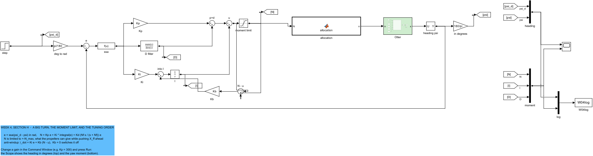

| 그림에서 | 뜻 |
|---|---|
| `step` → `deg to rad` → `e` → `ssa` | 도 단위 명령, 라디안 오차, 그리고 감김 |
| `Kp`, `D filter`, `Ki` → `I`, `p+d`, `u` | 2·3주차의 PID, 블록 하나까지 그대로 |
| `moment limit`, `N - u`, `Kb` | 3주차의 모멘트 한계와 back-calculation 경로 |
| `allocation` | §4-1 의 $T_1$ 과 $T_2$, 좌현 프로펠러의 효율 `port_eff`(실험 4-3c 가 낮추지 않으면 1), 그리고 축 회전수 둘. 두 번 누르면 주석 달린 코드가 보인다 |
| `Otter` → `heading psi` → `in degrees` | 배, 그리고 Scope 를 위해 도로 돌아온 선수각 |
| `heading`, `moment` → Scope | 위: $\psi_d$ 와 $\psi$. 아래: $N$, $I$, $D$ |

> [!tip] 수업에서
> - **목적** — 제어기가 여전히 2주차의 제어기임을 보인다. 새 부분은 도 변환, 감김, 그리고 프로펠러 둘로 모멘트를 만드는 추력 분배다.
> - **가리킬 곳** — `moment limit` 뒤의 `allocation` 블록을 연다. 모멘트 하나가 들어가고 추력 둘이 나오며, 하나는 크고 하나는 작고, 각각 축 회전수로 바뀐다.
> - **질문** — "프로펠러마다 자기 한계가 있는데 `moment limit` 이 왜 따로 있는가?" 요구는 **제어기가 볼 수 있는 자리**에서 제한되어야 한다. 그렇지 않으면 적분이 잘렸다는 것을 알 수 없고, 와인드업이 따라온다(§4-5).
> - **남길 것** — 방향타 없는 배를 조종하려면 한쪽을 더 세게 민다.

## 4-2. 배가 하는 일을, 바깥에서 재기

이 절이 답하는 것: 요 모멘트 계단 하나가 선수각에 대해 무엇을 드러낼 수 있는가?

모델 `W04_C_open_loop` 에는 제어기가 없다. 배가 $X_{ff} = 60$ N 으로 앞으로 달리고, $t = 5$ s 에 일정한 요 모멘트 $N$ 이 더해진다. 아래 실험 4-2 가 잰 값이다.

| $N$ [N·m] | 최종 회두율 [deg/s] | N·m 당 회두율 | 회두율의 63 % 까지 [s] | 40 s 의 선수각 [deg] |
|---|---|---|---|---|
| 5 | 3.05 | 0.610 | 0.36 | 108.2 |
| 10 | 5.06 | 0.506 | 0.30 | 178.3 |
| 20 | 8.14 | 0.407 | 0.24 | 286.0 |

**거기서 무엇이 따라 나오는가, 한 줄씩.**

1. **선수각은 멈추지 않는다.** 일정한 모멘트는 일정한 회두율을 주고, 모멘트가 걸려 있는 동안 선수각은 계속 자란다 — 40 s 에 $108°$, $178°$, $286°$ 다. 선수각은 회두율의 누적합, 곧 적분이다.
2. **그래서 플랜트는 자기 적분기를 품고 있다.** 2주차 §2-4 의 말로 하면 제어기의 도움 없이 **형식 1(type 1)** 이고, 최종값 정리에 따라 비례 제어기만으로도 **정확히** 명령에서 끝난다. 2·3주차와 반대다 — 거기서 P 는 항상 간격을 남겼다.
3. **선수각을 유지하는 데는 모멘트가 들지 않는다.** 1번 줄을 거꾸로 읽으면, 모멘트 0 은 회두율 0 을 주므로 이미 그 선수각에 있는 배는 거기 머물기 위해 아무것도 필요하지 않다. 이 축에는 버텨야 할 항력도 스프링도 없다 — 2번 줄이 그렇게 나오는 이유다.
4. **회두율은 빠르게 답한다.** 최종값의 63 % 안에 $0.36$ s 이내로 든다. 그래서 선수각 변화의 느린 부분은 배의 응답이 아니라 회두율의 **누적**이다.
5. **회두율은 모멘트에 비례하지 않는다.** 모멘트를 10 에서 20 N·m 로 두 배 해도 회두율은 $61\,\%$ 만 오른다. 요 감쇠가 회두율 자체와 함께 커지기 때문이다(1주차: $N_r(1 + 10\lvert r\rvert)\,r$). 빠른 선회는 더 큰 저항을 만난다. 3주차의 전진속도와 달리 이 축은 눈에 보이게 **비선형**이고, 모델이 아니라 측정으로 튜닝하는 이유가 하나 더 생긴다.

### 실험 4-2 · 바깥에서 본 선수각 (10분)

**무엇을 재는가.** 1, 4, 5번 줄 — 끝없이 자라는 선수각, 3분의 1초 안에 정착하는 회두율, 그리고 모멘트가 커지면 떨어지는 N·m 당 회두율.

**모델.** `W04_C_open_loop` — 제어기 없음. 배가 $X_{ff} = 60$ N 으로 앞으로 달리고 $t = 5$ s 에 일정한 요 모멘트가 더해진다.

**열고 돌리기.**

```matlab
W04_0_setup
open_system('W04_C_open_loop')     % Run — 선수각이 멈추지 않는다 / the heading never stops
N_open = 20;                       % Run — 모멘트는 네 배, 회두율은 2.7 배뿐 / not proportional
W04_C_plant_from_outside           % 세 모멘트를 한 번에 / all three moments at once
```

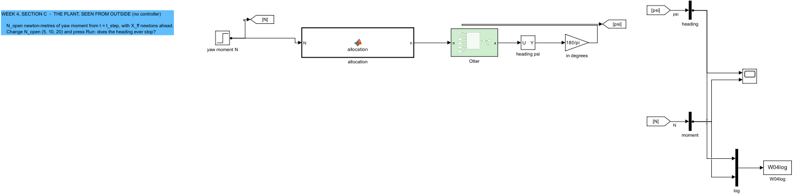

| 그림에서 | 뜻 |
|---|---|
| `yaw moment N` | $t = 5$ s 의 계단 `N_open` N·m |
| 추력 분배, `Otter`, `heading psi`, `in degrees` | §4-1 의 플랜트 사슬 |
| Scope | 위: 선수각 $\psi$. 아래: 모멘트 $N$ |

나오는 출력:

```
  W04 Experiment 4-2  the plant seen from outside (no controller, X_ff = 60 N ahead)
    N [N m]   final turn rate [deg/s]   rate per N m   time to 63 % of the rate [s]   heading at 40 s [deg]
    5                            3.05          0.610                           0.36                   108.2
    10                           5.06          0.506                           0.30                   178.3
    20                           8.14          0.407                           0.24                   286.0
```

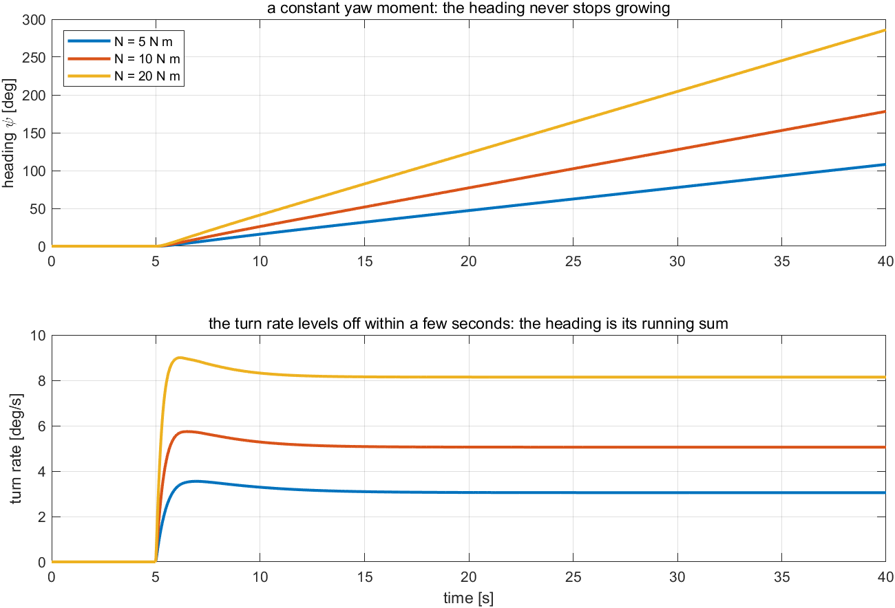

| 그림에서 | 뜻 |
|---|---|
| 위 | 5, 10, 20 N·m 계단 모멘트 뒤의 선수각 |
| 아래 | 회두율, 곧 위 곡선의 기울기 |

**그림을 유도와 대조해 읽기.**

| 볼 곳 | 거기 있는 것 | 어느 줄이 예측했나 |
|---|---|---|
| 위 칸, 곡선이 **직선이고 결코 눕지 않는다** | 40 s 에 $108°$, $178°$, $286°$ | 1번 줄: 일정한 회두율을 적분하면 끝없이 자라는 선수각이다 |
| 아래 칸, 각 회두율이 1초도 안 되어 **평평해진다** | $3.05$, $5.06$, $8.14$ deg/s | 4번 줄: 회두율이 빠른 부분이다. 63 % 까지 $0.36$ s |
| 위 칸, 각 직선의 **기울기** | 바로 아래의 평평한 값과 같다 | 다시 1번 줄: 선수각은 회두율의 누적합이다 |
| 세 평평한 회두율을 $5$, $10$, $20$ N·m 와 대조 | 모멘트 $4\times$ 가 회두율은 $2.7\times$ 만 준다 | 5번 줄: 요 감쇠가 회두율과 함께 커진다 |
| $t = 5$ s **이전**의 아래 칸 | 모멘트 0, 회두율 0, 선수각 그대로 | 3번 줄: 선수각 유지에는 비용이 없다 |

**그림이 말하는 것**

- 회두율은 몇 초 안에 눕는데 선수각은 끝없이 자란다. 선수각은 회두율의 누적합이다.

| 해 볼 것 | 볼 것 |
|---|---|
| `N_open = 40;` Run | 마지막 줄의 두 배 모멘트가 $8.14$ 에 대해 $12.82$ deg/s 를 준다 — 2 가 아니라 $1.57$ 배다. 빨리 돌수록 5번 줄이 세게 문다 |
| `N_open = 0;` Run | 회두율 $0.00$ deg/s, 40 s 에도 선수각은 여전히 $0°$ 다. 3번 줄, 선수각 유지에는 모멘트가 들지 않는다 |

> [!tip] 수업에서
> - **목적** — 3주차 개루프와 대조한다. 거기서는 일정한 힘이 일정한 속도를 주었고, 여기서는 일정한 모멘트가 멈추지 않는 선수각을 준다.
> - **가리킬 곳** — 위 칸의 직선들, 아래 칸의 평평한 회두율.
> - **질문** — "선수각을 유지하는 데 모멘트가 얼마나 드는가?" 들지 않는다. 정상 선수각에 있는 배는 요 모멘트가 필요하지 않다. P 만으로 오차가 남지 않을 이유가 그것이다(실험 4-3a).
> - **질문** — "20 N·m 가 왜 10 N·m 의 두 배보다 작은 회두율을 주는가?" 요 감쇠가 회두율과 함께 커진다.
> - **남길 것** — 선수각은 적분이고, 플랜트가 그 적분기를 직접 들고 온다.

## 4-3. 선수각에서의 P, I, D

이 절이 답하는 것: 이 축에서 각 항은 무슨 일을 하고, 2·3주차와 비교하면 어떤가?

**무엇이 관측되는가.** 또 같은 세 항을 이 축에 걸면,

- P 만으로 **울린다** — $K_p$ 가 100 에서 1000 으로 오르는 동안 오버슛 $5.8 \to 15.9\,\%$ — 그런데도 오차는 **전혀 남지 않는다**. 최종 선수각이 $10.000°$ 다.
- D 가 그것을 감쇠한다. 2주차처럼, 3주차와 달리 — 오버슛 $12.18 \to 0.39\,\%$, 정착 $3.26 \to 1.72$ s.
- I 는 명령에 닿기 위해 필요하지 않고, 무엇이 밀어낼 때에만 필요해진다 — 좌현 프로펠러가 $70\,\%$ 면 PD 는 $0.80°$ 못 미친다.

그래서 선수각은 같은 제어기에서 나온 세 가지 다른 답 중 셋째이고, §4-2 의 두 줄이 그 전부를 설명한다.

**거기서 무엇이 따라 나오는가, 한 줄씩.**

1. **선수각은 오버슛할 수 있다. 그것이 적분이기 때문이다.** 모멘트가 치워지는 동안에도 배는 계속 돌므로, 회두율이 0 에 닿기 전에 선수각이 명령을 지나간다 — 3주차의 속도 축에 없던 저장소다.
2. **P 만으로 오차가 남지 않는다.** §4-2 의 2번과 3번 줄 때문이다. 플랜트가 이미 적분기를 품고 있고, 선수각 유지에 모멘트가 들지 않는다. 명령에 있으면 오차가 0 이므로 $N = 0$ 이고, 필요한 것이 정확히 0 이다. 3주차와 비교하라 — 거기서는 속도 유지에 꾸준한 $116$ N 이 들었고, 그래서 P 는 그것을 만들기 위해 오차를 유지해야 했다.
3. **여기서 D 는 감쇠한다.** 선수각 오차의 미분은 **회두율**이고, 회두율에 저항하는 것은 2주차에서 질량의 속도에 저항한 것과 같이 감쇠다. 3주차의 속도 축에서 같은 미분은 가속도였고, 거기서 해가 된 이유가 그것이다. 항이 바뀐 것이 아니라 축이 바뀌었다 — 세 번째로.
4. **이번 주 모델 대부분은 오차를 미분한다.** 2·3주차가 한 것과 똑같다. 블록 `D filter` 는 $K_d N_f s/(s + N_f)$ 이고 $\text{ssa}(\psi_d - \psi)$ 를 받는다. 그것이 교과서 형태이고, 그 하나의 약점을 말로 설명하는 대신 **재기** 위해 `W04_D_P` … `W04_H_tuning` 에 그대로 둔다. **이 강의의 나머지가 실제로 쓰는 형태는 다른 쪽**, 곧 $-K_d r$ 이고, "미분은 회두율에서 받는 것이 낫다" 소절이 그것을 유도하고 실험 4-3e 에서 재며, 부호가 틀렸을 때 무엇이 일어나는지 보인다.
5. **I 는 꾸준한 외란에 대해서만 필요하다.** 추력의 $70\,\%$ 만 내는 프로펠러는 사라지지 않는 요 모멘트를 만든다. PD 는 그것을 오차로만 맞설 수 있어서 $0.80°$ 벗어난 채로 정착하며 $4.19$ N·m 를 들고 있다. 적분은 그 모멘트를 스스로 찾아낸다 — $K_i = 20$ 에서 $4.15$ N·m — 2주차 §2-8 의 5번 줄을, 스프링 대신 오염된 프로펠러로 다시 한 것이다.

| 항 | 2주차, 위치 | 3주차, 속도 | 이번 주, 선수각 | 측정값 |
|---|---|---|---|---|
| P | 빨라지고, 울리고, 오차를 남긴다 | 빨라지고, 결코 울리지 않고, 오차를 남긴다 | 빨라지고, **울리고**, 오차는 **남지 않는다** | 실험 4-3a: $K_p$ 가 $100 \to 1000$ 으로 오르며 오버슛 $5.8 \to 15.9\,\%$, 최종 선수각 $10.000°$ |
| D | 감쇠한다 | 더 나쁘게 만든다 | **다시 감쇠한다** | 실험 4-3b: $K_p = 300$ 에서 $K_d$ 가 $0 \to 100$ 으로 오르며 오버슛 $12.18 \to 0.39\,\%$, 정착 $3.26 \to 1.72$ s |
| I | 오차를 없앤다 | 오차를 없앤다 | 무엇이 **밀어낼 때에만** 오차를 없앤다 — 약해진 프로펠러 | 실험 4-3c: 좌현 프로펠러 70 % 에서 PD 가 $0.80°$ 를 남기고, $K_i = 20$ 이 그것을 없앤다 |

### 실험 4-3a · P 만 (10분)

**무엇을 재는가.** 1번과 2번 줄 — 게인이 무엇이든 정확히 명령에서 끝나는 선수각, 그리고 플랜트가 적분하기 때문에 게인과 함께 커지는 오버슛.

**모델.** `W04_D_P` — §4-1 의 루프에 $K_i = K_d = 0$.

**열고 돌리기.**

```matlab
W04_0_setup
open_system('W04_D_P')             % Run — 10.000 도에서 정확히 멈춘다 / it ends exactly at 10.000 deg
Kp = 1000;                         % Run — 빨라지고 더 넘친다 / faster, and it overshoots more
W04_D_proportional_only            % 네 게인을 한 번에 / all four gains at once
```

나오는 출력:

```
  W04 Experiment 4-3a  P only  (psi_d = 10 deg at t = 5 s)
    Kp     final psi [deg]   overshoot %   rise [s]   settle [s]   peak |N| [N m]
    30               9.989           0.0       3.94         6.36              5.2
    100              9.997           5.8       1.50         3.96             17.5
    300              9.999          12.2       0.74         3.26             52.4
    1000            10.000          15.9       0.48         3.12             70.8
```

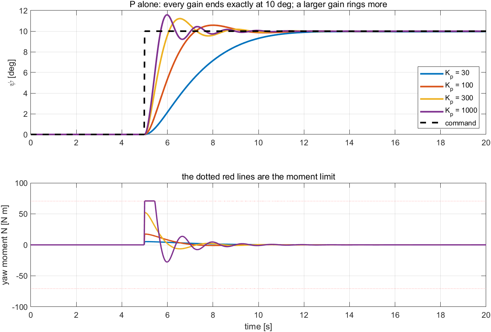

| 그림에서 | 뜻 |
|---|---|
| 위 | $K_p = 30$ 부터 $1000$ 까지의 선수각과 점선 명령 |
| 아래 | 요 모멘트. 붉은 점선은 $\pm 70.85$ N·m |

**그림을 유도와 대조해 읽기.**

| 볼 곳 | 거기 있는 것 | 어느 줄이 예측했나 |
|---|---|---|
| 위 칸, **모든** 곡선이 끝나는 자리 | 점선 명령 위의 $10.000°$ | 2번 줄: 플랜트 자신의 적분기, 그리고 머무는 데 모멘트가 들지 않는다 |
| 위 칸, 명령 **위로 솟은 봉우리** | $K_p$ 와 함께 $0.0 \to 15.9\,\%$ | 1번 줄: 모멘트를 치울 때 배는 아직 돌고 있다 |
| 아래 칸, **명령에서의** 모멘트 | 모든 실행에서 0 으로 돌아온다 | 다시 2번 줄: 오차 0, 모멘트 0, 그리고 그것으로 충분하다 |
| 아래 칸, 봉우리 뒤의 **음의** 모멘트 | 울리는 모든 실행에 있다 | 1번 줄: 배가 아직 하고 있는 회전을 멈추려면 모멘트를 거꾸로 걸어야 한다 |
| 아래 칸 $K_p = 1000$, **납작한 꼭대기** | $70.85$ N·m 선 위 | §4-1: 모멘트 한계. 그것을 §4-5 가 관리해야 한다 |

**그림이 말하는 것**

- 어떤 게인이든 $10°$ 에서 끝난다. 게인이 크면 빠르고 더 울린다. $K_p = 1000$ 에서 모멘트는 한계에 있고 게인을 더 올려도 얻는 것이 적다.

| 해 볼 것 | 볼 것 |
|---|---|
| `Kp = 30;` Run | 느리지만 여전히 정확하다 — 오버슛 전혀 없이 $9.989°$. 2번 줄은 $K_p$ 의 크기에 기대지 않는다 |
| `psi_step = 90; Kp = 300; T_final = 60;` Run | 모멘트가 $4.24$ s 동안 한계에 앉고, 오버슛은 $10°$ 에서의 $12.18\,\%$ 에 비해 $0.91\,\%$ 로 **더 작다**. 포화된 P 루프는 그냥 자기 최대 회두율로 돌고, 무엇을 저장할 적분기가 없다. §4-5 가 적분기를 더하면 같은 선회가 $15.6\,\%$ 오버슛한다 |

> [!tip] 수업에서
> - **목적** — 3주차와의 차이 둘을 한 그림에서. 오차가 남지 않는 것, 그리고 울리는 것.
> - **가리킬 곳** — 최종 선수각 열이 $0.011°$ 안에서 모두 $10°$ 인 것. 오버슛 열이 게인과 함께 커지는 것.
> - **질문** — "3주차는 $K_p = 800$ 에서도 0.133 m/s 를 못 채웠다. 왜 여기는 다른가?" 속도 유지에는 항력에 맞서는 힘이 들고, 선수각 유지에는 모멘트가 들지 않는다.
> - **남길 것** — 적분하는 축에서 P 는 명령에 닿는다. 문제는 얼마나 울리는가로 바뀐다.

### 실험 4-3b · D 를 더한다 (10분)

**무엇을 재는가.** 3번과 4번 줄 — 실험 4-3a 의 울림을 감쇠하는 미분, 그리고 계단이 걸리는 순간 그것이 요구하는 크기.

**모델.** `W04_E_PD` — 같은 루프에 `D filter` 가지를 켠 것. $K_d N_f s/(s+N_f)$ 가 오차를 받는다. $K_i$ 는 아직 0 이다. 그 미분이 어디서 와야 하는지는 아래 소절의 주제다.

**열고 돌리기.**

```matlab
W04_0_setup
open_system('W04_E_PD')            % Run — Kd = 100: 거의 넘치지 않는다 / almost no overshoot
Kd = 0;                            % Run — 4-3a 의 울림이 돌아온다 / the ringing of 4-3a is back
Kd = 200;                          % Run — 넘침은 0, 대신 느리다 / no overshoot, but slow
W04_E_derivative                   % 일곱 값을 한 번에 / all seven gains at once
```

나오는 출력:

```
  W04 Experiment 4-3b  P + D  (Kp = 300, psi_d = 10 deg)
    Kd     overshoot %   rise [s]   settle [s]
    0            12.18       0.74         3.26
    10           10.23       0.76         3.20
    25            7.61       0.80         2.98
    50            4.10       0.88         2.22
    100           0.39       1.12         1.72
    150           0.00       1.44         2.42
    200           0.00       1.78         3.14
```

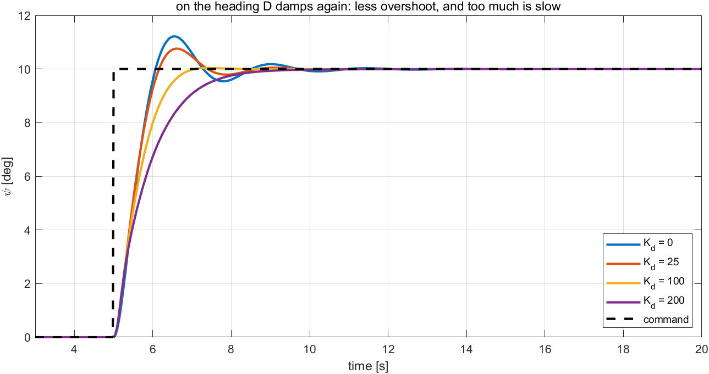

| 그림에서 | 뜻 |
|---|---|
| 곡선들 | $K_p = 300$ 에서 $K_d = 0, 25, 100, 200$ 의 선수각 |

**그림을 유도와 대조해 읽기.**

| 볼 곳 | 거기 있는 것 | 어느 줄이 예측했나 |
|---|---|---|
| 각 곡선의 **봉우리** | $K_d$ 가 100 으로 오르며 $12.18 \to 0.39\,\%$ | 3번 줄: 회두율에 맞서는 항은 이 축에서 감쇠다 |
| $K_d = 150$ 과 $200$ 의 곡선 | 오버슛은 없지만 상승 $1.44$, $1.78$ s | 2주차 §2-3: $\zeta = 1$ 을 넘으면 감쇠를 더해도 속도만 잃는다 |
| **정착** 열 | $K_d = 100$ 에서 $1.72$ s 로 떨어지고 그 뒤 올라간다 | 위의 두 줄이 서로 반대로 당긴다. 측정이 $K_d = 100$ 을 고른다 |
| 계단이 걸리는 순간의 모멘트 | $70.85$ N·m 한계에 대해 $325.8$ N·m 의 첨두 | 4번 줄: 계단의 미분, 곧 $K_d N_f$ 곱하기 점프 — 2주차 §2-10 의 킥이고, 아래 소절이 있는 이유다 |

**그림이 말하는 것**

- 미분이 울림을 없앤다. $K_d = 100$ 을 넘으면 선회만 느려진다.

| 해 볼 것 | 볼 것 |
|---|---|
| `Kd = 400;` Run | 오버슛은 전혀 없지만 상승시간이 $K_d = 100$ 의 $1.12$ s 에 대해 $3.24$ s 다. 브레이크가 밀기보다 무거워졌다 |
| `Kp = 1000; Kd = 100;` Run | $K_p = 300$ 에서 $0.39\,\%$ 를 남긴 같은 $K_d$ 가 여기서는 $5.83\,\%$ 의 오버슛을 돌려준다 — $K_d$ 는 자기가 감쇠하는 $K_p$ 와 함께 읽는 것이고, 혼자 읽는 것이 아니다 |

> [!tip] 수업에서
> - **목적** — 속도 루프에서 실패한 뒤, 미분을 다시 자기 자리에서 본다.
> - **가리킬 곳** — 정착 열. $K_d = 100$ 에서 $1.72$ s 로 떨어지고 다시 올라간다 — 감쇠가 지나치면 느리다(2주차 §2-3, $\zeta > 1$).
> - **질문** — "같은 블록이 3주차를 나쁘게 만들었다. 무엇이 바뀌었나?" 축이다. 선수각 오차의 미분은 회두율이고, 거기 저항하는 것이 감쇠다.
> - **남길 것** — 출력이 오버슛할 수 있는 곳에 D 를 쓰고, 정착시간이 다시 올라가는 자리에서 올리기를 멈춘다.

### 실험 4-3c · 약해진 좌현 프로펠러와 적분 (10분)

**무엇을 재는가.** 5번 줄 — 사라지지 않는 외란, 그것에 맞서기 위해 PD 가 유지하는 오차, 그리고 오차 없이 같은 모멘트를 찾아내는 적분.

**모델.** `W04_F_PID` — 전체 루프에 `port_eff` 가 좌현 프로펠러의 추력을 비례해 줄인다. `port_eff = 1` 이면 아무 문제가 없고 적분은 할 일이 없다. `0.7` 이면 배가 달리는 동안 계속 선수각에서 끌려난다.

**열고 돌리기.**

```matlab
W04_0_setup
port_eff = 0.7; Ki = 0;            % 좌현 30 % 약함, 적분 없음 / a weak port propeller, no integral
open_system('W04_F_PID')           % Run — 9.200 도에서 멈춘다 / it stops 0.8 deg short
Ki = 20;                           % Run — 목표에 도달한다 / it reaches the command
W04_F_weak_propeller               % 두 스윕을 한 번에 / both sweeps at once
```

나오는 출력:

```
  W04 Experiment 4-3c  1) PD only (Kp = 300, Kd = 100), port propeller at reduced efficiency
    port_eff   final psi [deg]   error left [deg]   steady N [N m]
    1                    9.999              0.001             0.00
    0.7                  9.200              0.800             4.19
    0.5                  8.490              1.510             7.90

  2) add the integral, port_eff = 0.7
    Ki     final psi [deg]   overshoot %   settle [s]   I at 40 s [N m]
    0                9.200          0.00          Inf              0.00
    20               9.993          0.00         1.98              4.15
    50              10.002          8.27         9.82              4.20
    100             10.000         18.07         7.66              4.19
```

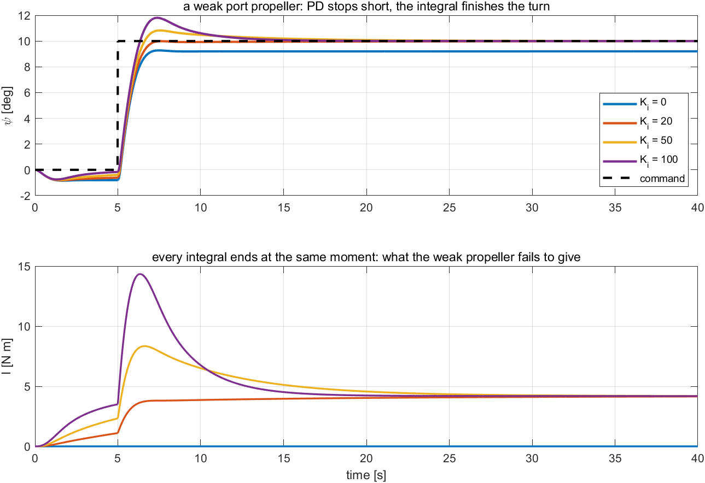

| 그림에서 | 뜻 |
|---|---|
| 위 | 좌현 프로펠러 70 % 에서 $K_i = 0$ 부터 $100$ 까지의 선수각 |
| 아래 | 적분 항. 모든 곡선이 같은 모멘트에서 끝난다 |

**그림을 유도와 대조해 읽기.**

| 볼 곳 | 거기 있는 것 | 어느 줄이 예측했나 |
|---|---|---|
| 위 칸, $K_i = 0$ 곡선 | $9.200°$ 에서 평평하다 | 5번 줄: PD 는 필요한 $4.19$ N·m 를 $0.80°$ 의 오차를 유지해서만 만들 수 있다 |
| 아래 칸, **모든** 적분이 눕는 자리 | $K_i$ 와 무관하게 $4.15$ ~ $4.20$ N·m | 2주차 §2-8 의 5번 줄: 적분기는 오차가 0 인 곳, 곧 고장이 요구하는 모멘트에서 멈춘다 |
| 위 칸, $K_i = 20$ 대 $K_i = 100$ | 오버슛 $0.00\,\%$ 대 $18.07\,\%$ | 적분이 지나치면 늦은 모멘트가 되고, 이 축은 이미 두 겹으로 적분한다 |
| `port_eff` 표, $1 \to 0.7 \to 0.5$ | 정상 $N$ 이 $0.00 \to 4.19 \to 7.90$ N·m | 5번 줄: 프로펠러가 나쁠수록 유지해야 할 모멘트가 커지고, PD 가 유지하는 오차도 커진다 |

**그림이 말하는 것**

- PD 는 $0.80°$ 못 미쳐 멈춘다. 이제 선수각 유지에 오차만이 만들 수 있는 $4.19$ N·m 가 들기 때문이다. 적분이 그것을 공급하면 오차가 사라진다. 적분이 지나치면 오버슛한다.

| 해 볼 것 | 볼 것 |
|---|---|
| `port_eff = 1; Ki = 20;` Run | 맞설 것이 없으면 적분은 $0.22$ N·m 에 정착하고 선수각은 $10.043°$ 에서 끝난다. 적분은 보험이고, 그 자체를 위해 올리는 게인이 아니다 |
| `port_eff = 0.5; Ki = 20;` Run | 같은 $K_i$ 가 여전히 명령에 닿는다 — $9.947°$, 이제 $7.64$ N·m 를 들고. 이 항은 고장이 요구하는 것을 무엇이든 찾아낸다 |

> [!tip] 수업에서
> - **목적** — 이미 적분하는 축에서 적분이 필요해지는 때를 보인다. 무엇이 밀어낼 때다.
> - **가리킬 곳** — 정상 $N$ 열. PD 에서 $4.19$ N·m, $K_i > 0$ 이면 적분 안에서 같은 $4.15$–$4.20$ N·m.
> - **질문** — "약해진 프로펠러가 애초에 왜 요 모멘트를 만드는가?" 두 프로펠러에 30 N 씩 요구했는데 좌현이 21 N 만 내므로 우현 쪽이 더 세게 밀고, 배가 좌현으로 돈다.
> - **남길 것** — 적분은 플랜트가 요구하는 꾸준한 노력을 무엇이든 찾아낸다. 그것이 항력이든(3주차) 고장이든(여기).

### 미분은 회두율에서 받는 것이 낫다

이 소절이 답하는 것: 오토파일럿은 선회를 제동해야 한다 — 그런데 왜 선수각 오차를 미분하는 대신 **회두율**을 재는가?

**두 형태.** 둘 다 "D 항" 이라 불리지만 같은 식이 아니다.

$$
\text{error form:}\quad N = K_p\,e + K_d\,\dot e ,
\qquad
\text{rate form:}\quad N = K_p\,e - K_d\,r ,
\qquad e = \text{ssa}(\psi_d - \psi)
$$

**왜 보통은 같은가.** 오차를 미분하면 $\dot e = \dot\psi_d - \dot\psi = \dot\psi_d - r$ 이다. **명령이 움직이지 않는 동안에는** $\dot\psi_d = 0$ 이고 두 형태는 항 하나까지 같다. 배가 고정된 선수각에 정착하는 동안 미분이 하는 일은 양쪽에서 똑같다.

**어디서 갈라지는가, 한 줄씩.**

1. 둘은 **오직** $\dot\psi_d$ 를 통해서만 다르다. 오차 형태가 $K_d\,\dot\psi_d$ 를 더하고, 그 밖에는 없다.
2. 계단 명령은 $\dot\psi_d$ 를 충격으로 만든다. §2-10 이 하듯 필터를 걸면 항이 무한으로 가지는 않지만 $K_d N_f$ 곱하기 점프에서 시작한다 — $10°$ 계단에 대해 $100 \times 20 \times 0.1745\ \mathrm{rad} = 349$ N·m 이고, 모멘트 한계는 $70.85$ N·m 다. **회두율 형태는 이것을 할 수 없다.** $r$ 은 관성을 가진 배의 속도이고 점프할 수 없기 때문이다.
3. 그 첨두는 배가 아니라 구동기에 쓰인다. 수백분의 1초 안에 한계에 잘려 나가고, $10°$ 선회에서도 그것이 일으키는 와인드업을 §4-5 가 기록한다.
4. **이음매가 그것을 더 나쁘게 만든다.** 명령이 $\pm180°$ 를 지날 때 감긴 오차는 꼬박 $2\pi$ 만큼 점프한다 — `ssa` 가 하는 일이 그것이고, §4-6 이 그래야 하는 이유를 보인다. 그 점프를 미분하면 몇 도의 선회에 대해 $K_d N_f\,2\pi = 12\,566$ N·m, 한계의 약 177 배를 요구한다. 회두율 형태는 거기에 영향을 받지 않는다.
5. **센서도 그것을 정한다.** 배는 **자이로**를 싣고, $r$ 은 자이로가 직접 보고하는 것이다. 오차 형태에는 $\dot\psi$ 의 측정이 없다. 선수각을 미분해 스스로 만들어야 하는데, 미분은 모든 주파수에 $\omega$ 를 곱하므로(§2-10) 선수각 잡음을 증폭하고, 그래서 필터 $N_f$ 가 필요해지고, 그 필터의 위상 지연이 애초에 더하려던 감쇠를 일부 깎아먹는다.
6. 회두율 형태의 대가는 **움직이는** 명령을 예측하지 못하는 것이다. 램프 명령은 작은 지연을 두고 따라간다. $\psi_d$ 와 $\dot\psi_d$ 를 함께 공급하는 기준모델이 그것까지 없애고, 그것이 9주차의 주제다.

**부호가 음수여야 하는 이유.** 회두율 항은 $K_d > 0$ 으로 두고 $-K_d r$ 로 쓴다. 이 마이너스는 관습이 아니라 그 항의 목적 전부다. 법칙을 §4-2 의 5번 줄의 요 방정식에 넣으면,

$$
M_{66}\,\dot r \;=\; N \;-\; \underbrace{\lvert N_r\rvert\big(1 + 10\lvert r\rvert\big)\,r}_{\text{the hull's own damping}},
\qquad
N = K_p\,e - K_d\,r
$$

이고, $e = \psi_d - \psi$ 와 $r = \dot\psi$ 를 넣으면 이것은

$$
M_{66}\,\ddot\psi
\;+\; \Big[\underbrace{\lvert N_r\rvert\big(1 + 10\lvert r\rvert\big)}_{\text{the hull's}} + \underbrace{K_d}_{\text{the controller's}}\Big]\dot\psi
\;+\; K_p\,\psi \;=\; K_p\,\psi_d
$$

| 기호 | 양 | 값 · 출처 |
|---|---|---|
| $M_{66}$ | 요 관성, 부가질량 포함 | $42.65$ kg·m² · `otter.m`, 1주차 §1-9 |
| $N_r$ | 선형 요 감쇠 | rad/s 당 $-42.65$ N·m · $-M_{66}/T_{\text{yaw}}$, $T_{\text{yaw}} = 1$ s |
| $K_d$ | 회두율 게인 | rad/s 당 $100$ N·m |

7. **$K_d$ 는 선체 자신의 감쇠와 같은 괄호 안에 앉아 거기에 더해진다.** 여기서 "감쇠" 가 뜻하는 것이 그것이고, 그 항을 모멘트에서 빼는 이유가 그것이다. 선회에 **맞서는** 모멘트는 선회에서 에너지를 빼는 모멘트다.
8. 부호를 뒤집으면 괄호가 $\lvert N_r\rvert(1 + 10\lvert r\rvert) - K_d$ 가 된다. 제어기가 이제 선체의 감쇠에서 **뺀다.** $\lvert N_r\rvert = 42.65$ 에 대해 $K_d = 100$ 이면 낮은 회두율에서 합이 **음수**다. 루프가 흔들릴 때마다 에너지를 넣는다. 거꾸로 배선된 브레이크는 가속기다.
9. 그런데 발산하지는 않고, 이유는 1주차의 비선형 인자다. $\lvert N_r\rvert(1 + 10\lvert r\rvert) = K_d$ 가 되면 괄호가 0 으로 돌아온다. 곧

$$
\lvert r\rvert = \frac{1}{10}\left(\frac{K_d}{\lvert N_r\rvert} - 1\right)
= \frac{1}{10}\left(\frac{100}{42.65} - 1\right) = 0.1345\ \text{rad/s} = 7.70\ \text{deg/s}
$$

이고, 배는 회두율이 대략 그 값에 닿을 때까지 진동을 키우고 그 다음 그것을 유지한다 — **발산이 아니라 한계순환(limit cycle)** 이다. 실험 4-3e 가 $7.23$ deg/s 를 잰다.

**MSS 는 무엇을 하는가.** 툴박스의 어느 배도 오차를 미분하지 않는다. 그중 셋이 회두율 형태로 조종하고, 이 강의가 따르는 기준이 그것이다.

| MSS 파일 | 그 줄 | 무엇인가 |
|---|---|---|
| `VESSELS/SIMclarke83.m` | `M(3,3)*( Kp*ssa(psi_ref-eta(3)) - Kd*nu(3) )` | PD 선수각 오토파일럿. $\nu(3)$ 이 $r$ 이다 |
| `VESSELS/SIMremus100.m` | `delta_r = -Kp_psi*ssa( x(12)-psi_d ) - Kd_psi*x(6)` | 같은 것. 오차를 반대로 쓴 것뿐이다. $x(6)$ 이 $r$ 이다 |
| `VESSELS/SIMrig.m` | `tau3 = -R'*(Kp*eta3 + Ki*z3) - Kd*nu3` | 3자유도 DP: P 와 I 는 **위치 오차**에, D 는 측정된 **속도** $\boldsymbol\nu$ 에 |

`SIMrig` 는 두 번 읽을 가치가 있다. 비례와 적분 항은 오차에 작용하고 감쇠 항은 측정된 속도에 작용한다 — 한 신호의 미분 셋이 아니다. 9주차 §9-3 이 만들고 10주차가 조립하는 구조가 정확히 그것이다.

> [!note] 같은 게인을 쓰는 두 방식
> 어떤 교재들 — 함께 쓰는 캡스톤 강의도 포함해 — 은 마이너스를 게인 안에 접어 넣고 $K_{d,\psi} < 0$ 으로 $N = K_p e + K_{d,\psi}\,r$ 로 쓴다. 이 강의는 $K_d > 0$ 으로 두고 마이너스를 법칙에 쓴다. 그래야 모든 주차의 모든 게인이 양수다. 둘은 같은 제어기이고 $K_{d,\psi} = -K_d$ 다.

| | 오차 형태, $K_d\,\dot e$ | 회두율 형태, $-K_d\,r$ |
|---|---|---|
| 고정된 명령에서 | 같다 | 같다 |
| $\psi_d$ 의 계단에서 | $349$ N·m 를 요구 | $-1.1$ N·m: 아무 일도 없다 |
| $\pm180°$ 이음매를 지날 때 | $12\,566$ N·m | 아무 일도 없다 |
| 필요한 센서 | 미분한 선수각, 그리고 필터 | 자이로, 있는 그대로 |
| 명령이 램프일 때 | 예측한다 | 조금 뒤처진다 |
| 쓰이는 곳 | 이번 주의 모델들 — 킥을 재기 위해 | **5주차**, 유도가 웨이포인트마다 $\psi_d$ 를 움직이는 곳 |

### 실험 4-3d · 킥, 그리고 회두율 형태였다면 요구했을 것 (5분)

**무엇을 재는가.** 2번과 5번 줄 — $10°$ 계단에서 실제로 요구된 D 항, 그리고 같은 실행에서 $-K_d\,r$ 이 요구했을 것.

**실행.** 실험 4-3b 의 로그, `W04_E_PD` 에서. 새 모델도 새 시뮬레이션도 없다. 두 형태를 같은 실행에서 읽는다. 둘이 같은 배를 보기 때문이다.

**열고 돌리기.**

```matlab
W04_0_setup
R = W04_read('W04_E_PD', 'Kp', 300, 'Kd', 100);
r = gradient(deg2rad(R.psi), R.t);        % 기록된 선수각에서 회두율 / yaw rate from the log
[max(abs(R.D))  max(abs(Kd*r))  N_max]    % 오차 미분 / 회두율 되먹임 / 한계
```

나오는 출력:

```
ans =

  325.7948   20.9746   70.8488
```

**출력을 읽기.**

| 찍힌 것 | 무엇인가 | 어느 줄을 보이나 |
|---|---|---|
| $325.79$ | 모델들이 실제로 요구하는 가장 큰 D 항 | 2번 줄: 킥 — 프로펠러가 만들 수 있는 모멘트의 $4.6$ 배 |
| $20.97$ | 같은 실행에서 가장 큰 $\lvert K_d\,r\rvert$ | 2번 줄: 회두율 형태는 배가 하고 있는 것보다 더 요구하지 않는다. 최대 회두율이 $12.02$ deg/s 이고 $100 \times 0.2097 = 21.0$ N·m 다 |
| $70.85$ | 모멘트 한계 | 둘을 함께 재는 기준선 |

- 계단이 걸리는 순간 둘은 $325.8$ N·m 와 $-1.1$ N·m 다. 1초 뒤, 명령이 더 이상 움직이지 않으면 둘은 일치한다 — 1번 줄이다.

| 해 볼 것 | 볼 것 |
|---|---|
| `Nf = 5;` 로 두고 두 줄 재실행 | 킥이 $85.8$ N·m 로 떨어지고, 식이 주는 $K_d N_f \times 0.1745 = 87.3$ 에 가깝다. 그리고 **여전히 한계 위다.** 필터는 킥을 줄이지만 없앨 수 없다 — 점프한 것이 명령이기 때문이다. 한편 회두율 형태는 $26.4$ N·m 로 조금 오른다. 느려진 필터가 선회를 더 세게 가게 두기 때문이다 |
| `psi_step = 90; T_final = 60;` 로 두고 재실행 | 킥이 계단과 함께 커진다 — 식이 주는 $K_d N_f \times 1.571 = 3142$ 에 대해 $2932$ N·m 다. 회두율 형태는 $33.3$ N·m 에 닿는다 — 여전히 선체에 요구할 수 있는 범위 안이다 |

### 실험 4-3e · D 항 셋, 각각이 실제로 조종한다 (10분)

**무엇을 재는가.** 1, 7, 8번 줄 — 명령이 고정된 동안 두 형태가 비슷하게 따라가는 것, 각각이 요구하는 것, 그리고 틀린 부호가 정말로 루프 안에 있을 때 무엇을 하는지.

실험 4-3d 는 **한** 실행에서 두 형태를 읽었다. 이번에는 각각에 루프를 닫으므로 배가 정말로 시험 대상 항에 의해 조종된다 — 세 번째 형태에서 그 차이가 중요해진다. 그것은 궤적을 완전히 바꾸므로 날아 보지 않은 실행에서 읽어낼 수 없다.

**모델.** `W04_I_rate` — 실험 4-3b 의 루프에서 `D filter` 하나를 `Multiport Switch` 로 들어가는 세 가지로 바꾼 것. `d_form` 이 고른다: 자이로의 $-K_d r$, 필터를 건 $K_d\dot e$, 그리고 $+K_d r$. 그 밖의 모든 것 — 배, 게인, 명령, 솔버 — 은 공유하므로 세 실행은 그 가지 하나에서만 다르다.

**열고 돌리기.**

```matlab
W04_0_setup
open_system('W04_I_rate')     % Run — d_form = 1, 회두율 되먹임 / the rate form
d_form = 2;                   % Run — 오차를 미분. 궤적은 거의 같다 / the error form; nearly the same track
d_form = 3;                   % Run — 부호를 뒤집는다. 멈추지 않는다 / the sign flipped; it never stops
W04_I_rate_feedback           % 세 가지를 한 번에 / all three at once
```

나오는 출력:

```
  W04 Experiment 4-3e  where the D term comes from  (Kp = 300, Kd = 100, psi_d = 10 deg)
    d_form   D term                          overshoot   rise [s]   settle [s]   max |D| [N m]
      1      -Kd r   (rate, the gyro)           0.90 %      1.16    1.74          17.03
      2      +Kd Nf s/(s+Nf) e   (error)        0.39 %      1.12    1.72         325.79
      3      +Kd r   (sign flipped)            38.59 %      0.50   never          29.46
    the wrong sign settles into a limit cycle of 7.23 deg/s;  |N_r|(1+10|r|) = Kd predicts 7.70
```

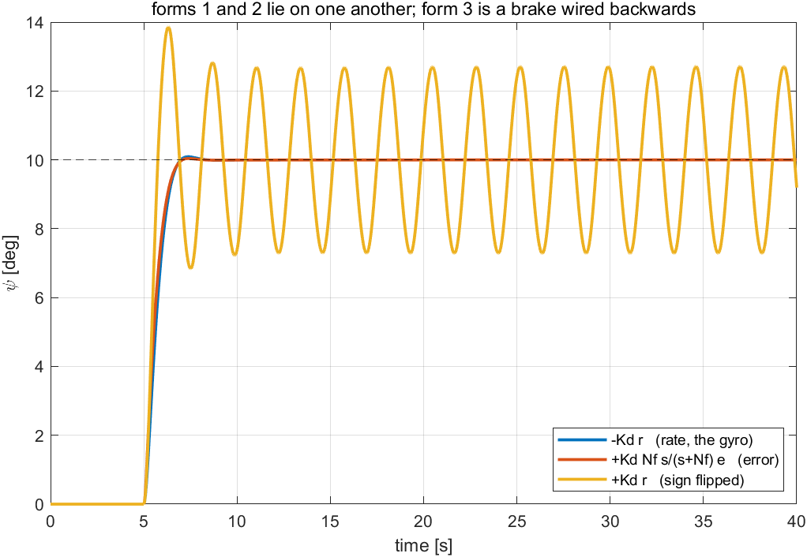

**그림을 유도와 대조해 읽기.**

| 볼 곳 | 거기 있는 것 | 어느 줄이 예측했나 |
|---|---|---|
| 파랑 대 빨강 | 선 굵기 안에서 한 줄이다 | $\dot\psi_d = 0$ 인 동안 두 형태는 같은 항이다 |
| 찍힌 표의 첫 두 줄 | $0.90$ 대 $0.39\,\%$, $1.74$ 대 $1.72$ s | 같은 것을 다시, 재서. 둘을 가르는 것은 추종이 아니다 |
| `max \|D\|` 열, 첫 두 줄 | $70.85$ 한계에 대해 $17.03$ 대 $325.79$ N·m, 19 배 | 2번 줄: 오차 형태는 계단을 미분하고, $r$ 은 관성을 가진 배의 것이어서 점프할 수 없다 |
| 노란 곡선 | 명령에 닿고 그 뒤 결코 지나가기를 멈추지 않는다 | 8번 줄: 괄호가 음수이므로 흔들림마다 에너지를 얻는다 |
| 표 아래에 찍힌 줄 | 흔들림이 $7.23$ deg/s 에 정착한다. 예측은 $7.70$ | 9번 줄: 선체 자신의 비선형 감쇠가 거기서 붙잡는다 |
| `settle` 열, 셋째 줄 | `never` — $40$ s 에도 여전히 흔들린다 | 8번 줄: 낮은 회두율에서 루프 안의 무엇도 에너지를 빼지 않는다 |

**그림이 말하는 것**

- 이 셋 중 둘은 배를 같은 방식으로 조종하면서 프로펠러에 19 배 차이 나는 수를 요구한다. 셋째는 같은 게인에 부호 하나가 틀린 것이고, 브레이크를 가속기로 만든다.

| 해 볼 것 | 볼 것 |
|---|---|
| `psi_step = 90; T_final = 80;` 로 재실행 | 좋은 두 형태는 구별되지 않는다 — 오버슛 $0.00\,\%$, 정착 $5.58$ 과 $5.60$ s — 그런데 요구는 88 배로 갈라진다. $33.27$ 대 $2932.15$ N·m |
| `d_form = 3; Kd = 30;` Run | $30 < \lvert N_r\rvert = 42.65$ 이므로 9번 줄의 식이 **음의** 회두율을 돌려준다 — 교차점이 없고, 괄호는 어디서나 양수이고, 배는 $18.45\,\%$ 의 오버슛과 함께 $6.42$ s 에 정착한다. 틀린 부호는 자기가 싸우는 감쇠보다 작을 때에만 살아남는다 |
| `d_form = 3; Kd = 200;` Run | 한계순환이 게인과 함께 커진다 — 오버슛 $79.88\,\%$, 회두율 $18.84$ deg/s. 9번 줄이 예측하는 $\frac{1}{10}(200/42.65 - 1) = 0.369$ rad/s $= 21.14$ deg/s 와 비교하라 |

> [!tip] 수업에서
> - **목적** — D 항이 어디서 오는지 정하고, 그 부호가 그 항의 의미 전부인 이유를 정한다.
> - **가리킬 곳** — 파랑과 빨강이 서로 겹쳐 놓인 것, 그 옆의 로그 축.
> - **질문** — "둘이 똑같이 따라간다면 선택이 왜 중요한가?" 알아채는 것은 배가 아니라 구동기이고, §4-6 의 이음매다.
> - **남길 것** — 센서가 이미 재는 것을 미분하지 않는다. 그리고 감쇠 항의 부호를 선체가 이미 가진 감쇠와 대조해 확인한다.

## 4-4. 선수각은 침로가 아니다 — 크랩각

이 절이 답하는 것: 배는 자기가 가리키는 쪽으로 가는가?

- 선수각 제어기는 배가 **가리키는** 곳을 조절한다. 배가 **가는** 곳을 조절하지 않으며, 그 둘은 서로 다른 방향이다.

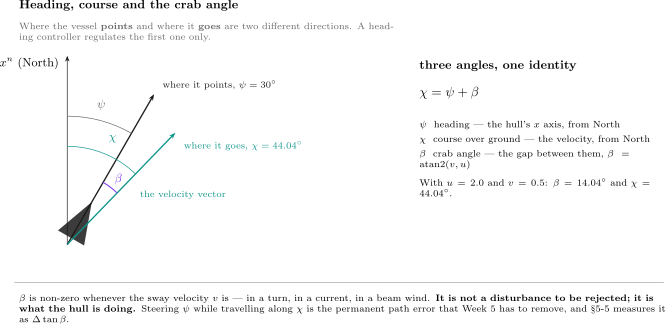

| 그림에서 | 뜻 |
|---|---|
| 주황 반직선 | 선수각 $\psi$ — $x_b$ 가 가리키는 방향 |
| 파란 반직선 | 침로 $\chi$ — 속도가 실제로 가는 방향 |
| 초록 호 | 크랩각 $\beta$, 둘 사이의 간격 |

$$
\beta = \operatorname{atan2}(v,\ u), \qquad \chi = \psi + \beta
$$

| 기호 | 정의 | 단위 |
|---|---|---|
| $\psi$ | 선수각, 북에서 $x_b$ 까지 | rad |
| $\chi$ | 대지 침로, 북에서 속도 벡터까지 | rad |
| $\beta$ | 크랩각 | rad |
| $u,\ v$ | 전진·횡동요 속도 (1주차) | m/s |

- 1주차의 예로, $\psi = 30°$ 에서 $u = 2.0$ m/s, $v = 0.5$ m/s 이면 $\beta = \operatorname{atan2}(0.5,\ 2.0) = 14.04°$ 이고 $\chi = 44.04°$ 다.
- 크랩각은 $v \neq 0$ 이면 언제나 0 이 아니다 — 선회 중에, 조류 속에서, 횡풍에서. 그것은 선체가 하고 있는 일이고, 없애야 할 오차가 아니다. 1주차는 횡방향 구동이 아예 없는 배의 선회 실행에서 $\beta = -20.3°$ 를 쟀다.
- Fossen 은 $\beta = \arcsin(v/U)$ 로 쓴다. $u > 0$ 이면 같은 수다. $\operatorname{atan2}(v,u)$ 형태는 후진에서도 옳다.
- 이번 주는 $\psi$ 를 조절하고 $\chi$ 는 가는 대로 둔다. **5주차는 그럴 수 없다.** 배가 침로를 따라 이동하는 동안 선수각을 조종하는 경로추종 법칙은 $\beta$ 곱하기 전방주시거리 정도의 횡방향 오차를 남긴다.

### 실험 4-4 · 두 속도에서 나오는 크랩각 (3분)

**무엇을 재는가.** 위 식을, 1주차가 잰 수치로. 여기에는 모델이 없다. 크랩각은 속도의 성질이고, Command Window 두 줄이 계산 전부다.

**열고 돌리기.**

```matlab
u = 2.0;  v = 0.5;  psi = 30;                  % 1주차의 값 / the Week 1 example
beta = atan2d(v, u)                            % 크랩각 / the crab angle
chi  = psi + beta                              % 침로 / the course over ground
```

나오는 출력:

```
beta =

   14.0362


chi =

   44.0362
```

| 해 볼 것 | 볼 것 |
|---|---|
| `v = -0.5;` | $\beta = -14.04°$: 좌현으로의 횡동요가 배를 가리키는 쪽의 좌현으로 나른다 |
| `v = 0;` | $\beta = 0$ 이고 $\chi = \psi$ — 선수각 제어기가 침로 제어기이기도 한 유일한 경우다 |
| `u = -2.0; v = 0.5;` | $\beta = 165.96°$: 후진에서도 $\operatorname{atan2}$ 는 진행 방향을 참되게 돌려준다. $\arcsin(v/U)$ 는 그러지 못한다 |

- 이번 주의 배는 특정한 $\chi$ 를 요구받지 않으므로 크랩각은 관측만 된다. 5주차는 **경로**를 조종하고, 그때 $\beta$ 는 ILOS 가 없애야 하는 상주 오차가 된다.

## 4-5. 튜닝 순서를, 선수각에 적용한다

이 절이 답하는 것: 모델 없이 이 축의 게인을 어떻게 고르는가 — 그리고 모멘트 한계는 무엇을 더하는가?

2주차 §2-12 의 절차다. 요구사항: $10°$ 선회가 3 s 안에 2 % 이내, 오버슛 5 % 이하. 약해진 프로펠러에서도 선수각 오차 없음. $90°$ 선회에서 와인드업 없음.

| 단계 | 하는 일 | 측정한 것 | 결정 |
|---|---|---|---|
| 0 | 요구사항. 플랜트가 얌전한가? | §4-2: 회두율은 안정, 선수각은 적분, 약하게 비선형 | 진행 |
| 1 | P 만. 단위에서 $K_p$ 의 자리수 | $10°$ 오차는 $0.175$ rad 이고, $K_p = 300$ 은 쓸 수 있는 $70.85$ 중 $52$ N·m 를 요구한다 | $K_p = 300$ |
| 2 | P 응답을 읽는다 | 오버슛 $12.2\,\%$, 정착 $3.26$ s — 울린다 | D 를 더한다 |
| 3 | 응답이 좋아지는 동안 $K_d$ 를 올린다 | $K_d = 25$: $7.61\,\%$, $2.98$ s. $50$: $4.10\,\%$, $2.22$ s. $100$: $0.39\,\%$, $1.72$ s. $150$: $0\,\%$, $2.42$ s | $K_d = 100$, 정착이 가장 빠르다 |
| 4 | 무엇이 밀어내면 I 를 더한다 | 70 % 좌현 프로펠러가 $0.80°$ 를 남기고, $K_i = 20$ 이 그것을 없앤다. 정착 $1.98$ s | $K_i = 20$ |
| 5 | 모멘트를 본다: 큰 선회 | $90°$ 선회가 모멘트를 포화시킨다. 그동안 적분이 무엇을 하는지는 back-calculation 게인 $K_b$ 가 정한다 | 아래 |

**모멘트 한계와 $K_b$.** 아래 실험 4-5 가 잰, 세 선회에 대한 정착시간과 오버슛:

| $K_b$ | $10°$ 선회 | 약한 프로펠러, $10°$ | $90°$ 선회 |
|---|---|---|---|
| 0 (안티와인드업 없음) | 12.42 s, 4.35 % | 1.98 s, 0 % | 37.12 s, **15.57 %** |
| 0.05 | 7.28 s, 3.20 % | 2.18 s, 0 % | 24.14 s, 6.38 % |
| **0.1** | **2.64 s, 2.06 %** | 9.38 s, 0 % | **5.80 s, 0 %** |
| 1 | 33.68 s, 0 % | 35.00 s 이상, 0 % | 48.50 s, 0 % |

- **$K_b$ 가 너무 작으면 와인드업.** 모멘트가 한계에 있는 동안 적분이 계속 충전된다 — $90°$ 선회에서 $79.7$ N·m 까지 — 그리고 배가 $15.6\,\%$ 오버슛하고 돌아오는 데 37 s 가 걸린다. $10°$ 선회도 조금은 감긴다. 계단에서의 미분 킥이 한순간 한계에 닿기 때문이다.
- **$K_b$ 가 너무 크면 적분이 끌려 내려간다.** 포화인 동안 back-calculation 은 적분을 "요구가 한계와 같아지는 값" 쪽으로 당긴다. $K_p e$ 만으로 수백 N·m 를 요구하고 있으면 그 값은 0 보다 한참 아래다 — $K_b = 1$ 에서 $-249.5$ N·m — 그리고 배가 수십 초 동안 선수각에 못 미친 채 멈춰 있다. 2주차 §2-11 의 $I^\star$ 를 배 위에서 본 것이다.
- **$K_b = 0.1$** 이 절충이다. $90°$ 선회는 적분이 아예 없는 것처럼 움직이고(PD 단독의 $5.60$ s 에 대해 $5.80$ s), $10°$ 선회는 요구사항을 만족하고, 약해진 프로펠러도 더 느리게나마 여전히 보정된다.

결과 $K_p = 300$, $K_d = 100$, $K_i = 20$, $K_b = 0.1$ 이 `W04_0_setup.m` 의 기본값이다. 배의 전달함수는 적지 않았다.

### 실험 4-5 · 튜닝 순서, 그리고 큰 선회 (15분)

**무엇을 재는가.** 위 표의 다섯 단계, 그리고 포화하는 선회만이 정할 수 있는 수 하나 — $K_b$. 세 선회에서 한꺼번에 잰다.

**모델.** `W04_H_tuning` — 모멘트 한계와 back-calculation 경로를 갖춘 전체 루프. 모멘트를 의미 있을 만큼 오래 한계에 올려 두는 것이 $90°$ 선회다.

**열고 돌리기.**

```matlab
W04_0_setup
psi_step = 90; T_final = 60;
open_system('W04_H_tuning')        % Run — Kb = 0.1: PD 만큼 깔끔하다 / as clean as PD alone
Kb = 0;                            % Run — 적분이 쌓여 15.6 % 넘친다 / windup, 15.6 % overshoot
Kb = 1;                            % Run — 너무 끌어내려 한참 못 미친다 / dragged down, and slow
W04_H_tuning_by_hand               % 다섯 단계와 Kb 세 선회를 한 번에 / all five steps and three turns
```

나오는 출력:

```
  W04 Experiment 4-5  the tuning order on the heading
    1-2  Kp = 300 (10 deg asks 52 N m of the 70.8 available): overshoot 12.2 %, settle 3.26 s: it rings, so D
    3    Kd = 25: 7.61 %, 2.98 s   50: 4.10 %, 2.22 s   100: 0.39 %, 1.72 s   150: 0.00 %, 2.42 s   -> Kd = 100 (fastest settling)
    4    weak port propeller (0.7): PD leaves 0.80 deg; Ki = 20 removes it: 0.007 deg left, settle 1.98 s
    5    the moment limit: Kb against three turns (settle [s], overshoot %)
         Kb      10 deg turn        weak propeller     90 deg turn
         0       12.42 s   4.35 %    1.98 s   0.00 %   37.12 s  15.57 %
         0.05     7.28 s   3.20 %    2.18 s   0.00 %   24.14 s   6.38 %
         0.1      2.64 s   2.06 %    9.38 s   0.00 %    5.80 s   0.00 %
         1       33.68 s   0.00 %   35.00 s   0.00 %   48.50 s   0.00 %
         PD alone, 90 deg turn: 5.60 s, 0.00 %
         final: Kp = 300, Kd = 100, Ki = 20, Kb = 0.1
```

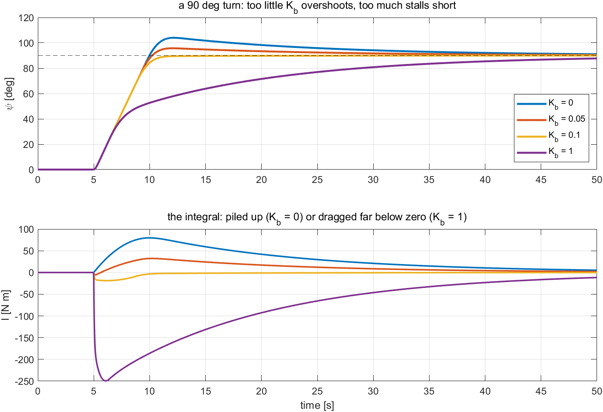

| 그림에서 | 뜻 |
|---|---|
| 위 | $K_b = 0, 0.05, 0.1, 1$ 에 대한 $90°$ 선회의 선수각 |
| 아래 | 적분 항 |

**그림을 단계와 대조해 읽기.**

| 볼 곳 | 거기 있는 것 | 어느 단계 또는 규칙을 보이나 |
|---|---|---|
| 위 칸, 약 8 s **이전**의 네 곡선 | 한 줄이다 | 모멘트가 한계에 있고, 적분이 무엇을 하든 배는 낼 수 있는 만큼 빠르게 돈다 |
| 아래 칸, $K_b = 0$ 곡선이 **올라간다** | $79.7$ N·m 까지 | 5단계, 와인드업: 오차가 몇 초 동안 크고, 저장을 빼는 것이 없다 |
| 위 칸, $K_b = 0$ 곡선이 $90°$ **를 지나간다** | $15.57\,\%$, 그리고 돌아오는 데 37 s | 2주차 §2-11: 저장은 명령을 지나가야만 소진된다 |
| 아래 칸, $K_b = 1$ 곡선이 **내리꽂힌다** | $-249.5$ N·m 까지 | 2주차 §2-11 의 $I^\star$: $K_p e$ 가 수백 N·m 를 요구하고 있으면 그것을 상쇄하는 값은 0 보다 한참 아래다 |
| 위 칸, $K_b = 1$ 곡선이 못 미친 채 **멈춰 있다** | 수십 초 | 같은 것: 선수각을 마치기 전에 그 저장을 되돌려야 한다 |
| 위 칸, $K_b = 0.1$ 곡선 | $5.80$ s, 오버슛 없음 — PD 단독은 $5.60$ s | 5단계의 절충: 적분이 쌓이지도, 지나치게 빠지지도 않는다 |

**그림이 말하는 것**

- $K_b$ 가 너무 작으면 적분이 쌓여 배가 오버슛하고, 너무 크면 0 보다 한참 아래로 끌려가 배가 못 미친 채 멈춘다. $K_b = 0.1$ 은 PD 단독만큼 깔끔하게 돈다.

| 해 볼 것 | 볼 것 |
|---|---|
| `psi_step = 10; Kb = 0;` Run | 작은 선회도 조금 감긴다. 모멘트가 한순간 한계에 닿고 정착이 $12.42$ s 로 늘어난다 |
| `Ki = 0; psi_step = 90;` Run | 적분이 없으면 감길 것이 없고, $K_b$ 는 아무 차이도 만들지 않는다 — 처방은 그 항이 있기 때문에만 존재한다 |

> [!tip] 수업에서
> - **목적** — 전체 절차, 그리고 구동기를 보지 않고는 내릴 수 없는 결정 하나.
> - **가리킬 곳** — 80 N·m 까지 오르는 파란 적분과 $-250$ N·m 로 내리꽂히는 보라 적분. 그리고 약 8 s 부터 갈라지는 선수각 곡선들.
> - **질문** — "3주차에서는 도움이 됐는데 여기서는 왜 $K_b$ 가 크면 나빠지는가?" 큰 선회에서는 $K_p e$ 만으로 수백 N·m 를 요구한다. Back-calculation 은 적분을 그것을 상쇄할 값, 곧 0 보다 한참 아래로 끌어당기고, 그것을 나중에 되돌려야 한다.
> - **질문** — "약한 프로펠러 경우가 $K_b = 0.1$ 에서 왜 더 느린가?" 계단에서의 미분 킥이 한계에 닿아 back-calculation 이 적분을 끌어내리고, 그 다음 적분이 고장이 요구하는 $4.19$ N·m 까지 다시 올라가야 한다.
> - **남길 것** — back-calculation 게인은 절충이고, 중요한 선회들을 실제로 돌려서 고른다.

## 4-6. 감김

이 절이 답하는 것: 선수각 오차를 왜 `ssa` 에 통과시키는가?

**무엇이 관측되는가.** 배가 $170°$ 를 유지하고 있고 $-170°$ 로 명령을 받는다. 오차 경로에서 블록 하나를 빼면 배가 **반대쪽으로 한 바퀴 돌아간다** — $20°$ 가 아니라 $340°$ 다.

**거기서 무엇이 따라 나오는가, 한 줄씩.**

1. 어떤 각과 그 각에 $360°$ 를 더한 것은 같은 선수각이므로, 두 각의 차는 $360°$ 까지만 정의된다. 날 것의 뺄셈 $-170 - 170 = -340°$ 는 산술로는 옳고 물리로는 터무니없다.
2. 제어기는 주어진 수에 작용한다. $-340°$ 는 좌현으로 $340°$ 선회를 요구하고, 배는 그대로 한다.
3. 처방은 오차를 가장 짧은 동등한 각으로 보내는 것이다 — $\text{ssa}(e) = \operatorname{atan2}(\sin e,\ \cos e)$ 는 $(-180°,\ 180°]$ 의 값을 돌려주고, 여기서는 $+20°$ 다. 사인과 코사인은 $360°$ 를 더해도 바뀌지 않고, 그것이 바로 둘을 쓰는 이유다.
4. 이것은 예외적인 경우가 아니다. 5주차의 유도는 $(-180°,\ 180°]$ 어디로든 명령 선수각을 만들고, 다리 몇 개로 된 임무는 이음매를 예사로 지난다.

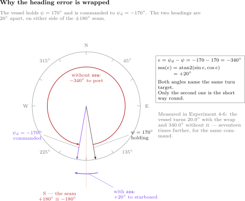

| 그림에서 | 뜻 |
|---|---|
| 회색 원 | 북에서 시계방향으로 잰 모든 선수각. 배의 컴퍼스가 읽는 대로 |
| S 의 붉은 점선 | 이음매. $+180°$ 와 $-180°$ 가 같은 방향이고 수가 점프하는 곳 |
| 검은 반직선 | 배가 가리키는 곳, $\psi = 170°$ |
| 보라 반직선 | 가리키라고 요구받은 곳, $\psi_d = -170°$, 곧 $190°$ |
| 원 바깥의 보라 호 | 감긴 오차가 요구하는 선회: 우현으로 $+20°$ |
| 원 안쪽의 붉은 호 | 날 것의 뺄셈이 요구하는 선회: 좌현으로 $-340°$, $20°$ 를 뺀 한 바퀴 |
| 오른쪽 상자 | 두 수, 그리고 둘째를 첫째로 바꾸는 한 줄 |

**그림을 한 각씩 읽기.**

| 단계 | 그 수 | 제어기가 그것으로 하는 일 |
|---|---|---|
| 배가 유지하고 있다 | $\psi = 170°$ | 아직 아무것도 |
| 명령이 도착한다 | $\psi_d = -170°$ | $190°$ 와 같은 방향. 컴퍼스는 둘을 구별할 수 없다 |
| 날 것의 뺄셈 | $e = -170 - 170 = -340°$ | 큰 **음의** 오차 — **좌현**으로 세게 돌고, $340°$ 동안 계속 돈다 |
| 감으면 | $\text{ssa}(-340°) = +20°$ | 작은 **양의** 오차 — **우현**으로 $20°$ 만 틀어 준다 |
| 선회 뒤 | $190°$, 또는 $-170°$ | 어느 쪽이든 같은 선수각이다. 다른 것은 경로뿐이었다 |

- **`ssa` 가 하는 일, 한 문장으로.** $180°$ 미만의 모든 오차는 있는 그대로 두고, $180°$ 를 넘는 모든 오차는 반대 방향의 동등한 선회로 바꾼다. 요구되고 있는 선수각을 바꾸는 일은 결코 없다 — 거기 가는 경로만 바꾼다.
- **왜 `if` 가 아니라 $\operatorname{atan2}(\sin e, \cos e)$ 인가.** $360°$ 를 더하거나 빼도 $\sin e$ 도 $\cos e$ 도 바뀌지 않으므로, 쌍 $(\sin e, \cos e)$ 는 이미 감긴 각 **그 자체**다. `atan2` 는 그것을 되읽을 뿐이다. 한 식이 $e = \pm 540°$ 와 그 너머까지 모든 경우를 덮고, 틀릴 분기가 없다.
- **비용.** 정상 운전에서는 없다. $\lvert e\rvert < 180°$ 이면 출력이 입력과 같으므로 §4-3 에서 튜닝한 모든 게인이 영향을 받지 않는다. 이음매를 지날 때에만 작용한다.
- **반드시 그 앞에 와야 하는 것 하나.** 감김은 **모든** 게인 앞에 있어야 하고, 모델들이 그렇게 둔다 — `e` → `ssa` → `Kp`, `D filter`, `Ki`. $340°$ 오차가 적분기에 닿으면 배가 하지 않을 선회를 저장하게 된다.

아래 실험 4-6 이 잰 값. 배가 $170°$ 에 있고 $t = 20$ s 에 $-170°$ 를 명령받는다.

| `use_ssa` | 20 s 뒤 실제 선회량 |
|---|---|
| 1 | $20.0°$ |
| 0 | $340.0°$, 반대쪽으로 |

- 같은 명령 선수각에 대해 열일곱 배 멀다.

### 실험 4-6 · 감김 (10분)

**무엇을 재는가.** 2번과 3번 줄 — 하나의 같은 명령에 대해, 오차 경로에 감김이 있을 때와 없앴을 때 배가 실제로 수행하는 선회.

**모델.** `W04_G_wrap` — 튜닝된 루프에 감긴 오차와 날 것의 차이를 고르는 스위치 `use_ssa` 가 있다. 두 실행 사이에 다른 것은 없다.

**열고 돌리기.**

```matlab
W04_0_setup
psi_step = 170; psi_step2 = -170; t_step2 = 20; T_final = 60;
open_system('W04_G_wrap')          % Run — 20 도만 돌린다 / a 20 deg turn
use_ssa = 0;                       % Run — 반대로 340 도 / 340 deg, the other way
W04_G_the_wrap                     % 두 실행을 한 번에 / both runs at once
```

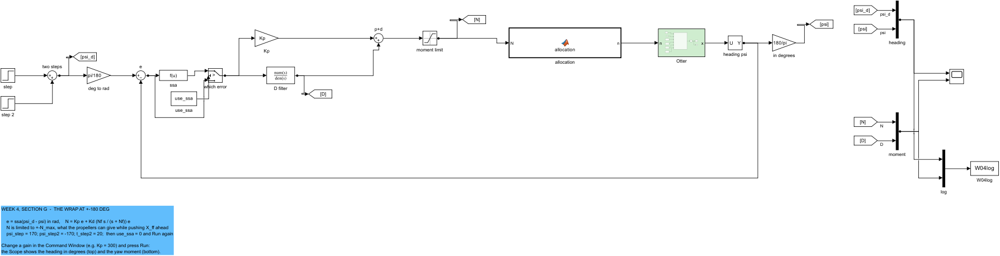

| 그림에서 | 뜻 |
|---|---|
| `ssa`, `use_ssa`, `which error` | `use_ssa = 1` 이면 감긴 오차, 0 이면 날 것의 오차 |
| `step`, `step 2`, `two steps` | 5 s 에 $170°$, 그 다음 `t_step2` 에 $-170°$ |

나오는 출력:

```
  W04 Experiment 4-6  170 deg, then -170 deg at t = 20 s
    use_ssa   heading at 20 s [deg]   heading at 60 s [deg]   turned after 20 s [deg]
    1                         170.0                   190.0                      20.0
    0                         170.0                  -170.0                     340.0
```

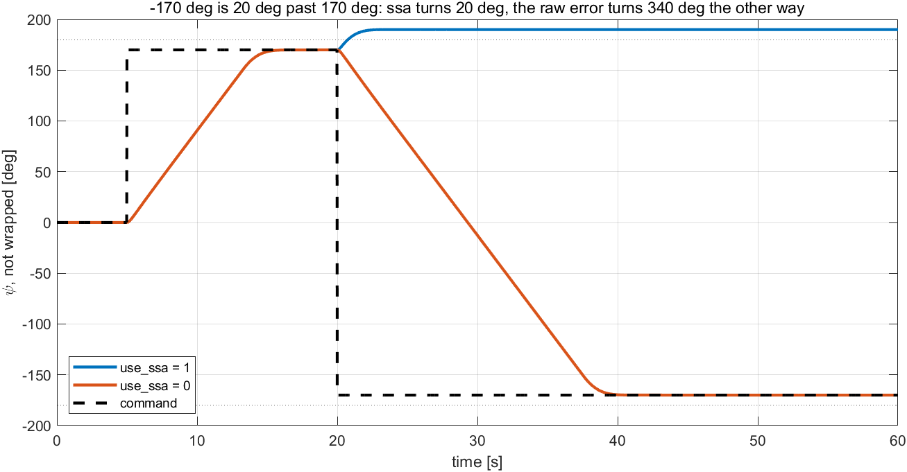

| 그림에서 | 뜻 |
|---|---|
| 곡선들 | 감지 않은 선수각. `ssa` 가 있을 때와 없을 때. 점선은 $\pm 180°$ |

**그림을 유도와 대조해 읽기.**

| 볼 곳 | 거기 있는 것 | 어느 줄이 예측했나 |
|---|---|---|
| $t = 20$ s **까지**의 두 곡선 | $170°$ 에서 같다 | 아직 이음매를 지나지 않았고, 두 오차 경로는 그 밖의 모든 곳에서 일치한다 |
| $170°$ 를 **떠나는** 두 곡선이 반대 방향이다 | $+20°$ 와 $-340°$ | 2번 줄: 제어기는 건네받은 수가 가리키는 쪽으로 돈다 |
| 각 곡선이 **끝나는** 곳 | $190°$ 와 $-170°$ | 1번 줄: 같은 선수각을 두 가지로 쓴 것이다. 선회가 보이도록 그림은 선수각을 감지 않고 둔다 |
| $340°$ 곡선이 점선 $\pm 180°$ 를 **지나간다** | 원을 한 바퀴 쓸고 간다 | 3번 줄: `ssa` 가 막으려고 존재하는 것 |

**그림이 말하는 것**

- $190°$ 와 $-170°$ 는 같은 선수각이다. `ssa` 가 있으면 배는 $20°$ 선회로 거기에 닿고, 없으면 반대쪽으로 $340°$ 돌아서 닿는다.

| 해 볼 것 | 볼 것 |
|---|---|
| `use_ssa = 0` 으로 `psi_step2 = 150;` | 이음매를 지나지 않으므로 두 설정이 정확히 일치한다. 이 결함은 명령이 마침 $\pm 180°$ 를 지날 때까지 숨어 있다 |
| `use_ssa = 0` 으로 `psi_step = -170; psi_step2 = 170;` | 같은 결함이 반대 방향으로 — 우현으로 $340°$ 선회 |

> [!tip] 수업에서
> - **목적** — 코드 한 줄, 그리고 그것을 빼놓는 비용.
> - **가리킬 곳** — 20 s 에 $170°$ 를 반대 방향으로 떠나는 두 곡선.
> - **질문** — "그려진 선수각이 왜 $-170°$ 가 아니라 $190°$ 에서 끝나는가?" 선회 방향이 보이도록 그림이 선수각을 감지 않고 보인다. 물리로는 같다.
> - **남길 것** — 어떤 게인이 보기 전에 모든 선수각 오차를 감는다.

---

## 4-7. 안쪽 루프를 조립한다: 오차 둘, 힘 둘, 프로펠러 둘

**무엇이 관측되는가.** 네 절이 각각 선수각 법칙의 한 조각을 정했고, 그 조각들은 서로 다른 자리에서 정해졌다 — 감김은 §4-6, 미분은 §4-3d, 한계는 §4-0. 한 줄로 쓰면 결과는 소리 내어 읽을 만큼 짧고, 그것이 곧 `heading autopilot` 블록의 내용 전부다.

$$
\boxed{\ N = K_p\,\mathrm{ssa}(\psi_d - \psi)\ -\ K_d\, r\ },\qquad \lvert N\rvert \le N_{\max}
$$

| 기호 | 양 | 값 · 출처 |
|---|---|---|
| $\psi_d$ | 명령 선수각 | rad. 이번 주는 계단, 5주차는 유도 법칙 |
| $\psi$ | 선수각, 상태 12 | rad |
| $r$ | 회두율, 상태 6 — **측정한 것이고 미분한 것이 아니다** | rad/s |
| $K_p$ | 비례 게인 | rad 당 $300$ N·m, `W04_0_setup` |
| $K_d$ | 회두율 게인 | rad/s 당 $100$ N·m, `W04_0_setup` |
| $N_{\max}$ | 모멘트 한계, 프로펠러가 줄 수 있는 것에서 | $70.85$ N·m, §4-0 |

**결과.** 그 한 줄에 결정 셋이 보이고, 각각은 이번 주 앞쪽의 측정이 강제한 것이다.

| 법칙에서 | 그 결정 | 어디서 강제되었나 |
|---|---|---|
| 오차를 감싼 $\mathrm{ssa}(\cdot)$ | **어떤 게인이 보기 전에** $(-\pi, \pi]$ 로 감는다 | §4-6: 없으면 $20°$ 선회가 $340°$ 선회가 된다 |
| $+K_d\,\dot e$ 가 아니라 $-K_d\,r$ | 미분을 오차가 아니라 **측정값**에서 받는다 | §4-3d: 필터를 건 오차 형태는 계단에서 $K_d N_f$ 만큼 킥한다 |
| $\lvert N\rvert \le N_{\max}$ | 프로펠러 둘이 실제로 만들 수 있는 것으로 제한한다 | §4-0, 그리고 그것을 무시하면 §3-4 의 와인드업이 일어난다 |

**부호의 유도, 한 줄로.** D 항은 흔히 $+K_d\,\mathrm{d}e_\psi/\mathrm{d}t$ 로 쓴다. $e_\psi = \psi_d - \psi$ 이고 명령이 일정하면 $\dot e_\psi = -\dot\psi = -r$ 이므로

$$
+K_d\,\frac{\mathrm{d}e_\psi}{\mathrm{d}t} \;=\; -K_d\,r
$$

   두 형태는 **같은 항**이고, 마이너스 부호는 외울 관습이 아니라 연쇄법칙이 돌려주는 것이다. 다른 것은 명령이 일정하지 *않을* 때 무엇이 일어나는가뿐이고, 그 차이가 §4-3d 의 전부다 — 오차 형태는 $\dot\psi_d$ 를 모멘트로 넘기고 회두율 형태는 넘기지 않는다.

> [!important] 킥은 실제로 얼마나 큰가
> $\psi_d$ 의 단위 계단에서 필터를 건 오차 형태는 계단 순간에 $K_d N_f = 100 \times 20 = 2000$ N·m 를 요구한다. 모멘트 한계는 $N_{\max} = 70.85$ N·m 다. 그 요구는 따라서 **배가 가진 전부의 28.2 배**이고, 그 전부가 포화에 버려지며 조종에는 쓰이지 않는다. 이 강의가 회두율 형태를 쓰는 이유가 그 수다.

**그 모멘트는 어디로 가는가.** 이 블록의 출력은 뉴턴미터 단위의 수이고, Otter 에는 뉴턴미터를 받는 구동기가 없다. §3-6 이 그것을 축 회전수로 바꾸는 두 단계를 만들었고, 그 절이 0 으로 두었던 입력을 이번 주가 공급한다.


| 다이어그램에서 | 이번 주의 몫 |
|---|---|
| 아래쪽 줄, `heading autopilot` | 위에 상자로 둔 법칙 — 오차에 $\mathrm{ssa}$, 측정된 회두율에 $K_d$ |
| $r$ 로 표시된 되먹임 | 합산점을 지나지 않고 **곧바로 D 항으로** 들어간다. 다이어그램이 두 경로를 따로 그리는 이유가 정확히 이것이다 |
| `allocation` 으로 들어가는 $N$ | §3-6 이 0 으로 둔 입력. 이제 0 이 아니다 |
| 위쪽 줄 | 3주차. 바뀌지 않았고 다시 튜닝하지도 않았다 |

$N \neq 0$ 이 되면 §3-6 의 2번 줄의 행렬이 드디어 무언가를 한다.

$$
F_{L,R} = \frac{X}{2} \pm \frac{N}{2b}
$$

   전진력은 여전히 똑같이 나뉘고, 모멘트는 **좌현 프로펠러에 더해지고 우현에서 빠진다.** $N > 0$ 에서 배가 우현으로 도는 이유가 그것이다. 그 행렬이 어디서 오는지는 §3-6 이고, $N$ 이 더 이상 0 이 아닌 지금 다시 읽을 그림이 이것이다.


| 그림에서 | $N \neq 0$ 이 된 지금 무슨 뜻인가 |
|---|---|
| 선체 위의 청록 $N$ 화살표 | 이번 주의 출력. 그것이 0 이 아닌 첫 주차다 |
| 셋째 줄, $b\,(F_L - F_R)$ | 모멘트는 **차이**에서 나오므로, 그것을 명령하는 것은 두 프로펠러를 서로 벌리는 것이다 |
| 비어 있는 가운데 줄 | 여전히 비어 있다. 선체는 횡방향 힘을 만들지 않으므로 선수각이 똑바로가 아닌 어딘가로 가는 **유일한** 방법이다 — 5주차가 그 위에 세운다 |
| 3행의 $\tfrac{1}{2b}$ 와 $-\tfrac{1}{2b}$ | 모멘트를 지레로 나누어 한쪽에 더하고 다른 쪽에서 뺀다. 짧은 지레는 추력을 비용으로 치른다 — $2b = 0.79$ m 에 걸친 $N = 70.85$ N·m 는 $89.68$ N 의 차이가 필요하다 |

둘째 단계, 곧 프로펠러 곡선은 요구된 추력이 축 회전수가 되는 자리이고, 그 요구가 애초에 가능했는지를 정하는 단계다.


| 그림에서 | 이번 주가 더하는 것 |
|---|---|
| STEP 1, 위 | §3-6 의 행렬. 이제 그 안에 0 이 아닌 $N$ 이 있다 |
| STEP 2, 주황 가지 | 센 선회 동안 **짐을 진** 프로펠러가 앉는 자리 — 그 가지의 맨 끝이다 |
| STEP 2, 파란 가지 | **짐을 벗은** 쪽이 가는 자리: 후진, 더 약한 곡선 위 |
| 표시된 점들 | $F_{\max} = 119.7$ N 과 $F_{\min} = -66.7$ N. $N_{\max}$ 를 그 둘에 맞춰 풀었다 |

이번 주의 수치를 두 단계에 통과시키면, $30°$ 선회의 가장 센 지점에서

| 양 | 값 | 어디서 |
|---|---|---|
| $X$ | $60.00$ N | §4-0 의 상수 `X_ff` |
| $N$ | $70.85$ N·m | 제한, 포화 상태 |
| $F_L = X/2 + N/(2b)$ | $30.00 + 89.68 = 119.68$ N | 정확히 $= F_{\max}$ |
| $F_R = X/2 - N/(2b)$ | $30.00 - 89.68 = -59.68$ N | 후진이고, $F_{\min} = -66.7$ N 안쪽 |
| $n_L = \sqrt{F_L/k_{pos}}$ | $103.93$ rad/s | 정확히 $= n_{\max}$ |
| $n_R = -\sqrt{\lvert F_R\rvert/k_{neg}}$ | $-96.23$ rad/s | $n_{\min} = -101.7$ 안쪽 |

- $N_{\max}$ 는 고른 것이 아니라 **계산한** 것이다. 짐을 진 프로펠러가 자기 한계에 정확히 앉고 그것을 넘지 않도록. `W04_0_setup` 의 그 계산이고, §4-0 의 표가 그 값이 나온 곳이다.

**같은 두 단계를, 모델 안에서**

두 단계가 블록 하나에 산다. 아래는 그 블록이 들고 있는 코드이고 `W04_H_tuning.slx` 에서 그대로 복사한 것이다. 이번 주 어느 모델에서든 `allocation` 을 두 번 누르면 같은 글이 보인다. 주석은 블록 자신의 것이다.

```matlab
function n = allocation(N, X_ff, y_pont, k_pos, k_neg, port_eff)
%#codegen
%ALLOCATION  요 모멘트 N [N m] 를 두 프로펠러의 축 회전수 n [rad/s] 로 바꾼다.
%            Turn the yaw moment N [N m] into the shaft speeds n [rad/s] of the two propellers.
%
%   N 만 입력 포트다. 나머지는 작업공간 변수 (W04_0_setup) 에서 온다.
%   Only N is an input port; the rest come from the workspace (W04_0_setup).
%     X_ff      두 프로펠러가 함께 내는 전진력 / surge force from both propellers   [N]
%     y_pont    중심선에서 각 프로펠러까지의 거리 / each propeller's arm              [m]
%     k_pos     앞으로 밀 때 추력 계수 / thrust coefficient ahead
%     k_neg     뒤로 당길 때 추력 계수 / thrust coefficient astern
%     port_eff  좌현 프로펠러 효율, 보통 1 (절 F 는 0.7) / port efficiency, 1 unless section F

% 1) 두 프로펠러의 추력. 둘 다 X_ff 의 절반씩 밀고, 모멘트는 한쪽을 더 세게,
%    다른 쪽을 덜 세게 밀어 만든다. 팔 길이가 y_pont 이므로
%        y_pont (T1 - T2) = N,   T1 + T2 = X_ff
%    Both push half of X_ff ahead; the moment comes from pushing one side
%    harder and the other less. With arm y_pont:
%        y_pont (T1 - T2) = N,   T1 + T2 = X_ff
T = [X_ff/2 + N/(2*y_pont);      % 좌현 / port
     X_ff/2 - N/(2*y_pont)];     % 우현 / starboard

% 2) 약한 좌현 프로펠러: 요구한 추력의 port_eff 배만 낸다 (절 F).
%    A weak port propeller delivers only port_eff of what is asked (section F).
T(1) = port_eff * T(1);

% 3) 프로펠러 곡선 T = k n|n| (1주차) 을 하나씩 n 에 대해 푼다.
%    앞으로와 뒤로의 계수가 다르다 (k_pos > k_neg).
%    Solve the propeller curve T = k n|n| (Week 1) for each n; the coefficient
%    differs ahead and astern (k_pos > k_neg).
n = zeros(2,1);
for i = 1:2
    if T(i) >= 0
        n(i) =  sqrt( T(i) / k_pos);   % 앞으로 / ahead
    else
        n(i) = -sqrt(-T(i) / k_neg);   % 뒤로 / astern
    end
end
end
```

| 코드에서 | 그림에서 | 비고 |
|---|---|---|
| `T = [...]` 의 두 줄 | $\mathbf{T}^{-1}$ 의 줄 $\bigl[\tfrac12\ \ \tfrac{1}{2b}\bigr]$ 과 $\bigl[\tfrac12\ \ -\tfrac{1}{2b}\bigr]$, STEP 1 | $\mathbf{T}^{-1}$ 을 손으로 풀어 쓴 것이고 $b = $ `y_pont` 다. §5-7 은 대신 $\mathbf{B}$ 를 적고 MATLAB 이 풀게 한다. 산술은 같다 |
| 유일한 입력 포트 `N` | 청록 $N$ 화살표 | §4-3 의 P–D 법칙이 그것을 만든다. `X_ff` 는 이번 주에 상수이고, 5주차가 그것을 속도 루프의 출력으로 바꾼다 |
| `T(1) = port_eff * T(1);` | 없다 — 그림은 건강한 배를 그린다 | §4-F 의 손상된 프로펠러. `port_eff = 1` 이면 이 줄은 아무것도 하지 않고, 그래서 공유 블록에 들어 있을 수 있다 |
| `for i = 1:2` 루프 | STEP 2 의 두 가지, 프로펠러마다 한 번 | 각 프로펠러를 곡선에서 **따로** 읽는다. 어느 쪽도 다른 쪽을 도울 수 없고, 그래서 한계가 배 단위가 아니라 프로펠러 단위다 |
| `T(i) >= 0` 대 `else` | 주황 가지와 파란 가지 | 선회의 가장 센 지점에서 루프는 같은 시간 스텝 안에 좌현에는 주황 가지를, 우현에는 파란 가지를 탄다 |

**이 절의 모든 수를 확인하려면**

```matlab
cd _tools
verify_w04_heading
```

실제 출력:

```
  verify_w04_heading

    1 W04_vars = W04_0_setup                     OK    
    2 N_max = 70.85 N m                          OK    70.8488
    3 thrust split returns X_ff and N            OK    7.1e-15
    4 atan2(sin, cos) = MSS ssa                  OK    4.9e-16
    5 PD leaves no heading error                 OK    0.0009 deg

  ALL CHECKS PASSED
```

| 검사 | 무엇을 증명하나 |
|---|---|
| 2 | 모멘트 한계는 프로펠러 한계가 함의하는 그 값이고, 누가 고른 어림수가 아니다 |
| 3 | $(F_L, F_R)$ 을 $\mathbf{T}$ 로 되돌리면 그것이 나온 $(X, N)$ 이 $7\times10^{-15}$ 까지 돌아온다 — §3-6 의 2번 줄의 역이 정확하다 |
| 4 | `ssa` 블록이 같은 이름의 MSS 함수와 $5\times10^{-16}$ 까지 일치한다 |
| 5 | 적분이 없는 P–D 법칙도 정상 선수각 오차를 남기지 않는다. 요에는 맞서 싸울 복원 모멘트가 없기 때문이다(§4-3) |

| 해 볼 것 | 볼 것 |
|---|---|
| `Kd = 0;` 로 두고 `W04_F_PID` Run | 회두율 항을 뺀 것. 선수각이 울리고, 그 오버슛이 §4-3b 가 한 측정이다 |
| `Kp = 600;` Run | $N$ 이 더 일찍 제한에 닿고 더 오래 머문다. 선회가 비례해서 빨라지지는 않는다. $N_{\max}$ 가 움직이지 않았기 때문이다 |
| `W04_F_PID` 에서 `heading autopilot` 을 두 번 누르기 | 상자로 둔 법칙이 블록 단위로 — `ssa` 를 위한 `Fcn` 하나, 항마다 `Gain` 하나, 그리고 `N_max` 를 들고 있는 `Saturation` |

> [!tip] 수업에서
> - **목적** — 이번 주의 네 가지 따로 된 결정을 한 줄에 넣고, 그 줄이 프로펠러에 닿는 것을 지켜본다.
> - **가리킬 곳** — 다이어그램의 $r$ 화살표. 합산점을 지나지 않고 아래에서 제어기로 들어간다.
> - **질문** — "제한에서 $F_L$ 이 왜 정확히 $119.68$ N 인가?" $N_{\max}$ 를 그 조건으로 풀었기 때문이다. 그 한계는 프로펠러에 가진 것보다 더 요구하지 않는 가장 큰 모멘트다.
> - **질문** — "배가 앞으로 가는데 우현 프로펠러가 $-96$ rad/s 로 후진하고 있다. 잘못된 것인가?" 아니다 — 차동 추력 배가 세게 도는 방식이 그것이고, 센 선회가 속도를 비용으로 치르는 이유도 그것이다.
> - **남길 것** — 제어기의 출력은 힘이고, 구동기에 내리는 명령이 아니다. 그 둘 사이의 모든 것은 한계가 들어 있는 산술이다.

---

## 4-8. 안쪽 루프 둘을 한꺼번에: 속도 루프가 선수각 루프에 합류한다

**무엇이 관측되는가.** 지금까지의 모든 모델은 일정한 $X_{ff} = 60$ N 으로 선체를 밀었다. 선수각은 제어되고 속도는 제어되지 않았다 — $0.77$ m/s 는 누가 명령한 것이 아니고, 그저 추력과 항력이 균형을 이루는 자리다. 그 자리에 3주차의 속도 루프를 넣으면 배는 두 번째 제어기를 갖게 되고, 둘이 같은 프로펠러 두 개를 끌어 쓴다.

**결과.** 두 루프가 각자의 명령을 유지하고, 서로의 과도를 통과하면서도 그렇게 한다. 대가는 한계에서 치른다. 전진력이 더 이상 알려진 상수가 아니므로 모멘트 제한을 다시 계산해야 한다.

**유도.**

1. **법칙 둘, 바뀌지 않았다.** 어느 제어기도 수정되지 않는다. 선수각 법칙은 §4-7 의 것이고, 속도 법칙은 3주차의 것으로 적분기와 안티와인드업을 포함한다.

$$
N = K_p\,\operatorname{ssa}(\psi_d - \psi) - K_d\, r, \qquad
X = K_{p,u}(u_d - u) + I, \qquad \dot I = K_{i,u}(u_d - u) + K_{b,u}\bigl(X - X_{raw}\bigr)
$$

| 기호 | 양 | 값 · 출처 |
|---|---|---|
| $K_p, K_d$ | 선수각 게인 | $300$, $100$. `W04_0_setup`, §4-5 |
| $K_{p,u}, K_{i,u}$ | 속도 게인 | $200$, $200$. 3주차의 값 |
| $K_{b,u}$ | 속도 루프의 back-calculation 게인 | $1$ s⁻¹ — §4-5 의 `Kb` 가 **아니다**. 그것은 선수각 적분기의 것이다 |
| $X_{\max}$ | 전진력 한계 | $120$ N, 두 프로펠러 합쳐 |

2. **배분기 하나, 살아 있는 입력 둘.** §4-7 의 배분기는 이미 $X$ 와 $N$ 을 받는다. 바뀌는 것은 둘 중 하나가 상수이던 대신 이제 둘 다 신호로 도착한다는 것이다.

$$
\begin{bmatrix} T_L \\ T_R \end{bmatrix}
= \mathbf{T}^{-1}\begin{bmatrix} X \\ N \end{bmatrix}, \qquad
n_i = \pm\sqrt{\lvert T_i \rvert / k}
$$

3. **제한이 움직여야 한다.** $N_{\max} = 70.85$ N·m 는 $X = X_{ff} = 60$ N 에서 계산한 것이다. $X_{\max} = 120$ N 을 요구할 수 있는 속도 루프가 있으면 남아 있는 모멘트가 더 작고, 선수각 루프의 `Saturation` 은 그 더 작은 수를 들고 있어야 한다.

$$
N_{speed} = \min\Bigl\{2y_p\bigl(T_{\max} - \tfrac{X_{\max}}{2}\bigr),\; 2y_p\bigl(\tfrac{X_{\max}}{2} - T_{\min}\bigr)\Bigr\} = 47.15\ \text{N·m}
$$

   $N_{\max}$ 를 그대로 두면 배분기가 프로펠러에 없는 축 회전수를 요구하게 된다. 5주차 §5-7 이 이 식을 온전히 유도하고 그 비용을 재며, 이 절은 그 규칙이 처음 적용되는 자리다.

4. **왜 여기이고 5주차가 아닌가.** 5주차의 유도는 **명령 둘을 한꺼번에** 만든다 — 선수각과 속도. 그 둘을 받는 루프 쌍이 이 모델이다. 유도를 붙이기 전에 안쪽 쌍을 확인해 두면, 다음 주에 바깥 루프가 말을 듣지 않을 때 안쪽은 이미 결백한 것으로 알려져 있다.

### 실험 4-8 · 명령 둘, 루프 둘, 선체 하나 (10분)

두 명령 모두 `W04_0_setup` 에서 온 계단식이고 값마다 $30$ s 유지되므로, 그림이 보이는 것은 단일 계단 응답이 아니라 추종이다.

| 명령 | 값 | 유지 |
|---|---|---|
| $u_d$ | $0.8 \to 1.2 \to 1.0 \to 1.4$ m/s | 각 $30$ s |
| $\psi_d$ | $0 \to 20 \to -15 \to 30$ deg | 각 $30$ s |

```matlab
cd lectures/W04_simulink
W04_0_setup
W04_J_build_both          % once, to write the model
W04_J_speed_and_heading
```

실제 출력:

```
  W04 Experiment 4-8  both inner loops at once  (Kp = 300, Kd = 100, Kp_u = 200, Ki_u = 200)
    step   psi_d [deg]   psi end [deg]   u_d [m/s]   u end [m/s]   max |N| [N m]   max X [N]
     1           0.0           -0.00          0.80         0.800            0.00         120.0
     2          20.0           20.00          1.20         1.200           47.15         120.0
     3         -15.0          -15.00          1.00         1.000           47.15          82.3
     4          30.0           30.00          1.40         1.400           47.15         120.0

    the two limits, and how long each was reached
      |N| at N_speed = 47.15 N m  for  4.54 s
      X   at X_max   = 120.0 N    for  1.74 s
```

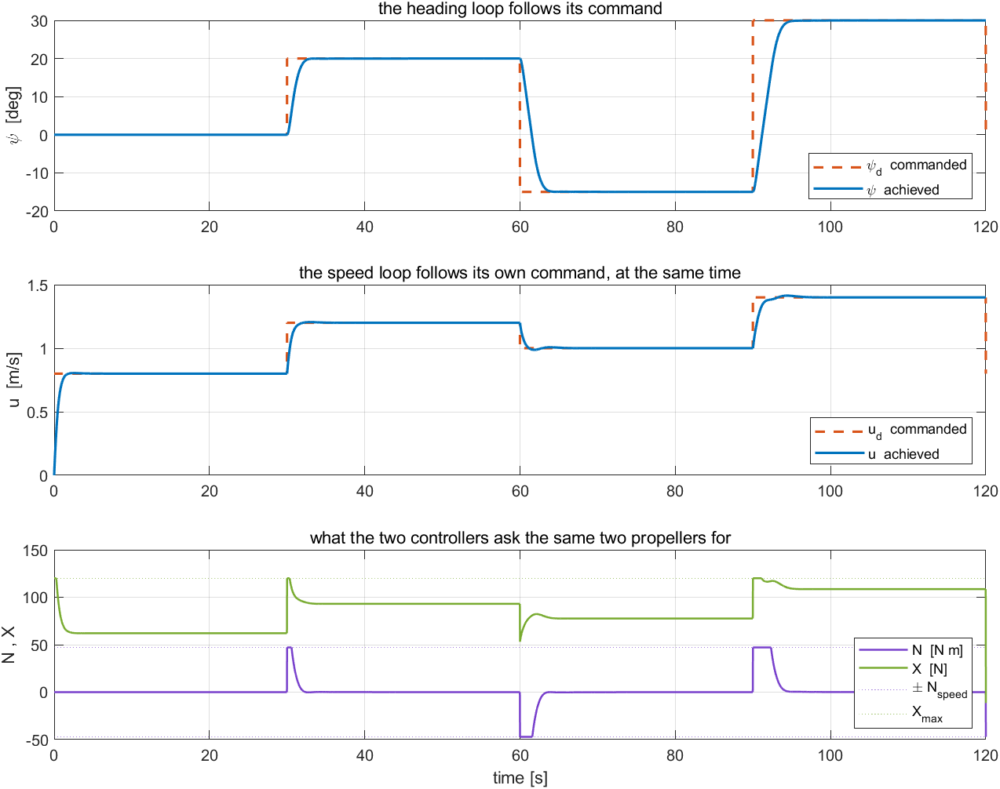

| 그림에서 | 뜻 |
|---|---|
| 1번 칸 | 명령 선수각과 실제 선수각, 도 단위 |
| 2번 칸 | 명령 속도와 실제 속도, 같은 순간들에서 |
| 3번 칸 | $N$ 과 $X$, 각각 자기 한계와 함께 |

**그림을 유도와 대조해 읽기.**

| 볼 곳 | 거기 있는 것 | 어느 줄을 정하나 |
|---|---|---|
| `psi end` 열 | 같은 값의 명령에 대해 $20.00$, $-15.00$, $30.00$ deg | 1번 줄: 선수각 법칙에 적분기가 없는데도 정상 오차가 없다 — §4-3 의 요점이고, 이제 그 아래에서 속도가 바뀌고 있다 |
| `u end` 열 | $0.800$, $1.200$, $1.000$, $1.400$ m/s | 1번 줄: 이것들을 정확하게 만드는 것은 속도 루프의 적분기다. 그것이 없으면 항력이 편차를 남긴다 |
| 1번 칸, $t = 60$ s | 속도 명령도 바뀌는 동안 선수각이 $35°$ 흔들려 간다 | 두 명령이 같은 순간에 움직이고 어느 루프도 다른 쪽에 흐트러지지 않는다 |
| 2번 칸, 코너마다의 처짐 | 수백분의 몇 m/s, 몇 초 안에 회복 | 센 선회는 속도를 비용으로 치르고, 적분기가 그것을 되사 온다 |
| 3번 칸, 코너마다의 $N$ | $\pm 47.15$ N·m 에서 평평하다 | 3번 줄: 제한은 `N_max` 가 아니라 `N_speed` 다 |
| 3번 칸, 같은 순간들의 $X$ | 자기 한계인 $120$ N 에서, 합쳐 $1.74$ s | 두 제어기가 같은 몇 초에 각자의 한계에 닿는다. 프로펠러 둘을 나눠 쓴다는 것이 그 뜻이다 |
| 3단계의 줄 | $\max X = 82.3$ N, 한계 아래 | 속도를 **덜** 요구하는 유일한 단계다. 필요한 힘이 더 작고 아무것도 포화되지 않는다 |

**그림이 말하는 것**

- 한 선체 위의 두 제어기는 둘 다 자기 한계 안에 있는 동안 서로 간섭하지 않는다 — 그리고 한계가 둘이 만나는 자리다. 속도 루프가 존재하기 전에 모멘트 제한을 다시 계산해야 했던 이유가 그것이다.

| 해 볼 것 | 볼 것 |
|---|---|
| `W04_0_setup` 에서 `N_speed = N_max;` 로 두고 재실행 | 배분기가 코너마다 우현 프로펠러에 없는 것을 요구한다. `n` 이 잘리고 선수각 응답이 법칙과 맞지 않게 된다 |
| `u_d_steps = [1.4 1.4 1.4 1.4];` | 속도 루프가 한 값을 유지하고 코너만이 그것을 흐트러뜨린다 — 계단 없는 2번 칸의 처짐들이다 |
| `Kb_u = 0;` | Back-calculation 을 뺀 것. 힘을 포화시킨 계단마다 그 뒤에 속도가 오버슛한다 |
| `speed loop` 을 두 번 누르고, 그 다음 `heading autopilot` | 두 서브시스템이 3주차와 4주차의 도면 그대로다. 둘 다 `_tools/add_speed_loop` 과 `_tools/add_heading_loop` 이 만들고, 5주차도 그것을 부른다 |

> [!tip] 수업에서
> - **목적** — 두 안쪽 루프가 동작에서는 독립이고 구동기 한계를 통해서만 결합된다는 것을 보인다.
> - **가리킬 곳** — $t = 90$ s 의 3번 칸. 두 곡선이 같은 순간에 각자의 한계에 평평하게 붙어 있다.
> - **질문** — "둘 다 더 원할 때 어느 루프가 이기는가?" 어느 쪽도 아니다. 배분기는 요구된 것을 나누고, 요구를 실현 가능하게 유지하는 것은 각 루프 자신의 Saturation 이다.
> - **남길 것** — 5주차의 유도가 만들어 낼 명령 쌍은 이미 갈 곳이 있다.

---

# Part 2 · 실습 실행 순서

Part 1 의 실험들을 순서대로 따라간 것이다. 이 표는 무엇을 돌렸는지의 색인이고, 집에서 그 주차를 되짚을 때 쓴다.

예제마다 **자기 모델**이 있고, 2·3주차와 같이 배치되어 있다. 제어기가 왼쪽, 추력 분배와 배가 가운데, **Scope 하나**가 오른쪽에 있고 위에 도 단위 선수각, 아래에 요 모멘트가 있다.

| 실험 | 모델 | 스크립트 | 무엇을 보이나 |
|---|---|---|---|
| 4-0 | 전부 | `W04_0_setup`, `W04_1_build_heading` | 파라미터, 그리고 코드로 쓰인 모든 모델 |
| 4-1 | `W04_H_tuning` | — | 앞에 `ssa`, 뒤에 추력 분배를 둔 3주차 캔버스 |
| 4-2 | `W04_C_open_loop` | `W04_C_plant_from_outside` | 계단 요 모멘트, 제어기 없음 |
| 4-3a | `W04_D_P` | `W04_D_proportional_only` | P 만 |
| 4-3b | `W04_E_PD` | `W04_E_derivative` | P + D |
| 4-3c | `W04_F_PID` | `W04_F_weak_propeller` | P + I + D, 약해진 좌현 프로펠러와 함께 |
| 4-3d | `W04_E_PD`, 다시 읽기 | — | 한 실행에서 읽은 두 D 형태: 킥, 그리고 회두율 형태였다면 요구했을 것 |
| 4-3e | `W04_I_rate` | `W04_I_rate_feedback` | D 항 셋, 각각이 실제로 조종한다 — 자이로, 오차, 그리고 틀린 부호 |
| 4-4 | 없음 — Command Window 두 줄 | — | $u$ 와 $v$ 에서 나오는 크랩각 |
| 4-5 | `W04_H_tuning` | `W04_H_tuning_by_hand` | 튜닝 순서, 큰 선회, 그리고 back-calculation 게인 |
| 4-6 | `W04_G_wrap` | `W04_G_the_wrap` | $\pm 180°$ 를 지나는 명령, `ssa` 스위치와 함께 |
| 4-7 | `W04_F_PID` | `verify_w04_heading` | 조립된 법칙, 그리고 두 축까지 따라간 모멘트 |
| 4-8 | `W04_J_both` | `W04_J_build_both`, `W04_J_speed_and_heading` | 속도 루프와 선수각 루프를 함께, 각각 계단식 명령을 따라간다 |

- 스크립트는 Run 이 이미 보여 주는 것을 여러 게인에 대해 한꺼번에 되풀이하고, Part 1 이 인용한 수치를 찍는다.
- 각 실험은 **수업에서** 노트로 끝난다 — 목적, 가리킬 곳, 질문과 그 답, 그리고 남길 한 문장.

---

# 정리

## 주차 정리

| 단계 | 한 일 | 어떻게 검증했나 |
|---|---|---|
| 1 | 2주차 제어기를 선수각 둘레에 놓고 `ssa` 와 추력 분배를 붙였다 | 일곱 모델에서 `check_overlaps` 0 |
| 2 | 요 축을 바깥에서 쟀다 | 실험 4-2: 선수각이 끝없이 자란다. 회두율은 0.36 s 안에 63 % 에 닿는다. N·m 당 회두율이 0.610 에서 0.407 로 떨어진다 |
| 3 | P 만 | 실험 4-3a: 어떤 게인에서도 오차 없음. 오버슛 $5.8 \to 15.9\,\%$ |
| 4 | D 가 감쇠한다 | 실험 4-3b: $12.18 \to 0.39\,\%$, $K_d = 100$ 에서 가장 빠르다 |
| 5 | 약해진 프로펠러에 대한 I | 실험 4-3c: $0.80°$ 가 사라진다. 적분 $4.15$ N·m |
| 5a | D 항이 어디서 오는지, 부호가 왜 음수인지 정했다 | 실험 4-3e: 회두율 형태와 오차 형태는 비슷하게 따라가고($0.90$ 대 $0.39\,\%$) $17.03$ 대 $325.79$ N·m 를 요구한다. 부호를 뒤집으면 결코 정착하지 않고 예측 $7.70$ 에 대해 $7.23$ deg/s 의 한계순환을 돈다 |
| 6 | 감김 | 실험 4-6: `ssa` 가 있으면 $20°$, 없으면 $340°$ |
| 7 | 튜닝 순서와 $K_b$ | 실험 4-5: $K_p = 300$, $K_d = 100$, $K_i = 20$, $K_b = 0.1$. $90°$ 선회를 오버슛 없이 $5.80$ s |

## 진도 점검

> [!important] 5주차를 따라가기 위한 최소 조건

### 이론

- [ ] 개루프 시험 하나에서 P 만으로 선수각 오차가 남지 않는 이유를 설명할 수 있다.
- [ ] 선수각에서 P·I·D 가 하는 일을 말하고 2·3주차와 비교할 수 있다.
- [ ] $u$, $v$, $\psi$ 에서 크랩각과 침로를 계산할 수 있다.
- [ ] Back-calculation 게인의 두 가지 실패 양상을 모두 설명할 수 있다.

### 실습

- [ ] `W04_1_build_heading` 이 돌았고 모든 모델이 `overlapping lines: 0` 을 보고했다.
- [ ] `W04_P1_start` 로 만든 모델에서 `W04_check(1)`, `(2)`, `(3)` 이 통과한다.

### 기록한 관측

- [ ] 70 % 좌현 프로펠러에서 PD 가 남긴 선수각 오차, 그리고 적분이 찾아낸 모멘트.
- [ ] $K_b = 0$, $0.1$, $1$ 에서의 $90°$ 선회 정착시간.

---

## 수업 실습 — 선수각 오토파일럿을 손으로 만든다

4주차 수업의 두 번째 시간은 배분이 주어진 배 둘레에 오토파일럿을 Simulink 로 만드는 데 쓴다.

```matlab
cd lectures/W04_simulink/problems
W04_P1_start                 % creates W04_P1.slx — hull and allocation only
W04_check(1)                 % run this whenever, as often as needed
```

| | 문제 | 시간 | 재현해야 하는 수 |
|---|---|---|---|
| 1 | P 만 | 20분 | 오차 없음. $K_p = 100$ 에서 오버슛 $5.8\,\%$, $300$ 에서 $12.2\,\%$ |
| 2 | 필터를 건 미분을 더한다 | 20분 | $K_d = 0$, $50$, $100$ 에서 오버슛 $12.18$, $4.10$, $0.39\,\%$ |
| 3 | 감김 | 20분 | `ssa` 가 있으면 $20°$ 선회, 없으면 $340°$ |

- 문제지는 [`W04_simulink/problems/README.md`](W04_simulink/problems/README.md) 이고, 모범답안은 [`W04_simulink/solutions/`](W04_simulink/solutions/README.md) 에 있다.

---

## 과제 4

- **기한**: 5주차 수업 전
- **제출물**: 수정한 `W04_0_setup.m`, 아래에서 요구하는 수치, 그리고 그림 둘

### ① 요구사항

`W04_0_setup.m` 과 `W04_vars.m` 에서 전진력을 절반으로, `X_ff = 30` N 으로 바꾸고, 같은 요구사항으로 §4-5 의 튜닝 순서에 따라 선수각 루프를 다시 튜닝한다.

### ② 검증 — 필수

> [!important] 주장은 결과가 아니다. 수치가 필요하고, 허용 범위를 함께 적는다

1. 새 $N_{\max}$. §4-1 로 계산하고 `W04_0_setup` 의 출력에서 읽는다.
2. 새 $X_{ff}$ 로 C 절을: 10 N·m 에서의 N·m 당 회두율.
3. 튜닝 순서의 각 단계에 대해, 그것을 결정한 측정값.
4. 최종 게인에 대한 §4-5 의 $K_b$ 표.

### ③ 분석 (5–10줄)

쓸 수 있는 요 모멘트가 왜 전진력에 기대는지, 그리고 그것이 게인을 어떻게 움직였는지 설명한다.

### 배점

| 기준 | 배점 |
|---|---|
| 모델이 돌고 요구한 출력을 낸다 | 25% |
| **검증을 수행하고 수치를 보고했다** | 40% |
| 분석의 정확성 | 25% |
| 코드의 가독성 | 10% |

---

## 문제 해결

| 증상 | 원인 | 조치 |
|---|---|---|
| `W04_0_setup` 이 `mss_path` 에서 멈춘다 | MSS 툴박스가 `Tools\MSS` 에 없다 | 거기에 둔다. 첫 장 참조 |
| 큰 선회에서 배가 수십 초 동안 못 미친 채 멈춰 있다 | $K_b$ 가 너무 크다 | `Kb = 0.1` |
| 큰 선회가 오버슛하고 느리게 돌아온다 | $K_b = 0$, 와인드업 | `Kb = 0.1` |
| 배가 먼 쪽으로 돌아간다 | `use_ssa = 0` | `use_ssa = 1` |
| Scope 가 이 노트와 맞지 않는다 | 바꾼 변수가 아직 작업공간에 있다 | `W04_0_setup` 을 다시 실행한다 |
| `allocation` 이 `X_ff` 또는 `k_pos` 가 정의되지 않았다고 한다 | `W04_0_setup` 을 돌리지 않아 블록의 파라미터에 값이 없다 | `W04_0_setup` 을 실행한다. 블록은 작업공간에서 `X_ff`, `y_pont`, `k_pos`, `k_neg`, `port_eff` 를 읽는다 |

---

## 참고문헌

### 원전

- Fossen, T. I. *Handbook of Marine Craft Hydrodynamics and Motion Control*, 2nd ed., Wiley, 2021, §12.2 (해양 운동체의 PID 제어) 와 §12.2.6 (안티와인드업). 크랩각과 침로는 2장의 운동학과 함께 정의된다.
- Åström, K. J. and Hägglund, T. *Advanced PID Control*, ISA, 2006, 3장.
- MSS 툴박스, `Tools/MSS/VESSELS/otter.m` 과 `GNC/ssa.m`. D 항의 회두율 형태는 툴박스 자신이 조종에 쓰는 것이다 — `VESSELS/SIMclarke83.m`, `VESSELS/SIMremus100.m`, `VESSELS/SIMrig.m`. MSS 의 어느 배도 선수각 오차를 미분하지 않는다.

### 이 강의 안에서

- 2주차 §2-4, §2-6 ~ §2-8, §2-11, §2-12. 3주차 §3-3 과 §3-5.
- 이 주차의 이전 판, 곧 모델에 기반한 판 — Nomoto 모델, 극배치, 2차 공식 — 은 참고용으로 `W04_simulink/_previous_version/` 에 남겨 두었다.

---

## 다음 주

- **5주차 — 웨이포인트 추종과 LOS 유도**
- 선수각 오토파일럿은 명령된 선수각을 따라간다. 유도는 어느 선수각을 명령할지 정한다. 5주차는 웨이포인트 목록을 $\psi_d$ 로 바꾸는 시선(line-of-sight) 법칙을 만들고, §4-4 의 크랩각을 횡방향 오차로 만난다.
