# 5주차 · 웨이포인트 추종과 LOS 유도

> [!note] 이 문서는 한글본이다
> 영어본 [`W05_Waypoint_Following_and_LOS_Guidance.md`](W05_Waypoint_Following_and_LOS_Guidance.md) 와
> **같은 내용**이고, 수식·코드·그림·수치는 한 글자도 다르지 않다. 러너가 찍는 출력은
> 영어 그대로 둔다 — 실제로 화면에 그렇게 나오기 때문이다.

> [!note] 이번 학기 수업 실시간 녹화
> <span style="font-size:0.88em">이 강의의 모든 시간은 진행되는 그대로 녹화되어 아래 재생목록에 올라간다. 여기 적힌 글이 기준이고, 녹화는 실제로 전달된 속도의 강의다. 유도를 다시 볼 때, 또는 빠진 주를 실습 전에 따라잡을 때 쓴다.</span>
>
> | | 어디에 |
> |---|---|
> | **[충남대] 2026 센서신호처리** — 이 강의의 2026년 실시간 녹화 | [재생목록](https://youtube.com/playlist?list=PLCxINRGlWUrk) |

> [!important] 참고자료 — 먼저 읽을 것
> <span style="font-size:0.88em">아래 다섯 강의는 **이 강의의 강사가 직접 한 강의**이고, 이 강의가 전제하는 배경이다. 기초부터 대학원 내용까지 이어지므로 모자란 곳부터 시작하면 된다. 여기서 쓰는 좌표계·기호·유도는 전부 그 강의들에서 길게 다룬다. 선수 지식이 얇은 사람은 그쪽을 먼저 보고 돌아오는 편이 빠르다.</span>
>
> | # | 강의 | 수준 | 언어 | 영상 | 자료와 코드 |
> |---|---|---|---|---|---|
> | 1 | **제어공학** — 기초: 전달함수, 되먹임, 안정도, 근궤적, PID | 학부 | KO | [재생목록](https://youtube.com/playlist?list=PLFaUxNRM4BvJMpF9HZS-Mp8tDv9dTdglk) | [드라이브](https://drive.google.com/drive/folders/1TNIPDNtS_Iy8li-olka5WJslSXDYf0aT) |
> | 2 | **제어시스템설계** — 해석이 아니라 설계: 사양, 루프 성형, 이산 구현 | 학부 | KO | [재생목록](https://youtube.com/playlist?list=PLFaUxNRM4BvIGroZ5rgn7x08F7C79d9WZ) | [드라이브](https://drive.google.com/drive/folders/11m5Xxl_PHJvxgHghLSP-jhCpmRpbvoXh) |
> | 3 | **제어공학특론** — 좌표계, 6자유도 운동방정식, 회전행렬과 오일러각, 선형화와 트림, 운동체 제어 설계 | 대학원 | EN | [재생목록](https://youtube.com/playlist?list=PLFaUxNRM4BvJmvF2ljx4KM5dj1P5jEcw0) | [드라이브](https://drive.google.com/drive/folders/1GUxbbONl916lNd0ggnFnXrNwNkd13-2-) |
> | 4 | **센서신호처리 및 융합** — 센서 모델, 잡음, 추정과 다중센서 융합 | 대학원 | EN | [재생목록](https://youtube.com/playlist?list=PLFaUxNRM4BvK-aP2Gdoyp5-AWvMn7Fo8E) | [드라이브](https://drive.google.com/drive/folders/1MEVJP7TzMcm8w6TZwUjhWJtL34WeNY3u) |
> | 5 | **캡스톤디자인** — 운동체 과제를 처음부터 끝까지 | 학부 | KO | [재생목록](https://youtube.com/playlist?list=PLFaUxNRM4BvLu7L0pDoLzDXTv8mm6rCmj) | [드라이브](https://drive.google.com/drive/folders/1haIQejlJfrdhtOuof-MpffR9ydVscXZS) |
>
> <span style="font-size:0.88em">**MATLAB 과 Simulink 가 아직 익숙하지 않다면 Part 2 전에 이것부터.** 이 강의의 실습은 전부 Simulink 이고, Onramp 는 무료이며 각각 몇 시간이면 끝난다.</span>
>
> | 도구 | 시작할 곳 |
> |---|---|
> | MATLAB | [MATLAB Onramp](https://matlabacademy.mathworks.com/kr/details/matlab-onramp/gettingstarted) · [Core MATLAB Skills](https://matlabacademy.mathworks.com/details/core-matlab-skills/lpmlcms) |
> | Simulink | [Simulink Onramp](https://matlabacademy.mathworks.com/kr/details/simulink-onramp/simulink) · 강사의 Simulink 강의 [1편](https://youtu.be/a-afHg_fSaU) · [2편](https://youtu.be/070Yn0Hw5a0) |


> [!tip] 수업 파일 받기와 최신으로 유지하기 (Windows)
> <span style="font-size:0.88em">강의노트·모델·스크립트는 한 Git 저장소에 들어 있고 학기 내내 갱신된다. 한 번 clone 하고, 수업 전마다 pull 한다. pull 은 지난번 이후 **바뀐 것만** 내려받는다.</span>
>
> | 언제 | 어디서 | 명령 |
> |---|---|---|
> | 한 번 | PowerShell — Git for Windows 설치 | `winget install --id Git.Git -e` |
> | 한 번 | 강의 폴더를 둘 자리, 예를 들어 `Documents` | `git clone https://github.com/wkyouncnu/Sensor-Signal-Processing-and-Fusion.git` |
> | 수업 전마다 | clone 한 폴더 `Sensor-Signal-Processing-and-Fusion` 안에서 | `git pull` |
>
> - 바뀐 것이 없으면 `git pull` 은 `Already up to date.` 를 찍고, 있으면 갱신한 파일을 나열한다.
> - 저장소는 비공개다. Git 이 물으면 강사가 접근 권한을 준 GitHub 계정으로 로그인한다.
> - 실험은 복사본에서 한다. 그 주차의 `WXX_simulink` 폴더를 다른 곳에 복사해 두면 pull 이 내 수정과 부딪칠 일이 없다. 이미 부딪쳤다면 `git stash` → `git pull` → `git stash pop` 이 수정을 치워 두고 갱신한 뒤 되돌려 놓는다.
> - MSS 툴박스는 저장소에 들어 있지 않다. Otter 를 시뮬레이션하는 주차는 clone 한 폴더 안 `Tools\MSS` 에 MSS 가 있어야 하고, `Tools\MSS\VESSELS\otter.m` 이 보이도록 두어야 한다 — `_tools\mss_path.m` 이 그 파일 하나를 찾아 MSS 를 MATLAB 경로에 얹는다. 최신 MSS 릴리스는 `otter.m` 을 `CRAFT\USV\models\` 아래에 두므로 강의 스크립트가 찾지 못한다.
> - **2026-10-27 이후 처음 pull 할 때 118 MB 폴더 하나가 사라진다.** `lectures\MSS-master` 가 그때까지 MSS 사본을 담고 있었다. 위의 새 구조여서 강의 스크립트가 닿을 수 없었고 clone 만 느리게 했다. 삭제는 정상이며 오류가 아니다. 그 폴더 안에 둔 파일이 있으면 pull 하기 전에 다른 곳으로 옮긴다.

- **과목**: USV 유도·항법·제어 (대학원)
- **학과**: 충남대학교 자율운항시스템공학과
- **이번 주**: ① 선수각 명령은 어디서 오는가 — 유도가 웨이포인트 목록을 $\psi_d$ 로 바꾼다 ② 횡방향 오차에 대한 P 제어기로서의 시선(LOS) 유도, 전방주시거리로 튜닝한다 ③ 다음 다리로 언제 넘어가는가 ④ 조류, 그리고 그것이 남기는 편차를 없애는 적분(ILOS) — 전부 측정에서 튜닝하고, 배의 모델은 쓰지 않는다

> [!important] 지난 주차에서 가져오는 것
> - 4주차는 Otter 에 선수각 오토파일럿을 튜닝했다. 이번 주는 그 앞에 유도 법칙을 놓고 오토파일럿을 다시 튜닝하지 않는다. 오토파일럿은 주어진 선수각이 무엇이든 따라간다.
> - 4주차 §4-4: 선수각은 침로가 아니다. 조류 속의 배는 한쪽을 가리키고 다른 쪽으로 간다. 그 차이가 경로 오차를 비용으로 치르는 곳이 §5-5 다.
> - 2~4주차에서: P 는 루프를 빠르게 하고 무엇이 밀어내면 오차를 남긴다. I 가 그 오차를 없앤다. 그리고 튜닝 순서.

---

## 학습 성과

이 주를 마치면 다음을 할 수 있다.

1. 다리의 두 웨이포인트에서 배의 횡방향 오차를 계산하고, 웨이포인트를 겨누는 것이 왜 웨이포인트 사이의 직선을 따라가지 않는지 설명한다.
2. LOS 법칙을 쓰고, 그것이 게인 $1/\Delta$ 를 가진 횡방향 오차에 대한 P 제어기임을 알아보고, 측정한 스윕에서 $\Delta$ 를 고른다.
3. 전환 거리를 그것이 임무에서 만드는 코너 거동에서 고른다.
4. 횡조류가 LOS 아래에서 남기는 편차 — 유지된 선수각의 $\Delta\tan$ — 를 예측하고, ILOS 로 없앤다.
5. 플래그 하나로 유도 법칙을 고르고, 그 밖의 모든 것을 고정한 채 한 임무에서 셋을 비교한다.
6. 유도 법칙을 $\Delta \to R \to \kappa$ 의 순서로 튜닝하고, 각 선택의 근거가 된 측정을 말한다.
7. 전진력과 요 모멘트를 고정 프로펠러 둘에 배분하는 식을 유도하고, 그것이 남기는 모멘트 한계를 전진력의 함수로 말한다.
8. 3주차의 속도 루프와 5주차의 유도를 한 선체 위에서 돌리고, 그 조합이 무엇을 비용으로 치르는지 설명한다.

## 준비물

| 항목 | 필요한 것 |
|---|---|
| MATLAB | R2024b, Simulink 포함 |
| MSS | `Tools/MSS` — `W05_0_setup` 이 `mss_path` 로 찾는다 |
| 강의 폴더 | `lectures/W05_simulink` |
| 모델 | **실험마다 하나** — `W05_C_atan2`, `W05_D_LOS`, `W05_E_switching`, `W05_F_LOS`, `W05_F_ILOS`, `W05_G_tuning`. 전부 `W05_1_build_guidance` 가 생성하며 손으로 고치지 않는다 |
| 시간 | 강의 40분, 실습 1시간 20분 |

---

# Part 1 · 원리와 실험, 절 하나씩

절마다 무엇이 관측되는지 말하고, 거기서 무엇이 따라 나오는지 적고, 그것을 **재는 실험**을 그 절의 모델로 돌린다. 본문이 인용하는 수치는 몇 줄 아래의 실행이 찍는 수다.

| 절의 구성 | 무엇이 들어가나 |
|---|---|
| **무엇이 관측되는가** | 현상 그 자체와, 그것이 내는 수 |
| **거기서 무엇이 따라 나오는가** | 번호를 단 줄들, 한 줄에 한 단계. 경로의 기하에서 법칙까지 |
| **실험 N-x** | 모델, 명령, 실제로 받은 출력, 그림, 그리고 그림의 모든 특징을 **그것을 예측한 번호 줄**로 되돌려 읽는 표 |

## 5-0. 준비 (10분)

```matlab
cd lectures/W05_simulink
W05_0_setup
W05_1_build_guidance
```

나오는 출력:

```
  W05_0_setup
    path      5 waypoints, legs of 60 m
    guidance  Delta = 5 m (P gain 0.200), R_switch = 3 m, kappa = 0.3
    start     20 m east of the path;  current 0 m/s

  built  W05_C_atan2.slx      (overlapping lines: 0)
  built  W05_D_LOS.slx        (overlapping lines: 0)
  built  W05_E_switching.slx  (overlapping lines: 0)
  built  W05_F_LOS.slx        (overlapping lines: 0)
  built  W05_F_ILOS.slx       (overlapping lines: 0)
  built  W05_G_tuning.slx     (overlapping lines: 0)
```

- 손으로 고치는 파일은 `W05_0_setup.m` 하나뿐이다. `mss_path` 에서 멈추면 MSS 툴박스가 `Tools\MSS` 에 없는 것이다.
- `W05_0_setup` 의 첫 줄은 `clear` 다. Scope 가 이 노트와 다르게 나오면 언제든 다시 실행한다.

## 5-1. 유도가 더하는 것

이 절이 답하는 것: 선수각 명령은 어디서 오는가?

- 3·4주차는 명령을 손으로 받았다 — 속도 하나, 선수각 하나. 임무 중인 배는 대신 **웨이포인트**를 받고, 무엇인가가 그것을 조종할 선수각으로 바꿔야 한다. 그 무엇인가가 **유도(guidance)** 다.
- 유도는 선수각 오토파일럿을 둘러싼 제어기다. 그 출력 $\psi_d$ 가 오토파일럿의 입력이고, 그 입력은 배의 위치이고, 그 오차는 경로로부터의 거리다.

이번 주의 모든 모델에는 같은 네 단계가 왼쪽에서 오른쪽으로 있다. 새로운 것은 첫째뿐이다.

| 블록 | 입력 → 출력 | 이번 주 |
|---|---|---|
| `guidance` | 위치 → 명령 선수각 $\psi_d$ | 이번 주의 주제: atan2, LOS, ILOS — 각각 MATLAB Function 하나 |
| `heading autopilot` | $\psi_d$ 와 상태 → 요 모멘트 $N$ | 4주차의 게인 $K_p = 300$, $K_d = 100$. P 는 감긴 선수각 오차에, D 는 측정된 회두율에 — 그래서 웨이포인트 전환에서 $\psi_d$ 가 점프해도 미분 킥이 없다(2주차 §2-10). 다시 튜닝하지 않았다 |
| `allocation` | $N$ → 축 회전수 둘 | 4주차 §4-1, 일정한 전진력 $X_{ff} = 60$ N (약 0.77 m/s) 과 함께 |
| `Otter` | 축 회전수 → 상태 열둘 | 1주차 |

**유도가 다루는 오차.** "경로를 따라가라" 는 제어기가 작용할 수 있기 전에 수가 되어야 하고, **수 하나로는 부족하다.** 경로는 웨이포인트 $\mathbf p_i^n$ 에서 $\mathbf p_{i+1}^n$ 로 가는 직선 다리다. 필요한 것은 배가 그 다리를 **따라** 얼마나 왔는지, 그리고 그 다리에서 얼마나 **벗어나** 있는지다. 둘이 한 구성에서 함께 나온다.

위치는 이 강의의 그림이 쓰는 표기 그대로 쓴다 — 배는 $\{n\}$ 에서의 북·동인 $(x^n, y^n)$, 웨이포인트는 $\mathbf p_i^n = [\,x_i^n,\ y_i^n\,]^{\mathsf T}$ 다. $N$ 과 $E$ 라는 글자는 위치에 쓰지 않는다. 로그의 열 이름은 그대로 `N`·`E` 이고, `W05_read` 가 이어 준다.

**1단계 — 다리가 프레임의 방향을 준다.** 두 웨이포인트가 북에서 잰 방향 하나를 고정한다.

$$
\pi_p = \operatorname{atan2}\big(y_{i+1}^n - y_i^n,\ x_{i+1}^n - x_i^n\big)
$$

- $\pi_p$ 는 **한 다리 위에서 상수**이고, 웨이포인트 번호가 바뀔 때에만 다시 계산된다.
- 반드시 두 인자 `atan2` 여야 한다. 다리는 네 사분면 어디로든 갈 수 있고, 한 인자 $\arctan$ 은 그중 둘을 나머지 둘에 접어 버린다 — 4주차 §4-6 이 그것을 필요로 한 것과 같은 이유다.

**2단계 — 다리가 단위벡터 둘을 들고 있다.** 다리를 따라, 그리고 그 오른쪽으로.

$$
\hat{\mathbf t} = \begin{bmatrix}\cos\pi_p\\ \sin\pi_p\end{bmatrix}
\qquad
\hat{\mathbf n} = \begin{bmatrix}-\sin\pi_p\\ \ \ \cos\pi_p\end{bmatrix}
$$

둘은 수직이고 길이가 1 이므로 함께 **프레임** — 경로 프레임 $\{p\}$ — 이고, $\hat{\mathbf n}$ 은 다리를 따라 달리는 배의 우현을 가리킨다.

**3단계 — 두 오차는 두 그림자다.** 어떤 벡터와 단위벡터의 내적은 **그 방향 위에 드리운 그림자의 길이**다. 그래서 활성 웨이포인트에서 배까지의 벡터 $\mathbf d = \mathbf p^n - \mathbf p_i^n = [\,x^n - x_i^n,\ y^n - y_i^n\,]^{\mathsf T}$ 를 두 단위벡터에 차례로 드리운다.

$$
\begin{aligned}
x_e &= \mathbf d \cdot \hat{\mathbf t} = \ \ (x^n - x_i^n)\cos\pi_p + (y^n - y_i^n)\sin\pi_p \qquad &&\text{along the leg}\\
y_e &= \mathbf d \cdot \hat{\mathbf n} = -(x^n - x_i^n)\sin\pi_p + (y^n - y_i^n)\cos\pi_p \qquad &&\text{across it, positive to starboard}
\end{aligned}
$$

이 구성에 다른 것은 없고, 그 두 줄이 블록의 코드 두 줄이다. 부호를 붙잡아 둘 수 하나 — $(0,0)$ 에서 $(60,60)$ 으로 가는 다리는 북동이므로 $\pi_p = 45°$ 이고, $(40,0)$ 에 있는 배는 그 다리를 따라 $x_e = 28.3$ m, 그리고 다리의 **좌현** 쪽으로 $y_e = -28.3$ m 다. 북동으로 달아나는 다리의 정북에 앉은 배를 그려 보면 그 자리가 맞다.

두 그림자를 쌓으면 두 줄이 $\hat{\mathbf t}^{\mathsf T}$ 와 $\hat{\mathbf n}^{\mathsf T}$ 인 회전이 된다. 그것이 문헌의 표기이고 — $\{n\}$ 은 북동 프레임, $\{p\}$ 는 경로 프레임 — 알아볼 가치가 있지만, 두 번째 생각은 아니다.

$$
\begin{bmatrix} x_e \\ y_e \end{bmatrix}
= \mathbf R_p^n(\pi_p)^{\mathsf T}
  \begin{bmatrix} x^n - x_i^n \\ y^n - y_i^n \end{bmatrix},
\qquad
\mathbf R_p^n(\pi_p) = \begin{bmatrix}\cos\pi_p & -\sin\pi_p\\ \sin\pi_p & \ \ \cos\pi_p\end{bmatrix}
$$

$\mathbf R_p^n(\pi_p)$ 는 벡터를 경로 프레임 **에서** $\{n\}$ **으로** 돌리므로, 그 전치가 반대 방향으로 가져온다. 열이 $\hat{\mathbf t}$ 와 $\hat{\mathbf n}$ 이고, 그래서 전치의 행이 위의 내적 둘이다. 회전행렬의 역은 전치이므로 여기서 역행렬을 구하는 일은 없다.

| 기호 | 양 | 단위 · 출처 |
|---|---|---|
| $\mathbf p_i^n = [\,x_i^n,\ y_i^n\,]^{\mathsf T}$, $\mathbf p_{i+1}^n$ | 활성 다리의 두 웨이포인트 | m · `WP_N`, `WP_E` |
| $\mathbf p^n = [\,x^n,\ y^n\,]^{\mathsf T}$ | 배의 위치, 북과 동 | m · 상태 7 과 8, 로그 열 이름은 `N`·`E` |
| $\pi_p$ | 다리의 방향, 북에서 | rad |
| $x_e$ | **종방향 오차**: 다리를 따라 간 거리 | m · §5-4 가 이것으로 전환한다 |
| $y_e$ | **횡방향 오차**: 다리에서 벗어난 거리, 오른쪽이 양 | m · §5-3 이 이것을 0 으로 보낸다 |
| $d = \lVert \mathbf p_{i+1}^n - \mathbf p_i^n\rVert$ | 다리의 길이 | m · $d - x_e$ 가 남은 거리다 |

이번 주의 그림들은 두 오차를 $x_e^{\,p}$, $y_e^{\,p}$ 로 쓴다. 위 첨자는 그 오차가 어느 프레임에서 분해되었는지를 말한다. 본문은 그것을 떼고 쓴다 — 이번 주의 모든 오차가 $\{p\}$ 에 살고, 구별할 다른 것이 없기 때문이다.

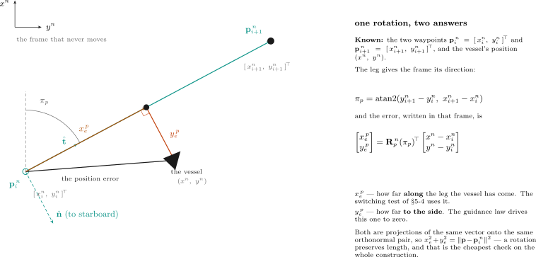

**그림을 읽기.**

| 볼 곳 | 거기 있는 것 | 왜 |
|---|---|---|
| (1) 칸 | 같은 화살표를 북·동으로 읽은 것 — 뺄셈 둘 | 위치 오차가 시작하는 자리이고, **무엇이 빠졌는지**를 보이는 칸이다. 두 수 어디에도 다리가 없다 |
| (2) 칸의 검은 화살표 | $\mathbf d = \mathbf p^n - \mathbf p_i^n$, (1) 칸과 같은 것 | 화살표는 다시 그리지 않는다. 축만 돌아간다 — 그것이 요령 전부다 |
| (2) 칸, $\mathbf p_i^n$ 의 점선 쌍 | 다리의 방향을 가리키는 $\hat{\mathbf t}$, 우현으로 가는 $\hat{\mathbf n}$ | 2단계: 다리가 자기 프레임을 들고 있고, 회전이란 그 프레임일 뿐이다 |
| (2) 칸, 다리 위의 갈색 선분과 그것을 가로지르는 붉은 선분 | $x_e$ 와 $y_e$, 직각으로 만난다 | 3단계: 두 그림자. 배가 옆으로 나란한 그 점에서 만난다 |
| (2) 칸, 웨이포인트의 회색 호 | $\pi_p$, 다리가 시작하는 자리에서 북으로부터 잰 것 | 1단계, 그리고 이 구성의 유일한 각 |
| (3) 칸의 사분원 | 단위원. 두 화살표가 모두 그 위에서 끝나므로 길이가 1 이다 | 내적이 길이 곱하기 무엇이 아니라 **길이 그 자체**인 이유 |
| (3) 칸, $\hat{\mathbf n}$ 의 아래쪽 성분 | $-\sin\pi_p$, 이 구성에서 음수인 유일한 항 | **시계방향**으로 90도 돌리면 그렇게 된다. 그리고 시계방향이라야 $\hat{\mathbf n}$ 이 우현을 가리킨다 |

**뒤에서 쓰이는 성질 둘.**

1. **회전이므로 길이를 보존한다.** $x_e^2 + y_e^2 = \lVert\mathbf p - \mathbf p_k\rVert^2$ 가 정확히 성립한다. 그 항등식이 이 구성 전체에 대한 가장 값싼 확인이고, `verify_w05_guidance` 검사 5 가 그것을 시험한다.
2. **$y_e$ 의 부호는 결과가 따라오는 관습이다.** $y_e > 0$ 은 배가 다리의 **우현**에 있다는 뜻이고, §5-3 의 법칙은 그때 좌현으로 돌려 경로로 되돌린다. 두 사인 항을 뒤바꾸면 배가 같은 속도로 경로에서 달아난다.

수직거리 공식을 쓰면 $y_e$ 의 크기만 얻는다 — 어느 쪽으로 돌릴지 말해 줄 부호도 없고, §5-4 가 전환에 쓸 $x_e$ 도 없다. 회전 하나가 두 질문에 답하고, 둘이 서로 어긋날 수 없다.

> [!note] 같은 두 줄을, Fossen 의 표기로
> 참고 구현은 Fossen 의 TTK4190 강의 코드다 — *2. USV 제어기 설계* 에서 가르치는 판의 출처다.
>
> ```matlab
> pi_p = atan2(yk_next-yk, xk_next-xk);        % path-tangential angle w.r.t. North
> % along-track and cross-track errors (x_e, y_e) expressed in NED
> x_e =  (x-xk) * cos(pi_p) + (y-yk) * sin(pi_p);
> y_e = -(x-xk) * sin(pi_p) + (y-yk) * cos(pi_p);
> ```
>
> $(x, y)$ 는 북과 동이다. 이번 주의 `guidance` 블록이 이 줄들이고, §5-4 의 전환 판정이 그 다음 두 줄이다. 이 회전은 MSS `crosstrackWpt.m` 과 기계 정밀도까지 같은 $y_e$ 를 준다(`verify_w05_guidance` 검사 5).

- 경로추종의 목표는 $y_e \to 0$ 이다. $x_e$ 는 어디로도 보내지 않고 **지켜보기만** 하며, §5-4 가 그것을 지켜본다.

**어디에 붙는가.** 3·4주차는 각각 배가 이미 싣고 있는 측정에 닫히는 루프 둘을 만들었다. 속도 루프는 $u$ 를 읽고, 선수각 루프는 $\psi$ 와 $r$ 을 읽는다. 둘 중 어느 것도 경로가 무엇인지 모르고, 알 필요도 없다. 유도는 그 둘에 합류하지 않는다 — 그 **앞**에 앉아, 전에는 손으로 주어졌던 것을 공급한다.

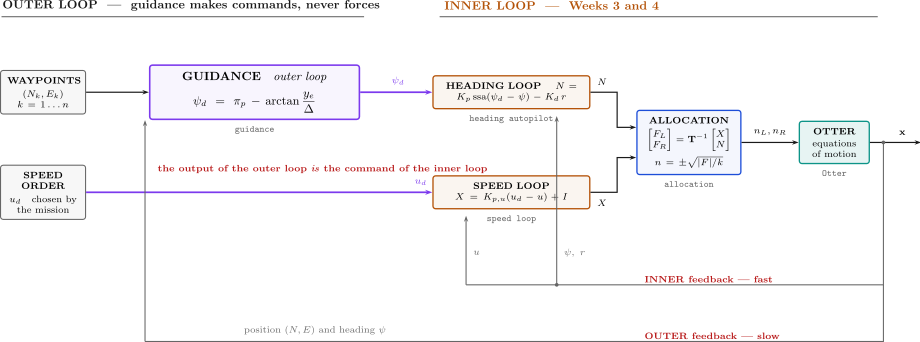

| 다이어그램에서 | 무엇인가 | 어느 주차 |
|---|---|---|
| `guidance`, LOS 법칙 하나 | $\psi_d = \pi_p - \arctan(y_e/\Delta)$. 다리 방향 $\pi_p$, $y_e$ 를 만드는 회전, 전환 판정은 §5-2 ~ §5-4 가 그 밑에 쌓는 것이다 | **이번 주** |
| $\psi_d$ 로 표시된 굵은 화살표 | 바깥 루프의 출력, 그리고 **선수각 루프의 명령** | 이번 주 → 4주차 |
| $u_d$ 로 표시된 굵은 화살표 | 속도 지시. 유도를 지나치지 않고 곧바로 속도 루프로 간다 | §5-7 |
| `heading autopilot`, `speed loop` | 4주차와 3주차에서 바뀌지 않았고, 다시 튜닝하지 않았다 | 3, 4주차 |
| `allocation` | 3주차 §3-6 의 두 단계. 이제 두 입력 모두 살아 있다 | 3주차 |

- 명령은 **다른 색, 더 굵은 선으로** 그려져 있고 이유는 하나다. $\psi_d$ 는 힘도, 모멘트도, 축 회전수도 아니다. 그것은 *다른 제어기에 내리는 지시*이고, 유도가 만들어 내는 것은 언제나 그 한 종류뿐이다.
- 두 되먹임은 병렬이 아니라 포개져 있다. 안쪽 것은 fast 로 표시되어 있다 — $u$, $\psi$, $r$ 을 솔버 스텝마다 읽고, 3·4주차의 게인이 그것에 맞춰 튜닝되었다. 바깥 것은 slow 로 표시되어 있다 — 위치, 경로가 그것에 대해 정의되는 바로 그것이다. 안쪽 루프는 몇 초 안에 선수각을 정착시키고, 바깥 루프는 수십 미터에 걸쳐 어느 선수각을 요구할지를 바꾼다. 그 시간 척도의 분리가 종속 구조를 작동하게 만들고, §5-3 의 $\Delta$ 선택이 그 대가를 치르는 자리다.

> [!note] 3·4주차의 어느 것도 바뀌지 않는다
> `W05_G_tuning` 의 `heading autopilot` 블록은 4주차의 블록이고, 4주차의 게인이고, 다시 튜닝되지 않았다. 다른 것은 $\psi_d$ 가 어디서 들어오는가뿐이다. 그 아래의 오토파일럿을 다시 튜닝하지 않고는 유도 법칙을 붙일 수 없다면, 둘은 애초에 제대로 분리된 적이 없는 것이다.

### 실험 5-1 · 캔버스 위의 유도 층 (10분)

**무엇을 재는가.** 아직 아무것도. 위 표의 네 블록을 캔버스와 맞추고, $y_e$ 를 만드는 회전을 그것을 수행하는 블록 안에서 읽는다.

**캔버스.** `W05_G_tuning` — 이번 주에서 가장 꽉 찬 모델이다. 여기서는 읽고, 재는 것은 실험 5-6 이다. `guidance` 블록을 뺀 모든 것은 4주차이고, 바뀌지 않았으며 다시 튜닝되지 않았다.

**열고 돌리기.**

```matlab
W05_0_setup
open_system('W05_G_tuning')        % Run — XY 그래프에 항적이 그려진다 / the track is drawn live
```

- `guidance` 를 두 번 누른다. 그것은 블록 하나가 아니라 **서브시스템**이다. `the active leg` 이 $\pi_p$ 와 $x_e$, $y_e$ 를 내고, 법칙마다 그 옆에 자기 MATLAB Function 하나가 서 있다. 그 안쪽은 §5-1b 가 읽는다.
- `heading autopilot` 을 두 번 누른다. 4주차의 두 게인과 그 밖에는 없다. 경로는 그 안 어디에도 나타나지 않는다.

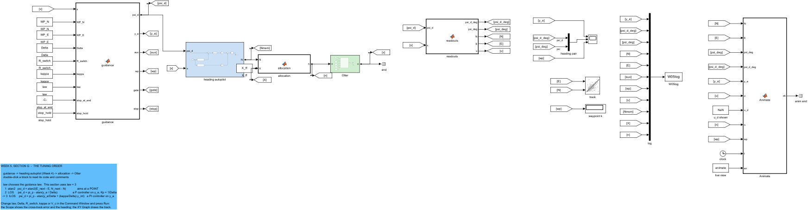

| 그림에서 | 뜻 |
|---|---|
| `guidance`, 보라 | 이번 주. $\psi_d$, $y_e$, 적분 `aux`, 다리 번호 `wp` 를 낸다 |
| 그것을 먹이는 Constant 의 열 | 법칙이 바깥에서 받는 모든 것 — 웨이포인트, $\Delta$, $R_{\text{switch}}$, $\kappa$, `law`, 그리고 샘플 시간 `h`. 유도가 쓰는 수 가운데 마스크에 숨은 것은 하나도 없다 |
| `state next` 를 떠나 `1 step` 으로 내려갔다 `state` 로 돌아오는 선 | 유도가 스텝 사이에 **기억하는 것**: 활성 다리, §5-5 의 적분, 그리고 도착 뒤 센 스텝 수 |
| `heading autopilot`, `allocation`, `Otter` | 1·3·4주차. 건드리지 않았다 |
| Otter 뒤의 Goto `[x]` | 상태 열둘. 유도·오토파일럿·표시로 보낸다 |
| Scope, `track` (XY Graph), `W05log` | 횡방향 오차와 선수각들. 항적, 북에 대한 동. 로그 |

> [!tip] 수업에서
> - **목적** — 유도가 앉는 자리를 보인다. 4주차 오토파일럿 앞의 블록 하나이고, 오토파일럿은 건드리지 않는다.
> - **가리킬 곳** — `guidance` 를 두 번 누르고 번호 달린 주석을 읽는다 — 다리, $y_e$ 로의 회전, 전환 판정, 법칙.
> - **질문** — "오토파일럿은 경로에 대해 무엇을 아는가?" 아무것도. 그것은 $\psi_d$ 를 따라가고, 경로는 유도 안에만 산다.
> - **남길 것** — 유도는 출력이 다른 제어기의 명령인 제어기다.

### 실험 5-1b · 모델 하나, 법칙 셋 (10분)

`W05_G_tuning` 의 `guidance` 를 열면 그 층의 안쪽이 한 화면이다.


| 그림에서 | 뜻 |
|---|---|
| 아래쪽의 넓은 블록 `the active leg` | §5-1 의 기하와 §5-4 의 전환 판정. **한 번** 계산되어 공유된다. $\pi_p$, $y_e$, `to_wp` 가 거기서 나와 위의 법칙들로 퍼진다 |
| `aim at the waypoint`, `LOS`, `ILOS` | 법칙마다 MATLAB Function 하나. 각각 자기 식이 필요로 하는 것만 받는다. 하나를 두 번 누르면 그 절의 식이 코드이고, 그 안에 다른 것은 없다 |
| `psi_d switch` | `law` 입력 포트가 돌리는 Multiport Switch. 세 법칙이 만나는 유일한 자리다 |
| `integral switch` 와 Constant `0` | 법칙 1 과 2 는 적분을 들지 않으므로 그 둘에 대해서는 `aux` 가 0 을 보고한다 |

법칙 하나를 다른 법칙과 비교할 수 있는 이유가 이것이다. 두 법칙이 쓰는 기하가 *같은 블록*이므로, 두 실행의 차이는 법칙에서만 올 수 있다.

| `law` | 법칙 | 무엇을 겨누나 | 어디서 유도하나 | 어느 모델이 드나 |
|---|---|---|---|---|
| 1 | atan2 | 다음 웨이포인트 — **점** 하나 | §5-2 | `W05_C_atan2`, `W05_G_tuning` |
| 2 | LOS | **직선** 위, $\Delta$ 앞의 점 | §5-3 | `W05_D_LOS`, `W05_E_switching`, `W05_F_LOS`, `W05_G_tuning` |
| 3 | ILOS | 같은 직선. 밀림을 기억하면서 | §5-5 | `W05_F_ILOS`, `W05_G_tuning`, `W05_H_speed_path` |
| 4 | ILOS, 보통 적분 | 같은 겨눔 식, 교과서 적분기로 | §5-5c | `W05_F_ILOS` |

- **모델은 자기 절이 비교하는 법칙만 든다.** `W05_C_atan2` 는 법칙 하나뿐이므로 `law` 입력 포트도 스위치도 없다. 절이 한 번도 말하지 않는 법칙 셋을 그려 놓은 블록도는 학생이 떨쳐 내야 할 질문 셋이다. `W05_G_tuning` 은 셋을 비교하므로 플래그를 가진다.
- 플래그는 캔버스의 `law` 라는 Constant 에서 오고, 그것이 같은 이름의 작업공간 변수를 읽는다. 그것을 바꾸고 Run 을 누르면 같은 모델이 다른 법칙을 따라가며, 다시 만들 필요가 없다.

```matlab
W05_0_setup
law = 1;                           % 또는 2, 3 / or 2, 3
open_system('W05_G_tuning')        % Run
```

그 밖의 모든 것이 고정되어 있으므로 — 같은 웨이포인트, 같은 조류, 같은 4주차 오토파일럿, 같은 $\Delta$ 와 $R$ — 세 실행의 차이는 법칙이고 그 밖에는 없다. 그것이 이 비교에 값을 주는 것이다.

**이 절의 모든 그림과 수를 만들려면**

```matlab
cd lectures/W05_simulink
W05_0_setup
W05_B_three_laws
```

실제 출력:

```
  W05 Experiment 5-1b  one model, three laws  (W05_G_tuning, current 0.3 m/s east)
    law   mean |y_e| legs 2-4 [m]   worst |y_e| [m]   last waypoint at [s]
    atan2                3.929            10.877                316.1
    LOS                  1.521             5.102                330.4
    ILOS                 0.614             3.847                338.8
```

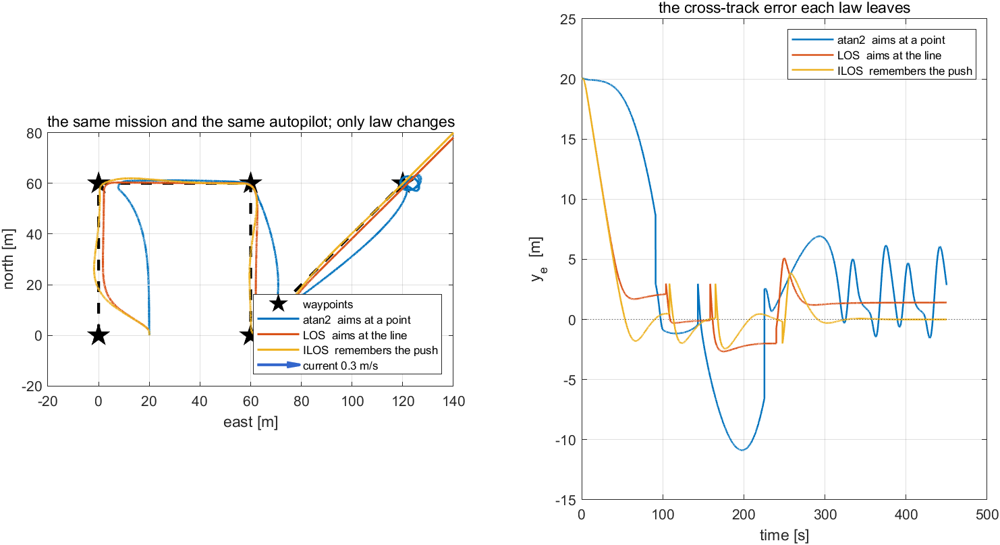

| 그림에서 | 뜻 |
|---|---|
| 왼쪽, 세 항적 | 같은 웨이포인트와 같은 오토파일럿. `law` 만 다르다 |
| 왼쪽, 마지막 웨이포인트의 파란 고리 | 겨누고 있는 점을 돌고 있는 atan2 |
| 오른쪽 | 각 법칙이 남기는 횡방향 오차. 같은 축에서 |
| 화살표 | 조류, 동쪽으로 0.3 m/s |

**그림과 표를 읽기.** 세 법칙은 세 가지 다른 방식으로 실패하고, 각 실패가 그것을 고치는 절의 이름을 부른다.

| 볼 곳 | 무엇을 말하나 |
|---|---|
| 모든 다리에서 벗어나 부풀었다가 $(120, 60)$ 에서 고리를 그리는 파란 항적 | **점**을 겨누는 것은 점 사이의 직선을 따라가지 않고, 그 점에 도달한 뒤에는 방향을 전혀 주지 않는다. §5-2 |
| 각 다리와 평행하게, $1.52$ m 벗어난 채 **꾸준히** 달리는 주황 항적 | LOS 는 직선의 방향을 유지하지만 그 옆에 앉는다. 꾸준한 밀림 아래의 꾸준한 편차는 적분이 없다는 표지다. §5-5 |
| 다리 위에 있는 노란 항적 | 적분이 밀림을 인수하고, 편차가 사라진다. §5-5b |
| 마지막 열, $316 \to 330 \to 339$ s | 각 단계가 시간을 비용으로 치른다. 직선을 유지한다는 것은 코너를 잘라먹지 않는다는 뜻이고, 코너를 자르지 않는 것은 더 멀리 가는 것이다 |

세 법칙은 한 생각의 세 가지 튜닝이 아니다. 서로 다른 것을 겨누고, 표의 순서가 유도 법칙이 자라나는 순서다.

| 해 볼 것 | 볼 것 |
|---|---|
| `law = 1; V_c = 0;` Run | 조류를 없애도 atan2 는 여전히 다리를 벗어난다 — 평균 $1.69$ m, 최악 $4.44$ m. 그 오차는 외란이 아니라 기하이고, 그것이 §5-2 의 전부다 |
| `law = 2; kappa = 3;` Run | 항적이 조금도 움직이지 않는다. 서브시스템이 아무것도 돌리지 않고 이유를 보여 준다 — `LOS` 블록에는 `kappa` 포트가 없다 |
| `law = 3; Delta = 40;` Run | 적분이 여전히 편차를 없애지만 접근에 118 s 가 걸린다(§5-3). $\Delta$ 와 $\kappa$ 는 다른 일을 한다 |

> [!tip] 수업에서
> - **목적** — 어느 것도 유도하기 전에, 세 법칙을 한 질문의 세 가지 물음으로 보인다.
> - **가리킬 곳** — 마지막 웨이포인트의 파란 고리. 이미 도달한 점을 겨누고 있는 배가 무엇을 해야 하는지 물어본다.
> - **질문** — "왜 가장 빠른 실행이 가장 나쁜 실행이기도 한가?" 코너를 자르는 것이 짧다. 경로추종은 그러지 않기로 하는 결정이다.
> - **남길 것** — 기하 블록 하나, 법칙 셋, 스위치 하나, 그 밖의 모든 것을 고정 — 그것이 세 실행을 세 가지 일화가 아니라 비교로 만든다.

## 5-2. 점을 겨누는 것은 직선을 따라가는 것이 아니다

이 절이 답하는 것: 그냥 다음 웨이포인트를 가리키면 왜 안 되는가?

**무엇이 관측되는가.** 배가 북으로 달리는 경로의 동쪽 20 m 에서 출발해 뻔한 법칙 $\psi_d = \operatorname{atan2}(y_{i+1}^n - y^n,\ x_{i+1}^n - x^n)$ — 다음 웨이포인트를 가리켜라 — 로 조종된다.

- 웨이포인트까지 절반 왔을 때 아직 경로에서 $10.75$ m 벗어나 있다. 출발 편차의 절반이 넘는다.
- 경로에 닿는 것은 웨이포인트에 **도착해서야**이고, 그 다음 다리에서 다시 벗어난다.
- 한편 §5-3 의 법칙은 같은 출발에서 같은 지점에서 경로의 $0.04$ m 안에 있다.

**거기서 무엇이 따라 나오는가, 한 줄씩.**

1. `atan2` 는 **점**까지의 거리를 줄인다. 그것이 그리는 직선은 배에서 웨이포인트까지의 직선이고, 배가 이미 경로 위에 있지 않으면 그 직선은 경로가 아니다.
2. 따라서 "경로에서 벗어남" 을 재는 양은 웨이포인트까지의 거리가 아니라 **직선**까지의 수직거리, 곧 §5-1 의 횡방향 오차 $y_e$ 다.
3. `atan2` 는 $y_e$ 를 전혀 쓰지 않으므로 그 안의 무엇도 $y_e$ 를 0 으로 보내지 않는다. 오차는 도착의 부수 효과로만 줄어들고, 그래서 웨이포인트에서 정확히, 그 전에는 아니게 사라진다.
4. 경로를 따라가는 유도 법칙은 $y_e$ 를 입력으로 받아 그것을 줄이는 선수각을 돌려주어야 한다. 그것이 §5-3 이고, 그래서 그 법칙은 이 강의의 다른 모든 것과 같은 되먹임 제어기가 된다.
5. 실제 임무에서 웨이포인트는 멀리 떨어져 있고 배가 있으라고 요구받는 곳은 그 **사이의** 공간이다. 그래서 1번 줄의 오차는 접근 과도가 아니라 임무 전체가 된다.

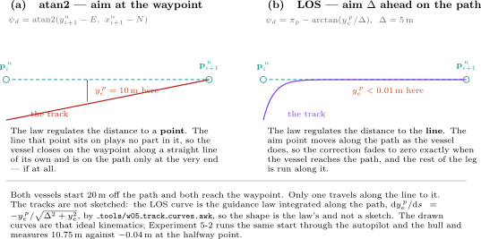

**그림을 읽기.**

| 볼 곳 | 거기 있는 것 | 어느 줄이 예측했나 |
|---|---|---|
| (a), 붉은 항적 | 출발점에서 웨이포인트까지의 직선 | 1번 줄: `atan2` 는 **점**까지의 거리를 줄이고, 점까지의 최단 경로는 직선이다 |
| (a), 절반 지점의 이름표 | $y_e = 10$ m, 출발 편차의 절반. 순전히 기하로 | 3번 줄: 법칙 안의 무엇도 $y_e$ 에 작용하지 않는다 |
| (a), 항적이 경로를 만나는 곳 | 웨이포인트 그 자체에서만 | 3번 줄: 오차는 도착의 부수 효과로 사라진다 |
| (b), 보라 항적 | 경로로 꺾어 들어가 그 위를 달린다 | 4번 줄: 법칙이 $y_e$ 를 입력으로 받는다 |
| (b), 절반 지점의 이름표 | $0.01$ m 미만 — 법칙은 이미 일을 마쳤다 | §5-3: 오차가 줄면서 보정도 사그라든다 |
| 두 칸 모두 | 같은 출발, 같은 웨이포인트, 같은 배 | 다른 것은 법칙이 어느 양을 읽는가뿐이다 |

- 그려진 곡선은 유도 법칙을 **경로를 따라 적분한** 것 $\mathrm{d}y_e/\mathrm{d}s = -y_e/\sqrt{\Delta^2 + y_e^2}$ 이고 스케치가 아니다 — 그래서 그 모양은 법칙 자신의 것이다. 실험 5-2 는 같은 출발을 오토파일럿과 선체에 통과시키고, 거기서 배는 약간 뒤처진다.

아래 실험 5-2 가 잰 값:

| 법칙 | 북으로 50 m 에서의 $y_e$ | 100 m (웨이포인트) 에서 | 150 m 에서 |
|---|---|---|---|
| atan2 | 10.75 m | 0.50 m | −0.74 m |
| LOS (§5-3) | −0.04 m | 0.01 m | 0.01 m |

### 실험 5-2 · 웨이포인트를 겨누기 (10분)

**무엇을 재는가.** 1번과 3번 줄 — 뻔한 법칙이 배를 경로에서 얼마나 멀리 두는지, 한 다리의 세 지점에서, $y_e$ 를 쓰는 법칙과 대조해.

**모델.** `W05_C_atan2` — 유도 블록을 `atan2` 법칙으로 돌린 것. 그 뒤의 모든 것(오토파일럿, 배분, Otter)은 4주차가 남긴 그대로다. 웨이포인트는 북으로 가는 곧은 경로 하나로 두어, 두 법칙이 자기 정의 말고는 아무것도 다르지 않게 한다.

**열고 돌리기.**

```matlab
W05_0_setup
WP_N = [0 100 200 300]'; WP_E = [0 0 0 0]';    % 북쪽으로 곧은 경로 / a straight path north
open_system('W05_C_atan2')         % Run — XY 그래프에서 대각선으로 접근한다 / a diagonal approach
W05_C_aim_at_the_waypoint          % 두 법칙을 나란히 / both laws, side by side
```

나오는 출력:

```
  W05 Experiment 5-2  aiming at the waypoint against line of sight (start 20 m east of the path)
    law     y_e at N = 50 m   N = 100 m   N = 150 m
    atan2            10.75        0.50       -0.74
    LOS              -0.04        0.01        0.01
```

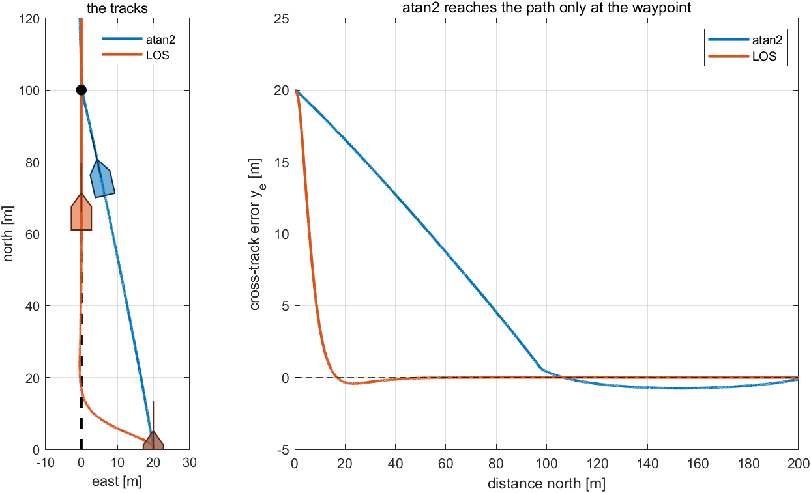

| 그림에서 | 뜻 |
|---|---|
| 왼쪽 | 선체 윤곽을 붙인 두 항적. 점선이 경로, 점이 100 m 의 웨이포인트 |
| 오른쪽 | 북으로 간 거리에 대한 횡방향 오차 |

**그림을 유도와 대조해 읽기.**

| 볼 곳 | 거기 있는 것 | 어느 줄이 예측했나 |
|---|---|---|
| 왼쪽 칸, atan2 항적의 **곧음** | 웨이포인트로 그어진 대각선 | 1번 줄: 법칙이 점을 겨누고, 일정한 방위는 곧은 주행을 준다 |
| 오른쪽 칸, $N = 100$ m 의 atan2 곡선 | 0 에 닿고, 거기서만 닿는다 | 3번 줄: 오차는 도착에서 사라지고 그 전에는 아니다 |
| 오른쪽 칸, 웨이포인트 **뒤**의 atan2 곡선 | 다시 0 을 떠나 $-0.74$ m | 다음 다리에서의 1번 줄: 새 점, 새 대각선 |
| 오른쪽 칸, LOS 곡선 | 약 20 m 안에 0 에 닿고 거기 머문다 | 4번 줄: $y_e$ 를 먹는 법칙은 $y_e$ 를 몬다 |
| 왼쪽 칸, atan2 항적 위의 선체 윤곽 | 내내 웨이포인트를 가리킨다 | 다시 1번 줄: 그 선수각이 정확히 법칙이 요구하는 것이다 |

**그림이 말하는 것**

- atan2 는 웨이포인트로 직선을 긋고 거기서만 경로를 만난다. LOS 는 20 m 안에 경로 위에 있다.

| 해 볼 것 | 볼 것 |
|---|---|
| `E0 = 5;` Run | $N = 50$ m 에서 $10.75$ 대신 $2.80$ m 가 남는다 — 출발 편차에 대한 **같은 비율**이다, $0.54$ 에 대해 $0.56$. 1번 줄은 크기의 문제가 아니라 기하의 결함이다. 같은 실행에서 LOS 는 $0.02$ m 를 남긴다 |
| `WP_N = [0 400]'; WP_E = [0 0]'; E0 = 20;` Run | 긴 다리 하나에서 atan2 항적은 절반 지점에서 $10.70$ m, 4분의 3 지점에서 $5.58$ m 벗어나 있다 — 5번 줄, 그 오차가 임무 **그 자체**다 |

> [!tip] 수업에서
> - **목적** — "웨이포인트로 가라" 와 "경로를 따라가라" 가 서로 다른 목표임을 보인다.
> - **가리킬 곳** — 웨이포인트로 대각선으로 잘라 가는 파란 항적, 그리고 곧바로 경로로 꺾어 드는 주황 항적.
> - **질문** — "atan2 가 절반 지점에서도 왜 10.75 m 벗어나 있는가?" 그것은 웨이포인트까지의 거리를 줄이고, 웨이포인트까지의 직선은 경로가 아니다.
> - **남길 것** — 유도는 직선까지의 거리 $y_e$ 를 재고 그것에 작용해야 한다.

## 5-3. 시선 유도: 횡방향 오차에 대한 P 제어기

이 절이 답하는 것: 어떤 법칙이 배를 직선 위로 데려오고, 그 하나의 튜닝 손잡이는 무엇인가?

**법칙.** 웨이포인트 대신, 경로 위 $\Delta$ 앞의 점을 겨눈다.

$$
\psi_d = \pi_p - \arctan\!\left(\frac{y_e}{\Delta}\right)
$$

- $\pi_p$ 는 "경로와 나란히 서라" 고 말하고, arctan 은 "그쪽으로, 얼마나 벗어나 있는지와 함께 자라는 각만큼 기울여라" 고 말한다. 경로 위에서는 $y_e = 0$ 이고 배는 그냥 다리를 따라 향한다. 멀리서는 기울기가 $90°$ 에 가까워지고 배는 곧바로 경로를 향한다.

**arctan 은 어디서 오는가.** 함수를 고른 것이 아니다 — 직각삼각형의 각이다. 배에서 경로로 수선을 내리면 그 발이 배와 나란한 경로 위의 점이다. 이제 그 발에서 **경로를 따라** 거리 $\Delta$ 만큼 간다. 그것이 겨눔점이다. 변이 $\Delta$(경로를 따라)와 $y_e$(경로를 가로질러)인 삼각형은

$$
\tan(\text{the lean}) = \frac{y_e}{\Delta}
\qquad\Longrightarrow\qquad
\text{the lean} = \arctan\!\left(\frac{y_e}{\Delta}\right)
$$

이고, 명령은 $\pi_p$ 를 그 기울기만큼 경로 쪽으로 돌린 것이다 — 그래서 마이너스 부호이고, $y_e$ 는 우현이 양이다.

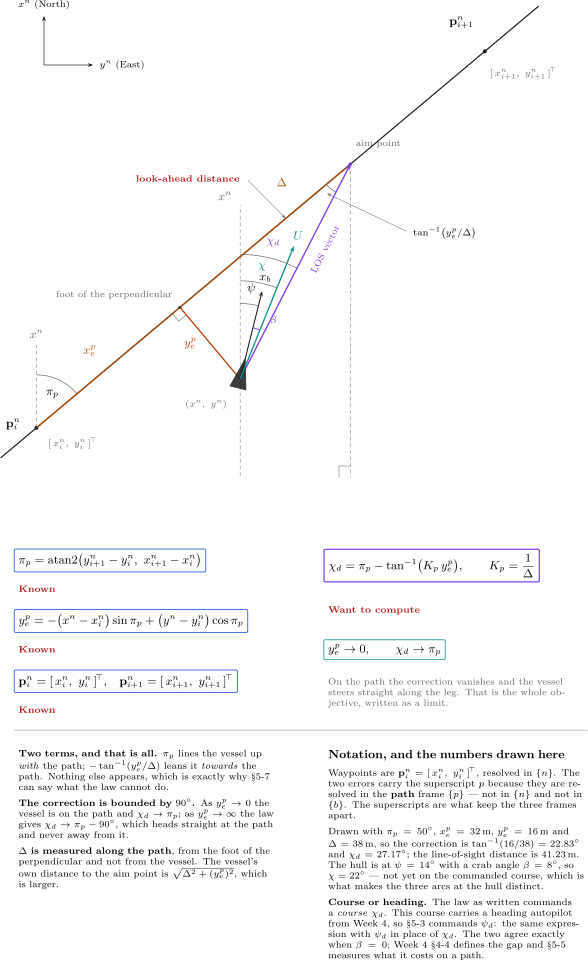

**그림을 읽기.**

| 볼 곳 | 거기 있는 것 | 왜 |
|---|---|---|
| 경로 위의 직각 | 수선의 발, 배와 나란한 점 | 전방주시거리를 재기 시작하는 원점이다 |
| $\Delta$ 로 표시된 선분 | 그 발에서 **경로를 따라** 쟀다 | 배에서가 아니다. 배 자신에서 겨눔점까지의 거리는 $\sqrt{\Delta^2 + y_e^2}$ 이고 더 길다 |
| 보라 반직선 | 시선, 배에서 겨눔점까지 | 법칙의 이름이다. 배가 어떤 점을 바라보고 그쪽으로 조종한다 |
| $\arctan(y_e/\Delta)$ 로 표시된 호 | 기울기, 경로 방향과 시선 사이 | 위의 직각삼각형 |
| 아래쪽 웨이포인트의 $\pi_p$ | 경로 방향, 북에서 | §5-1 의 1단계 |
| 갈색 선분 둘 | §5-1 의 $x_e$ 와 $y_e$ | 법칙은 그중 둘째만 쓴다 |
| 선체의 호 셋 | $\psi$, $\chi$, $\chi_d$ — 선수각, 침로, 명령 침로 | 4주차 §4-4 의 크랩각만큼 다르고, 그것이 §5-5 의 주제다 |

- **항이 둘, 그것으로 끝이다.** $\pi_p$ 는 배를 경로와 *나란히* 세우고, $-\arctan(y_e/\Delta)$ 는 경로 *쪽으로* 기울인다. 그 밖에는 아무것도 나타나지 않는다 — 그래서 §5-5 가 이 법칙이 할 수 없는 것을 말할 수 있다.
- **보정은 $90°$ 로 한계가 있다.** $y_e \to 0$ 이면 기울기가 0 으로 가고 $\psi_d \to \pi_p$ 다. $y_e \to \pm\infty$ 이면 $\mp 90°$ 에 가까워져 곧바로 경로를 향하고 결코 경로에서 멀어지지 않는다. 날 것의 게인 $-K y_e$ 로 만든 법칙에는 그런 한계가 없고, 경로에서 멀면 터무니없는 선수각을 명령하게 된다.

**이것은 P 제어기다.** $\Delta$ 에 비해 작은 오차에서 $\arctan(y_e/\Delta) \approx y_e/\Delta$ 이고($\lvert y_e\rvert \le 0.2\Delta$ 에서 1.4 % 안, `verify_w05_guidance` 검사 2),

$$
\psi_d - \pi_p \approx -\frac{1}{\Delta}\, y_e \qquad\Longrightarrow\qquad K_p = \frac{1}{\Delta}
$$

| 기호 | 양 | 값 |
|---|---|---|
| $\Delta$ | 전방주시거리 | $5$ m, `W05_0_setup.m` |
| $1/\Delta$ | P 게인: 오차 1 미터당 선수각 보정 | $0.2$ rad/m |

그래서 $\Delta$ 는 2~4주차의 $K_p$ 처럼, 거꾸로 튜닝한다. $\Delta$ 가 **작을수록** 게인이 **크다.**

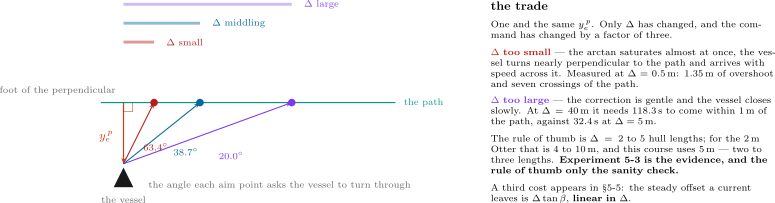

**그림을 읽기.**

| 볼 곳 | 거기 있는 것 | 왜 |
|---|---|---|
| 경로 위의 겨눔점 셋 | 셋 다 경로 위에 있고, 같은 발에서 $\Delta$ = 작은 값·중간값·큰 값만큼 떨어져 있다 | $\Delta$ 만 바뀌었다 |
| 하나뿐인 붉은 선분 $y_e$ | 세 경우 모두 하나의 같은 오차 | 그래서 그림이 $\Delta$ 만을 떼어 보인다 |
| 세 각, $53.1°$, $38.7°$, $20.0°$ | 각 겨눔점이 배에게 요구하는 선회량 | 분자 하나와 분모 셋을 가진 $\arctan(y_e/\Delta)$ |
| 셋 사이의 비 | $\Delta$ 의 3 배 차이에서 명령의 약 3 배 차이 | $\Delta$ 는 거꾸로 읽는 게인이다 |

- 절충은 2주차 §2-6 의 P 스윕을 새 옷을 입혀 놓은 것이다. $\Delta$ 가 너무 작으면 arctan 이 포화되어 배를 경로에 거의 수직으로 돌리고, 경로를 가로지르는 속도를 가진 채 도착한다. $\Delta$ 가 너무 크면 부드럽게, 그리고 느리게 닫는다.

아래 실험 5-3 이 잰 값:

| $\Delta$ [m] | $1/\Delta$ | 1 m 안에 드는 시각 [s] | 오버슛 [m] | 0 교차 횟수 |
|---|---|---|---|---|
| 0.5 | 2.000 | 27.7 | 1.35 | 7 |
| 1 | 1.000 | 27.9 | 0.70 | 2 |
| 2.5 | 0.400 | 29.1 | 0.42 | 2 |
| 5 | 0.200 | 32.4 | 0.41 | 2 |
| 10 | 0.100 | 41.7 | 0.41 | 2 |
| 20 | 0.050 | 65.2 | 0.40 | 1 |
| 40 | 0.025 | 118.3 | 0.40 | 1 |

- 큰 $\Delta$ 는 느리고, 작은 것은 오버슛하고 흔들린다. $\Delta = 5$ m — 선체 길이 두세 개 — 는 흔들림 없이 가장 작은 값들만큼 거의 빠르게 경로에 닿고, 그것이 선택이다.

### 실험 5-3 · 전방주시거리 (15분)

**무엇을 재는가.** $\Delta$ 가 정확히 $1/K_p$ 처럼 움직인다는 것. 아래 스윕은 2주차 §2-6 의 P 스윕을 거꾸로 읽은 것이고, 게인 말고는 아무것도 끼어들지 않도록 긴 다리 하나에서 한다.

**모델.** `W05_D_LOS` — 유도 블록을 LOS 법칙으로 돌린 것. 웨이포인트는 400 m 다리 하나이고, 어느 코너보다 먼저 과도가 끝날 만큼 길다.

**열고 돌리기.**

```matlab
W05_0_setup
WP_N = [0 400]'; WP_E = [0 0]';    % 긴 다리 하나 / one long leg
open_system('W05_D_LOS')           % Run — Delta = 5 m / the chosen value
Delta = 0.5;                       % Run — 지그재그로 다가간다 / it zigzags onto the path
Delta = 40;                        % Run — 한참 걸린다 / it creeps
W05_D_lookahead_distance           % 일곱 값을 한 번에 / all seven values at once
```

나오는 출력:

```
  W05 Experiment 5-3  LOS, the look-ahead distance  (start 20 m east of the path)
    Delta [m]   P gain 1/Delta   within 1 m after [s]   overshoot [m]   zero crossings
    0.5                  2.000                   27.7            1.35                7
    1                    1.000                   27.9            0.70                2
    2.5                  0.400                   29.1            0.42                2
    5                    0.200                   32.4            0.41                2
    10                   0.100                   41.7            0.41                2
    20                   0.050                   65.2            0.40                1
    40                   0.025                  118.3            0.40                1
```

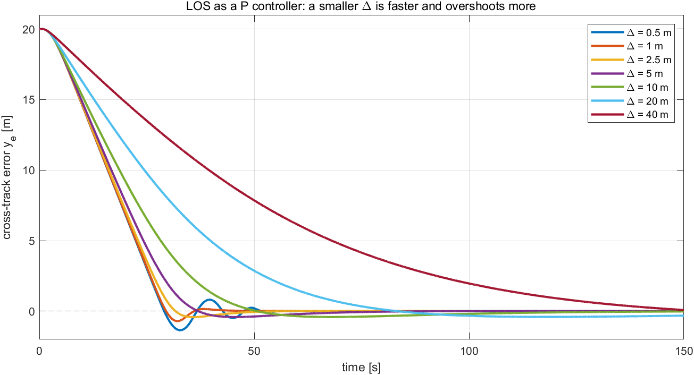

| 그림에서 | 뜻 |
|---|---|
| 곡선들 | 경로에서 20 m 벗어난 지점부터의 시간에 대한 횡방향 오차. $\Delta$ 마다 하나 |

**그림을 법칙과 대조해 읽기.**

| 볼 곳 | 거기 있는 것 | 무엇에 대응하나 |
|---|---|---|
| 출발에서 각 곡선의 **기울기** | $\Delta$ 가 작을수록 급하다 | $K_p = 1/\Delta$: 큰 게인은 같은 오차를 더 세게 민다 |
| $\Delta = 0.5$ m 곡선이 0 을 거듭 **지나간다** | 7 번 교차, 오버슛 $1.35$ m | 게인이 너무 크면 울린다. 2주차 §2-6 과 같고, 여기서 그 울림은 경로를 가로지르는 지그재그다 |
| $\Delta = 40$ m 곡선 | $118.3$ s 가 지나서야 1 m 안에 든다 | 게인이 너무 작으면 느리고, $1/40$ 은 매우 작은 게인이다 |
| 가운데 곡선들, $\Delta = 2.5$ ~ $10$ m | 모두 29 ~ 42 s 안에 1 m 에 닿고 오버슛은 같은 $0.41$ m | 절충의 평평한 부분이고, 선택이 내려지는 자리다 |
| 경로에 올라선 뒤의 모든 곡선 | 거기 머문다 | 조류 없는 직선 경로에서 이 법칙은 남길 정상 오차가 없다 — §5-5 가 그것이 바뀌는 자리다 |

**그림이 말하는 것**

- 곡선들은 P 게인 스윕이 하는 대로 정확히 펼쳐진다. 작은 $\Delta$ 는 빠르게 내려가고 앞뒤로 지나간다. 큰 것은 기어간다.

| 해 볼 것 | 볼 것 |
|---|---|
| `Delta = 0.2;` Run | 지그재그가 멈추지 않는다 — 경로를 **44** 번 지나고 다리 끝에서도 여전히 $1.20$ m 벗어나 있다. 한계를 넘겨 올린 $K_p$ 이고, 선체 자신의 회두율이 느린 요소다 |
| `Delta = 100;` Run | 교차는 한 번, 지그재그도 전혀 없지만 경로에 닿는 것은 $286$ s 뒤다 — $0.01$ rad/m 의 게인은 다리 전체를 수렴하는 데 쓴다 |

> [!tip] 수업에서
> - **목적** — 낯선 법칙 안에서 낯익은 제어기를 알아본다.
> - **가리킬 곳** — 0 을 거듭 지나가는 $\Delta = 0.5$ m 곡선. 100 s 뒤에도 5 m 벗어나 있는 $\Delta = 40$ m 곡선.
> - **질문** — "$\Delta$ 를 절반으로 하면 게인은 어느 쪽으로 가는가?" 올라간다. $K_p = 1/\Delta$ 가 두 배가 된다.
> - **남길 것** — $K_p$ 를 튜닝한 것처럼 $\Delta$ 를 튜닝한다. 흔들리지 않는 가장 작은 값이다.

## 5-4. 다음 다리로 언제 넘어가는가

이 절이 답하는 것: 코너에서 유도는 언제 다음 다리로 전환하는가?

**무엇이 관측되는가.** 같은 임무를 다섯 전환 거리로 돌리면 코너가 항적이 갈라지는 곳이다.

- $R = 20$ m 에서 배는 일찍 돌아 새 다리에서 거의 $20$ m 떨어져 지나간다.
- $R = 1$ m 에서는 돌기 전에 코너를 **지나쳐** 달려, 가장 급한 코너의 바깥으로 $3.70$ m 쓸고 간다.
- 그리고 $R$ 이 클수록 임무가 더 빨리 끝난다 — $364$ s 에 대해 $305$ s.

**거기서 무엇이 따라 나오는가, 한 줄씩.**

1. 전환은 **종방향** 좌표에 대한 판정이다. 활성 다리에 $R$ 보다 적게 남았을 때, 곧 $d - x_e < R$ 일 때 유도가 다음 다리로 넘어간다. $d$ 는 다리의 길이다. MSS 가 쓰는 판정이 이것이고, 웨이포인트를 둘러싼 원이 아니라 경로를 따라 잰 거리다.

**두 판정, 그리고 둘이 같지 않은 이유.** 둘 다 코드 한 줄인데 서로 어긋난다.

$$
\text{along-track:}\quad d - x_e < R
\qquad\qquad
\text{acceptance circle:}\quad \lVert \mathbf p^{\,n} - \mathbf p_{i+1}^{\,n}\rVert \le R
$$

| 기호 | 양 | 값 · 출처 |
|---|---|---|
| $d$ | 활성 다리의 길이 | m · $\lVert\mathbf p_{i+1}^{\,n} - \mathbf p_i^{\,n}\rVert$ |
| $x_e$ | 배가 그 다리를 따라 얼마나 왔는가 | m · §5-1 |
| $d - x_e$ | 그 다리에 **남은 거리** | m · 배가 웨이포인트를 지나면 음수가 된다 |
| $R$ | 전환 거리 | $3$ m · `R_switch`, 4번 줄에서 고른다 |

참거리를 경로 프레임 성분으로 쓰면 관계가 정확히 보인다.

$$
\lVert \mathbf p^{\,n} - \mathbf p_{i+1}^{\,n}\rVert = \sqrt{(d - x_e)^2 + y_e^2} \;\ge\; d - x_e
$$

2. **경로 위에서 둘은 일치하고, 벗어나면 결코 일치하지 않는다.** $y_e = 0$ 이면 제곱근이 $d - x_e$ 로 무너지고 두 판정이 같아진다. $y_e \neq 0$ 이면 원 판정이 **언제나 둘 중 더 엄격한 쪽**이고, 그 차이는 배가 경로에서 얼마나 벗어나 있는지와 함께 자란다 — 그래서 넓게 달리는 배는 같은 순간에 종방향 판정을 만족하면서 원 판정을 통과하지 못할 수 있다.

3. **원은 아예 놓칠 수 있다.** 횡방향 오차가 결코 $R$ 아래로 떨어지지 않는 배는 원에 들어가지 못하고, 웨이포인트를 지나치고, 이미 일어난 도착을 기다린다 — 영원히. 종방향 판정은 그렇게 실패할 수 없다. 횡방향 오차가 무엇이든, 배가 웨이포인트를 지나 다리에 수직인 선을 넘는 순간 $d - x_e$ 가 음수가 된다. 가정이 아니다. 10주차 §10-5 가 $1.3$ m/s 조류에서 임무 하나를 통째로 그렇게 잃는다.

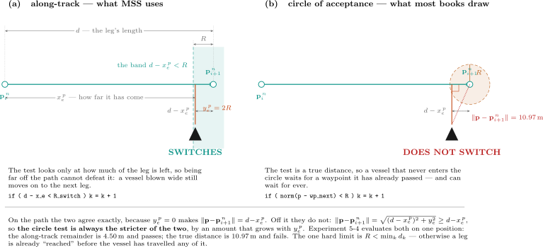

**그림을 읽기.**

| 볼 곳 | 거기 있는 것 | 어느 줄이 예측했나 |
|---|---|---|
| (a), 위쪽의 치수선 | 다리 전체 길이 $d$, 그리고 끝 웨이포인트에서 되짚은 $R$ | 판정이 견주는 두 길이를, 길이로 그린 것 |
| (a), 다리 아래의 치수선 둘 | 배가 온 거리 $x_e$ 와 남은 거리 $d - x_e$ | 판정은 뒤의 것을 $R$ 과 견주는 일이고, 그것뿐이다 |
| (a), 웨이포인트 앞의 음영 띠 | $d - x_e < R$ 인 영역 | 1번 줄: 판정은 다리를 **따라** 잰 거리다 |
| (a), 경로에서 꼬박 $y_e = 2R$ 벗어난 배 | 여전히 띠 안에 있고, 전환한다 | 3번 줄: 경로에서 벗어나 있다는 것이 종방향 판정을 꺾지 못한다 |
| (b), 웨이포인트를 둘러싼 반지름 $R$ 의 원 | $\lVert\mathbf p^{\,n} - \mathbf p_{i+1}^{\,n}\rVert \le R$ 인 영역 | 다른 판정을 그린 것 |
| (b), 같은 배, 원 바깥 | $10.97$ m 떨어져 있고, 전환하지 **않는다** | 2번 줄: 원이 더 엄격한 판정이다 |
| 칸 아래의 코드 두 줄 | `d - x_e < R_switch` 대 `norm(p - wp_next) < R` | 한 줄의 차이, 그리고 거동 전체 |
| 설명의 산술 | 종방향 잔여 $4.50$ m 는 통과, 참거리 $10.97$ m 는 불통과 | 2번 줄: $\sqrt{(d-x_e)^2 + y_e^2} \ge d - x_e$, 여기서는 $6.47$ m 만큼 |

4. **$R$ 에는 단단한 한계가 하나 있고**, 그것은 종방향 판정의 것이다 — $R < \min_k d_k$. $R$ 이 어느 다리의 길이를 넘으면 그 다리가 활성화되는 순간 $d - x_e < R$ 이 참이 되고, 배가 그 다리를 조금도 가지 않은 채로 그 다리에 "도달한" 것이 된다.

5. **큰 $R$ 은 코너를 자른다.** 전환하는 순간 배는 아직 옛 다리 위, 그 끝에서 $R$ 앞에 있으므로 새 다리에서 약 $R$ 만큼 떨어져 있다 — 그리고 이제 $y_e$ 가 그 새 다리에 대해 재어진다. 그래서 마지막 세 줄에서 가장 먼 거리가 $R$ 자신에 가깝다.
6. **작은 $R$ 은 배를 코너 너머로 나른다.** 선회가 코너에서야 시작되고 선체는 즉시 돌 수 없다. $0.77$ m/s 에서 바깥으로 쓸고 가며, $R = 1$ m 에서 $135°$ 코너에서 $3.70$ m 다. 코너가 급할수록 더 멀리 간다.
7. 5번과 6번 줄이 서로 반대로 당기므로, 가장 좋은 $R$ 은 그 **최악** 코너가 가장 작은 값이다 — $R = 3$ m, $2.98$ m 에서.
8. 코너를 자르는 것 자체가 틀린 것은 아니다. 그쪽이 더 빨리 끝나기도 한다. 여기서 내린 선택은 경로에 가까이 머무는 것이고, 자기 측선을 정확히 덮어야 하는 측량이라면 다르게 고를 것이다.

아래 실험 5-4 가 $\Delta = 5$ m 로 웨이포인트 다섯의 임무에서 잰 값:

| $R$ [m] | 코너 1, 2, 3 에서 새 다리로부터의 최대 거리 [m] | 마지막 웨이포인트 도달 [s] |
|---|---|---|
| 1 | 2.06, 2.08, 3.70 | 363.5 |
| 3 | 2.98, 2.98, 2.29 | 352.8 |
| 5 | 4.98, 4.98, 3.53 | 344.0 |
| 10 | 9.97, 9.98, 7.04 | 328.0 |
| 20 | 19.97, 19.98, 14.08 | 305.4 |

### 실험 5-4 · 웨이포인트 전환 (10분)

**무엇을 재는가.** 5, 6, 7번 줄 — 각 전환 거리가 세 코너에서 배를 새 다리에서 얼마나 멀리 두는지, 그리고 그때 임무가 얼마나 걸리는지.

**모델.** `W05_E_switching` — 웨이포인트 다섯의 전체 임무에 LOS 법칙. $\Delta$ 는 실험 5-3 이 고른 값으로 고정되어 있다. 실행 사이에 바뀌는 것은 `R_switch` 뿐이고, XY Graph 가 코너를 도는 모습을 보인다.

**열고 돌리기.**

```matlab
W05_0_setup
open_system('W05_E_switching')     % Run — R = 3 m / the chosen value
R_switch = 20;                     % Run — 모퉁이를 크게 자른다 / it cuts the corners wide
R_switch = 1;                      % Run — 모퉁이를 지나쳐서 돈다 / it runs past them
W05_E_waypoint_switching           % 다섯 값을 한 번에 / all five values at once
```

나오는 출력:

```
  W05 Experiment 5-4  waypoint switching on the mission  (LOS, Delta = 5 m, no current)
    R_switch [m]   largest distance from the new leg at corners 1, 2, 3 [m]   last waypoint at [s]
    1                      2.06   2.08   3.70                                363.5
    3                      2.98   2.98   2.29                                352.8
    5                      4.98   4.98   3.53                                344.0
    10                     9.97   9.98   7.04                                328.0
    20                    19.97  19.98  14.08                                305.4
```

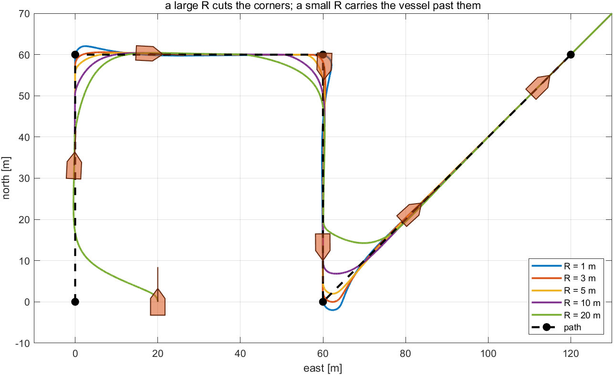

| 그림에서 | 뜻 |
|---|---|
| 색깔 항적들 | $R = 1$ 부터 $20$ m 까지의 임무. 선체는 $R = 3$ m 에 그렸다 |
| 점선과 점들 | 경로와 그 웨이포인트 다섯 |

**그림을 유도와 대조해 읽기.**

| 볼 곳 | 거기 있는 것 | 어느 줄이 예측했나 |
|---|---|---|
| 첫 코너의 $R = 20$ m 항적 | 다리를 $20$ m 쯤 일찍 떠난다 | 2번 줄: 전환은 다리 끝에서 $R$ 앞에 일어난다 |
| $R = 5$, $10$, $20$ 의 최대거리 열 | $4.98$, $9.97$, $19.97$ m — 각각 $R$ 과 같다 | 다시 2번 줄, 수로 |
| **셋째** 코너의 $R = 1$ m 항적 | 전체에서 가장 넓게 쓸고 간다, $3.70$ m | 3번 줄: 선회가 코너에서 시작되고, $135°$ 코너가 가장 급하다 |
| $R = 3$ m 의 열 | $2.98$, $2.98$, $2.29$ m — 최악의 경우가 가장 작다 | 4번 줄: 둘 사이의 절충 |
| 마지막 열, 위에서 아래로 | $363.5 \to 305.4$ s | 5번 줄: 코너를 자르면 임무가 짧아진다 |
| 코너 사이의 직선 부분 | 모든 항적이 경로 위에 있다 | §5-3: 전환 거리는 코너만을 정한다 |

**그림이 말하는 것**

- 초록 항적은 모든 코너를 일찍 넓게 돌고, 파란 항적은 돌기 전에 코너마다 지나쳐 달린다. $R = 3$ m 가 그 사이에 앉는다.

| 해 볼 것 | 볼 것 |
|---|---|
| `R_switch = 50;` Run | 60 m 다리와 거의 같은 길이다. 다리가 시작하는 즉시 유도가 전환하고, 배는 따라가야 할 다리에서 $49.98$ m 보다 가까워진 적이 없으며, 대각선을 날아 마지막 다리에 $146.9$ s 에 닿는다 |
| `Delta = 20; R_switch = 3;` Run | $R$ 이 바뀌지 않았는데 최악 코너가 $7.93$ m 로 커진다 — $1/20$ 의 게인은 배를 새 다리로 빨리 끌어당길 수 없다. 그래서 $\Delta$ 와 $R$ 은 함께 읽는다 |

> [!tip] 수업에서
> - **목적** — 두 번째 튜닝 손잡이. 코너가 어떻게 보이는지에서 정한다.
> - **가리킬 곳** — (60, 0) 의 코너. 항적들이 가장 크게 벌어지는 곳이다.
> - **질문** — "$R$ 이 클 때 최대거리가 왜 $R$ 과 같은가?" 전환하는 순간 배는 옛 다리 위, 코너에서 $R$ 앞에 있다 — 새 다리에서 $R$ 이다.
> - **남길 것** — 너무 일찍이면 자르고 너무 늦으면 넘어간다. 최악 코너에서 고른다.

## 5-5. 조류, 그리고 그 편차를 없애는 적분 (ILOS)

이 절이 답하는 것: 조류가 배를 옆으로 밀면 LOS 는 무엇을 하고, 그것을 어떻게 고치는가?

**무엇이 관측되는가.** 북으로 가는 경로를 가로질러 동으로 조류가 흐른다. §5-3 의 LOS 법칙도 그대로이고 $\Delta$ 도 그대로인데, 배가 **경로와 평행하게, 그 옆에** 정착해서 다리가 끝날 때까지 거기 머문다.

**왜 그렇게 되는가.** 논증은 짧고, 숫자를 보기 전에 가지고 있을 만하다.

1. 동으로 흐르는 조류를 가로질러 북으로 **나아가려면** 배는 북에서 서쪽을 가리켜 조류를 비껴 들어가야 한다. 침로는 경로를 따르고 선수각은 그렇지 않다. 4주차 §4-4 의 크랩각이다.
2. LOS 가 선수를 $\pi_p$ 에서 기울이는 수단은 가진 항 하나, $\arctan(y_e/\Delta)$ 뿐이다 — 그래서 그 기울기를 **$y_e \neq 0$ 인 동안에만** 유지할 수 있다. 2주차 §2-6 의 7번 줄을 다시 한 것이다. 비례 법칙은 자기 출력을 오차만으로 만든다.
3. 둘을 합치면 함정이 드러난다. **법칙은 기울기를 만들려고 오차가 필요하고, 그 기울기가 침로를 지켜 주고 있으므로, 오차가 사라지도록 둘 수 없다.** 조류가 $y_e$ 를 밀어내는데 LOS 는 침로를 지키는 선수각을 포기하지 않고는 그것을 되돌릴 방법이 없다. 그것이 이 절의 문제 전부이고, 8번 줄이 답 전부다 — 기울기를 $y_e$ 가 아닌 다른 데서 공급한다.

**편차는 얼마인가.** 정상상태에서 유지된 선수각은 요구된 선수각과 같다 — $\psi = \psi_d = \pi_p - \arctan(y_e/\Delta)$. 오차에 대해 풀면
$$
y_e = \Delta\,\tan(\pi_p - \psi)
$$
4. 따라서 편차는 **예측 가능하고 신비롭지 않다.** 조류가 강제하는 크랩각의 탄젠트에 $\Delta$ 를 곱한 것이다. 실험 5-5a 가 조류 넷에서 그것을 재고, 모든 조류에서 양변이 밀리미터까지 일치한다 — $0.3$ m/s 에서 $2.107$ m 벗어나고, 그때 선수는 조류 쪽으로 $22.8°$ 를 가리킨다 (`verify_w05_guidance` 검사 3).
5. $\Delta$ 를 줄이면 4번 줄에 따라 편차가 작아진다 — 그런데 $\Delta$ 는 §5-3 에서 이미 과도를 보고 골랐고, 더 작은 값은 지그재그를 만든다. 요구사항 둘, 손잡이 하나. 이 강의의 상비 답은 대신 **적분**을 더하는 것이다.

**처방을 유도하기.** 1번부터 5번 줄까지는 편차가 존재한다는 것과 그것이 얼마나 큰지를 말한다. 아직 그 법칙을 무엇으로 바꿀지는 말하지 않는다. 그것에는 방정식 하나가 더 필요하다 — 이번 주가 지금까지 쓰기를 피해 온 것, 곧 **오차 자신의 운동**이다.

6. **$y_e$ 는 어떻게 움직이는가.** §5-1 의 정의 $y_e = -(x^n - x_i^n)\sin\pi_p + (y^n - y_i^n)\cos\pi_p$ 를, $\pi_p$ 가 상수인 직선 다리 위에서 미분한다. $\{n\}$ 에서의 속도를 $\dot x^n = U\cos\chi$, $\dot y^n = U\sin\chi$ 로 쓰면, $U$ 는 대지속력이고 $\chi$ 는 침로이므로

$$
\dot y_e = -U\cos\chi\,\sin\pi_p + U\sin\chi\,\cos\pi_p = U\,\sin(\chi - \pi_p)
$$

   말로 읽으면 **횡방향 오차는 배가 경로에 대해 옆으로 가고 있는 속도만큼 변한다.** 배의 다른 무엇도 들어오지 않는다. 그리고 침로는 선수각에 크랩각을 더한 것, $\chi = \psi + \beta$ 이고, 조류가 들어오는 곳이 거기다 — 4주차 §4-4.

| 기호 | 양 | 값 · 출처 |
|---|---|---|
| $U$ | 대지속력 | $X_{ff} = 60$ N 에서 $\approx 0.77$ m/s |
| $\chi$ | 침로, 실제로 가는 방향 | $\chi = \psi + \beta$ |
| $\beta$ | 크랩각, 조류의 옆 밀림 | $V_c = 0.3$ m/s 에서 $22.8°$, 실험 5-5a |

   참고자료는 같은 식을 선수각 제어 선박에 맞춰, 크랩각을 사인 안에 넣은 채로 적는다.

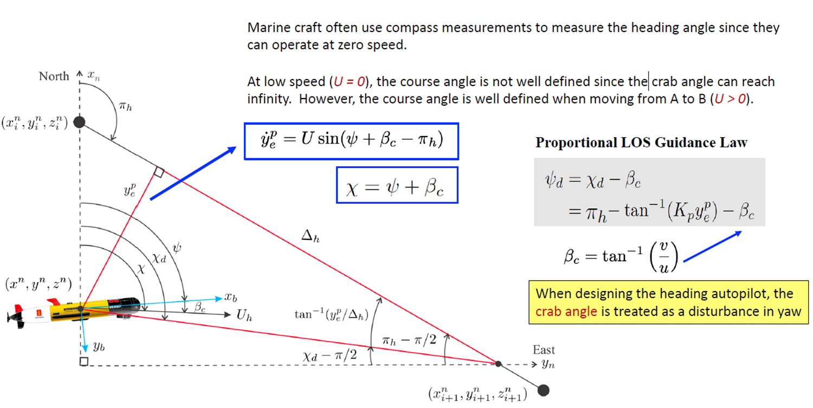

| 슬라이드에서 | 무엇인가 |
|---|---|
| 위쪽 상자 친 식 | 위의 식. $\chi$ 를 $\psi + \beta$ 로 이미 풀어 쓴 형태다 |
| 아래 회색 상자 | 선수각 제어 선박에 맞춘 §5-3 의 법칙: 침로 명령에서 크랩각을 뺀다 |
| 왼쪽의 기하 | §5-3 의 삼각형. 잠항도 하는 이동체를 두고 그린 것이라 아래 첨자 $h$(수평면)가 붙었다 |
| 노란 상자 | 이 절 전체가 걸려 있는 문장. 선수각 오토파일럿에게 크랩각은 요 방향의 외란이다 |

> [!note] 이 절의 참고 슬라이드를 읽는 법
> §5-5 에 실린 슬라이드는 2025년 강의자료 *2. USV 제어기 설계* 와 Fossen (2021) §12.3 에서 왔다. 기호는 아래와 같이 대응하며, 슬라이드마다 다시 적지 않는다.
>
> | 슬라이드에서 | 이 강의에서 | |
> |---|---|---|
> | $y_e^p$, $y_{\text{int}}^p$ | $y_e$, $y_{\text{int}}$ | 위 첨자는 경로 접선 좌표계를 뜻하고, 여기서 쓰는 좌표계는 그것 하나뿐이다 |
> | $\pi_p$, $\pi_h$ | $\pi_p$ | 둘 다 다리의 방향이다. $\pi_h$ 는 잠항하는 이동체를 위한 수평면 형태다 |
> | $\Delta$, $\Delta_h$ | $\Delta$ | §5-3 의 전방주시거리 |
> | $K_p$ | $1/\Delta$ | §5-3 — 슬라이드는 게인을 남기고 이 강의는 거리를 남긴다. 둘은 서로 역수다 |
> | $\beta_c$ | $\beta$ | **크랩각.** 이 볼트에서 $\beta_c$ 는 조류가 흘러가는 방향으로 예약되어 있고, 그것이 `W05_0_setup.m` 의 `beta_c` 변수다 |
> | $U_h$ | $U$ | 대지속력 |

   4주차 §4-4 는 그중 세 각을 한 그림에 두었다. 조류가 들어오면 둘이 더 붙고, 다섯이 함께 속도 삼각형 하나가 된다 — 물에 대한 속도에 물 자신의 속도를 더하면 땅에 대한 속도다.

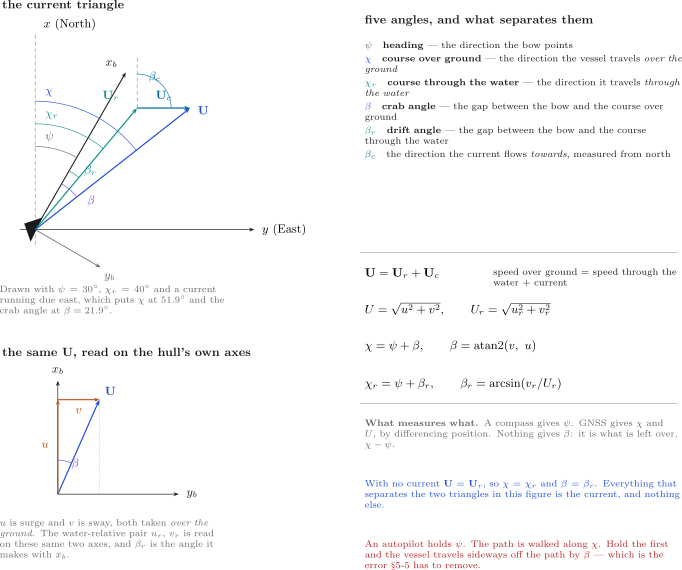

| 그림에서 | 무슨 뜻인가 |
|---|---|
| 청록 화살표 $\mathbf U_r$ | 선체가 물을 가르며 내는 속도 — 프로펠러가 만드는 것이고, 오토파일럿이 건드릴 수 있는 전부다 |
| 파란 화살표 $\mathbf U_c$ | 조류. 앞 화살표의 끝에서 그린다 — 배가 물을 헤엄치는 동안 그 물이 배를 실어 나른다 |
| 진한 파란 화살표 $\mathbf U$ | 그 합이고, 경로가 신경 쓰는 유일한 것 — 땅에 대한 방향과 속력이다 |
| 북에서 시작하는 세 호 $\psi$, $\chi_r$, $\chi$ | 선수각, 대수 침로, 대지 침로. 서로 다른 셋이고, 다르다는 것이 이 그림의 요점이다 |
| 선체의 호 $\beta$ | 크랩각 $\chi - \psi$. 선수가 가리키는 쪽과 배가 가는 쪽의 차이 |
| 안쪽 호 $\beta_r$ | 표류각 $\chi_r - \psi$. 같은 차이를 물에 대해 잰 것이다. 조류가 없어도 선회 중이면 선체가 스스로 만든다 |
| 아래 칸 | 같은 $\mathbf U$ 를 선체 축에서 본 것. 그 두 성분이 로그의 $u$ 와 $v$ 다 |

| 기호 | 양 | 값 · 출처 |
|---|---|---|
| $\mathbf U_r$, $U_r$ | 물에 대한 속도와 그 크기 | m/s · 조류에 대한 `otter.m` 상태 1–2 |
| $\mathbf U_c$, $U_c$ | 조류의 속도와 속력 | m/s · `W05_0_setup.m` 의 `V_c` |
| $\beta_r$ | 표류각, $\arcsin(v_r/U_r)$ | 잔잔한 물의 직선 다리에서는 0 |
| $\beta_c$ | 조류가 흘러**가는** 방위, 북에서 | rad · `W05_0_setup.m` 의 `beta_c`, $\pi/2$ 가 동쪽 |

- **다섯 중 둘은 재지 않는다.** 컴퍼스가 $\psi$ 를, GNSS 가 $\chi$ 와 $U$ 를 준다. 크랩각은 남는 것 $\chi - \psi$ 이고, $\mathbf U_r$ 은 조류를 모르면 알 수 없다.
- **조류가 없으면 그림이 무너진다.** $\mathbf U_c = 0$ 이면 $\mathbf U = \mathbf U_r$ 이므로 $\chi = \chi_r$, $\beta = \beta_r$ 이다. 반직선 셋이 둘이 되고 4주차 §4-4 가 그대로 돌아온다. 여기서 셋을 갈라 놓는 것은 조류 하나다.
- 어려움 전부가 $\beta$ 로 표시된 간격에 있다. 경로는 $\chi$ 에 대해 정의되고, 오토파일럿은 $\psi$ 를 조종하며, 이 배의 무엇도 그 사이의 호를 재지 않는다.

7. **LOS 를 닫는다.** §5-3 의 $\psi = \psi_d$ 를 6번 줄에 넣는다.

$$
\dot y_e = U\,\sin\!\left(\beta - \arctan\frac{y_e}{\Delta}\right)
$$

   $\dot y_e = 0$ 으로 두면 괄호가 사라져야 하므로 $\arctan(y_e/\Delta) = \beta$ 이고 $y_e = \Delta\tan\beta$ 다. 3번 줄을 다시 얻은 것이지만 정상상태에 대한 진술이 아니라 **동역학**에서 도달한 것이고, 더 강한 것을 말한다 — 그 편차는 **닫힌 루프의 평형점**이고 유일한 평형점이다. 끝나지 않은 과도가 아니다. 기다려도 사라지지 않고 어떤 게인으로도 사라지지 않는다. $\Delta$ 가 이 법칙의 유일한 게인이고 4번 줄이 그 값을 이미 매겨 두었기 때문이다.

> [!note] Lyapunov 안정도 판정이란 무엇인가 — 상자 하나로
> **왜 필요한가.** 7번 줄의 오차 운동방정식은 상태의 arctan 의 sin 이다. 전달함수도 극점도 근궤적도 없으므로 2~4주차의 안정도 판정법이 통하지 않는다. 통하는 것이 Lyapunov 의 방법이고, **방정식을 풀지 않고도** 답한다.
>
> **원리.** 에너지처럼 행동하는 스칼라 $V(x)$ 를 하나 지어낸다 — 평형점에서 0, 다른 곳에서는 양, 멀리 갈수록 한없이 커지는 함수다. 그리고 시스템 자신의 운동을 따라가며 $\dot V$ 를 본다. 평형점을 벗어나 있는 동안 에너지가 계속 줄어든다면 상태는 벗어난 채로 있을 수 없다. 그릇 바닥 말고는 갈 곳이 없기 때문이다.
>
> | 조건 | 기호로 | 무엇을 말하는가 |
> |---|---|---|
> | $V$ 가 양정부호 | $V(0) = 0$, $x \neq 0$ 에서 $V(x) > 0$ | 그릇의 가장 낮은 점이 평형점 하나뿐이다 |
> | $V$ 가 반경방향 무한 | $\lVert x\rVert \to \infty$ 일 때 $V(x) \to \infty$ | 그릇에 넘어갈 테두리가 없다 — 결론이 **전역**이 되는 것은 이 조건 때문이다 |
> | $\dot V$ 가 음정부호 | $x \neq 0$ 에서 $\dot V(x) < 0$ | 바닥에 있지 않은 모든 순간에 에너지를 잃는다 |
>
> **무엇이 따라오는가.** 셋이 함께 성립하면 전역 점근 안정이다 — **어떤** 초기 상태에서 출발해도 $x \to 0$ 이다. 약한 조건은 약한 결론을 준다. $\dot V \le 0$ 뿐이면 상태는 안정하지만 수렴한다는 보장은 없고, 그때는 $\dot V = 0$ 인 집합 안에 평형점 말고는 어떤 궤적도 머무를 수 없음을 보여 수렴을 되찾는다. 그것이 Krasovskii–LaSalle 정리이고, 9b 번 줄 끝에서 인용하는 단계다.
>
> **주의 둘.** 이 판정은 **충분조건이지 필요조건이 아니다.** 어떤 $V$ 가 실패해도 아무것도 증명되지 않는다. 다른 $V$ 가 성공할 수 있기 때문이다. 그리고 그 양이 물리적 에너지일 필요도 없다 — 7b 번 줄의 $V$ 는 횡방향 오차 제곱의 절반이고, 단위는 m² 이며 물리적 의미는 없다. 그릇 모양이기만 하면 된다.

7b. **조류가 없으면 같은 식이 법칙의 전역 수렴을 증명한다.** 7번 줄에서 $\beta = 0$ 으로 둔다. arctan 의 sin 은 §5-3 삼각형의 대변 나누기 빗변, 곧 $\sin\arctan(y_e/\Delta) = y_e/\sqrt{\Delta^2 + y_e^2}$ 이므로

$$
\dot y_e = -U \sin\!\left(\arctan\frac{y_e}{\Delta}\right) = -\frac{U}{\sqrt{\Delta^2 + (y_e)^2}}\; y_e
$$

   $V = \tfrac12 (y_e)^2$ 를 잡는다 — 오차 제곱의 절반이고, 경로 위에서 0, 다른 곳에서 양이다. 그 운동을 따라간 변화율은

$$
\dot V = y_e\,\dot y_e = -\frac{U}{\sqrt{\Delta^2 + (y_e)^2}}\,(y_e)^2 < 0, \qquad \forall\, y_e \neq 0
$$

   2025년 강의자료와 Fossen (2021) §12.3 에 실린 유도를 6번 줄의 표기만 바꿔 그대로 옮긴 것이다.

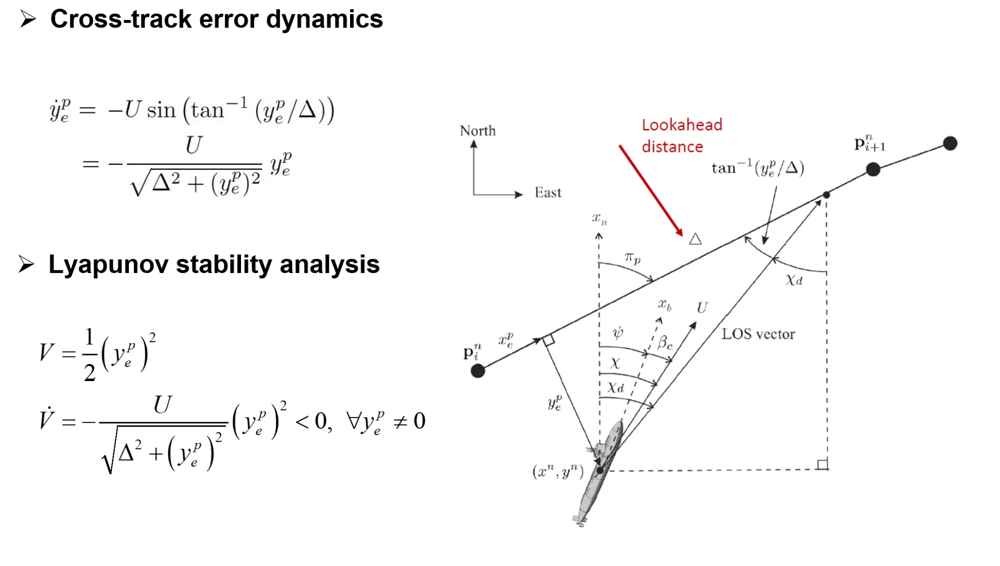

| 슬라이드에서 | 위의 어느 식인가 |
|---|---|
| *Cross-track error dynamics* 의 두 줄 | 첫 번째 식. arctan 의 sin, 그리고 삼각형을 넣어 정리한 같은 식 |
| *Lyapunov stability analysis* 의 $V = \tfrac12 (y_e^p)^2$ | 위 상자에서 고른 그 후보 |
| $\dot V < 0,\ \forall y_e^p \neq 0$ | 두 번째 식, 그리고 거기서 끌어낸 결론 |
| 오른쪽의 기하 | §5-3 의 전방주시 삼각형. 조준점이 $\Delta$ 앞에 있고 각이 $\arctan(y_e^p/\Delta)$ 다 |

- **무엇이 증명되는가.** 배가 경로를 벗어나 있는 모든 순간에 $V$ 가 줄고, 경로 위에서만 줄기를 멈춘다. **어떤** 초기 오차에서든 그렇고, 작은 오차에 한정되지 않는다. 실험 5-3 은 전방주시거리 $5$ m 로 $20$ m 떨어진 곳에서 출발해 쓸어 본 모든 $\Delta$ 에서 수렴하는데, 그것이 이 줄을 측정으로 옮긴 것이다.
- **조건은 $U > 0$ 하나다.** 대지속력이 없는 배는 어디로도 조종될 수 없고, $y_e$ 앞의 계수도 $U$ 와 함께 사라진다. 같은 조건이 이 절 끝에서 선수각 제어 선박을 쓰는 이유로 돌아온다.
- **분모는 조준점까지의 거리** $\sqrt{\Delta^2 + y_e^2}$ 이고, §5-3 의 삼각형에서 바로 읽힌다. 경로에서 멀면 접근 속도가 $U$ 자체에 가까워진다 — 배가 경로를 똑바로 겨누고 전속으로 다가간다. 가까우면 $U y_e/\Delta$ 가 되는데, 그것이 §5-3 의 P 제어기다.
- **조류에 대해서는 아무것도 말하지 않는다.** $\beta = 0$ 으로 두고 얻은 것이기 때문이다. $\beta \neq 0$ 이면 평형점이 7번 줄의 $y_e = \Delta\tan\beta$ 로 옮겨 가고 위의 논증은 **그 점**에 대해 성립한다. 곤란한 것이 정확히 그것이다 — 법칙은 안정하다. 엉뚱한 자리에 대해 안정하다.

8. **대신 무엇이 참이어야 하는가.** $y_e = 0$ 이 평형점이 되려면 7번 줄의 괄호가 $y_e = 0$ **에서** 사라져야 한다. $\beta \ne 0$ 이므로 arctan 은 $y_e$ 가 **아닌** 무엇인가를 받아야 한다. 거기에 두 번째 항을 더하고 그 항에 자기 상태를 준다.

$$
\psi_d = \pi_p - \arctan\!\left(\frac{y_e + \kappa\, y_{\text{int}}}{\Delta}\right)
\qquad\Longrightarrow\qquad
\dot y_e = U\,\sin\!\left(\beta - \arctan\frac{y_e + \kappa\, y_{\text{int}}}{\Delta}\right)
$$

   이제 $y_e = 0$ 이 평형점인 것은 **다음과 동치다**

$$
\kappa\, y_{\text{int}}^\star = \Delta\tan\beta
$$

   그리고 그 오른쪽은, 3번 줄에 따라 **정확히 LOS 가 남기고 있던 편차**다. 그것이 설계의 전부다, 한 줄로. 적분은 조류를 상쇄하지 않고, 조류가 무엇인지 끝내 배우지도 않는다. 옛 법칙이 오차로서 만들어 내던 그 수로 수렴해서, 그것을 대신 상태로서 만들어 낸다. 측정은 같은 수를 두 번 말한다 — LOS 편차 $2.107$ m, 그리고 $\kappa y_{\text{int}} \to 2.10$ m.

| $\kappa$ | 끝의 $\kappa\,y_{\text{int}}$ [m] | 최대 $\lvert\dot y_{\text{int}}\rvert$ |
|---|---|---|
| 0.1 | 2.1013 | 0.3949 |
| 0.3 | 2.1042 | 0.3361 |
| 1 | 2.1456 | 0.8193 |
| 3 | 0.1187 | 1.2337 |

   $V_c = 0.3$ m/s 에서 900 m 다리 하나로, 정착하도록 1100 s 를 주고 쟀다. 그 실행의 $\Delta\tan\beta = 2.1049$ m 와 대조한 것이다. 앞의 세 줄은 2 % 안에서 그 값에 닿고, $\kappa = 3$ 은 전혀 수렴하지 않는다 — 그것이 11번 줄이다. 마지막 열은 9번 줄에서 읽는다.

   그것을 그린 그림이 이 절에서 가져갈 하나다.

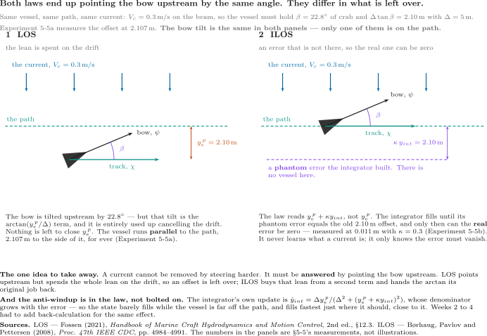

| 그림에서 | 거기 있는 것 | 어느 줄이 예측했나 |
|---|---|---|
| 두 칸 모두, 선수 화살표 | **같은** $22.8°$ 만큼 상류로 기울어 있다 | 1번 줄: 크랩각은 조류와 속력이 정하고, 법칙이 정하지 않는다 |
| 1번 칸, 선체가 앉은 자리 | 경로 옆이고, 그 항적은 경로와 **평행**하다 | 2번과 4번 줄: LOS 는 $y_e \ne 0$ 인 동안에만 그 기울기를 유지할 수 있고, 그것을 유지하는 $y_e$ 가 $\Delta\tan\beta = 2.10$ m 다 |
| 2번 칸, 선체가 앉은 자리 | 같은 기울기로, 경로 **위에** | 8번 줄: 이제 적분이 각을 공급하므로 오차가 그럴 필요가 없다 |
| 2번 칸, 경로 아래의 점선 | $\kappa y_{\text{int}} = 2.10$ m — 그 위에 배가 없는 **유령** 오차 | 8번 줄: 법칙은 $y_e + \kappa y_{\text{int}}$ 를 읽고, 사라져야 하는 것은 그 합이다 |

- 적분은 조류와 싸우지 않는다. **조류가 공급하고 있던 오차를 대신 공급한다.** 그래서 arctan 은 전과 정확히 같은 만큼 선수를 계속 기울이고, 실제 오차는 0 으로 간다.

9. **상태를 거기로 보내는 방법.** 8번 줄은 $y_{\text{int}}$ 가 어디서 끝나야 하는지를 고정하지만 거기에 어떻게 가는지는 고정하지 않는다. (a) $y_e = 0$ 일 때에만 0 이어서 8번 줄의 평형점이 멈추는 곳이 되고, (b) 배가 경로에서 멀리 있는 동안 달아나지 않는다 — 2주차의 와인드업이다 — 이 둘을 만족하면 어떤 갱신 법칙이든 된다. Børhaug, Pavlov, Pettersen 은 다음을 고른다

$$
\dot y_{\text{int}} = \frac{\Delta\, y_e}{\Delta^2 + (y_e + \kappa\, y_{\text{int}})^2}
$$

   조건 (a) 는 즉시 보인다. 분자가 $y_e$ 의 부호를 지니고 그것과 함께서만 사라진다. 조건 (b) 는 분모가 하는 일이다. 적분이 아직 작은 동안 인자는 $\approx y_e$ 이고,

$$
\max_{y_e}\ \frac{\Delta\, y_e}{\Delta^2 + y_e^2} = \frac{1}{2}
\quad\text{at}\quad y_e = \Delta
$$

   이므로 배가 경로에서 얼마나 멀리서 출발하든 상태는 초당 반 단위보다 빠르게 자랄 수 없다 — 2~4주차의 back-calculation 처럼 **덧붙인 것이 아니라 법칙에 써 넣은 안티와인드업**이다. 갱신이 $y_e = \Delta$ 에서 가장 빠르고 그보다 가깝거나 멀면 느려지는 이유도 그것이다. 경로 근처에서는 적분할 것이 적고, 멀리서는 법칙이 보정보다 선회에 바쁘다.

| 기호 | 양 | 값 · 출처 |
|---|---|---|
| $y_{\text{int}}$ | 적분 상태 | s. 0 에서 시작한다 |
| $\kappa$ | 적분 상수 — $\kappa y_{\text{int}}$ 가 길이이므로 그 자체는 **속도**다 | $0.3$ m/s, `W05_0_setup.m` |
| $\kappa/\Delta$ | 그 결과의 I 게인 | $0.06$ s⁻¹ |

9b. **같은 상태, 그리고 출판된 증명.** 9번 줄은 갱신 법칙을 요구조건 둘에서 끌어냈다. 문헌은 같은 자리에 도달하고 그것을 증명한다. Fossen (2021) §12.3 이 식 (12.96)~(12.100) 으로 제시하는 형태이고, MSS 가 구현한 것도 이것이다. 법칙은 침로 명령으로 쓰이며, 분모에 제곱근이 있고 분자에 대지속력이 있다.

$$
\chi_d = \pi_p - \arctan\!\left(K_p\, y_e + K_i\, y_{\text{int}}\right),
\qquad
\dot y_{\text{int}} = \frac{U\, y_e}{\sqrt{\Delta^2 + (y_e + \kappa\, y_{\text{int}})^2}}
$$

   여기서 $K_p = 1/\Delta$, $K_i = \kappa K_p$, $\kappa > 0$ 이다. 이것을 6번 줄에 넣으면 닫힌 루프의 오차 운동방정식이 나온다.

$$
\dot y_e = U \sin(\chi - \pi_p) = -U\,\frac{y_e + \kappa\, y_{\text{int}}}{\sqrt{\Delta^2 + (y_e + \kappa\, y_{\text{int}})^2}}
$$

   Lyapunov 후보는 7b 번 줄의 것에 새 상태를 위한 둘째 항을 더한 $V = \tfrac12 (y_e)^2 + \tfrac{\kappa}{2}(y_{\text{int}})^2$ 이고, 그 변화율은

$$
\begin{aligned}
\dot V &= y_e\left(-U\,\frac{y_e + \kappa\, y_{\text{int}}}{\sqrt{\Delta^2 + (y_e + \kappa y_{\text{int}})^2}}\right) + \kappa\, y_{\text{int}}\,\dot y_{\text{int}} \\[4pt]
&= -U\,\frac{(y_e)^2}{\sqrt{\Delta^2 + (y_e + \kappa y_{\text{int}})^2}}
 + \frac{\kappa\, y_{\text{int}}\left(\dot y_{\text{int}}\sqrt{\Delta^2 + (y_e + \kappa y_{\text{int}})^2} - U y_e\right)}{\sqrt{\Delta^2 + (y_e + \kappa y_{\text{int}})^2}}
\end{aligned}
$$

   갱신 법칙이 하필 그 모양인 이유가 둘째 항에 있다. $\dot y_{\text{int}}$ 를 위와 같이 고르면 그 괄호가 항등적으로 사라지고, 남는 것은 음수다.

$$
\dot V = -U\,\frac{(y_e)^2}{\sqrt{\Delta^2 + (y_e + \kappa\, y_{\text{int}})^2}} < 0,
\qquad \forall\, y_e \neq 0,\ y_{\text{int}} \neq 0
$$

   $U$ 와 $\Delta$ 가 상수이면 Krasovskii–LaSalle 정리에 의해 $(y_e, y_{\text{int}}) = (0,0)$ 이 전역 점근 안정이다. 증명은 핸드북 p. 362 에 있고, 알고리즘은 Lekkas and Fossen (2014), MSS 구현은 `ILOSchi.m` 이다.

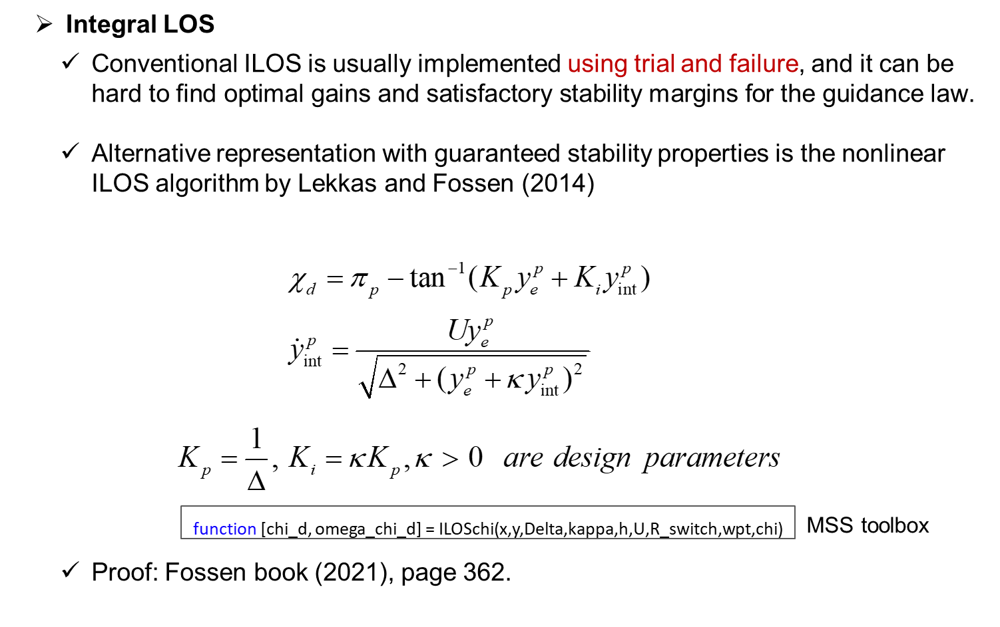

| 슬라이드에서 | 무엇인가 |
|---|---|
| 적힌 식 둘 | 위의 법칙과 갱신식. 핸드북의 (12.96) 과 (12.97) 이다 |
| $K_p = 1/\Delta$, $K_i = \kappa K_p$, $\kappa > 0$ | 설계 파라미터. 거리 하나와 비 하나이고, §5-3 과 9번 줄 그대로다 |
| 상자 친 함수 선언 | `ILOSchi(x, y, Delta, kappa, h, U, R_switch, wpt, chi)` — MSS 구현이고, 인자가 이번 주의 §5-3·§5-4·§5-5 를 한 줄에 담고 있다 |
| 그 위의 *trial and failure* | 증명이 딸린 형태를 보통 ILOS 의 맹목적 튜닝보다 앞세우는 이유 |

> [!important] 이 증명이 덮는 형태
> 위에서 증명한 갱신 법칙은 $U/\sqrt{\cdot}$ 를 들고 있고, 이 강의가 9번 줄에서 쓰는 것은 $\Delta/(\cdot)$ 를 들고 있다 — Børhaug, Pavlov, Pettersen (2008) 이고, 3자유도 선박 모델과 종속으로 연결한 상태에서 UGAS/ULES 를 증명한다. 둘의 차이는 갱신률이 속력에 따라 어떻게 비례하는가, 따라서 $\kappa$ 의 단위가 무엇인가에 있지, 9번 줄의 요구조건 둘에 있지 않다. 둘 다 $y_e$ 와 함께만 사라지고 둘 다 오차가 커지면 작아진다. 이 강의가 $\Delta$ 형태를 남기는 것은 $\kappa$ 를 속도로 읽어 조류와 바로 견줄 수 있게 하기 위해서이고, 실험 5-5b 의 재계산 검사도 그 형태에 대해 돌린다.

10. **작은 신호에서는 PI 제어기다.** 경로 근처에서 다시 $\arctan x \approx x$ 이므로 $\psi_d - \pi_p \approx -(1/\Delta)\,y_e - (\kappa/\Delta)\,y_{\text{int}}$ — 횡방향 오차에 대한 비례 더하기 적분이고, §5-3 에서 온 $K_p = 1/\Delta$ 와 $K_i = \kappa/\Delta$ 다. 2주차가 PI 제어기에 대해 세운 모든 것이 여기 그대로 적용되고, 적분이 오버슛을 비용으로 치른다는 것도 포함된다.

11. **그리고 $\kappa$ 에는 천장이 있다.** 9번 줄의 한계는 $y_{\text{int}}$ 가 작은 동안 성립한다. $\kappa y_{\text{int}}$ 가 $y_e$ 와 비슷한 크기이면서 부호가 반대가 되면 분모가 다시 작아지고 갱신에 뚜껑이 없어진다. 8번 줄 표의 마지막 열은 $\kappa = 1$ 과 $\kappa = 3$ 에서 이미 $\tfrac12$ 를 넘었고, 그중 뒤의 것은 결코 정착하지 않는다. 원논문의 안정성 증명이 바로 이 이유로 $\kappa$ 에 조건을 붙인다. 이 강의는 대신 §5-6 에서 측정으로 $\kappa$ 를 고른다.

유도는 거기까지다. 1번부터 5번 줄이 LOS 아래에서 편차를 피할 수 없다고 말하고, 6번부터 8번 줄이 법칙을 무엇으로 바꿔야 하는지 말하며 — 7b 번 줄이 옛 법칙은 불안정했던 적이 없고 다만 엉뚱한 자리에 정착했을 뿐임을 보이고 — 9번부터 11번 줄이 새 상태를 어떻게 몰고 얼마나 세게 몰아도 되는지, 9b 번 줄이 그것이 수렴한다는 출판된 증명을 말한다. 뻔한 대안 둘이 남아 있고, 실험 전에 둘 다 물려야 한다.

**보통 적분은 왜 안 되는가?** 뻔한 갱신은 2주차가 쓴 것 — 오차 자체를 적분하는 $\dot y_{\text{int}} = y_e$ — 이고, 그러면

$$
\psi_d = \pi_p - \arctan\!\left(K_p\, y_e + K_i\!\int_0^t\! y_e(\tau)\,\mathrm d\tau\right), \qquad K_p = \frac{1}{\Delta},\quad K_i = \frac{\kappa}{\Delta}
$$

   이것이 문헌의 **보통 ILOS(conventional ILOS)** 이고, 조건 (a) 를 만족한다 — $y_e = 0$ 인 곳에서만 멈춘다. 조건 (b) 를 만족하지 못한다. 경로에서 멀면 최대 속도로 적분한다.

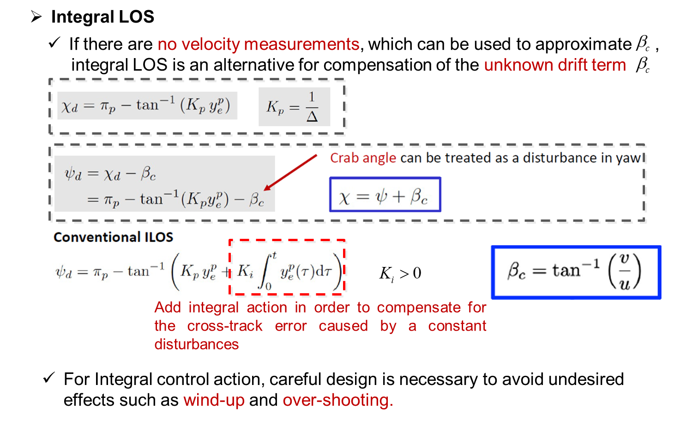

- 슬라이드는 그 대가를 2주차와 같은 말로 적는다 — 적분 동작에는 와인드업과 오버슈팅을 피하기 위한 세심한 설계가 필요하다. 9번 줄의 법칙은 그 둘을 세심한 설계로 피하지 않는다. 분모의 모양으로 피한다.

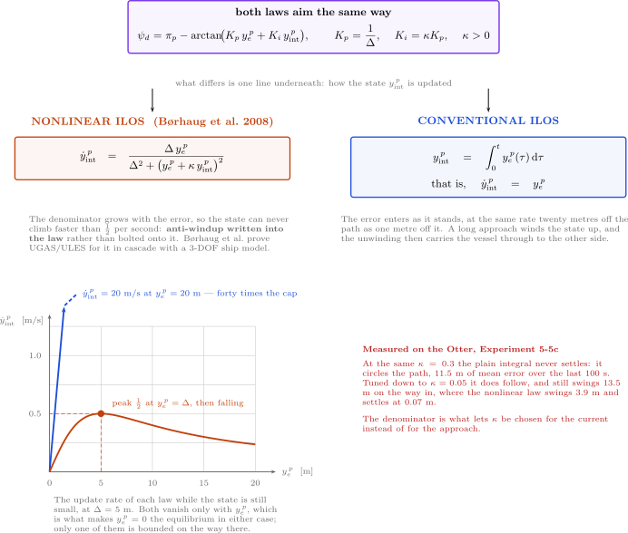

| 그림에서 | 무슨 뜻인가 |
|---|---|
| 맨 위의 보라 상자 | 겨눔 식. **두 법칙에서 동일하고**, $K_p = 1/\Delta$, $K_i = \kappa K_p$ 다 |
| 그 아래의 상자 둘 | 다른 한 줄. 왼쪽이 비선형 갱신, 오른쪽이 보통 적분 |
| 주황 곡선 | 비선형 갱신 속도. 올라가서 $y_e = \Delta$ 에서 $\tfrac12$ 로 꼭대기를 찍고 **떨어져 내린다** |
| 파란 직선 | 보통 적분의 같은 양. $\dot y_{\text{int}} = y_e$ 이고 축 위로 곧장 벗어난다 — 경로에서 $20$ m 면 $20$ m/s |

참고자료가 두 법칙을 나란히 놓은 것, 그리고 그 차이가 사 주는 과도응답:

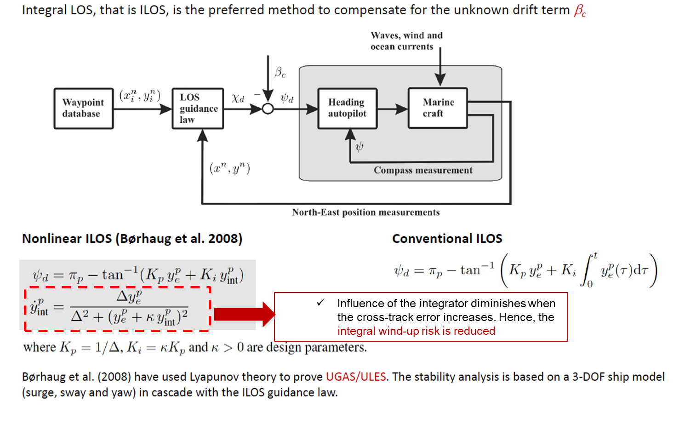

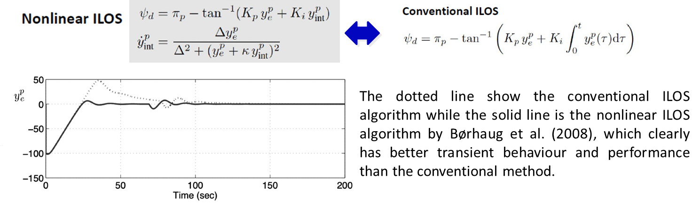

| 슬라이드에서 | 무엇을 읽는가 |
|---|---|
| 왼쪽 슬라이드의 붉은 점선 상자 | 다른 한 줄. 위 그림이 하는 비교와 같은 것이다 |
| 그 옆의 문장 | *횡방향 오차가 커지면 적분기의 영향이 줄어든다* — 9번 줄의 조건 (b) 다 |
| 아래 슬라이드의 점선 곡선 | $-100$ m 에서 접근한 뒤 $+50$ m 까지 넘어가는 보통 ILOS |
| 아래 슬라이드의 실선 곡선 | 그 넘어감 없이 정착하는 비선형 법칙 |

- 그 그래프는 다른 배에 대한 출판된 결과이므로 수치는 이 강의의 것이 아니다. 실험 5-5c 가 같은 비교를 Otter 로 돌려 $13.5$ m 대 $3.9$ m 를 보고한다 — 다른 수 한 쌍이지만 모양은 같다.

- 주황 곡선이 논증 전부를 한 줄에 담고 있다. **경로에서 멀 때 느려지는** 적분기는 접근 중에 감길 수 없고, 빨라지는 적분기는 반드시 감긴다. 이 임무는 $20$ m 벗어난 곳에서 출발하므로 배가 경로에 닿을 때쯤 상태는 반 분 동안 쌓여 있고, 그 다음 반대쪽을 지나며 풀려야 한다. 실험 5-5c 가 그 비용을 잰다 — 같은 $\kappa$ 에서 보통 적분은 경로를 아예 따라가지 못하고, 따라갈 때까지 낮춰도 비선형 법칙이 $3.9$ m 흔들리는 자리에서 여전히 $13.5$ m 흔들린다. 분모가 차이 전부이고, 덧붙인 것이 아니라 법칙에 써 넣은 것이다.

**크랩각을 재면 되지 않는가?** 횡동요 속도 $v$ 가 측정되면 크랩각을 계산해 그대로 빼면 되고, 적분기는 어디에도 필요하지 않다.

$$
\psi_d = \chi_d - \beta = \pi_p - \arctan\frac{y_e}{\Delta} - \beta, \qquad \beta = \arctan\frac{v}{u} = \arcsin\frac{v}{\sqrt{u^2+v^2}}
$$

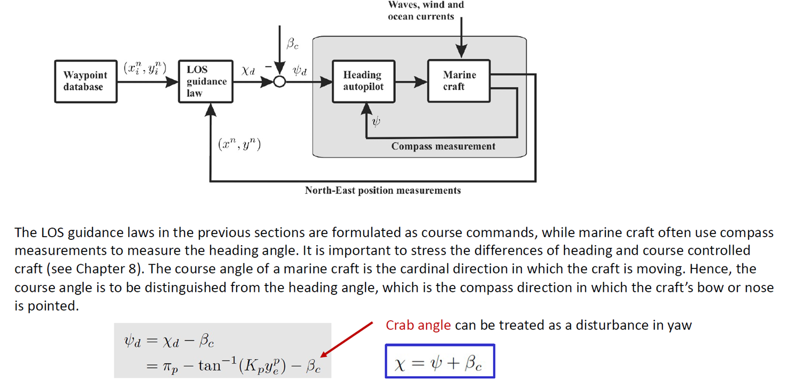

| 슬라이드에서 | 무엇인가 |
|---|---|
| 블록도 | 이 절 끝 그림의 오른쪽 칸. 선수각 오토파일럿이고, 그 앞에서 크랩각을 뺀다 |
| 회색 상자 | 위의 식을 두 단계로 쓴 것. 먼저 $\chi_d - \beta$, 그 다음 $\chi_d$ 를 펼친다 |
| 파란 상자 $\chi = \psi + \beta$ | 그 뺄셈이 옳은 뺄셈이게 하는 4주차 §4-4 의 항등식 |
| 붉은 주석 | 아래 콜아웃과 같은 문장. 오토파일럿에게 크랩각은 요 방향의 외란이다 |

   그것은 동작하고, **측정이 존재할 때는** 가장 깔끔한 방법이다. 대신 적분을 쓰는 이유 셋이 있다.

- **영속력에서 특이하다.** $U \to 0$ 에서 $\beta$ 가 정의되지 않고 그 바로 위에서 조건수가 나쁘다 — 배가 접안 근처에서 조함하는 바로 그 자리다.
- **측정이 있어야 한다.** $v$ 가 필요하다 — 도플러 로그, 또는 컴퍼스와 차분한 대지침로. **이 강의의 Otter 는 유도 블록에 $v$ 를 기록하지 않고,** 여기서 결정하는 것은 그 이유다.
- **결코 완전하지 않다.** 횡동요·종동요 결합이 $\beta$ 를 뺀 뒤에도 작은 편차를 남기므로, 적분을 어차피 더한다 — 아래 참고자료 자신의 결론이기도 하다.

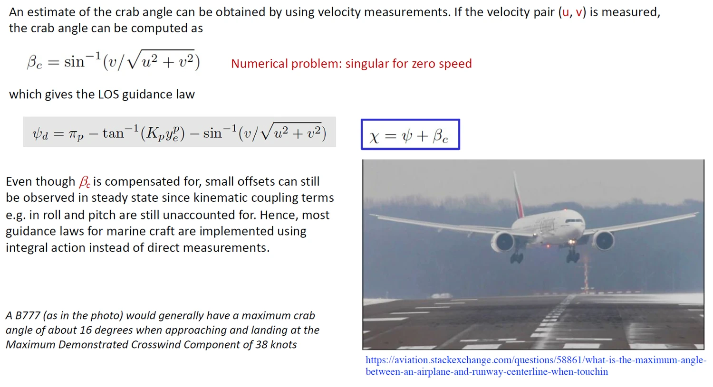

| 슬라이드에서 | 무엇을 가져가는가 |
|---|---|
| 상자 친 추정식 | 위의 두 번째 식, 슬라이드의 표기로 |
| 그 옆의 글 | *numerical problem: singular for zero speed* — 첫 번째 항목 |
| 아래 문단 | 횡동요·종동요의 기구학적 결합이 그래도 편차를 남긴다는 것 — 세 번째 항목 |
| 사진 | 같은 각을 항공기에서. B777 은 $38$ 노트 측풍에서 최대 $16°$ 까지 게걸음으로 착륙한다. 실험 5-5a 의 배는 $0.3$ m/s 조류에서 $22.8°$ 다 |

   그리고 둘은 사실 경쟁자가 아니다. 8번 줄은 적분이 $\kappa y_{\text{int}}^\star = \Delta\tan\beta$ 로 수렴하는 것을 보였다. **적분은 측정이 공급했을 그 수를 재구성한다** — 경로 오차만으로, 센서 없이, 영속력에서의 특이점 없이.

   그 뺄셈이 가능한지만큼 그것을 **어디에** 배선하는가도 중요하고, 문헌이 LOS 를 양쪽으로 쓰기 때문에 두 구조를 나란히 볼 만하다.

> [!important] LOS 계열의 유도 법칙은 침로를 명령하고, 이 배는 선수각을 조종한다
> $\dot y_e = U\sin(\chi - \pi_p)$ 에는 침로 $\chi$ 가 들어 있고 그 밖에는 없으므로, 법칙의 자연스러운 출력은 $\chi_d$ 다. 그것을 어디에 배선하는가가 그 다음에 무엇을 해야 하는지를 정한다.
>
> | | 침로 제어 | 선수각 제어 — **이 강의** |
> |---|---|---|
> | 오토파일럿이 닫는 대상 | 대지침로로 측정한 $\chi$ (GNSS) | 컴퍼스나 자이로로 측정한 $\psi$ (4주차) |
> | 유도의 출력은 | 그대로 쓴다: $\chi_d$ | 변환한다: $\psi_d = \chi_d - \beta$ |
> | 영속력에서 동작 | 아니다 — $U = 0$ 이면 $\chi$ 가 정의되지 않는다 | 된다. 해양 운동체가 컴퍼스를 싣는 이유다 |
> | 크랩각은 | 루프 안에 있고, 측정된다 | **요 방향의 외란**, 루프 밖에 있다 |
>
> Otter 는 오른쪽 열에 앉고, 그 두 번째 줄의 변환이 바로 위의 뺄셈 — 이 배가 수행할 수 없는 것 — 이다. 그래서 $\beta$ 는 측정되지 않은 요 외란으로 도착하고, 그것이 적분기의 고전적인 경우이며, §5-5 가 그 적분기다.

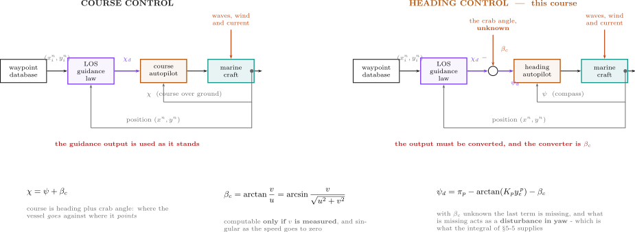

| 그림에서 | 무엇인가 |
|---|---|
| 두 칸 모두, 왼쪽 절반 | 같다. 같은 웨이포인트 목록과 같은 LOS 법칙이 $\chi_d$ 를 만든다 |
| 오토파일럿으로 가는 되먹임 | 왼쪽은 GNSS 의 $\chi$, 오른쪽은 컴퍼스의 $\psi$ |
| 오른쪽 칸, 오토파일럿 앞의 원 | $\chi_d$ 가 $\psi_d$ 가 되는 자리. 크랩각을 뺀다 |
| 오른쪽 칸, 그 원으로 들어가는 붉은 화살표 | $\beta$ — 그리고 **unknown** 이라는 말. 이 배의 무엇도 그것을 재지 않는다 |

- 이 강의의 배는 붉은 화살표가 **빠진** 오른쪽 칸이다. 6번부터 11번 줄이 그것을 그려 넣는 대신 하는 일이다.

참고자료의 같은 두 구조, 그리고 거기 딸린 정의들:

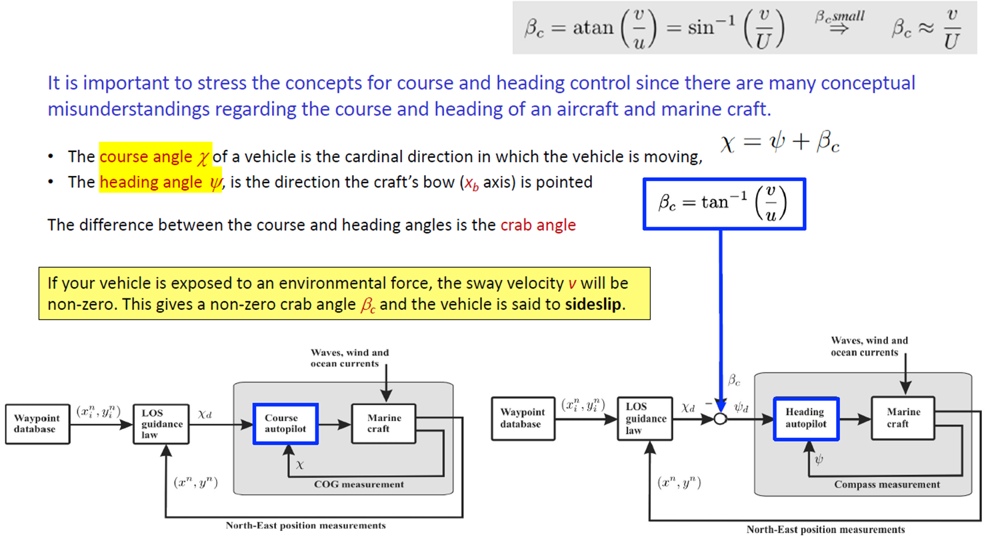

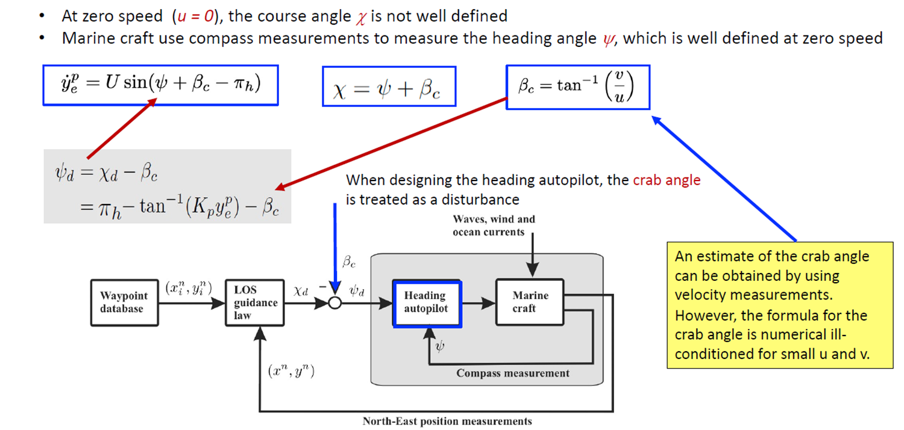

| 슬라이드에서 | 무엇을 가져가는가 |
|---|---|
| 첫 슬라이드의 블록도 둘 | 위 표의 두 열을 그린 것. 침로 오토파일럿은 GNSS 의 $\chi$ 를, 선수각 오토파일럿은 컴퍼스의 $\psi$ 를 닫는다 |
| 형광색 문장 | 환경 외력을 받는 배는 횡동요 속도가 0 이 아니므로 크랩각도 0 이 아니고, 그것을 **sideslip** 한다고 말한다 |
| 둘째 슬라이드의 첫 줄 | $U = 0$ 에서 침로각이 정의되지 않는 반면 컴퍼스는 정지 상태에서도 읽는다 — 해양 운동체가 오른쪽 열을 쓰는 이유 |
| 둘째 슬라이드의 노란 상자 | 앞 소절의 추정식, 그리고 작은 $u$, $v$ 에서의 나쁜 조건수 |

**유도가 예측한 것, 측정.** 실험 5-5b 가 $\Delta = 5$ m 로 $0.3$ m/s 조류에서 임무를 돌린 값:

| $\kappa$ | 마지막 100 s 의 평균 $y_e$ [m] | 오버슛 [m] |
|---|---|---|
| LOS ($\kappa = 0$) | 2.107 | 0 |
| 0.1 | 0.009 | 0.03 |
| 0.3 | 0.011 | 1.79 |
| 1 | −0.011 | 4.10 |
| 3 | 0.169 | 6.32 |

- 모든 $\kappa$ 가 편차를 없앤다 — 8번 줄 — 그리고 큰 값이 더 오버슛하는데, 그것이 2주차 이래 모든 적분의 대가다. 긴 다리 하나에서는 $\kappa = 0.1$ 이 가장 깔끔하다. §5-6 은 임무에서 고르고, 거기서는 다리가 짧고 적분에 시간이 적다.

**출처.** 이 법칙과 그 Lyapunov 해석: Børhaug, Pavlov and Pettersen, "Integral LOS control for path following of underactuated marine surface vessels in the presence of constant ocean currents", *47th IEEE Conference on Decision and Control*, 2008, pp. 4984–4991, DOI [10.1109/CDC.2008.4739352](https://doi.org/10.1109/CDC.2008.4739352) — 유도 법칙과 종속으로 연결된 3자유도 선박 모델에 대해 UGAS/ULES 를 증명한다. Fossen, *Handbook of Marine Craft Hydrodynamics and Motion Control*, 2nd ed., 2021, §12.3 이 여기 쓰는 표기로 같은 법칙을 주고 증명은 p. 362 이며, 그것을 9b 번 줄에 옮겨 적었다. Lekkas and Fossen (2014) 이 안정성 성질이 보장되는 형태를 제시한 곳이다. MSS 구현은 `ILOSpsi.m` 과 `ILOSchi.m` 이고, `ILOSchi.m` 은 여기서 쓰는 $\Delta/(\cdot)$ 가 아니라 9b 번 줄의 $U/\sqrt{\cdot}$ 비례를 들고 있다. Lyapunov 방법 자체는 7b 번 줄 앞의 상자에 정리해 두었다.

### 실험 5-5a · LOS 아래에서 조류가 남기는 편차 (7분)

**무엇을 재는가.** 3번과 4번 줄 — LOS 가 네 조류에서 정착하는 오차를, 그것이 유지하는 선수각의 $\Delta\tan$ 과 대조해.

**모델.** `W05_F_LOS` — §5-3 의 LOS 법칙을 곧은 400 m 다리 하나에서. 편차가 정착할 만큼 길다. 실행 사이에 바뀌는 것은 조류뿐이다.

**열고 돌리기.**

```matlab
W05_0_setup
WP_N = [0 400]'; WP_E = [0 0]'; V_c = 0.3;     % 동쪽으로 0.3 m/s / 0.3 m/s to the east
open_system('W05_F_LOS')           % Run — 경로와 나란히, 2.1 m 옆으로 / parallel, 2.1 m beside it
V_c = 0.4;                         % Run — 더 비스듬히 서고 더 벌어진다 / further off
W05_F_LOS_in_a_current             % 조류 네 가지를 한 번에 / all four currents at once
```

나오는 출력:

```
  W05 Experiment 5-5a  LOS in a current flowing east  (Delta = 5 m)
    V_c [m/s]   error left [m]   heading held [deg]   Delta*tan(heading) [m]
    0.1                  0.658                 -7.5                    0.658
    0.2                  1.344                -15.0                    1.344
    0.3                  2.107                -22.8                    2.107
    0.4                  3.012                -31.1                    3.012

    the direction it points and the direction it goes  (measured over t > 100 s)
      V_c [m/s]   mean |chi - psi| [deg]   heading psi [deg]   course chi [deg]
      0                          0.0984                -0.1                0.0
      0.3                       23.0066               -23.0                0.0
```

- 첫 표의 마지막 두 열이 4번 줄이고, 모든 줄에서 밀리미터까지 맞는다. 배는 $0.3$ m/s 조류 쪽으로 $22.8°$ 를 가리키고 정북으로 간다 — 4주차 §4-4 가, 이제 경로 오차를 비용으로 치르며.

**침로 대 선수각, 측정으로.** 둘째 표는 위 콜아웃의 크랩각을, 정의가 아니라 이 배에서 받아낸 것이다. 대지침로는 항적을 미분해 $\chi = \operatorname{atan2}(\dot y^n,\ \dot x^n)$ 으로 계산한다. GNSS 수신기가 보고하는 것이고 이 배가 공급할 수 있는 것이다 — 횡동요 속도 $v$ 는 기록하지 않고, 그것이 §5-5 가 크랩각을 재지 않는 이유로 든 셋 중 하나다.

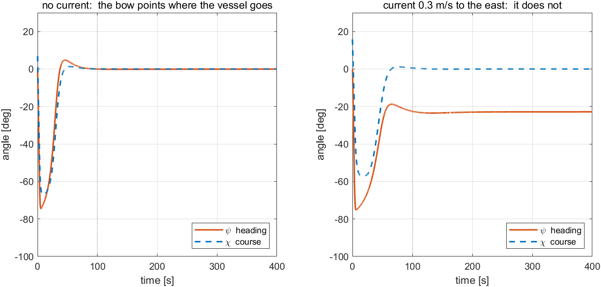

| 그림에서 | 거기 있는 것 |
|---|---|
| 왼쪽 칸, $t = 100$ s 뒤 | $\psi$ 와 $\chi$ 가 $0°$ 에서 겹쳐 있다. 조류가 없으면 선수는 배가 가는 쪽을 가리키고, 평균 차이는 $0.098°$ 다 |
| 오른쪽 칸, $t = 100$ s 뒤 | $\chi = 0.0°$ 인 동안 $\psi = -23.0°$ — 배가 북에서 서쪽을 가리키며 정북으로 가고, 그 간격이 $23.0°$ 다 |
| 두 칸 모두, 처음 $60$ s | 경로 동쪽 $20$ m 에서의 접근. 선수각과 침로가 둘 다 $-75°$ 까지 흔들리고 아직 잴 거리가 아니다 |
| $100$ s 의 점선 | 그 이유로, 측정이 시작되는 자리 |

- **같은 것에 대한 독립적인 측정 둘이 일치한다.** 각에서 읽은 크랩각은 $23.0°$ 이고, LOS 가 남기는 편차는 $2.107$ m 이고, $\Delta\tan 23.0° = 2.12$ m 다. 3번 줄이 그 둘이 같은 수여야 한다고 했고, 약 1 % 안에서 그렇다.

> [!note] 같은 실험을, 2025년 강의자료에서 다른 배로
> *2. USV 제어기 설계* 는 웨이포인트 다섯의 임무에서 조류 없이 $\operatorname{mean}\lvert\chi-\psi\rvert = 1.38°$, $20°$ 방향 $0.4$ m/s 조류에서 $13.63°$ 를 보고한다. 여기의 수가 더 큰 것은 상황이 더 어렵기 때문이고 배의 종류가 다르기 때문이 아니다. 이 다리는 조류에 $20°$ 가 아니라 **직각으로** 달리고, Otter 는 $X_{ff} = 60$ N 에서 $0.77$ m/s 만 내므로 같은 조류가 선수를 더 돌린다. 두 측정이 공유하는 것은 답의 모양 — 정수에서는 무시할 만하고 조류에서는 수십 도인 크랩각 — 이고, 그것이 §5-5 의 적분이 공급해야 하는 것이다.
>
> 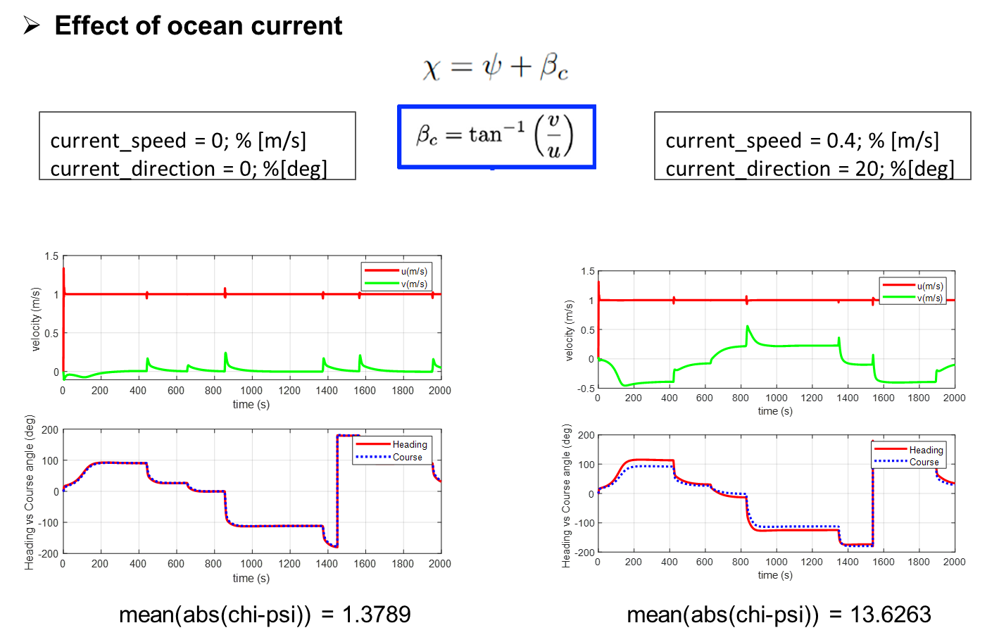
>
> | 슬라이드에서 | 여기서는 |
> |---|---|
> | 왼쪽 열, `current_speed = 0` | 위 그림의 왼쪽 칸. $\chi$ 와 $\psi$ 가 겹쳐 있다 |
> | 오른쪽 열, $20°$ 방향 `current_speed = 0.4` | 오른쪽 칸. 두 각이 크랩각만큼 벌어진다 |
> | 위쪽 그래프 | $u$ 와 $v$ — 크랩각의 근원인 횡동요 속도이고, Otter 가 유도 블록에 기록하지 않는 그것이다 |
> | $\operatorname{mean}\lvert\chi-\psi\rvert$ = $1.38$ 과 $13.63$ | 이 실험이 $0.098$ 과 $23.007$ 로 보고하는 같은 양. 위에 적은 더 어려운 상황에서다 |

### 실험 5-5b · 그것을 없애는 적분 (8분)

**무엇을 재는가.** 8번부터 11번 줄까지 — 같은 조류에 적분을 켠 것, $\kappa$ 네 값에 대해. 각각이 오버슛을 얼마나 비용으로 치르는지, $\kappa y_{\text{int}}$ 가 LOS 가 남기고 있던 편차로 정말 수렴하는지, 그리고 9번 줄의 갱신속도 한계가 어디서 성립을 멈추는지.

**모델.** `W05_F_ILOS` — 위 법칙의 적분 상태를 가진 같은 유도 블록. 그림의 검은 선은 비교를 위한 실험 5-5a 의 실행이다.

> [!important] 무엇을 열고, 그 안에서 무엇을 읽는가
> 이번 주의 적분은 Simulink `Integrator` 블록이 **아니다.** 그 갱신이 자기가 만들어 내고 있는 바로 그 양에 기대기 때문이고, 그것은 블록들의 고리보다 산술 두 줄로 읽는 것이 쉽다. 그러나 적분 **상태**가 함수 안에 숨어 있는 것도 아니다. 포트로 나가서 `Unit Delay` 에서 한 스텝 기다렸다가 다른 포트로 돌아온다.
>
> `W05_F_ILOS` 를 열고 캔버스부터 읽는다. 유도 블록 아래로 통로 하나가 오른쪽에서 왼쪽으로 흐른다.
>
> | 캔버스에서 | 무엇인가 |
> |---|---|
> | `guidance` 오른쪽을 떠나는 `k_n`, `y_int_n`, `n_after_n` | 이 스텝 **뒤**의 상태. 활성 다리, 적분, 그리고 도착 뒤 센 스텝 수 |
> | Mux `state` | 셋을 한 선으로 모은다. 그래서 통로가 셋이 아니라 하나다 |
> | Unit Delay `1 step`, 초기값 `[1;0;0]` | 기억 그 자체다. 다리 1, 적분 0, 센 것 없음 — 모델의 출발 상태가 `isempty` 검사에 묻히지 않고 **블록 파라미터로 읽힌다** |
> | Demux `state back` | 셋을 다시 풀어 놓는다. 각자 이름을 지킨 채로 |
> | `guidance` 왼쪽으로 들어가는 `k_p`, `y_int_p`, `n_after_p` | 이 스텝 **전**의 상태 |
>
> 그 다음 `guidance` 를 두 번 누르고, 그 통로가 존재하는 이유인 두 줄을 읽는다.
>
> ```matlab
> psi_d = pi_p - atan(y_e/Delta + (kappa/Delta)*y_int);          % ① 법칙
> y_int = y_int + h * Delta*y_e / (Delta^2 + (y_e + kappa*y_int)^2);   % ② 적분
> ```
>
> | 이것을 읽으면 | 이것이 보인다 |
> |---|---|
> | 캔버스의 통로 | 블록에 **기억**이 있고, 도면이 그렇게 말한다. 유도의 다른 무엇도 기억을 갖지 않는다 |
> | ① 줄을 §5-3 의 법칙과 대조 | 같은 arctan 안에 항 하나가 더 있다 — 그것이 ILOS 의 전부다 |
> | ② 줄의 분모 | $\Delta^2 + (y_e + \kappa y_{\text{int}})^2$, 오차와 함께 자란다. 9번 줄의 안티와인드업이고, 포화 블록도 back-calculation 게인도 없다 |
> | `kappa = 0` | ② 줄은 여전히 돌지만 ① 줄에 아무것도 보태지 않으므로 블록이 정확히 §5-3 의 LOS 가 된다. 근사가 아니다 — 그렇게 돌리면 `W05_F_LOS` 를 $0.000\times10^{0}$ m 까지 재현하고, 그것이 실험 5-5a 와 이 실험을 비교 가능하게 유지하는 방법이다 |
>
> 블록과 Unit Delay 는 둘 다 $h$ 에서 돈다. 상태를 읽고 다음 상태를 돌려주는 함수에는 그것이 얼마나 자주 일어나는지 알려 주어야 하고, ② 줄의 오일러 갱신이 이미 그것을 가정하고 있었다.
>
> **상태가 왜 밖에 앉는가.** 한 스텝의 모든 출력이 위치와 **직전** 상태만의 함수다. $\pi_p$ 와 $y_e$ 와 $\psi_d$ 를 옛 다리와 옛 적분으로 구하고, 그러고 나서야 다리와 적분을 나아가게 한다. 그래서 상태가 숨은 변수가 아니라 신호일 수 있다 — 그리고 두 형태는 비슷한 정도가 아니다. `persistent` 선언에서 Unit Delay 로 옮긴 뒤, 일곱 모델이 §5-1b 의 네 법칙 전부에서 자기 로그를 **비트 단위로** 재현한다.
>
> **그리고 블록이 곧 수식이고, 기계가 확인한다.** `verify_w05_guidance` 검사 9 는 조류 속 전체 임무의 기록된 위치를 받아 §5-2 의 회전, §5-4 의 전환 판정, 그리고 위의 두 줄로 $\psi_d$ 를 다시 계산하고 — 모델에서 불러오지 않고 손으로 검사기에 옮겨 적은 것이다 — 비교한다. 전체 실행에서 최악의 불일치는 $0.0\times10^{0}$ 도다. 강의가 쓰는 것과 배가 조종된 것이 같은 식이다.

**열고 돌리기.**

```matlab
W05_0_setup
WP_N = [0 400]'; WP_E = [0 0]'; V_c = 0.3;
open_system('W05_F_ILOS')          % Run — 같은 조류, 오차가 사라진다 / the same current, no offset
open_system('W05_F_ILOS/guidance') % 적분 두 줄을 직접 본다 / the two lines above
kappa = 1;                         % Run — 더 빨리 없애지만 더 넘어간다 / faster, and past it
kappa = 0;                         % Run — 같은 블록이 LOS 가 된다 / the same block becomes LOS
kappa = 0.3;
W05_F_ILOS_removes_it              % kappa 네 가지를 한 번에 / all four values at once
```

나오는 출력:

```
  W05 Experiment 5-5b  ILOS at 0.3 m/s  (I gain = kappa / Delta)
    kappa   mean y_e, last 100 s [m]   overshoot [m]   integral state at 400 s
    0.1                        0.009            0.03                    20.95
    0.3                        0.011            1.79                     7.03
    1                         -0.011            4.10                     2.35
    3                          0.169            6.32                    -0.50

    line 8   the LOS offset is Delta*tan(beta) = 2.1049 m;  does kappa*y_int reach it?
      kappa   kappa*y_int at the end [m]   mean y_e, last 200 s [m]   max |dy_int/dt|
      0.1                   2.1013                   0.0002            0.3949
      0.3                   2.1042                  -0.0000            0.3361
      1                     2.1456                   0.0015            0.8193
      3                     0.1187                   0.1720            1.2337
```

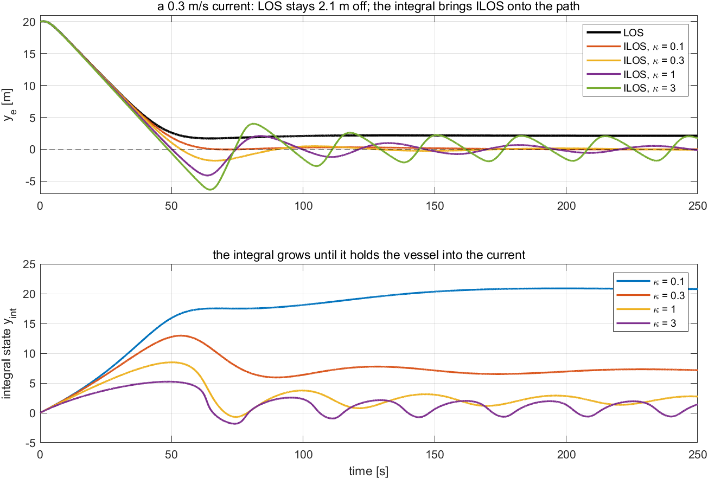

| 그림에서 | 뜻 |
|---|---|
| 위 | 횡방향 오차. LOS 는 검정, ILOS 는 $\kappa$ 네 값 |
| 아래 | 각 ILOS 실행의 적분 상태 |

**그림을 유도와 대조해 읽기.**

| 볼 곳 | 거기 있는 것 | 어느 줄이 예측했나 |
|---|---|---|
| 위 칸, 검은 LOS 선 | $2.107$ m 에서 평평하게, 영원히 | 2번과 3번 줄: 기울기를 만들어 내는 것이 오차이므로 그 오차는 사라질 수 없다 |
| LOS 표, 마지막 두 열 | 네 줄 모두 같다 | 4번 줄: $y_e = \Delta\tan$(크랩각) |
| 위 칸, 모든 색깔 곡선 | 0 에 닿고 머문다 | 8번 줄: 적분이 대신 기울기를 공급한다 |
| 아래 칸, 상태가 $20.95$, $7.03$, $2.35$ 에서 **눕는다** | 다른 값, 같은 효과 | 8번 줄: 고정된 것은 곱 $\kappa\,y_{\text{int}}$ 이므로 $\kappa$ 가 작으면 그만큼 큰 상태가 필요하다 — 그리고 소수 둘째 자리까지 $0.1 \times 20.95 = 0.3 \times 7.03$ 이다 |
| 둘째 표, 둘째 열 | LOS 편차 $2.1049$ 에 대해 $2.1013$, $2.1042$, $2.1456$ | 8번 줄, 이 절 전체의 요점: **적분은 LOS 가 오차로 남기고 있던 그 수로 수렴한다** |
| 같은 표, $\kappa = 3$ | $0.1187$, 그리고 1100 s 뒤에도 $y_e$ 가 $0.17$ m | 11번 줄: 이 $\kappa$ 는 수렴하지 않으므로 그 줄은 평형점의 측정이 아니다 |
| 위 칸, $\kappa = 1$ 과 $3$ 의 오버슛 | $4.10$ m 와 $6.32$ m | 2주차 §2-8 이래 모든 적분의 대가: 늦은 보정은 필요했던 때가 지나서 도착한다 |
| 20 m 벗어난 곳에서 시작하는 모든 곡선의 처음 몇 초 | 감김도 없고 첨두도 없다 | 9번 줄: $y_e$ 가 클 때 분모가 크고 상태는 거의 움직이지 않는다 |
| $\kappa = 0.1$ 과 $0.3$ 의 마지막 열 | $0.3949$ 와 $0.3361$, 둘 다 $\tfrac12$ 아래 | 9번 줄: 상태가 작은 동안 한계가 성립한다 |
| $\kappa = 1$ 과 $3$ 의 마지막 열 | $0.8193$ 과 $1.2337$, 둘 다 $\tfrac12$ 를 넘었다 | 11번 줄: $\kappa y_{\text{int}}$ 가 커지고 $y_e$ 와 맞서면 분모가 다시 작아지고 한계가 사라진다 |

**그림이 말하는 것**

- LOS 는 경로에서 2.1 m 떨어져 정착한다. 모든 ILOS 는 경로 위에 정착하고, 큰 $\kappa$ 는 지나쳐 흔들리며 거기에 닿는다.

| 해 볼 것 | 볼 것 |
|---|---|
| `W05_F_LOS` 에서 `V_c = 0.5;` | $4.234$ m 벗어나 $-40.3°$ 를 유지한다 — 그리고 $5\tan 40.3° = 4.234$ m 다. 4번 줄은 어느 조류에서나 성립한다 |
| `W05_F_LOS` 에서 `Delta = 2.5; V_c = 0.3;` | 전방주시거리를 절반으로 하면 편차가 절반이 된다 — 같은 $-22.9°$ 선수각에서 $1.054$ m, 정확히 4번 줄대로다. 그것은 과도도 날카롭게 만들고, 그래서 §5-6 은 과도를 보고 $\Delta$ 를 고정하고 조류는 $\kappa$ 에 맡긴다 |

> [!tip] 수업에서
> - **목적** — 2주차의 P 와 I 와 같은 이야기를, 이제 경로 위에서.
> - **가리킬 곳** — 2.1 m 를 유지하는 검은 선. 그리고 다른 값에서 누우면서도 모두 같은 정상 기울기를 조류 쪽으로 만들어 내는 적분 상태들.
> - **질문** — "LOS 의 선수각은 정확히 자기가 명령한 것인데, 왜 경로에 닿지 못하는가?" 조류를 가로질러 직선을 유지하려면 배가 조류 쪽을 가리켜야 하고, LOS 는 $y_e \ne 0$ 인 동안에만 그것을 명령한다.
> - **남길 것** — 꾸준한 밀림은 P 아래에서 오차를 남기고, 적분이 그것을 없앤다.

### 실험 5-5c · 보통 적분 대 비선형 적분 (8분)

**무엇을 재는가.** §5-5 가 "보통 적분은 왜 안 되는가?" 에 내놓은 답이다 — 같은 겨눔 법칙, 같은 조류, 같은 임무에, 적분 상태를 두 가지로 갱신한다. 겨눔 식은 두 실행에서 동일하므로 — $\psi_d = \pi_p - \arctan\bigl[(y_e + \kappa y_{\text{int}})/\Delta\bigr]$ — 둘 사이의 모든 차이는 적분기의 것이다.

**모델.** `W05_F_ILOS` 를 보통 적분에는 `law = 4`, 비선형 적분에는 `law = 3` 으로. 두 법칙이 같은 `guidance` 블록 안에 하나 위에 하나로 살고, 플래그가 고른다(§5-1b).

```matlab
W05_0_setup
W05_F2_two_integrators
```

실제 출력:

```
  W05 Experiment 5-5c  the two integrators  (current 0.3 m/s towards east, Delta = 5 m)
    run                        worst swing after the first crossing [m]   |y_e| mean over the last 100 s [m]
    A  nonlinear   kappa = 0.3                             3.85                                0.071
    B  plain       kappa = 0.3                            23.73                               11.529
    C  plain       kappa = 0.05                           13.48                                0.203
```

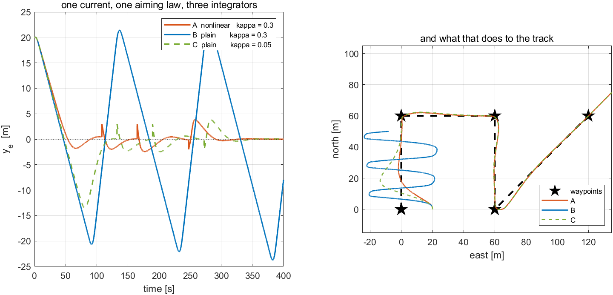

| 그림에서 | 뜻 |
|---|---|
| 왼쪽, 주황 선 (A) | $\kappa = 0.3$ 의 비선형 갱신. 경로를 한 번 가로지르고 그 뒤 1 미터 안에 있다 |
| 왼쪽, 파란 선 (B) | **같은 $\kappa$ 의** 보통 적분. 경로를 따라가지 못하고 그 둘레를 돈다 |
| 왼쪽, 초록 점선 (C) | $\kappa = 0.05$ 로 낮춘 보통 적분. 여기서 이 법칙이 할 수 있는 최선이다 |
| 오른쪽 | 같은 셋을 항적으로. B 는 첫 다리를 가로질러 엮어 가고, C 는 그 안으로 오버슛하고, A 는 합류한다 |

**그림을 유도와 대조해 읽기.**

| 볼 곳 | 거기 있는 것 | 어느 줄을 정하나 |
|---|---|---|
| 실행 B, 처음 60 s | 오차가 $20$ m 에서 0 으로, A 만큼 빠르게 떨어진다 | $y_e$ 가 클 때 조종하고 있는 것은 두 적분기가 아니라 arctan 이다 |
| 실행 B, 첫 교차 뒤 | 반대쪽으로 $23.7$ m 흔들리고, 또 한 번, 또 한 번 | 보통 상태가 접근 중에 감겼고, 풀리면서 배를 통과시킨다 |
| 실행 B, 마지막 100 s | 평균 $\lvert y_e\rvert = 11.5$ m — 결코 정착하지 않는다 | 이 $\kappa$ 에서 보통 법칙은 경로추종기가 전혀 아니다 |
| 실행 C 를 실행 B 와 | 같은 법칙, $\kappa$ 를 6 분의 1 로, 그리고 $0.20$ m 에 정착한다 | 보통 적분도 동작하게 만들 수 있다. 게인을 포기하면서 |
| 실행 C 를 실행 A 와 | $3.9$ m 에 대해 $13.5$ m 의 흔들림, 그리고 A 의 정상 오차가 **3 배 작다** | 9번 줄: 분모가, 들어오는 길에 감기지 않으면서 조류를 빠르게 물리칠 만큼 $\kappa$ 를 크게 둘 수 있게 해 준다 |
| 셋 모두의 마지막 100 s | $0.071$, $11.529$, $0.203$ m | 8번 줄은 $y_e = 0$ 에서만 멈추는 모든 적분기에 성립한다. 다른 것은 거기에 닿는가다 |

**그림이 말하는 것**

- 두 법칙 모두 "LOS 더하기 적분" 이고 한 줄에서 다르다. 그 한 줄이 $\kappa$ 를 조류를 보고 고를 수 있는지, 접근을 보고 골라야 하는지를 정한다.

| 해 볼 것 | 볼 것 |
|---|---|
| `E0 = 2;` 로 재실행 | 출발이 20 m 가 아니라 2 m 벗어난 것이 되고, 보통 적분은 감길 거리가 없어서 B 와 A 가 거의 구별되지 않게 된다 — 분모가 무엇을 위한 것인지에 대한 가장 분명한 진술이다 |
| `law = 3` 으로 `kappa = 0.05` | C 의 게인을 가진 비선형 법칙. 조류를 더 느리게 떨쳐 내고 깔끔한 과도는 유지한다 |

> [!tip] 수업에서
> - **목적** — 법칙에 써 넣은 안티와인드업이 구현의 세부가 아님을 보인다.
> - **가리킬 곳** — 매번 전속으로 0 을 지나가는 파란 곡선.
> - **질문** — "두 적분기 모두 $y_e = 0$ 에서만 멈춘다. 왜 같은 자리에 이르지 못하는가?" 8번 줄의 평형점은 거기까지 가는 길에 대해 아무것도 말하지 않고, 보통 적분기는 풀어야 할 상태를 들고 도착하기 때문이다.
> - **남길 것** — 같은 평형점, 두 과도. 안심하고 튜닝할 수 있는 쪽은 분모를 가진 쪽이다.

## 5-6. 튜닝 순서를, 유도에 적용한다

이 절이 답하는 것: 세 파라미터를 어떤 순서로 고르는가?

2주차 §2-12 의 순서다. 비례부터, 적분은 남는 오차에 대해서만.

| 단계 | 무엇을 고르나 | 어느 측정에서 | 선택 |
|---|---|---|---|
| 1 | $\Delta$, P 게인 | 실험 5-3: 직선 다리에서 흔들리지 않으면서 빠르게 | 5 m |
| 2 | $R$, 전환 거리 | 실험 5-4: 최악 코너가 가장 작게 | 3 m |
| 3 | $\kappa$, I 게인 | 실험 5-6: 0.3 m/s 조류에서의 임무 | 아래 |

아래 실험 5-6 이, 각 다리에 들어선 뒤 25 s 부터 잰 평균 $\lvert y_e\rvert$:

| $\kappa$ | 다리 1 | 다리 2 | 다리 3 | 다리 4 | 다리 2–4 의 합 [m] | 마지막 웨이포인트 [s] |
|---|---|---|---|---|---|---|
| 0 (LOS) | 3.29 | 0.12 | 2.14 | 1.38 | 3.64 | 330.4 |
| 0.1 | 2.04 | 1.22 | 1.33 | 0.55 | 3.10 | 337.0 |
| **0.3** | 2.29 | 0.40 | 0.38 | 0.14 | **0.92** | 338.8 |
| 0.5 | 2.44 | 0.30 | 0.48 | 0.15 | 0.93 | 342.6 |
| 1 | 2.62 | 0.24 | 0.66 | 0.18 | 1.07 | 349.8 |

- 다리 1 은 20 m 출발 편차를 품고 있어 비교에서 뺀다. LOS 는 조류를 가로지르는 다리들에 2.14 m 와 1.38 m 를 남기고, 조류와 함께 달리는 다리 2 에는 거의 아무것도 남기지 않는다.
- 60 m 다리에서 $\kappa = 0.1$ 은 너무 느리다. $\kappa = 0.3$ 과 $0.5$ 는 거의 같은데, 실험 5-5b 가 $\kappa$ 가 클수록 더 오버슛하는 것을 보였으므로 $\kappa = 0.3$ 이다.

결과 $\Delta = 5$ m, $R = 3$ m, $\kappa = 0.3$ 이 `W05_0_setup.m` 의 기본값이다. 배의 모델은 쓰지 않았고, Scope 와 항적이 보여 준 것만 썼다.

**이것이 기대할 만한 성능인가?** 측정으로 튜닝하는 것은 "어느 값이 가장 나은가" 에 답하고, "그 결과가 쓸 만한가" 에는 답하지 않는다. 그 두 번째 질문은 각 수를 읽기 **전에**, 유도가 아니라 배에서 예측하고 그 다음 비교해서 답한다. `W05_I_performance` 가 §5-7 의 임무에서 그 여섯을 잰다.

```matlab
W05_0_setup
W05_I_performance
```

```
  W05 section 5-6  the performance, predicted and measured
    [1] straight leg, heading       mean |psi_d - psi|   0.26 deg      (expect well under 1)
    [2] straight leg, path keeping  mean |y_e|  0.411 m, max  0.880 m   (expect inside Delta/10 = 0.5 m)
    [3] speed loop                  95% at  1.4 s, overshoot 0.0216 m/s, steady error 0.0001 m/s
    [4] limits                      |N|  47.15 /  47.15,  X 120.00 / 120.00,  n  103.93 /  103.93,  min n  -96.55 > -101.74
    [5] corner                      peak yaw rate 15.07 deg/s at 1.00 m/s -> R_turn  3.8 m;  excursion  2.86 m
    [6] time scales                 corner command   62 deg, inner within 10% after 8.44 s;  Delta/U 5.00 s
```


| 무엇이 일어나야 하고, 왜 | 예측 | 측정 | 판정 |
|---|---|---|---|
| **작은 신호에서의 분리.** 직선 다리에서 안쪽 루프는 자기 명령을 아주 잘 따라가서 유도가 그것을 아예 보지 않아야 한다 | 선수각 오차가 $1°$ 보다 훨씬 작다 | 다리 가운데에서 평균 $0.26°$ | 기대대로 |
| **직선 다리에서의 경로 유지.** 선수각 루프가 그만큼 정확하고 조류가 없을 때 | $\Delta/10 = 0.5$ m 안으로 충분히 | 평균 $0.411$ m, 최악 $0.880$ m | 기대대로 |
| **속도 루프**, 안티와인드업을 갖춘 PI | 빠른 상승, 작은 오버슛, 정상 오차 없음 | $1.4$ s 에 $95\%$, 오버슛 $0.0216$ m/s $(2.2\%)$, 정상 오차 $0.0001$ m/s | 기대대로 |
| **한계에 닿되 결코 넘지 않는다** — §5-7 의 요점 전부 | $\lvert N\rvert \le 47.15$, $X \le 120$, $n \in [-101.7,\ 103.9]$ | $47.15$, $120.00$, $\max n = 103.93$, $\min n = -96.55$ | 정확히 한계 위, 결코 그 너머가 아니다 |
| **코너의 벗어남은 유도가 아니라 선회반경이 정한다.** $N$ 이 한계에 있으면 배는 어떤 $r_{\max}$ 로 돌고, $R_{\text{turn}} = U/r_{\max}$ 다 | $1.0$ m/s 에서 $r_{\max} = 15.1$ deg/s $\Rightarrow R_{\text{turn}} = 3.8$ m | 첫 코너에서 벗어남 $2.86$ m | 기대대로, 그리고 $R_{\text{turn}}$ 보다 **작다**. §5-4 가 선회를 $R = 3$ m 일찍 시작하기 때문이다 |
| **큰 신호에서는 분리가 성립하지 않는다.** $62°$ 코너는 모멘트를 포화시키므로 안쪽 루프가 속도제한에 걸린다 | 안쪽 응답이 전방주시시간 $\Delta/U = 5.0$ s 보다 느리다 | 새 명령의 $10\%$ 안에 드는 데 $8.4$ s | **기대대로, 그리고 그것이 구속 조건이다** |

- 마지막 두 줄이 "이것이 경로를 얼마나 잘 따라가는가" 에 대한 정직한 답이다. 직선 부분에서 종속 구조는 종속 구조가 해야 할 바로 그대로 움직이고, 오차는 $\Delta$ 의 몇 분의 1 이다. 코너에서는 그렇지 않다. 모멘트가 포화되고 안쪽 루프가 느린 쪽이 되고, 그 결과로 생기는 벗어남은 배의 선회원이다. **$\Delta$, $R$, $\kappa$ 의 어떤 값도 그것을 낫게 할 수 없다** — 더 큰 모멘트, 더 느린 속력, 또는 코너가 완만한 경로만이 할 수 있다. 더 큰 모멘트가 나오는 곳이 7주차이고, 임무가 직각을 요구하기를 그치는 곳이 9주차다.

> [!note] 이번 주에서 빠진 것
> 이 주차의 이전 판은 법칙을 온전히 유도하고 Lyapunov 함수로 안정성을 증명했으며, 크랩각을 직접 추정하는 세 번째 법칙 ALOS 를 더했다. 그 내용은 참고용으로 `W05_simulink/_previous_version/` 에 남겨 두었고, 이번 주의 튜닝은 그중 어느 것에도 기대지 않는다.

### 실험 5-6 · 튜닝 순서 (15분)

**무엇을 재는가.** 위 순서의 3단계를, 유도가 실제로 쓰이는 임무에서 — 조류 속에서 다리별 평균 $\lvert y_e\rvert$ 를 $\kappa$ 다섯 값에 대해, 그리고 임무가 걸리는 시간.

**모델.** `W05_G_tuning` — 웨이포인트 다섯의 임무에 ILOS, $\Delta$ 와 $R$ 은 실험 5-3 과 5-4 가 이미 고정해 두었다. $\kappa$ 만 바뀐다.

**열고 돌리기.**

```matlab
W05_0_setup
V_c = 0.3; T_final = 450;          % 동쪽 조류 / a current to the east
open_system('W05_G_tuning')        % Run — kappa = 0.3 / the chosen value
kappa = 0;                         % Run — LOS 로 돌아간다 / back to LOS: it runs beside the path
W05_G_tuning_by_hand               % 다섯 값을 다리별로 / all five values, leg by leg
```

나오는 출력:

```
  W05 Experiment 5-6  the tuning order  (Delta = 5 m, R_switch = 3 m, current 0.3 m/s east)
    kappa   mean |y_e| on legs 1, 2, 3, 4 [m]   sum of legs 2-4 [m]   last waypoint at [s]
    0           3.29   0.12   2.14   1.38                  3.64                  330.4
    0.1         2.04   1.22   1.33   0.55                  3.10                  337.0
    0.3         2.29   0.40   0.38   0.14                  0.92                  338.8
    0.5         2.44   0.30   0.48   0.15                  0.93                  342.6
    1           2.62   0.24   0.66   0.18                  1.07                  349.8
```

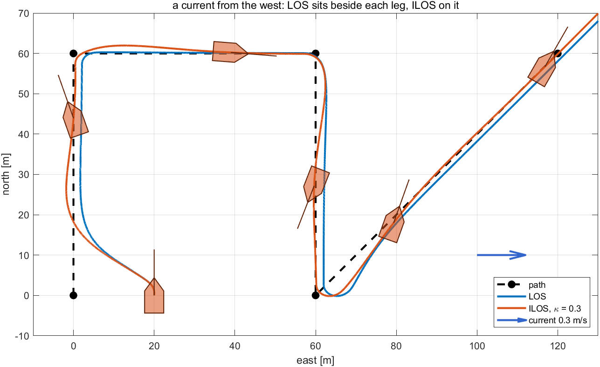

| 그림에서 | 뜻 |
|---|---|
| 파랑 | LOS: 조류를 가로지르는 다리마다 그 옆에 |
| 선체를 붙인 주황 | ILOS, $\kappa = 0.3$: 다리 위에. 선체는 조류 쪽을 가리키면서 항적은 경로 위에 머문다 |
| 화살표 | 조류, 동쪽으로 0.3 m/s |

**그림과 표를 세 단계와 대조해 읽기.**

| 볼 곳 | 거기 있는 것 | 어느 단계 또는 절을 정하나 |
|---|---|---|
| 다리 3 과 4 옆의 파란 항적 | 평균 오차 $2.14$ m 와 $1.38$ m | §5-5 의 2~4번 줄: LOS 가 남겨야 하는 편차. 이제 임무 위에서 |
| 다리 2 **위**의 파란 항적 | $0.12$ m 뿐 | 그 다리는 조류와 함께 달리므로 유지할 크랩각이 거의 없다 |
| 모든 다리 위의 주황 항적 | $0.40$, $0.38$, $0.14$ m | §5-5 의 7번 줄: 적분이 대신 기울기를 유지한다 |
| 주황 항적 위의 선체들 | 항적은 다리를 따라 달리는데 선체는 조류 쪽을 가리킨다 | 4주차 §4-4: 선수각은 침로가 아니다. 직접 본 것 |
| $\kappa = 0.1$ 줄 | $3.10$ m, LOS 보다 간신히 낫다 | 짧은 다리: 400 m 에서 가장 깔끔했던 값이 60 m 에서는 작용할 시간이 없다 |
| 마지막 열, $330 \to 350$ s | $\kappa$ 가 커지면서 임무가 느려진다 | 적분의 흔들림은 정확도만이 아니라 거리도 비용으로 치른다 |
| 모든 줄의 다리 1 | $2.0$ ~ $3.3$ m, 합에서 빼 두었다 | 20 m 출발 편차를 품고 있고, 그것은 과도이고 추종 오차가 아니다 |

**그림이 말하는 것**

- 튜닝된 ILOS 는 다리들을 따라간다. 그렇게 하기 위해 유지하는 크랩각을 선체들이 보여 준다.

| 해 볼 것 | 볼 것 |
|---|---|
| `kappa = 3;` Run | 실험 5-5 의 흔들림이 이제 코너마다 일어난다. 60 s 뒤의 평균 $\lvert y_e\rvert$ 가 $\kappa = 0.3$ 의 $0.64$ m 에 대해 $1.18$ m 이고, 마지막 웨이포인트는 $338.8$ s 대신 $385.9$ s 에 닿는다 — **더 느리고 덜 정확하다** |
| `V_c = 0; kappa = 0.3;` Run | 조류가 없으면 찾을 것이 없다. LOS 의 $0.20$ m 에 대해 $0.30$ m, 임무 시간은 같다. 적분은 보험이고, 공짜가 아니다 |

> [!tip] 수업에서
> - **목적** — 임무 위에서 전체 순서로 한 주를 닫고, 그림 안에서 4주차 §4-4 를 본다.
> - **가리킬 곳** — 남향 다리의 선체. 항적은 정남으로 달리는데 선체는 남에서 서쪽을 가리킨다.
> - **질문** — "왜 $\kappa$ 를 실험 5-5b 의 긴 다리가 아니라 임무에서 고르는가?" 짧은 다리는 적분할 시간을 적게 남긴다. 400 m 에서 가장 좋은 게인이 60 m 에서는 너무 느리다.
> - **남길 것** — 각 파라미터를 그것이 맞닥뜨릴 과제에서, P → 전환 → I 의 순서로 고른다.

---

## 5-7. 루프 둘을 한꺼번에: 3주차의 속도와 5주차의 경로

**무엇이 관측되는가.** 여기까지의 모든 모델은 일정한 전진력 `X_ff = 60` N 으로 선체를 밀었고, 그래서 속력을 요구할 방법이 없었다 — Otter 의 항력이 60 N 에 대해 균형을 이루는 속력이 무엇이든 그것이 얻는 속력이다. 같은 배분기 앞에 3주차의 속도 루프를 놓으면 그것이 고쳐지고, 대신 다른 것이 깨진다 — 4주차가 올바르게 계산한 상수인 선수각 오토파일럿의 모멘트 한계가, 둘째 제어기가 전진력을 움직이기 시작하는 순간 틀린 값이 된다.

**왜 그렇게 되는가.** 두 제어기는 신호를 주고받지 않는다. **배분기에서** 만난다. 전진력과 요 모멘트가 같은 프로펠러 둘에서 나와야 하기 때문이고, 그래서 **한쪽에 남는 것이 다른 쪽이 이미 가져간 양에 달려 있다.** 그 나눠 씀을 적으면 그 의존이 드러난다.

$$
X = T_L + T_R, \qquad N = y_p\,(T_L - T_R)
\qquad\Longrightarrow\qquad
T_L = \frac{X}{2} + \frac{N}{2 y_p}, \qquad
T_R = \frac{X}{2} - \frac{N}{2 y_p}
$$

$$
\lvert N\rvert \;\le\; N_{\lim}(X) \;=\; \min\left\{\, 2 y_p\!\left(k_{pos} n_{\max}^2 - \tfrac{X}{2}\right),\;\; 2 y_p\!\left(\tfrac{X}{2} + k_{neg} n_{\min}^2\right) \right\}
$$

| 기호 | 양 | 값 · 출처 |
|---|---|---|
| $X$ | 요구된 전진력 | $60$ N 상수, 또는 속도 루프의 출력. `W05_0_setup` |
| $N$ | 요구된 요 모멘트 | 오토파일럿의 출력, §5-1 |
| $T_L, T_R$ | 좌현·우현 프로펠러의 추력 | N |
| $y_p$ | 두 폰툰 간격의 절반 | $0.3950$ m, `otter.m` |
| $k_{pos}, k_{neg}$ | 전진·후진 추력계수 | $0.011080$, $0.006445$. `otter.m` |
| $n_{\max}, n_{\min}$ | 축 회전수 한계 | $103.931$, $-101.737$ rad/s. `otter.m` |
| $N_{\lim}(X)$ | 그 전진력에서 아직 쓸 수 있는 모멘트 | $X = 60$ 에서 $70.85$ N·m, $X = 120$ 에서 $47.15$. 실험 5-7 |

**유도.**

1. **두 힘은 어디서 오는가.** Otter 에는 고정 프로펠러가 둘, 폰툰마다 하나 있고 둘 다 앞을 향한다. 각각은 선체 $x$ 축을 따라 추력 $T_i$ 를 만든다. 조향하는 것은 없다. 한쪽이 다른 쪽보다 세게 밀기 때문에 선체가 돈다.

2. **둘이 만들 수 있는 두 힘.** 선체 $y$ 가 우현이 양이므로 좌현 프로펠러는 $y = -y_p$, 우현은 $y = +y_p$ 에 있다. $y$ 에 걸린 $x$ 방향 힘 $T$ 는 요 모멘트 $-yT$ 를 만든다. 둘을 합하면

$$
\underbrace{\begin{bmatrix} X \\ Y \\ N \end{bmatrix}}_{\tau}
=
\underbrace{\begin{bmatrix} 1 & 1 \\ 0 & 0 \\ y_p & -y_p \end{bmatrix}}_{\mathbf{B}}
\begin{bmatrix} T_L \\ T_R \end{bmatrix}
$$

   가운데 줄이 0 이고, 그 줄이 이번 주의 이야기 전부다. **이 선체는 횡방향 힘을 만들 수 없다.** 유도가 배를 옆으로 움직이려면 돌려야 하는 이유이고, §5-5 의 조류를 추력이 아니라 선수각으로 맞서는 이유다. `_tools/otter_B.m` 이 열 규칙에서 이 $\mathbf{B}$ 를 만들고 위의 행렬을 정확히 돌려준다.

   이것은 3주차 §3-6 이 선체에서 읽어낸, 그리고 4주차 §4-7 이 살아 있는 모멘트와 함께 쓴 그 행렬이고, 여기서는 $b$ 대신 $y_p$ 로 썼다. 그림도 그 주차들이 쓴 것이고, 이제 그 입력 **둘 다** 제어기의 출력이 되었으니 다시 읽을 가치가 있다.

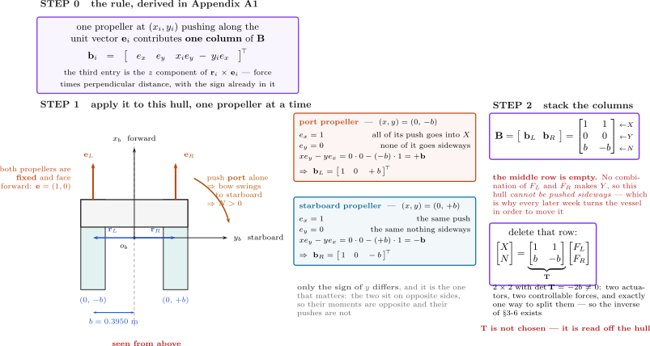

| 그림에서 | 이 절에서 무슨 뜻인가 |
|---|---|
| 붉은 화살표 둘 | 두 프로펠러 모두 앞으로 민다. 그것이 줄 $[\,1\ \ 1\,]$ 이다 |
| 청록 $N$ 화살표 | **위에서 보아 시계방향**이다. $z_b$ 가 아래를 가리키고 $N > 0$ 이 선수를 우현으로 돌리기 때문이다 |
| 비어 있는 가운데 줄 | §5-5 의 조류를 선수각으로 맞서고 횡방향 추력으로는 결코 맞서지 않는 이유 |
| 3행, $\mathbf{T}^{-1}$ | 배분기. 이번 주까지 그 두 입력 중 하나는 상수였다. §5-7 부터는 둘 다 제어기에서 온다 |

- $y_p = 0.395$ m 로 $\begin{bmatrix} 1 & 1 \\ 0.395 & -0.395\end{bmatrix}$ 로 써 두면, 이 행렬이 MSS 데모 모델 `demoOtterUSVPathFollowingHeadingControl` 의 `Allocation` 서브시스템 안에 Constant 블록으로 앉아 있다. 강의와 툴박스가 성분 하나하나까지 일치한다.

3. **두 추력에 대해 푼다.** 0 인 줄을 지우면 $\mathbf{B}$ 는 행렬식이 $-2y_p \ne 0$ 인 $2\times2$ 가 되므로 해가 정확히 하나다 — 유사역행렬이 필요하지 않고 남는 자유도도 없다. 그것을 역으로 풀거나, 똑같이 남은 두 식을 더하고 빼면

$$
\begin{bmatrix} T_L \\ T_R \end{bmatrix}
= \mathbf{B}^{-1} \begin{bmatrix} X \\ N \end{bmatrix}
\qquad\Longrightarrow\qquad
T_L = \frac{X}{2} + \frac{N}{2 y_p}, \qquad T_R = \frac{X}{2} - \frac{N}{2 y_p}
$$

   말로 읽으면 **두 프로펠러가 전진력의 절반씩을 지고, 모멘트는 한쪽에 더하고 다른 쪽에서 같은 만큼 빼서 만든다.** 두 과제가 중첩되어 있고, $y_p$ 가 모멘트를 추력 차이로 바꾸는 지레다. 짧은 지레는 같은 모멘트에 더 많은 추력을 비용으로 치른다 — $2 y_p = 0.79$ m 에 걸친 $N = 47$ N·m 는 $60$ N 의 차이가 필요하다.

   `allocation` 블록은 이것을 두 식이 아니라 풀이로 쓴다. 그래야 코드와 이 줄이 같은 것을 말한다. 코드는 8번 줄 뒤에 있다.

4. **추력에서 축 회전수로.** 프로펠러의 추력은 축 회전수의 제곱으로 가고, 날개가 거꾸로 돌기 때문에 후진에서 계수가 다르다.

$$
T = \begin{cases} k_{pos}\, n^2, & n \ge 0\\[2pt] -k_{neg}\, n^2, & n < 0\end{cases}
\qquad\Longrightarrow\qquad
n = \begin{cases} +\sqrt{T/k_{pos}}, & T \ge 0\\[2pt] -\sqrt{-T/k_{neg}}, & T < 0\end{cases}
$$

   여기서 선형성이 끝난다. 위의 모든 것은 두 힘의 선형 나눔이었고, 제곱근은 선형이 아니다. 그래서 **$N$ 의 같은 간격이 $n$ 의 같은 간격이 아니다.** 추력 0 근처에서는 $T$ 의 작은 변화가 $n$ 을 크게 움직이고, 최대 추력 근처에서는 거의 움직이지 않는다.

5. **프로펠러가 실제로 줄 수 있는 것.** 축 한계를 같은 곡선에 통과시키면 각 프로펠러가 닿을 수 있는 추력이 나온다.

$$
T_{\max} = k_{pos}\,n_{\max}^2 = 119.68\ \text{N}, \qquad
T_{\min} = -k_{neg}\,n_{\min}^2 = -66.71\ \text{N}
$$

   후진은 전진보다 거의 두 배 약하다 — 같은 날개를 거꾸로 돌린 것이다.

6. **모멘트의 한계, 그리고 그것이 움직이는 이유.** 두 추력 모두 $[T_{\min}, T_{\max}]$ 안에 있어야 한다. 3번 줄을 넣고 각 부등식을 $\lvert N\rvert$ 에 대해 풀면

$$
\frac{X}{2} + \frac{\lvert N\rvert}{2y_p} \le T_{\max} \;\Longrightarrow\; \lvert N\rvert \le 2y_p\!\left(T_{\max} - \frac{X}{2}\right), \qquad
\frac{X}{2} - \frac{\lvert N\rvert}{2y_p} \ge T_{\min} \;\Longrightarrow\; \lvert N\rvert \le 2y_p\!\left(\frac{X}{2} - T_{\min}\right)
$$

   둘 중 작은 쪽이 $N_{\lim}(X)$ 다. 첫 가지는 $X$ 가 자라면 떨어진다 — 배를 세게 밀수록 짐을 진 프로펠러에 남는 여유가 적다. 둘째 가지는 올라간다 — 안쪽 프로펠러가 빠르게 돌고 있으면 자기 후진 한계에 닿기까지 떨어질 거리가 더 멀다. 둘은 다음에서 교차한다

$$
X^\star = T_{\max} + T_{\min} = 52.97\ \text{N}, \qquad N_{\lim}(X^\star) = 73.62\ \text{N·m}
$$

   따라서 **이 선체의 선회 권한은 전력(全力)이 아니라 중간 정도의 전진력에서 가장 크다.** 4주차의 상수 `N_max` 는 이 식을 $X = X_{ff} = 60$ N 에서 한 번 계산한 것에 지나지 않는다.

7. **$X$ 가 상수이기를 그치면 무엇이 깨지는가.** 4주차 오토파일럿은 $X_{ff} = 60$ N 에서 계산한 고정 `N_max` 를 들고 있는 보통 Saturation 블록으로 자기 출력을 제한한다. 그 수를 그대로 두고 $X_{\max} = 120$ N 까지 밀 수 있는 속도 루프를 더하면, 6번 줄은 거기서의 참한계가 $47.15$ N·m 라고 말하는데 블록은 여전히 $70.85$ 를 들고 있다. 그러면 배분기가 한계 $103.9$ 에 대해 $n_R = 116.2$ rad/s 를 요구한다 — **한 주 전에는 옳았던 산술이 만들어 낸 불가능한 명령이다.**

   처방은 게인도 새 블록도 아니다. 6번 줄을 **이 모델이 요구할 수 있는 가장 큰 전진력에서** 계산하는 것이다. 전에 요구하던 값에서가 아니다. 그래서 `W05_0_setup` 은 수 둘을 들고 있고, 모든 모델의 Saturation 은 자기에게 속한 쪽의 이름을 쓴다.

$$
N_{\max} = N_{\lim}(X_{ff}) = 70.85\ \text{N·m}, \qquad
N_{speed} = N_{\lim}(X_{\max}) = 47.15\ \text{N·m}
$$

   이것은 일부러 보수적으로 고른 것이다. 속도 루프가 $77.6$ N 만 요구하고 있는 동안 참한계는 $63.9$ N·m 인데 배는 $47.15$ 에 묶여 있다. 아래 읽기 표의 3번 줄이 그 비용을 잰다. 대안 — 매 스텝 살아 있는 $X$ 에서 $N_{\lim}$ 을 다시 계산하는 것 — 은 도면에 블록 넷을 더 두는 대가로 그 여유를 되사 오고, 마지막 **해 볼 것** 으로 남겨 둔다.

8. **그리고 플랜트는 어차피 자른다.** MSS `otter.m` 은 자기 안에서 $n$ 을 $[n_{\min}, n_{\max}]$ 로 제한한다(167–170행). 그래서 자르지 않는 배분기는 배가 결코 돌린 적 없는 축 회전수를 기록하고, 그 로그를 나중에 읽는 모든 것이 잘려 나간 만큼 틀린다. 배분기가 자르므로 로그는 **플랜트가 받은 것**을 기록한다.

**유도 전체를, 블록 하나로**

2번부터 8번 줄까지가 MATLAB Function 블록 하나다. 아래는 그 블록이 들고 있는 코드이고 `W05_H_speed_path.slx` 에서 그대로 복사한 것이다. `allocation` 을 두 번 누르면 같은 글이 보인다. 주석은 블록 자신의 것이다.

```matlab
function n = allocation(N, X, y_pont, k_pos, k_neg, n_max, n_min)
%#codegen
%ALLOCATION  전진력 X 와 요 모멘트 N 을 두 축의 회전수 n = [n_L; n_R] 로.
%            The surge force X and the yaw moment N to the two shaft speeds.
%  X 는 **속도 루프의 출력**이다 (3주차). 상수가 아니라는 것 하나만 다르다.
%  X is the output of the speed loop of Week 3, not a constant. That is the
%  only difference; the two equations below are unchanged.

% 1) 두 힘을 두 추력으로. 배치행렬 B 를 세우고 **풀면** 된다 - 손으로 푼
%    T = X/2 +- N/(2 y_pont) 와 같은 것이고, 이 쪽이 5-7 절의 유도와 같은
%    모양이다. MSS 데모도 이렇게 한다: demoOtterUSVPathFollowingHeadingControl
%    의 Allocation 안에 Constant [1 1; 0.395 -0.395] 와 행렬 나눗셈이 있다.
%    B is square and nonsingular here, so the two forces are shared by solving
%    rather than by two hand-written expressions. The MSS demonstration model
%    does the same: its Allocation holds the constant [1 1; 0.395 -0.395] and
%    a matrix division.
B = [1        1;              % 전진력  X = T_L + T_R        / surge force
     y_pont  -y_pont];        % 요 모멘트 N = y_pont(T_L-T_R) / yaw moment
T = B \ [X; N];               % 좌현, 우현 / port, starboard

% 2) 프로펠러 곡선 T = k n|n| 을 n 에 대해 푼다 (앞 k_pos, 뒤 k_neg).
%    Solve the propeller curve T = k n|n| for n (k_pos ahead, k_neg astern).
n = zeros(2,1);
for i = 1:2
    if T(i) >= 0
        n(i) =  sqrt( T(i) / k_pos);
    else
        n(i) = -sqrt(-T(i) / k_neg);
    end
end

% 3) 프로펠러가 낼 수 있는 범위로 자른다. **otter.m 이 안에서 이미 자르기 때문에**
%    (MSS otter.m 167-170 행) 여기서 자르지 않으면 로그에 적히는 n 이 플랜트가
%    실제로 받은 n 과 달라진다 - 기록은 플랜트가 받은 것이어야 한다.
%    Clamp to what the propellers can do. otter.m clamps internally (lines
%    167-170), so without this the logged n would not be the n the plant got,
%    and a log must record what the plant received.
n(1) = min(max(n(1), n_min), n_max);
n(2) = min(max(n(2), n_min), n_max);
end
```

| 코드에서 | 유도의 어느 줄 | 비고 |
|---|---|---|
| `B = [1 1; y_pont -y_pont];` | 2번 줄, 0 인 줄은 이미 지운 상태 | 행렬이 `y_pont` 에서 만들어지므로 선체가 다르면 새 코드가 필요하지 않다 |
| `T = B \ [X; N];` | 3번 줄 | 역백슬래시는 역행렬이 아니라 풀이다. 이 $2\times2$ 에서는 둘이 같고, $\det\mathbf{B} = -2y_p$ 가 그것을 애초에 쓸 수 있는 이유다 |
| 두 입력 포트 `N` 과 `X` | 7번 줄 | **이제 둘 다 신호다.** `N` 은 선수각 오토파일럿에서, `X` 는 속도 루프에서. 3·4주차는 각각 그중 하나를 상수로 두었다 |
| 코드에 없는 것 | 5~7번 줄 | $N_{\lim}$ 은 여기서 계산하지 **않는다.** `W05_0_setup` 에서 한 번 계산되어 오토파일럿의 Saturation 에 앉아 있고, 그래서 거기 든 값이 낡으면 배분기가 그것을 잡아낼 수 없다 |

마지막 줄이 §5-7 의 요점 전부다. 결함 아래의 블록은 옳고, 그런데도 결함이 생긴다. 그 위의 Saturation 에 든 수가 모델이 더 이상 쓰지 않는 전진력에 대해 계산된 것이기 때문이다.

> [!note] 속도 루프 자체는 새것이 아니다
> 게인까지 포함해 3주차 그대로다 — $X = K_{p,u}(u_d - u) + I$, $\lvert X\rvert \le X_{\max}$, 항력뿐인 축이 필요로 하는 적분이 있고 미분 항은 없다. §5-7 이 더하는 것은 제어기가 아니라, 따로 설계된 두 제어기 사이의 셈이다.

### 실험 5-7 · 속도 제어와 웨이포인트 추종을 함께 (15분)

같은 임무와 같은 ILOS 법칙을 두 번 돌린다. 4주차의 선수각 오토파일럿은 건드리지 않는다. 바뀌는 것 하나는 전진력이 어디서 오는가다.

| 모델 | 전진력 | 그 오토파일럿의 Saturation 이 들고 있는 것 |
|---|---|---|
| `W05_G_tuning` | 캔버스의 Constant 블록에서 온 상수 `X_ff` = 60 N | `N_max` = 70.85 N·m |
| `W05_H_speed_path` | `u_d` = 1.0 m/s 를 유지하는 `speed loop` 서브시스템의 출력 | `N_speed` = 47.15 N·m |

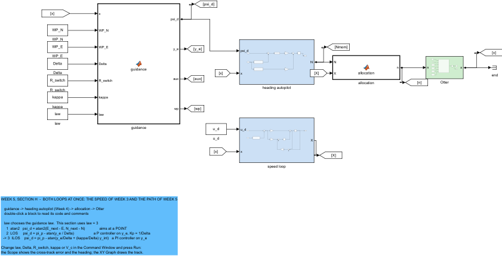

| 다이어그램에서 | 무엇인가 |
|---|---|
| 왼쪽의 Constant 블록들 | 명령 전부. 마스크가 아니라 캔버스에 둔다 — `WP_N`, `WP_E`, `Delta`, `R_switch`, `kappa`, `u_d` |
| `guidance` | §5-5 의 ILOS 법칙. $\psi_d$ 를 주고 $y_e$, 적분 상태, 다리 번호를 내놓는다 |
| `heading autopilot` 과 `speed loop` | 4주차와 3주차의 법칙. 각각 **Simulink 블록의 서브시스템** |
| `allocation` | 유도의 3번 줄. `N` 과 `X` 를 받아 `Otter` 가 받는 `n` 을 준다 |

캔버스의 왼쪽 절반만 보인 것이다. 계측·Scope·XY Graph·로그·Animate 블록이 오른쪽으로 이어진다.

두 제어기 중 어느 것도 코드 블록이 아니다. 어느 쪽을 열어도 수식이 도면으로 보이고, 3·4주차가 쓴 것과 같은 블록과 같은 이름이 있다 — `ssa` 를 위한 `Fcn` 블록 하나, 값이 작업공간 변수 이름인 `Gain` 블록들, 그리고 보통 `Saturation`. 모든 게인이 양수다. **빼는 항은 합산점에서 빼므로**, 부호가 도면에 정확히 한 군데에만 나타난다.

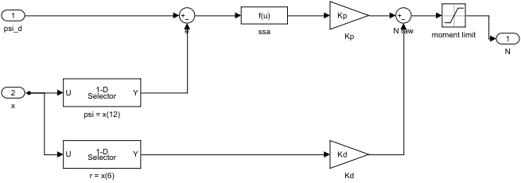

| 다이어그램에서 | 4주차 법칙의 어느 부분 |
|---|---|
| 합산점과 `ssa` | $e = \operatorname{ssa}(\psi_d - \psi)$. `atan2(sin(u), cos(u))` 를 든 `Fcn` 하나가 감는다 |
| `Kp` 와 `Kd` | $K_p e$ 와 $K_d r$. **D 항은 미분 블록이 아니라 회두율 Selector 가 먹인다** — 도면에 미분 블록이 없다 |
| `N raw` 의 `−` | $K_d r$ 을 **빼는** 자리. 부호가 합산점에만 살고 다른 데에는 없으므로 도면이 수식 그대로 읽힌다 |
| `moment limit` | 7번 줄의 Saturation. 여기서는 `N_speed`, 다른 여섯 모델에서는 `N_max` 를 들고 있다 |

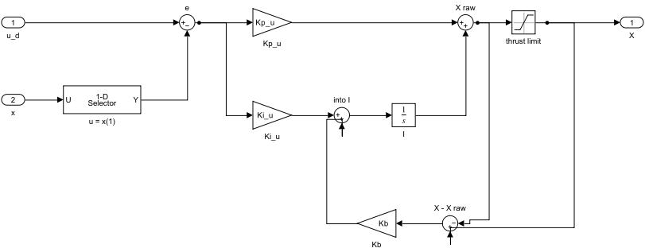

| 다이어그램에서 | 3주차 법칙의 어느 부분 |
|---|---|
| `e` | $e = u_d - u$. 명령이 바깥 캔버스에서 들어오고, 측정이 아래에서 들어온다 |
| `I` 로 들어가는 `Ki_u` | 적분. `I` 는 보통 **연속 Integrator** $1/s$ 다 — 플랜트가 연속이고, 이 강의의 모든 제어기도 그렇다 |
| `X raw` 와 `thrust limit` | $X_{raw} = K_{p,u}e + I$, 그 다음 $\lvert X\rvert \le X_{\max}$ |
| `X - X raw` → `Kb` → `into I` | **안티와인드업**, 오른쪽에서 왼쪽으로 가는 유일한 경로 |

오른쪽에서 왼쪽으로 가는 그 경로가 **안티와인드업**이다. 3주차 §3-F 에서 유도하고 게인까지 고른 back-calculation 그대로다 — 힘이 한계 안에 있는 동안 그 경로는 0 을 싣고 루프는 평범한 PI 이며, 한계가 무는 순간 버려진 그만큼 정확히 적분을 다시 눌러 내린다. 여기서 그것이 거의 보이지 않는 이유는 분명히 말해 둘 만하다 — **이 임무는 간신히 포화된다.** 전진력이 $X_{\max}$ 에 닿는 것은 정지에서 가속하는 첫 1초뿐이고 남은 실행 동안 $77.6$ N 에 앉아 있으므로, 경로를 끄면(`Kb = 0`) 속도 오버슛이 $0.0216$ 에서 $0.0380$ m/s 로 자라는 것이 전부다. 그래도 들고 있는 것은 블록 둘이면 되고, 그것이 막아 주는 경우 — 한계가 오래 유지되는 것 — 이 미리 보이지 않기 때문이다.

> [!note] 수들이 사는 곳
> 명령은 캔버스의 Constant 블록이다 — `WP_N`, `WP_E`, `Delta`, `R_switch`, `kappa`, `u_d`. 게인은 `Gain` 블록의 값이고, 변수 이름으로 쓴다. 둘 다 작업공간을 읽으므로 Command Window 의 `Kp = 400` 다음에 Run 이 수정의 전부다. MSS 데모 모델도 같은 방식으로 되어 있다. 웨이포인트 목록, $\Delta$, $R$, 목표 전진 추력이 Constant 블록이고, 오토파일럿 게인은 `Heading autopilot` 서브시스템 안의 `Gain` 블록이다.

**이 절의 모든 그림과 수를 만들려면**

```matlab
cd lectures/W05_simulink
W05_0_setup
W05_H_speed_and_path
```

실제 출력:

```
  W05 Experiment 5-7  speed control and path following at once
    surge force from    u mean [m/s]   last leg at [s]   mean |y_e| legs 2-4 [m]   X mean [N]
    a constant X_ff        0.767             244.9                    0.353        60.00
    the speed loop         1.000             189.7                    0.896        78.88

    the allocation, checked by hand   (y_pont = 0.3950 m, k_pos = 0.01108)
      case              X [N]    N [N m]   T_L [N]   T_R [N]   n_L      n_R     n_L by hand
      straight leg      77.59      -0.50     38.16     39.43   58.683   59.651     58.686
      hardest turn     120.00     -47.15      0.32    119.68    5.357  103.931      5.357

    X [N]               0      20      40      60      80     100     120     140
    N_lim [N m]     52.70   60.60   68.50   70.85   62.95   55.05   47.15   39.25
    the constants the models hold:  N_max = N_lim(60) = 70.85,  N_speed = N_lim(120) = 47.15 N m

    the anti-windup (back-calculation), measured
      Kb      X at its limit for [s]   speed overshoot [m/s]
      1                     0.68               0.0216
      0                     0.94               0.0380
```

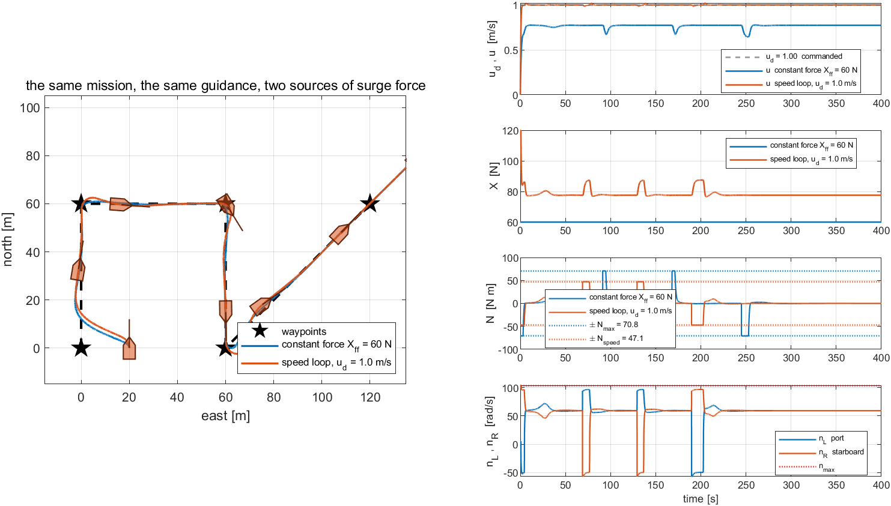

그림은 속도 루프를 쓰는 실행만 그리고 그 밖에는 그리지 않는다. 일정한 전진력과의 비교는 위의 표이고, 거기서 두 실행이 두 줄에 앉아 있어 범례 없이 읽을 수 있다.

| 그림에서 | 뜻 |
|---|---|
| 왼쪽 | 임무. 항적을 따라 선체를 그려 두어 표시마다 선수각이 보인다 |
| 1번과 2번 칸, $u_d, u$ 와 $X$ | 명령 속도와 실제로 낸 속도가 서로 겹쳐 있고, 그것을 내는 데 든 힘: 직선 다리에서 $77.6$ N, 코너를 나올 때마다 $X_{\max}$ 까지 |
| 3번과 4번 칸, $N$ 과 $n_L, n_R$ | 요 모멘트와 Saturation 이 든 $\pm N_{speed}$, 그리고 두 축 회전수와 $n_{\max}$ |
| 5번과 6번 칸, 웨이포인트 $k$ 와 $y_e$ | 전환마다 한 단씩 오르는 다리 번호, 그리고 오차: 출발에 $20$ m, 코너마다 첨두, 0 으로 복귀 |
| 모든 칸, $280$ s 뒤 | 평평하다. 배가 마지막 웨이포인트에 도착했고 실행이 끝나기 전 `stop_hold` 초 동안 유지되고 있다 |

**그림과 표를 유도와 대조해 읽기.**

| 볼 곳 | 거기 있는 것 | 어느 줄을 정하나 |
|---|---|---|
| `u mean` 과 `X mean` 열 | 고정된 $60.00$ N 에서 $0.767$ m/s, 일해서 낸 $78.88$ N 에서 $1.000$ m/s | 첫머리: 일정한 힘은 항력과 균형을 이루는 속력을 주고, $0.767$ 은 누구도 고른 적이 없다 |
| `straight leg` 줄 | $X = 77.59$, $N = -0.50$ 에서 $T_L = 38.16$, $T_R = 39.43$ N | 3번 줄: 각자 $77.59/2 = 38.80$, 그 다음 $\mp 0.50/0.79 = \mp 0.63$ |
| `n_L by hand` 열 | 기록된 $58.683$ 에 대해 $58.686$ | 4번 줄을 기록된 $X$ 와 $N$ 만으로, 같은 제곱근을 통해 재현한 것 |
| `hardest turn` 줄 | $N = -47.15$ N·m 정확히, $T_R = 119.68$ N 과 $n_R = 103.931$ 과 함께 | 5번과 7번 줄: 코너가 더 요구하는 동안 Saturation 이 `N_speed` 를 들고 있고, 그 순간 우현 프로펠러는 **정확히** $T_{\max}$ 에, 그 축은 정확히 $n_{\max}$ 에 있다. `N_speed` 를 그 자리에 놓이도록 골랐고, 그렇게 되었다 |
| $N_{\lim}$ 줄 | $X = 60$ 에서 $70.85$, $X = 120$ 에서 $47.15$ | 6번 줄, 첫 가지. 전진력이 여유를 가져간다 |
| 같은 줄의 $X = 0$ | $52.70$ N·m, 60 N 에서의 값보다 **낮다** | 6번 줄, 둘째 가지. 꼭대기는 그 사이, $X^\star = 52.97$ N 에 있다 |
| `mean \|y_e\|` 와 `last leg at` 열 | $0.896$ 대 $0.353$ m, 그리고 $189.7$ 대 $244.9$ s | 절충이 한 줄에: 임무 시간의 23 % 를 횡방향 오차 두 배 넘게로 산 것이다. 둘 다 **항행 중에** 쟀다 — 속도 루프 실행은 마지막 웨이포인트에서 멈추고, 그 감속을 평균에 넣으면 유리하게 보이게 된다 |

**그림이 말하는 것**

- 속력을 고르는 것은 가능하고, 그것은 모멘트 여유와 추종 정확도 둘을 비용으로 치른다. 전진력이 상수이기를 그치기 전에는 어느 비용도 보이지 않는다.

`W05_H_speed_path` 에서 Run 만 눌러도 같은 수와 단일 실행의 그림이 나온다. 모델의 `StopFcn` 이 `W05_plot` 을 부르기 때문이다.

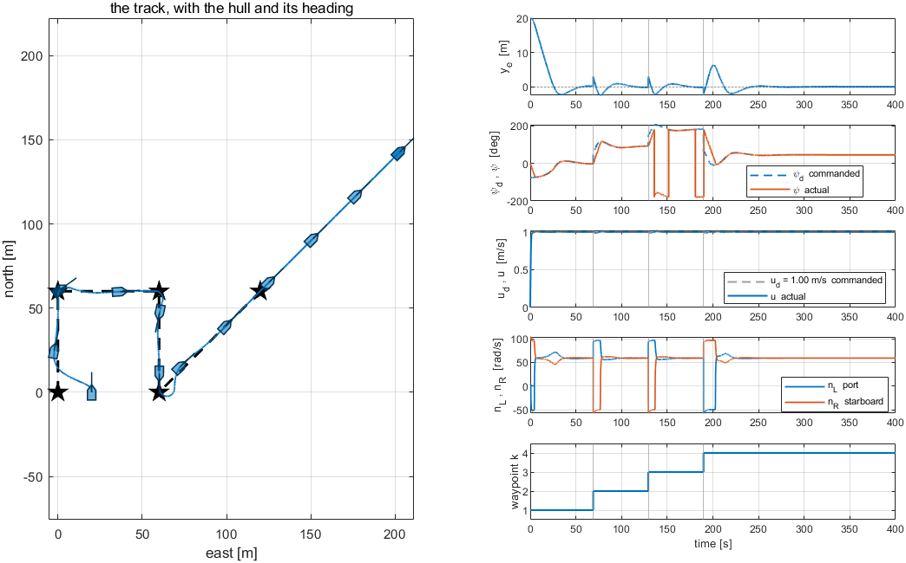

| 그림에서 | 거기 있는 것 |
|---|---|
| 오른쪽의 다섯 줄 | 각 줄이 명령을 실제로 낸 것 위에 올린다. 전환 순간마다 회색 선이 그어진 $y_e$, 그 다음 $\psi_d$ 대 $\psi$, $u_d$ 대 $u$, 두 축 회전수, 그리고 §5-4 의 판정이 참이 되면서 $1 \to 2 \to 3 \to 4$ 로 올라가는 다리 번호 |
| 제목 아래의 파란 줄 | **어느 법칙이 이 항적을 그렸는가** 를 유도 블록이 실제로 받은 대로 적는다. 항적만으로는 atan2 와 LOS 를 구별할 수 없고, §5-1b 의 플래그 때문에 어느 모델이든 넷 중 무엇으로도 돈다 |

**모델이 아직 돌고 있는 동안** 두 번째 창이 열리고, `Animate` 블록이 매 스텝 다시 그린다. 수업에서 볼 것은 그쪽이다.

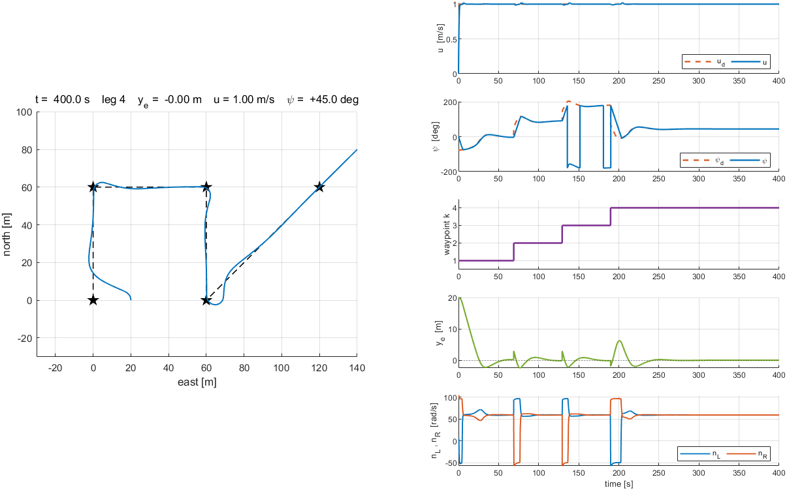

| 실시간 화면에서 | 거기 있는 것 |
|---|---|
| 왼쪽 절반 | 경로·웨이포인트·여기까지의 항적과 선체 — 일어나는 그대로의 임무 |
| 선체 | 배의 위치에 **가리키고 있는 방향대로** 그리므로, 선체와 자기 항적 사이의 각이 크랩각이다. 일어나는 그대로 보이고, 완성된 그림은 그것을 보일 수 없다 |
| 왼쪽 칸 위의 한 줄 | 법칙·시계·다리 번호, 그리고 $y_e$, $u$, $\psi$ 를 **숫자로** — 위 그림이 곡선으로만 줄 수 있는 것 |
| 오른쪽 절반 | 위 그림과 같은 다섯 가지가, 순서만 다르게, 실행이 진행되는 대로 채워진다 |

> [!tip] 실시간 화면을 끄기
> `W05_0_setup` 의 `animate = 0` 은 블록을 그대로 두고 아무것도 하지 않게 만든다. 스크립트가 게인을 훑을 때 그쪽이 빠르다. `pace = 1` 은 시뮬레이션을 실제 시간 속도로 돌려 창을 실시간으로 볼 수 있게 한다. 수치는 어느 쪽이든 동일하다.

> [!important] 임무는 마지막 웨이포인트에서 끝난다
> `W05_H_speed_path` 는 도착하면 멈춘다. 유도가 **다리를 전환할 때 쓰는 그 판정** — 다리 끝까지 `R_switch` 보다 적게 남았는가 — 을 적용하고, 전환할 다리가 없음을 알고는 캔버스의 `u_d x gate` 곱을 통해 속도 명령을 0 으로 내린다. `stop_hold` 초 뒤 `Stop Simulation` 블록이 실행을 끝내고, 위의 그림이 `T_final` $= 400$ s 가 아니라 $295.1$ s 에서 끝나는 이유가 그것이다. 배는 $(58.2,\ 118.1)$ m 에, 마지막 웨이포인트에서 $2.5$ m 떨어진 곳에 선다. `R_switch` 가 $3$ m 이고, 남은 것은 감속하는 동안 간 거리다.
>
> | 무엇이 그것을 끝내나 | 어디에 있나 |
> |---|---|
> | 판정 | `guidance` 안, 3b 단계: `arrived = near_end && k == n-1` |
> | 속도가 0 으로 가는 것 | **캔버스의** `u_d x gate` Product. 그래서 임무의 끝이 도면에 보인다 |
> | 실행이 끝나는 것 | `stop` 출력이 먹이는 `Stop Simulation` 블록 하나 |
> | 그것을 끄기 | `W05_0_setup` 의 `stop_at_end = 0`. 옛 거동으로 되돌린다 |
>
> 다른 여섯 모델은 `stop_at_end` 를 쓰지 않는다. 마지막 다리를 유지하고 그 연장선을 따라 항행하며, §5-4 의 읽기 표가 서술하는 것이 그것이다. 대기와 재계획과 상태기계를 갖춘 임무는 9주차다. 이것은 *임무의 끝* 이라는 이름을 받을 만한 가장 작은 것이다.

| 해 볼 것 | 볼 것 |
|---|---|
| `u_d = 1.6;` Run | 루프가 실행의 대부분을 $X_{\max} = 120$ N 에 앉아 있고, 코너가 눈에 보이게 넓어지고, 임무는 간신히 빨라진다 — 항력이 이기기 시작했다 |
| `u_d = 0.4;` Run | 더 느리고, `N_speed` 는 여전히 $47.15$ 다. 배가 전혀 필요하지 않은 한계에 묶여 있다. 보수적인 상수의 비용을 직접 본 것 |
| `W05_0_setup` 을 다시 돌린 뒤 `X_max = 70;` Run | `N_speed` 가 $66.40$ N·m 로 오르고 코너가 조여지지만, 루프가 더 이상 $1.0$ m/s 에 닿을 수 없다. 둘은 같은 절충을 반대쪽에서 본 것이다 |
| `Kb = 0;` Run | 안티와인드업 경로를 끈 것. 속도 오버슛이 $0.0216$ 에서 $0.0380$ m/s 로 자란다 — 여기서는 작다. 이 임무가 한계를 1초도 채 안 되게 유지하기 때문이다 |
| `animate = 1; pace = 1;` Run | 실행이 임무가 걸리는 만큼 걸리고, 그동안 실시간 화면이 항적·오차·두 속도·두 축을 그린다 |
| `heading autopilot` 의 Saturation 을, 6번 줄로 만든 $N_{\lim}(X)$ 가 먹이는 **Saturation Dynamic** 으로 바꾸기 | $47.15$ 와 참한계 사이의 여유가 돌아오고 코너가 조여진다. 다리 2–4 의 `mean \|y_e\|` 를 전후로 재고, 블록을 더 쓸 값을 했는지 판단한다 |

> [!tip] 수업에서
> - **목적** — 한 주 차이로 설계된 두 제어기가 하나의 하드웨어를 나눠 쓴다는 것, 그리고 그 나눠 씀에 산술이 있다는 것을 보인다.
> - **가리킬 곳** — `hardest turn` 줄. $T_R = 119.68$ N 이고 $T_{\max} = 119.68$ N 이다. 설계상 정확히 한계에 있다. `N_speed` 를 그 자리에 놓이도록 골랐기 때문이다.
> - **질문** — "배를 더 세게 미는데 왜 선회는 *덜* 세게 하는가?" 두 일이 같은 프로펠러 둘에서 나온다. 전진이 요에서 여유를 가져가고, 6번 줄이 얼마나 가져가는지를 말한다.
> - **질문** — "선회 권한이 왜 0 N 이 아니라 53 N 에서 가장 큰가?" $X^\star$ 아래에서는 안쪽 프로펠러가 후진 추력을 먼저 다 쓰고, 후진이 약한 방향이다.
> - **질문** — "$X = 77.6$ N 에서 참한계가 63.9 인데 Saturation 은 47.15 를 든다. 왜 실시간으로 계산하지 않는가?" 상수는 블록 하나이고 살아 있는 한계는 다섯이며, 여유는 코너에서만 버려진다. 둘 중 무엇을 만들지는 옳고 틀림의 문제가 아니라 공학의 문제다 — 마지막 **해 볼 것** 이 그것을 측정으로 바꾼다.
> - **남길 것** — 상수가 신호가 되면, 그 상수로 계산해 둔 모든 한계를 다시 계산해야 한다.

---

# Part 2 · 실습 실행 순서

Part 1 의 실험들을 순서대로 따라간 것이다. 이 표는 무엇을 돌렸는지의 색인이고, 집에서 그 주차를 되짚을 때 쓴다.

예제마다 **자기 모델**이 있고 모두 같은 방식으로 배치되어 있다 — `guidance` → `heading autopilot` → `allocation` → `Otter`, 배를 뺀 각각이 주석 달린 MATLAB Function 이다. 그 블록들이 받는 모든 입력은 **캔버스의 Constant 블록**이다 — 웨이포인트 목록, $\Delta$, $R$, $\kappa$, 전진력을 블록 마스크 안에 숨기지 않고 도면에서 읽는다.

각 모델의 오른쪽에 넷이 앉아 있다.

| | 무엇을 보이나 | 언제 |
|---|---|---|
| **Scope** | 횡방향 오차. 명령 선수각과 실제 선수각. 한 단씩 올라가는 웨이포인트 번호 | 도는 동안 |
| **XY Graph** | 항적, 북에 대한 동 | 도는 동안 |
| **Display** | 활성 다리를 수로 | 도는 동안 |
| **Animate** 블록 | 실시간 화면: 왼쪽에 경로·웨이포인트·항적·선체, 오른쪽에 $y_e$, $u_d$ 에 대한 $u$, $n_L$ 과 $n_R$, 그리고 다리 번호 | 도는 동안, `animate = 1` 일 때 |

작업공간에서 `pace = 1` 로 두면 모델이 **실제 시간 속도로** 돌아 실시간 화면이 배가 가는 속도로 움직인다. `pace = 0` 은 낼 수 있는 만큼 빠르게 돌린다. 결과는 동일하고 기다리는 시간만 다르다 — 10 s 임무가 `pace = 1` 에서 실제 12.7 s, `pace = 0` 에서 1.4 s 걸린다. 실행이 끝나면 모델의 `StopFcn` 이 `W05_plot` 을 부르고, 그것이 다리별 표를 찍고 항적을 그 옆의 다섯 곡선과 함께 그린다. 그래서 **Run 만 눌러도 절 스크립트와 같은 그림이 나온다.**

| 실험 | 모델 | 스크립트 | 무엇을 보이나 |
|---|---|---|---|
| 5-0 | 전부 | `W05_0_setup`, `W05_1_build_guidance` | 파라미터, 그리고 코드로 쓰인 모든 모델 |
| 5-1 | `W05_G_tuning` | — | 유도가 앉는 자리, 그리고 $y_e$ 를 주는 회전 |
| 5-1b | `W05_G_tuning` | `W05_B_three_laws` | `law` 플래그: 한 모델을 atan2, LOS, ILOS 로 돌린다 |
| 5-2 | `W05_C_atan2` | `W05_C_aim_at_the_waypoint` | 다음 웨이포인트를 겨누기 |
| 5-3 | `W05_D_LOS` | `W05_D_lookahead_distance` | LOS 와 전방주시거리 |
| 5-4 | `W05_E_switching` | `W05_E_waypoint_switching` | 임무에서의 전환 거리 |
| 5-5a | `W05_F_LOS` | `W05_F_LOS_in_a_current` | LOS 아래에서 조류가 남기는 편차 |
| 5-5b | `W05_F_ILOS` | `W05_F_ILOS_removes_it` | 그것을 없애는 적분 |
| 5-5c | `W05_F_ILOS`, `law = 3` 과 `4` | `W05_F2_two_integrators` | 보통 적분 대 비선형 적분, 같은 게인에서 그리고 각자의 게인에서 |
| 5-6 | `W05_G_tuning` | `W05_G_tuning_by_hand` | 조류 속 임무에서의 튜닝 순서 |
| 5-6b | `W05_H_speed_path`, 다시 읽기 | `W05_I_performance` | 성능에 대한 예측 여섯, 그리고 임무가 실제로 준 것 |
| 5-7 | `W05_H_speed_path` | `W05_H_speed_and_path` | 같은 선체 위의 3주차 속도 루프, 그리고 $X$ 와 $N$ 이 $n_L$ 과 $n_R$ 로 갈라지는 방식 |

- 스크립트는 Run 이 이미 보여 주는 것을 여러 값에 대해 한꺼번에 되풀이하고, Part 1 이 인용한 수치를 찍는다.
- 각 실험은 **수업에서** 노트로 끝난다 — 목적, 가리킬 곳, 질문과 그 답, 그리고 남길 한 문장.

---

# 정리

## 주차 정리

| 단계 | 한 일 | 어떻게 검증했나 |
|---|---|---|
| 1 | 4주차 오토파일럿 앞에 유도 법칙을 놓았다 | 일곱 모델 모두 `check_overlaps` 0. $y_e$ 가 MSS `crosstrackWpt` 와 같다 |
| 1b | 법칙 셋을 플래그 뒤의 한 블록에 넣었다 | 실험 5-1b: 한 임무에서 atan2, LOS, ILOS 의 평균 오차 $3.93 \to 1.52 \to 0.61$ m |
| 2 | atan2 대 LOS | 실험 5-2: 웨이포인트까지 절반에서 0.04 m 에 대해 10.75 m |
| 3 | P 게인 $1/\Delta$ 로서의 $\Delta$ | 실험 5-3: 40 m 에서 118 s, 0.5 m 에서 흔들림. $\Delta = 5$ m |
| 4 | 전환 거리 | 실험 5-4: $R = 3$ m 에서 최악 코너 2.98 m |
| 5 | 조류와 ILOS | 실험 5-5a 와 5-5b: LOS 편차 $= \Delta\tan$(선수각) 이 밀리미터까지. ILOS 가 그것을 없앤다 |
| 6 | 임무에서의 튜닝 순서 | 실험 5-6: $\kappa = 0.3$, 다리 2–4 합이 LOS 의 3.64 m 에 대해 0.92 m |
| 7 | 같은 배분기에 3주차 속도 루프를 더했다 | 실험 5-7: $1.000$ m/s 유지, 마지막 다리 23 % 더 빨리. 손으로 계산한 $n_L$ 이 기록된 $58.683$ 에 대해 $58.686$ |
| 8 | 전진력이 남기는 모멘트 한계를 유도했다 | 실험 5-7: $X = 60$ N 에서 $N_{\lim} = 70.85$ N·m, $120$ N 에서 $47.15$, $52.97$ N 에서 꼭대기 $73.62$ |
| 9 | 두 제어기를 코드가 아니라 Simulink 블록으로 그렸다 | 모든 서브시스템 안에서 `check_overlaps` 0. §5-2 부터 §5-6 이 MATLAB Function 판의 모든 수를 그대로 재현한다 |

## 진도 점검

> [!important] 6주차를 따라가기 위한 최소 조건

### 이론

- [ ] 두 웨이포인트와 위치에서 $y_e$ 를 계산할 수 있다.
- [ ] LOS 가 왜 P 제어기인지, $\Delta$ 가 그 게인을 어느 쪽으로 움직이는지 설명할 수 있다.
- [ ] 유지된 선수각에서 횡조류 속 LOS 편차를 예측할 수 있다.
- [ ] ILOS 의 적분이 무엇을 하는지, 그 분모가 왜 와인드업을 제한하는지 설명할 수 있다.
- [ ] 전진력과 요 모멘트에서 $T_L$ 과 $T_R$ 을 쓰고, 그것을 축 회전수로 바꿀 수 있다.
- [ ] 선체를 더 세게 밀면 왜 요 모멘트가 덜 남는지, 그리고 모멘트 한계가 어디서 꼭대기인지 설명할 수 있다.

### 실습

- [ ] `W05_1_build_guidance` 가 돌았고 모든 모델이 `overlapping lines: 0` 을 보고했다.
- [ ] Command Window 에서 파라미터를 바꾸었고 XY Graph 가 새 항적을 보였다.
- [ ] `W05_H_speed_path` 를 `animate = 1` 로 돌렸고 실시간 화면이 항적·오차·두 속도·두 축을 그렸다.
- [ ] `W05_P1_start` 로 만든 모델에서 `W05_check(1)`, `(2)`, `(3)` 이 통과한다.

---

## 수업 실습 — 유도 층을 손으로 만든다

5주차 수업의 두 번째 시간은 유도 블록을 Simulink 로 만드는 데 쓴다. 완성된 4주차 배가 입력 하나만 열린 채로 주어진다 — 명령 선수각이다.

```matlab
cd lectures/W05_simulink/problems
W05_P1_start                 % creates W05_P1.slx — a Week 4 vessel, no guidance
W05_check(1)                 % run this whenever, as often as needed
```

| | 문제 | 시간 | 재현해야 하는 수 |
|---|---|---|---|
| 1 | 다리 1 에서의 LOS 법칙 | 25분 | $\pi_p = 0$ 정확히. $y_e$ 가 18 m 에서 0 으로. $\psi_d \to \pi_p$ |
| 2 | 같은 배에서 atan2 대 LOS | 20분 | LOS 는 직선을 유지하고 atan2 는 못 한다 |
| 3 | 조류, 그리고 남는 편차 | 15분 | 정착한 $y_e = \Delta\tan$(크랩각) |

- 문제지는 [`W05_simulink/problems/README.md`](W05_simulink/problems/README.md) 이고, 모범답안은 [`W05_simulink/solutions/`](W05_simulink/solutions/README.md) 에 있다.
- 문제 3 은 §5-5 가 이어 가는 자리에서 끝난다 — 편차를 없애는 적분.

---

## 과제 5

- **기한**: 6주차 수업 전
- **제출물**: 수정한 `W05_0_setup.m`, 아래에서 요구하는 수치, 그리고 그림 둘

### ① 요구사항

임무의 다리를 두 배로 하고(웨이포인트 좌표 전부 2 배, 다리 120 m), 0.3 m/s 조류에서 §5-6 의 순서로 $\Delta$, $R$, $\kappa$ 를 다시 튜닝한다.

### ② 검증 — 필수

> [!important] 주장은 결과가 아니다. 수치가 필요하고, 평균 구간을 함께 적는다

1. 고른 $\Delta$ 와 그 이웃 값들로, 240 m 다리 하나에서 실험 5-3 의 표.
2. 새 임무에서 실험 5-4 의 표.
3. 새 임무에서 실험 5-6 의 표, 그리고 고른 $\kappa$.
4. 조류 속의 LOS 편차를, 유지된 선수각의 $\Delta\tan$ 옆에 나란히.

### ③ 분석 (5–10줄)

고른 $\kappa$ 를 0.3 과 비교하고, 다리 길이에서 그것이 왜 그 방향으로 움직였는지 설명한다.

### 배점

| 기준 | 배점 |
|---|---|
| 모델이 돌고 요구한 출력을 낸다 | 25% |
| **검증을 수행하고 수치를 보고했다** | 40% |
| 분석의 정확성 | 25% |
| 코드의 가독성 | 10% |

---

## 문제 해결

| 증상 | 원인 | 조치 |
|---|---|---|
| `W05_0_setup` 이 `mss_path` 에서 멈춘다 | MSS 툴박스가 `Tools\MSS` 에 없다 | 거기에 둔다. 첫 장 참조 |
| XY Graph 에 아무것도 안 나온다 | 항적이 그 축 밖에 있다 | 축이 −20 ~ 140 m 다. 다른 경로를 쓰면 `set_param(... '/track', 'xmax', ...)` 가 필요하다 |
| 배가 웨이포인트를 돈다 | $R$ 이 배가 그 안에서 돌 수 있는 것보다 작다 | `R_switch` 를 올린다 |
| `guidance` 가 `WP_N` 이 정의되지 않았다고 한다 | `W05_0_setup` 을 돌리지 않았다 | 그것을 실행한다. 유도 블록은 작업공간에서 웨이포인트를 읽는다 |
| Scope 가 이 노트와 맞지 않는다 | 바꾼 변수가 아직 작업공간에 있다 | `W05_0_setup` 을 다시 실행한다 |

---

## 참고문헌

### 원전

- Fossen, T. I. *Handbook of Marine Craft Hydrodynamics and Motion Control*, 2nd ed., Wiley, 2021, §12.3 (시선 유도와 그 적분 형태).
- Børhaug, E., Pavlov, A. and Pettersen, K. Y. "Integral LOS control for path following of underactuated marine surface vessels in the presence of constant ocean currents." *47th IEEE Conference on Decision and Control*, 2008, pp. 4984–4991. DOI: 10.1109/CDC.2008.4739352.
- MSS 툴박스, `Tools/MSS/GNC/crosstrackWpt.m` 과 `ILOSpsi.m`.

### 이 강의 안에서

- 2주차 §2-6 ~ §2-8 과 §2-12: P, I, 그리고 튜닝 순서. 4주차 §4-4: 선수각은 침로가 아니다.
- 이 주차의 이전 판, 곧 모델에 기반한 판 — 온전한 유도, Lyapunov 안정성, ALOS — 은 `W05_simulink/_previous_version/` 에 남겨 두었다.

---

## 다음 주

**6주차 — 선수추진기: 위치제어와 접안.** 이번 주는 선미 추진기 둘로 경로를 따라갔고, 끝까지 할 수 없었던 요구 하나가 **옆으로 가라**는 것이었다. 크랩각은 바로잡을 대상이었고 명령할 대상이 아니었다. 6주차는 선수에 추진기를 하나 더 단다. 그 열 하나가 $B$ 를 정사각으로 만들어 역행렬이 생기고, 그것으로 배는 조류 속에서 한 점을 지키고 부두에 붙는다.
