# Week 6 · The Bow Thruster: Position Control and Berthing

> [!note] Recordings of this semester's own classes
> <span style="font-size:0.88em">Every session of this course is recorded as it is given and posted to the playlist below. The written material here is the reference; the recording is the lecture, at the pace it was actually delivered. Use it to review a derivation, or to catch up on a missed week before the laboratory.</span>
>
> | | Where |
> |---|---|
> | **[충남대] 2026 센서신호처리** — this course, recorded live, 2026 | [playlist](https://youtube.com/playlist?list=PLCxINRGlWUrk) |

> [!important] Reference material — read this first
> <span style="font-size:0.88em">The five courses below are **taught by the instructor of this course** and are the assumed background for it. They run from the fundamentals down to the graduate material, so start wherever the gap is. Every frame, symbol and derivation used here is developed in them at length; anyone whose prerequisites are thin should work through them first, then return.</span>
>
> | # | Course | Level | Lang. | Video | Slides and code |
> |---|---|---|---|---|---|
> | 1 | **Control Engineering** (제어공학) — the foundation: transfer functions, feedback, stability, root locus, PID | undergraduate | KO | [playlist](https://youtube.com/playlist?list=PLFaUxNRM4BvJMpF9HZS-Mp8tDv9dTdglk) | [drive](https://drive.google.com/drive/folders/1TNIPDNtS_Iy8li-olka5WJslSXDYf0aT) |
> | 2 | **Control System Design** (제어시스템설계) — design rather than analysis: specifications, loop shaping, discrete implementation | undergraduate | KO | [playlist](https://youtube.com/playlist?list=PLFaUxNRM4BvIGroZ5rgn7x08F7C79d9WZ) | [drive](https://drive.google.com/drive/folders/11m5Xxl_PHJvxgHghLSP-jhCpmRpbvoXh) |
> | 3 | **Advanced Control Engineering** (제어공학특론) — reference frames, the 6-DOF equation of motion, rotation matrices and Euler angles, linearisation and trim, vehicle control design | graduate | EN | [playlist](https://youtube.com/playlist?list=PLFaUxNRM4BvJmvF2ljx4KM5dj1P5jEcw0) | [drive](https://drive.google.com/drive/folders/1GUxbbONl916lNd0ggnFnXrNwNkd13-2-) |
> | 4 | **Sensor Signal Processing and Fusion** (센서신호처리 및 융합) — sensor models, noise, estimation and multi-sensor fusion | graduate | EN | [playlist](https://youtube.com/playlist?list=PLFaUxNRM4BvK-aP2Gdoyp5-AWvMn7Fo8E) | [drive](https://drive.google.com/drive/folders/1MEVJP7TzMcm8w6TZwUjhWJtL34WeNY3u) |
> | 5 | **Capstone Design** (캡스톤디자인) — a vehicle project carried end to end | undergraduate | KO | [playlist](https://youtube.com/playlist?list=PLFaUxNRM4BvLu7L0pDoLzDXTv8mm6rCmj) | [drive](https://drive.google.com/drive/folders/1haIQejlJfrdhtOuof-MpffR9ydVscXZS) |
>
> <span style="font-size:0.88em">**Not fluent in MATLAB or Simulink yet? Do these before Part 2.** Every laboratory in this course is Simulink, and the Onramp courses are free and take a few hours each.</span>
>
> | Tool | Where to start |
> |---|---|
> | MATLAB | [MATLAB Onramp](https://matlabacademy.mathworks.com/kr/details/matlab-onramp/gettingstarted) · [Core MATLAB Skills](https://matlabacademy.mathworks.com/details/core-matlab-skills/lpmlcms) |
> | Simulink | [Simulink Onramp](https://matlabacademy.mathworks.com/kr/details/simulink-onramp/simulink) · instructor's Simulink lectures [part 1](https://youtu.be/a-afHg_fSaU) · [part 2](https://youtu.be/070Yn0Hw5a0) |


> [!tip] Getting the course files, and keeping them current (Windows)
> <span style="font-size:0.88em">The notes, models and scripts are kept in one Git repository that is updated through the semester. Clone it once; before every class, pull. A pull downloads only what has changed since the last one.</span>
>
> | When | Where to run it | Command |
> |---|---|---|
> | once | PowerShell — installs Git for Windows | `winget install --id Git.Git -e` |
> | once | the folder that will hold the course, e.g. `Documents` | `git clone https://github.com/wkyouncnu/Sensor-Signal-Processing-and-Fusion.git` |
> | before every class | inside the cloned folder `Sensor-Signal-Processing-and-Fusion` | `git pull` |
>
> - `git pull` prints `Already up to date.` when nothing has changed, and otherwise lists the files it updated.
> - The repository is private. When Git asks, sign in with the GitHub account the instructor has given access.
> - Experiment on copies, not on the cloned files: copy a week's `WXX_simulink` folder elsewhere first, and a pull can never collide with local edits. If it already has, `git stash`, then `git pull`, then `git stash pop` sets the edits aside, updates, and puts them back.
> - The MSS toolbox is not part of the repository. The weeks that simulate the Otter need it at `Tools\MSS` inside the cloned folder.


- **Course**: USV Guidance, Navigation and Control (Graduate)
- **Department**: Autonomous Vehicle System Engineering, Chungnam National University
- **This week**: ① a third thruster, and the words under-, fully- and over-actuated ② allocation by hand, and the ceiling that binds first ③ three nested loops that hold a point ④ stopping, and who declares arrival ⑤ berthing as four latched phases ⑥ alongside against bow-first ⑦ the same controller written in two frames

> [!important] Before starting
> - Week 5 must run: the lookahead guidance law produces a heading reference, and the heading autopilot follows it. The vessel can follow a path.
> - Verify in one command: `cd lectures/W05_simulink; W05_0_setup` opens the model and prints the gain banner without error.
> - What Week 5 could not do: hold a position. A path follower needs forward speed to steer; at zero speed the rudder-equivalent of a differential-thrust hull has no authority in sway at all.

---

## Learning Outcomes

Upon completion of this week, the learner is able to:

1. State the rank test that separates an under-actuated, a fully actuated and an over-actuated vessel, and apply it to the three Otter configurations defined in `otter_config.m`.
2. Build the control effectiveness matrix $B$ for a three-thruster Otter from the column rule alone, and confirm the result against `otter_B.m` to machine precision.
3. Solve $B\mathbf{f} = \boldsymbol{\tau}$ by hand, explain why the third row of $B^{-1}$ is $[0\ \ 1\ \ 0]$, and predict which actuator ceiling binds first for a pure sway demand.
4. Predict, from the clipped allocation alone, the surge force and yaw moment that leak out when a sway demand exceeds the attainable set, and verify the prediction to two decimal places against simulation.
5. Explain why a position controller is built as a cascade of a position P loop, a velocity PI loop and a heading P-D loop rather than as one gain from position error to thrust, and name the quantity each loop owns.
6. Derive the braking distance and the settling time constant of the outer position loop, and state the condition under which the cascade's time-scale separation fails.
7. Implement an arrival test as a conjunction of bounded conditions with a latch, and explain what the latch prevents.
8. Compare an alongside and a bow-first berthing on measured phase durations, and attribute the whole difference to one commanded quantity.
9. Place the single rotation that must sit between a NED position error and a body-fixed force, in both of the two possible positions, and state what each choice costs.

## Prerequisites and Setup

| Item | Requirement |
|---|---|
| MATLAB | R2024b or later, with Simulink |
| MSS toolbox | on the path; `mss_path()` locates it — do not add it by hand |
| Week 5 | `W05_simulink` runs and its figures regenerate |
| Working folder | `lectures/W06_simulink` |
| First command | `W06_0_setup` — defines every constant and opens `W06_F_position.slx` |
| Verification | `verify_w06_actuation` — 17 checks, all must print `OK` |

---

# Part 1 · Principle and experiment, section by section

Each section below is built the same way, and the three parts answer three different questions.

| | |
|---|---|
| **What is observed** | the measurement that makes the section necessary — a number from a run, not an assertion |
| **What follows from it** | the derivation, one line at a time, ending in a prediction that can be measured |
| **Experiment N-x** | the run that measures it, with the output reproduced exactly as the script prints it |

## 6-0. Setting up (10 min)

Every constant this week lives in one file. Nothing is typed into a block dialogue.

```matlab
cd lectures/W06_simulink
W06_0_setup
```

Expected output:

```
  W06_0_setup
    actuation   3 thrusters, rank B = 3, det B = 0.790  ->  fully actuated
    thrust      stern -66.71 .. +119.68 N per propeller,  bow +-40 N
    lever       l_f/(2 y_pont) = 1.8987
    sway limit  35.13 N from the stern reverse limit, 40.00 N from the bow unit
    berth       (40.0, 1.2) via (40.0, 8.2), final heading +0 deg
```

The banner is the whole week in five lines. Each of them is derived in a section below, and the figure on the right of each experiment is the measurement that confirms it.

Four models are used. They share one hull, one allocation block and one measurement block; what differs is how much of the control chain is present.

| Model | Sections | What is closed |
|---|---|---|
| `W06_C_actuation.slx` | 6-1, 6-2 | nothing — generalised force is commanded directly |
| `W06_F_position.slx` | 6-3, 6-4 | position, velocity and heading, all in the body frame |
| `W06_H_berth.slx` | 6-5, 6-6 | the same, with a four-phase mission block setting the target |
| `W06_I_position_ned.slx` | 6-7 | the same, with the outer loop written in NED instead |

> [!important] Run the verification before the experiments
> `verify_w06_actuation` re-derives $B$ by hand, re-solves the allocation for 200 random demands, re-computes every ceiling quoted in this document, and compares `W06_vars` against `W06_0_setup` field by field. Its 17 checks are the reason the numbers in this week's tables can be quoted without qualification.

```
  verify_w06_actuation

    1  W06_vars = W06_0_setup                            OK    58 fields compared, none differ
    2  B = the column rule, written by hand              OK    max |B - Bhand| = 0.0e+00
    3  det B = 0.790000, rank B = 3                      OK    det = 0.790000, rank = 3, size = 3x3
    4  inv(B) rows, the third one [0 1 0]                OK    lever a = 1.898734, 1/(2 y_pont) = 1.265823
    5  the hand-solved law = B \ tau  (200 demands)      OK    max error = 3.553e-14 N
    6  pure sway unit column = [-a; a; 1]                OK    [-1.898734; 1.898734; 1.000000]
    7  T_max 119.6820, T_min -66.7080, N_max 52.6993     OK    119.6820 N, -66.7080 N, 52.6993 N m
    8  sway limits 35.1329 / 63.0325 / 40, the first binds OK    35.1329 (stern astern) / 63.0325 (stern ahead) / 40.0000 (bow) -> Y_max = 35.1329 N
    9  the leak is 0 up to Y_max and not above it        OK    at Y = 50 N:  X leaks +28.23 N, N leaks -3.85 N m
    10 ranks 2 (under) / 3 square (fully) / 3 of 8 (over) OK    base 3x2 r2, bow 3x3 r3, quad_tilt 3x8 r3
    11 M(2,6) = 12.25 gives rdot = -2.588 deg/s^2        OK    M(2,2) = 162.5000, M(2,6) = 12.2500, M(6,6) = 42.6515
    12 superposition residual < 1e-12                    OK    0.000e+00
    13 R' R = I, det R = 1, and the 30 deg example       OK    cos 30 = 0.866, sin 30 = 0.500, x_e = 1.866, y_e = 1.232
    14 app = [berth_N; berth_E + stand_off]              OK    berth (40.0, 1.2) + 7.0 m  ->  (40.0, 8.2)
    15 body and NED ask the same velocity, before the cap OK    max difference over 24 headings = 2.001e-16 m/s
    16 per-axis bends the direction, magnitude keeps it  OK    diagonal 0.8732, two 0.35 caps 0.4950, magnitude 0.3500 m/s
    17 W06_read and W06_plot read the same 17 columns    OK    17 and 17 names, identical

  ALL CHECKS PASSED
```

---

## 6-1. Two thrusters, three demands

This section answers: what exactly does a third thruster add, and what are the words for what it adds.

**What is observed.** Week 5 closed a path-following loop on the Otter with two stern propellers and it worked. The same vessel, asked to hold a fixed point, fails: it arrives on the line of its own heading and then stops 14.8 m short, with no gain anywhere in the loop saturated and no disturbance acting. The failure is not one of tuning. It is a property of the actuator set.

**The result.** The generalised force a vessel can produce is the image of its actuator vector under one matrix,

$$\boldsymbol{\tau} = B\,\mathbf{f},\qquad
\boldsymbol{\tau} = \begin{bmatrix} X \\ Y \\ N \end{bmatrix},\qquad
\mathbf{f} = \begin{bmatrix} T_L \\ T_R \\ F_B \end{bmatrix}$$

and the three words that classify a vessel are three statements about that image.

| Term | Condition on $B \in \mathbb{R}^{3 \times m}$ | What it means for control | Otter configuration |
|---|---|---|---|
| under-actuated | $\operatorname{rank} B < 3$ | some generalised forces cannot be produced at all | `base` — two stern propellers, $B \in \mathbb{R}^{3\times 2}$, rank 2 |
| fully actuated | $\operatorname{rank} B = 3$, $m = 3$ | every $\boldsymbol{\tau}$ is attainable, by exactly one $\mathbf{f}$ | `bow_thruster` — $B \in \mathbb{R}^{3\times 3}$, rank 3, $\det B = 0.79$ |
| over-actuated | $\operatorname{rank} B = 3$, $m > 3$ | every $\boldsymbol{\tau}$ is attainable, by infinitely many $\mathbf{f}$ | `quad_tilt` — four tilting units, $B \in \mathbb{R}^{3\times 8}$, rank 3 |

| Symbol | Quantity | Value, source |
|---|---|---|
| $X$ | surge force, body frame | N |
| $Y$ | sway force, body frame | N |
| $N$ | yaw moment about $z_b$ | N·m |
| $T_L, T_R$ | thrust of the port and starboard stern propellers | N, $-66.708 \ldots +119.682$ |
| $F_B$ | bow thruster force, positive to starboard | N, $\lvert F_B \rvert \le 40$ |
| $y_{pont}$ | half the pontoon separation | $0.395$ m, `otter.m` line 57 |
| $l_f$ | bow thruster arm forward of the origin | $1.5$ m, `otter_config.m` |
| $m$ | number of actuators | 2, 3 or 8 by configuration |

**Derivation, one line at a time.**

1. Fix the body frame at the origin CO used by `otter.m`: $x_b$ forward, $y_b$ to starboard, $z_b$ down. A force $\mathbf{F} = [F_x\ \ F_y]^{\mathsf T}$ applied at the body-frame point $(x_t, y_t)$ produces the generalised force

$$\begin{bmatrix} X \\ Y \\ N \end{bmatrix}
= \begin{bmatrix} F_x \\ F_y \\ x_t F_y - y_t F_x \end{bmatrix}.$$

2. The $k$-th **column** of $B$ is therefore nothing but the generalised force produced by one unit of actuator $k$. There is no matrix to memorise: each column is read off the geometry of one actuator.

3. The port stern propeller pushes along $+x_b$ and sits at $y_t = -y_{pont}$, so its column is $[1\ \ 0\ \ +y_{pont}]^{\mathsf T}$. The starboard propeller is the mirror image, $[1\ \ 0\ \ -y_{pont}]^{\mathsf T}$. The bow thruster pushes along $+y_b$ and sits at $x_t = +l_f$, so its column is $[0\ \ 1\ \ +l_f]^{\mathsf T}$.

4. Assembling the three columns,

$$B = \begin{bmatrix}
1 & 1 & 0 \\
0 & 0 & 1 \\
y_{pont} & -y_{pont} & l_f
\end{bmatrix}
= \begin{bmatrix}
1 & 1 & 0 \\
0 & 0 & 1 \\
0.395 & -0.395 & 1.5
\end{bmatrix}.$$

5. Expanding the determinant along the second row, whose only non-zero entry is $B_{23} = 1$,

$$\det B = (-1)^{2+3}\cdot 1 \cdot \det\!\begin{bmatrix} 1 & 1 \\ 0.395 & -0.395 \end{bmatrix}
= -(-0.395 - 0.395) = 0.790.$$

6. The determinant is non-zero, so $B$ is invertible and the Otter with a bow thruster is **fully actuated**: there is exactly one $\mathbf{f}$ for every $\boldsymbol{\tau}$, and no choice to make. Delete the third column and the remaining $3 \times 2$ matrix has rank 2; its image is the plane $Y = 0$, which is why the two-thruster Otter can never produce a pure sideways force. Add more actuators and the rank stays 3 while the null space grows, which is what makes allocation an optimisation problem rather than a solve — the subject of Week 7.

7. Nothing in the derivation used a hull station. What enters $B$ is the **moment arm**, which for the stern pair is the lateral offset $y_{pont}$ and for the bow unit is the longitudinal arm $l_f$. The fore-aft position of the stern propellers never appears, because they push along $x_b$ and a force through a point parallel to $x_b$ has no moment arm except in $y$.

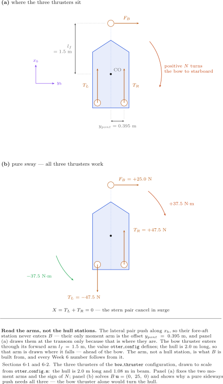

| In the figure | Meaning |
|---|---|
| panel (a), two arrows at the transom | the stern pair, each pushing along $+x_b$; their arms are the lateral offsets $\pm y_{pont} = \pm 0.395$ m |
| panel (a), one arrow ahead of the bow | the bow thruster, pushing along $y_b$ at the arm $l_f = 1.5$ m |
| the arc labelled *positive $N$ turns the bow to starboard* | the sign convention: $z_b$ points down, so a positive moment about it is clockwise seen from above |
| `CO` | the body-frame origin $B$ is written about — not the centre of gravity |
| panel (b), $F_B = +25.0$ N | the bow force needed for a pure sway demand $Y = 25$ N: exactly $Y$, by the second row of $B^{-1}$ |
| panel (b), $T_L = -47.5$, $T_R = +47.5$ N | the stern pair **opposing** each other, to cancel the bow unit's moment |
| the two moment labels $\pm 37.5$ N·m | $l_f F_B = 1.5 \times 25 = 37.5$ N·m produced by the bow unit, and the equal and opposite $2 y_{pont} \times 47.5 = 37.5$ N·m from the stern pair |
| the caption *the stern pair cancel in surge* | $X = T_L + T_R = 0$: the hull is pushed sideways and not forward |

Panel (b) is the whole of the next section in advance. A pure sideways force on this hull costs **three** thrusters working, two of them against each other, and the magnitudes are set by the ratio of the arms.

### Experiment 6-1 · Three axes, commanded one at a time (20 min)

**What it measures.** Whether the algebra of $B$ survives contact with the hull. A square $B$ of rank 3 says the three axes are independent as a matter of linear algebra; it says nothing about whether the hull's inertia agrees.

**The model.** `W06_C_actuation.slx` — no feedback anywhere. Three Constants set $X$, $Y$ and $N$ directly; the allocation block solves for the three thrusts; the hull integrates. The point of running it open loop is that nothing can hide a failure by correcting it.

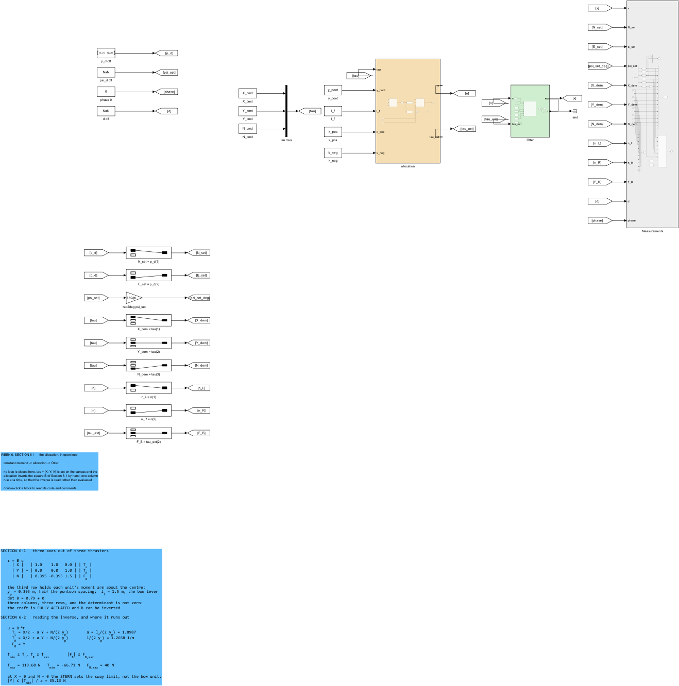

| In the figure | Meaning |
|---|---|
| the three Constants on the left | the generalised force demand $[X\ \ Y\ \ N]$, in newtons and newton-metres |
| `allocation` | solves $B\mathbf{f} = \boldsymbol{\tau}$ and converts thrust to shaft speed; green-free because it is not the plant |
| `Otter` (green) | the 6-DOF hull from `otter.m`, with the bow force entering as an external force |
| `Measurements` (grey) | the 17-column log, and the live animation |
| the single wide signal returning from `Otter` | the 12-state vector $\mathbf{x}$; every subsystem that needs part of it selects internally |

**Opening and running.**

```matlab
W06_C_three_axes
```

Expected output:

```
  W06 Experiment 6-1  three axes, commanded one at a time  (open loop, 20 s)
    demand [N, N, N m]      n_L      n_R     F_B [N]    delivered [N, N, N m]      residual     u       v      r [deg/s]
    surge only   X      52.03    52.03      0.00      60.00    0.00     0.00     1.42e-14   0.774   0.000     0.000
    sway only    Y     -85.82    65.45     25.00       0.00   25.00     0.00     0.00e+00  -0.000   0.344    -0.000
    yaw only     N      47.80   -62.67      0.00      -0.00    0.00    20.00     3.55e-15   0.004  -0.002     9.365
    all three           19.42    56.86     15.00      40.00   15.00    10.00     1.78e-15   0.556   0.223     4.790
```

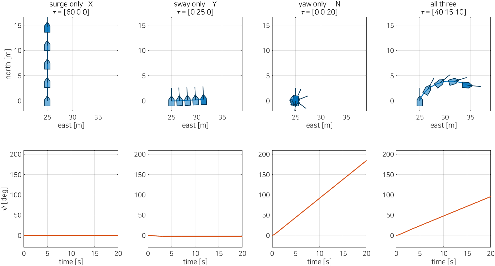

**Reading the figure against the derivation.**

| Where to look | What is there | Which line predicts it |
|---|---|---|
| `residual` column, every row | $1.8\times10^{-15}$ to $1.4\times10^{-14}$ N | step 6 — $B$ is invertible, so the recovered force equals the demand to machine precision |
| `sway only` row, $F_B = 25.00$ | the bow force equals the sway demand exactly | step 4, second row of $B$: $Y = F_B$ and nothing else contributes |
| `sway only` row, $n_L = -85.82$ against $n_R = +65.45$ | the stern pair oppose each other, and the magnitudes differ | panel (b) of the figure, plus $k_{neg} < k_{pos}$: the same thrust needs a larger shaft speed astern |
| `sway only` row, $v = 0.344$ m/s | a sideways velocity, which the two-thruster hull cannot produce at all | step 6 — rank 3 against rank 2 |
| `yaw only` row, $u = 0.004$ m/s | surge is essentially zero while the hull turns at 9.365 deg/s | step 4, first row: $X = T_L + T_R$, and $47.80$ against $-62.67$ in shaft speed is very nearly cancelling in thrust |

**What the figure says.** The three axes are independent in force, and the residual column proves it to fourteen decimal places. They are not independent in motion. The `sway only` run commands $N = 0$ exactly, the delivered moment is $0.00$ N·m, and yet the heading swings to $-3.00$ deg over the twenty seconds. Nothing in $B$ is wrong; what separates the axes is $B$, and $B$ is not the only matrix in the problem.

Write the sway and yaw rows of the rigid-body equation with the surge row dropped, since $X = 0$ throughout:

$$\begin{bmatrix} M_{22} & M_{26} \\ M_{26} & M_{66} \end{bmatrix}
\begin{bmatrix} \dot v \\ \dot r \end{bmatrix}
= \begin{bmatrix} Y \\ 0 \end{bmatrix}$$

Solving the second row for $\dot r$,

$$\dot r = \frac{-M_{26}\,Y}{M_{22}M_{66} - M_{26}^2}
= \frac{-12.25 \times 25}{162.5 \times 42.6515 - 12.25^2}
= -0.04516\ \text{rad/s}^2 = -2.588\ \text{deg/s}^2 .$$

| Symbol | Quantity | Value, source |
|---|---|---|
| $M_{22}$ | sway inertia including added mass | $162.5$ kg, `otter_M.m` |
| $M_{26}$ | sway–yaw added-mass coupling | $12.25$ kg·m, `otter_M.m` |
| $M_{66}$ | yaw inertia including added mass | $42.6515$ kg·m², `otter_M.m` |

The off-diagonal term $M_{26}$ is the whole of the effect. A sideways force applied at the origin accelerates the hull in yaw even when the applied moment is zero, because the sway and yaw equations are coupled through added mass. The rate peaks at $1.18$ deg/s, decays to $-1.5\times10^{-7}$ deg/s as hydrodynamic damping removes it, and leaves the **angle** behind — a rate that returns to zero does not return the angle it integrated.

> [!important] What the allocation can and cannot promise
> $B$ guarantees that the commanded generalised force is the generalised force delivered. It promises nothing about the motion that force produces, because the map from force to acceleration is $M^{-1}$ and $M$ is not diagonal. Decoupling the axes in force is the allocation's job; decoupling them in motion is the controller's, and that is why Section 6-3 closes a loop on heading even when nothing commands a turn.

| What to try | What to watch |
|---|---|
| set `Y_cmd = 25` and `N_cmd = -37.5` | the heading drift does not vanish — the leak is through $M$, not through an uncancelled moment |
| set `rp = [0 0 -0.35]'`, moving the origin onto the centreline station | $M_{26}$ changes, and so does the drift; the coupling is a property of where the frame is |
| set `cfg = otter_config('base')` in `W06_0_setup` and rerun | the allocation fails on the sway row: a rank-2 $B$ has no solution for $Y \ne 0$ |

> [!tip] In class
> - **Purpose**: make *fully actuated* a statement about a matrix, not a slogan.
> - **Point to**: the `residual` column, then the $-3.00$ deg of heading in a run that commanded $N = 0$.
> - **Ask**: if the force is exactly right and the moment is exactly zero, what turned the hull?
> - **Take away**: $B$ separates the axes in force; $M$ couples them in motion. Two different matrices, two different jobs.

---

## 6-2. Allocation, and the ceiling that binds first

This section answers: how is $B\mathbf{f} = \boldsymbol{\tau}$ actually solved, and what happens when the answer asks for more thrust than exists.

**What is observed.** The bow thruster is rated at $40$ N. A pure sway demand of $40$ N is therefore inside its rating, and the allocation produces it. Yet at $Y = 40$ N the hull also acquires $9.24$ N of surge force and $3.65$ N·m of yaw moment that nobody asked for, and the heading runs to $+31.25$ deg. At $Y = 35$ N none of that happens. Something binds between the two, and it is not the bow thruster.

**The result.** For this $B$ the solve is done by hand in three lines, and the structure of those lines is what makes the ceiling predictable:

$$F_B = Y,\qquad
N_s = N - l_f F_B,\qquad
T_L = \tfrac12\!\left(X + \frac{N_s}{y_{pont}}\right),\qquad
T_R = \tfrac12\!\left(X - \frac{N_s}{y_{pont}}\right).$$

| Symbol | Quantity | Value, source |
|---|---|---|
| $N_s$ | the yaw moment left for the stern pair after the bow unit has acted | N·m |
| $a$ | the arm ratio $l_f / (2 y_{pont})$ | $1.898734$, `verify_w06_actuation` check 4 |
| $T_{max}$ | maximum ahead thrust, one propeller | $119.682$ N $= k_{pos} n_{max}^2$ |
| $T_{min}$ | maximum astern thrust, one propeller | $-66.708$ N $= -k_{neg} n_{min}^2$ |
| $F_{B,max}$ | bow thruster rating | $40$ N, `W06_0_setup` |
| $Y_{max}$ | attainable sway force at $X = N = 0$ | $35.1329$ N, derived below |

**Derivation, one line at a time.**

1. The second row of $B$ is $[0\ \ 0\ \ 1]$. It has a single non-zero entry, so the sway demand determines the bow thrust on its own: $F_B = Y$. Equivalently, the third row of $B^{-1}$ is exactly $[0\ \ 1\ \ 0]$ — `verify_w06_actuation` check 4. This is the only line of the allocation that does not share a degree of freedom with another.

2. The bow unit sits $l_f$ forward, so producing $F_B$ has already produced the moment $l_f F_B$, wanted or not. What remains for the stern pair is $N_s = N - l_f F_B$.

3. The first and third rows give the stern pair's sum and difference: $T_L + T_R = X$ and $y_{pont}(T_L - T_R) = N_s$. Solving the pair gives the two expressions above.

4. Specialise to a **pure sway demand**, $X = 0$ and $N = 0$. Then $N_s = -l_f Y$ and

$$T_L = -\frac{l_f}{2 y_{pont}}\,Y = -aY,
\qquad T_R = +aY,
\qquad F_B = Y,
\qquad a = \frac{1.5}{0.79} = 1.898734 .$$

A sideways force of one newton costs the stern pair $1.899$ N each, in opposite directions. The hull is inefficient in sway by almost a factor of four, and the reason is geometric: the bow unit's arm is nearly twice the stern pair's full separation.

5. Each of the three thrusts has a ceiling, and each ceiling becomes a ceiling on $Y$:

| From | Constraint | Ceiling on $Y$ |
|---|---|---|
| port propeller driven astern | $-aY \ge T_{min}$ | $Y \le 66.708 / 1.898734 = 35.1329$ N |
| starboard propeller driven ahead | $+aY \le T_{max}$ | $Y \le 119.682 / 1.898734 = 63.0325$ N |
| bow thruster rating | $F_B = Y \le F_{B,max}$ | $Y \le 40.0000$ N |

6. The smallest of the three binds, so $Y_{max} = 35.1329$ N. **The limit on sideways force is not set by the bow thruster.** It is set by how hard one stern propeller can be driven in reverse, because a propeller astern is weaker than the same propeller ahead: $k_{neg} < k_{pos}$ in `otter.m`, and $\lvert T_{min}\rvert$ is only $56$ % of $T_{max}$.

7. Above $Y_{max}$ the Saturation block clips. What is clipped is the **thrust vector**, not the demand, and the hull then receives $B$ times the clipped vector. With $Y = 40$: $F_B$ is within rating at $40$, $T_R = a \times 40 = 75.95$ N is within $T_{max}$, and $T_L = -75.95$ N is clipped to $T_{min} = -66.708$ N. The delivered force follows:

$$X = T_L + T_R = -66.708 + 75.949 = +9.241\ \text{N},$$

$$N = y_{pont}(T_L - T_R) + l_f F_B = 0.395(-142.657) + 1.5 \times 40 = -56.350 + 60 = +3.650\ \text{N}\cdot\text{m}.$$

8. The same arithmetic at $Y = 50$, where both $T_L$ and $F_B$ clip:

$$X = -66.708 + 94.937 = +28.229\ \text{N}, \qquad
N = 0.395(-161.645) + 60 = -3.850\ \text{N}\cdot\text{m}.$$

9. This is the measurable prediction: **past the ceiling, the sway force still comes out; what breaks is the promise that the other two axes are zero.** Saturation does not reduce the commanded axis gracefully. It converts the excess into the axes that were supposed to stay at zero, which is why an over-demand shows up first as an unexplained heading change.

10. Sweeping $X$ instead of fixing it at zero gives the attainable set at $N = 0$, bounded above and below by

$$Y_{hi}(X) = \min\!\left(\frac{X/2 - T_{min}}{a},\ \frac{T_{max} - X/2}{a},\ F_{B,max}\right),
\qquad
Y_{lo}(X) = \max\!\left(\frac{X/2 - T_{max}}{a},\ \frac{T_{min} - X/2}{a},\ -F_{B,max}\right)$$

over $X \in [2T_{min},\ 2T_{max}]$. The set is a hexagon, and $X = 0$ is its **narrowest** place in $Y$. Asking for sway while already making way is cheaper than asking for sway from rest.

The allocation is nine lines of code, and the figure above draws exactly what they encode. The code is reproduced here because it is what a student sees on double-clicking the block.

```matlab
function f = allocate(tau, y_pont, l_f)
% Solve B f = tau for the three thrusts, by hand rather than with inv(B).
%
%   B = [    1         1       0  ]      f = [T_L; T_R; F_B]   [N]
%       [    0         0       1  ]      tau = [X; Y; N]       [N, N, N m]
%       [ y_pont   -y_pont   l_f ]
X = tau(1);  Y = tau(2);  N = tau(3);

% The second row of B has one non-zero entry, so the sway demand fixes the bow
% thruster on its own. This is the only line of the allocation that does not
% have to share a degree of freedom.
F_B = Y;

% The bow thruster sits l_f forward of the origin, so meeting the sway demand
% has already produced a yaw moment l_f*F_B whether that was wanted or not.
% What the stern pair has to produce is the remainder.
N_s = N - l_f*F_B;

% The stern pair: their sum is the surge demand, their difference is the
% remaining moment divided by the lever y_pont.
T_L = 0.5*(X + N_s/y_pont);
T_R = 0.5*(X - N_s/y_pont);

f = [T_L; T_R; F_B];
end
```

| In the code | In the figure | Note |
|---|---|---|
| `F_B = Y` | panel (b), $F_B = +25.0$ N for a $25$ N sway demand | derivation step 1 — the second row of $B$ |
| `N_s = N - l_f*F_B` | the $+37.5$ N·m label on the bow arm | the moment the bow unit has already made |
| `T_L`, `T_R` sum and difference | the $\mp 47.5$ N arrows at the transom, and the $-37.5$ N·m label | derivation step 3 |
| no call to `inv` or `\` | — | written by hand so the ceiling derivation can be read off the lines; check 5 confirms it equals `B \ tau` to $3.6\times10^{-14}$ N over 200 random demands |

> [!warning] A solve is not an allocation
> `allocate` returns the unique exact solution and the Saturation block downstream clips it. That is adequate here only because $B$ is square: there is nothing to optimise. With more actuators than degrees of freedom the clipped vector is no longer the best attainable approximation of the demand, and the allocation must be posed as a constrained minimisation instead. Week 7 does that, and its first experiment is the measurement of how far the clipped solution falls short.

### Experiment 6-2 · Which limit binds first (15 min)

**What it measures.** The three ceilings of derivation step 5, and the leak of derivation steps 7 and 8. Both the ceiling and the leak are predicted before the run and printed beside the measurement.

**The model.** `W06_C_actuation.slx` again, with $X_{cmd} = 0$, $N_{cmd} = 0$ and $Y_{cmd}$ swept across the ceiling.

**Opening and running.**

```matlab
W06_D_force_limits
```

Expected output:

```
  W06 Experiment 6-2  which limit binds first  (N = 0, X = 0)
    lever  l_f/(2 y_pont)          = 1.898734
    from the stern ASTERN limit    |Y| <= 35.1329 N   (T_min = -66.7080 N)
    from the stern AHEAD  limit    |Y| <= 63.0325 N   (T_max = 119.6820 N)
    from the bow thruster rating   |Y| <= 40.0000 N
    binding, and so W06_vars.Y_max = 35.1329 N

    demand Y [N]     T_L       T_R      F_B       X       Y       N      X pred   N pred    psi(end)
       20.00     -37.97     37.97    20.00     0.00   20.00    0.00     0.00     0.00      -2.84
       30.00     -56.96     56.96    30.00    -0.00   30.00    0.00     0.00     0.00      -3.12
       35.00     -66.46     66.46    35.00     0.00   35.00    0.00     0.00     0.00      -3.23
       35.13     -66.71     66.71    35.13     0.00   35.13    0.00     0.00     0.00      -3.23
       40.00     -66.71     75.95    40.00     9.24   40.00    3.65     9.24     3.65      31.25
       50.00     -66.71     94.94    40.00    28.23   40.00   -3.85    28.23    -3.85     -37.58
```

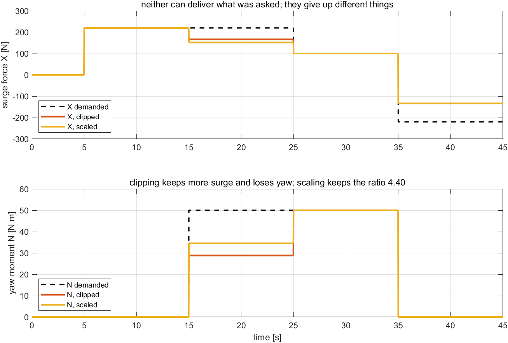

**Reading the figure against the derivation.**

| Where to look | What is there | Which line predicts it |
|---|---|---|
| rows $20$ through $35.13$ | $X = 0.00$ and $N = 0.00$ throughout | step 4 — inside the attainable set the solve is exact |
| the $T_L$ column, rows $20$ to $35.13$ | $-37.97$, $-56.96$, $-66.46$, $-66.71$: exactly $-1.8987\,Y$ | step 4, $T_L = -aY$ |
| the row at $Y = 35.13$ | $T_L = -66.71$, the first row at which $T_L = T_{min}$ | step 6 — this is $Y_{max}$, and the port propeller is the actuator that reaches its limit |
| the $F_B$ column, row $Y = 40$ | $40.00$ — the bow unit is at its rating but not over it | step 5, third row of the table: the bow rating is the *second* ceiling, not the first |
| `X pred` and `N pred` against `X` and `N`, rows $40$ and $50$ | $9.24$ / $3.65$ and $28.23$ / $-3.85$, agreeing to two decimals | steps 7 and 8, computed from the clipped thrust vector |
| the `psi(end)` column | $-3.2$ deg below the ceiling, then $+31.25$ and $-37.58$ deg above it | step 9 — above the ceiling the leak dominates the $M_{26}$ drift by an order of magnitude |
| the sign change in $N$ between rows $40$ and $50$ | $+3.65$ then $-3.85$ N·m | at $Y = 40$ only $T_L$ is clipped; at $Y = 50$ the bow unit clips too, and the sign of the residual moment flips |

**What the figure says.** Three numbers are available as a sway ceiling and only one of them is the answer. The bow thruster's $40$ N rating is the number printed on the unit and it is not the limit; the limit is $35.13$ N, set by a propeller at the other end of the hull being driven backwards. A specification written from component ratings would be wrong by $14$ %, and wrong in the unsafe direction.

The leak is the more important half. Below the ceiling, two of three axes hold at exactly zero. Above it, the commanded axis continues to be satisfied — $Y$ reads $40.00$ in both over-demand rows — while the two axes that were supposed to be quiet are not. Saturation in a coupled allocation is not a soft degradation of the thing demanded; it is a transfer of error into the things not demanded.

| What to try | What to watch |
|---|---|
| raise `F_B_max` to `100` and rerun | $Y_{max}$ does not move: it was never the bow unit that bound |
| set `k_neg = k_pos` in `otter_config` and rerun | the astern ceiling rises to $63.03$ N and the bow rating becomes the binding one at $40$ N |
| demand $X = 60$ and sweep $Y$ again | the ceiling rises — step 10, $X = 0$ is the narrowest place in the hexagon |
| demand $Y = 40$ with $N_{cmd} = -3.65$ | the heading stays near zero: the leak is a known quantity and can be pre-compensated, though only for one operating point |

> [!tip] In class
> - **Purpose**: separate a component rating from a vessel capability.
> - **Point to**: the three ceilings in the banner, then the row at $Y = 35.13$ where $T_L$ reaches $T_{min}$.
> - **Ask**: the bow thruster is rated $40$ N and is not saturated at $Y = 40$. What is?
> - **Take away**: the sway limit of this hull is a reverse-thrust limit at the stern. Past it, the error appears in surge and yaw, not in sway.

---

## 6-3. Three loops, and the one rotation between them

This section answers: given that every generalised force is now attainable, what structure turns a position error into that force.

**What is observed.** A position error is measured in NED, in metres north and metres east. A force is produced in the body frame, along $x_b$ and $y_b$. Hand the northing error directly to the surge controller and the result is not a slow response or a noisy one: with the hull heading east, the vessel drives $90$ degrees away from the target at full commanded speed, and the error grows. The controller is not mistuned. Two of its signals are expressed in different frames, and nothing in the loop says so.

**The result.** The chain from a target point to three shaft speeds is four stages, of which three are feedback loops and one is a change of frame:

$$\underbrace{\mathbf{p}_e = \mathbf{p}_d - \mathbf{p}}_{\text{NED}}
\ \longrightarrow\ \underbrace{\mathbf{p}_b = R(\psi)^{\mathsf T}\mathbf{p}_e}_{\text{the rotation}}
\ \longrightarrow\ \underbrace{\boldsymbol{\nu}_d = \operatorname{sat}\!\left(K_{p,pos}\,\mathbf{p}_b\right)}_{\text{position P}}
\ \longrightarrow\ \underbrace{X, Y \ \text{from a PI on}\ \boldsymbol{\nu}_d - \boldsymbol{\nu}}_{\text{velocity PI}}$$

with the yaw axis closed separately by

$$N = \operatorname{sat}\!\big(K_p\,\mathrm{ssa}(\psi_d - \psi) - K_d\, r\big).$$

| Symbol | Quantity | Value, source |
|---|---|---|
| $\mathbf{p}_d, \mathbf{p}$ | target and measured position, NED | m |
| $\mathbf{p}_e$ | position error in NED | m |
| $\mathbf{p}_b$ | the same error, read in the body frame | m |
| $R(\psi)$ | rotation from body to NED | — |
| $K_{p,pos}$ | position proportional gain | $0.30$ s⁻¹, `W06_0_setup` |
| $u_{lim}, v_{lim}$ | velocity command ceilings | $0.80$, $0.35$ m/s |
| $K_{p,u}, K_{i,u}$ | surge PI gains | $200$, $200$ |
| $K_{p,v}, K_{i,v}$ | sway PI gains | $150$, $120$ |
| $K_b$ | anti-windup back-calculation gain | $1$ |
| $K_p, K_d$ | heading P and D gains | $300$, $100$ |
| $\mathrm{ssa}(\cdot)$ | smallest signed angle, $\operatorname{atan2}(\sin\cdot,\cos\cdot)$ | rad |

### The rotation, and nothing more than the rotation

The body axes are the NED axes turned through the heading angle $\psi$. That single sentence is the whole content of $R(\psi)$, and the figure below is three ways of saying it.

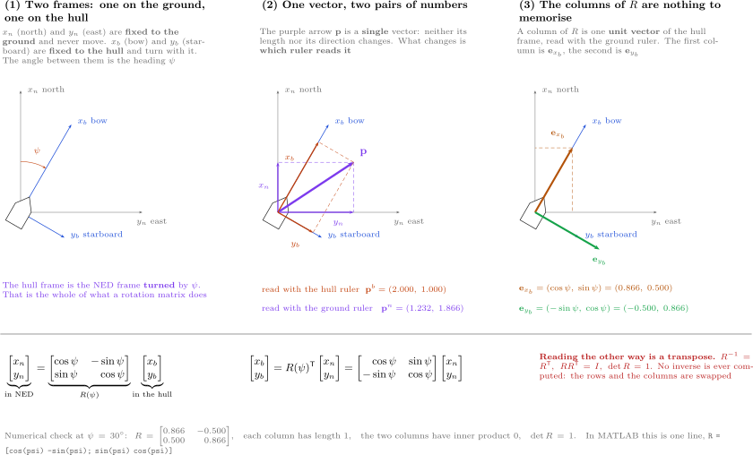

| In the figure | Meaning |
|---|---|
| left panel, two pairs of axes sharing an origin | $x_b, y_b$ are $x_n, y_n$ turned by $\psi$ — nothing is moved, only re-labelled |
| middle panel, one arrow with two pairs of numbers | one physical vector; two coordinate pairs, because two sets of axes read it |
| right panel, the columns of $R$ | each column of $R$ is one body unit vector written in NED coordinates |
| the equation band | $R^{-1} = R^{\mathsf T}$, so reading in the other direction is a transpose and costs nothing |

The columns are the part worth remembering, because they remove the need to remember anything else. The body $x$-axis points along $(\cos\psi, \sin\psi)$ in NED; the body $y$-axis, ninety degrees to starboard of it, points along $(-\sin\psi, \cos\psi)$. Stacking those two as columns,

$$R(\psi) = \begin{bmatrix} \cos\psi & -\sin\psi \\ \sin\psi & \cos\psi \end{bmatrix},$$

which maps body coordinates to NED. The chain needs the opposite direction, and because $R$ is orthogonal the opposite direction is the transpose:

$$\mathbf{p}_b = R(\psi)^{\mathsf T}\,\mathbf{p}_e
= \begin{bmatrix} \ \ \cos\psi & \sin\psi \\ -\sin\psi & \cos\psi \end{bmatrix}
\begin{bmatrix} p_{e,N} \\ p_{e,E} \end{bmatrix}.$$

```matlab
function p_b = to_body(p_e, psi)
% Rotate the position error from NED into the body frame.
%
%            [ cos(psi)  -sin(psi) ]
%   R(psi) = [ sin(psi)   cos(psi) ]     maps the BODY frame to NED,
%
% so the transpose maps NED to the body frame. R is orthogonal, so the
% transpose is the inverse and nothing is lost in the change of frame: the
% distance to the target is the same number in either one.
c = cos(psi);
s = sin(psi);
p_b = [  c*p_e(1) + s*p_e(2) ;      % 전진 방향의 오차 / along the bow
        -s*p_e(1) + c*p_e(2) ];     % 우현 방향의 오차 / to starboard
end
```

| In the code | In the figure | Note |
|---|---|---|
| `c*p_e(1) + s*p_e(2)` | the projection of the arrow onto $x_b$ in the middle panel | the first row of $R^{\mathsf T}$, which is the first **column** of $R$ |
| `-s*p_e(1) + c*p_e(2)` | the projection onto $y_b$ | the second row of $R^{\mathsf T}$ |
| `c` and `s` computed once | — | `psi` is a signal, so the two trigonometric calls are the cost of the block; computing them once is the only optimisation present |
| no normalisation, no inverse | the equation band, $R^{-1} = R^{\mathsf T}$ | an orthogonal matrix needs neither |

Two numbers make the block concrete. With a target $1$ m north and $2$ m east of the vessel and a heading of $30$ degrees,

$$x_e = 0.866 \times 1 + 0.500 \times 2 = 1.866\ \text{m},\qquad
y_e = -0.500 \times 1 + 0.866 \times 2 = 1.232\ \text{m},$$

so the target is $1.866$ m ahead and $1.232$ m to starboard. The distance is unchanged: $\sqrt{1^2+2^2} = \sqrt{1.866^2+1.232^2} = 2.236$ m. `verify_w06_actuation` check 13 confirms $R^{\mathsf T}R = I$, $\det R = 1$ and these four numbers.

The failure named at the top of this section is the same arithmetic with $\psi = 90$ degrees and a target $10$ m due north:

$$x_e = \cos\psi\, p_{e,N} + \sin\psi\, p_{e,E} = 0 \times 10 + 1 \times 0 = 0,\qquad
y_e = -\sin\psi\, p_{e,N} + \cos\psi\, p_{e,E} = -1 \times 10 + 0 = -10 .$$

There is nothing ahead and $10$ m to **port**. Hand $p_{e,N} = 10$ to the surge PI instead of $x_e = 0$ and the surge controller drives the hull forward at the velocity ceiling — which, at this heading, is due east, $90$ degrees from the target. The error does not merely fail to shrink; it grows. One matrix transpose stands between a working position controller and a vessel that runs away from its target.

### Why three loops and not one gain

A single gain from position error to thrust is shorter to write and does not work. There are five separate reasons, and each of them names a thing the cascade has and the single gain does not.

| | What the cascade provides | What is lost without it |
|---|---|---|
| 1 | a place to clip the **velocity** command: $u_{lim} = 0.80$, $v_{lim} = 0.35$ m/s | a thrust clip limits force, not speed; a vessel $40$ m from its target would arrive at whatever speed the drag happened to allow |
| 2 | an inner loop whose integral absorbs drag and current before the outer loop sees them | the outer loop would have to carry integral action on position, and a position integrator winds up over an entire transit |
| 3 | units that match their jobs: $K_{p,pos}$ is s⁻¹, a velocity per metre; $K_{p,u}$ is N/(m/s), a force per velocity error | one gain from metres to newtons mixes the two, and retuning for a heavier payload changes the braking distance |
| 4 | a controller that knows its own speed | thrust set from position error alone never measures velocity, so it cannot brake — it can only stop pushing |
| 5 | a heading loop with **no** integral term, so a steady yaw offset is accepted rather than fought | integral action on heading, against a yaw moment the allocation cannot supply, drives the stern pair to opposing saturation |

The heading loop deserves the explicit mention in row 5. It is P-D and the D term is the **measured yaw rate**, not the derivative of the error: $N = K_p\,\mathrm{ssa}(\psi_d-\psi) - K_d\,r$. Differentiating the error would differentiate $\psi_d$ as well, and in Section 6-5 $\psi_d$ changes discontinuously at a phase boundary. Feeding back $r$ costs nothing and cannot differentiate a step.

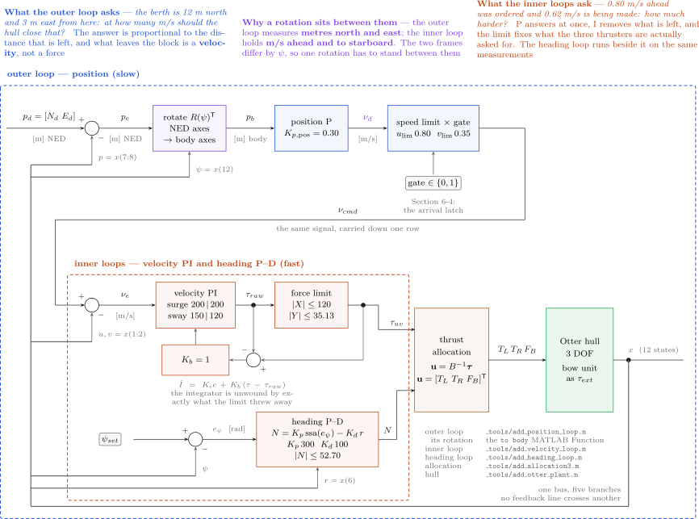

| In the figure | Meaning |
|---|---|
| the top row, left to right | the outer position loop: error, rotation into the body frame, the P gain, the velocity cap |
| the labelled carriage return at the right of the top row | the **forward** continuation of the chain onto the second row, not a feedback path — the diagram is one chain folded, and the fold sits on the boundary between the outer and the inner loop |
| the bottom row | the inner velocity PI, the force cap, the allocation, and the shaft-speed conversion |
| the band below, labelled with $K_p$ and $K_d$ | the heading loop, running in parallel and producing $N$ |
| the single vertical trunk on the left with five rightward branches | the 12-state measurement vector $\mathbf{x}$; each subsystem selects what it needs ($\psi = x(12)$, $r = x(6)$, and so on) |
| the short loop marked $K_b = 1$ around the velocity PI | the anti-windup back-calculation: $\operatorname{sat}(X) - X$ fed back into the integrator input |
| every gain triangle unsigned, every minus sign at a summing junction | the sign convention of this course: gains are positive and subtraction is visible |

The anti-windup path is drawn rather than configured. A Simulink `Integrator` has a *Limit output* option that does the same job inside the block, and a diagram built that way is indistinguishable from one with no anti-windup at all. The back-calculation is three blocks and it is visible, which is the reason it is used here.

> [!important] Where the time-scale separation comes from, and when it fails
> A cascade is only valid when the inner loop settles much faster than the outer one commands. Here the outer loop's time constant is $1/K_{p,pos} = 3.33$ s and the velocity PI settles in a few tenths of a second, so the separation is roughly tenfold. Raise $K_{p,pos}$ towards $2$ and the margin disappears: Experiment 6-4 measures $0.089$ m of overshoot at $K_{p,pos} = 2.00$ against exactly zero at $0.15$ and $0.30$. The cascade does not fail loudly. It develops overshoot, and then ringing.

### Experiment 6-3 · Holding a point (20 min)

**What it measures.** Whether the three loops hold a fixed point, and what the third thruster is worth — measured by removing it and changing nothing else.

**The model.** `W06_F_position.slx`. Target $(10, 10)$ m, start $(0, 25)$ m, commanded heading $0$ degrees throughout. The second case sets `F_B_max = 0`, which leaves every gain, every cap and every block in place and removes only the bow thruster's authority.

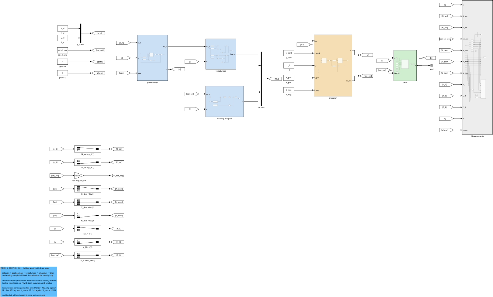

| In the figure | Meaning |
|---|---|
| `position loop` | the rotation and the P gain, with the velocity cap on its output |
| `velocity loop` | the surge and sway PI controllers with the drawn anti-windup |
| `heading autopilot` | the P-D loop producing $N$ |
| `allocation` | the nine lines of Section 6-2, with the thrust Saturation after them |
| the wide signal from `Otter` to the left edge | the measurement bus; the three controllers each select from it |

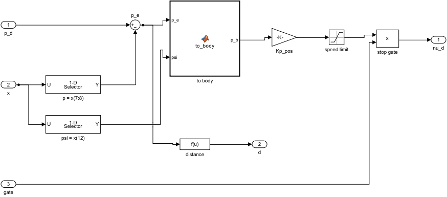

| In the figure | Meaning |
|---|---|
| the `to body` block | the MATLAB Function listed above — the only place a trigonometric function appears in the loop |
| the gain labelled `Kp_pos` | $0.30$ s⁻¹; its value is a workspace variable name, so it is changed in `W06_0_setup` and nowhere else |
| the two Saturation blocks | the per-axis velocity caps $u_{lim}$ and $v_{lim}$, which is where the asymmetry between ahead and sideways motion enters the controller |

**Opening and running.**

```matlab
W06_E_holding_a_point
```

Expected output:

```
  W06 Experiment 6-3  holding the point (10, 10) m, heading 0 deg
    case               t to 0.5 m [s]   d(end) [m]   psi error [deg]   max |v| [m/s]   max |Y| [N]
    three thrusters           42.68        0.000             -0.00           0.356         35.13
    bow unit off                NaN       14.827             10.37           0.047         35.13
```

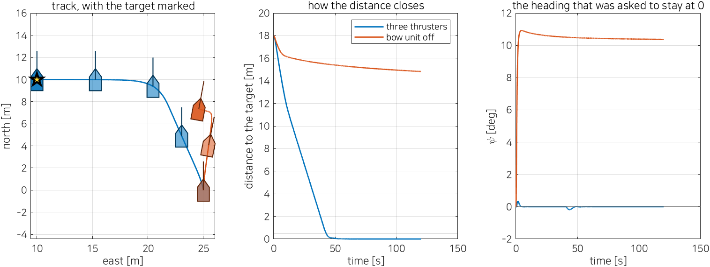

**Reading the figure against the derivation.**

| Where to look | What is there | Which line predicts it |
|---|---|---|
| `three thrusters`, `d(end) = 0.000` m | the error goes to zero, not to a small offset | the velocity PI's integral term removes the steady error; the position P loop needs none |
| `three thrusters`, `psi error = -0.00` deg | the heading is held throughout, although the hull moves sideways the whole time | the heading loop is independent of the position loop — they share only the allocation |
| `three thrusters`, `max |v| = 0.356` m/s | sideways speed just above the $v_{lim} = 0.35$ cap | the cap is on the **command**; the measured velocity overshoots it slightly because the inner loop has finite bandwidth |
| `bow unit off`, `d(end) = 14.827` m | the vessel stops $14.8$ m from its target | the start is $(0,25)$ and the target $(10,10)$: $10$ m of northing, $15$ m of easting. Heading is held at $0$, so the hull can only move along north — the $10$ m is removed and the $15$ m is not |
| `bow unit off`, `max |v| = 0.047` m/s | essentially no sideways motion | rank 2 — the two-thruster $B$ has image $Y = 0$, so there is no sideways force to produce one |
| `max |Y| = 35.13` N in **both** rows | the sway *demand* is at the $Y_{max}$ cap in both cases | the demand is produced by the controller either way; with `F_B_max = 0` the allocation cannot deliver it, and the column shows the demand, not the delivery |
| `bow unit off`, `t to 0.5 m = NaN` | the $0.5$ m radius is never entered | the target is not in the reachable set of a rank-2 actuator configuration at fixed heading |

**What the figure says.** The two rows differ in one number, `F_B_max`, and the outcome differs by $14.8$ m. That is the clearest available statement of what *fully actuated* buys: not a better response, but the existence of a response at all.

The residual is worth reading closely because it is not a tuning symptom. $14.827$ m against the $15$ m of easting the hull cannot remove is agreement to $1.2$ %, and the remaining $0.17$ m is accounted for by the $10.37$ degrees of heading error at the end — a heading error that itself exists because the sway demand, which the allocation cannot meet, still perturbs the yaw axis through the clipped stern pair. Nothing here is mysterious, and nothing here is fixable by a gain.

| What to try | What to watch |
|---|---|
| `F_B_max = 0` and `psi_d_cmd = deg2rad(-56.3)`, pointing the bow at the target | the two-thruster hull now arrives: at a fixed, favourable heading an under-actuated vessel can reach a point — it simply cannot choose the heading and the point independently |
| `Kp_pos = 0.05` | the approach is slower and still exact; the integral lives in the inner loop, so outer-loop gain does not change the final error |
| `v_lim = 0.10` | the easting takes four times as long and the northing is unchanged — the caps are per axis, which is exactly the question Section 6-7 reopens |
| comment out the `to body` block and wire `p_e` straight through | at `psi_d_cmd = 0` nothing changes, because $R(0) = I$; set `psi_d_cmd = deg2rad(90)` and the failure of the opening paragraph appears in full |

> [!tip] In class
> - **Purpose**: establish that the frame conversion is a structural requirement, not a refinement.
> - **Point to**: the $14.827$ m against the $15$ m of easting, then the last row of the "What to try" table.
> - **Ask**: with the rotation removed and the heading at zero, the model behaves identically. Why is that not evidence that the rotation is unnecessary?
> - **Take away**: three loops, one rotation, and a velocity cap that only a cascade has a place for.

---

## 6-4. Stopping, and who declares arrival

This section answers: how far does the vessel travel after the target is set, and what test says it has arrived.

**What is observed.** With $K_{p,pos} = 0.30$ s⁻¹ and a target $12$ m ahead, the vessel reaches the $0.5$ m radius at $17.00$ s and comes to rest with no overshoot at all. With $K_{p,pos} = 2.00$ it reaches the same radius at $14.80$ s — a gain of $2.2$ s for a sevenfold gain increase — and overshoots by $0.089$ m. The braking behaviour of the loop is not set by the inner controller or by the hull. It is set by one outer gain, and the relationship is simple enough to write down before the run.

**The result.** In the regime where the velocity command is saturated, the approach is at constant speed and the distance at which braking begins is

$$d_{brake} = \frac{u_{lim}}{K_{p,pos}} .$$

Inside that distance the command is linear in the error, the loop is first order, and

$$d(t) = d_{brake}\,e^{-K_{p,pos}(t - t_{brake})},
\qquad \tau = \frac{1}{K_{p,pos}} .$$

| Symbol | Quantity | Value, source |
|---|---|---|
| $d_{brake}$ | distance at which the velocity cap stops binding | m |
| $\tau$ | time constant of the linear approach | $1/K_{p,pos}$ s |
| $R_{berth}$ | arrival radius | $0.40$ m |
| $\psi_{tol}$ | heading tolerance | $5$ deg |
| $v_{tol}$ | sway-speed tolerance | $0.05$ m/s |
| $r_{tol}$ | yaw-rate tolerance | $1.0$ deg/s |

**Derivation, one line at a time.**

1. The position loop commands $u_d = \operatorname{sat}(K_{p,pos}\, x_e)$ with the ceiling $u_{lim}$. Far from the target the saturation binds, so $u_d = u_{lim}$ and the approach is at constant commanded speed regardless of distance.

2. The saturation stops binding when $K_{p,pos}\, x_e = u_{lim}$, which is at $x_e = u_{lim}/K_{p,pos}$. That is the braking distance: $0.80/0.30 = 2.67$ m at the nominal gain.

3. Inside that distance, and assuming the inner loop tracks its command, $\dot x_e = -u_d = -K_{p,pos}\, x_e$. The solution is exponential with time constant $1/K_{p,pos} = 3.33$ s.

4. The exponential is the prediction that makes the arrival radius a *time*. Entering a radius $R$ takes

$$t(R) = t_{0.5} + \frac{1}{K_{p,pos}}\ln\!\frac{0.5}{R},$$

measuring from the time the $0.5$ m radius is crossed. Halving the radius costs $\ln 2 / K_{p,pos} = 2.31$ s, independent of which radius is halved.

5. Step 4 is also the argument against a tight arrival radius. Going from $R = 0.50$ m to $R = 0.05$ m costs $7.68$ s for a vessel whose hull is $2.0$ m long. At some radius the gain in accuracy is smaller than the drift the extra time allows.

6. Arrival therefore cannot be a distance test alone. A vessel inside $R_{berth}$ while still moving sideways at $0.3$ m/s has not arrived. The test used here is a conjunction of four bounded conditions:

$$\|\mathbf{p}_d - \mathbf{p}\| \le R_{berth}
\ \wedge\ \lvert \mathrm{ssa}(\psi - \psi_{berth})\rvert \le \psi_{tol}
\ \wedge\ \lvert v \rvert \le v_{tol}
\ \wedge\ \lvert r \rvert \le r_{tol}.$$

7. Each of those four conditions flickers at its own boundary, and the conjunction flickers whenever any one of them does. The measurable prediction is a count: the sway-speed test changes state **twice** on a clean run, so a controller that switched on the raw conjunction would command the moored state, leave it, and command it again. The remedy is a latch, and Section 6-5 builds it.

### Experiment 6-4 · Stopping (20 min)

**What it measures.** The braking distance and time constant of steps 2 and 3, the radius–time law of step 4, and the number of state changes of step 7.

**The model.** `W06_F_position.slx`, target $12$ m due north with $\psi_d = 0$, so the motion is pure surge and the prediction can be compared without a sway term. The last block of the script re-runs the $(10,10)$ case and evaluates the four arrival conditions, once in still water and once with a $0.3$ m/s cross-current.

**Opening and running.**

```matlab
W06_F_stopping
```

Expected output:

```
  W06 Experiment 6-4  stopping 12 m due north, heading 0 -- pure surge
    Kp_pos   u_lim/Kp [m]   measured [m]   1/Kp [s]   measured [s]   overshoot [m]   t to 0.5 m [s]
      0.15           5.33            5.04       6.67           6.26           0.000            23.60
      0.30           2.67            2.46       3.33           2.90           0.000            17.00
      2.00           0.40            0.34       0.50           0.17           0.089            14.80

    radius [m]   first entry [s]   |U| there [m/s]   Kp_pos R [m/s]   t05 + ln(0.5/R)/Kp_pos [s]
          2.00            12.98              0.679            0.600                       12.38
          1.00            14.98              0.345            0.300                       14.69
          0.50            17.00              0.171            0.150                       17.00
          0.20            19.66              0.068            0.060                       20.05
          0.05            23.70              0.017            0.015                       24.68

    the berth test at (10, 10), without and with a cross-current
    V_c   term                 true [% of run]   first true [s]   changes
    0.0   d < R_berth                   64.0            43.16         1
    0.0   |psi_e| < psi_tol            100.0             0.00         0
    0.0   |v| < v_tol                   62.4             0.00         2
    0.0   |r| < r_tol                  100.0             0.00         0
    0.0   all four at once              62.2            45.42         1
    0.0   ends at d = 0.000 m, v = -0.0000 m/s, max|Y| = 35.13 N of the 35.13 N available
    0.3   d < R_berth                    0.0              Inf         0
    0.3   |psi_e| < psi_tol            100.0             0.00         0
    0.3   |v| < v_tol                    0.6             0.00         1
    0.3   |r| < r_tol                  100.0             0.00         0
    0.3   all four at once               0.0              Inf         0
    0.3   ends at d = 2.153 m, v = -0.1080 m/s, max|Y| = 35.13 N of the 35.13 N available
```

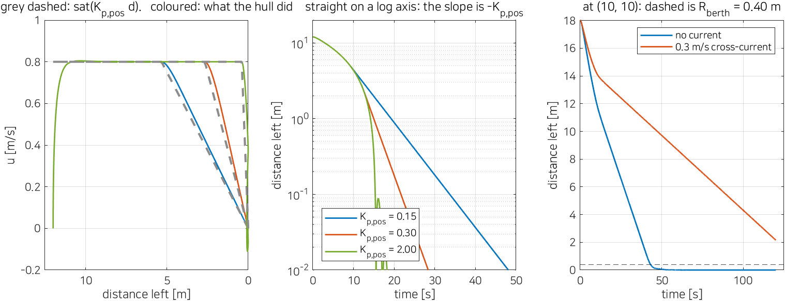

**Reading the figure against the derivation.**

| Where to look | What is there | Which line predicts it |
|---|---|---|
| `u_lim/Kp` against `measured`, all three rows | $5.33$ / $5.04$, $2.67$ / $2.46$, $0.40$ / $0.34$ | step 2; the measured value is consistently $6$–$15$ % short because the inner loop takes a moment to stop accelerating |
| `1/Kp` against `measured` | $6.67$ / $6.26$, $3.33$ / $2.90$, $0.50$ / $0.17$ | step 3; the agreement degrades badly in the last row |
| `overshoot`, last row only | $0.089$ m at $K_{p,pos} = 2.00$, zero at the other two | the time-scale separation of Section 6-3: at $\tau = 0.5$ s the outer loop is no longer slow compared with the inner one |
| `t to 0.5 m` across the three gains | $23.60$, $17.00$, $14.80$ s | sevenfold gain for $2.2$ s — most of the transit is at the velocity cap, where gain does nothing at all |
| `|U| there` against `Kp_pos R` | $0.679$/$0.600$, $0.345$/$0.300$, $0.171$/$0.150$, $0.068$/$0.060$, $0.017$/$0.015$ | step 3; the speed at radius $R$ is $K_{p,pos}R$, confirmed over a factor of forty in $R$ |
| the last column against `first entry` | $12.38$/$12.98$, $14.69$/$14.98$, $17.00$/$17.00$, $20.05$/$19.66$, $24.68$/$23.70$ | step 4; within a second across two decades of radius |
| `|v| < v_tol`, `changes = 2` at $V_c = 0$ | the sway test leaves and re-enters its bound | step 7 — this is the chatter the latch exists to prevent |
| `all four at once`, first true at $45.42$ s | later than `d < R_berth` at $43.16$ s | the conjunction waits for the sway test to come back; a distance-only test would have declared arrival $2.3$ s early, with the hull still moving |
| the $V_c = 0.3$ block, `d < R_berth` true $0.0$ % of the run | arrival is never declared | `max|Y| = 35.13 N of the 35.13 N available`: the sway demand is pinned at the cap and the current wins |

**What the figure says.** The outer loop's behaviour is predictable from one gain, over a range of radii spanning a factor of forty, to within a second. That is unusual enough to be worth stating plainly: the position loop is first order, the derivation has one step, and the measurement agrees.

Two things in the output are not agreement, and they matter more. The $K_{p,pos} = 2.00$ row shows the cascade's assumption breaking — measured time constant $0.17$ s against a predicted $0.50$ s, with overshoot appearing for the first time. And the cross-current block shows the arrival test failing honestly: the vessel ends $2.153$ m away with the sway demand saturated at $35.13$ N, and the test says *not arrived* rather than declaring success at a tolerance it cannot meet. A $0.3$ m/s current is $86$ % of the $v_{lim}$ ceiling and demands the full attainable sway force; that this configuration cannot berth in it is a capability statement about the hull, correctly reported by the logic.

| What to try | What to watch |
|---|---|
| `Kp_pos = 0.30` with `u_lim = 0.4` | the braking distance halves to $1.33$ m and the time constant does not change — they are set by different quantities |
| `R_berth = 0.05` | arrival is declared $7.7$ s later, as step 4 predicts, and the drift in that time is larger than the accuracy gained |
| `V_c = 0.2`, `beta_c = pi/2` | the margin returns; the failure threshold lies between $0.2$ and $0.3$ m/s, and Section 6-2's $Y_{max}$ is why |
| remove the $\lvert v\rvert$ term from the conjunction | arrival is declared at $43.16$ s instead of $45.42$ s, with $0.3$ m/s of residual sway — the two seconds are the whole point of the term |

> [!tip] In class
> - **Purpose**: make arrival a stated condition rather than a judgement.
> - **Point to**: the `changes = 2` entry, then the $2.3$ s gap between $43.16$ and $45.42$.
> - **Ask**: the distance test is satisfied at $43.16$ s. What is wrong with stopping there?
> - **Take away**: braking distance is $u_{lim}/K_{p,pos}$, the approach is exponential with $\tau = 1/K_{p,pos}$, and arrival is four conditions at once — which is why it needs a latch.

---

## 6-5. Berthing as four latched phases

This section answers: how a manoeuvre with a required final heading is expressed as logic above the three loops, and why that logic must latch.

**What is observed.** A berth is not a point. It is a point, a heading, and an order: arrive at the heading *before* arriving at the point, because a quay is on one side and a hull that rotates while alongside sweeps into it. A single position target cannot express that order. Commanding the berth directly from the start of the run produces a vessel that translates to the quay on whatever heading the transit happened to leave it with, and then rotates there.

**The result.** The manoeuvre is four states, with the target point and the commanded heading as outputs of the state and the three loops of Section 6-3 unchanged beneath:

| Phase | Target point | Commanded heading | Thrust gate |
|---|---|---|---|
| 1 `TRANSIT` | the approach point `app` | bearing to `app` | on |
| 2 `ALIGN` | the approach point `app` | $\psi_{berth}$ | on |
| 3 `BERTH` | the berth `brt` | $\psi_{berth}$ | on |
| 4 `MOORED` | the berth `brt` | $\psi_{berth}$ | **off** |

Transitions are one-way. Once taken, none is taken back.

| Symbol | Quantity | Value, source |
|---|---|---|
| `berth_N`, `berth_E` | berth position, NED | $40.0$, $1.2$ m |
| `stand_off` | offset of the approach point from the berth | $7.0$ m |
| `app` | approach point | $(40.0, 8.2)$ m |
| $\psi_{berth}$ | required final heading | $0$ deg (alongside) |
| $R_{app}$ | radius that ends phase 1 | $1.5$ m |
| $R_{berth}$ | radius that ends phase 3 | $0.40$ m |
| $\psi_{tol}$, $r_{tol}$ | tolerances that end phase 2 | $5$ deg, $1.0$ deg/s |
| $v_{tol}$ | sway tolerance that ends phase 3 | $0.05$ m/s |

### The geometry, before the logic

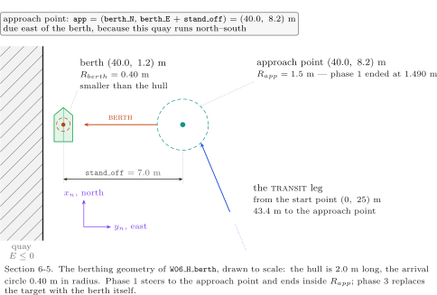

| In the figure | Meaning |
|---|---|
| the screen axes, $x_n$ up and $y_n$ to the right | a plan view in NED: north is up, east is right, so the figure is read like a chart |
| the quay, hatched, at $E \le 0$ | the obstacle; the berth sits $1.2$ m off it, which is a little over half a hull beam |
| the berth circle, $R_{berth} = 0.40$ m | smaller than the hull, drawn to scale — the tolerance is tighter than the vessel it applies to |
| the approach point, $R_{app} = 1.5$ m | due **east** of the berth, because this quay runs north–south; `stand_off` is applied along $E$ |
| the dashed `stand_off` dimension, $7.0$ m | the length of the final leg, and therefore the distance over which the heading must already be correct |
| the `TRANSIT` leg from $(0, 25)$ m | $43.4$ m, which is $93$ % of the run |

The approach point exists so that the final leg is a straight line perpendicular to the quay. It is constructed, not chosen:

$$\texttt{app} = \begin{bmatrix} \texttt{berth\_N} \\ \texttt{berth\_E} + \texttt{stand\_off}\end{bmatrix}
= \begin{bmatrix} 40.0 \\ 1.2 + 7.0\end{bmatrix} = \begin{bmatrix} 40.0 \\ 8.2 \end{bmatrix}\ \text{m},$$

which `verify_w06_actuation` check 14 confirms. The offset is applied along $E$ alone because this quay runs north–south. A quay at another orientation would need the offset applied along its own normal, which is one rotation and is left to Assignment 6.

### The four phases, and the three tests between them

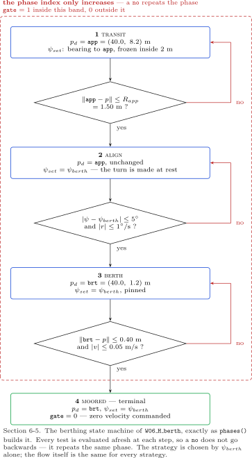

| In the figure | Meaning |
|---|---|
| four boxes, one arrow each, no return arrows | the latch: the graph is a path, not a cycle |
| the $1 \to 2$ test | $\lVert \texttt{app} - \mathbf{p}\rVert \le R_{app} = 1.50$ m — a distance only; the heading is still free |
| the $2 \to 3$ test | $\lvert\mathrm{ssa}(\psi - \psi_{berth})\rvert \le \psi_{tol} = 5$ deg **and** $\lvert r \rvert \le r_{tol} = 1$ deg/s — pointing the right way *and* no longer turning |
| the $3 \to 4$ test | $\lVert \texttt{brt} - \mathbf{p}\rVert \le R_{berth} = 0.40$ m **and** $\lvert v \rvert \le v_{tol} = 0.05$ m/s |
| the $3 \to 4$ test uses $v$ and **not** $u$ | the hull comes alongside sideways; the speed that must be zero at contact is the sway component, and surge is already bounded by the position loop |
| `gate = 0` in phase 4 | the shaft-speed command is multiplied by zero — mooring lines hold the vessel, not the thrusters |

The order of the tests is the content of the state machine. Phase 2 does not test position, because the vessel is already inside $R_{app}$ and rotating in place moves it only a little. Phase 3 does not re-test heading, because the heading loop holds $\psi_{berth}$ throughout and re-testing would stall the approach on a transient. Each test asks only what its own phase is responsible for.

```matlab
function [p_d, psi_set, gate, phase] = phases(berth_N, berth_E, stand_off, ...
                                                psi_berth, R_app, R_berth, x, ...
                                                psi_tol, v_tol, r_tol)
%#codegen
%  네 단계. 한 번 넘어가면 돌아오지 않는다 — 빗장이 걸려 있다.
%  Four phases. Once a transition is taken it is never taken back: it latches.
%
%    1 TRANSIT  접근점으로 간다. 선수각은 그쪽 방위 (5주차의 atan2 법칙)
%    2 ALIGN    제자리에서 psi_berth 로 돌린다
%    3 BERTH    그 선수각을 지킨 채 남은 stand_off 미터를 간다
%    4 MOORED   gate = 0 — 계류줄이 걸렸고 추진기는 0 으로 간다
%
%  왜 빗장을 거는가 / why it latches
%      단계마다 조건이 **경계에서** 참과 거짓을 왕복한다. 빗장이 없으면 배가
%      반경 R_app 안팎을 드나들 때 목표점이 접근점과 접안점 사이를 떨고,
%      안쪽 루프는 그 떨림을 추력으로 바꾼다.
%      Each condition flickers at its own boundary. Without the latch the
%      target would jitter between the two points and the inner loops would
%      turn that jitter into thrust.
%
%  왜 선수각을 **들고 있는가** / why the heading is HELD
%      1 단계의 선수각은 접근점 방위다. 접근점에 가까워지면 그 방위의 분모가
%      0 으로 가므로 2 m 안에서는 **마지막 값을 들고 있는다**. 이것이 이 절이
%      재는 예측 하나를 만든다 — 명령 선수각이 그 시각부터 평평해진다.
%      The bearing is ill-conditioned near the point, so inside 2 m the last
%      value is held. This section measures the prediction that makes: the
%      commanded heading goes flat from that instant.

persistent ph psi_hold
if isempty(ph), ph = 1; psi_hold = x(12); end

p   = [x(7); x(8)];     %  NED 위치 / position in NED
psi = x(12);
r   = x(6);
v   = x(2);

app = [berth_N; berth_E + stand_off];   %  접근점 / the approach point
brt = [berth_N; berth_E];               %  접안점 / the berth

switch ph
    case 1      %  TRANSIT
        e = app - p;
        if norm(e) > 2
            psi_hold = atan2(e(2), e(1));
        end
        if norm(e) <= R_app, ph = 2; end

    case 2      %  ALIGN
        psi_hold = psi_berth;
        de = atan2(sin(psi - psi_berth), cos(psi - psi_berth));
        if abs(de) <= psi_tol && abs(r) <= r_tol, ph = 3; end

    case 3      %  BERTH
        psi_hold = psi_berth;
        if norm(brt - p) <= R_berth && abs(v) <= v_tol, ph = 4; end

    otherwise   %  MOORED
        psi_hold = psi_berth;
end

if ph >= 3
    p_d = brt;
else
    p_d = app;
end
psi_set = psi_hold;
gate    = double(ph <= 3);   %  4 단계에서 0 — 추력을 끊는다 / thrust off
phase   = ph;
end
```

| In the code | In the figure | Note |
|---|---|---|
| `persistent ph psi_hold` | the absence of return arrows | the latch is one persistent integer; nothing else is needed to make the graph one-way |
| `switch ph` with no `case` restoring a lower value | — | a phase can only be left by its own test, and only forwards |
| `if norm(e) > 2, psi_hold = atan2(...)` | the `TRANSIT` box | the bearing is recomputed only while the vessel is more than $2$ m from the approach point; inside that, the last value is held |
| `de = atan2(sin(...), cos(...))` | the $2 \to 3$ test | $\mathrm{ssa}$ written out: the heading error is wrapped to $(-\pi, \pi]$, so a $350$-degree error is read as $-10$ degrees and turned the short way |
| `abs(v) <= v_tol`, not `norm([u;v])` | the $3 \to 4$ test | as drawn — the sway component is the one that matters at contact |
| `if ph >= 3, p_d = brt; else p_d = app;` | the target column of the phase table | two phases share each target, which is why the target changes once in the whole run |
| `gate = double(ph <= 3)` | `gate = 0` in phase 4 | a multiplication by one or zero, downstream of the allocation |
| `%#codegen` | — | the block is compiled; `persistent` state is therefore held in generated code too, not only in interpreted simulation |

> [!warning] A latch is a decision that cannot be revisited
> The latch removes chatter and, by construction, removes recovery. If phase 3 is entered and a current then pushes the vessel back outside $R_{app}$, the logic does not return to phase 1 — it continues trying to berth from wherever it is. Experiment 6-4 showed exactly that failure in a $0.3$ m/s cross-current: the arrival test is never satisfied and the vessel holds station $2.153$ m out, with the sway demand pinned at $35.13$ N. For a vessel that must abort and retry, the states need guarded re-entry, which is a Stateflow chart rather than nine lines of MATLAB. Week 9 builds one.

### Experiment 6-5 · The four phases, measured (20 min)

**What it measures.** When each phase is entered, how long it lasts, and where the vessel is at each boundary — against the three tests of the figure.

**The model.** `W06_H_berth.slx`. Start $(0, 25)$ m, berth $(40.0, 1.2)$ m, approach point $(40.0, 8.2)$ m, $\psi_{berth} = 0$.

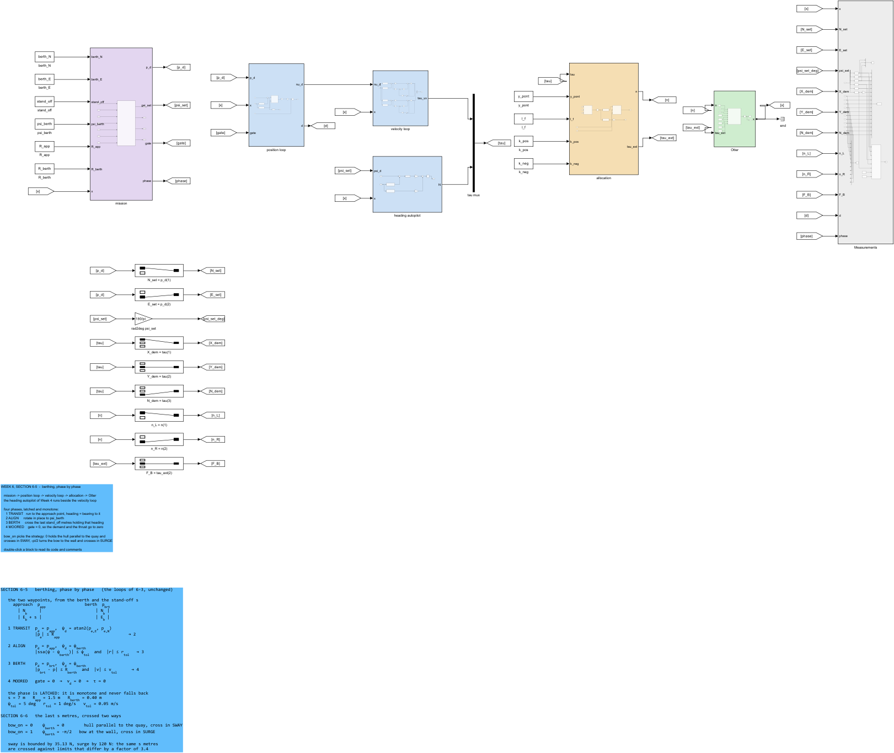

| In the figure | Meaning |
|---|---|
| the `mission` subsystem, left of the position loop | the only block added to the Section 6-3 model; the three loops below it are unchanged |
| its outputs `p_d` and `psi_set` | the target point and the commanded heading — previously Constants, now signals |
| its output `gate`, running right to the shaft-speed block | the thrust gate, applied last so that phase 4 cuts the command and not the controller state |
| its output `phase` | logged as column 17, which is what the tables below read |

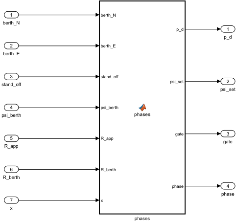

| In the figure | Meaning |
|---|---|
| the `phases` MATLAB Function block | the code listed above; the whole state machine is this one block |
| the measurement bus entering it as `x` | the block selects $\mathbf{p}$, $\psi$, $r$ and $v$ itself, so no Selector appears outside it |
| the Constants feeding its first six inputs | the berth, the stand-off, the required heading and the three radii — all commands, so all visible on the canvas |

**Opening and running.**

```matlab
W06_G_berthing
```

Expected output, the first table:

```
  W06 Experiment 6-5/6-6  berthing at (40, 1.2) m from (0, 25) m, approach point (40, 8.2) m

    alongside, psi_berth = +0 deg
    phase        enters [s]   lasts [s]   N [m]   E [m]   psi [deg]   to berth [m]   d the loop sees [m]
    1 TRANSIT           0.00       53.04    0.00   25.00        0.00         46.545               43.385
    2 ALIGN            53.04        2.62   38.62    8.77      -22.42          7.693                1.490
    3 BERTH            55.66       23.00   39.45    8.46       -0.08          7.284                7.284
    4 MOORED           78.66       71.34   40.00    1.34       -0.12          0.144                0.144
```

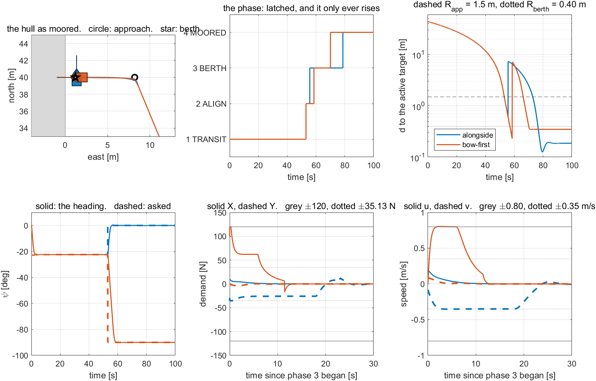

**Reading the figure against the derivation.**

| Where to look | What is there | Which line predicts it |
|---|---|---|
| phase 1, `d the loop sees = 43.385` m at entry | the position loop sees the distance to the **approach point**, $3.16$ m less than the distance to the berth | the target column of the phase table: phases 1 and 2 target `app` |
| phase 2 entered at $53.04$ s, `d the loop sees = 1.490` m | just inside $R_{app} = 1.50$ m | the $1\to2$ test, satisfied within $0.01$ m of its threshold |
| phase 2, `psi = -22.42` deg at entry | the transit left the vessel pointing $22.4$ degrees off the required heading | the bearing to `app` from the start point; nothing in phase 1 controls the final heading |
| phase 2 lasts $2.62$ s | $22.4$ degrees are removed in $2.62$ s | the heading loop's own dynamics; the position loop is holding `app` meanwhile, which is why $N$ and $E$ barely change |
| phase 3, `psi = -0.08` deg at entry | within $\psi_{tol} = 5$ deg, with a wide margin | the $2\to3$ test is a conjunction with $\lvert r\rvert \le 1$ deg/s, and waiting for the rate to settle overshoots the angle tolerance in the useful direction |
| phase 3, `to berth` and `d the loop sees` both $7.284$ m | the two columns become equal | the target switches from `app` to `brt` exactly at this boundary — this is the one target change in the run |
| phase 3 lasts $23.00$ s for $7.28$ m | an average of $0.32$ m/s, against the $v_{lim} = 0.35$ m/s cap | the final leg is pure sway for this attitude, so the sway cap sets its duration |
| phase 4 entered at $78.66$ s, `to berth = 0.144` m | inside $R_{berth} = 0.40$ m | the $3\to4$ test; the extra margin is the distance covered while the sway speed decays below $v_{tol}$ |
| phase 4, `psi = -0.12` deg over $71.34$ s | the heading does not drift after the gate closes | `gate` multiplies the command; with no current there is nothing to push the hull |
| the phase trace in the figure, a staircase with four levels and no return | each level entered once | the latch |

**What the figure says.** The required final heading is not achieved by the position loop and was never asked of it. It is achieved by ordering two things the position loop cannot order: rotate, then translate. The whole of that ordering is one persistent integer.

| What to try | What to watch |
|---|---|
| `R_app = 5.0` | phase 2 begins $5$ m out and the alignment happens further from the quay — safer, and the final leg is longer than `stand_off` intends |
| `stand_off = 2.0` | phase 3 lasts about $6$ s instead of $23$; the vessel also aligns much closer to the quay, which is the trade `stand_off` exists to set |
| `v_tol = 0.5` | phase 4 is entered earlier, with the hull still moving sideways at up to $0.5$ m/s into the quay |
| `psi_tol = deg2rad(45)` | phase 3 begins at a heading up to $45$ degrees off, and the final leg is then neither pure sway nor pure surge — the caps of Section 6-7 both bind |
| remove the latch: recompute `ph` from the tests every step | the phase trace chatters at each boundary and the target point oscillates between `app` and `brt` |

> [!tip] In class
> - **Purpose**: show that a required final heading is a *sequencing* problem, not a control problem.
> - **Point to**: the `to berth` and `d the loop sees` columns becoming equal at phase 3.
> - **Ask**: phase 2 lasts $2.62$ s and moves the vessel almost nowhere. What would happen if phases 2 and 3 were merged?
> - **Take away**: four phases, three tests, one persistent integer — and the three loops underneath entirely unchanged.

---

## 6-6. Alongside against bow-first

This section answers: what changes in a berthing manoeuvre when only the required final heading changes, and which actuator pays for it.

**What is observed.** Two berthing runs are set up identically — same start, same berth, same approach point, same gains, same caps — and differ in a single constant: $\psi_{berth} = 0$ in one and $-90$ degrees in the other. The first comes alongside the quay; the second noses into it bow-first. Both arrive. The alignment takes twice as long in the second, the final leg takes half as long, and the peak demands land on different axes.

**The result.** $\psi_{berth}$ determines the body-frame direction of the final leg, and therefore which velocity cap and which thrust cap bind on it:

$$\text{alongside } (\psi_{berth} = 0^\circ):\ \text{final leg is pure \textbf{sway}},\quad
\text{bow-first } (\psi_{berth} = -90^\circ):\ \text{final leg is pure \textbf{surge}}.$$

The duration of that leg follows from the cap that applies, plus one time constant of the position loop:

$$t_{berth} \approx \frac{\texttt{stand\_off}}{v_{cap}} + \frac{1}{K_{p,pos}},
\qquad v_{cap} = \begin{cases} v_{lim} = 0.35\ \text{m/s} & \text{alongside} \\ u_{lim} = 0.80\ \text{m/s} & \text{bow-first}\end{cases}$$

**Derivation, one line at a time.**

1. The approach point lies due east of the berth, so the final leg runs due west, along $-E$.

2. With $\psi_{berth} = 0$ the bow points north and that leg is to port: in the body frame it is $-y_b$, pure sway. With $\psi_{berth} = -90$ degrees the bow points west and the leg is dead ahead: $+x_b$, pure surge.

3. The velocity caps are per axis and unequal — $u_{lim} = 0.80$ m/s against $v_{lim} = 0.35$ m/s. The final leg therefore runs at $0.35$ m/s alongside and $0.80$ m/s bow-first, a factor of $2.3$.

4. Over $7.28$ m that gives $20.8$ s against $9.1$ s, to which the exponential tail of Section 6-4 adds $1/K_{p,pos} = 3.33$ s: a prediction of $24.15$ s against $12.16$ s.

5. The force caps are also unequal, and more sharply: $X_{max} = 120$ N against $Y_{max} = 35.13$ N, a factor of $3.4$. The alongside leg is therefore expected to run against its force cap and the bow-first leg is not.

6. The alignment pays for this. Phase 2 turns the vessel from the transit bearing to $\psi_{berth}$, which is $22.4$ degrees alongside and $67.6$ degrees bow-first — a factor of $3.0$ in angle, and the heading loop is not saturated, so the time scales similarly.

7. The measurable prediction is therefore a trade with a visible sign change: bow-first spends more time aligning and less time approaching, and loads the surge axis instead of the sway axis.

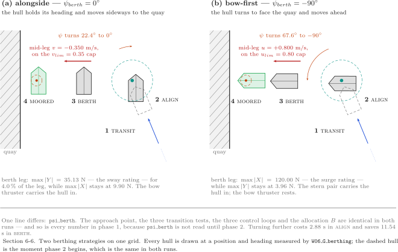

| In the figure | Meaning |
|---|---|
| two panels on the same grid, the same quay and berth | only $\psi_{berth}$ differs between them; everything the figure shows apart from the hull attitudes is identical |
| hull outlines numbered 1 to 4 | drawn at the measured positions and headings of the phase table, to scale, $1$ m $= 6$ mm |
| the arc between hulls 2 and 3 in each panel | the turn **asked** of the heading loop: $22.4$ degrees left, $67.6$ degrees right |
| the mid-leg hull in the left panel, labelled $v = -0.350$ m/s | the alongside final leg is pure sway, at the sway cap |
| the mid-leg hull in the right panel, labelled $u = +0.800$ m/s | the bow-first final leg is pure surge, at the surge cap |
| hull 4 in each panel, against the berth circle | both arrive; the left one lies parallel to the quay, the right one perpendicular to it |

The last row of the figure is the part that is not about control at all. A hull alongside presents its full length to the quay and can take lines fore and aft; a hull bow-first touches at one point and must be held by that point. Which of those is wanted is a seamanship question, and the controller's job is only to make both reachable.

### Experiment 6-6 · The same berth, two attitudes (20 min)

**What it measures.** The predictions of steps 4, 5 and 6 — alignment time, berth-leg time, and which cap binds — from two runs of the same model.

**The model.** `W06_H_berth.slx`, run twice, with `psi_berth = 0` and `psi_berth = deg2rad(-90)`.

**Opening and running.**

```matlab
W06_G_berthing
```

Expected output, the remaining tables:

```
    bow-first, psi_berth = -90 deg
    phase        enters [s]   lasts [s]   N [m]   E [m]   psi [deg]   to berth [m]   d the loop sees [m]
    1 TRANSIT           0.00       53.04    0.00   25.00        0.00         46.545               43.385
    2 ALIGN            53.04        5.50   38.62    8.77      -22.42          7.693                1.490
    3 BERTH            58.54       11.46   39.78    8.26      -89.85          7.059                7.059
    4 MOORED           70.00       80.00   39.99    1.60      -90.00          0.398                0.398

    attitude    transit [s]   align [s]   turn asked [deg]   berth [s]   d/v_cap + 1/K_p,pos [s]   moored at [s]
    alongside         53.04        2.62               22.4       23.00                     24.15           78.66
    bow-first         53.04        5.50               67.6       11.46                     12.16           70.00

    attitude    berth max |X| [N]   berth max |Y| [N]   on the Y cap [% of leg]   berth max |u|   berth max |v|   d(end) [m]   drift [m]   psi err [deg]
    alongside                9.90               35.13                      4.0           0.193           0.353        0.186       0.042           -0.00
    bow-first              120.00               3.96                      0.0           0.804           0.086        0.347      -0.050            0.00
    the caps: X_max = 120 N, Y_max = 35.13 N, u_lim = 0.80 m/s, v_lim = 0.35 m/s,  R_berth = 0.40 m,  K_p,pos = 0.30
```

**Reading the figure against the derivation.**

| Where to look | What is there | Which line predicts it |
|---|---|---|
| `transit`, both rows $53.04$ s | the first phase is identical to the digit | phase 1 does not know $\psi_{berth}$; the two runs are the same simulation until $53.04$ s |
| `turn asked`, $22.4$ against $67.6$ deg | a factor of $3.0$ | step 6: the transit bearing is the same in both, so the turn asked is the difference between it and $\psi_{berth}$ |
| `align`, $2.62$ against $5.50$ s | a factor of $2.1$ for a factor of $3.0$ in angle | the heading loop is not rate-limited, and its response to a larger step is faster than linear in the step |
| `berth` against the prediction column | $23.00$ / $24.15$ and $11.46$ / $12.16$ | step 4; both within $5$ % without any fitted quantity |
| `berth max |Y|`, $35.13$ N alongside | exactly $Y_{max}$ | step 5: the alongside leg runs against the sway force cap |
| `on the Y cap`, $4.0$ % alongside and $0.0$ % bow-first | the cap is reached, and only briefly | the cap binds on the acceleration at the start of the leg, not on the steady approach |
| `berth max |X|`, $9.90$ N alongside against $120.00$ N bow-first | a factor of $12$ | step 2 and step 5: the leg is sway in one case and surge in the other, so the demand lands on a different axis entirely, and the surge axis has $3.4$ times the authority to meet it |
| `berth max |v|` $0.353$ alongside, `berth max |u|` $0.804$ bow-first | each just above its own cap | the caps are on the command; the measured value overshoots slightly, as in Section 6-3 |
| `moored at`, $78.66$ against $70.00$ s | bow-first is $8.66$ s faster overall | the $11.5$ s saved on the final leg exceeds the $2.9$ s lost on the alignment |
| `drift`, $0.042$ against $-0.050$ m | both hold position after the gate closes | phase 4 with no current |
| `d(end)`, $0.186$ against $0.347$ m | both inside $R_{berth} = 0.40$ m | the arrival test; the bow-first value is larger because the leg arrives faster and the decay below $v_{tol}$ covers more ground |

**What the figure says.** One constant, changed from $0$ to $-90$ degrees, moves a peak demand of $120$ N from one axis to another and changes the total manoeuvre time by $11$ %. Nothing else in the model is different: same gains, same caps, same logic, same four phases.

The bow-first run is faster, and that is the less interesting half of the result. The more interesting half is that it is faster *because* the Otter's surge authority is $3.4$ times its sway authority, which is a consequence of the hull form — two propellers aft and one small tunnel forward — and not of any choice made in this course. An orientation that aligns the dominant demand with the dominant actuator is faster. That is a statement about the vessel, and reading it off a controller's output is the point of running both cases.

| What to try | What to watch |
|---|---|
| `psi_berth = deg2rad(-45)` | neither cap dominates; both $u$ and $v$ are commanded on the final leg and the duration falls between the two measured values |
| `psi_berth = deg2rad(+90)`, nosing the stern in | the turn asked is $112.4$ degrees and the final leg is pure **astern** surge, against $T_{min} = -66.71$ N rather than $T_{max}$ — the slowest of the four attitudes |
| `v_lim = 0.80` with `psi_berth = 0` | the alongside leg shortens towards the bow-first time, and `on the Y cap` rises — the velocity cap, not the force cap, was setting the duration |
| `stand_off = 15` | the difference between the two attitudes grows in proportion, because it accrues on the final leg alone |

> [!tip] In class
> - **Purpose**: separate what the controller decides from what the hull decides.
> - **Point to**: `berth max |X|` — $9.90$ N against $120.00$ N, from one changed constant.
> - **Ask**: bow-first is $8.66$ s faster. Name a berth where it would nevertheless be the wrong choice.
> - **Take away**: $\psi_{berth}$ chooses which actuator pays, and on this hull surge has $3.4$ times the authority of sway.

---

## 6-7. Where the one rotation sits

This section answers: the thrusters are bolted to the hull and the berth is bolted to the shore, so exactly one rotation must stand between them — does it matter where it is placed?

**What is observed.** Two models hold the same point $(10, 10)$ m with the same three loops, the same position gain, the same heading autopilot and the same allocation. They differ only in where $R(\psi)$ appears. One rotates the position *error* in the outer loop and works entirely in hull axes below that; the other leaves the outer loop in north and east, and rotates the measured velocity *into* the inner loop and the computed force *out* of it. Each is run at $\psi_d = 0$ and at $\psi_d = 45$ degrees. All four stop on the point, to three decimal places. Nothing else about the four runs is the same.

**The result.** One rotation in the outer loop, or two in the inner — and the two are the same controller until a limit is reached:

$$\text{body-fixed:}\quad F^b = \mathrm{sat}\!\big(K_p\,(\nu_d - \nu) + I\big),
\qquad
\text{NED:}\quad F^b = R(\psi)^{\mathsf T}\,\mathrm{sat}\!\big(K_{p,ned}\,(\dot p_d - R(\psi)\,\nu) + I\big)$$

The outer loops that feed them differ in one operation, the cap:

$$\text{body-fixed:}\quad
\nu_d = \begin{bmatrix}\mathrm{sat}(K_{p,pos}\,x_e,\ u_{lim})\\[2pt]\mathrm{sat}(K_{p,pos}\,y_e,\ v_{lim})\end{bmatrix},
\quad
\begin{bmatrix}x_e\\y_e\end{bmatrix} = R(\psi)^{\mathsf T}(p_d - p)$$

$$\text{NED:}\quad
\dot p_d = \nu_p\,\min\!\left(1,\ \frac{v_{ned,max}}{\lVert \nu_p \rVert}\right),
\qquad \nu_p = K_{p,pos}\,(p_d - p)$$

| Symbol | Quantity | Value, source |
|---|---|---|
| $R(\psi)$ | rotation from hull axes into NED | $\begin{bmatrix}\cos\psi & -\sin\psi\\ \sin\psi & \cos\psi\end{bmatrix}$, Section 6-3 |
| $p_d - p$ | position error, north and east | m, from the plant state $x_{7:8}$ |
| $K_{p,pos}$ | outer position P gain | $0.30$ s$^{-1}$, the same constant in both models |
| $u_{lim},\ v_{lim}$ | per-axis speed caps, hull axes | $0.80$, $0.35$ m/s, Section 6-3 |
| $v_{ned,max}$ | speed cap by magnitude, NED | $0.35$ m/s $= v_{lim}$, `W06_vars.m:79` |
| $K_p,\ I$ | inner PI, hull axes, per axis | surge $200\,\vert\,200$, sway $150\,\vert\,120$ |
| $K_{p,ned},\ K_{i,ned}$ | inner PI, NED, **both axes** | $150$, $120$ — the sway values |
| $Y_{max}$ | sway force the hull can make | $35.13$ N, `W06_vars.m:69` |
| $2X_{max}$ | the limit the NED PI applies instead | $240$ N per axis, `add_velocity_loop_ned.m:144` |

**Derivation, one line at a time.**

1. The thrusters are bolted to the hull, so the allocation of Section 6-2 takes $X$, $Y$, $N$ in hull axes. The berth is a point on the shore, so the error of Section 6-3 is born in north and east. Exactly one rotation must appear on the path between them — no fewer, or the axes do not match; no more, unless they cancel.

2. There are two places to put it. On the error, at the top: $p_e^b = R(\psi)^{\mathsf T}(p_d - p)$, after which every signal below is in hull axes and no further rotation appears. Or on the two signals that cross the inner loop's boundary: the measured velocity on the way in, $R(\psi)\,\nu$, and the computed force on the way out, $R(\psi)^{\mathsf T}F$. That is one rotation against two.

3. Before any limit is reached the two are the same controller. For a given error and heading, the physical velocity commanded by the body-fixed outer loop and by the NED outer loop agree to machine precision: check 15 of `verify_w06_actuation` sweeps $24$ headings and reports a largest difference of $2.001\times10^{-16}$ m/s. Correctness therefore cannot choose between them, and neither can the gains, which are set from the same constants.

4. What differs is one fact about the frames: **a hull axis has a fixed physical identity and a NED axis does not.** $x_b$ is always surge — two propellers, $M_{11} = 85.5$ kg, $\lvert X \rvert \le 120$ N. North is surge when $\psi = 0$, sway when $\psi = 90$ degrees, and a mixture in between.

5. First consequence, on the cap. The body-fixed outer loop caps each axis at its own limit, $0.80$ and $0.35$ m/s. The NED outer loop cannot: two per-axis caps at $0.35$ would allow $0.35\sqrt{2} = 0.495$ m/s on a diagonal, which at $\psi = 45$ degrees is partly sway, and the hull cannot make it. The cap must therefore be on the **magnitude**, at the slower axis's value, $v_{ned,max} = 0.35$ m/s. The body-fixed command may reach $\sqrt{0.80^2 + 0.35^2} = 0.873$ m/s on a diagonal; the NED command may reach $0.350$ m/s in any direction. A ratio of $2.49$, with no gain changed.

6. Second consequence, on the shape of the command. A per-axis cap scales the two components by *different* factors and therefore turns the velocity vector away from the error. A magnitude cap scales both by the *same* factor and leaves the direction alone. The body-fixed track must therefore bend; the NED track must be straight. Which way the body-fixed track bends depends on $\psi$ — the fast axis points where the bow points — but that it bends does not.

7. Third consequence, on the gains. The body-fixed inner loop may be tuned per axis, because each axis has a fixed inertia: $M_{11} = 85.5$ against $M_{22} = 162.5$ kg, hence surge $K_p = 200$ and sway $K_p = 150$. The NED inner loop may not: a gain set for surge becomes excessive once the vessel has turned and that axis is sway. Both NED axes therefore carry the **slow axis's** gains, $150\,\vert\,120$.

8. Fourth consequence, on the saturation, and this is the one that leaves a mark on the integrator. The body-fixed sway PI knows its own actuator rating, $Y_{max} = 35.13$ N, and saturates there — one block *upstream* of the allocation. The quantity $\mathrm{sat}(F) - F$ therefore exists, and the back-calculation term $K_b(\mathrm{sat}(F) - F)$ of Section 6-3 carries exactly what the limit threw away. The NED PI cannot know its rating, because on the north axis it depends on $\psi$; it saturates loosely at $2X_{max} = 240$ N, and the true limit is applied *downstream*, inside the allocation, after the rotation. The NED controller integrates against a wall it cannot feel.

9. The measurable predictions follow. The NED run must take the same time at every heading, because no heading enters its outer loop; the body-fixed run must not. The body-fixed sway demand must stop exactly at $Y_{max}$; the NED sway demand must pass it. And the body-fixed advantage must be temporary, because it holds only while the fast axis still has error to close.

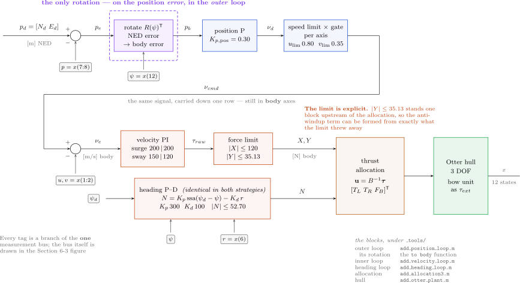

| In the figure | Meaning |
|---|---|
| the purple cell at the top left, `rotate` $R(\psi)^{\mathsf T}$ | the **only** rotation in the whole diagram, on the position error, in the outer loop |
| `speed limit × gate`, `per axis`, $u_{lim}\,0.80$ $v_{lim}\,0.35$ | two independent caps, each at its own axis's limit — step 5 |
| `velocity PI`, `surge` $200\,\vert\,200$, `sway` $150\,\vert\,120$ | per-axis gains, because each axis has a fixed inertia — step 7 |
| `force limit`, $\lvert X \rvert \le 120$, $\lvert Y \rvert \le 35.13$ | the actuator rating, stated in the loop that can act on it |
| the orange note, *the limit is explicit* | $\mathrm{sat}(F) - F$ is available here, so anti-windup is exact — step 8 |
| the `heading P--D` band at the bottom | identical, character for character, in both strategies |

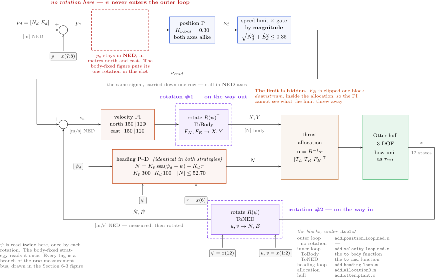

| In the figure | Meaning |
|---|---|
| the red dashed cell at the top left, *no rotation here* | the slot the previous figure fills; $\psi$ never enters this outer loop at all |
| `speed limit × gate`, `by magnitude`, $\sqrt{\dot N_d^2 + \dot E_d^2} \le 0.35$ | one cap on the length of the vector, at the slow axis's value — step 5 |
| `velocity PI`, `north` $150\,\vert\,120$, `east` $150\,\vert\,120$ | one gain pair for both axes — step 7 |
| the purple cell `to NED`, marked *rotation #1 — on the way in* | $u, v \to \dot N, \dot E$, the measurement entering the loop |
| the purple cell `to body`, marked *rotation #2 — on the way out* | $F_N, F_E \to X, Y$, the force leaving it |
| the note that $\psi$ is read **twice** | two rotations need two copies of the heading; the previous figure needs one |
| the orange note, *the limit is hidden* | $F_B$ is clipped inside the allocation, downstream, where no back-calculation term can be formed — step 8 |

Both sheets are drawn on the same grid, so holding one over the other shows a single difference: one filled cell in the outer loop against two filled cells in the inner.

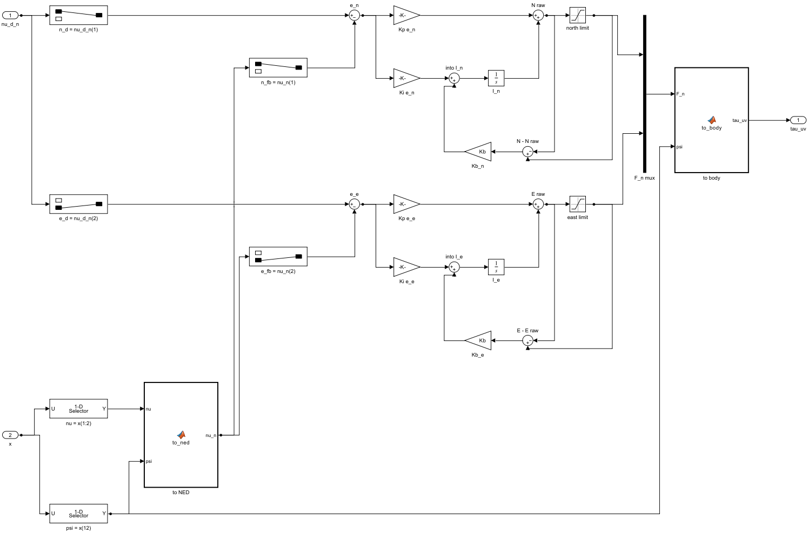

| In the figure | Meaning |
|---|---|
| `to NED` at the left and `to body` at the right | the two rotations, each a MATLAB Function block, with `psi = x(12)` branching to both |
| the two identical PI rows, `N` above and `E` below | the same gain names `Kp_ned` and `Ki_ned` appear in all four Gain blocks |
| the `Saturation` blocks reading `2*X_max` | the loose limit of step 8, written as an expression so the model shows where the number comes from |
| the `Kb` path from each saturation back to its integrator | the anti-windup wiring is present and correct — it simply has the wrong limit to work from |

### Experiment 6-7 · The same point, held in two frames (20 min)

**What it measures.** All four predictions of step 9, from four runs of two models; and, for the two NED runs, what produces a peak speed above their own $0.350$ m/s ceiling.

**The model.** `W06_F_position.slx` and `W06_I_position_ned.slx`, each run at $\psi_d = 0$ and $\psi_d = 45$ degrees, target $(10, 10)$ m, $T_{final} = 120$ s.

**Opening and running.**

```matlab
W06_I_two_frames
```

Expected output:

```
  W06 Experiment 6-7  the point (10, 10) m, held in two frames
    case                  t to 0.5 m [s]   d(end) [m]   max |U| [m/s]   max |X| [N]   max |Y| [N]
    body-fixed, psi 0            42.68        0.000           0.878        120.00         35.13
    NED, psi 0                   51.00        0.000           0.363         29.12         43.68
    body-fixed, psi 45           49.36        0.000           0.714        120.00         35.13
    NED, psi 45                  51.00        0.000           0.468         65.87         43.68
    speed ceilings: diagonal 0.873 = hypot(0.80, 0.35) m/s   by magnitude 0.350 m/s
    sway the NED PI never saw: 43.68 - 35.13 = 8.55 N
    body-fixed stays above the NED ceiling until t = 18.08 s
    what makes the NED peak -- demand against delivery, at one instant
      NED, psi 0          peak |U| = 0.363 m/s at t = 3.18 s   (ceiling 0.350)
        there:  u +0.191  v -0.309    X dem   +14.96 -> del   +14.96 (excess   +0.00)    N dem    -0.02 -> del    -0.02
        yaw demand on N_max for 0.0 % of the run;  worst same-instant surge excess +1.67 N at t = 0.00 s
      NED, psi 45         peak |U| = 0.468 m/s at t = 1.38 s   (ceiling 0.350)
        there:  u +0.378  v -0.277    X dem   -54.27 -> del   +28.94 (excess  +83.21)    N dem   +52.70 -> del   +19.83
        yaw demand on N_max for 3.4 % of the run;  worst same-instant surge excess +83.45 N at t = 1.20 s
```

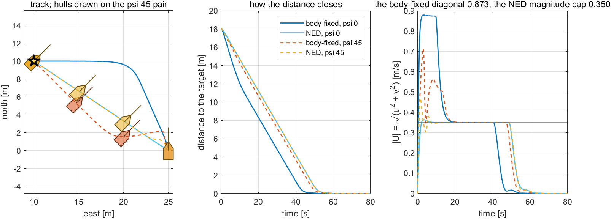

**Reading the figure against the derivation.**

| Where to look | What is there | Which line predicts it |
|---|---|---|
| `d(end)`, all four rows | $0.000$ m | step 3: both are correct controllers; where the rotation sits does not decide whether the loop closes |
| the left panel, the two NED tracks | straight lines from start to target | step 6: a magnitude cap shrinks the length and leaves the direction |
| the left panel, the body-fixed track at $\psi = 0$ | an **L** — north first, then west along north $= 10$ m | step 6: the per-axis caps trim surge and sway by different factors, so the command turns |
| the left panel, the body-fixed track at $\psi = 45$ | it sags the other way and comes back | step 6: the fast axis points north-east while the way to go is north-west |
| `t to 0.5 m`, NED rows | $51.00$ s at **both** headings | step 9: $\psi$ never enters the NED outer loop, so the approach cannot depend on it |
| `t to 0.5 m`, body-fixed rows | $42.68$ against $49.36$ s | step 9: the body-fixed approach depends on how the error lies relative to the hull |
| `max |U|`, body-fixed $0.878$ against the ceiling $0.873$ | $0.6$ % above the commanded diagonal | the cap is on the command; the inner PI overshoots its own setpoint slightly, as in Section 6-3 |
| the right panel, the two grey lines | $0.873$ and $0.350$ m/s — each strategy's own ceiling | step 5; drawing $0.80$ instead would make the $0.878$ peak look like a violation of a limit that was never imposed |
| `body-fixed stays above the NED ceiling until t = 18.08 s` | the advantage lasts $18$ s of a $51$ s run | step 9: after the north error is closed, the body-fixed run also crawls at $0.35$ m/s |
| `max |Y|`, body-fixed $35.13$ N | exactly $Y_{max}$ | step 8: the limit stands in the loop that computes the demand |
| `max |Y|`, NED $43.68$ N at both headings | $8.55$ N more than the hull can make | step 8: the NED PI saturates at $240$ N and never learns about $35.13$ |
| `max |X|`, body-fixed $120.00$ N both runs | the surge force cap | the body-fixed command is large enough to press the surge axis to its limit |
| `max |X|`, NED $29.12$ and $65.87$ N | never near $120$ | its velocity command is $2.5$ times smaller, so the surge PI is never pressed |

**What the figure says.** The first line of the table is the one to read twice: $d(end) = 0.000$ m, four times. Both strategies are correct. A derivation that ended at correctness would have nothing left to say, and would have missed everything this experiment measures.

What the placement of the rotation decides is which frame the *limits* are expressed in, and limits are where a linear design stops being linear. In hull axes the limits are constants of the vessel — $0.80$ and $0.35$ m/s, $120$ and $35.13$ N — and a controller written in hull axes can use all four of them. In north and east the same physical limits become functions of $\psi$, and a controller written there can only use the weakest value of each: one speed, one gain pair, one loose force bound. The three costs of steps 5, 7 and 8 are three faces of that single fact.

The costs are not equal. Being slow is visible and bounded: $51.00$ s against $42.68$ s at $\psi = 0$, and the gap closes to $1.64$ s at $\psi = 45$ degrees once the body-fixed advantage is spent on the bend in its own track. Asking for $43.68$ N of sway from a hull that can make $35.13$ N is different in kind. The demand is still enforced — the allocation clips it, and the vessel arrives — but it is enforced in a place where the integrator cannot see it happen, so the integral state carries $8.55$ N of credit for work the hull never did. With no current and a reachable target that costs only time. Week 9 puts the same structure under a current, where the integrator is what holds station, and the difference stops being cosmetic.

The last four lines of the output are a caution about measurement, not about frames. The NED run's peak speed, $0.468$ m/s at $\psi = 45$ degrees, sits above its own $0.350$ m/s ceiling, and the natural suspicion is the surge leak of Section 6-2 — a sway demand above $Y_{max}$ producing unasked-for surge. Measured at matched instants, that is not what happens. At $\psi = 0$ the peak falls where demand and delivery agree to the cent, excess $+0.00$ N, with the yaw demand on $N_{max}$ for $0.0$ % of the run: a $3.7$ % overshoot of the inner PI past its own command, the same thing as $0.878$ against $0.873$ on the body-fixed side. At $\psi = 45$ degrees the peak falls at $t = 1.38$ s, inside the opening turn, where the yaw demand is exactly $N_{max} = 52.70$ N$\cdot$m. Asked for a yaw it cannot produce alongside the surge and sway, the allocation clips per thruster and delivers a surge of the **opposite sign** to the one requested: $-54.27$ N asked, $+28.94$ N delivered, an excess of $+83.21$ N. The peak is a transient of the heading turn passing through the allocation. It belongs to Section 6-2, not to Section 6-7.

> [!warning] Compare at one instant, not maximum against maximum
> The two maxima of a signal pair fall at different times. Subtracting them produces a number that describes no moment of the run, and here it gets even the sign of the surge excess wrong. `W06_I_two_frames` therefore prints demand and delivery at the single index where $\lvert U \rvert$ peaks. Every claim in the paragraph above comes from that index.

| What to try | What to watch |
|---|---|
| `Kp_ned = 200` and `Ki_ned = 200`, the surge values | $\psi = 0$ improves and $\psi = 45$ degrees overshoots — step 7's reason for using the slow axis's gains, made visible |
| the NED cap per axis instead: edit `cap_speed` in `position loop NED` to clip each component at `v_ned_max` | the command reaches $0.495$ m/s on the diagonal and the sway demand rises further above $Y_{max}$ |
| `psi_d_cmd = deg2rad(90)` for both models | the body-fixed L inverts — it now runs west first — and the NED time stays at $51.00$ s |
| `N_d = 10`, `E_d = 0`, a target due north | at $\psi = 0$ the error lies along the fast axis and the two tracks coincide; the body-fixed advantage is at its largest |
| `Y_max` raised to $120$ in `W06_vars.m` for the body-fixed run only | the body-fixed sway demand passes $35.13$ N, which proves the $35.13$ in the table was the saturation and not a coincidence of the trajectory |

> [!tip] In class
> - **Purpose**: show that a frame choice which cannot affect correctness still decides what the controller is allowed to know.
> - **Point to**: the two loop figures side by side — one filled cell against two — then `max |Y|`, $35.13$ against $43.68$.
> - **Ask**: all four runs stop on the point. Name the quantity that the NED controller is wrong about anyway, and say where in the diagram it would have to be measured to fix it.
> - **Take away**: put the rotation where it leaves the limits in the frame they are constants in. For a hull, that is hull axes.

---

# Part 2 · Laboratory run order

The experiments of Part 1 are worked through in order; this table is the index of what was run, for repeating the week at home.

The four models share one hull, one allocation block and one measurement block, and all four are laid out in the course order — **command → reference → controller → allocation → plant → measurement** — with each stage a subsystem. Every value a controller uses is visible on the diagram: the target, the berth, the approach point, the stand-off, the speed caps and the arrival tolerances are **Constant blocks on the canvas**, and $K_{p,pos}$, $K_p$, $K_i$ and $K_b$ are the **values of Gain blocks**. No controller this week is one MATLAB Function. The only hand-written code is the allocation, the two rotations and the mission block, and each of those three is listed in full in the section that needs it — §6-2, §6-3 and §6-5 — taken out of the saved model rather than copied from the builder.

On the right of each model sit three things:

| | What it shows | When |
|---|---|---|
| **Scope** `vessel u v r` | the three velocities — the six-column contract every week of this course logs | while it runs |
| **Scope** `W06 this week` | what Week 6 adds: the set points, the three demands $X$, $Y$ and $N$, the shaft speeds $n_L$ and $n_R$, the bow force $F_B$, the distance $d$ and the phase number | while it runs |
| **Animate** block | the live view: quay, approach point, berth, track and hull with its heading on the left; $d$, the commanded and actual heading, $u$ and $v$ on one axis, the demands against their limits, the two shafts and the phase on the right | while it runs, when `animate = 1` |

Setting `pace = 1` in the workspace runs the model **at wall-clock speed**, so the live view moves at the speed the vessel would; `pace = 0` runs it as fast as it can. The results are identical and only the waiting differs: at `pace = 0` Experiment 6-5 runs both $150$ s berthing missions, prints four tables and saves its figure in $6.5$ s of wall clock, while at `pace = 1` each mission alone takes its full $150$ s. `W06_0_setup` sets `animate = 1` and `pace = 0`, because a person who presses Run wants the window but not the wait; `W06_vars`, which the section scripts use, sets `animate = 0` so that a table is not paid for in redraws.

The Animate block is never deleted to switch the live view off. `animate = 0` leaves the block in place doing nothing, so the diagram is the same in every model and in every week.

When a run finishes, the model's `StopFcn` calls `W06_plot`, which draws the track beside six panels and prints the same numbers a section script prints. Its `InitFcn` runs `run_alone`, which adds `_tools` and the week folder to the path, fills in any workspace variable that is missing, and reads `pace`. **Pressing Run on a freshly opened model therefore works on its own**, with no setup script run first.

| Experiment | Model | Script | What it shows |
|---|---|---|---|
| 6-0 | all four | `W06_0_setup`, `W06_1_build_bow`, `verify_w06_actuation` | the constants, the four models written from code, and 17 checks |
| 6-1 | `W06_C_actuation` | `W06_C_three_axes` | the three columns of $B$, commanded one axis at a time |
| 6-2 | `W06_C_actuation`, $X_{cmd} = 0$ and $N_{cmd} = 0$ | `W06_D_force_limits` | which actuator ceiling binds a sway demand, and what leaks past it |
| 6-3 | `W06_F_position` | `W06_E_holding_a_point` | the three-loop cascade holding a point, with and without the bow unit |
| 6-4 | `W06_F_position` | `W06_F_stopping` | the braking distance, the settling time, and the arrival test with its latch |
| 6-5 | `W06_H_berth` | `W06_G_berthing` | the four latched phases, with the instant each is entered |
| 6-6 | `W06_H_berth`, run twice | `W06_G_berthing` | alongside against bow-first, from the same two tables |
| 6-7 | `W06_F_position` and `W06_I_position_ned` | `W06_I_two_frames` | the one rotation, in each of the two places it can sit |

- The scripts only repeat what Run already shows, for several values at once, and print the numbers quoted in Part 1.
- `W06_G_berthing` serves two sections: §6-5 reads its phase tables down the rows, §6-6 reads them across the two attitudes.
- Each experiment ends with an **In class** note: purpose, what to point at, a question with its answer, and the sentence to take away.

---

# Summary

## Week Summary

| Step | What was done | How it was verified |
|---|---|---|
| 1 | wrote all four models from one builder | `check_overlaps` and `check_diagonals` both $0$ in all four, counted from the saved files on disk |
| 2 | added a third thruster and built $B$ from the column rule alone | `verify_w06_actuation` checks 2–6: $\max\lvert B - B_{hand}\rvert = 0$, $\det B = 0.790$, rank $3$, and the hand-solved law within $3.55 \times 10^{-14}$ N of `B \ tau` over 200 random demands |
| 3 | commanded the three axes one at a time | Experiment 6-1: residual at most $1.4 \times 10^{-14}$ N; sway alone gives $v = 0.344$ m/s with $r = 0.000$ deg/s, which is the third row of $B^{-1}$ being $[0\ \ 1\ \ 0]$ |
| 4 | found which actuator ceiling binds a sway demand | Experiment 6-2: $35.13$ N from the stern astern limit, against $63.03$ N from the ahead limit and $40.00$ N from the bow unit |
| 5 | predicted the leak above that ceiling | Experiment 6-2: at $Y = 50$ N the clipped allocation delivers $X = 28.23$ N and $N = -3.85$ N$\cdot$m, matching the hand prediction to two decimals |
| 6 | built the position cascade, then removed the bow unit | Experiment 6-3: $42.68$ s to within $0.5$ m with three thrusters; $14.827$ m of standing error and $10.37$ deg of heading error without |
| 7 | derived the braking distance and the settling time | Experiment 6-4: $u_{lim}/K_{p,pos} = 5.33 / 2.67 / 0.40$ m against $5.04 / 2.46 / 0.34$ measured, and $1/K_{p,pos} = 6.67 / 3.33 / 0.50$ s against $6.26 / 2.90 / 0.17$ |
| 8 | made arrival a conjunction of four bounded terms with a latch | Experiment 6-4: the four terms true for $64.0$, $100$, $62.4$ and $100$ % of the run, all four together from $45.42$ s, latch changes $1$; in a $0.3$ m/s current never satisfied, holding $2.153$ m out with the sway demand pinned at $35.13$ N |
| 9 | compared two berthing attitudes on one mission | Experiment 6-5/6-6: berth leg $23.00$ s alongside against $11.46$ s bow-first, with $35.13$ N and $3.96$ N of peak sway; both end within $0.35$ m of the berth |
| 10 | moved the one rotation to the other side of the limits | Experiment 6-7: all four runs end at $d = 0.000$ m, so the choice is not about correctness; NED pays $51.00$ s against $42.68$ s and asks $43.68$ N of sway from a hull that makes $35.13$ N |

## Progress Check

> [!important] Minimum condition for following Week 7

### Theory

- [ ] Able to state the rank test and apply it to the three Otter configurations: under-actuated, fully actuated, over-actuated.
- [ ] Able to write the three columns of $B$ from the geometry alone, and to say what the lever $l_f/(2 y_{pont}) = 1.8987$ is the ratio of.
- [ ] Able to say which ceiling binds a pure sway demand, and why it is the stern astern limit rather than the bow thruster's rating.
- [ ] Able to predict the surge force and yaw moment that leak out of a clipped allocation.
- [ ] Able to name the quantity each of the three loops owns, and to state the condition under which their time-scale separation fails.
- [ ] Able to derive the braking distance $u_{lim}/K_{p,pos}$ and the settling time $1/K_{p,pos}$, and to say where the derivation stops holding.
- [ ] Able to explain what the arrival latch prevents, and what it removes along with the chatter.
- [ ] Able to place the single rotation in both of its two possible positions, and to state what each placement costs.

### Laboratory

- [ ] `W06_1_build_bow` ran and all four models reported `overlapping lines: 0` and `diagonal lines: 0`.
- [ ] `verify_w06_actuation` printed `ALL CHECKS PASSED`.
- [ ] `W06_F_position` was run with `animate = 1`, and the live view drew the track, the hull heading, both speeds and both demands against their limits.
- [ ] One constant was changed in `W06_0_setup` — the berth, the stand-off, or `Kp_pos` — and the new behaviour appeared in the figure `W06_plot` draws.
- [ ] `W06_H_berth` was run at `psi_berth = 0` and at `deg2rad(-90)`, and the phase table changed in the one column §6-6 says it should.

---

## Assignment 6

- **Due**: before the Week 7 session
- **Submit**: the modified `W06_0_setup.m`, the numbers requested below, and two figures

### ① Requirements

Rotate the quay. Section 6-5 placed the approach point by adding `stand_off` along $E$ alone, and `verify_w06_actuation` check 14 confirms it does exactly that: $(40.0,\ 1.2) + 7.0$ m $\rightarrow (40.0,\ 8.2)$. That is correct only for a quay running north–south. Give the quay a heading of $30$ degrees, apply the offset along the quay's own normal — one rotation, the same $R(\psi)$ of §6-3 — and berth against it both alongside and bow-first.

### ② Verification — mandatory

> [!important] A claim is not a result. Numbers are required, with the averaging window stated

1. The approach point, computed by hand from the quay heading and reported by the mission block, to three decimals.
2. The phase table of Experiment 6-5 for both attitudes against the rotated quay: entry instant and duration of all four phases.
3. The berth-leg maxima of $X$ and $Y$, and the percentage of that leg spent on the $Y$ cap, for both attitudes.
4. The final distance to the berth, the drift and the heading error, for both attitudes.

### ③ Analysis (5–10 lines)

Against a north–south quay the alongside attitude spent $4.0$ % of its berth leg on the sway cap and the bow-first attitude $0.0$ %. State what those two percentages become on a quay rotated $30$ degrees, and explain the direction of the change from where the sway demand comes from.

### Grading

| Criterion | Weight |
|---|---|
| The model runs and produces the requested output | 25% |
| **Verification performed and numbers reported** | 40% |
| Correctness of the analysis | 25% |
| Readability of the code | 10% |

---

## Troubleshooting

| Symptom | Cause | Fix |
|---|---|---|
| `W06_0_setup` stops in `mss_path` | the MSS toolbox is not at `Tools\MSS` | place MSS there; see the first page |
| a section script appears to run and do nothing | an `.slx` shares its name, so MATLAB opens the model instead of running the script | the runners carry `_run` in their names; never give a script a model's stem |
| the model stops at `Undefined function or variable 'h'` | the workspace is empty and every Constant holds a **name** | nothing is broken. The model's `InitFcn` fills missing variables itself, so this appears only if the `.slx` was copied out of the vault and `_tools` can no longer be found from it |
| adding the measured distance as an input to `mission` is reported as an algebraic loop | the mission block sets the target, the loops compute $d$ from that target, and $d$ would then set the target | the block computes its own distance from $x$; it must not receive one |
| a heading on a Scope is about $57$ times the expected number | `psi` and `psi_set` are both logged in **degrees**, not radians | subtract them as they are; do not convert either |
| the vessel holds station a few metres out and never declares arrival | a current pushes it back outside $R_{app}$, and the latch does not re-enter phase 1 | expected, and measured: §6-4 gives $2.153$ m in a $0.3$ m/s current. Guarded re-entry is Week 9 |
| `W06_plot` draws a figure that does not match these notes | a changed variable is still in the workspace | run `W06_0_setup` again |

---

## References

### Primary

- Fossen, T. I. *Handbook of Marine Craft Hydrodynamics and Motion Control*, 2nd ed., Wiley, 2021, §15.3 — dynamic positioning: the outer position loop and the inner velocity loop, in both the body-fixed and the NED formulation of §6-7.
- Fossen, T. I. *Handbook of Marine Craft Hydrodynamics and Motion Control*, 1st ed., Wiley, 2011, §12.3.4 — the extended thrust vector, from which `_tools/otter_B.m` builds the three columns of $B$ used in §6-1.
- MSS toolbox, `VESSELS/otter.m` — the hull, its mass matrix and the two stern propellers; `demoOtterUSVPathFollowingHeadingControl` — the autopilot structure the heading loop of §6-3 keeps unchanged.

### In this course

- Week 2 §2-6 to §2-8: P, I and the tuning order, used unchanged by the velocity loop of §6-3.
- Week 4 §4-4: heading is not course. It is why the heading loop stays separate from the position loop rather than being folded into it.
- Week 5 §5-7: the yaw moment a surge force leaves behind. Section 6-2 asks the same question of sway, and the answer is harsher.
- Week 9: dynamic positioning on the under-actuated hull, under a current, with the guarded phase re-entry §6-4 and §6-5 both point forward to.

---

## Next Week

**Week 7 — Control Allocation.** The allocation of this week was a square solve: three demands, three thrusters, exactly one answer, nothing to choose. Section 6-2 clipped that answer when it exceeded a ceiling and measured what leaked out. Week 7 adds actuators until the answer is no longer unique — the rank stays 3 while the null space grows — and at that point clipping is no longer the best attainable approximation of the demand. Its first experiment measures how far short the clipped solution falls, and its subject is the constrained minimisation that replaces it.
