# Week 7 · Four Tilting Thrusters, Control Allocation, and Closed-Loop Control

> [!note] Recordings of this semester's own classes
> <span style="font-size:0.88em">Every session of this course is recorded as it is given and posted to the playlist below. The written material here is the reference; the recording is the lecture, at the pace it was actually delivered. Use it to review a derivation, or to catch up on a missed week before the laboratory.</span>
>
> | | Where |
> |---|---|
> | **[충남대] 2026 센서신호처리** — this course, recorded live, 2026 | [playlist](https://youtube.com/playlist?list=PLCxINRGlWUrk) |

> [!important] Reference material — read this first
> <span style="font-size:0.88em">The five courses below are **taught by the instructor of this course** and are the assumed background for it. They run from the fundamentals down to the graduate material, so start wherever the gap is. Every frame, symbol and derivation used here is developed in them at length; anyone whose prerequisites are thin should work through them first, then return.</span>
>
> | # | Course | Level | Lang. | Video | Slides and code |
> |---|---|---|---|---|---|
> | 1 | **Control Engineering** (제어공학) — the foundation: transfer functions, feedback, stability, root locus, PID | undergraduate | KO | [playlist](https://youtube.com/playlist?list=PLFaUxNRM4BvJMpF9HZS-Mp8tDv9dTdglk) | [drive](https://drive.google.com/drive/folders/1TNIPDNtS_Iy8li-olka5WJslSXDYf0aT) |
> | 2 | **Control System Design** (제어시스템설계) — design rather than analysis: specifications, loop shaping, discrete implementation | undergraduate | KO | [playlist](https://youtube.com/playlist?list=PLFaUxNRM4BvIGroZ5rgn7x08F7C79d9WZ) | [drive](https://drive.google.com/drive/folders/11m5Xxl_PHJvxgHghLSP-jhCpmRpbvoXh) |
> | 3 | **Advanced Control Engineering** (제어공학특론) — reference frames, the 6-DOF equation of motion, rotation matrices and Euler angles, linearisation and trim, vehicle control design | graduate | EN | [playlist](https://youtube.com/playlist?list=PLFaUxNRM4BvJmvF2ljx4KM5dj1P5jEcw0) | [drive](https://drive.google.com/drive/folders/1GUxbbONl916lNd0ggnFnXrNwNkd13-2-) |
> | 4 | **Sensor Signal Processing and Fusion** (센서신호처리 및 융합) — sensor models, noise, estimation and multi-sensor fusion | graduate | EN | [playlist](https://youtube.com/playlist?list=PLFaUxNRM4BvK-aP2Gdoyp5-AWvMn7Fo8E) | [drive](https://drive.google.com/drive/folders/1MEVJP7TzMcm8w6TZwUjhWJtL34WeNY3u) |
> | 5 | **Capstone Design** (캡스톤디자인) — a vehicle project carried end to end | undergraduate | KO | [playlist](https://youtube.com/playlist?list=PLFaUxNRM4BvLu7L0pDoLzDXTv8mm6rCmj) | [drive](https://drive.google.com/drive/folders/1haIQejlJfrdhtOuof-MpffR9ydVscXZS) |
>
> <span style="font-size:0.88em">**Not fluent in MATLAB or Simulink yet? Do these before Part 2.** Every laboratory in this course is Simulink, and the Onramp courses are free and take a few hours each.</span>
>
> | Tool | Where to start |
> |---|---|
> | MATLAB | [MATLAB Onramp](https://matlabacademy.mathworks.com/kr/details/matlab-onramp/gettingstarted) · [Core MATLAB Skills](https://matlabacademy.mathworks.com/details/core-matlab-skills/lpmlcms) |
> | Simulink | [Simulink Onramp](https://matlabacademy.mathworks.com/kr/details/simulink-onramp/simulink) · instructor's Simulink lectures [part 1](https://youtu.be/a-afHg_fSaU) · [part 2](https://youtu.be/070Yn0Hw5a0) |

> [!tip] Getting the course files, and keeping them current (Windows)
> <span style="font-size:0.88em">The notes, models and scripts are kept in one Git repository that is updated through the semester. Clone it once; before every class, pull. A pull downloads only what has changed since the last one.</span>
>
> | When | Where to run it | Command |
> |---|---|---|
> | once | PowerShell — installs Git for Windows | `winget install --id Git.Git -e` |
> | once | the folder that will hold the course, e.g. `Documents` | `git clone https://github.com/wkyouncnu/Sensor-Signal-Processing-and-Fusion.git` |
> | before every class | inside the cloned folder `Sensor-Signal-Processing-and-Fusion` | `git pull` |
>
> - `git pull` prints `Already up to date.` when nothing has changed, and otherwise lists the files it updated.
> - The repository is private. When Git asks, sign in with the GitHub account the instructor has given access.
> - Experiment on copies, not on the cloned files: copy a week's `WXX_simulink` folder elsewhere first, and a pull can never collide with local edits. If it already has, `git stash`, then `git pull`, then `git stash pop` sets the edits aside, updates, and puts them back.
> - The MSS toolbox is not part of the repository. The weeks that simulate the Otter need it at `Tools\MSS` inside the cloned folder, and `_tools\mss_path.m` finds it there in either release layout — `Tools\MSS\VESSELS\otter.m` in the older releases, or `Tools\MSS\CRAFT\USV\models\otter.m` in the current master.
> - **The two releases are not the same vessel.** The figures printed in these notes were measured with the older layout. Terminal surge speed agrees at 1.0286 m/s, but the current master turns 25.5 % faster under differential thrust, 0.1276 rad/s against 0.1017 rad/s. `mss_path` therefore prefers the older layout when both are present, and warns when only the newer one is available, so a reading that cannot reproduce is announced rather than silent.
> - **A 118 MB folder disappears on the first pull after 2026-10-27.** `lectures\MSS-master` held a copy of MSS until then. It sat outside `Tools\MSS`, so no course script could reach it, and it only made cloning slower. Its removal is expected and is not a fault. Any file kept inside that folder must be moved elsewhere before pulling.

- **Course**: USV Guidance, Navigation and Control (Graduate)
- **Department**: Autonomous Vehicle System Engineering, Chungnam National University
- **This week**: ① a tilting thruster occupies **two** columns of $B$, not one ② the four places `otter.m` must change to carry four of them ③ eight numbers given by hand, and the three asymmetries that make the symmetric guess wrong ④ four allocation laws compared, and the one that survives put inside two closed loops

> [!important] Before starting
> - Week 3's column rule must be available from memory: a thrust applied at a point contributes one column to $B$, and the rule that builds that column is the only definition of $B$ this course uses.
> - Week 6's change to the motion model must be understood as a change to the **model**, not an addition to its input. `otter_bow.m` carries the bow thrust inside $\boldsymbol{\tau}$; this week does the same thing for four tilting units.
> - Verify both in one command: `cd lectures/W06_simulink; W06_0_setup` must print the three-thruster configuration without error, and `verify_otter_bow` must print `PASS`.

---

## Learning Outcomes

Upon completion of this week, the learner is able to:

1. State the column rule for a thrust applied at $(x_i, y_i)$, write the generalised force of four tilting thrusters as $\boldsymbol{\tau} = B\mathbf{f}$ with $B \in \mathbb{R}^{3\times 8}$, give its rank and null-space dimension, and confirm that $\delta_i = 0$ recovers `otter.m` exactly.
2. Identify the four places in `otter.m` that must change to carry four tilting units, and state why the hull hydrodynamics are not among them.
3. Derive the three asymmetries of this arrangement — the surge left over when $+n$ is opposed by $-n$, the residual yaw $N = \bar{x}\,Y$ with $\bar{x} = (l_f - l_a)/2$ of a symmetric sway command, and the servo limit — and say why together they make an allocator necessary rather than optional.
4. Distinguish a check on the delivered force from a check on the resulting motion, say why the force is read off the motion model rather than rebuilt from the logged states, and derive the instant from which the two computations of $\boldsymbol{\tau}$ may be compared.
5. Derive the minimum-norm allocation $\mathbf{f} = \mathbf{B}^\top(\mathbf{B}\mathbf{B}^\top)^{-1}\boldsymbol{\tau}_d$ from a Lagrange multiplier, invert the thrust curve to $n_i$ and $\delta_i$, and state what a weight matrix can and cannot change on this geometry.
6. Turn $\lvert\delta_i\rvert \le \alpha_{\max}$ into two linear inequalities once the thrust sign is fixed, show that $\lvert n_i\rvert \le n_{\max}$ is the thrust cap $\lvert T_i\rvert \le k_i n_{\max}^2$ seen through the thrust curve, replace the resulting arc by inscribed chords, and say why sixteen convex subproblems are solved rather than one.
7. Assemble the closed loops of Weeks 3 to 6 over that allocator — LOS waypoint following and position-and-heading hold — and distinguish an actuator that is **on** its limit from one that was **clipped**.

## Prerequisites and Setup

| Item | Requirement |
|---|---|
| MATLAB | R2024b or later, with Simulink |
| MSS toolbox | reachable at `Tools\MSS`; `_tools\mss_path.m` adds it |
| Optimization Toolbox | version 24.2 or later, for the `lsqlin` that law 4 of §7-11 calls sixteen times per step. Verify with `ver('optim')` |
| Weeks assumed | Week 3 (the column rule and $B$, and the surge PI of §3-3 with the anti-windup of §3-4), Week 4 (the heading PD of §4-3), Week 5 (saturation and limits, and the LOS law of §5-3), Week 6 (changing the motion model itself, the square allocation of §6-2 with its clipping, and the three loops of §6-3) |
| Plant | `_tools\otter_tilt4.m` — `otter.m` with four tilting units, same hull |
| Configuration | `otter_config('quad_tilt')` |
| Model | `W07_openloop.slx`, written by `W07_1_build_openloop.m` |
| Solver | fixed-step `ode4`, $h = 0.02$ s |
| Allocation model | `W07_alloc_chain.slx`, written by `W07_2_build_alloc.m` — the four laws as four MATLAB Function blocks behind one Multiport Switch |
| Allocation runner | `W07_alloc_run.m` — one file, §7-8 to §7-12. It sets `law` and `tau_cmd` on the workspace and calls `sim`: no law is implemented in the `.m` |
| Closed-loop models | `W07_wpt_los.slx` by `W07_3_build_wpt.m` (§7-13) and `W07_pose_dp.slx` by `W07_4_build_pose.m` (§7-14) — both with law 4 alone and no switch |
| Closed-loop runners | `W07_wpt_run.m` and `W07_pose_run.m`, two sections each. Both set constants and call `sim` |
| Scope of this week | §7-0 to §7-6 are **open loop only** — eight numbers given by hand, no controller and no guidance. §7-7 to §7-12 add the **allocation** that produces those eight numbers from three, still with no controller. §7-13 and §7-14 close the loop around the one law that survives the comparison |

---

# Part 1 · Principle and experiment, section by section

Every section states what is observed, says what follows from it, and then runs **the experiment that measures it**, on its own model. The numbers quoted in the text are printed by the run a few lines below it.

## 7-0. Setting up (10 min)

```matlab
cd lectures/W07_simulink
W07_1_build_openloop          % once — writes W07_openloop.slx and img/*.png
W07_0_setup                   % every session — defines every constant
```

`W07_1_build_openloop` prints one line, and both counts must be zero:

```
  W07_openloop   overlaps 0   diagonals 0
```

`W07_0_setup` prints the configuration this week works in:

```
  Week 7  four tilting thrusters, open loop
    thruster stations   x = [+1.50 +1.50 -1.00 -1.00] m
                        y = [-0.395 +0.395 -0.395 +0.395] m
    servo limit         +45 deg,  rate 90 deg/s
    shaft limits        -101.737 .. +103.931 rad/s
    thrust at +-60      +39.888 N ahead, -23.202 N astern   (k_neg/k_pos = 0.5817)
    cancelling astern    -78.670 rad/s, not -60
    B                   3 x 8, rank 3, null space 5
    command             n = [60 60 60 60] rad/s
                    delta = [45 45 45 45] deg
```

Four lines of that block are the week in miniature. The shaft limits are not symmetric, the two thrust coefficients are not equal, $B$ has five more columns than rows, and the astern speed that cancels $+60$ rad/s is not $-60$.

> [!warning] The shaft command is in rad/s, not rpm
> `n_cmd = [60 60 60 60]` is 60 radians per second, about 573 rpm. `otter.m` has always used rad/s and `otter_tilt4.m` keeps that, because the thrust coefficients $k_{pos}$ and $k_{neg}$ are quoted against it. Entering 600 expecting rpm asks for 5730 rpm, and the model saturates it to 103.931 rad/s.

## 7-1. Four thrusters, two columns each, and two different zeros

**What is observed.** Experiment 7-1 reports that the forward pair at $\delta = 0$ reproduces `otter.m` exactly, that the aft mounting sign flips $\boldsymbol{\tau}$ to $3.55\times10^{-15}$, that $\boldsymbol{\tau}$ agrees with $B\mathbf{f}$ to $7.19\times10^{-14}$ over 200 random states, and that $B$ is $3\times 8$ with rank 3.

- four thrust stations: two at $x_b = +1.50$ m, two at $x_b = -1.00$ m, each $0.395$ m off centreline
- each unit turns through $\pm 45^\circ$ at up to $90^\circ$/s
- the two pairs are mounted facing **opposite** ways, so $\delta_i = 0$ drives the hull ahead at the bow and astern at the stern
- eight numbers are commanded; three components of force result

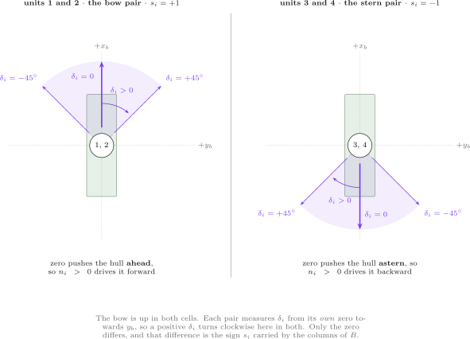

**The result.** Write $s_i = +1$ when unit $i$'s zero points ahead and $s_i = -1$ when it points astern. The thrust direction and the force of unit $i$ are then

$$
\mathbf{e}_i \;=\; s_i\begin{bmatrix}\cos\delta_i \\[2pt] \sin\delta_i\end{bmatrix},
\qquad
\mathbf{f}_i \;=\; T_i\begin{bmatrix}\cos\delta_i \\[2pt] \sin\delta_i\end{bmatrix},
\qquad
s = \begin{bmatrix}+1 & +1 & -1 & -1\end{bmatrix}
$$

The sign is deliberately kept out of $\mathbf{f}$ and placed in $B$, so that $\mathbf{f}$ holds only what the hardware reports.

Which direction is called the zero of a servo is a **convention**: calling the other direction zero everywhere gives $-B$, which is a different labelling of the same hull, not an error. What is not free is consistency between $B$, the figures, the commanded $\delta_i$ and the measurements of §7-3. The choice is fixed once in the `mount` field of `otter_config.m`, and `verify_otter_tilt4.m` compares the matrix the motion model writes against the one `_tools/otter_B.m` builds from the column rule, so the two cannot drift apart.

With the column rule applied to each component separately, the force on the hull is linear in those eight numbers:

$$
\boldsymbol{\tau} \;=\; \begin{bmatrix} X \\ Y \\ N \end{bmatrix} \;=\; B\,\mathbf{f},
\qquad
\mathbf{f} = \begin{bmatrix} T_1\cos\delta_1 \\ T_1\sin\delta_1 \\ \vdots \\ T_4\cos\delta_4 \\ T_4\sin\delta_4\end{bmatrix},
\qquad
\mathbf{b}^{c}_i = s_i\!\begin{bmatrix} 1 \\ 0 \\ -y_i\end{bmatrix},
\quad
\mathbf{b}^{s}_i = s_i\!\begin{bmatrix} 0 \\ 1 \\ x_i\end{bmatrix}
$$

$$
B \;=\;
\begin{bmatrix}
1 & 0 & 1 & 0 & -1 & 0 & -1 & 0 \\
0 & 1 & 0 & 1 & 0 & -1 & 0 & -1 \\
d_1 & l_f & d_2 & l_f & d_3 & l_a & d_4 & l_a
\end{bmatrix}
$$

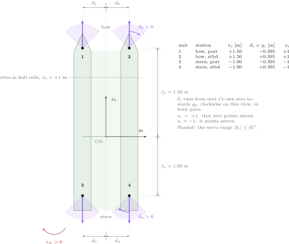

The first two rows carry only the mounting sign, because a force adds to $X$ and $Y$ whatever point it acts at. The third row is where the geometry enters, and **every entry in it is a moment arm**: a length, in metres, and never anything else. Two arms exist on this hull, one for each kind of column, each named once with its sign already inside the name — this is how `otter_tilt4.m` writes it.

| Column of $B$ | It multiplies | Its entry in row 3 | What that length measures |
|---|---|---|---|
| $\mathbf{b}^{c}_i$, the $\cos$ column | $T_i\cos\delta_i$, the part of unit $i$'s thrust along $x_b$ | $d_i \equiv -s_i y_i$ | **transverse** arm: centreline to unit $i$'s pontoon, $\lvert d_i\rvert = 0.395$ m, signed by which way that thrust turns the bow |
| $\mathbf{b}^{s}_i$, the $\sin$ column | $T_i\sin\delta_i$, the part of the same thrust along $y_b$ | $l_f \equiv s_1 x_1$, $l_a \equiv s_3 x_3$ | **longitudinal** arm: midships CO to the thrust station, $l_f = 1.50$ m forward, $l_a = 1.00$ m aft |

The two arms of one unit are different lengths because a moment arm is measured **perpendicular to the force it multiplies**: thrust along $x_b$ turns the hull only by acting off the centreline, thrust along $y_b$ only by acting away from midships.

Two readings of row 3 follow directly, and both are measured in §7-3.

- the four $\sin$ entries are **all positive** — at the bow $s_i = +1$ and $x_i = +l_f$, at the stern $s_i = -1$ and $x_i = -l_a$, and the two negatives cancel. A positive $\delta$ at any of the four units therefore turns the hull the same way, which is why S3 tilts all four alike and gets a pure yaw
- the four $\cos$ entries alternate in sign across the diagonal of the hull: $d_1 = +d$, $d_2 = -d$, $d_3 = -d$, $d_4 = +d$. Port-bow and starboard-stern thrust turn the bow to starboard; the other diagonal turns it to port

All four pontoons sit at the same half-separation, so the four transverse arms share one magnitude, $d = 0.395$ m, and differ only in sign. Row 3 is then the eight numbers the code holds:

$$
\begin{bmatrix} d_1 & l_f & d_2 & l_f & d_3 & l_a & d_4 & l_a \end{bmatrix}
=
\begin{bmatrix} 0.395 & 1.500 & -0.395 & 1.500 & -0.395 & 1.000 & 0.395 & 1.000 \end{bmatrix}\ \text{m}
$$

| Symbol | Quantity | Value · source |
|---|---|---|
| $x_i$ | longitudinal station of unit $i$ | $+1.50, +1.50, -1.00, -1.00$ m — `otter_config.m`, field `pos` |
| $y_i$ | transverse station of unit $i$ | $-0.395, +0.395, -0.395, +0.395$ m — same |
| $d_i$ | transverse moment arm of unit $i$, $-s_i y_i$ | $+0.395, -0.395, -0.395, +0.395$ m — the signed form of $y_i$ |
| $s_i$ | mounting sign: which way the zero points | $+1, +1, -1, -1$ — `otter_config.m`, field `mount` |
| $\delta_i$ | tilt angle, from unit $i$'s own zero towards $y_b$ | commanded, clipped to $\pm 45^\circ$ |
| $T_i$ | thrust magnitude of unit $i$ | $k_{pos}n_i\lvert n_i\rvert$ for $n_i \ge 0$, $k_{neg}n_i\lvert n_i\rvert$ otherwise |
| $\mathbf{b}^{c}_i, \mathbf{b}^{s}_i$ | the two columns unit $i$ owns | the $\cos$ column and the $\sin$ column |
| $B$ | allocation matrix | $3\times 8$, rank 3 — written out in `otter_tilt4.m` and checked against `_tools/otter_B.m` |
| $l_f, l_a$ | longitudinal moment arms, CO to the forward and aft stations | $1.50$ m, $1.00$ m — `otter_config.m`, fields `l_f`, `l_a` |

**Derivation, one line at a time.**

1. The force–moment triple produced by a planar force $\mathbf{g} = [\,g_x\;\;g_y\,]^{\mathsf T}$ applied at $(x, y)$ in body axes is $[\,g_x,\;g_y,\;x g_y - y g_x\,]^{\mathsf T}$. This is Week 3's column rule, and it is the only definition of $B$ this course uses.
2. For a **fixed** thruster, $\mathbf{e}_i$ is a constant of the hull. The single unknown is $T_i$, the rule returns one column, and four fixed thrusters give $B \in \mathbb{R}^{3\times 4}$.
3. For a **tilting** thruster, $\mathbf{e}_i = \mathbf{e}_i(\delta_i)$. The map $(T_i, \delta_i) \mapsto T_i\mathbf{e}_i$ is polar-to-Cartesian, invertible wherever $T_i > 0$, so the unit carries two independent numbers rather than one.
4. Applying line 1 to the two components of $s_i T_i [\cos\delta_i\;\;\sin\delta_i]^{\mathsf T}$ separately gives the columns $s_i[1, 0, -y_i]^{\mathsf T}$ and $s_i[0, 1, x_i]^{\mathsf T}$. Four units give $B \in \mathbb{R}^{3\times 8}$, written above with its third row in symbols.
5. $B$ has rank 3: rows 1 and 2 are independent by inspection, and row 3 is not a combination of them because the $x_i$ and $y_i$ are not all zero. Its null space has dimension $8 - 3 = 5$.
6. Five null-space dimensions are five independent ways to change the eight numbers without changing the force. Choosing among them is allocation — the minimum-norm choice is $\mathbf{f} = B^{\dagger}\boldsymbol{\tau}$ with $B^{\dagger} = B^{\mathsf T}(BB^{\mathsf T})^{-1}$ — and it is next stage's subject, not this one's.
7. Multiplying out $B\mathbf{f}$ gives the scalar form the motion model evaluates:

$$
X = \sum_{i=1}^{4} s_i T_i\cos\delta_i,
\qquad
Y = \sum_{i=1}^{4} s_i T_i\sin\delta_i,
\qquad
N = \sum_{i=1}^{4} s_i\bigl(x_i T_i\sin\delta_i - y_i T_i\cos\delta_i\bigr)
$$

8. Writing $f_{i,x} = T_i\cos\delta_i$ and $f_{i,y} = T_i\sin\delta_i$ and substituting the four stations turns the moment sum into eight separate terms, each one a force times its own arm:

$$
N \;=\; \bigl(d_1 f_{1,x} + d_2 f_{2,x} + d_3 f_{3,x} + d_4 f_{4,x}\bigr)
\;+\; l_f\bigl(f_{1,y} + f_{2,y}\bigr) \;+\; l_a\bigl(f_{3,y} + f_{4,y}\bigr)
$$

   Every sum is a plain sum, because each $d_i$, $l_f$ and $l_a$ already carries its own sign: the alternation of the diagonal lives in $d_2 = d_3 = -0.395$ m, not in the operators. This is the form to read when a commanded manoeuvre comes out wrong — each term names one thruster, one component of its thrust, and the one length that turns it into yaw.

9. Two consequences follow at $\delta = 0$, and Experiment 7-1 measures both. Every sine dies, so $Y = 0$ and $N = -\sum s_i y_i T_i$: the differential-thrust yaw of `otter.m`, with four stations in place of two. And because $s_3 = s_4 = -1$, the aft pair alone reproduces `otter.m` with $\boldsymbol{\tau}$ reversed.

### Experiment 7-1 · The new model contains the old one (15 min)

**What it measures.** Lines 1, 7 and 9 of the derivation: that the column rule and the scalar form agree, and that $\delta = 0$ returns `otter.m` — forward with $\boldsymbol{\tau}$ as it stands, aft with $\boldsymbol{\tau}$ reversed.

**The model.** None. `verify_otter_tilt4` calls `otter_tilt4` and `otter` directly, over 200 random states, so the check is on the equations and not on any wiring.

**Opening and running.**

```matlab
verify_otter_tilt4            % 네 가지 항등식 / four identities
```

Expected output:

```
  verify_otter_tilt4
    stations   x = [+1.50 +1.50 -1.00 -1.00] m
               y = [-0.395 +0.395 -0.395 +0.395] m
    tilt limit +-45 deg each
    B          3 x 8, rank 3, null space 5

  (a) aft mounting sign flips tau exactly :  3.55e-15
  (b) fore pair, delta 0 == otter.m       :  0.00e+00
  (c) tau                == otter_B * f   :  7.19e-14
  (d) saturation clamps n AND delta       :  0.00e+00

  thrust at +-60 rad/s   +39.888 N ahead, -23.202 N astern  (k_neg/k_pos = 0.5817)
  cancelling astern speed   -78.670 rad/s   (not -60)
  limits                   -101.737 .. +103.931 rad/s

  PASS  (tol 1e-09, 200 random states)
```

| What to try | What to watch |
|---|---|
| `verify_otter_tilt4` twice in a row | only `(c)` changes, in its last digits — the random states feed the $B\mathbf{f}$ comparison alone |

## 7-2. What had to change inside the motion model

**What is observed.** `_tools/otter_tilt4.m` is MSS `otter.m` copied and changed in four places, each marked in the file with `% ---- CHANGED (i of 4)`, the same four places as Week 6's `otter_bow.m`. The rigid-body and added-mass matrices, the Coriolis terms, the restoring forces, the linear and cross-flow damping, the nonlinear yaw damping $N_h = N_r(1 + 10\lvert r\rvert)r$ and the kinematics are character-for-character identical — the hull is the same hull, and the file has to show that.

**The result.** Four changes, and nothing else.

| | `otter.m` | `otter_tilt4.m` | Why |
|---|---|---|---|
| 1 · input check | `length(n) ~= 2` | `length(n) ~= 4` and `length(delta) ~= 4`, plus an eighth argument `quad` | the configuration arrives as data, so the stations and tilt limits are not hard-coded in the plant |
| 2 · thruster data | $l_1$, $l_2$ | `px`, `py`, `d_max`, `s` read out of `quad`, then the six arms named and $B$ written out | with four stations a pair of signed arms is not enough, and the mounting sign has to reach the columns |
| 3 · thrust | a two-pass loop, $n$ saturated | no loop: $n$ **and** $\delta$ clipped one line each, then $T = k\,n\lvert n\rvert$ | derivation line 3 below — the servo is part of the vessel, not of the controller |
| 4 · the force vector | `tau = [T1+T2  0  0 0 0  -l1*T1-l2*T2]'` | `tau3 = B_thr * f` | derivation lines 4 to 6 — one matrix product in place of a literal |

**Derivation, one line at a time.**

1. The propellers are unchanged. $k_{pos} = 0.02216/2$ and $k_{neg} = 0.01289/2$ stay at the values `otter.m` sets, because the same propeller is fitted four times rather than twice.
2. The shaft limits are therefore also unchanged: $n_{max} = +103.931$ rad/s and $n_{min} = -101.737$ rad/s, derived in `otter.m` from the maximum thrust each way.
3. The tilt servo belongs inside the plant. A servo that refuses $70^\circ$ refuses it whatever asked, so the clip must be in the motion model; a clip placed only in the controller would let a mis-wired command produce a force the vessel cannot make.
4. `otter.m` writes its $\boldsymbol{\tau}$ as a literal six-row vector because two fixed thrusters reach only two of the six rows. Here every unit reaches rows 1, 2 and 6 at once, so the literal is replaced by the product $\boldsymbol{\tau}_3 = B\mathbf{f}$ of §7-1.
5. The split is deliberate. $B$ is built once, from geometry and mounting alone, and holds every sign; $\mathbf{f}$ is rebuilt each step and holds only $T_i$ and $\delta_i$. Nothing in the force code can disagree with the figure, because the figure is $B$.
6. Rows 3, 4 and 5 stay zero. No thruster on this vessel acts in heave, roll or pitch, and the trim moment that does act in pitch is applied elsewhere in the file, exactly as in `otter.m`.

The second change, which is the column rule and the mounting sign written as code:

```matlab
% ---- CHANGED (2 of 4) ---------------------------------------------------
px     = quad(1,:);                     % x stations (m)
py     = quad(2,:);                     % y stations (m)
d_max  = quad(3,:);                     % tilt limits, both ways (rad)
s      = quad(4,:);                     % mounting signs, +1 forward, -1 aft

% 3 행의 여섯 칸은 전부 **모멘트 팔**이다. 열 규칙(3주차)에 자리와 거치 부호를
% 넣으면 cos 열은 -s_i y_i, sin 열은 s_i x_i 이므로, 길이에 이름을 붙여 둔다.
% Row 3 is nothing but moment arms. Putting the station and the mounting sign
% into the Week 3 column rule gives -s_i y_i for a cos column and s_i x_i for a
% sin column, so each of those lengths is given a name here.
l_f = s(1)*px(1);                       % +1.500 m  forward pair, along the hull
l_a = s(3)*px(3);                       % +1.000 m  aft pair  (s = -1, x = -1 m)
d1  = -s(1)*py(1);                      % +0.395 m  unit 1, across the beam
d2  = -s(2)*py(2);                      % -0.395 m  unit 2, the other side
d3  = -s(3)*py(3);                      % -0.395 m  unit 3
d4  = -s(4)*py(4);                      % +0.395 m  unit 4

% 유효행렬을 **여기서** 쓴다 — 강의 §7-1 의 행렬 그대로다. 이름이 B_thr 인
% 것은 otter.m 의 B 가 이미 **선폭**이라서다 — 그 줄은 고치지 않는다.
% 1·2 행은 거치 부호만, 3 행은 위에서 이름 붙인 팔만 들고 있다.
% The effectiveness matrix, written out here exactly as the matrix of 7-1. It
% is named B_thr because B is already the beam in otter.m, and that line is not
% touched. Rows 1 and 2 hold only the mounting sign; row 3 holds only the arms
% named above.
B_thr = [ s(1)   0    s(2)   0    s(3)   0    s(4)   0
           0    s(1)   0    s(2)   0    s(3)   0    s(4)
          d1    l_f   d2    l_f   d3    l_a   d4    l_a ];
% -------------------------------------------------------------------------
```

The third change, which puts both hardware limits in front of the thrust law:

```matlab
% ---- CHANGED (3 of 4) ---------------------------------------------------
n     = min(max(n(:),      n_min),      n_max);        % shaft speed (rad/s)
delta = min(max(delta(:), -d_max(:)),   d_max(:));     % tilt servo  (rad)

% 추력은 n|n| 이고, 계수가 전진과 후진에서 다르다 — 부호가 계수를 고른다.
% The thrust is k n|n|, and k differs ahead and astern, so the sign of n picks
% which coefficient applies.
k_thr  = k_pos * (n > 0) + k_neg * (n <= 0);
Thrust = k_thr .* n .* abs(n);          % 4 x 1, N
% -------------------------------------------------------------------------
```

The fourth change, which is the matrix product itself:

```matlab
% ---- CHANGED (4 of 4) ---------------------------------------------------
% Control forces and moments — written as a matrix product
% otter.m:  tau = [T1+T2  0  0 0 0  -l1*T1 - l2*T2]'      <- sway is zero
% here:     tau_3 = B f.  Each tilting thruster contributes TWO columns of B
%           and two entries of f, so the 3-by-8 B is constant and the whole
%           dependence on the commands sits in f.
%
%     f = [ T_1 cos d_1 ; T_1 sin d_1 ; ... ; T_4 cos d_4 ; T_4 sin d_4 ]
%
% 쌍마다 0 도가 다른 것은 B_thr 안에 있다 — 위에서 거치 부호 s = [1 1 -1 -1]
% 을 열에 실어 두었다. 그래서 여기에는 부호가 하나도 없다. 한 줄이 한 열에
% 대응하므로, 어느 줄이 어느 열과 곱해지는지 세지 않고 읽을 수 있다.
% The per-pair zero lives inside B_thr: the mounting sign s = [1 1 -1 -1] was
% carried into its columns above, so no sign appears here. One line per column,
% so which entry meets which column is read off rather than counted.
f = [ Thrust(1)*cos(delta(1))
      Thrust(1)*sin(delta(1))
      Thrust(2)*cos(delta(2))
      Thrust(2)*sin(delta(2))
      Thrust(3)*cos(delta(3))
      Thrust(3)*sin(delta(3))
      Thrust(4)*cos(delta(4))
      Thrust(4)*sin(delta(4)) ];

tau3 = B_thr * f;                       % [X ; Y ; N]

tau = [tau3(1)
       tau3(2)
       0
       0
       0
       tau3(3)];
% -------------------------------------------------------------------------
```

| In the code | In the derivation | Note |
|---|---|---|
| `d1 = -s(1)*py(1)` and its three mates | $d_i = -s_i y_i$ | the transverse arm of §7-1, sign included |
| `l_f = s(1)*px(1)`, `l_a = s(3)*px(3)` | $l_f = s_1 x_1$, $l_a = s_3 x_3$ | the longitudinal arms — one name each, both positive |
| rows 1 and 2 of `B_thr`, holding only `s(i)` | $\mathbf{b}^{c}_i$ and $\mathbf{b}^{s}_i$, first two entries | the only place the mounting sign acts on a force |
| row 3 of `B_thr`, holding only the six names | row 3 of the matrix of §7-1 | the two column kinds alternate: arm, station, arm, station |
| `tau3 = B_thr * f` | $\boldsymbol{\tau} = B\mathbf{f}$ | no sign and no station appears here: both are already in $B$ |
| rows 3, 4, 5 left at zero | line 6 | heave, roll and pitch carry no thruster |

## 7-3. The force eight numbers make

**What is observed.** Experiment 7-3 commands eight sets of eight numbers and compares two independent computations of $\boldsymbol{\tau}$: the product $B\mathbf{f}$ of §7-1, summed out by hand in the script, and the $[X\;Y\;N]$ the motion model built for itself and returned on its second output. The worst disagreement over the eight scenarios is $2.8\times10^{-14}$ N or N·m.

- the eight scenarios isolate one effect each, and are reused by §7-4, §7-5 and §7-6
- S8 asks for $70^\circ$, and the table records what the model received

**The result.** The model is driven open loop: eight constants on the canvas, a saturation stage, the plant, and the log.

$$
\boldsymbol{\tau}_{\text{hand}} = \sum_{i=1}^{4} s_i T_i
\begin{bmatrix} \cos\delta_i \\ \sin\delta_i \\ x_i\sin\delta_i - y_i\cos\delta_i \end{bmatrix},
\qquad
\boldsymbol{\tau}_{\text{logged}} = \text{columns } 15\text{–}17 \text{ of the log}
$$

| Symbol | Quantity | Value · source |
|---|---|---|
| $\boldsymbol{\tau}_{\text{hand}}$ | the column rule of §7-1, summed in the script | `W07_openloop_run`, block (1) |
| $\boldsymbol{\tau}_{\text{logged}}$ | the force the motion model used to integrate the hull | second output of `otter_tilt4`, logged as columns 15 to 17 |
| $n_{\text{post}}, \delta_{\text{post}}$ | shaft speed and tilt angle **after** the servo stage | columns 7 to 10 and 11 to 14 of the same log |
| residual | $\max\lvert\boldsymbol{\tau}_{\text{hand}} - \boldsymbol{\tau}_{\text{logged}}\rvert$ | $2.8\times10^{-14}$, read from $t = 0.58$ s on |

**Derivation, one line at a time.**

1. The motion model forms $\boldsymbol{\tau}$ before it integrates anything. Rows 1, 2 and 6 are built from the post-servo $(n, \delta)$ by the column rule, and the second output returns that vector unchanged, so the delivered force is read rather than reconstructed. No block outside the hull rebuilds it.
2. The script forms the same three numbers from the clipped command by hand. The two paths share no code, so a wrong column, a wrong sign or a wrong arm on either side opens a residual far above $10^{-14}$.
3. Reading the force out of the plant rather than reconstructing it from the logged states avoids a trap: the log carries 6 of the 12 states, and under sway the missing six — $w$, $p$, $q$, $\phi$ among them — are not zero, so a force rebuilt from an acceleration evaluated on the logged six would be evaluated at a state the vessel was never in.
4. The comparison runs over the whole 30 s rather than at one instant, so it covers the wiring as well as the arithmetic: a tap taken before the saturation stage would reproduce the command and not the force, and S3 to S8 would disagree.
5. The tilt command is clipped before it reaches the column rule, so the table prints the clipped angle. A case that asks for more than $45^\circ$ must therefore produce the row of the case that asked for exactly $45^\circ$.

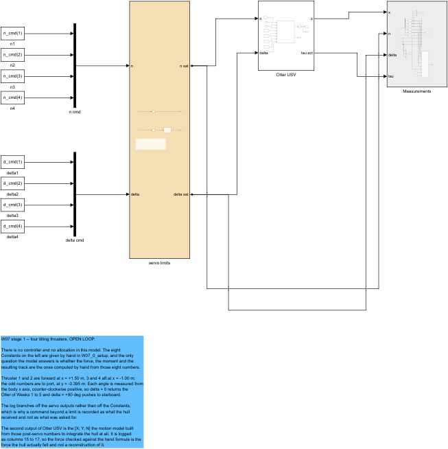

The green block is `otter_tilt4`; the grey one logs `[u v r N E psi]`, then the post-servo $(n, \delta)$ tapped from the branches below, and last the $[X\;Y\;N]$ the plant returns on its second output.

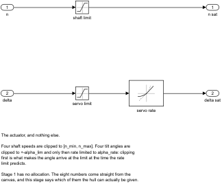

The upper lane clips the shaft speed to $[-101.737, +103.931]$ rad/s; the lower clips the angle to $\pm 45^\circ$ and only then rate-limits it to $90^\circ$/s. The two never meet, because shaft speed and tilt angle are independent commands.

> [!important] The angle is clipped before it is rate-limited, not after
> Rate-limiting first would let the limiter chase a $70^\circ$ target through the legal range and sit at $45^\circ$ only on arrival, so the recorded angle would depend on how long the run lasted. Clipping first makes the target legal, and the rate limiter then describes only how fast the servo gets there.

### Experiment 7-3 · Eight commands, and the force each one makes (20 min)

**What it measures.** Lines 2 and 5: that the force the plant reports is the force the column rule predicts, and that the servo clip is visible in the table.

**The model.** `W07_openloop.slx`. Between runs only the eight constants change; the wiring does not.

**Opening and running.** One file runs the whole of Part 1. Its `S` list holds one line per scenario, and a `%` in front of a line drops that scenario, so one case can be re-examined without redrawing the other seven.

```matlab
W07_0_setup
open_system('W07_openloop')    % Run — 궤적과 상태량이 뜬다 / the track appears
W07_openloop_run               % S 에 남은 것만 돈다 / whatever is left in S runs
```

The `S` list inside `W07_openloop_run.m`, with nothing commented out, is the full eight:

```matlab
S = { ...
    'S1'  [ 60  60 -60 -60]  [  0   0   0   0]  'surge ahead'
    'S2'  [-60 -60  60  60]  [  0   0   0   0]  'surge astern'
    'S3'  [ 60  60  60  60]  [ 45  45  45  45]  'yaw to starboard'
    'S4'  [ 60  60  60  60]  [-45 -45 -45 -45]  'yaw to port'
    'S5'  [ 60  60  60  60]  [ 45  45 -45 -45]  'sway to starboard'
    'S6'  [ 60  60  ns  ns]  [ 45  45 -45 -45]  'sway, moment cancelled'
    'S7'  [ 60  60 -60 -60]  [ 45  45   0   0]  'turn while making way'
    'S8'  [ 60  60  60  60]  [ 70  70 -70 -70]  'tilt beyond the servo limit'
};
```

The first line left in `S` is also left in the base workspace as `n_cmd` and `d_cmd`, so pressing **Run** in the open model afterwards repeats that one scenario without any further editing.

Expected output, the first of the two tables printed by that script:

```
  W07 open loop  --  8 of 8 scenarios selected : S1 S2 S3 S4 S5 S6 S7 S8
  the base workspace now holds S1, so Run in W07_openloop reproduces it

  (1) the hand formula against the force the hull reports

      X = sum si Ti cos di,   Y = sum si Ti sin di
      N = sum si (xi sin di - yi cos di) Ti
      s = [+1 +1 -1 -1], the mounting signs
      tau is column 15 to 17 of the log: what otter_tilt4 built for
      itself out of the post-servo n and delta

    case  n [rad/s] after servo      delta [deg] clipped       X [N]    Y [N]  N [N m]    resid  clip
    ---------------------------------------------------------------------------------------------------
    S1    [ 60.0  60.0 -60.0 -60.0]  [   0    0    0    0]   126.180    0.000    0.000  0.0e+00  n 0  d 0
    S2    [-60.0 -60.0  60.0  60.0]  [   0    0    0    0]  -126.180   -0.000    0.000  0.0e+00  n 0  d 0
    S3    [ 60.0  60.0  60.0  60.0]  [  45   45   45   45]     0.000    0.000  141.025  2.8e-14  n 0  d 1
    S4    [ 60.0  60.0  60.0  60.0]  [ -45  -45  -45  -45]     0.000    0.000 -141.025  2.8e-14  n 0  d 1
    S5    [ 60.0  60.0  60.0  60.0]  [  45   45  -45  -45]     0.000  112.820   28.205  3.6e-15  n 0  d 1
    S6    [ 60.0  60.0  73.5  73.5]  [  45   45  -45  -45]   -28.205  141.025    0.000  2.1e-14  n 0  d 1
    S7    [ 60.0  60.0 -60.0 -60.0]  [  45   45    0    0]   102.814   56.410   84.615  1.4e-14  n 0  d 1
    S8    [ 60.0  60.0  60.0  60.0]  [  45   45  -45  -45]     0.000  112.820   28.205  3.6e-15  n 0  d 1
    ---------------------------------------------------------------------------------------------------
    worst 2.8e-14 N or N m over the 8 scenarios, from t = 0.58 s on
```

The `clip` column flags whether any unit ended the run sitting on a limit: `d 1` on S3 to S8 is a tilt angle at $\pm 45^\circ$, which for S8 is the $70^\circ$ brought down to the limit.

| What to try | What to watch |
|---|---|
| leave only the `'S1'` line in `S` | the S1 sheet alone: surge only, and the vessel of Weeks 1 to 6 is back |
| leave only the `'S5'` and `'S6'` lines in `S` | two sheets and a two-curve overlay: the leftover moment, and the same crab with that moment cancelled |

## 7-4. Three asymmetries that break the symmetric guess

**What is observed.** Three asymmetries run through the eight rows of table (1), and each one is a property of the vessel rather than of the command.

- the thrust curve: $+60$ rad/s gives $+39.888$ N, $-60$ rad/s gives only $-23.202$ N
- the stations: $l_f = 1.50$ m forward against $l_a = 1.00$ m aft
- the servo: $70^\circ$ asked, $45^\circ$ given

**The result.** Each has a closed form, and each predicts a number in the table.

$$
\underbrace{n_{rev} = -n\sqrt{\frac{k_{pos}}{k_{neg}}} = -78.670\ \text{rad/s}}_{\text{thrust curve}},
\qquad
\underbrace{N = \bar{x}\,Y, \quad \bar{x} = \frac{l_f - l_a}{2} = 0.25\ \text{m}}_{\text{stations}}
$$

| Symbol | Quantity | Value · source |
|---|---|---|
| $k_{pos}$ | thrust coefficient, ahead | $0.02216/2 = 0.011080$ — `otter.m`, unchanged |
| $k_{neg}$ | thrust coefficient, astern | $0.01289/2 = 0.006445$ — same |
| $k_{neg}/k_{pos}$ | the asymmetry ratio | $0.5817$ — printed by `W07_0_setup` |
| $n_{rev}$ | astern speed matching $+60$ rad/s | $-78.670$ rad/s — printed by `verify_otter_tilt4` |
| $\bar{x}$ | longitudinal centroid of the four stations | $0.25$ m |
| $N$ | residual yaw of a four-unit symmetric crab | $+28.205$ N·m — table (1), row S5 |

**Derivation, one line at a time.**

1. The thrust of one propeller is the signed square $T = k n\lvert n\rvert$, with $k = k_{pos}$ for $n \geq 0$ and $k = k_{neg}$ for $n < 0$. Both coefficients are positive, and $k_{neg} < k_{pos}$ because a propeller designed to push ahead is less efficient in reverse.
2. Running one unit at $+n$ and another at $-n$ therefore does not cancel: $T(+n) + T(-n) = (k_{pos} - k_{neg})n^2$.
3. Row S1 runs the bow pair at $+60$ rad/s and the stern pair at $-60$. Each stern unit returns $-23.202$ N, which its mounting sign $s_i = -1$ turns into $+23.202$ N of ahead force, so the four push ahead in unequal shares — $39.888$ N forward against $23.202$ N aft, a ratio of $1.72$. Row S2 swaps which pair runs astern, so $\lvert X\rvert$ is the same $126.180$ N in both. The thrust curve does not break the fore–aft symmetry of the total; it breaks **the split between the pairs**, and that split decides each pair's moment as soon as the units tilt.
4. Setting $k_{pos}n^2 + k_{neg}n_{rev}\lvert n_{rev}\rvert = 0$ with $n_{rev} < 0$ gives the astern speed at which a unit matches a forward one: $n_{rev} = -n\sqrt{k_{pos}/k_{neg}} = -60 \times 1.3112 = -78.670$ rad/s. `verify_otter_tilt4` prints it as `cancelling astern speed`.
5. The second asymmetry needs no thrust curve at all. Take row S5 — the bow pair at $\delta = +45^\circ$, the stern pair at $-45^\circ$, all four at the same thrust $T$. With the mounting signs every unit makes the **same** sway force $f_y = T\sin 45^\circ = 28.205$ N, while the surge forces alternate: $+f_x$ forward, $-f_x$ aft. Then

$$
N \;=\; \sum_i \bigl(x_i f_y - y_i f_{ix}\bigr) \;=\; f_y\sum_i x_i \;-\; \sum_i y_i f_{ix}
$$

6. The second sum is zero: inside each pair the two units sit at $\pm y$ with the same $f_{ix}$, so their two contributions cancel. The first sum is not zero: $\sum x_i = 2l_f - 2l_a = 1.0$ m, so $N = 2(l_f - l_a)f_y$.
7. Dividing by $Y = 4f_y$ puts it in the form that explains itself: $N = \bar{x}Y$ with $\bar{x} = \tfrac14\sum x_i = (l_f - l_a)/2 = 0.25$ m. Four equal sway forces are one sway force acting at the centroid of the four stations, and that centroid is $0.25$ m ahead of $o_b$. With $Y = 112.820$ N this is $N = 112.820 \times 0.25 = 28.205$ N·m, the S5 and S8 reading.

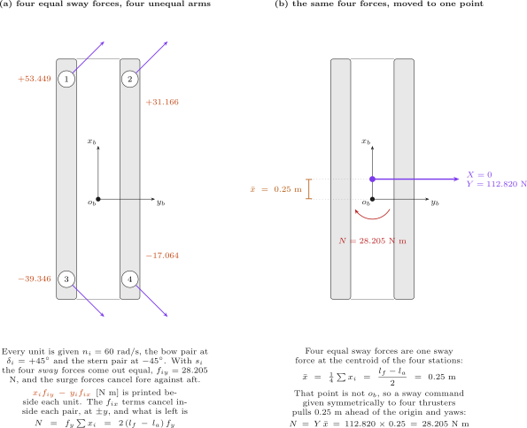

8. The condition that removes it follows from the same sum with the bow pair at $T_f$ and the stern pair at $T_a$, all at $\lvert\delta\rvert = 45^\circ$: $\sum x_i T_i = 3.0T_f - 2.0T_a = 0$, hence $T_a = 1.5T_f$. With $T_f = 39.888$ N this needs $T_a = 59.832$ N, that is $n_a = \sqrt{59.832/k_{pos}} = 60\sqrt{1.5} = 73.485$ rad/s. Row S6 runs it and reads $N = 0.000$ N·m — at the price of $X = 2\cos 45^\circ\,(T_f - T_a) = -28.205$ N. The moment did not vanish; it became a surge of the same number. No *common* shaft speed can do this, because the asymmetry is geometric: four equal thrusts inside $\pm45^\circ$ always leave $28.205$ N·m, and only unequal ones can do better (Assignment requirement 2).
9. The third asymmetry is the servo, and it is not a sign or a ratio but a limit. $\delta$ is clipped before the column rule sees it, so the force is computed from $45^\circ$ whatever was asked. A command of $70^\circ$ and a command of $45^\circ$ are the same command to this vessel.
10. All three together are the argument for an allocator: solving by hand, as line 8 did for one condition, does not scale to three conditions and a changing state.

### Experiment 7-4 · The three asymmetries, measured (20 min)

**What it measures.** Lines 3, 4, 7, 8 and 9, each against a row of table (1).

**The model.** The same `W07_openloop.slx`. `W07_openloop_run` prints the three asymmetries below table (2), from the same eight runs.

**Opening and running.**

```matlab
W07_openloop_run               % S 전부 — 여덟 줄 / all of S, all eight rows
```

Leaving only the `'S5'` and `'S6'` lines in `S` isolates the second asymmetry.

Expected output, the block printed below table (2):

```
      thrust curve   +60 rad/s gives +39.888 N, -60 rad/s gives -23.202 N
      the stations   l_f = 1.50 m forward, l_a = 1.00 m aft
      the servo      +-45 deg, so 70 deg is given as 45 deg
```

Each line is read against a row above it: the thrust curve against S1 and S2, the stations against S5 and S6, the servo against S8.

| What to try | What to watch |
|---|---|
| leave only the `'S6'` line in `S` | $N = 0.000$ N·m against S5's $+28.205$, and $X$ going from $0$ to $-28.205$ N |
| `d_deg = [90 90 -90 -90]'` in `W07_0_setup`, expecting a pure sway | the table returns S5's row. The servo refuses the extra $45^\circ$ — line 9, not a sway |

## 7-5. The track those forces produce

**What is observed.** Experiment 7-5 runs each of the eight cases for 30 s from rest and reads four quantities at the end. S1 runs straight at $1.627$ m/s; S5 crabs at $74.28^\circ$ while turning; S8 lies exactly on S5.

- the readings are taken at $t = 30$ s, by when all eight have settled
- the crab angle is $\beta = \operatorname{atan2}(v, u)$ and the speed is $U = \sqrt{u^2 + v^2}$
- turn radius is $U/\lvert r\rvert$, reported as `straight` when $\lvert r\rvert < 10^{-4}$ rad/s

**The result.** A force held constant in body axes produces a steady body-frame velocity, and a steady velocity with a steady yaw rate is a circle.

$$
U = \sqrt{u^2 + v^2},
\qquad
\beta = \operatorname{atan2}(v, u),
\qquad
R = \frac{U}{\lvert r \rvert}
$$

| Symbol | Quantity | Value · source |
|---|---|---|
| $U$ | total speed over the water | read at $t = 30$ s |
| $\beta$ | crab angle, body $x$ to the velocity | positive to starboard |
| $R$ | radius of the steady turn | $U/\lvert r\rvert$; infinite when $r = 0$ |
| $T_{final}$ | run length for these readings | 30 s, from `W07_vars` |

**Derivation, one line at a time.**

1. With $(n, \delta)$ held constant, $\boldsymbol{\tau}$ is constant in body axes, so the body-frame equation $M\dot{\boldsymbol{\nu}} + \mathbf{d}(\boldsymbol{\nu}) = \boldsymbol{\tau}$ is autonomous and settles on an equilibrium $\boldsymbol{\nu}^\star$ where damping balances thrust.
2. That equilibrium is reached in a few seconds for surge and sway, and in rather longer for yaw, because the nonlinear yaw damping $N_h = N_r(1 + 10\lvert r\rvert)r$ stiffens as $r$ grows.
3. At equilibrium the body-frame velocity is fixed but the heading is not: $\dot\psi = r \neq 0$ rotates the velocity in the Earth frame, which traces a circle of radius $U/\lvert r\rvert$.
4. The crab angle $\beta$ is a property of that equilibrium, not of the command. Row S7's force stands at $\operatorname{atan2}(56.410, 102.814) = 28.74^\circ$ in body axes, yet the hull crabs at only $5.89^\circ$, because sway damping on this hull is far larger than surge damping.
5. A case with $r = 0$ runs straight in the direction $\beta$, and three rows do: S1 at $\beta = 0$, S2 at $180^\circ$, and S6 at $114.0^\circ$ — a heading held while the hull travels sideways and slightly astern.
6. S8 must trace S5's circle exactly, since §7-4 line 9 showed the two commands reach the plant identically. The overlay draws S8 dashed so the coincidence is visible rather than hidden by overdrawing.

### Experiment 7-5 · Eight tracks from eight commands (20 min)

**What it measures.** Lines 3 to 6: that each command settles, that the settled state is a circle or a straight line, and that S8 and S5 coincide.

**The model.** The same `W07_openloop.slx`, run eight times at $T_{final} = 30$ s. Each run gets **its own sheet** — `img/W07_result_S1.png` … `_S8.png` — because eight curves in one axes erase each other and the question of this section is whether each scenario did what was written down for it.

**Opening and running.**

```matlab
W07_openloop_run               % S 전부 — 여덟 장 / all of S, all eight sheets
```

Expected output, the second table:

```
  (2) the motion those forces produce, read at t = 30 s

    case  command                      U [m/s]  crab [deg]  r [deg/s]  radius [m]
    ----------------------------------------------------------------------------
    S1    surge ahead                    1.627        0.00      0.000    straight
    S2    surge astern                   1.627      180.00      0.000    straight
    S3    yaw to starboard               0.030      -21.14     28.397        0.06
    S4    yaw to port                    0.030       21.14    -28.397        0.06
    S5    sway to starboard              0.747       74.28      7.589        5.64
    S6    sway, moment cancelled         0.895      113.99     -0.000    straight
    S7    turn while making way          1.464        5.89     20.239        4.15
    S8    tilt beyond the servo limit    0.747       74.28      7.589        5.64
    ----------------------------------------------------------------------------
```

Each sheet carries the six states on the left, **the command drawn as four force arrows** at the top right, and the track with hull and heading below it. The arrow panel is what makes a wrong command distinguishable from a wrongly followed one.

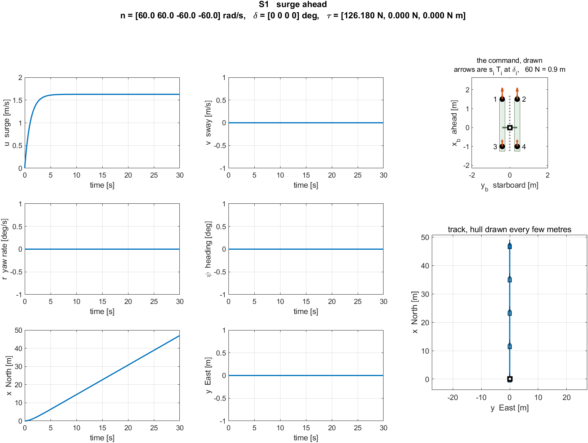

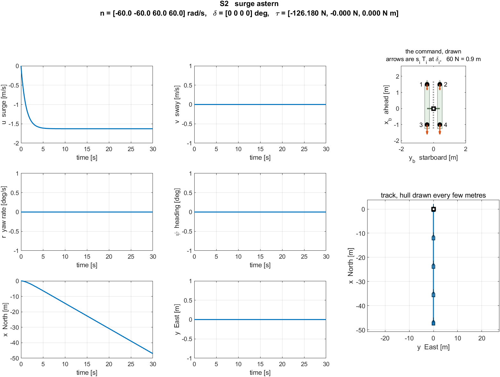

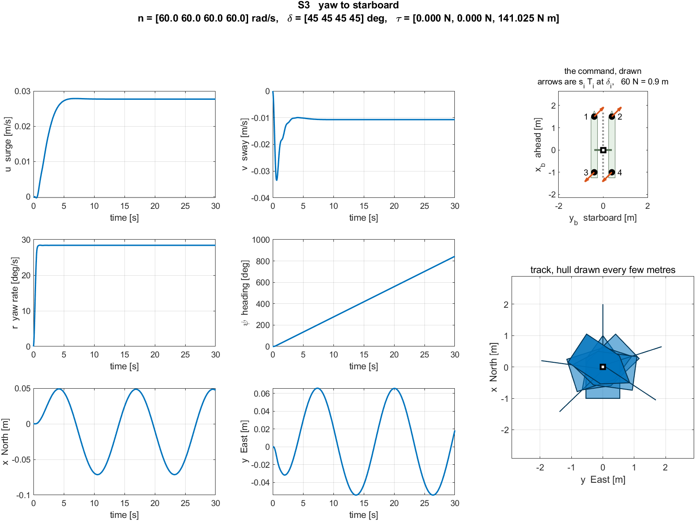

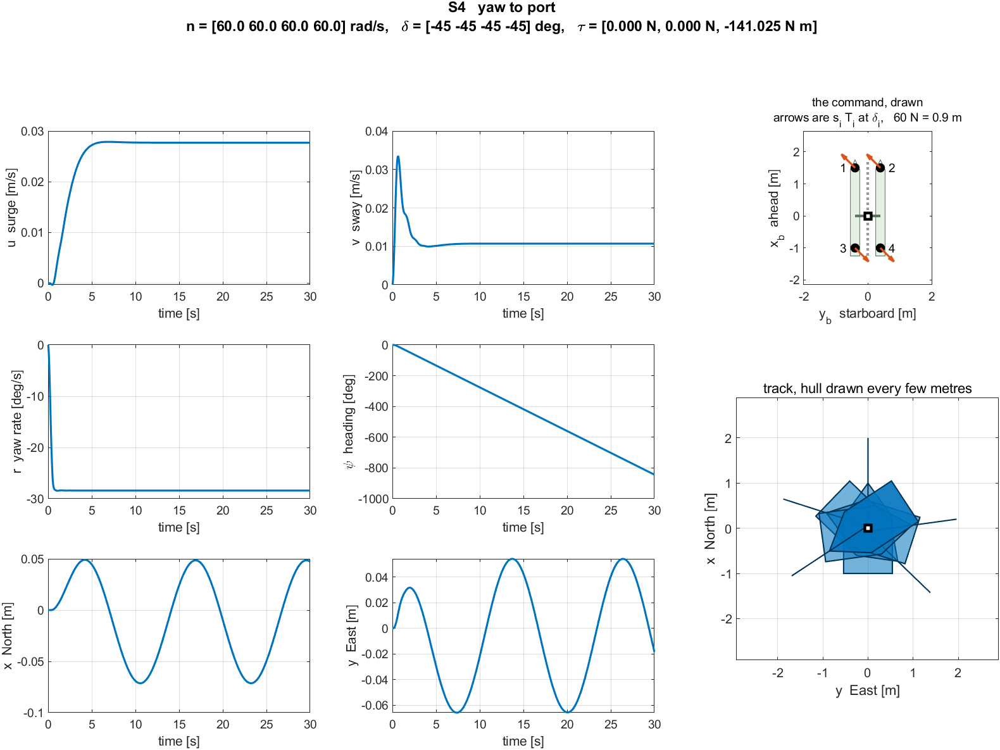


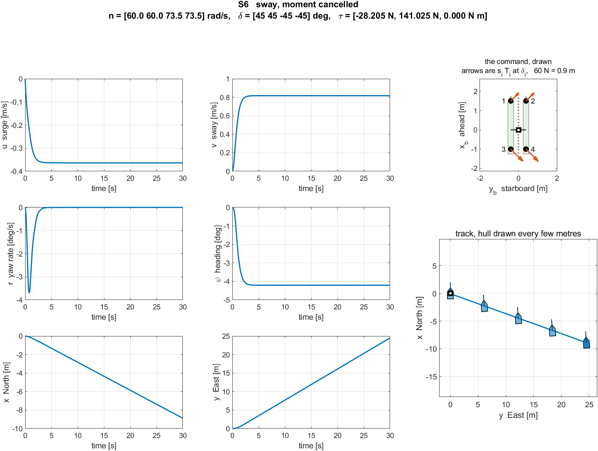

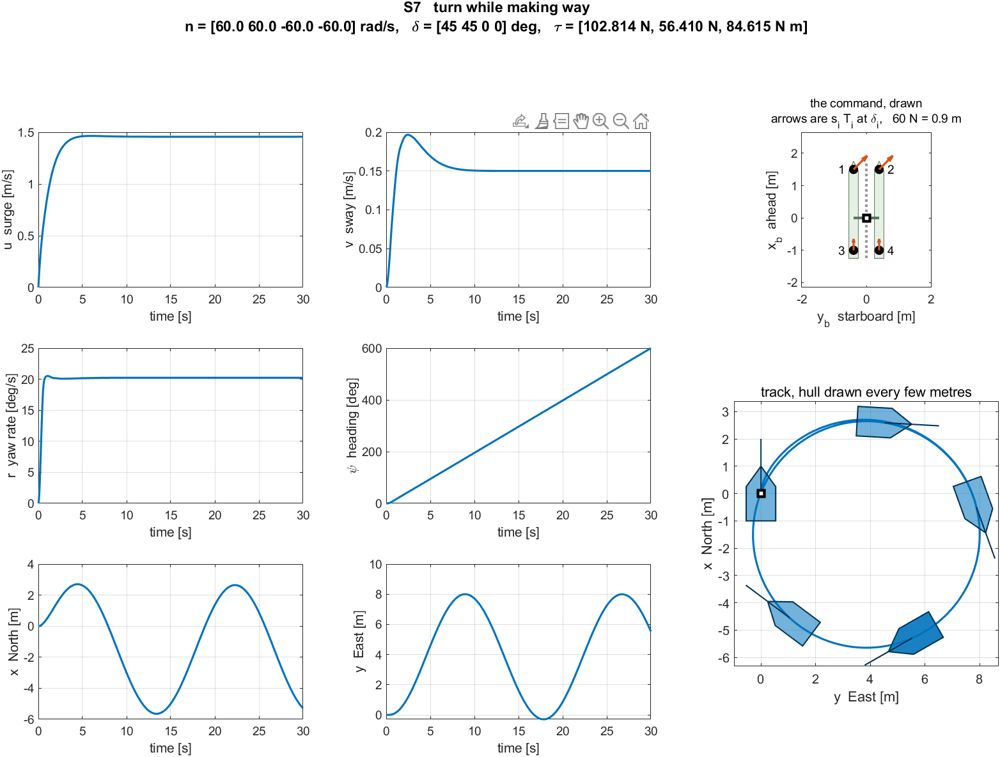

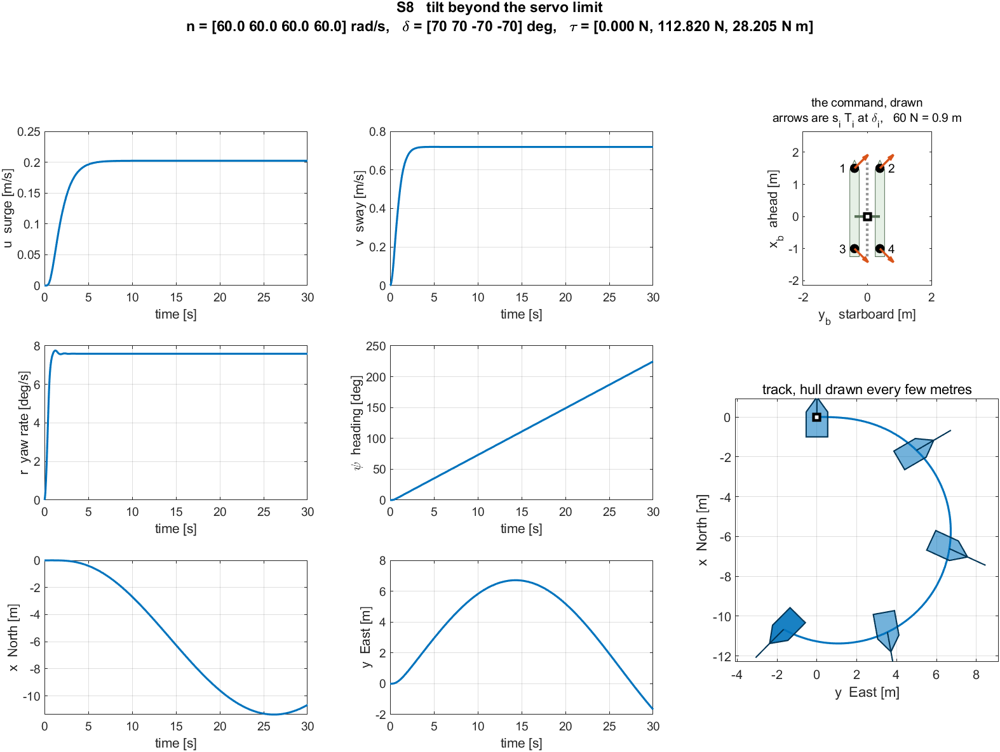

The overlay below is kept for comparison only.

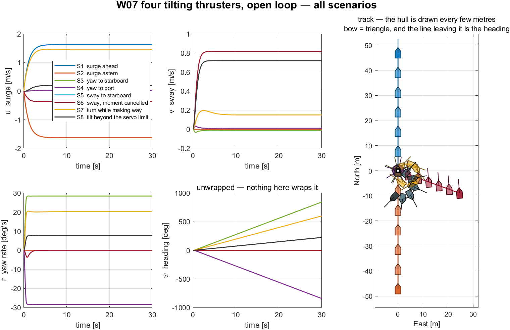

| What to try | What to watch |
|---|---|
| `T_final = 120; animate = 1;` then Run | the hull drawn along the circle; S5 closes its $5.64$ m circle in about 47 s |
| leave only the `'S5'` and `'S6'` lines in `S` | two sheets and no overlay file written — a partial run never overwrites the figure this section embeds |

## 7-6. When the comparison may be read

**What is observed.** Table (1) states a window: `from t = 0.58 s on`. Before that instant the hand formula and the logged force genuinely differ, and the difference is not an error. The tilt servo is still travelling.

- $0.58$ s is not a tuned number: it is the servo rate limit plus four solver steps
- the window is computed from the **clipped** command, so S8 gets S5's window

**The result.** The instant from which the residual is read follows from the rate limit and the step.

$$
t_s \;=\; \frac{\max_i\lvert\delta_i\rvert}{\dot\delta_{\max}} \;+\; 4h
\;=\; \frac{45^\circ}{90^\circ/\text{s}} + 4(0.02\ \text{s}) \;=\; 0.58\ \text{s}
$$

| Symbol | Quantity | Value · source |
|---|---|---|
| $\max_i\lvert\delta_i\rvert$ | largest clipped tilt command of the scenario | $45^\circ$ for S3 to S8, $0^\circ$ for S1 and S2 |
| $\dot\delta_{\max}$ | servo rate limit | $90^\circ$/s — `alpha_rlim`, `otter_config('quad_tilt')` |
| $h$ | fixed solver step | $0.02$ s — `W07_vars` |
| $t_s$ | first instant of the comparison window | $0.58$ s — printed on the last line of table (1) |

**Derivation, one line at a time.**

1. The hand formula is evaluated once per scenario, on the clipped command. It is the force of the angle the servo will **reach**, not of the angle it holds at a given instant.
2. The plant builds its force afresh every step, out of the angle the rate limiter has reached by then. From $\delta = 0$ that angle climbs at $\dot\delta_{\max}$, so the two are unequal for as long as it climbs.
3. A rate limiter covers $\lvert\delta\rvert$ in $\lvert\delta\rvert/\dot\delta_{\max}$, which is $0.5$ s for the $45^\circ$ of S3 to S8 and zero for the two surge rows.
4. Four steps are added so that the first sample compared is taken after arrival rather than on the step that straddles it. Nothing is tuned here: $4h$ is $0.08$ s at the step the model runs.
5. From $t_s$ on, both sides hold the same constant angle, and table (1) reports $10^{-14}$ — the double-precision floor. Two independent transcriptions of the column rule agree to the last bits.
6. What this does not reach is the integration: the force is read from the model, not integrated by the script, so neither table can be wrong about the solver or the step alone.

| Check | What it catches | What it cannot catch |
|---|---|---|
| table (1), the force | a wrong column, sign or arm; a tap taken on the wrong signal; the order of clip and rate limit | an error inside the hull's own equations, and anything about the integration |
| table (2), the motion | that the force reaches the equilibrium §7-5 derives, and that S8 lies on S5 | the solver and the step, which are tested by halving $h$ and seeing whether the table moves |

### Experiment 7-6 · The window, and what each table covers (15 min)

**What it measures.** Lines 3 and 4: that the printed window is the servo rate limit and the step, and nothing else.

**The model.** The same eight runs. Block (1) of `W07_openloop_run` prints the window on the last line of table (1).

**Opening and running.**

```matlab
W07_openloop_run               % 창은 (1) 의 마지막 줄 / the window is (1)'s last line
```

Expected output, that last line:

```
    worst 2.8e-14 N or N m over the 8 scenarios, from t = 0.58 s on
```

| What to try | What to watch |
|---|---|
| replace line 29 of `W07_vars` with `V.alpha_rate = deg2rad(45);` | the window moves to $45/45 + 0.08 = 1.08$ s and the residual stays on the $10^{-14}$ floor: the force depends on where the servo arrived, not on how fast it got there |
| `V.h = 0.01;` in `W07_vars` | table (2) should not move in its printed digits. If it does, the step was too coarse for the stiffening yaw damping of §7-5 line 2 |

---

## 7-7. Three numbers in, eight numbers out

**What is observed.** Every control law of Weeks 2 to 6 ends in a demanded force: a surge force $X$, a sway force $Y$, a yaw moment $N$. The hull of this week does not accept those three numbers. It accepts four shaft speeds and four servo angles. The stage that stands between them is **control allocation**.

From here to the end of the week the controller is **assumed given**. No gain is tuned and no error signal appears. The demand

$$\boldsymbol{\tau}_d = \begin{bmatrix} X \\ Y \\ N \end{bmatrix}$$

arrives from outside the stage under study, exactly as a measurement arrives from outside a filter. What is studied is the map from those three numbers to the eight the hardware needs.


**The result.** The stage has one input, one output, and a fixed table of things it knows in advance.

| Symbol | Quantity | Size and units |
|---|---|---|
| $\boldsymbol{\tau}_d$ | demanded surge force, sway force, yaw moment | $3\times1$, [N, N, N·m] |
| $\mathbf{f}$ | per-unit thrust components $[f_{x,1}; f_{y,1}; \dots; f_{x,4}; f_{y,4}]$ | $8\times1$, [N] |
| $\mathbf{B}$ | configuration matrix of §7-1, from the Week 3 column rule | $3\times8$, [--, --, m] |
| $\mathbf{W}$ | weight matrix — the price put on each component | $8\times8$, diagonal |
| $\alpha_{\max}$ | servo limit of each unit, $45^\circ$ for all four | $4\times1$, [rad] |
| $\mathbf{n}$ | shaft speeds handed to the plant | $4\times1$, [rad/s] |
| $\boldsymbol{\delta}$ | servo angles handed to the plant | $4\times1$, [rad] |
| $\boldsymbol{\tau}$ | **achieved** force, $\mathbf{B}\mathbf{f}$, which is compared with $\boldsymbol{\tau}_d$ | $3\times1$, [N, N, N·m] |

**The count that decides which week this is.** Three planar degrees of freedom are commanded in every week of this course — surge, sway, yaw. What changes from week to week is how many independent control variables the hull offers against those three, and the rank test of Week 6 §6-1 turns that count into a name.

| Configuration | Control variables | $\operatorname{rank}\mathbf{B}$ | Name | Commands that achieve a reachable $\boldsymbol{\tau}_d$ |
|---|---|---|---|---|
| two fixed propellers — Weeks 1 to 5 | 2 | 2 | under-actuated | none at all when $Y \neq 0$: row 2 of $\mathbf{B}$ is identically zero |
| plus one bow tunnel thruster — Week 6 | 3 | 3 | fully actuated | exactly one, $\mathbf{f} = \mathbf{B}^{-1}\boldsymbol{\tau}_d$ |
| four tilting units, two components each — this week | 8 | 3 | over-actuated | infinitely many |

Week 6 sat on the middle row, and a square system with a non-zero determinant behaves as the two-unknown systems of elementary algebra behave: $4x + 5y = 3$ together with $10x - 3y = 2$ has one answer, elimination finds it, and the question of a *better* answer never arises because no other answer exists. On that hull $\det\mathbf{B}_6 = 2d = 0.790$ m, with $d = 0.395$ m the transverse arm of §7-1, so the inverse existed and the allocator of §6-2 was a matrix multiply (Week 6 §6-1, derivation step 5; `otter_config('bow_thruster')`).

Two facts fix everything that follows, and one consequence.

1. By §7-1 each tilting unit contributes **two** columns to $\mathbf{B}$, so the force is linear in the eight components and the equation to be solved has **three rows and eight unknowns**:

$$\mathbf{B}\mathbf{f} = \boldsymbol{\tau}_d, \qquad
\operatorname{rank}\mathbf{B} = 3, \qquad \dim\ker\mathbf{B} = 8 - 3 = 5$$

2. This is not a matrix inversion. Five dimensions of freedom mean that for **any** reachable $\boldsymbol{\tau}_d$ there are infinitely many eight-number commands that achieve it exactly: if $\mathbf{f}^\star$ is one and $\mathbf{B}\mathbf{z} = \mathbf{0}$, then $\mathbf{f}^\star + \mathbf{z}$ achieves the same force.

3. Allocation is therefore not the problem of finding **a** solution but of **choosing among** them. Every method in §7-8 to §7-11 differs only in what it decides to make small, and in which limits it refuses to exceed.

> [!important] What makes this a design problem and not an algebra problem
> An under-determined system has no single answer, so the engineer must supply the missing statement of what a good answer is. The three statements used in this course, in the order they are introduced: **use as little thrust as possible** (§7-8), **use the cheap components before the expensive ones** (§7-9), and **never ask a servo for an angle it does not have** (§7-10).

---

## 7-8. The smallest solution: the pseudo-inverse

**What is observed.** Among the infinitely many commands that achieve a demanded force, one is shorter than all the others. Making that choice turns an under-determined equation into a formula with no iteration in it.

**The result.** The choice is written as a minimisation, solved once with Lagrange multipliers, and the answer is a constant matrix times the demand.

**Derivation.**

1. Choose what to make small. The sum of squares of the eight components is the natural first choice, because it is the square of the total thrust vector's length:

$$J(\mathbf{f}) = \mathbf{f}^\top\mathbf{f} = \sum_{i=1}^{4}\left(f_{x,i}^2 + f_{y,i}^2\right) = \sum_{i=1}^{4} T_i^2$$

2. State the problem. Minimise $J$ subject to achieving the demand exactly:

$$\min_{\mathbf{f}} \ \mathbf{f}^\top\mathbf{f} \quad \text{subject to} \quad \mathbf{B}\mathbf{f} = \boldsymbol{\tau}_d$$

3. Attach the constraint with a multiplier $\boldsymbol{\lambda} \in \mathbb{R}^3$, one entry for each row of $\mathbf{B}$:

$$L(\mathbf{f}, \boldsymbol{\lambda}) = \mathbf{f}^\top\mathbf{f} + \boldsymbol{\lambda}^\top\!\left(\boldsymbol{\tau}_d - \mathbf{B}\mathbf{f}\right)$$

4. Set the gradient in $\mathbf{f}$ to zero. This is where the eight unknowns collapse onto three:

$$\frac{\partial L}{\partial \mathbf{f}} = 2\mathbf{f} - \mathbf{B}^\top\boldsymbol{\lambda} = \mathbf{0}
\quad\Longrightarrow\quad
\mathbf{f} = \tfrac{1}{2}\mathbf{B}^\top\boldsymbol{\lambda}$$

5. The solution is thus constrained to lie in the three-dimensional row space of $\mathbf{B}$. Substituting it back into the constraint gives the multiplier:

$$\mathbf{B}\!\left(\tfrac{1}{2}\mathbf{B}^\top\boldsymbol{\lambda}\right) = \boldsymbol{\tau}_d
\quad\Longrightarrow\quad
\boldsymbol{\lambda} = 2\left(\mathbf{B}\mathbf{B}^\top\right)^{-1}\boldsymbol{\tau}_d$$

6. Put the multiplier back into line 4:

$$\boxed{\ \mathbf{f} = \mathbf{B}^\top\left(\mathbf{B}\mathbf{B}^\top\right)^{-1}\boldsymbol{\tau}_d\ }$$

6-a. **The same six lines, on two numbers instead of eight.** The algebra above is short but abstract, so the identical derivation is carried out here on a problem small enough to finish on paper. Two thrusters sit on one shaft line of a hull, one at a moment arm of $1$ m and the other at $2$ m, and both push sideways. Only the yaw row is demanded:

$$\mathbf{B} = \begin{bmatrix} 1 & 2 \end{bmatrix}, \qquad
\boldsymbol{\tau}_d = 10 \ \text{N m}, \qquad
\mathbf{f} = \begin{bmatrix} f_1 \\ f_2 \end{bmatrix}$$

&nbsp;&nbsp;&nbsp;&nbsp;One equation, two unknowns: the demand $f_1 + 2f_2 = 10$ is a straight line of solutions, and the task is to pick the point on that line closest to the origin. Each step below is the step of the same number in the derivation above.

| Step | The general line | The same line, with numbers |
|---|---|---|
| 1 | $J = \mathbf{f}^\top\mathbf{f}$ | $J = f_1^2 + f_2^2$ |
| 2 | $\min J$ s.t. $\mathbf{B}\mathbf{f} = \boldsymbol{\tau}_d$ | $\min\ f_1^2 + f_2^2$ s.t. $f_1 + 2f_2 = 10$ |
| 3 | $L = \mathbf{f}^\top\mathbf{f} + \boldsymbol{\lambda}^\top(\boldsymbol{\tau}_d - \mathbf{B}\mathbf{f})$ | $L = f_1^2 + f_2^2 + \lambda\,(10 - f_1 - 2f_2)$ |
| 4 | $2\mathbf{f} - \mathbf{B}^\top\boldsymbol{\lambda} = \mathbf{0}$ | $2f_1 = \lambda$ and $2f_2 = 2\lambda$, so $\mathbf{f} = \tfrac{\lambda}{2}\begin{bmatrix}1\\2\end{bmatrix}$ |
| 5 | $\boldsymbol{\lambda} = 2(\mathbf{B}\mathbf{B}^\top)^{-1}\boldsymbol{\tau}_d$ | $\mathbf{B}\mathbf{B}^\top = 1^2 + 2^2 = 5$, so $\lambda = \dfrac{2\cdot 10}{5} = 4$ |
| 6 | $\mathbf{f} = \mathbf{B}^\top(\mathbf{B}\mathbf{B}^\top)^{-1}\boldsymbol{\tau}_d$ | $\mathbf{f} = \begin{bmatrix}1\\2\end{bmatrix}\dfrac{10}{5} = \begin{bmatrix}2\\4\end{bmatrix}$ N |

&nbsp;&nbsp;&nbsp;&nbsp;The constraint is met exactly, $1\cdot 2 + 2\cdot 4 = 10$ N·m, at a cost of $J^\star = 2^2 + 4^2 = 20$ N². Three remarks make this worth the page.

6-b. **The answer shares the demand in proportion to authority.** The thruster at the $2$ m arm is given twice the force of the one at $1$ m, because line 4 forces $\mathbf{f}$ to be a multiple of $\mathbf{B}^\top$ — the column of $\mathbf{B}$ *is* each unit's authority. The minimum-norm solution therefore leans on whichever unit is most effective, with no rule written anywhere that says so. Two other commands satisfy the same demand and cost more:

| Command | $f_1 + 2f_2$ | $J = f_1^2 + f_2^2$ | What it does |
|---|---|---|---|
| $(10,\ 0)$ | $10$ | $100$ | the whole demand on the weak unit |
| $(0,\ 5)$ | $10$ | $25$ | the whole demand on the strong unit |
| $(2,\ 4)$ | $10$ | $\mathbf{20}$ | the minimum-norm share |

6-c. **The null space is one direction here, and moving along it only costs.** Any $\mathbf{z}$ with $\mathbf{B}\mathbf{z} = 0$ satisfies $z_1 = -2z_2$, so $\mathbf{z} = (2,-1)$ spans it. Adding $a\mathbf{z}$ keeps the demand met and raises the cost by exactly $\lVert a\mathbf{z}\rVert^2 = 5a^2$, which is line 9 of the derivation with the cross term gone because $\mathbf{f} \perp \mathbf{z}$:

| $a$ | $\mathbf{f} + a\mathbf{z}$ | $\mathbf{B}(\mathbf{f} + a\mathbf{z})$ | $J$ | $20 + 5a^2$ |
|---|---|---|---|---|
| $-1.0$ | $(0.00,\ 5.00)$ | $10.0$ | $25.00$ | $25.00$ |
| $-0.5$ | $(1.00,\ 4.50)$ | $10.0$ | $21.25$ | $21.25$ |
| $0.0$ | $(2.00,\ 4.00)$ | $10.0$ | $20.00$ | $20.00$ |
| $+0.5$ | $(3.00,\ 3.50)$ | $10.0$ | $21.25$ | $21.25$ |
| $+1.0$ | $(4.00,\ 3.00)$ | $10.0$ | $25.00$ | $25.00$ |

6-d. **The multiplier is a price, and that is what makes it worth computing.** With the optimum substituted back, $J^\star(\tau_d) = \tau_d^2 / 5$, so

$$\frac{\mathrm{d}J^\star}{\mathrm{d}\tau_d} = \frac{2\tau_d}{5} = 4 = \lambda$$

&nbsp;&nbsp;&nbsp;&nbsp;$\lambda$ is therefore the cost of one more newton-metre: raising the demand from $10$ to $11$ N·m raises the optimal cost from $20$ to $24.2$ N², a difference of $4.2 \approx \lambda$. The multiplier is not bookkeeping introduced to make the gradient vanish — it is the marginal price of the demand, and in the $3\times8$ problem its three entries price surge, sway and yaw separately. Against this reading, line 5's $\boldsymbol{\lambda} = 2(\mathbf{B}\mathbf{B}^\top)^{-1}\boldsymbol{\tau}_d$ says that a demand along a direction in which the hull has little authority is expensive, which is exactly the statement §7-9 goes on to exploit.

6-e. **Verifying the hand solution.** The five lines below reproduce every number above, and the printed output is what they produce:

```matlab
B = [1 2];  tau = 10;
lam = 2*((B*B')\tau);          % the multiplier, line 5
f   = 0.5*B'*lam;              % the solution, line 4
fprintf('lambda = %g,  f = [%g %g],  B*f = %g,  J = %g\n', lam, f, B*f, f'*f);
fprintf('pinv agrees: [%.6f %.6f]\n', pinv(B)*tau);
```

```
lambda = 4,  f = [2 4],  B*f = 10,  J = 20
pinv agrees: [2.000000 4.000000]
```

6-f. **The block that carries line 6.** In the model, line 6 is not re-derived at run time; it is one statement inside the MATLAB Function block `law 1  minimum norm`, which a double-click on the block shows exactly as printed here:

```matlab
function f = law1_minimum_norm(tau_d, B_alloc)
% LAW 1 -- minimum norm.  Section 7-8.
%
%     min f'f    subject to    B f = tau_d        ->    f = B'(B B')\tau_d
%
% Eight unknowns against three equations: the demand leaves five directions
% free, and this law spends them on the shortest f. Nothing here knows about
% the servo limit or the thrust cap, which is what laws 3 and 4 go on to fix.
%
%     f = [f_x1; f_y1; f_x2; f_y2; f_x3; f_y3; f_x4; f_y4]
f = B_alloc' * ((B_alloc*B_alloc') \ tau_d);
end
```

| In the code | In the derivation | Note |
|---|---|---|
| `B_alloc` | $\mathbf{B}$, $3\times8$ | the Constant on the canvas, `cfg.B` of §7-7 |
| `tau_d` | $\boldsymbol{\tau}_d$, $3\times1$ | the demand entering the `allocation` subsystem |
| `(B_alloc*B_alloc') \ tau_d` | $(\mathbf{B}\mathbf{B}^\top)^{-1}\boldsymbol{\tau}_d$ | a $3\times3$ solve, not an $8\times8$ one |
| `B_alloc' * (...)` | the premultiplication of line 6 | returns the eight components |
| no loop, no solver | lines 1 to 6 are closed-form | this is why the law costs almost nothing |

&nbsp;&nbsp;&nbsp;&nbsp;The backslash is used in place of an explicit `inv`, which is the same solution computed without forming the inverse. Experiment 7-8 checks the block against the formula typed out by hand and finds them identical to $0.000\text{e}{+}00$ N.

7. The inverse exists. $\mathbf{B}\mathbf{B}^\top$ is only $3\times3$, and it is non-singular precisely because $\operatorname{rank}\mathbf{B} = 3$, which §7-1 verified for this geometry. The matrix $\mathbf{B}^\top(\mathbf{B}\mathbf{B}^\top)^{-1}$ is the Moore–Penrose pseudo-inverse $\mathbf{B}^{+}$ of a matrix with full row rank.

8. The residual is zero by construction, not approximately zero:

$$\mathbf{B}\mathbf{f} = \mathbf{B}\mathbf{B}^\top\left(\mathbf{B}\mathbf{B}^\top\right)^{-1}\boldsymbol{\tau}_d = \boldsymbol{\tau}_d$$

9. The solution is orthogonal to the null space. For any $\mathbf{z}$ with $\mathbf{B}\mathbf{z} = \mathbf{0}$, line 4 gives $\mathbf{f}^\top\mathbf{z} = \tfrac{1}{2}\boldsymbol{\lambda}^\top\mathbf{B}\mathbf{z} = 0$, so $\lVert\mathbf{f} + \mathbf{z}\rVert^2 = \lVert\mathbf{f}\rVert^2 + \lVert\mathbf{z}\rVert^2 \ge \lVert\mathbf{f}\rVert^2$. **Adding anything from the null space can only cost thrust.** This is the measurable prediction the derivation makes, and Experiment 7-8 tests it.

| Symbol | Quantity | Value or source |
|---|---|---|
| $\mathbf{B}^{+}$ | $\mathbf{B}^\top(\mathbf{B}\mathbf{B}^\top)^{-1}$, pseudo-inverse of $\mathbf{B}$ | $8\times3$, built from `cfg.B` |
| $\boldsymbol{\lambda}$ | Lagrange multiplier, one entry per demanded component | $3\times1$ |
| $\mathbf{z}$ | any null-space vector, $\mathbf{B}\mathbf{z} = \mathbf{0}$ | $8\times1$, 5 free dimensions |
| $\mathbf{B}\mathbf{B}^\top$ | the $3\times3$ matrix actually inverted | non-singular, $\operatorname{rank}\mathbf{B} = 3$ |

**From eight components to eight commands.** The plant of §7-2 takes shaft speeds and servo angles, not components, so one more stage is needed. It is pure trigonometry and the inverse of the thrust curve, and it contains no choices.

1. The sign of each unit's thrust is read off its forward component, so that a unit pushing astern is described as negative thrust at a small angle rather than positive thrust at $180^\circ$:

$$\sigma_i = \operatorname{sign}(f_{x,i}), \qquad
T_i = \sigma_i\sqrt{f_{x,i}^2 + f_{y,i}^2}$$

2. The servo angle is the direction of the component pair, measured in the frame the sign choice fixes:

$$\delta_i = \operatorname{atan2}\!\left(\sigma_i f_{y,i},\ \sigma_i f_{x,i}\right)$$

**What the sign is, as a piece of geometry.** Read the pair $(f_{x,i}, f_{y,i})$ as a point in the plane that unit lives in — $f_{x,i}$ forward, $f_{y,i}$ to starboard. Two properties of that plane decide lines 1 and 2 between them.

- **One push carries two names.** A thrust $T_i$ at angle $\delta_i$ and a thrust $-T_i$ at angle $\delta_i \pm \pi$ are the same force vector. The map from $(T_i, \delta_i)$ to $\mathbf{f}_i$ is two-to-one, so some rule has to say which of the two names is written down. Line 1 is that rule.
- **The servo reaches a wedge, not the plane.** With $\lvert\delta_i\rvert \le \alpha_{\max}$ the reachable directions form a wedge of half-angle $45^\circ$ about the $+f_{x,i}$ axis. Every direction with $f_{x,i} < 0$ lies outside it, and no clipping of $\delta_i$ can bring such a direction back, because clipping moves the angle to the nearest wall rather than to the nearest reachable force.

$\sigma_i = \operatorname{sign}(f_{x,i})$ reads **which half-plane the demand lies in**: the sign of a forward component is nothing more than the side of the $f_{y,i}$ axis the point sits on. Where that side is the astern one, multiplying *both* $\operatorname{atan2}$ arguments by $\sigma_i = -1$ performs a **point reflection through the origin**. A point reflection keeps the length $\lVert\mathbf{f}_i\rVert$ and turns the direction through exactly $\pi$, so the astern half-plane lands on the ahead half-plane without any force being altered. The sign carried on $T_i$ in line 1 is what pays for the turn, and it is the only thing the fold spends.


&nbsp;&nbsp;&nbsp;&nbsp;Cell (b) is why the fold cannot be postponed until after the limit is applied. Straight astern is the direction farthest from the wedge, and the angle $180^\circ$ is clipped to the nearest wall at $+45^\circ$ while the thrust stays positive — so the unit pushes the hull forward and sideways when it was asked to push it back. The folded command asks for $-50$ N at $\delta_i = 0$, which is the centre of the wedge: the limit never acts at all. The two columns of the table in 2-b are those two arrows.

&nbsp;&nbsp;&nbsp;&nbsp;One consequence of the fold is used throughout §7-10. After it, $\sigma_i f_{x,i} \ge 0$ holds by construction, so the only region the servo limit still has to describe is the right half-plane. There the limit $\lvert\delta_i\rvert \le \alpha_{\max}$ is the pair of straight lines $\lvert f_{y,i}\rvert \le f_{x,i}\tan\alpha_{\max}$, and a limit written as straight lines is a limit an optimiser can be handed.

2-a. **That $\sigma_i$ inside the $\operatorname{atan2}$ is the whole angle fold.** Multiplying *both* arguments by $\sigma_i = -1$ rotates the reported direction by exactly $\pi$, and since $\sigma_i f_{x,i} \ge 0$ always holds, the result can never leave $\left[-\tfrac{\pi}{2}, +\tfrac{\pi}{2}\right]$. Line 2 is therefore identical to the two-branch form in which the raw angle is taken first and then wrapped:

| One line, as written here | Two branches, written separately |
|---|---|
| $\sigma_i = \operatorname{sign}(f_{x,i})$ | $\alpha_i = \operatorname{atan2}(f_{y,i}, f_{x,i})$ |
| $T_i = \sigma_i\lVert(f_{x,i},f_{y,i})\rVert$ | if $\alpha_i > \pi/2$: $\ \alpha_i \leftarrow \alpha_i - \pi$ |
| $\delta_i = \operatorname{atan2}(\sigma_i f_{y,i},\ \sigma_i f_{x,i})$ | if $\alpha_i < -\pi/2$: $\ \alpha_i \leftarrow \alpha_i + \pi$ |
| — | the thrust sign is then carried as $\operatorname{sign}(f_{x,i})$ |

&nbsp;&nbsp;&nbsp;&nbsp;Over $20\,000$ random component pairs the two agree to $4.44\text{e}{-}16$ rad with no difference in commanded shaft speed, and rebuilding $\mathbf{f}$ from $(T_i, \delta_i)$ returns the original to $1.14\text{e}{-}13$ N, so the fold loses nothing.

2-b. **Without the fold the servo limit destroys the demand rather than weakening it.** A unit asked for $\mathbf{f}_i = (-50, 0)$ N is a unit pushing straight astern:

| | thrust $T_i$ | commanded $\delta_i$ | after the $45^\circ$ servo limit | force the unit then makes |
|---|---|---|---|---|
| raw $\operatorname{atan2}$, no fold | $+50.000$ N | $180.0^\circ$ | $45.0^\circ$ | $(+35.355, +35.355)$ N |
| folded, as in line 2 | $-50.000$ N | $-0.0^\circ$ | $-0.0^\circ$ | $(-50.000, 0.000)$ N |

&nbsp;&nbsp;&nbsp;&nbsp;The unfolded command is not merely degraded — the forward component has changed sign and a sideways component has appeared that was never demanded. Swept over a demand of $100$ N at every $5^\circ$ of heading, $216$ of the $288$ unit commands ($75\%$) have a raw angle outside $\pm45^\circ$, and the resulting residual $\lVert\mathbf{B}\mathbf{f} - \boldsymbol{\tau}_d\rVert$ is:

| | mean residual | worst residual |
|---|---|---|
| folded | $18.999$ N | $68.486$ N |
| not folded | $66.560$ N | $106.527$ N |

&nbsp;&nbsp;&nbsp;&nbsp;The folded residual is not zero because the $45^\circ$ limit is a real restriction — that is what §7-10 solves. The point of the fold is that what remains is a restriction and not a corruption.

> [!warning] $\operatorname{sign}(0)$ is a decision, not a detail
> MATLAB's `sign(0)` is $0$, which would set $T_i = 0$ and discard a unit whose forward component happens to be exactly zero — the case of a pure sideways demand. The block `force to input` therefore forces $\sigma_i \leftarrow +1$ wherever $\operatorname{sign}(f_{x,i}) = 0$ — the line `s(s == 0) = 1;` quoted at the end of this section — which keeps $T_i = \lVert\mathbf{f}_i\rVert$ at $\delta_i = +90^\circ$. An implementation that leaves `sign(0) = 0` in place loses one unit's thrust at exactly the demands that need it most.

3. The thrust curve of §7-1 is inverted with the branch that matches the sign of the thrust, because the two coefficients differ:

$$n_i = \operatorname{sign}(T_i)\sqrt{\frac{\lvert T_i\rvert}{k_i}}, \qquad
k_i = \begin{cases} k_{\text{pos}} = 0.011080 & T_i \ge 0\\[2pt] k_{\text{neg}} = 0.006445 & T_i < 0 \end{cases}$$

4. **Where a limit enters, and why one scalar can absorb this one.** Nothing in lines 1 to 3 knows that a propeller has a largest usable shaft speed. The allocation of line 6 will happily return components that invert to $n_i$ beyond that speed, and the hardware will then do whatever it does — which is the subject of the rest of this chapter. The shaft limit is stated as a thrust cap by running the thrust curve forwards at the largest allowed shaft speed, $T_{\max,i} = k_i n_{\max,i}^2$, giving the two numbers verified in §7-1:

| Direction | Largest shaft speed | Coefficient | Thrust cap $T_{\max}$ |
|---|---|---|---|
| ahead, $T_i \ge 0$ | $n_{\max} = 103.93$ rad/s | $k_{\text{pos}} = 0.011080$ | $119.68$ N |
| astern, $T_i < 0$ | $n_{\min} = -101.74$ rad/s | $k_{\text{neg}} = 0.006445$ | $66.71$ N |

4-a. **The limit restricts a magnitude, and a magnitude is a uniform thing.** Suppose the solution of line 6 asks one unit for more thrust than its cap. Scale *every* component by one scalar $\rho \in (0,1]$ chosen as the tightest of the four ratios:

$$\rho = \min\!\left(1,\ \min_i \frac{T_{\max,i}}{\lvert T_i\rvert}\right), \qquad
\mathbf{B}(\rho\,\mathbf{f}) = \rho\,\mathbf{B}\mathbf{f} = \rho\,\boldsymbol{\tau}_d$$

&nbsp;&nbsp;&nbsp;&nbsp;Two facts do all the work. First, $\mathbf{B}$ is linear, so the achieved force scales by the same factor — the equality above is one application of $\mathbf{B}(\rho\mathbf{f}) = \rho(\mathbf{B}\mathbf{f})$ and nothing more. Second, scaling a component pair $(f_{x,i}, f_{y,i})$ by a positive number changes its length but not its angle, so every servo angle of line 2 and every thrust sign of line 1 comes out of the scaling unchanged. The consequence is the single sentence worth remembering from this section: **a thrust cap can only shorten the delivered force vector, never turn it.** The hull is pushed in exactly the demanded direction, with less of it.

4-b. **An angle limit is not of that kind, and no scalar repairs it.** Clipping $\delta_i$ to $\pm 45^\circ$ rotates that one unit's contribution while the other three stay where they were. The *mixture* changes, so the achieved $\boldsymbol{\tau}$ no longer points along $\boldsymbol{\tau}_d$, and there is no scalar $\rho$ that can undo a rotation. The table states the difference that decides where in the chain each limit has to be handled:

| | Thrust cap $\lvert T_i\rvert \le T_{\max,i}$ | Servo limit $\lvert\delta_i\rvert \le \alpha_{\max}$ |
|---|---|---|
| What it restricts | the length of each component pair | the direction of each component pair |
| Effect on $\mathbf{B}\mathbf{f}$ | shortens it, direction kept | rotates it, direction lost |
| Can one scalar undo it | yes, $\rho$ applied to all eight | no |
| Where it is handled | one line *after* the solve, line 4-a | *inside* the solve — §7-10 and §7-11 |

4-c. **The same thing with numbers.** The demand $\boldsymbol{\tau}_d = [300\ \text{N},\ 100\ \text{N},\ 60\ \text{N m}]$ is deliberately hard. The minimum-norm solution of line 6 is converted to thrusts by lines 1 to 3, the cap of each unit is read off its thrust sign, and $\rho$ is the tightest ratio:

```matlab
cfg = otter_config('quad_tilt');  V = W07_vars();
B = cfg.B;  tau_d = [300; 100; 60];
f = B'*((B*B')\tau_d);
fx = f(1:2:7);  fy = f(2:2:8);  s = sign(fx);  s(s == 0) = 1;
T = s.*hypot(fx, fy);  delta = atan2(s.*fy, s.*fx);
cap = V.T_pos*(T >= 0) + V.T_neg*(T < 0);
rho = min([1 ; cap./abs(T)]);
```

| Unit | 1 | 2 | 3 | 4 |
|---|---|---|---|---|
| $T_i$ asked [N] | $83.15$ | $79.44$ | $-79.23$ | $-75.33$ |
| cap in force [N] | $119.68$ | $119.68$ | $66.71$ | $66.71$ |
| ratio $T_{\max,i}/\lvert T_i\rvert$ | $1.439$ | $1.507$ | $0.842$ | $0.886$ |
| $n_i$ before scaling [rad/s] | $86.63$ | $84.68$ | $-110.88$ | $-108.11$ |
| $n_i$ after scaling [rad/s] | $79.49$ | $77.69$ | $-101.74$ | $-99.20$ |

&nbsp;&nbsp;&nbsp;&nbsp;Unit 3 is the binding one, so $\rho = 0.8419$, and after scaling its shaft speed sits exactly on $n_{\min} = -101.74$ rad/s. The two aft units are the ones that bind because they are asked to push astern, where the coefficient is smaller and the cap is therefore $66.71$ N rather than $119.68$ N. The delivered force is

$$\mathbf{B}(\rho\mathbf{f}) = [252.574,\ 84.191,\ 50.515] = 0.8419\,\boldsymbol{\tau}_d$$

&nbsp;&nbsp;&nbsp;&nbsp;to $7.1\text{e}{-}15$, which is the prediction of line 4-a measured rather than asserted: $84\%$ of the demand, in the demanded direction, with all four servo angles ($22.16^\circ$, $23.25^\circ$, $13.60^\circ$, $14.32^\circ$) left exactly as the allocation chose them.

4-d. **What the one scalar costs.** Unit 1 could have delivered $119.68$ N and is sent $70.0$ N; unit 2 could have delivered $119.68$ N and is sent $66.9$ N. The uniform scaling throws away the headroom of the three unbound units in order to keep the direction, and a solver that is allowed to redistribute instead of scale will beat it — that solver is law 4 of §7-11, where the cap becomes a constraint rather than an afterthought. Until then, $\rho$ is the honest answer, because it is the only one that keeps the promise of line 4-a.

5. So a shaft limit weakens the demand but does not bend it, and one line after the solve is enough. The servo limit of §7-10 is **not** of this kind, which is why it has to be handled inside the allocation and not after it.

> [!note] What the model does at this point, and what it does not
> `W07_alloc_chain` does **not** apply $\rho$. Each shaft speed and each servo angle meets its own Saturation block independently of the other three, because that is what the hardware does — a servo at its stop does not consult the other servos. The logged pair `n asked` and `n allowed` is exactly that clip. $\rho$ would turn four independent clips into one honest scaling; §7-11 avoids both.

6. **The block that carries lines 1 to 3.** The conversion lives in the MATLAB Function block `force to input` inside the `allocation` subsystem, and is the same for all four laws:

```matlab
function [n, delta] = force2input(f, k_pos, k_neg)
% Eight force components -> four shaft speeds and four tilt angles.
%
%     sigma_i = sign(f_xi)                       which way the unit pushes
%     T_i     = sigma_i |f_i|                    signed thrust      [N]
%     delta_i = atan2(sigma_i f_yi, sigma_i f_xi)      tilt angle   [rad]
%     n_i     = sign(T_i) sqrt(|T_i| / k_i)      shaft speed    [rad/s]
%
% Multiplying BOTH arguments of atan2 by sigma_i turns the direction through
% exactly pi, and because sigma_i f_xi >= 0 the result always lands in
% [-pi/2, +pi/2]. That is what keeps the angle reachable: a unit pushing
% astern comes out as negative thrust at a small angle instead of positive
% thrust at 180 deg, which no servo limited to +-45 deg could hold.
fx = f(1:2:7);
fy = f(2:2:8);
s  = sign(fx);
s(s == 0) = 1;      % a unit with no surge component is left pointing abeam

T     = s .* hypot(fx, fy);
delta = atan2(s.*fy, s.*fx);

% The coefficient depends on the sign because a propeller pushing astern is
% less efficient than the same propeller pushing ahead.
k = k_pos*double(T >= 0) + k_neg*double(T < 0);
n = sign(T) .* sqrt(abs(T) ./ k);
end
```

| In the code | In the derivation | Note |
|---|---|---|
| `fx = f(1:2:7)`, `fy = f(2:2:8)` | the pair $(f_{x,i}, f_{y,i})$ | the component order of §7-7 is what makes this a stride |
| `s(s == 0) = 1` | $\sigma_i \leftarrow +1$ where $\operatorname{sign}(f_{x,i}) = 0$ | the warning above |
| `T = s .* hypot(fx, fy)` | line 1 | `hypot` rather than a square root of a sum, for range |
| `delta = atan2(s.*fy, s.*fx)` | line 2, the fold of 2-a | both arguments carry $\sigma_i$ |
| `k = k_pos*(T >= 0) + k_neg*(T < 0)` | the branch of line 3 | a mask, not an `if`, so all four units are done at once |
| no $\rho$ anywhere | line 4-a is not in the model | the note above says why |

### Experiment 7-8 · The smallest of infinitely many (15 min)

The runner sets `law = 1` on the workspace and runs `W07_alloc_chain`, so every number below comes out of the block quoted in line 6-f. Nothing in the runner re-derives the law.

```matlab
% SEC 에서 '7-8' 한 줄만 남긴다 / leave only the '7-8' line in SEC
W07_alloc_run
```

```
---- 7-8  the minimum-norm solution, straight out of the block ----
  the block and  f = B'(BB')^-1 tau_d  agree to 0.000e+00 N
  ||f|| from the block          20.3604 N
  ||f|| from the hand solution  20.3604 N
  law 1, minimum norm
      unit    T [N]   delta asked   delta allowed    n asked   n allowed
         1    -8.20        -85.98          -45.00     -35.67      -35.67
         2     8.20         85.98           45.00      27.21       27.21
         3    11.83        -87.22          -45.00      32.68       32.68
         4   -11.83         87.22           45.00     -42.85      -42.85
      tau demanded  [   0.000   40.000    0.000]
      tau delivered [   0.000   28.333  -10.526]   error 15.714 N
```


The demand is $40$ N of pure sway, which is the hardest thing to ask of this hull: sideways force can only come from tilted units. Three readings matter.

- **The formula and the block agree to $0.000\text{e}{+}00$ N.** The runner forms $\mathbf{B}^\top(\mathbf{B}\mathbf{B}^\top)^{-1}\boldsymbol{\tau}_d$ in one line and compares it with what the block returned. They are bit-identical, which is the check that line 6 and the model are the same object.
- **Every unit asks for a tilt no servo can hold.** The angles asked for are $\pm 85.98^\circ$ and $\pm 87.22^\circ$, close to fully abeam, and the servos stop at $\pm 45^\circ$. This is the servo limit of line 4-b happening for real: the law did not know the limit existed.
- **The clip costs $15.714$ N and invents a moment.** The demand was $[0,\ 40,\ 0]$; the hull received $[0.000,\ 28.333,\ -10.526]$. Only $71\%$ of the sway arrived, and a yaw of $-10.5$ N·m that nobody asked for arrived with it. A scalar $\rho$ could not have produced this, because $\rho$ cannot create a moment out of a force — it is the *rotation* of four angles that did.

| What to try | What to watch |
|---|---|
| set `tau_nom = [40; 0; 0]` in the preamble | pure surge needs no tilt; the angles come back near $0^\circ$, no clip occurs, and the error falls to zero |
| set `tau_nom = [0; 0; 20]` | all four $f_x$ vanish; a pure moment is carried on the long $f_y$ arms alone, and the servo limit bites again |
| compare `B'*((B*B')\tau_nom)` with `pinv(B)*tau_nom` | the same numbers. `pinv` forms a singular-value decomposition, which is unnecessary when $\mathbf{B}$ has full row rank |

---

## 7-9. The weight matrix, and how it is tuned

**What is observed.** The minimum-norm solution treats all eight components as equally desirable. They are not. Sideways thrust means a tilted servo, and a hull may prefer to keep its servos near zero, or to spare one tired thruster, or to load the bow pair rather than the stern pair. The weight matrix is where such a preference is written down.

> [!warning] Two matrices are both called $\mathbf{W}$ in allocation work, and they weight different things
> One of them prices the **force error** $\mathbf{B}\mathbf{f}-\boldsymbol{\tau}_d$, which is how a solver is told that a newton-metre of lost yaw matters more than a newton of lost surge. This section prices the **effort** $\mathbf{f}$ itself, which is how it is told that one component or one unit is dearer than another. Both appear together in §7-10, where the error weight is written $\mathbf{Q}$ to keep them apart.

**The result.** Attaching a price to each component changes the closed form in one place, and the resulting matrix is still constant. Measuring the sweep then shows something that the formula alone does not: **the price list cannot override what the demand itself has already fixed.**

**Derivation.**

1. Replace the plain sum of squares with a **weighted** sum, where $w_j > 0$ is the price of component $j$:

$$J(\mathbf{f}) = \mathbf{f}^\top\mathbf{W}\mathbf{f} = \sum_{j=1}^{8} w_j f_j^2,
\qquad \mathbf{W} = \operatorname{diag}(w_1,\dots,w_8)$$

2. Repeating §7-8 lines 3 to 6 with this cost changes two things and nothing else. The gradient becomes $2\mathbf{W}\mathbf{f} - \mathbf{B}^\top\boldsymbol{\lambda} = \mathbf{0}$, so $\mathbf{f} = \tfrac{1}{2}\mathbf{W}^{-1}\mathbf{B}^\top\boldsymbol{\lambda}$, and the constraint then gives:

$$\boxed{\ \mathbf{f} = \mathbf{W}^{-1}\mathbf{B}^\top\left(\mathbf{B}\mathbf{W}^{-1}\mathbf{B}^\top\right)^{-1}\boldsymbol{\tau}_d\ }$$

3. Setting $\mathbf{W} = \mathbf{I}$ recovers §7-8 exactly, so the pseudo-inverse is the special case in which everything costs the same.

4. **Only ratios matter.** Replacing $\mathbf{W}$ by $c\mathbf{W}$ for any $c > 0$ leaves the formula unchanged, because $c$ cancels between $\mathbf{W}^{-1}$ and $(\mathbf{B}\mathbf{W}^{-1}\mathbf{B}^\top)^{-1}$. A weight has no unit and no absolute size; $\operatorname{diag}(1, 10)$ and $\operatorname{diag}(100, 1000)$ are the same price list.

5. **What a price list can change is who pays, not how much is owed.** This is the part the formula hides, and the geometry of $\mathbf{B}$ decides it. Row 2 of $\mathbf{B}$ is $[0\ 1\ 0\ 1\ 0\ {-1}\ 0\ {-1}]$, so the sway force is produced by the $f_y$ components **and by nothing else**:

$$Y = f_{y,1} + f_{y,2} - f_{y,3} - f_{y,4}
\quad\Longrightarrow\quad
\sum_i \lvert f_{y,i}\rvert \ \ge\ \lvert Y \rvert$$

6. The demand therefore **pins** the total sideways thrust from below. Pricing $f_y$ at a hundred times $f_x$ cannot reduce $\sum_i\lvert f_{y,i}\rvert$ below $\lvert Y\rvert$, and in this geometry the weighted solution sits exactly on that bound.

7. What a high $f_y$ price does instead is move the **yaw balance** off the $f_y$ columns. Row 3 of $\mathbf{B}$ offers two kinds of moment arm: the $f_y$ components act on the long arms $l_f = 1.5$ m and $l_a = 1.0$ m, the $f_x$ components only on the half-beam $d = 0.395$ m. A demand that asks for $N = 0$ may therefore be met in two ways — hold the four $f_y$ **unequal**, so that their moments cancel on the long arms, or hold them nearly equal and cancel the residue with a **differential in $f_x$** on the short arm. The first way is free while $f_y$ is cheap; the second is what a high $f_y$ price buys.

8. The tilt asked of unit $i$ is set by the ratio of its two components:

$$\lvert\delta_i\rvert = \arctan\frac{\lvert f_{y,i}\rvert}{\lvert f_{x,i}\rvert}$$

9. Line 6 pins the numerator and line 7 grows the denominator, so the prediction is sharp and it runs **against** what a price is usually expected to do: raising the price of the sideways component makes the worst servo angle **smaller**, not larger. For $\boldsymbol{\tau}_d = [0,\ 40,\ 0]^\top$ N the two ends of the sweep predict

$$\arctan\frac{11.818}{0.575} = 87.2^\circ
\qquad\text{and}\qquad
\arctan\frac{10.020}{6.266} = 58.0^\circ$$

10. Nothing in that prediction is fitted, and Experiment 7-9 measures $87.22^\circ$ and $57.98^\circ$. It also shows the limit of the device: $58^\circ$ is still past the $45^\circ$ stop, so the hull still does not receive what was asked. **A price makes a demand cheaper to meet; it cannot make an unreachable demand reachable.** That is §7-10.

11. The preference a diagonal $\mathbf{W}$ **can** express without argument is between **units**. Pricing the aft pair above the bow pair moves the thrust share forward, because the four units are genuinely interchangeable in a way that $f_x$ and $f_y$ are not.

| Symbol | Quantity | Value or source |
|---|---|---|
| $\mathbf{W}$ | price list, diagonal and positive | $8\times8$, `W_alloc` on the workspace |
| $w$ | price put on every $f_y$ in the sweep | $1 \dots 1000$, dimensionless |
| $\delta_i$ | tilt angle asked of unit $i$ | rad, line 8 |
| $l_f$, $l_a$ | moment arms of the $f_y$ components | $1.5$ m, $1.0$ m — §7-1 |
| $d$ | moment arm of the $f_x$ components | $0.395$ m — half beam, §7-1 |
| $\mathbf{K}_W$ | $\mathbf{W}^{-1}\mathbf{B}^\top(\mathbf{B}\mathbf{W}^{-1}\mathbf{B}^\top)^{-1}$ | $8\times3$, constant — see §7-11 |

**The code that carries the boxed line.** The block is `allocation/law 2  weighted minimum norm`, which the Multiport Switch selects when `law = 2`. It is the boxed formula of line 2 and nothing else — two executable lines, no function call inside the block.

```matlab
function f = law2_weighted_minimum_norm(tau_d, B_alloc, W_alloc)
% LAW 2 -- weighted minimum norm.  Section 7-9.
%
%     min f' W f    subject to    B f = tau_d
%     ->    f = W^-1 B' (B W^-1 B')^-1 tau_d
%
% W states what is expensive. With W = diag([1 10 1 10 ...]) the sway
% component of a unit costs ten times its surge component, so the solution
% leans on the shaft speeds rather than on the tilt angles.
Wi = W_alloc \ eye(8);
f  = Wi * B_alloc' * ((B_alloc*Wi*B_alloc') \ tau_d);
end
```

| In the code | In the derivation | Note |
|---|---|---|
| `W_alloc` | $\mathbf{W}$ of line 1 | an $8\times8$ Constant on the canvas; only its ratios act (line 4) |
| `Wi = W_alloc \ eye(8)` | $\mathbf{W}^{-1}$ | a solve rather than `inv`: identical here, and it fails loudly if a price is set to zero |
| `B_alloc*Wi*B_alloc'` | $\mathbf{B}\mathbf{W}^{-1}\mathbf{B}^\top$ | $3\times3$ — the weighted problem still collapses to three equations, as in §7-8 |
| `(B_alloc*Wi*B_alloc') \ tau_d` | $(\mathbf{B}\mathbf{W}^{-1}\mathbf{B}^\top)^{-1}\boldsymbol{\tau}_d$ | this quantity is $\tfrac{1}{2}\boldsymbol{\lambda}$: the multipliers are solved for, never named |
| `f = Wi * B_alloc' * ...` | the boxed line | $8\times1$; with `W_alloc = eye(8)` it is the law-1 line character for character (line 3) |

> [!important] How a weight matrix is tuned
> The tuning rule follows from lines 4, 6 and 11, and it is short.
> - **Set the ratios, not the magnitudes.** Start from $\mathbf{W} = \mathbf{I}$ and raise one entry at a time; a common factor does nothing (line 4).
> - **Price what is genuinely redundant.** Two units that can do each other's work respond to a price. A component that is the only source of a demanded axis does not (line 6).
> - **Each change must be measured, not assumed.** The sweep below brings the worst servo angle **down** by $29^\circ$, which is the opposite of what pricing a component is usually expected to do.
> - **Read what the preference cost.** Effort is the price paid: $\lVert\mathbf{f}\rVert$ rises from $20.36$ N to $23.60$ N across the sweep, and from $21.07$ N to $83.57$ N in the second half of the experiment.
> - **A hard limit is not a price.** A servo that must never pass $45^\circ$ belongs in a constraint (§7-10), not in $\mathbf{W}$. A large weight discourages; only a constraint forbids.

### Experiment 7-9 · What the price list can and cannot do (20 min)

```matlab
% SEC 에서 '7-9' 한 줄만 남긴다 / leave only the '7-9' line in SEC
W07_alloc_run
```

```
==== W07 allocation, run from the model W07_alloc_chain ====
  sections: 7-9

---- 7-9  the weight matrix W, swept ------------------------------
  (a) the price of the sideways component
        w_y    sum|f_y|   spread|f_x|   worst delta     ||f||   tau err
           1      40.00         1.15         87.22     20.36    15.714
           3      40.00         2.92         82.79     20.44    14.865
          10      40.00         6.32         73.96     21.07    12.864
          30      40.00         9.49         65.68     22.16    10.637
         100      40.00        11.51         60.53     23.08     9.070
         300      40.00        12.25         58.68     23.45     8.469
        1000      40.00        12.53         57.98     23.60     8.237
  (b) the aft pair priced c times the forward pair
          c   aft share [%]      ||f||    tau err
            1          54.5      21.07     12.864
            2          40.5      27.51      3.242
            5          21.2      47.38      0.632
           10          11.7      66.64      0.000
           20           6.2      83.57      0.000
    saved ...\lectures\W07_simulink\img\W07_alloc_weights.png
```


**Reading the left panel.** The horizontal axis carries a single number: how expensive a newton of **sideways** thrust is declared to be, measured against a newton of **forward** thrust in the same unit. At the far left the two cost the same, which is the pseudo-inverse of §7-8. At the far right sideways thrust is priced a thousand times dearer. Three curves are drawn against that one axis, and each answers a different question.

The flat dotted curve is the total sideways thrust the four units produce, $\sum_i\lvert f_{y,i}\rvert$. It sits at $40.00$ N and never moves. That number is the sway force that was demanded, and the reason it cannot move is line 6: sway comes out of the $f_y$ components and out of nothing else, so the demand itself fixes their total. Declaring sideways thrust a thousand times dearer does not buy one newton less of it.

The rising solid curve is the **spread** of the forward components, $\max_i f_{x,i} - \min_i f_{x,i}$, and it is what the money did buy — $1.15$ N at the left, $12.53$ N at the right. The demand asks for zero yaw, so the four units' moments have to cancel, and there are two ways to arrange that. While $f_y$ is cheap the solver cancels them on the long arms by holding the four $f_y$ **unequal**: $8.18$ N on each bow unit against $11.82$ N on each aft unit. Once $f_y$ is dear it holds them almost equal instead, $9.98$ N against $10.02$ N, and cancels the small residue with a push-pull in $f_x$ across the $0.395$ m half-beam. That push-pull is the rising curve.

The third curve, on the right-hand axis, is the worst tilt angle asked of any servo, and it **falls** — $87.2^\circ$ down to $58.0^\circ$. This is the one result worth remembering from the panel, and it is not mysterious once the first two curves are read: a unit's tilt is $\arctan(\lvert f_y\rvert/\lvert f_x\rvert)$, the numerator is pinned near $10$ N per unit by the demand, and the denominator is precisely the quantity that just grew. Pricing the sideways component removed no sideways thrust; it added forward thrust beside it, and a vector with a larger forward part points less sideways. The last column of the table follows from the same fact: the $\boldsymbol{\tau}$ error falls from $15.714$ N to $8.237$ N, because less of what the law asks for is clipped away at the servo stops.

The red dashed line at $45^\circ$ is the servo stop, and the honest reading of the panel is that **three decades of price never bring the curve down to it.** A weight expresses a preference; it does not enforce a limit. §7-10 is where the limit itself enters the problem.

**Reading the right panel.** Here the price list is used the way it works. Both components of the two **aft** units are priced $c$ times the same components of the two bow units, and the curve is the share of the total thrust the aft pair ends up carrying: $54.5\%$ when every unit costs the same, $6.2\%$ when the aft pair is priced twenty times dearer. The load moves because the four units are genuinely interchangeable — whatever the aft pair can produce, the bow pair can produce too, if at a different moment arm — whereas $f_x$ and $f_y$ are not interchangeable at all.

What that costs is in the $\lVert\mathbf{f}\rVert$ column: $21.07$ N of effort at $c=1$ against $83.57$ N at $c=20$, four times the thrust for the same three demanded numbers. The error column shows the side effect, and it is the left panel's mechanism again: a bow-loaded solution needs a large $f_x$ differential, therefore asks for small tilt angles, therefore meets no servo stop, and the error falls to $0.000$ N at $c=10$. Paying four times over did remove the clipping — expensively, and only because this particular demand happened to be met that way.

**What the two panels say together.** A diagonal $\mathbf{W}$ moves work between quantities that can substitute for each other, and does nothing to a quantity the demand has already fixed. So before raising any weight, find the row of $\mathbf{B}$ that produces the demanded axis: if one group of components is that axis's only source, the total of that group is not for sale at any price.

| What to try | What to watch |
|---|---|
| set `W_alloc = eye(8)` in `W07_0_setup` and Run with `law = 2` | the law-2 result becomes the law-1 result: $\mathbf{W} = \mathbf{I}$ is §7-8 — line 3 |
| price only unit 1, `W_alloc = diag([5 5 1 1 1 1 1 1])` | unit 1's thrust falls and the other three absorb it; $\Sigma\lvert f_y\rvert$ does not move |
| set `tau_cmd = [80; 0; 20]` and sweep again | with $Y = 0$ the bound of line 6 is slack, and now the price **does** reduce the sideways thrust |

---

## 7-10. The servo-angle limit, and the shape of the feasible set

**What is observed.** The model's own demand, `tau_cmd = [0; 40; 0]`, asks for 40 N abeam and nothing else. Law 2 answers it with a worst servo angle of $73.96^\circ$. No servo on this hull turns past $45^\circ$, so the `Saturation` blocks in the plant cut all four angles down to $45^\circ$, and the hull receives $[{-}0.000\ \ 29.677\ \ {-}7.675]$ — three quarters of the sway that was asked for, and a yaw moment of $-7.675$ N·m that was never asked for at all. The closed form has produced a command the hardware cannot execute, and the question of what to do instead is the question of this section.

**The result.** The limit is first written as a constraint, which shows what the feasible set looks like: convex only after the thrust sign of each unit is fixed, so the exact set is a union of $2^4 = 16$ convex pieces. Law 3 then takes the cheap route — solve without the limit, fold the answer onto it — and the measurement says exactly what that route buys. Lines 1 to 5 are the geometry §7-11 builds on; lines 6 to 10 are what this section measures.

**Derivation.**

1. State the limit on the quantity the hardware actually limits:

$$\lvert\delta_i\rvert \le \alpha_{\max}, \qquad
\delta_i = \operatorname{atan2}\!\left(\sigma_i f_{y,i},\ \sigma_i f_{x,i}\right), \qquad
\alpha_{\max} = 45^\circ$$

2. As written this is nonlinear, which is why a reference implementation reaches for a general nonlinear solver. It need not be. Taking the tangent of both sides, with the per-unit thrust sign $\sigma_i$ **held fixed**, turns it into two linear inequalities:

$$\lvert f_{y,i}\rvert \le \tan(\alpha_{\max})\,\sigma_i f_{x,i}
\quad\Longleftrightarrow\quad
\begin{cases}
\ \ \ f_{y,i} - \tan(\alpha_{\max})\,\sigma_i f_{x,i} \le 0\\[2pt]
-f_{y,i} - \tan(\alpha_{\max})\,\sigma_i f_{x,i} \le 0
\end{cases}$$

3. Two inequalities per unit, eight rows in all, assembled into $\mathbf{A}(\boldsymbol{\sigma})\mathbf{f} \le \mathbf{0}$. For $\alpha_{\max} = 45^\circ$ the tangent is $1$ and the two boundary lines are simply $f_{y,i} = \pm f_{x,i}$.


4. **The set is convex only after the sign is fixed.** The figure's right panel draws the proof: take a point in the forward wedge and a point in the reverse wedge, and the straight segment between them passes through the sideways region that both wedges exclude. A convex solver cannot represent the union; it can only be told which half to work in.

5. The union of the two half-cones, over four units, is covered **exactly** by $2^4 = 16$ convex subsets, one for each sign combination $\boldsymbol{\sigma} \in \{+1,-1\}^4$. This is a complete description, not an approximation — every feasible command lies in at least one of them.

6. **Law 3 — the cheap route: fold the answer onto the limit.** Nothing above has entered a solve yet. Law 3 does not use the constraint rows of line 3 at all: it solves the weighted problem of §7-9 exactly as law 2 does, and then repairs the answer. Each unit's pair $(f_{x,i}, f_{y,i})$ is read as a signed thrust and an angle, the angle is cut to the limit, and the pair is written back at the **same thrust**:

$$T_i = \sigma_i\lVert\mathbf{f}_i\rVert, \qquad
\delta_i = \operatorname{atan2}\!\left(\sigma_i f_{y,i},\ \sigma_i f_{x,i}\right), \qquad
\delta_i \leftarrow \operatorname{sat}_{\pm\alpha_{\max}}(\delta_i), \qquad
\mathbf{f}_i \leftarrow T_i\begin{bmatrix}\cos\delta_i\\[2pt] \sin\delta_i\end{bmatrix}$$

7. **Why the thrust is kept and the angle is cut.** The shaft can produce the thrust law 2 asked for; the servo cannot produce the angle. Keeping $T_i$ and cutting $\delta_i$ changes only the quantity that was unreachable, whereas scaling the whole vector down until the angle fits would throw away thrust the hull already has.

8. **The fold is per-unit, so the force balance is lost.** $\mathbf{B}\mathbf{f} = \boldsymbol{\tau}_d$ held for the vector law 2 returned. Nothing enforces it after four independent rotations, and no bound on the resulting error can be stated in advance — the size of that error is the result of this section.

9. **The measurement: the fold changes nothing the hull feels.** Run law 2 and law 3 against the same demand and the force that arrives is identical to the last digit:

| Law | worst $\delta$ asked | units the servo clipped | $\boldsymbol{\tau}$ delivered | error |
|---|---|---|---|---|
| 2 | $73.96^\circ$ | 4 | $[{-}0.000\ \ 29.677\ \ {-}7.675]$ | $12.864$ N |
| 3 | $45.00^\circ$ | 0 | $[{-}0.000\ \ 29.677\ \ {-}7.675]$ | $12.864$ N |

   Folding in the allocator and clipping in the hardware are **the same arithmetic in two different places**. Law 3 buys no accuracy; it buys an executable output, so the error is known where it is made rather than discovered at the actuator — worth having, but not performance.

10. **Why neither law is enough.** Both miss a 40 N demand by 12.864 N and hand the hull a yaw moment of $-7.675$ N·m on a demand whose yaw was zero. The fold cannot do better because the limit arrives after the solve, when the only freedom left is to spoil the answer. §7-11 moves it **inside** the solve, where one unit may be traded against another, and the same demand is met to $0.011$ N.

| Symbol | Quantity | Value or source |
|---|---|---|
| $\alpha_{\max}$ | servo-angle limit, the same on all four units | $45^\circ$, `alpha_lim` on the workspace |
| $\sigma_i$ | thrust sign of unit $i$ | $\pm1$, `sign(fx)` in the block |
| $\mathbf{A}(\boldsymbol{\sigma})$ | the eight angle-limit rows of line 3 | $8\times8$, rebuilt per combination — used in §7-11 |
| $\tan\alpha_{\max}$ | slope of each boundary line | $1.0$ at $45^\circ$ |
| $T_i$ | signed thrust of unit $i$, kept by the fold | N, column `T` of the run table |
| $\delta_i$ | servo angle of unit $i$, before and after the fold | rad, columns `delta asked` and `delta allowed` |

**The block that does it.** Law 3 is the third input of the Multiport Switch. Double-clicking it in `W07_alloc_chain` shows this, and nothing else:

```matlab
function f = law3_folded_onto_the_limit(tau_d, B_alloc, W_alloc, alpha_lim)
% LAW 3 -- the weighted solution, folded onto the servo limit.  Section 7-10.
%
% Law 2 can ask for a tilt angle no servo can reach. This law solves law 2
% first, then folds each angle back onto [-alpha_lim, +alpha_lim] while
% keeping the thrust magnitude of that unit:
%
%     T_i     = sigma_i |f_i|
%     delta_i = atan2(sigma_i f_yi, sigma_i f_xi)
%     delta_i <- min(max(delta_i, -alpha_lim), +alpha_lim)
%     f_i     <- T_i [cos delta_i ; sin delta_i]
%
% The fold treats each unit on its own, so the eight components no longer
% satisfy B f = tau_d. The error that opens up is the result of 7-10.
Wi = W_alloc \ eye(8);
f  = Wi * B_alloc' * ((B_alloc*Wi*B_alloc') \ tau_d);

for i = 1:4
    fx = f(2*i-1);
    fy = f(2*i);
    s  = sign(fx);
    if s == 0
        s = 1;        % a unit with no surge component is left pointing abeam
    end
    T  = s * hypot(fx, fy);
    de = atan2(s*fy, s*fx);
    de = min(max(de, -alpha_lim), alpha_lim);
    f(2*i-1) = T * cos(de);
    f(2*i)   = T * sin(de);
end
end
```

| In the code | In the derivation | Note |
|---|---|---|
| `Wi = W_alloc \ eye(8);` then `f = Wi * B_alloc' * ...` | §7-9, the weighted minimum norm | law 3 begins from law 2's answer, not law 1's; `W_alloc` still sets the price list |
| `s = sign(fx); if s == 0, s = 1; end` | $\sigma_i$ of line 1 | a unit asking for pure sway has no forward direction to measure the angle from, so one is chosen |
| `T = s * hypot(fx, fy);` | $T_i$ of line 6 | the quantity the fold keeps |
| `de = atan2(s*fy, s*fx);` | $\delta_i$ of line 1 | multiplying by $\sigma_i$ puts the angle in the unit's own forward half-plane, so $\lvert\delta_i\rvert \le 90^\circ$ |
| `de = min(max(de, -alpha_lim), alpha_lim);` | the saturation of line 6 | **this one line is the whole law**; everything around it is bookkeeping |
| `f(2*i-1) = T * cos(de); f(2*i) = T * sin(de);` | the write-back of line 6 | inside a per-unit loop, which is exactly why line 8 holds |

### Experiment 7-10 · What the fold costs, and what it buys (20 min)

```matlab
% SEC 에서 '7-10' 한 줄만 남긴다 / leave only the '7-10' line in SEC
W07_alloc_run
```

```
---- 7-10  the servo-angle limit: law 2 against law 3 --------------
  law 2, weighted minimum norm
      unit    T [N]   delta asked   delta allowed    n asked   n allowed
         1    -9.54        -70.64          -45.00     -38.47      -38.47
         2     9.54         70.64           45.00      29.34       29.34
         3    11.45        -73.96          -45.00      32.14       32.14
         4   -11.45         73.96           45.00     -42.14      -42.14
      tau demanded  [   0.000   40.000    0.000]
      tau delivered [  -0.000   29.677   -7.675]   error 12.864 N
  law 3, weighted and folded onto the servo limit
      unit    T [N]   delta asked   delta allowed    n asked   n allowed
         1    -9.54        -45.00          -45.00     -38.47      -38.47
         2     9.54         45.00           45.00      29.34       29.34
         3    11.45        -45.00          -45.00      32.14       32.14
         4   -11.45         45.00           45.00     -42.14      -42.14
      tau demanded  [   0.000   40.000    0.000]
      tau delivered [  -0.000   29.677   -7.675]   error 12.864 N
  what the fold costs and what it buys
        law   worst delta asked   clipped units   tau error [N]
            2              73.96               4          12.864
            3              45.00               0          12.864
    saved ...\lectures\W07_simulink\img\W07_alloc_limits.png
```


Three rows of the table carry the whole section. The `T [N]` and `n` columns are **the same numbers in both laws** — the fold did not touch a shaft speed. The `delta asked` column differs, and only there: law 2 asks for $73.96^\circ$ and law 3 asks for $45^\circ$. The `delta allowed` column is identical, because the hardware cuts law 2's request down to the very value law 3 had already chosen. The last line then states the consequence: the error is $12.864$ N either way.

The lesson is not that law 3 is useless; it is **where the truth lives**. Under law 2 the allocator's output and the hull's behaviour disagree, and only the plant knows by how much. Under law 3 they agree, so the error can be computed, logged and fed back inside the controller. A guidance law that integrates its own force error needs law 3 at the very least, and §7-11 for anything better.

| What to try | What to watch |
|---|---|
| `tau_cmd = [40; 0; 0]` in `W07_0_setup`, then `law = 2`, then `law = 3` | a pure forward demand asks for no tilt at all, the limit never binds, and the two laws return the same eight numbers — the fold is invisible when nothing is clipped |
| `alpha_lim = deg2rad(90)` on the workspace, `law = 3` | the fold becomes the identity, law 3 becomes law 2, and the $12.864$ N error disappears: the limit was the entire story |
| `W_alloc = eye(8)` with `law = 3` | law 1's answer gets folded instead of law 2's, and the error changes — the fold inherits whatever it is handed and cannot improve on it |
| `law = 4`, same `tau_cmd = [0; 40; 0]` | the error falls from $12.864$ N to $0.011$ N, which is the whole argument of §7-11 in one number |

---

## 7-11. Law 4 — both limits inside the solve

**What is observed.** Sections 7-9 and 7-10 answered a $40$ N sway demand, which strains the servos and nothing else. Raise the demand to one a working boat would actually make — `tau_cmd = [340; 60; 25]`, nearly full ahead with some sway and yaw — and a different limit answers. Law 3 asks the four servos for roughly $10^\circ$, far inside the $45^\circ$ stop, so the fold of §7-10 never fires. What fires instead is the shaft-speed saturation: the two aft units are asked for $-117.69$ and $-113.50$ rad/s against a floor of $n_{\min} = -101.74$ rad/s, both are cut, and the hull receives $[301.635\ \ 53.711\ \ 28.842]$ in place of $[340\ \ 60\ \ 25]$ — an error of $39.066$ N. The limit that decided the outcome was never in the allocator's problem at all.

**The result.** The shaft-speed limit is not a second kind of constraint. It is the thrust cap seen through the thrust curve $T = k\,n\lvert n\rvert$, and in each unit's own axes the servo limit and that cap together bound a circular **sector**: two straight lines for the angle, one arc for the radius. Replacing the arc by $M = 3$ inscribed chords turns the sector into a polygon, which a quadratic program can hold, and the sixteen sign combinations of §7-10 line 5 then cover both limits exactly. That is law 4. On the same hard demand it takes $23.40$ N and $17.16$ N off the two aft units and puts $21.38$ N and $19.26$ N onto the two bow units, where the cap is nearly twice as high; nothing clips, and the demand is met to $0.018$ N.

**Derivation.**

1. Write the whole chain once, because each section so far has looked at a single link of it:

$$\boldsymbol{\tau}_d
\ \xrightarrow{\ \text{allocation}\ }\ \mathbf{f}\in\mathbb{R}^8
\ \xrightarrow{\ \text{per unit}\ }\ (T_i,\ \delta_i)
\ \xrightarrow{\ \text{thrust curve}\ }\ (n_i,\ \delta_i)
\ \xrightarrow{\ \text{hardware}\ }\ \boldsymbol{\tau}_{\text{act}}$$

2. The two middle arrows are §7-8 lines 1 to 4, repeated here because this section inverts them:

$$T_i = \sigma_i\sqrt{f_{x,i}^2 + f_{y,i}^2},\qquad
\delta_i = \operatorname{atan2}\!\left(\sigma_i f_{y,i},\ \sigma_i f_{x,i}\right),\qquad
n_i = \operatorname{sign}(T_i)\sqrt{\frac{\lvert T_i\rvert}{k_i}}$$

   with $k_i = k_{\mathrm{pos}}$ when $T_i \ge 0$ and $k_i = k_{\mathrm{neg}}$ otherwise.

3. Impose the shaft-speed limit on the last of those. The square root is monotone, so the limit passes straight through it, one bound at a time:

$$n_i \le n_{\max} \ \Longleftrightarrow\ T_i \le k_{\mathrm{pos}}\,n_{\max}^{2},
\qquad
n_i \ge n_{\min} \ \Longleftrightarrow\ T_i \ge -k_{\mathrm{neg}}\,n_{\min}^{2}$$

   The rpm saturation **is** a thrust cap. It is not a separate kind of limit; it is the same limit seen through the curve of line 2. This is the single step that lets both of this section's limits live in one picture, because a bound on a shaft speed and a bound on an angle cannot be drawn on the same axes, while a bound on a thrust and a bound on an angle can.

4. The two caps are not equal, because the propeller is not symmetric. Astern uses a different coefficient from ahead:

$$T^{+} = k_{\mathrm{pos}}\,n_{\max}^{2} = 0.011080 \times 103.93^{2} = 119.682\ \text{N},
\qquad
T^{-} = k_{\mathrm{neg}}\,n_{\min}^{2} = 0.006445 \times 101.74^{2} = 66.708\ \text{N}$$

   The astern cap is $56\%$ of the ahead cap. Which of the two binds is decided by the mounting, not by the demand. On this hull `cfg.mount` is $[+1\ +1\ -1\ -1]$: the two bow units face forward and the two aft units face aft (`otter_B.m`, "which way the unit is mounted"). Driving the hull **ahead** therefore needs $T_i > 0$ from the bow pair and $T_i < 0$ from the aft pair, and the aft pair meets the smaller cap. So on the most ordinary demand a boat ever makes — full ahead — **the reverse cap is the one that binds**, even though the ahead cap is the number usually quoted. At $\delta_i = 0$ the whole hull can produce at most

$$X_{\max} = 2\,T^{+} + 2\,T^{-} = 2(119.68) + 2(66.71) = 372.78\ \text{N}$$

   which is why the demand of $340$ N used throughout this section is hard but not impossible: it asks for $91\%$ of everything the hull has.

5. Put both limits in the same picture. In the unit axes $x_i' = \sigma_i f_{x,i}$ and $y_i' = \sigma_i f_{y,i}$ of §7-10 line 2, the servo limit and the thrust cap read

$$\lvert y_i'\rvert \le \tan(\alpha_{\max})\,x_i'
\qquad\text{and}\qquad
x_i'^{\,2} + y_i'^{\,2} \le R_i^{2},
\qquad R_i = \begin{cases} T^{+} & \sigma_i = +1\\ T^{-} & \sigma_i = -1\end{cases}$$

   Two straight lines and one arc: the feasible set of a single unit is a circular **sector**.


6. A quadratic program accepts linear rows only, and the arc is quadratic. Cut it with $M$ chords, the angle divided evenly:

$$\cos\theta_j\,x_i' + \sin\theta_j\,y_i' \le R_i\cos\!\left(\frac{\alpha_{\max}}{M}\right),
\qquad
\theta_j = -\alpha_{\max} + \left(j - \tfrac{1}{2}\right)\frac{2\alpha_{\max}}{M},
\qquad j = 1,\dots,M$$

   For $\alpha_{\max} = 45^\circ$ and $M = 3$ the normals stand at $-30^\circ$, $0^\circ$ and $+30^\circ$, and the right-hand side is $R_i\cos 15^\circ = 0.9659\,R_i$.

7. **The polygon is inscribed, so it can never break the cap.** Two neighbouring chords are $2\alpha_{\max}/M = 30^\circ$ apart and each stands off by $R\cos 15^\circ$, so they meet at $R\cos 15^\circ / \cos 15^\circ = R$ — exactly on the circle. Only the chord midpoints sit at $0.9659\,R$, which is $3.41\%$ short. The approximation is therefore conservative everywhere and worst at three isolated angles, and raising $M$ shrinks that figure as $1 - \cos(\alpha_{\max}/M)$ at the cost of $M$ rows per unit.

   The experiment below measures what that costs on this demand. Law 4 puts unit 3 at $x_3' = 64.44$ N and $y_3' = 13.66$ N, so $\lvert T_3\rvert = 65.87$ N against a true cap of $66.708$ N. The row holding it there is the middle chord, $\theta_2 = 0$, whose right-hand side is $R\cos 15^\circ = 66.708 \times 0.96593 = 64.43$ N. The unit therefore stops $1.26\%$ below the thrust it could physically reach, and that shortfall is the entire price of making the arc linear.

8. Assembling line 5 and line 6 for all four units gives $4(2 + M) = 20$ rows for $M = 3$, against the $8$ rows of §7-10. The sixteen sign combinations are unchanged — $\boldsymbol{\sigma}$ still decides which half-cone applies and, now, which of the two cap heights applies with it.

9. **The demand goes into the cost, not into an equality.** §7-9 wrote $\mathbf{B}\mathbf{f} = \boldsymbol{\tau}_d$ as a hard equality and minimised $\lVert \mathbf{W}^{1/2}\mathbf{f}\rVert$ under it. That cannot be done once the cap rows are present: a demand larger than the hull can produce makes the equality **infeasible**, and an allocator that answers "no solution" at $50$ Hz has handed the controller nothing. Moving the demand into the cost removes the possibility of failing:

$$\mathbf{f}^{*} = \arg\min_{\mathbf{f}}\ \bigl\lVert \mathbf{Q}\left(\mathbf{B}\mathbf{f} - \boldsymbol{\tau}_d\right)\bigr\rVert^{2} + \varepsilon\,\bigl\lVert \mathbf{W}^{1/2}\mathbf{f}\bigr\rVert^{2}
\qquad\text{subject to}\qquad \mathbf{A}(\boldsymbol{\sigma})\,\mathbf{f} \le \mathbf{b}(\boldsymbol{\sigma})$$

   The feasible set always contains $\mathbf{f} = \mathbf{0}$, so a solution always exists. When the demand is reachable the first term is driven to zero and the answer agrees with §7-9's; when it is not, the solver returns the closest force the hardware can make. One formulation covers both, which is why the same block answers the $40$ N demand of §7-9 and the $340$ N demand of this section. The block stacks the two terms into a single least-squares residual $\lVert \mathbf{C}\mathbf{f} - \mathbf{d}\rVert$, because that is the form `lsqlin` takes:

```matlab
% the whole cost as one least-squares residual,  ||C f - d||
C = [Q_tau*B_alloc ; sqrt(eps_reg)*sqrt(W_alloc)];
d = [Q_tau*tau_d   ; zeros(8,1)];
```

9-a. **Why two squared terms may be written as one residual.** The stacking above is an identity, not an approximation. A squared $2$-norm is a sum over rows, and two stacked blocks share no rows, so for any $\mathbf{C}_1, \mathbf{C}_2$ of matching width:

$$\left\lVert
\begin{bmatrix}\mathbf{C}_1\\ \mathbf{C}_2\end{bmatrix}\mathbf{f}
-\begin{bmatrix}\mathbf{d}_1\\ \mathbf{d}_2\end{bmatrix}
\right\rVert^{2}
=\bigl\lVert\mathbf{C}_1\mathbf{f}-\mathbf{d}_1\bigr\rVert^{2}
+\bigl\lVert\mathbf{C}_2\mathbf{f}-\mathbf{d}_2\bigr\rVert^{2}$$

   Taking $\mathbf{C}_1 = \mathbf{Q}\mathbf{B}$ with $\mathbf{d}_1 = \mathbf{Q}\boldsymbol{\tau}_d$ reproduces the first term of line 9, and taking $\mathbf{C}_2 = \sqrt{\varepsilon}\,\mathbf{W}^{1/2}$ with $\mathbf{d}_2 = \mathbf{0}$ reproduces the second, since $(\sqrt{\varepsilon})^{2} = \varepsilon$. The scalar is square-rooted in the code for exactly that reason: everything placed in $\mathbf{C}$ is squared by the solver.

9-b. **Every matrix in the problem, with its size.** Eight unknowns are being solved for, so every matrix below has eight columns or is one of the three-component quantities that multiply $\mathbf{B}$.

| Symbol | In the code | Size | What one row of it is | Where the numbers come from |
|---|---|---|---|---|
| $\mathbf{f}$ | `x`, the answer | $8\times1$ | the two force components of one unit, four units stacked | the unknown |
| $\mathbf{B}$ | `B_alloc` | $3\times8$ | one demanded component as a sum over the eight unknowns | `cfg.B`, derived column by column in §7-7 |
| $\boldsymbol{\tau}_d$ | `tau_d` | $3\times1$ | the demanded surge, sway and yaw | the signal entering the `allocation` subsystem |
| $\mathbf{Q}$ | `Q_tau` | $3\times3$, diagonal | the price of one unit of error in that component | line 10; $\mathbf{I}_3$ here |
| $\mathbf{W}$ | `W_alloc` | $8\times8$, diagonal | the price of one unit of force from that component | §7-9; $\mathbf{I}_8$ here |
| $\mathbf{W}^{1/2}$ | `sqrt(W_alloc)` | $8\times8$ | element-wise square root, which equals the matrix square root **because $\mathbf{W}$ is diagonal** | §7-9 line 3 |
| $\mathbf{C}$ | `C` | $11\times8$ | rows $1$–$3$ weight the demand error, rows $4$–$11$ weight the force itself | assembled in the fence above |
| $\mathbf{d}$ | `d` | $11\times1$ | the weighted demand, then eight zeros | assembled in the fence above |
| $\mathbf{A}(\boldsymbol{\sigma})$ | `A` | $20\times8$ | one half-space: $2$ servo rows and $M = 3$ chord rows for each of the four units | built in line 13 |
| $\mathbf{b}(\boldsymbol{\sigma})$ | `b` | $20\times1$ | how far that half-space stands from the origin | $0$ on servo rows, $R_i\cos(\alpha_{\max}/M)$ on chord rows |

&nbsp;&nbsp;&nbsp;&nbsp;$\mathbf{A}$ and $\mathbf{b}$ are the only two that change inside the loop of line 12, because they are the only two that contain $\boldsymbol{\sigma}$. $\mathbf{C}$ and $\mathbf{d}$ are built once per step and handed to all sixteen solves unchanged, which is also why the sixteen costs are directly comparable: they are values of one and the same function.

10. **What $\mathbf{Q}$ does, and how it is tuned.** $\mathbf{Q}$ is diagonal, and $Q_{kk}$ multiplies the error in component $k$ before it is squared, so the solver pays $Q_{kk}^{2}$ for one unit of error there. While the demand is reachable and $\varepsilon = 0$ it changes nothing, because then there is no error to price. It decides only **where an unavoidable error lands**. With $\mathbf{Q} = \mathbf{I}$ a $1$ N surge error is priced exactly like a $1$ N·m yaw error, although the yaw demand of this section is $13.6$ times smaller and the same absolute error is therefore a far larger fraction of it. The tuning rule that follows is to make the *relative* errors comparable:

$$\mathbf{Q} = \operatorname{diag}\!\left(\frac{1}{X_{\text{scale}}},\ \frac{1}{Y_{\text{scale}}},\ \frac{1}{N_{\text{scale}}}\right)$$

   with each scale the largest demand that component will ever be given — here $340$ N, $60$ N and $25$ N·m. Sweep (c) of the experiment measures the effect directly: $\operatorname{diag}(10, 10, 1)$ drives the surge and sway errors to $-0.000$ and leaves yaw at $-0.001$, a total of $0.001$ N against $0.018$ N at $\mathbf{Q} = \mathbf{I}$, while $\operatorname{diag}(1, 1, 10)$ and $\operatorname{diag}(1, 1, 100)$ change nothing at all, because yaw was already the component being met.

11. **What $\varepsilon$ does, and how it is tuned.** $\mathbf{B}$ is $3 \times 8$ with a five-dimensional null space (§7-8 line 6), so the first term of line 9 alone has infinitely many minimisers, and the solver may return a different one at each step even when the demand has not moved — a thruster command that jitters while the boat is asked for something constant. The second term removes that: with $\varepsilon > 0$ the cost is **strictly convex**, so the minimiser is unique and moves continuously with the demand. It also reinstates §7-9's preference as a tie-breaker rather than a goal — among forces that deliver the demand equally well, the one cheapest in the $\mathbf{W}$ metric wins.

   It is paid for in bias, because $\varepsilon$ prices the force itself and the optimum therefore trades a little force error for a little less force. Sweep (b) measures that trade:

   | $\varepsilon$ | $\lVert \boldsymbol{\tau}_{\text{act}} - \boldsymbol{\tau}_d\rVert$ [N] | $\lVert \mathbf{f}\rVert$ [N] |
   |---|---|---|
   | $10^{-8}$ | $0.0000$ | $177.58$ |
   | $10^{-6}$ | $0.0002$ | $177.58$ |
   | $10^{-4}$ | $0.0182$ | $177.57$ |
   | $10^{-2}$ | $1.7831$ | $176.84$ |
   | $10^{0}$ | $82.6897$ | $135.39$ |

   Each hundredfold rise in $\varepsilon$ multiplies the error by very nearly a hundred, so the bias is linear in $\varepsilon$ over the usable range. At $\varepsilon = 1$ the norm term has stopped being a tie-breaker and become the objective: $\lVert \mathbf{f}\rVert$ collapses from $177.58$ to $135.39$ N and the hull is given $82.7$ N less than it asked for. The rule is therefore to take the **largest** $\varepsilon$ whose bias is smaller than the uncertainty in the thrust curve itself. Here $10^{-4}$ costs $0.018$ N on a demand of magnitude $346.16$ N — five parts in a hundred thousand — and that is the value in `W07_0_setup`.

12. **The sign vector is not known before the solve, so all sixteen are tried.** Both constraint families contain $\sigma_i$, and $\sigma_i = \operatorname{sign}(T_i)$ is a property of the answer, not of the demand. §7-10 line 5 settled what to do about that: fix $\boldsymbol{\sigma}$, and each of the $2^4 = 16$ cases is a convex quadratic program with no local minima, so solving all sixteen and keeping the cheapest feasible one returns the global optimum of the non-convex original. The code adds one safeguard — the closed form of §7-9 is computed first and left in `f`, so a step at which no combination is feasible still returns a force rather than nothing:

```matlab
% the fallback, used if no sign combination turns out to be feasible
Wi = W_alloc \ eye(8);
f  = Wi * B_alloc' * ((B_alloc*Wi*B_alloc') \ tau_d);

opts = optimoptions('lsqlin', 'Display', 'off');
best = inf;

for p = 0:15
    % the four thrust signs of combination p, read off its four bits
    sg = zeros(4,1);
    for i = 1:4
        sg(i) = 1 - 2*mod(floor(p/2^(i-1)), 2);
    end
```

   The loop counter is its own enumeration: bit $i$ of $p$ is $0$ or $1$, and $1 - 2\,\text{bit}$ maps that to $+1$ or $-1$, so $p = 0,\dots,15$ walks every sign vector exactly once with no stored table.

13. **The twenty rows, written one unit at a time.** Unit $i$ owns columns $2i-1$ and $2i$ of $\mathbf{f}$, so its $2 + M$ rows touch nothing else and the matrix is filled block by block. The first two rows are line 5's servo limit rearranged as $\pm f_{y,i} - \tan(\alpha_{\max})\,\sigma_i f_{x,i} \le 0$: the sign rides on the $x$ column and the $y$ column carries $\pm 1$, because multiplying a row by $\sigma_i$ cannot change a comparison with zero. The remaining $M$ rows are line 6's chords, and this is where line 4 enters — $\sigma_i$ chooses $T^{+}$ or $T^{-}$ as the radius of that unit's arc:

```matlab
    A = zeros(4*(2+M), 8);
    b = zeros(4*(2+M), 1);
    r = 0;
    for i = 1:4
        s = sg(i);
        if s > 0
            R = T_pos;
        else
            R = T_neg;    % written positive, so the cap is a radius
        end
        r = r + 1;  A(r, 2*i-1) = -t*s;  A(r, 2*i) =  1;
        r = r + 1;  A(r, 2*i-1) = -t*s;  A(r, 2*i) = -1;
        for j = 1:M
            th = -alpha_lim + (j - 0.5)*(2*alpha_lim/M);
            r  = r + 1;
            A(r, 2*i-1) = s*cos(th);
            A(r, 2*i)   = s*sin(th);
            b(r)        = R*cos(alpha_lim/M);
        end
    end
```

   `t` is $\tan(\alpha_{\max})$, formed once above the loop, and `b` stays zero on the two servo rows because that limit passes through the origin: a unit producing no thrust violates no angle limit.

14. **A cost is a cost only where the solver reported a solution.** A solver that stops at its iteration limit still returns the point it had reached, and that point is an ordinary vector with an ordinary cost even though it satisfies none of the twenty rows. Measured on a deliberately starved call: a last iterate that violates its worst row by $0.1302$ comes back with $\texttt{resnorm} = 102.896$ and $\texttt{exitflag} = 0$, a number that would sit happily in a comparison against the other fifteen. Comparing costs without reading the flag would therefore let that point win and be sent to the hull (`standing-orders.md` §15-76). The flag gates the comparison, and nothing else:

```matlab
    x   = zeros(8,1);
    cst = 0;
    res = zeros(11,1);
    ef  = 0;
    [x, cst, res, ef] = lsqlin(C, d, A, b, [], [], [], [], [], opts);

    % a cost is a cost only where the solver reported a solution
    if ef > 0 && cst < best
        best = cst;
        f    = x;
    end
```

14-a. **What `lsqlin` is handed, argument by argument.** The call above is the full positional form, `lsqlin(C, d, A, b, Aeq, beq, lb, ub, x0, options)`. Six of the ten slots are empty, and which ones are empty says more about this problem than the ones that are filled.

| Slot | Name | Here | Why |
|---|---|---|---|
| 1 | `C` | $11\times8$ | the residual matrix of line 9-b |
| 2 | `d` | $11\times1$ | the target the residual is measured against |
| 3 | `A` | $20\times8$ | the inequality rows of line 13 |
| 4 | `b` | $20\times1$ | their right-hand sides |
| 5 | `Aeq` | `[]` | there is no equality row — line 9 moved the demand $\mathbf{B}\mathbf{f} = \boldsymbol{\tau}_d$ out of the constraints and into the cost, which is the whole point of this law |
| 6 | `beq` | `[]` | same reason |
| 7 | `lb` | `[]` | a bound is a box, and neither limit is a box: the servo wedge couples $f_{x,i}$ to $f_{y,i}$, and the thrust cap is a circle. Both are already rows of $\mathbf{A}$ |
| 8 | `ub` | `[]` | same reason |
| 9 | `x0` | `[]` | no start point is offered, so the solver uses its own default. This is also the slot a warm-start object would occupy, which is the first thing to try if sixteen solves per step ever become the bottleneck |
| 10 | `options` | `opts` | `optimoptions('lsqlin','Display','off')`, so sixteen solver reports per step do not reach the command window |

&nbsp;&nbsp;&nbsp;&nbsp;What the function then does is minimise $\lVert\mathbf{C}\mathbf{f}-\mathbf{d}\rVert^2$ over every $\mathbf{f}$ satisfying $\mathbf{A}\mathbf{f}\le\mathbf{b}$. The cost is a convex quadratic, strictly convex because $\varepsilon > 0$ makes $\mathbf{C}$ full column rank, and the feasible set is an intersection of twenty half-spaces and so convex. A strictly convex function over a convex set has exactly one minimum and no local ones, which is what makes line 12's "solve all sixteen and keep the cheapest" an exact answer rather than a search.

&nbsp;&nbsp;&nbsp;&nbsp;Of the four outputs, `x` is the $8\times1$ minimiser, `cst` is $\lVert\mathbf{C}\mathbf{x}-\mathbf{d}\rVert^2$ — the squared residual itself, **not** halved, so it is directly the cost written in line 9 — and `ef` is the exit flag. `res` is the $11\times1$ residual $\mathbf{C}\mathbf{x}-\mathbf{d}$; nothing downstream reads it, and it is collected only so that line 15's pre-assignment has something to declare.

&nbsp;&nbsp;&nbsp;&nbsp;One exit flag cannot occur here. `lsqlin` reports $-2$ with an **empty** `x` when no feasible point exists, but $\mathbf{f} = \mathbf{0}$ satisfies every row of this problem for every $\boldsymbol{\sigma}$ — the servo rows have zero on the right and the chord rows have $R_i\cos(\alpha_{\max}/M) > 0 $ — so the feasible set is never empty. The flag is read anyway, because $0$ is the case that does happen and is the dangerous one.

15. **Why those four outputs are given values before the call.** `lsqlin` has no code generation support, so the block declares it extrinsic and calls the interpreted MATLAB function instead of generating C for it. An extrinsic call returns an `mxArray`, which carries no size or class the coder can propagate, so every output that feeds anything downstream must be pre-assigned with the size and class it will have — which is what the four lines above the call do. The declaration itself is one line at the top of the block:

```matlab
coder.extrinsic('lsqlin', 'optimoptions');
```

16. **Why the scalar $\rho$ of §7-8 line 4-a is not enough.** $\rho$ multiplies all eight components by one number, so $\mathbf{B}(\rho\mathbf{f}) = \rho\boldsymbol{\tau}_d$: the direction survives and the magnitude does not, in **every** component, including those no unit was straining. On this section's demand the weighted minimum-norm solution puts unit 3 past its astern cap by a factor $1/0.7473$, so $\rho = 0.7473$ and the hull receives $0.7473\,\boldsymbol{\tau}_d$. The three ways of answering the same demand line up as a ladder:

| How the cap is handled | $\boldsymbol{\tau}$ delivered | Error [N] |
|---|---|---|
| one scalar $\rho$ on all eight components, §7-8 line 4-a | $[254.07\ \ 44.84\ \ 18.68]$ | $87.49$ |
| four independent hardware clips, law 3 | $[301.64\ \ 53.71\ \ 28.84]$ | $39.07$ |
| chord rows inside the solve, law 4 | $[339.99\ \ 59.99\ \ 25.00]$ | $0.018$ |

   $\rho$ is the worst of the three here, which does not contradict §7-8: $\rho$ buys a property the other two lack — what is delivered still points exactly where it was asked to point — and pays for it in all three components at once. Independent clipping keeps most of the magnitude and loses the direction, which is why its yaw arrives at $28.84$ N·m when $25$ was asked. Only the chord rows do what the headroom permits, and move load off the pair at its cap onto the pair that still has some.

17. **The error is read out of the hull, not out of the allocator.** `otter_tilt4` applies its own limits to $n$ and $\delta$ before it computes anything, so an out-of-limit command produces a different hull force and nothing in the allocator's own bookkeeping records it. The model therefore logs the plant's **second output**, `tau act`, beside the demand, and every error quoted in this section is the difference of those two logged signals. Taking it from $\mathbf{B}\mathbf{f}$ instead would report what the allocator intended; rebuilding it from $n$ and $\delta$ in a block of its own would repeat a calculation the plant has already done, with its own chance of disagreeing (`standing-orders.md` §15-86).

| In the code | In the derivation | Note |
|---|---|---|
| `C` and `d` stacked | line 9 | the demand and the regularisation become one residual, so `lsqlin` can take both |
| `Wi`, then `f` from the closed form | line 12 | §7-9's answer, kept as the value returned if all sixteen solves fail |
| `for p = 0:15` and the bit extraction | §7-10 line 5 | the enumeration is exact; the bits replace a table of sixteen sign vectors |
| `if s > 0, R = T_pos; else R = T_neg;` | line 4 | the sign chooses the cap height, which is why the two caps cannot be averaged |
| the two rows with `-t*s` and $\pm 1$ | line 5 | the servo limit, $\mathbf{b} = 0$ because it passes through the origin |
| the `for j = 1:M` rows | lines 6 and 7 | the chords; `cos(alpha_lim/M)` is what keeps the polygon inside the circle |
| `x`, `cst`, `res`, `ef` pre-assigned | line 15 | an extrinsic call returns `mxArray`, which has no size the coder can use |
| `if ef > 0 && cst < best` | line 14 | without the flag an infeasible iterate could win and be sent to the hull |

18. Every link of line 1 has now been derived, so the whole allocator can be written down in one place. Lines 1 to 11 of the listing are the optimisation of §7-10 and of lines 5 to 15 above; lines 12 to 17 are the per-unit conversion of §7-8, including the angle fold of §7-8 item 2-a; lines 18 to 20 are the hardware and the measurement, which happen whether or not the allocator anticipated them.

```
Algorithm 1   Force-to-input allocation under the servo and shaft-speed limits

Require: B (3x8), tau_d (3x1), W (8x8), Q (3x3), eps,
         alpha_max, k_pos, k_neg, n_max, n_min, M
Ensure:  n (4x1) [rad/s], delta (4x1) [rad], tau_act (3x1) [N, N, N m]

 1: R_pos <- k_pos * n_max^2                     // ahead thrust cap        (line 4)
 2: R_neg <- k_neg * n_min^2                      // astern thrust cap       (line 4)
 3: J_best <- inf
 4: for each sigma in {+1,-1}^4 do                // 16 sign combinations  (7-10 l.5)
 5:     A <- [] ; b <- []
 6:     for i = 1..4 do
 7:         R_i <- R_pos if sigma_i = +1 else R_neg
 8:         append  +-y'_i - tan(alpha_max) * x'_i <= 0        // servo limit, 2 rows
 9:         append  cos(th_j) x'_i + sin(th_j) y'_i <= R_i cos(alpha_max/M),
                   th_j = -alpha_max + (j-1/2) * 2 alpha_max/M,  j = 1..M
10:     f, J, exit <- argmin ||Q (B f - tau_d)||^2 + eps ||W f||^2  s.t. A f <= b
11:     if exit > 0 and J < J_best then  f_best <- f ;  J_best <- J
12: for i = 1..4 do                               // one unit at a time      (7-8)
13:     sigma_i <- sign(f_x,i) ;  if sigma_i = 0 then sigma_i <- +1
14:     T_i     <- sigma_i * hypot(f_x,i, f_y,i)
15:     delta_i <- atan2(sigma_i * f_y,i, sigma_i * f_x,i)   // the angle fold, 7-8 2-a
16:     k_i     <- k_pos if T_i >= 0 else k_neg
17:     n_i     <- sign(T_i) * sqrt(|T_i| / k_i)             // invert T = k n|n|
18: n     <- clip(n, n_min, n_max)                // the hardware acts here, not before
19: delta <- clip(delta, -alpha_max, +alpha_max)
20: tau_act <- second output of otter_tilt4(n, delta)       // read, not recomputed
```

| In the pseudo-code | In the derivation | Note |
|---|---|---|
| lines 1 to 2 | line 4 | the two caps differ because $k_{\mathrm{pos}} \ne k_{\mathrm{neg}}$; the astern one binds |
| line 4 | §7-10 line 5 and line 12 | the enumeration is exact, not a heuristic; the bits of the counter are the sixteen sign vectors |
| lines 7 to 9 | lines 5, 6 and 13 | $2 + M$ rows per unit: two for the angle, $M$ for the cap |
| line 10 | lines 9, 10 and 11 | the limits are constraints and the force demand is in the cost, so a solution always exists |
| line 11 | line 14 | `exit > 0` is what makes the number a measurement (`standing-orders.md` §15-76) |
| line 13 | §7-8 warning | `sign(0) = 0` would discard a unit asked for pure sway |
| line 15 | §7-8 item 2-a | one line in place of the two angle-wrap branches, and algebraically the same map |
| lines 18 to 19 | line 17 | these two lines are the Saturation blocks ahead of the plant, which act whether or not lines 4 to 11 respected the limits |
| line 20 | line 17 | the allocator's own residual is not the hull's; this is the one that counts |

&nbsp;&nbsp;&nbsp;&nbsp;Dropping lines 4 to 9 and solving $\min\lVert \mathbf{W}\mathbf{f}\rVert$ subject to $\mathbf{B}\mathbf{f} = \boldsymbol{\tau}_d$ recovers §7-9's closed form; the remaining lines are unchanged. That is the sense in which the four laws of this chapter are one algorithm with constraints added, not four algorithms.

| Symbol | Quantity | Value or source |
|---|---|---|
| $k_{\mathrm{pos}}$, $k_{\mathrm{neg}}$ | thrust coefficients, ahead and astern | $0.011080$, $0.006445$, `otter_config` |
| $n_{\max}$, $n_{\min}$ | shaft-speed limits | $+103.93$, $-101.74$ rad/s, `n_max` and `n_min` |
| $T^{+}$, $T^{-}$ | the two thrust caps of line 4 | $119.682$ N, $66.708$ N, `T_pos` and `T_neg` |
| $R_i$ | cap height for unit $i$ in its own axes | $T^{+}$ or $T^{-}$ by $\sigma_i$ |
| $M$ | chords replacing the arc | $3$, `n_chord` |
| $\theta_j$ | normal direction of chord $j$ | $-30^\circ$, $0^\circ$, $+30^\circ$ at $M = 3$ |
| $\mathbf{Q}$ | weight on the three force errors, line 10 | $\mathbf{I}_3$, `Q_tau` |
| $\varepsilon$ | weight on the force norm, line 11 | $10^{-4}$, `eps_reg` |
| $\alpha_{\max}$ | servo stop | $45^\circ = 0.7854$ rad, `alpha_lim` |
| $\boldsymbol{\tau}_{\text{act}}$ | force the hull actually received | line 17, the plant's second output, logged |

> [!note] Which solver, and where it comes from
> `lsqlin` is the Optimization Toolbox's constrained linear least-squares solver, version $24.2$ on R2024b. It takes exactly the form of line 9 — a residual $\lVert \mathbf{C}\mathbf{f} - \mathbf{d}\rVert$ with inequality rows $\mathbf{A}\mathbf{f} \le \mathbf{b}$ — so no squaring by hand is needed. `quadprog` would reach the same answer through $\mathbf{H} = \mathbf{C}^\top\mathbf{C}$, a matrix whose condition number is squared; `fmincon` would solve it as a general nonlinear problem and give up the convexity guarantee for nothing.

> [!note] Choosing $M$
> $M = 1$ is a single flat cut across the sector and gives up $29\%$ of the radius at the corners; $M = 3$ gives up $3.41\%$; $M = 6$ gives up $0.86\%$. Each step adds four rows to a problem already solved sixteen times, and §7-11's measurement says what that costs. $M = 3$ is used here because the thrust cap is itself a fitted quantity — $k_{\mathrm{pos}}$ and $k_{\mathrm{neg}}$ are regression coefficients, not exact numbers — and an approximation three times finer than the data it approximates buys nothing.

### Experiment 7-11 · Following one demand all the way to the hull (25 min)

```matlab
% SEC 에서 '7-11' 한 줄만 남긴다 / leave only the '7-11' line in SEC
W07_alloc_run
```

```
==== W07 allocation, run from the model W07_alloc_chain ====
  sections: 7-11

---- 7-11  the thrust cap as well: law 4, and how Q and eps are tuned
  (a) the same demand through each of the four laws
      demand                   law   tau error [N]   clipped units
   [    0    40     0]         1          15.714             4
   [    0    40     0]         2          12.864             4
   [    0    40     0]         3          12.864             0
   [    0    40     0]         4           0.011             0
   [  340    60    25]         1          39.002             2
   [  340    60    25]         2          39.066             2
   [  340    60    25]         3          39.066             2
   [  340    60    25]         4           0.018             0
  (b) law 4 at the hard demand, eps swept
          eps     tau error [N]      ||f|| [N]
          1e-08          0.0000         177.58
          1e-06          0.0002         177.58
          1e-04          0.0182         177.57
          1e-02          1.7831         176.84
          1e+00         82.6897         135.39
  (c) law 4 at the hard demand, Q swept
      diag(Q)              X err      Y err      N err     norm
   [   1    1    1]         -0.011     -0.015     -0.001    0.018
   [   1    1   10]         -0.011     -0.015     -0.000    0.018
   [  10   10    1]         -0.000     -0.000     -0.001    0.001
   [   1    1  100]         -0.011     -0.015     -0.000    0.018
    saved ...\lectures\W07_simulink\img\W07_chain_sat.png

==== done.  `law` = 4 and `tau_cmd` are on the workspace;
     open W07_alloc_chain and press Run to see that law again. ====
```

The per-unit detail behind the two worst rows of table (a) is printed by the model's own `StopFcn`, and it is the whole argument of this section in sixteen numbers:

```
  law 3   weighted, folded onto the servo limit
  unit     T [N]   cap [N]    n asked   n allowed    d asked  d allowed   limit
   1       89.60    119.68      89.93       89.93      10.29      10.29   -
   2       83.39    119.68      86.75       86.75      11.06      11.06   -
   3      -89.27    -66.71    -117.69     -101.74       9.02       9.02   rpm
   4      -83.03    -66.71    -113.50     -101.74       9.71       9.71   rpm
  tau demanded  [ 340.000   60.000   25.000]
  tau delivered [ 301.635   53.711   28.842]   error 39.066 N
  2 clip(s) stand between what was solved for and what the hull got

  law 4   servo limit and thrust cap as constraints
  unit     T [N]   cap [N]    n asked   n allowed    d asked  d allowed   limit
   1      110.98    119.68     100.08      100.08       8.46       8.46   -
   2      102.65    119.68      96.25       96.25       9.15       9.15   -
   3      -65.87    -66.71    -101.09     -101.09      11.97      11.97   -
   4      -65.87    -66.71    -101.09     -101.09      11.97      11.97   -
  tau demanded  [ 340.000   60.000   25.000]
  tau delivered [ 339.989   59.985   24.999]   error 0.018 N
  no limit was reached, so the law delivered what it solved for
```

Table (a) holds two different stories. On the easy demand $[0,\ 40,\ 0]$ the servo limit binds, as §7-10 found: laws 1 and 2 clip all four units, law 3's fold removes the clipping without removing the error, and only law 4 — which holds the angle *while optimising* rather than after — reaches $0.011$ N. On the hard demand $[340,\ 60,\ 25]$ the angles are around $10^\circ$ and the fold never fires, so laws 2 and 3 produce the identical $39.066$ N: the limit that decided the outcome was the shaft speed, and neither law had it in its problem. Law 4 is the only row that answers both demands.

The two per-unit tables show where the $39$ N went and where law 4 found it. Law 3 asks the aft pair for more astern thrust than the cap allows, so both shafts are cut back to the floor of $-101.74$ rad/s. Law 4 asks each of them for $-65.87$ N — $1.26\%$ inside the cap, which is the chord shortfall of line 7 — and makes up the difference at the bow, pushing those units to $110.98$ and $102.65$ N against a cap of $119.68$ N. Nothing is clipped, so what the allocator solved for is what the hull received.


The first panel is the argument of this section drawn once: laws 1, 2 and 3 all push the aft pair past the astern cap line, and law 4 is the only set of four bars that stays between the two dashed lines, having raised the bow pair to pay for it. The second panel shows why the fold of §7-10 was silent here — every asked angle is near $10^\circ$ and the stops are at $\pm 45^\circ$ — and the third puts the three $39$ N errors beside law 4's invisible one. The fourth panel is the plan view: all four arrows point forward, because the two aft units are mounted facing aft and a negative thrust there is a forward push, which is the mounting fact of line 4 seen rather than read.

| What to try | What to watch |
|---|---|
| set `n_chord = 1` in `W07_0_setup` and press Run | the cap is still respected, but the error rises: one flat cut gives up $29\%$ of the radius instead of $3.41\%$ |
| set `T_neg = T_pos` and press Run | law 3's two `rpm` tags disappear, which identifies the ahead–astern asymmetry of line 4 as the cause and nothing else |
| raise `tau_cmd` from $340$ N to $400$ N in surge | law 4 begins to miss as well, because $400$ N is past the $372.78$ N envelope corner of line 4 — and `tau error` now reports a demand the hull cannot make, not a flaw in the law |
| set `eps_reg = 1` and press Run | the $82.7$ N of sweep (b) appears in panel 3, and panel 1 shows every unit well inside its cap: the regularisation has become the objective |
| set `Q_tau = diag([10 10 1])` and press Run | the error moves out of surge and sway into yaw, as sweep (c) measured; the total falls to $0.001$ N |

> [!important] Which of the four laws to use
> The four laws are not four candidates for the same job. Each is the right answer to a different question, and the table says which.
>
> | Law | Use it when | Do not use it when |
> |---|---|---|
> | 1 · minimum norm | the thrusters are identical, nothing is near a limit, and the allocation must be a single matrix multiply — a fixed $\mathbf{B}^\top(\mathbf{B}\mathbf{B}^\top)^{-1}$ computed once | the units differ in cost or authority, or any limit is reachable within the demand envelope |
> | 2 · weighted minimum norm | as law 1, but the units are not equal — a tilting unit is to be spared, or one shaft is cheaper to run. Still one matrix multiply, so still free at run time | a limit is reachable: the solution is optimal in $\mathbf{W}$ and silent about the hardware |
> | 3 · weighted, folded onto the servo limit | a command must be legal in the angle and the extra cost of a solver cannot be paid. The fold is a few lines of arithmetic and it guarantees the servo never asks for a stop | the thrust cap can bind — it is not in the problem, and §7-10 measured that folding changes the delivered force without the allocator knowing |
> | 4 · both limits as constraints | the hull is worked near its envelope, where a demand can reach either limit. It is the only law whose answer is what the hull receives | the step budget cannot hold sixteen quadratic programs, or the demand is known to stay far inside every limit, where it costs a solver to reproduce law 2's answer |
>
> For this course's purpose — a controller that runs the Otter near its limits and must be judged on what the hull did, not on what the allocator intended — **law 4 is the default**, and it is the value `W07_0_setup` leaves on the workspace, so opening `W07_alloc_chain` and pressing Run exercises law 4 unless the number is changed. §7-11 measures what it costs at $50$ Hz. Laws 1 to 3 are in the model because each one isolates a single failure a student can then recognise: law 1 ignores that the units differ, law 2 ignores that the hardware has stops, law 3 ignores that a thrust has a ceiling.

> [!note] What this week does not do
> Three things are deliberately left out, and each has a reason.
> - **Rate limits on the servos.** The angle is constrained, its rate is not. A rate limit couples one instant to the next and makes allocation a problem over time rather than over one demand.
> - **Singularity-free azimuth handling.** Nothing here prevents an angle from sweeping the long way round between two demands, because the sign pattern is chosen afresh each step.
> - **Explicit optimal solutions computed offline.** The sixteen sign combinations of §7-10 are enumerated at run time. Pre-solving the parametric problem and storing the regions of the solution is the standard way to buy back the factor of sixteen.

## 7-12. The four laws inside one model

**What is observed.** Sections 7-8 to 7-11 put one demand at a time to an allocator in a script. A controller does not present its demand that way. The allocator sits between the control law and the hull, runs at every step of a continuous simulation, and the force it fails to deliver is integrated by the vessel rather than printed. One model holding all four laws, with a single constant choosing between them, turns the comparison into something that is run rather than read.

**The result.** On a pure sway demand the two closed forms solve $\mathbf{B}\mathbf{f} = \boldsymbol{\tau}_d$ **exactly** and still deliver only $28.3$ N and $29.7$ N of the $40$ N asked, because the servo saturation that follows them is not in their arithmetic. Folding inside the allocator changes nothing the hull receives; putting the limit inside the solve recovers $39.989$ N.

**Derivation.**

1. The model is the four-stage chain of §7-0 — command, allocation, plant, measurement — with one stage replaced. The command stage carries three Constants for $X$, $Y$, $N$ and one Constant `law`; the plant is the same `otter_tilt4`; only the allocation stage is new.

2. The allocation stage holds **four MATLAB Function blocks, one law in each**, and a Multiport Switch named `pick the law` passes one of their four outputs on. Each block computes $\mathbf{f}$ from $\boldsymbol{\tau}_d$ and the constants wired into it and calls nothing outside itself, so reading a law means opening one block:

| `law` | Block inside `allocation` | Derived in | Its code is printed in |
|---|---|---|---|
| 1 | `law 1  minimum norm` | §7-8 | §7-8, Experiment 7-8 |
| 2 | `law 2  weighted minimum norm` | §7-9 line 2 | §7-9, Experiment 7-9 |
| 3 | `law 3  folded onto the limit` | §7-10 line 9 | §7-10, Experiment 7-10 |
| 4 | `law 4  limits as constraints` | §7-11 lines 5 to 15 | §7-11, beside each line that derives it |

   The switch is one-based contiguous, so `law` is $1$, $2$, $3$ or $4$ and nothing else. All four blocks are evaluated at every step — the switch decides which answer leaves the subsystem, not which block runs — so the sixteen `lsqlin` solves of §7-11 are paid even when `law` is $1$. A deployed controller replaces the switch with a Variant Subsystem, which leaves the other three laws out of the compiled model.

3. The `force to input` block is §7-8 lines 1 to 4 drawn as one block: the thrust sign $\sigma_i = \operatorname{sign}(f_{x,i})$, the magnitude $T_i = \sigma_i\lVert\mathbf{f}_i\rVert$, the folded angle $\delta_i = \operatorname{atan2}(\sigma_i f_{y,i},\,\sigma_i f_{x,i})$ and the shaft speed $n_i = \operatorname{sign}(T_i)\sqrt{\lvert T_i\rvert / k_i}$. The fold is inside this block, so every law reaches the servo with an angle already inside $[-90^\circ, +90^\circ]$.

4. The two Saturation blocks come **after** that, not before it: `shaft limit` clips $n$ into $[n_{\min}, n_{\max}]$ and `servo limit` clips $\delta$ into $\pm\alpha_{\max}$. Their position in the diagram is the whole point of the section — an allocator that does not carry a limit cannot know that its answer was clipped.

5. Nothing outside the plant rebuilds the delivered force. `otter_tilt4` has to form $\boldsymbol{\tau} = \mathbf{B}\,\mathbf{f}(n_{\text{clipped}}, \delta_{\text{clipped}})$ in order to integrate the hull at all, so the `Otter hull` block returns that vector as its **second output** and the Scope receives it beside $\boldsymbol{\tau}_d$. What is plotted is therefore the force the hull actually felt, not a reconstruction of it that could drift from the model.

6. The demand is $\boldsymbol{\tau}_d = [0,\ 40\ \text{N},\ 0]^\top$, held constant for the whole run. A pure sway is the hardest direction for a $\pm 45^\circ$ servo: the ideal unit force is sideways, which is $\delta_i = 90^\circ$, exactly twice the travel that exists.

7. Before the saturation, laws 1 and 2 are both exact — $\boldsymbol{\tau}_{\text{act}} = \boldsymbol{\tau}_d$ to three decimals — at raw angles of $87.2^\circ$ and $74.0^\circ$. The weight matrix of §7-9 moved the angle by $13^\circ$ and no further, which is §7-9's own conclusion restated: pricing $f_y$ redistributes load, it does not buy angle.

8. After the saturation they are no longer exact, and they are no longer equal either: clipping $87.2^\circ$ and clipping $74.0^\circ$ leave different eight-component vectors. The delivered sway is $28.333$ N and $29.677$ N, and a yaw moment of $-10.526$ N m and $-7.675$ N m appears although none was asked for.

9. Law 3 clips to $45^\circ$ inside the allocator, so the servo block finds nothing left to clip. It therefore reaches the hull as the **same** eight components as law 2, and delivers $\boldsymbol{\tau}_{\text{act}}$ identical to three decimals. What folding buys is not force but agreement: the allocator's own output is what the hull receives, so a controller reading it is not misled.

10. Law 4 delivers $39.989$ N of the $40$ N. The residual $0.011$ N is the regularisation bias of §7-11 line 11 together with the inscribed-chord error of §7-11 line 7, not a saturation error, and it falls as `eps_reg` is lowered and `n_chord` is raised.

| Symbol | Quantity | Value or source |
|---|---|---|
| `law` | Constant selecting the allocation law | $1$, $2$, $3$ or $4$; set in `W07_0_setup`, where the default is $4$ |
| $\boldsymbol{\tau}_d$ | demanded generalised force | `tau_cmd` $= [0;\,40;\,0]$, N and N m |
| $\boldsymbol{\tau}_{\text{act}}$ | force the hull received | second output of the `Otter hull` block |
| $\alpha_{\max}$ | servo travel | $45^\circ$, `otter_config('quad_tilt')` |

### Experiment 7-12 · One model, four laws (20 min)

```matlab
W07_2_build_alloc       % writes W07_alloc_chain.slx and the block-diagram PNGs
W07_0_setup             % puts every constant on the workspace
```

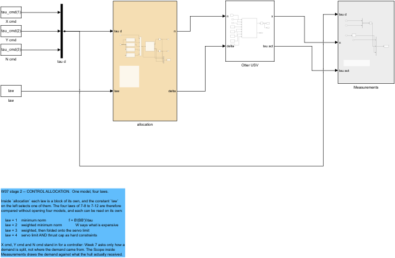


Each of the four blocks is the whole law: none calls a function stored elsewhere, so double-clicking one puts the arithmetic of its section on the screen and nothing else. The code is not reprinted here — the last column of the table in line 2 says where each block was shown beside its derivation.

Three details of the wiring decide the run. The same $\boldsymbol{\tau}_d = [0;\,40;\,0]$ enters all four law blocks, so the four answers differ only by the law. The `law` line entering the switch is one-based contiguous, so a value of $5$ stops the run rather than wrapping. And the two Saturation blocks sit **after** the allocator, which is why laws 1 and 2 are clipped without ever knowing it.

Changing the law means changing one number and pressing Run; `W07_plot_ca` is the model's `StopFcn`, so the table and the panels appear by themselves. Leaving only the `'7-12'` line in the `SEC` list of `W07_alloc_run` does the same for all four laws in one command:

```matlab
% SEC 에서 '7-12' 한 줄만 남긴다 / leave only the '7-12' line in SEC
W07_alloc_run
```

```
---- 7-12  the four laws side by side, out of one model ------------

  law 1   minimum norm
  ----------------------------------------------------------------------------
  unit     T [N]   cap [N]    n asked   n allowed    d asked  d allowed   limit
   1       -8.20    -66.71     -35.67      -35.67     -85.98     -45.00   servo
   2        8.20    119.68      27.21       27.21      85.98      45.00   servo
   3       11.83    119.68      32.68       32.68     -87.22     -45.00   servo
   4      -11.83    -66.71     -42.85      -42.85      87.22      45.00   servo
  ----------------------------------------------------------------------------
  tau demanded  [   0.000   40.000    0.000]
  tau delivered [   0.000   28.333  -10.526]   error 15.714 N
  4 clip(s) stand between what was solved for and what the hull got

  law 2   weighted minimum norm
  ----------------------------------------------------------------------------
  unit     T [N]   cap [N]    n asked   n allowed    d asked  d allowed   limit
   1       -9.54    -66.71     -38.47      -38.47     -70.64     -45.00   servo
   2        9.54    119.68      29.34       29.34      70.64      45.00   servo
   3       11.45    119.68      32.14       32.14     -73.96     -45.00   servo
   4      -11.45    -66.71     -42.14      -42.14      73.96      45.00   servo
  ----------------------------------------------------------------------------
  tau demanded  [   0.000   40.000    0.000]
  tau delivered [  -0.000   29.677   -7.675]   error 12.864 N
  4 clip(s) stand between what was solved for and what the hull got

  law 3   weighted, folded onto the servo limit
  ----------------------------------------------------------------------------
  unit     T [N]   cap [N]    n asked   n allowed    d asked  d allowed   limit
   1       -9.54    -66.71     -38.47      -38.47     -45.00     -45.00   -
   2        9.54    119.68      29.34       29.34      45.00      45.00   -
   3       11.45    119.68      32.14       32.14     -45.00     -45.00   -
   4      -11.45    -66.71     -42.14      -42.14      45.00      45.00   -
  ----------------------------------------------------------------------------
  tau demanded  [   0.000   40.000    0.000]
  tau delivered [  -0.000   29.677   -7.675]   error 12.864 N
  no limit was reached, so the law delivered what it solved for

  law 4   servo limit and thrust cap as constraints
  ----------------------------------------------------------------------------
  unit     T [N]   cap [N]    n asked   n allowed    d asked  d allowed   limit
   1      -15.78    -66.71     -49.48      -49.48     -45.00     -45.00   -
   2       15.78    119.68      37.74       37.74      45.00      45.00   -
   3       12.50    119.68      33.59       33.59     -45.00     -45.00   -
   4      -12.50    -66.71     -44.04      -44.04      45.00      45.00   -
  ----------------------------------------------------------------------------
  tau demanded  [   0.000   40.000    0.000]
  tau delivered [   0.000   39.989   -0.001]   error 0.011 N
  no limit was reached, so the law delivered what it solved for

  every row below came out of the same .slx, with `law` changed
        law     X [N]     Y [N]   N [N m]   error [N]   servo   rpm
            1     0.000    28.333   -10.526      15.714       4     0
            2    -0.000    29.677    -7.675      12.864       4     0
            3    -0.000    29.677    -7.675      12.864       0     0
            4     0.000    39.989    -0.001       0.011       0     0
    saved ...\lectures\W07_simulink\img\W07_chain_tau.png

  which law to use
    1  no limit is near            -- the cheapest, and the baseline
    2  one axis costs more         -- same price, shapes the solution
    3  the servo limit is reached  -- cheap, but the demand is missed
    4  any limit is reached        -- meets the demand, costs the most
```

Three columns carry the whole argument: `d asked` is what the allocator wanted, `d allowed` is what the servo gave it, and `limit` names the stage between them. Laws 1 and 2 show `servo` on all four units, laws 3 and 4 a dash on all four, and the `rpm` count is zero everywhere — on this demand the servo was the only binding stage.


Laws 2 and 3 are the **same height**, because folding changed what the allocator reports and not what the hull receives — §7-10's conclusion, now visible rather than argued. Law 4's bar is not short but effectively absent: $0.011$ N against $15.7$ N does not survive the axis, because a limit put inside the solve is not a smaller error of the same kind but a different outcome.

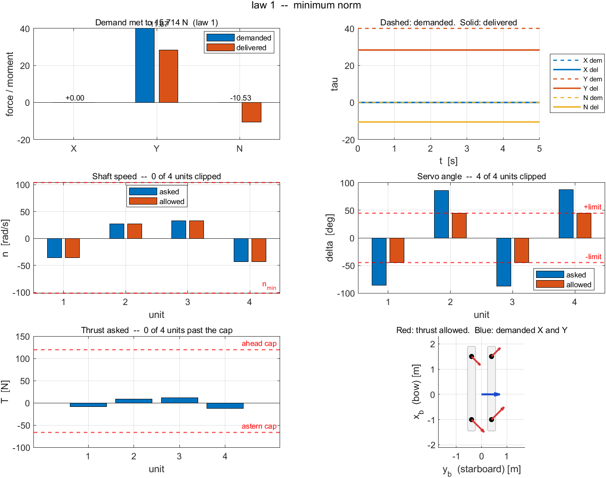

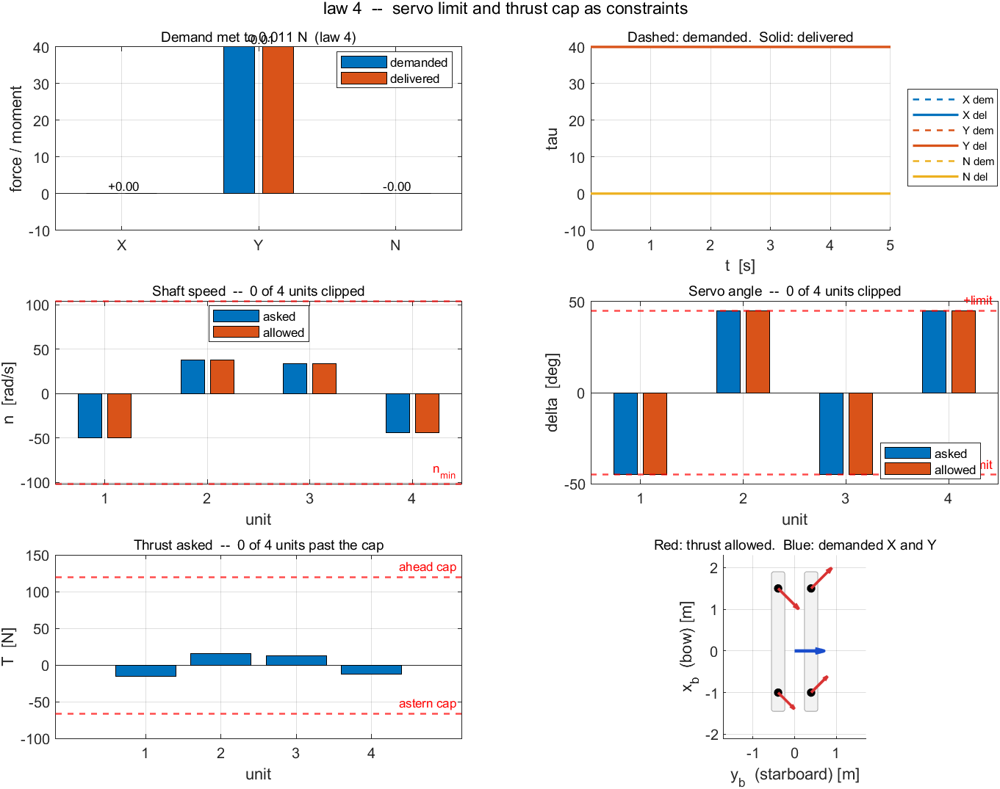

| What to try | What to watch |
|---|---|
| set `tau_cmd = [40; 0; 0]` and run all four laws | the four rows collapse onto one: a pure surge needs $\delta_i = 0$, and no law reaches a limit |
| set `law = 2`, run, then `rad2deg(squeeze(W07ca_act(17:20,1,end)))` | $\pm70.64^\circ$ on the bow pair and $\pm73.96^\circ$ on the stern pair — the $74.0^\circ$ of the table, as asked before any Saturation block saw it |
| set `law = 5` | the run stops at `pick the law` with `Simulink:blocks:MPSwitchControlInputOORIndexValue`: the switch is one-based contiguous, and $5$ is not one of its four ports |
| raise `tau_cmd` to $[0; 120; 0]$ | law 4 misses as well: $120$ N of sway is past what four units at $45^\circ$ can make |

---

## 7-13. Waypoint following with the one law that keeps its limits

**What is observed.** Sections 7-8 to 7-12 put a single demand to the allocator and read what came back. A vessel following a route never holds one demand: the guidance law rewrites it at every step, and whatever the allocator fails to deliver is integrated by the hull before the next demand exists. A law that silently loses force in closed loop loses it into the position of the vessel, so after §7-12 only one of the four is worth flying.

**The result.** A four-leg route of $264.85$ m is flown in $274.12$ s with a cross-track error of $0.467$ m rms and $2.964$ m at worst, every excursion sitting at a corner. The surge loop holds $0.945$ m/s of the $1.000$ m/s commanded. The servo limit is reached at $71$ samples and **nothing is clipped at any of them**: law 4 carries that limit inside its solve, so the force the allocator reports is the force the hull receives.

**Derivation.**

1. The model is a cascade of three loops, each derived in an earlier week — position outside, surge speed and heading inside — with the allocation stage of §7-11 between them and the hull. Only that stage is new this week.

2. The outer loop is Week 5's lookahead-based line-of-sight guidance, §5-3, unchanged. With the active leg running from $(N_k, E_k)$ to $(N_{k+1}, E_{k+1})$, the path angle and the cross-track error are

$$\pi_p = \operatorname{atan2}\!\left(E_{k+1} - E_k,\; N_{k+1} - N_k\right), \qquad
  y_e = -(N - N_k)\sin\pi_p + (E - E_k)\cos\pi_p ,$$

   and the heading command is the path angle turned towards the line,

$$\psi_d = \pi_p - \arctan\!\left(\frac{y_e}{\Delta}\right).$$

3. For small $y_e$ the arctangent is $y_e/\Delta$, so the outer loop is a proportional controller on the cross-track error whose gain is $1/\Delta$ and whose output is an **angle**. That is the whole reason the lookahead distance is the one tuning knob of the section: a small $\Delta$ turns hard towards the line, a large $\Delta$ turns gently and converges from further away.

4. A leg is finished when the vessel comes within $R_{\text{switch}}$ of its end point — Week 5 §5-4's switching circle — at which the guidance block advances $k$ and recomputes $\pi_p$. At the last waypoint it drops `gate` to zero instead; the gate multiplies the speed command, the surge loop brings the vessel to rest, and a Stop Simulation block ends the run `stop_hold` seconds later. The route therefore sets its own stop time; $T_{\text{wpt}}$ is only an upper bound.

5. The surge loop is Week 3's PI with the back-calculation anti-windup of §3-4, unchanged block for block:

$$e_u = u_d - u, \qquad X_{\text{raw}} = K_{p,u}\,e_u + I, \qquad
  \dot I = K_{i,u}\,e_u + K_b\,(X - X_{\text{raw}}), \qquad X = \operatorname{sat}(X_{\text{raw}}).$$

6. The heading loop is Week 4's PD, §4-3, whose derivative term is the **measured** yaw rate rather than the derivative of the error, so the step in $\psi_d$ at every leg change produces no kick:

$$e_\psi = \operatorname{ssa}(\psi_d - \psi), \qquad N = \operatorname{sat}\!\left(K_p\,e_\psi - K_d\,r\right),
  \qquad \operatorname{ssa}(u) = \operatorname{atan2}(\sin u, \cos u).$$

7. The demand assembled from the two inner loops is $\boldsymbol{\tau}_d = [X,\ 0,\ N]^\top$. The zero is a Constant on the canvas rather than a missing wire: this run follows the path **by turning the bow**, as a conventional hull must, and leaving the sway command visible is what makes §7-14 a change of one input rather than of architecture.

8. The allocation stage is `add_allocation_tilt4` with law 4 and **no switch** — a Multiport Switch selects an output, not a computation, so a model offering one law carries neither switch nor `law` inport. The block inside is the `law 4  limits as constraints` text of §7-12, already derived in §7-11.

9. The inner-loop saturations $X_{\max} = Y_{\max} = 120$ N and $N_{\text{lim}} = 150$ N m are a **comfort choice, not a physical limit**: the surge corner of the envelope is $372.78$ N by §7-11 line 4, so the cap sits at under a third of it and exists to keep the demand where the allocator still has headroom. Week 6's $Y_{\max} = 35.13$ N was the opposite kind of number — the hardware's own ceiling.

10. Shaft speed and thrust stay inside the envelope for the whole route — $81.1\,\%$ and $99.4\,\%$ of their limits respectively, with no sample sitting on either.

11. The tilt angle is the quantity that runs out: $\pm 45.00^\circ$ at $71$ samples, all inside the three corners, with **zero** clipped. Touching a limit and being clipped are two different events — law 4 solves against the wall, so the angle it reports is one the servo can hold. Under law 1 the same corner would give the silent shortfall of §7-12, integrated here into cross-track error.

12. The worst difference between asked and delivered force is $0.9890$ N over the samples asking above $2$ N — the regularisation bias and inscribed-chord error of §7-11 lines 7 and 11, not a saturation error.

| Symbol | Quantity | Value or source |
|---|---|---|
| $\Delta$ | lookahead distance of the LOS law | `Delta` $= 5$ m, `W07_0_setup` |
| $R_{\text{switch}}$ | radius at which the next leg becomes active | `R_switch` $= 3$ m |
| $u_d$ | commanded surge speed, before the gate | `u_d` $= 1.0$ m/s |
| $(N_k, E_k)$ | the waypoint list | `WP_N`, `WP_E`; five points, four legs, $60 + 60 + 60 + 84.85 = 264.85$ m |
| $K_{p,u},\,K_{i,u},\,K_b$ | surge PI and its back-calculation gain | $200$, $200$, $1$ |
| $K_p,\,K_d$ | heading PD | $300$, $100$ |
| $X_{\max},\,N_{\text{lim}}$ | inner-loop saturations | $120$ N, $150$ N m |
| $\alpha_{\max}$ | servo travel | $45^\circ$, `otter_config('quad_tilt')` |

### Experiment 7-13 · Flying a route on four tilting units (25 min)

```matlab
W07_3_build_wpt         % writes W07_wpt_los.slx and the block-diagram PNGs
W07_wpt_run             % runs the model and draws both figures
```

The runner reads its values from `W07_vars`, so nothing has to be set up first, and neither does the model. `W07_0_setup` puts the same values in the base workspace together with `animate = 1`, which is what to run when one of them is to be changed by hand before pressing **Run**.

> [!tip] The model alone is enough
> Opening `W07_simulink/W07_wpt_los.slx` and pressing **Run** — with no script
> run first — produces three windows: the live view of the route being flown,
> the command-against-actual sheet, and the actuator-limit sheet. The two
> result figures in this section are what that press of Run draws.
> The live view carries the track and seven panels: $\psi$ against the LOS
> command, $u$ against the gated speed command, the cross-track error on its
> own axis, then $\tau_X$ and $\tau_Y$ together, then $\tau_N$, and finally the
> four $n_i$ and the four $\delta_i$ against their limit lines — so a leg flown
> on a unit that has run out of travel is visible while it is being flown,
> rather than afterwards. The track draws the hull and the heading along the
> route and not the trail alone, because the angle between the two is the crab
> angle of §7-5, and on the diagonal leg it is what the lookahead has to absorb.
> The `InitFcn` is what makes this work: it puts `_tools` and the week folder on
> the path, calls `mss_path`, fills in any constant the base workspace is
> missing, raises `animate` to $1$ and reads `pace`. The `StopFcn` then calls
> `W07_plot_wpt`, which draws the second window and hands the third to
> `W07_plot_sat`. Running the section script instead is the same simulation with
> the live view switched off and a printed table added.


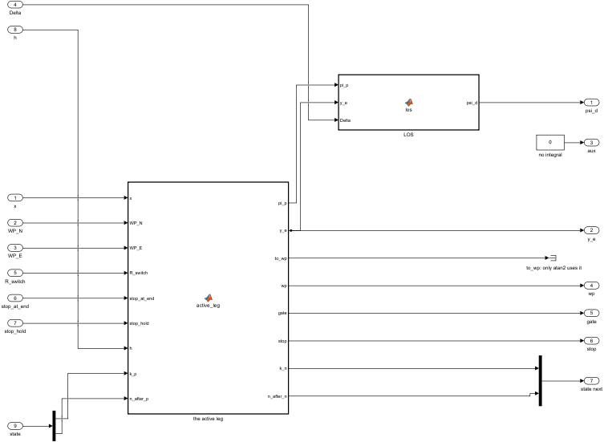

The leg counter travels through a **visible** Unit Delay rather than a `persistent` variable inside the block. A state that exists only inside a MATLAB Function cannot be read off the diagram, and which leg is active is the one thing a reader of this model wants to know.

```
==== W07 waypoint following, run from the model W07_wpt_los ====
  law 4,  waypoints 5,  Delta 5 m,  R_switch 3 m,  u_d 1 m/s
  sections: A, B

---- A  one run of the whole route ------------------------------

  W07 waypoint following with allocation law 4
   run length                  274.12 s
   statistics window             0.00 .. 274.12 s  (from |y_e| < Delta)
   cross-track |y_e|           max  2.964 m    rms  0.467 m
   surge speed u             mean  0.945 m/s   command 1.000 m/s
   heading error               max 111.358 deg  rms 11.355 deg
   distance to last waypoint    2.602 m
   peak force on the hull    X 120.00 N   Y   0.01 N   N 149.99 N m
   worst |asked - applied|     0.9890  N, over the samples asking above 2 N
  waypoint following: are the four units inside their limits?
      what          worst value        limit            used   samples on it
   shaft speed  -101.41 ..   84.26   -101.74 ..  103.93     81.1 %           0
   thrust        -66.28 ..   78.66    -66.71 ..  119.68     99.4 %           0
   tilt angle    -45.00 ..   45.00    -45.00 ..   45.00    100.0 %          71
   a limit was on at some samples, which is where the law earns its keep.
   nothing was clipped after the solve: the law kept its own walls.
```

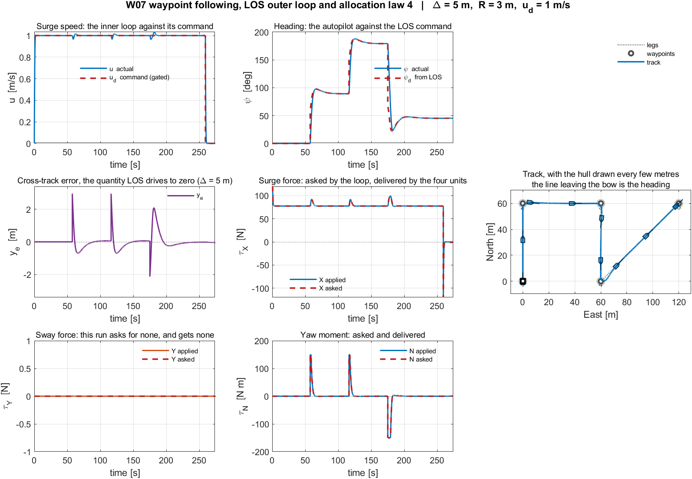

| Where to look | What is there | Which line predicts it |
|---|---|---|
| top left, $u$ against $u_d$ | the two traces coincide except for a dip at each corner, and the mean is $0.945$ of $1.000$ | line 5: the surge PI holds its command until the turn costs more than $X_{\max}$ |
| top centre, $\psi$ against $\psi_d$ | $\psi_d$ steps at each leg change and $\psi$ arrives a few seconds later; the worst error, $111.358^\circ$, is at the third corner | line 6: the PD has no derivative kick, so a step command is answered by a ramp in heading |
| middle left, $y_e$ | three spikes of about $3$ m, one per corner, each decaying back to zero | lines 2 and 3: LOS drives $y_e$ to zero, and only a change of leg can make it large |
| middle centre, $\tau_X$ | asked and applied lie on one line; the peak is $120.00$ N | lines 9 and 12: the cap is the inner loop's, and law 4 delivers what it is asked |
| bottom left, $\tau_Y$ | flat at zero for the whole run | line 7: this model commands no sway at all |
| bottom centre, $\tau_N$ | $\pm 150$ N m pulses at the corners and nothing between them | line 9: $N_{\text{lim}}$ is what a corner costs |
| right, the track | the hull symbol points along the leg on the straights and across it at the corners | line 7: the path is followed by turning the bow, so heading and track differ only while turning |

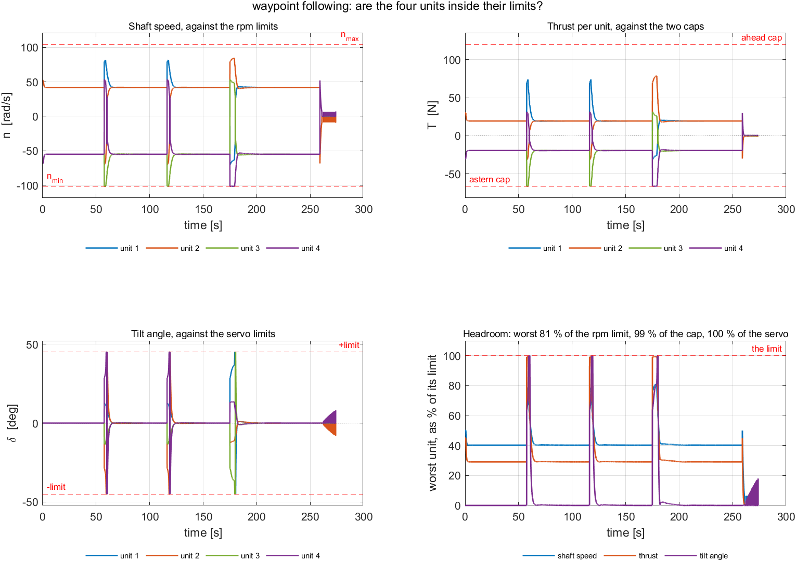

| Where to look | What is there | Which line predicts it |
|---|---|---|
| top left, shaft speed | four traces between $-101.41$ and $84.26$ rad/s, the limit lines never touched | line 10: $81.1\,\%$ of the limit, no sample on it |
| top right, thrust | the astern cap is approached to $99.4\,\%$ but no sample sits on it | line 10: astern is the weaker of the two caps, so it is the one that is approached |
| bottom left, tilt angle | flat at $0^\circ$ on the straights, hard against $\pm 45^\circ$ at each corner | line 11: a corner asks for a sideways force the servo cannot point at |
| bottom right, headroom | the tilt trace reaches $100\,\%$ three times, the other two stay below $50\,\%$ | line 11: of the three limits only the servo runs out, and only at corners |

| What to try | What to watch |
|---|---|
| leave only the `'B'` line in `SEC` and run | $\Delta = 2$, $5$, $10$ m give $0.395$, $0.446$ and $0.533$ m rms over the same $180$ s window — a shorter window than section `A`'s, which is why its $\Delta = 5$ row reads $0.446$ and not $0.467$. A shorter lookahead holds the line more closely, and turns harder to do it |
| set `Delta = 1` in `W07_0_setup` and run section `A` | the heading command begins to chatter between legs — the outer loop's gain is $1/\Delta$, and the loop is now faster than the autopilot under it |
| set `law = 1` in `W07_vars` and run section `A` | the corners widen: the force lost at $\pm 45^\circ$ is no longer recovered, and the cross-track error at a corner grows |
| set `R_switch = 10` | the corners are cut: the next leg becomes active before the vessel has arrived, which lowers $y_e$ at the cost of not passing the waypoint |

---

## 7-14. Position and heading control, all three degrees at once

**What is observed.** The route of §7-13 asked for no sway, because a conventional hull cannot produce any. Four tilting units can: §7-5 measured up to $295$ N of pure sway from the same hull. Holding a position and a heading at the same time is the manoeuvre that needs it, and it is the one manoeuvre for which this actuator arrangement exists.

**The result.** Commanded from the origin at $0^\circ$ to $(10,\,10)$ m at $45^\circ$, the vessel arrives with an error of $0.000$ m and $0.003^\circ$. The heading settles in $2.98$ s and the position in $19.44$ s, with no overshoot on either axis. Surge and sway are commanded together throughout; the servo limit is reached at $155$ samples and, again, nothing is clipped.

**Derivation.**

1. The loop structure is the same cascade as §7-13 with the outer stage replaced. Position replaces guidance, a second Week 3 PI appears beside the first so that sway has its own loop, and the heading autopilot is unchanged.

2. The outer loop is `add_position_loop`. The position error is formed in NED, where the command lives, and then rotated into the body frame, where the actuators live:

$$\mathbf{p}_e = \mathbf{p}_d - \mathbf{p}, \qquad
  \mathbf{p}_b = \mathbf{R}(\psi)^\top \mathbf{p}_e, \qquad
  \boldsymbol{\nu}_d = g\,\operatorname{sat}\!\left(K_{p,\text{pos}}\,\mathbf{p}_b\right) .$$

3. The rotation is the step that makes the cascade work — Week 6 §6-3's rotation in the same place. The inner loops control $u$ and $v$, measured along the hull, so a command in north and east would ask them for something they do not control. Rotating first makes the outer loop say "so far forward, so far to port", which is what the two PIs can answer.

4. The saturation is per axis, at $u_{\text{lim}} = 0.80$ m/s and $v_{\text{lim}} = 0.60$ m/s. Its effect is to turn the outer loop into a **speed-limited** approach: far from the target the command is the cap, and only inside $u_{\text{lim}}/K_{p,\text{pos}} = 2.67$ m does the proportional term take over. That is why the approach is a straight run followed by a soft arrival rather than an exponential decay.

5. The gate $g$ is held at $1$ for the whole run. Week 6 §6-5 needed a mission state machine — turn first, then translate — because its single bow thruster made sway scarce: $Y_{\max} = 35.13$ N against $X_{\max} = 120$ N. Here all three degrees of freedom are commanded from the first step, and the state machine disappears rather than being switched off.

6. The two inner loops are the Week 3 PI twice, one on $u$ driving $X$ and one on $v$ driving $Y$, with the same gains: $K_{p,u} = K_{i,u} = K_{p,v} = K_{i,v} = 200$. Week 6 ran the sway axis at $150$ because its tunnel thruster could deliver only $35.13$ N; with four tilting units the sway axis is no longer the weak one, so it is given the surge gains.

7. The heading loop runs **in parallel**, not under the position loop. Its command is a Constant, $\psi_{\text{set}}$, so the vessel may hold any heading while travelling in any direction — the observable difference from §7-13, where heading was the only steering authority there was.

8. The demand is now $\boldsymbol{\tau}_d = [X,\ Y,\ N]^\top$ with all three live, and it goes to the same law-4 block as §7-13. Only what is asked of the allocation stage changes between the two models.

9. The heading settles first, $2.98$ s to within $2^\circ$, because yaw has the least inertia and the most authority. Position takes $19.44$ s to within $0.50$ m with $0.000$ m of overshoot: an approach that spends most of its time on the speed cap arrives without overshooting, since the proportional term is already small when the cap releases.

10. The peak measured surge speed is $0.836$ m/s against a commanded cap of $0.80$ m/s — the **inner** loop overshooting its own command, not the cap failing; the outer loop never asks for more than $0.80$.

11. All three inner-loop saturations are active during the first seconds — $X = 120.00$ N, $Y = 119.97$ N, $N = 149.99$ N m — which is the point of commanding three degrees at once. Asked and applied differ by $0.9998$ N at worst, the same regularisation residue as §7-13.

12. The actuators work harder than in §7-13: $86.1\,\%$ of the shaft-speed limit, $99.5\,\%$ of the astern cap, and the servo at $\pm 45.00^\circ$ for $155$ samples with nothing clipped. A pure sway demand asks a $\pm 45^\circ$ servo for $90^\circ$ — §7-12's demand arriving by a different route.

| Symbol | Quantity | Value or source |
|---|---|---|
| $\mathbf{p}_d$ | commanded position in NED | `p_d` $= [10;\,10]$ m |
| $\psi_{\text{set}}$ | commanded heading | $45^\circ$, a Constant on the canvas |
| $K_{p,\text{pos}}$ | outer-loop proportional gain | $0.30$ s$^{-1}$ |
| $u_{\text{lim}},\,v_{\text{lim}}$ | per-axis speed caps of the outer loop | $0.80$, $0.60$ m/s |
| $K_{p,v},\,K_{i,v}$ | sway PI | $200$, $200$ — the surge values |
| $g$ | gate on the velocity command | held at $1$; Week 6 drove it from a state machine |
| $T_{\text{pose}}$ | stop time | $60$ s, fixed: there is no end-of-mission event here |

### Experiment 7-14 · Holding a position and a heading (20 min)

```matlab
W07_4_build_pose        % writes W07_pose_dp.slx and the block-diagram PNGs
W07_pose_run            % runs the model and draws both figures
```

> [!tip] The model alone is enough
> Opening `W07_simulink/W07_pose_dp.slx` and pressing **Run** — with no script
> run first — produces three windows and nothing else is needed: the live view
> of the hull holding its pose, the command-against-actual sheet, and the
> actuator-limit sheet. Both figures below are what that press of Run draws.
> The live view carries the track and eight panels: $N$, $E$ and $\psi$ against
> their commands, $u$ and $v$ against what the outer loop asked for, then
> $\tau_X$ and $\tau_Y$, then $\tau_N$ on its own axis — all three force
> components are asked and applied together, so a heading that lags can be
> charged either to the loop or to the four units — and finally $n_i$ and
> $\delta_i$ against their limit lines.
> The `InitFcn` and the `StopFcn` do what §7-13 describes, with `W07_plot_pose`
> in the place of `W07_plot_wpt`.

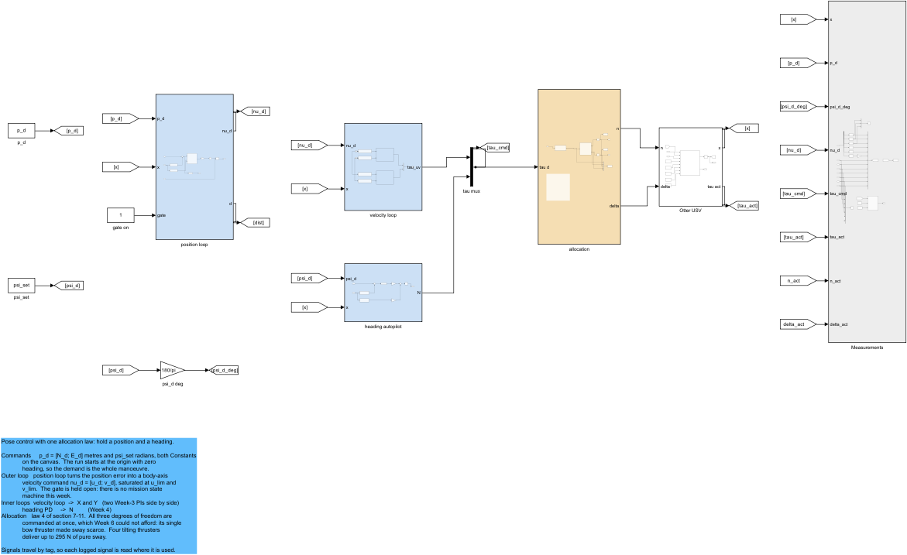

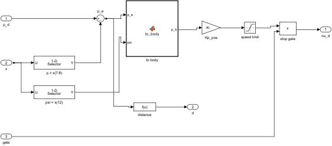

```
==== W07 position and heading control, model W07_pose_dp ====
  law 4,  target N 10 m  E 10 m  psi 45 deg,  Kp_pos 0.3
  speed cap on the outer loop: u 0.8 m/s,  v 0.6 m/s
  sections: A, B

---- A  one run to the commanded pose ---------------------------

  W07 position and heading hold with allocation law 4
   run length                   60.00 s
   commanded pose             N  10.00 m   E  10.00 m   psi  45.00 deg
   reached pose               N  10.00 m   E  10.00 m   psi  45.00 deg
   error at the end             0.000 m     0.003 deg
   settling (never leaves)     19.44 s to 0.50 m     2.98 s to 2.00 deg
   overshoot past the target  N  0.000 m   E  0.000 m
   peak speed                 u  0.836 m/s (cmd cap 0.80)   v  0.570 m/s (cmd cap 0.60)
   peak force on the hull     X 120.00 N   Y 119.97 N   N 149.99 N m
   worst |asked - applied|     0.9998  N, over the samples asking above 2 N
  position hold: are the four units inside their limits?
      what          worst value        limit            used   samples on it
   shaft speed  -101.46 ..   89.46   -101.74 ..  103.93     86.1 %           0
   thrust        -66.34 ..   88.67    -66.71 ..  119.68     99.5 %           0
   tilt angle    -45.00 ..   45.00    -45.00 ..   45.00    100.0 %         155
   a limit was on at some samples, which is where the law earns its keep.
   nothing was clipped after the solve: the law kept its own walls.
```


| Where to look | What is there | Which line predicts it |
|---|---|---|
| top row, $N$ and $E$ | both rise almost linearly for $15$ s, then bend onto $10$ m without crossing it | line 4: the approach is on the speed cap until the error falls inside $2.67$ m |
| middle left, $\psi$ | at $45^\circ$ within $3$ s and flat afterwards, while the vessel is still far from the target | lines 7 and 9: heading is an independent command, and it is the fastest axis |
| middle centre, $u$ and $v$ | both non-zero throughout the approach, and $u$ reaches $0.836$ against a command of $0.80$ | lines 6 and 10: sway has its own loop here, and the overshoot is the inner loop's |
| bottom left, $\tau_X$ and $\tau_Y$ | asked and applied coincide; both saturate near $120$ N in the first seconds | line 11: all three inner saturations are active at the start |
| bottom centre, $\tau_N$ | one pulse to $150$ N m at $t = 0$ and nothing afterwards | line 9: the heading manoeuvre is over before the translation has begun |
| right, the track | the hull symbol holds $45^\circ$ along a path that is itself close to $45^\circ$, ending inside the dashed commanded pose | line 7: the heading is held, not derived from the direction of travel |

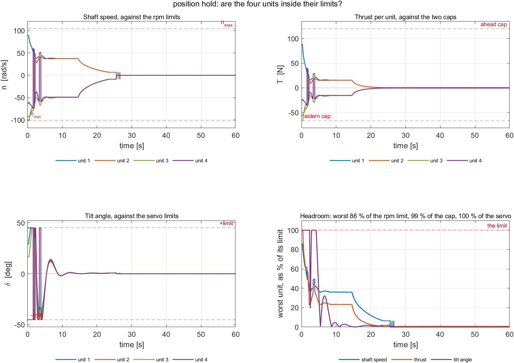

| Where to look | What is there | Which line predicts it |
|---|---|---|
| top left, shaft speed | between $-101.46$ and $89.46$ rad/s, $86.1\,\%$ of the limit, nothing on it | line 12: harder than §7-13 but still inside |
| top right, thrust | the astern cap is approached to $99.5\,\%$ during the first four seconds | line 11: the opening transient is where all three demands peak together |
| bottom left, tilt angle | hard against $\pm 45^\circ$ for the first four seconds, then smoothly back to $0^\circ$ | line 12: a large sway demand is what asks the servo for more than it has |
| bottom right, headroom | all three reach or approach $100\,\%$ early and fall below $5\,\%$ after $20$ s | lines 9 and 12: once the vessel is on station, holding it costs almost nothing |

| What to try | What to watch |
|---|---|
| leave only the `'B'` line in `SEC` and run | $K_{p,\text{pos}} = 0.15$, $0.30$, $0.60$ settle in $26.08$, $19.44$ and $17.48$ s while peak $\lvert u\rvert$ stays at $0.836$ — past a point the cap sets the approach, not the gain |
| set `psi_set = deg2rad(0)` and run section `A` | the vessel reaches the same point holding $0^\circ$: the path is unchanged, and the four units simply redistribute between surge and sway |
| set `v_lim = 0` | the manoeuvre becomes §7-13's: no sway is commanded, and the position loop can only drive the vessel along its own bow |
| set `p_d = [40; 0]` and raise `T_pose` to $120$ | the approach spends almost all of its time on the cap, and the settling time becomes distance divided by $u_{\text{lim}}$ |

---

# Part 2 · Laboratory run order

The week runs out of **four files**. Every experiment of Part 1 is a block inside one of them.

| Experiment | Model | Script | What it shows |
|---|---|---|---|
| 7-0 | `W07_openloop` | `W07_1_build_openloop`, `W07_0_setup` | the model written from code, and every constant |
| 7-1 | none | `verify_otter_tilt4` | four identities; $\delta = 0$ returns `otter.m` |
| 7-3 | `W07_openloop` | `W07_openloop_run`, block (1) | table (1) — the logged force against the column rule |
| 7-4 | `W07_openloop` | `W07_openloop_run`, block (2) | the three asymmetries, each against a row |
| 7-5 | `W07_openloop` | `W07_openloop_run`, blocks (2) and (3) | table (2), and the eight sheets `img/W07_result_S1.png` … `_S8.png` |
| 7-6 | `W07_openloop` | `W07_openloop_run`, block (1) | the comparison window of table (1), $t_s = 0.58$ s |
| 7-8 | `W07_alloc_chain` | `W07_alloc_run`, section `7-8` | law 1 at `law = 1`, and the $37\%$ a null-space solution costs |
| 7-9 | `W07_alloc_chain` | `W07_alloc_run`, section `7-9` | law 2 over seven weights: what $\mathbf{W}$ moves and what it cannot |
| 7-10 | `W07_alloc_chain` | `W07_alloc_run`, section `7-10` | laws 2 and 3 at the $45^\circ$ servo limit, and what folding costs |
| 7-11 | `W07_alloc_chain` | `W07_alloc_run`, section `7-11` | law 4 with both limits inside the solve, and the $\varepsilon$ and $\mathbf{Q}$ sweeps |
| 7-12 | `W07_alloc_chain` | `W07_alloc_run`, section `7-12` | the four laws side by side, one constant apart |
| 7-13 | `W07_wpt_los` | `W07_3_build_wpt`, `W07_wpt_run` | the four-leg route under law 4, and the $\Delta$ sweep |
| 7-14 | `W07_pose_dp` | `W07_4_build_pose`, `W07_pose_run` | the pose command at $(10,\,10)$ m and $45^\circ$, and the $K_{p,\text{pos}}$ sweep |

**Choosing what runs.** Each file carries one list near its top, and one line of that list is one unit of work. Put a `%` in front of a line and it drops out; leave the file as it is and everything runs.

| File | The list | One line is |
|---|---|---|
| `W07_openloop_run.m` | `S`, eight rows | one scenario, `S1` to `S8` |
| `W07_alloc_run.m` | `SEC`, five rows | one section, §7-8 to §7-12 |
| `W07_wpt_run.m` | `SEC`, two rows | `A` the whole route, `B` the lookahead sweep |
| `W07_pose_run.m` | `SEC`, two rows | `A` one run to the pose, `B` the outer-gain sweep |

**Running a model by hand.** Every runner leaves the first selected case in the base workspace — `n_cmd` and `d_cmd` for `W07_openloop`, `law` and `tau_cmd` for `W07_alloc_chain`, the whole constant set for the two closed-loop models. Opening that `.slx` and pressing Run repeats that one case, so the model file itself is never edited. The two closed-loop models also draw the live view while they run: the runners hold `animate` at $0$ for their own batch runs, but each one **clears that flag on its last line**, so the next press of Run finds the workspace clean and the model's own `InitFcn` raises `animate` back to $1$.

**No runner implements anything a model implements.** `W07_vars` holds the values, the `W07_plot*` functions draw, and each runner only sets constants, clears the logs and calls `sim`. There is no second copy of any law, guidance expression or gain in any `.m` of this week.

> [!note] One run order, four sections
> Sections 7-3 to 7-6 read the **same eight 30-s runs**: block (1) compares the force throughout each, block (2) reads the end of each, and block (3) draws each. Running them apart would send the vessel out twenty-four times for eight trajectories.

---

# Summary

## Week Summary

| Step | What was done | How it was verified |
|---|---|---|
| 1 | $B$ built for four tilting units from the Week 3 column rule, with the mounting signs | `verify_otter_tilt4` prints $3\times 8$, rank 3, null space 5 |
| 2 | `otter.m` changed in four marked places into `otter_tilt4.m`, and the trigonometric form checked against $B\mathbf{f}$ | identities (a) and (b) exactly zero ($\delta = 0$ reproduces `otter.m`); identity (c), $7.19\times10^{-14}$ over 200 random states |
| 3 | an open-loop model built with eight hand constants, and the force of those commands measured out of the plant | overlaps 0, diagonals 0; table (1), worst residual $2.8\times10^{-14}$ N or N·m |
| 4 | the mirrored mounting shown to make surge symmetric | S1 and S2 both reach $\lvert X\rvert = 126.180$ N despite $k_{pos} \neq k_{neg}$ |
| 5 | the residual yaw of a symmetric sway derived | $N = \bar{x}Y = 28.205$ N·m, matching S5 and S8 exactly |
| 6 | the thrust ratio that removes that yaw derived and run | $T_a = 1.5T_f$, i.e. $n_a = 73.485$ rad/s: $N = 0.000$ N·m at $X = -28.205$ N |
| 7 | the servo limit shown to act inside the plant, and the eight tracks read at $t = 30$ s | S8 asks $70^\circ$, table (1) records $45^\circ$ and S8 lies on S5; table (2) and `img/W07_result_S1.png` … `_S8.png` |
| 8 | the comparison window derived from the servo rate limit | $t_s = 45/90 + 4h = 0.58$ s, the window table (1) prints |
| 9 | allocation stated as a choice among infinitely many solutions, and the minimum-norm one derived and inverted to hardware | $42.99$ N against $58.72$ N for the same $\boldsymbol{\tau}$; residual $0.00\mathrm{e}{+}00$, $\rho = 1$, worst angle $26.88^\circ$ |
| 10 | the weight matrix measured over three decades | $\Sigma\lvert f_y\rvert$ fixed at $30.00$ N; the worst angle **rises** $26.88^\circ \to 31.73^\circ$ |
| 11 | the servo limit shown to be two straight lines per sign, and law 3's fold run against law 2 | law 2 asks $73.96^\circ$ where law 3 asks $45.00^\circ$, both delivering the same $12.864$ N error |
| 12 | the shaft-speed limit shown to be the thrust cap | $119.682$ N ahead and $66.708$ N astern, the astern cap $56\%$ of the ahead one |
| 13 | both limits put inside the solve, the force measured out of the hull | at $[340,\,60,\,25]$ the error falls $39.066 \to 0.018$ N, and law 4 is the only law with no unit clipped |
| 14 | the four laws put into one model, selected by one constant | $28.333$, $29.677$, $29.677$ and $39.989$ N delivered of a $40$ N sway demand |
| 15 | a four-leg route flown under law 4 with LOS guidance, and the lookahead distance swept over it | $0.467$ m rms cross-track, $71$ samples on the servo limit, $0$ clipped; $\Delta = 2$, $5$, $10$ m give $0.395$, $0.446$, $0.533$ m rms |
| 16 | position and heading commanded together, and the outer-loop gain swept against the speed cap | $(10,\,10)$ m and $45^\circ$ reached to $0.000$ m and $0.003^\circ$; $K_{p,\text{pos}} = 0.15$, $0.30$, $0.60$ settle in $26.08$, $19.44$, $17.48$ s at peak $\lvert u\rvert = 0.836$ m/s |

---

## Assignment 7

- **Due**: before the Week 8 session
- **Submit**: code, results, and a short analysis

### ① Requirements

Requirements 1 to 3 are three runs of `W07_openloop`, eight numbers given by hand in `W07_0_setup`: no allocator and no controller. Requirements 4 and 5 reverse the direction of the arithmetic and let `W07_alloc_chain` choose the eight numbers, by setting `law` and `tau_cmd` and pressing Run: **no allocation law is to be reimplemented in a script.**

1. **Reproduce the yaw-free crab.** Apply §7-4 line 8 to obtain the stern shaft speed that cancels the residual yaw of a $45^\circ$ four-unit sway command. Derive it rather than copying $73.485$ rad/s: show the step from $\sum x_i T_i = 0$ to $T_a = 1.5T_f$ and the conversion to shaft speed, including which thrust coefficient applies and why. Report the surge force the cancellation costs.
2. **Find a motion that is neither.** Choose eight numbers for which $X = 0$ **and** $N = 0$ while $Y \neq 0$ — a pure sway, with no surge and no yaw. Keep $\delta_i \in \{+45^\circ, -45^\circ\}$ so that only the four shaft speeds are free. State the two linear conditions on $T_1 \ldots T_4$, solve them by hand, convert each $T_i$ to a shaft speed with the correct sign-dependent coefficient, and check every value against the shaft limits before running.
3. **Break it deliberately.** Take the solution of requirement 2 and change one shaft speed by 10 %. Report what appears in $X$, $Y$ and $N$, and say which of the three asymmetries the change exposed.
4. **Let the allocator choose, and audit it.** Take the pure-sway demand solved by hand in requirement 2 as `tau_cmd`, scale its sway component until the servo limit is exceeded, put $\mathbf{W} = \operatorname{diag}([1\ 10\ 1\ 10\ 1\ 10\ 1\ 10])$ on the workspace as `W_alloc`, and run `W07_alloc_chain` with `law` set to $1$, $2$, $3$ and $4$ in turn. From the per-unit table the model's `StopFcn` prints, report for each law the worst `d asked`, how many units carry a `servo` or `rpm` tag, and the `tau delivered` line with its error. State for which laws `d asked` and `d allowed` differ, and explain why the error printed there — measured **out of the motion model** — is not $\lVert\mathbf{B}\mathbf{f} - \boldsymbol{\tau}_d\rVert$ computed from the allocator's own eight components.
5. **Find the second limit, and measure past it.** Derive both thrust caps from `otter_config('quad_tilt')` by §7-11 line 3 — not by copying $119.682$ N and $66.708$ N — and state which binds a pure surge demand and why. Then raise `tau_cmd = [X_d; 0; 0]` from $X_d = 100$ N in steps, with `law = 3`, until the per-unit table first shows an `rpm` tag; report that $X_d$ against the $372.78$ N envelope corner of §7-11 line 4, then press Run on the same demand with `law = 4`. For both laws report the four $T_i$ with the cap beside each, the worst `n asked`, the clip tags and the `tau delivered` error. Explain the direction in which law 4 moved the load between the two pairs, and why the scalar $\rho$ of §7-8 line 4-a could not have done the same.
6. **Close the loop, and find the limit from inside it.** Run `W07_pose_run` with only the `'A'` line of `SEC`, then change `p_d` to a freely chosen pose at least $15$ m away and run again. Predict the settling time before running it, from $\lVert\mathbf{p}_d\rVert$ and $u_{\text{lim}}$ by §7-14 line 4, and report the prediction beside the measurement. Then lower `v_lim` to $0.20$ m/s and run a third time: report what happens to the path, to the peak $\lvert\delta_i\rvert$ of the limit figure, and to the settling time, and say which of the three the cap acted on directly. Finally set `law = 1` in `W07_vars` and repeat the first run: report the clip count of the limit figure and the final pose error, and explain why the clipped force shows up as a position error rather than as a force error.

### ② Verification — mandatory

> [!important] A claim is not a result. Numbers are required, with the averaging window stated

| What to report | How |
|---|---|
| hand-predicted $X$, $Y$, $N$ for each of the three runs | from §7-1 line 7, before running anything |
| measured $X$, $Y$, $N$ | table (1) of `W07_openloop_run`, or the same arithmetic in a script written for the purpose |
| the residual between the two | one number per run, and it must be below $10^{-12}$ |
| $U$, $\beta$ and $r$ at $t = 30$ s | read at $t = 30$ s, as table (2) does; state the instant, not an average |
| the clip flags | whether the shaft or the servo limit bound during the run |
| for requirement 4, one row per law | the worst `d asked`, the clip tags, and the `tau delivered` error — all four from the model's own per-unit table, with `law` named |
| the achieved force of the chosen law | $\mathbf{B}\mathbf{f}$ computed from the eight components of `W07ca_act`, against the `tau_act` the model logged |
| for requirement 5, the two thrust caps and one row per law | each cap as $k_i n_{\lim}^2$ with the coefficient named and their ratio; then the four $T_i$, the worst `n asked`, the clip tags, and the `tau delivered` line of the model's table — which comes out of `otter_tilt4` by §7-11 line 17, not a residual recomputed from $\mathbf{f}$ |
| for requirement 6, one row per run | the predicted and the measured settling time, the final pose error in m and deg, and the three `samples on it` and clip counts of the limit figure, with `law`, `p_d` and `v_lim` named |

A run whose predicted and measured forces disagree by more than rounding is a mistake in the prediction, not in the model. Find it before reporting. Law 4 reads its own exit flag before it accepts a candidate (§7-11 line 14) and falls back to the closed form of §7-9 when no sign combination is feasible, so a law-4 answer that looks like law 2's answer is the fallback and must be reported as one, not as a solve.

### ③ Analysis (5–10 lines)

Requirement 2 asked for a pure sway and the vessel can produce one, while requirement 1's command cannot. Explain which freedom made the difference, counting it against the five null-space dimensions of §7-1. Then compare requirement 4 against requirements 1 to 3: state which of the two directions of arithmetic has a unique answer and which does not, name what law 4 searched that law 2 did not, and say what the hand solution would have to be redone for if the demanded force changed every 20 ms. Close with requirements 5 and 6: state which of the two limits a law can satisfy without knowing the other, why a residual reported by the allocator is not a statement about the hull, and where the same residual ends up once the allocator sits inside a loop.

### Grading

| Criterion | Weight |
|---|---|
| The model runs and produces the requested output | 25% |
| **Verification performed and numbers reported** | 40% |
| Correctness of the analysis | 25% |
| Readability of the code | 10% |

---

## Troubleshooting

- Only faults that have actually occurred. Hypothetical entries are not included

| Symptom | Cause | Fix |
|---|---|---|
| A tilt of $70^\circ$ or $90^\circ$ produces exactly the $45^\circ$ result | the servo clip inside `otter_tilt4`, §7-2 change 3 | expected. Read the `delta` column of table (1), which prints what the plant received |
| Four equal $\delta_i = +45^\circ$ at four equal $n_i$ produce no force at all, only a spot turn | the mounting signs: $s_3 = s_4 = -1$ reverses the stern pair's force, so the four cancel in surge and sway | expected, and it is row S3. A sway needs the two pairs at **opposite** $\delta$, which is S5 |
| A $B$ copied from another drawing or script has **every** sign reversed from the one in §7-1 | the convention lives in $s_i$: a source with $s = [-1,-1,+1,+1]$ produces exactly $-B$ | neither labelling is wrong, but mixing them reverses every manoeuvre. Rebuild $B$ from the column rule; this course uses $s = [+1,+1,-1,-1]$ throughout |
| A symmetric four-unit sway command yaws at $7.589$ deg/s | $\bar{x} = 0.25$ m, §7-4 line 7 | expected. Apply the ratio of §7-4 line 8 to cancel it, and accept the surge it costs |
| `W07_result_openloop.png` does not change after a run | a run of fewer than eight scenarios deliberately does not overwrite it, so the figure §7-5 embeds always carries all eight | uncomment every line of `S` and run `W07_openloop_run` again |
| A Constant block shows `-C-` instead of its value | `mss_style` sets Constant width to 55 px, and a longer expression does not fit | keep the Value expression short — the model uses `d_cmd`, not `delta_cmd` |
| `n_cmd = 600` saturates immediately | the command is rad/s, not rpm | 60 rad/s is about 573 rpm; the limit is 103.931 rad/s |
| `W07_openloop_run` runs but no figure appears | the script was called before `W07_0_setup` | run `W07_0_setup` first; it defines `animate`, `pace` and `h` |
| A quadratic program reports an angle and a force error that look reasonable, while the answer satisfies nothing | a solver stopped at its iteration limit returns that last iterate with an ordinary cost and `exitflag = 0` | read the flag before the cost, as §7-11 line 14 does: `if ef > 0 && cst < best` |
| Multiplying $\mathbf{W}$ by a constant changes nothing | only the ratios between the eight entries enter $\mathbf{W}^{-1}\mathbf{B}^\top(\mathbf{B}\mathbf{W}^{-1}\mathbf{B}^\top)^{-1}$ | change the ratio, not the magnitude. Measured in Experiment 7-9: $\mathbf{W}$ and $1000\mathbf{W}$ agree to $2.81\mathrm{e}{-}15$ N |
| Raising the price of the sideways components does not reduce the tilt | row 2 of $\mathbf{B}$ pins $\sum_i\lvert f_{y,i}\rvert$ to the demanded $Y$, so the price can only move the yaw onto the short $f_x$ arms | a hard limit is not a price. Put $\alpha_{\max}$ in the constraints, as §7-10 does |
| Selecting `law = 1` does not make the run any faster | a Multiport Switch evaluates every input and selects one output, so law 4's sixteen solves are paid whatever `law` is (§7-12 line 2) | expected. To build one law alone, replace the switch with a Variant Subsystem |
| A script run by name appears to do nothing at all | a `.slx` sharing its base name takes precedence, and MATLAB opens the model instead | never let a `.m` and a `.slx` share a name; the builders append `_run` where a collision is possible |
| A law that keeps every $\delta_i$ inside $45^\circ$ still drives a shaft past $n_{\min}$ | the servo limit and the thrust cap are two different limits, and law 3 holds only the first | set `law = 4`, which adds the chord rows of §7-11 line 6. The `limit` column of the per-unit table is the check |
| An allocation reports a residual of $0$ while the hull produces a visibly different force | the residual was computed as $\lVert\mathbf{B}\mathbf{f} - \boldsymbol{\tau}_d\rVert$ inside the allocator, before the hardware limits | read `tau_act`, the plant's second output (§7-11 line 17), printed as `tau delivered` |
| Law 2 and law 3 report **identical** force errors, which makes the fold look pointless | the plant clips at exactly the angle law 3 folded to | expected: $12.864$ N under both (Experiment 7-10). The fold earns no delivered force; it earns a command the allocator *knows* is legal |
| The limit figure reports `100.0 %` used on the tilt axis and `0` samples clipped | `used` is the worst angle as a fraction of the limit; the clip count is how often the plant had to cut a command back | expected under law 4 only: the limit is inside the solve (§7-11 line 6). Set `law = 1` and the clip count stops being zero |
| `W07_wpt_run` or `W07_pose_run` runs with no live view, while pressing Run on the model shows one | the runners set `animate = 0` and `W07_0_setup` sets it to $1$ | expected. The Animate block is never removed, only told to do nothing |
| Pressing Run on `W07_pose_dp` or `W07_wpt_los` opens **no window at all** — no live view and no figure — although the run completes | an older copy of a section script left `W07quiet`, `W07batch` and `animate = 0` behind in the base workspace. `ensure_base_vars` fills only what is **missing**, so the stale $0$ outlives the `InitFcn`'s attempt to raise it | `clear W07batch W07quiet animate pace`, or simply run `W07_0_setup`, whose own `clear` does the same. The runners shipped with this week clear those four on their last line |
| The run ends well before `T_wpt` | the guidance block drops `gate` at the last waypoint and a Stop Simulation block ends the run `stop_hold` seconds later | expected: $274.12$ s of a $400$ s stop time. `T_wpt` is an upper bound, not the run length |
| A reader written by hand indexes the allocator log and gets a scalar where a column was expected | a To Workspace block in `'Array'` format writes a column-vector signal as $24\times1\times N$, not $N\times24$ | `squeeze` first and then transpose, as `W07_plot_sat` does |

---

## References

### Primary

- Fossen, T. I. *Handbook of Marine Craft Hydrodynamics and Motion Control*, §11.2 (thrust allocation and the configuration matrix), §7.3 (manoeuvring models and damping)
- MSS toolbox, `Tools/MSS/VESSELS/otter.m` — the hull, the propeller coefficients and the shaft limits used unchanged
- MSS toolbox, `demoOtterUSVPathFollowingHeadingControl` — the block-level conventions this course's models follow
- Johansen, T. A. and Fossen, T. I. "Control allocation — A survey", *Automatica* **49**(5):1087–1103, 2013. DOI [10.1016/j.automatica.2013.01.035](https://doi.org/10.1016/j.automatica.2013.01.035) — the source for the classification §7-8 to §7-10 follows: unconstrained closed form, weighted pseudo-inverse, and constrained quadratic programming
- Härkegård, O. "Efficient active set algorithms for solving constrained least squares problems in aircraft control allocation", *41st IEEE Conference on Decision and Control*, 2002, pp. 1295–1300. DOI [10.1109/CDC.2002.1184694](https://doi.org/10.1109/CDC.2002.1184694) — the weighted least squares formulation of §7-10, with the force demand in the cost and the limits in the constraints
- Härkegård, O. *Backstepping and Control Allocation with Applications to Flight Control*, PhD thesis, Linköping University, 2003 — the longer treatment of the same formulation, and why an active-set method beats a general-purpose solver when the problem is solved every step. Its `QCAT` toolbox implements that cost in `wls_alloc`; this week writes the four laws out from the equations instead, so that each row of $\mathbf{A}$ can be traced to a sentence
- Johansen, T. A., Fossen, T. I. and Berge, S. P. "Constrained nonlinear control allocation with singularity avoidance using sequential quadratic programming", *IEEE Transactions on Control Systems Technology* **12**(1):211–216, 2004. DOI [10.1109/TCST.2003.821952](https://doi.org/10.1109/TCST.2003.821952) — the marine form of the sector constraint of §7-11 line 5

### Optimization Toolbox documentation

| Function | What it solves here | Link |
|---|---|---|
| `lsqlin` | the least-squares form of §7-11 line 9 directly, without forming $\mathbf{C}^\top\mathbf{C}$. The only solver this week calls, sixteen times per step inside law 4 | [lsqlin](https://www.mathworks.com/help/optim/ug/lsqlin.html) |
| `optimoptions` | silencing the solver and fixing its algorithm once, outside the sixteen-case loop | [optimoptions](https://www.mathworks.com/help/optim/ug/optimoptions.html) |
| `coder.extrinsic` | how a MATLAB Function block calls `lsqlin`, which does not generate code, with the output sizes declared first (§7-11 line 15) | [coder.extrinsic](https://www.mathworks.com/help/simulink/slref/coder.extrinsic.html) |

- Quadratic programming, the problem class §7-11 reduces both limits to — [overview](https://www.mathworks.com/help/optim/quadratic-programming.html)
- Variant Subsystem, the block that builds **one** of several laws instead of evaluating all of them, which is what replaces the Multiport Switch of §7-12 on deployed hardware — [overview](https://www.mathworks.com/help/simulink/slref/variantsubsystemvariantmodel.html)

### In this course

- **Week 3 §3-6 — the column rule**, and the only definition of $B$ this course uses. The rank of $B$ and what it leaves unreachable is Week 1 §1-10 for two propellers and Week 6 §6-2 for three
- **Week 6 §6-2 — the square allocation**: three demands, three thrusters, exactly one answer, and what leaks out when that answer is clipped. This week is the case it cannot cover — the null space is five-dimensional, so there is something to choose
- Week 5 — saturation, and what a limit does to a command; Week 6 — `otter_bow.m`, changing the motion model rather than adding to its input
- **Week 5 §5-3 — the lookahead LOS law** that §7-13 reuses unchanged, and §5-4 for the switching radius
- **Week 6 §6-3 — three loops and the one rotation between them**, which §7-14 repeats with a second velocity loop instead of a bow thruster
- `_tools/otter_tilt4.m` — the four changes, each marked `% ---- CHANGED (i of 4)`; `_tools/verify_otter_tilt4.m` — the four identities of Experiment 7-1
- `_tools/add_allocation_tilt4.m` — the allocation subsystem of all three models: four laws behind a switch for §7-8 to §7-12, one law and no switch for §7-13 and §7-14. `_tools/add_speed_loop.m`, `add_heading_loop.m`, `add_guidance.m` and `add_position_loop.m` hold the Week 3 to Week 6 loops, one function each, called rather than copied

---

## Next Week

- **Disturbance, and what a loop cannot absorb quietly.** Two of this week's measurements are now inside a loop rather than beside it: the force error a constrained law pays (§7-10) is a disturbance the controller did not ask for, and the residue between asked and applied force — $0.9890$ N on the route, $0.9998$ N on the pose — is a model error it rejects without being told of it. With wind and current added, neither stays small
- The servo limit was reached at $71$ samples of the route and $155$ of the pose with **nothing clipped**. What follows is the demand past the envelope rather than on its edge, which is where law 4's fallback of §7-11 line 14 starts to matter
- What must be prepared: the three asymmetries of §7-4 with the numbers $0.5817$, $0.25$ m and $45^\circ$ attached to the right one, the four laws ranked by what each gives up, and the cascade of §7-14 drawn with the rotation in the right place
- What is deliberately left open: servo rate limits, singularity-free azimuth handling, solving the sixteen subsets offline rather than every step, and an estimator between the measurement and the loops
