# Week 12 · Four Tilting Thrusters, and the Open-Loop Check

> [!note] Recordings of this semester's own classes
> <span style="font-size:0.88em">Every session of this course is recorded as it is given and posted to the playlist below. The written material here is the reference; the recording is the lecture, at the pace it was actually delivered. Use it to review a derivation, or to catch up on a missed week before the laboratory.</span>
>
> | | Where |
> |---|---|
> | **[충남대] 2026 센서신호처리** — this course, recorded live, 2026 | [playlist](https://youtube.com/playlist?list=PLCxINRGlWUrk) |

> [!important] Reference material — read this first
> <span style="font-size:0.88em">The five courses below are **taught by the instructor of this course** and are the assumed background for it. They run from the fundamentals down to the graduate material, so start wherever the gap is. Every frame, symbol and derivation used here is developed in them at length; anyone whose prerequisites are thin should work through them first, then return.</span>
>
> | # | Course | Level | Lang. | Video | Slides and code |
> |---|---|---|---|---|---|
> | 1 | **Control Engineering** (제어공학) — the foundation: transfer functions, feedback, stability, root locus, PID | undergraduate | KO | [playlist](https://youtube.com/playlist?list=PLFaUxNRM4BvJMpF9HZS-Mp8tDv9dTdglk) | [drive](https://drive.google.com/drive/folders/1TNIPDNtS_Iy8li-olka5WJslSXDYf0aT) |
> | 2 | **Control System Design** (제어시스템설계) — design rather than analysis: specifications, loop shaping, discrete implementation | undergraduate | KO | [playlist](https://youtube.com/playlist?list=PLFaUxNRM4BvIGroZ5rgn7x08F7C79d9WZ) | [drive](https://drive.google.com/drive/folders/11m5Xxl_PHJvxgHghLSP-jhCpmRpbvoXh) |
> | 3 | **Advanced Control Engineering** (제어공학특론) — reference frames, the 6-DOF equation of motion, rotation matrices and Euler angles, linearisation and trim, vehicle control design | graduate | EN | [playlist](https://youtube.com/playlist?list=PLFaUxNRM4BvJmvF2ljx4KM5dj1P5jEcw0) | [drive](https://drive.google.com/drive/folders/1GUxbbONl916lNd0ggnFnXrNwNkd13-2-) |
> | 4 | **Sensor Signal Processing and Fusion** (센서신호처리 및 융합) — sensor models, noise, estimation and multi-sensor fusion | graduate | EN | [playlist](https://youtube.com/playlist?list=PLFaUxNRM4BvK-aP2Gdoyp5-AWvMn7Fo8E) | [drive](https://drive.google.com/drive/folders/1MEVJP7TzMcm8w6TZwUjhWJtL34WeNY3u) |
> | 5 | **Capstone Design** (캡스톤디자인) — a vehicle project carried end to end | undergraduate | KO | [playlist](https://youtube.com/playlist?list=PLFaUxNRM4BvLu7L0pDoLzDXTv8mm6rCmj) | [drive](https://drive.google.com/drive/folders/1haIQejlJfrdhtOuof-MpffR9ydVscXZS) |
>
> <span style="font-size:0.88em">**Not fluent in MATLAB or Simulink yet? Do these before Part 2.** Every laboratory in this course is Simulink, and the Onramp courses are free and take a few hours each.</span>
>
> | Tool | Where to start |
> |---|---|
> | MATLAB | [MATLAB Onramp](https://matlabacademy.mathworks.com/kr/details/matlab-onramp/gettingstarted) · [Core MATLAB Skills](https://matlabacademy.mathworks.com/details/core-matlab-skills/lpmlcms) |
> | Simulink | [Simulink Onramp](https://matlabacademy.mathworks.com/kr/details/simulink-onramp/simulink) · instructor's Simulink lectures [part 1](https://youtu.be/a-afHg_fSaU) · [part 2](https://youtu.be/070Yn0Hw5a0) |


> [!tip] Getting the course files, and keeping them current (Windows)
> <span style="font-size:0.88em">The notes, models and scripts are kept in one Git repository that is updated through the semester. Clone it once; before every class, pull. A pull downloads only what has changed since the last one.</span>
>
> | When | Where to run it | Command |
> |---|---|---|
> | once | PowerShell — installs Git for Windows | `winget install --id Git.Git -e` |
> | once | the folder that will hold the course, e.g. `Documents` | `git clone https://github.com/wkyouncnu/Sensor-Signal-Processing-and-Fusion.git` |
> | before every class | inside the cloned folder `Sensor-Signal-Processing-and-Fusion` | `git pull` |
>
> - `git pull` prints `Already up to date.` when nothing has changed, and otherwise lists the files it updated.
> - The repository is private. When Git asks, sign in with the GitHub account the instructor has given access.
> - Experiment on copies, not on the cloned files: copy a week's `WXX_simulink` folder elsewhere first, and a pull can never collide with local edits. If it already has, `git stash`, then `git pull`, then `git stash pop` sets the edits aside, updates, and puts them back.
> - The MSS toolbox is not part of the repository. The weeks that simulate the Otter need it at `Tools\MSS` inside the cloned folder, and `_tools\mss_path.m` finds it there in either release layout — `Tools\MSS\VESSELS\otter.m` in the older releases, or `Tools\MSS\CRAFT\USV\models\otter.m` in the current master.
> - **The two releases are not the same vessel.** The figures printed in these notes were measured with the older layout. Terminal surge speed agrees at 1.0286 m/s, but the current master turns 25.5 % faster under differential thrust, 0.1276 rad/s against 0.1017 rad/s. `mss_path` therefore prefers the older layout when both are present, and warns when only the newer one is available, so a reading that cannot reproduce is announced rather than silent.
> - **A 118 MB folder disappears on the first pull after 2026-10-27.** `lectures\MSS-master` held a copy of MSS until then. It sat outside `Tools\MSS`, so no course script could reach it, and it only made cloning slower. Its removal is expected and is not a fault. Any file kept inside that folder must be moved elsewhere before pulling.


- **Course**: USV Guidance, Navigation and Control (Graduate)
- **Department**: Autonomous Vehicle System Engineering, Chungnam National University
- **This week**: ① a tilting thruster occupies **two** columns of $B$, not one ② the four places `otter.m` must change to carry four of them ③ eight numbers given by hand, and the three asymmetries that make the symmetric guess wrong

> [!important] Before starting
> - Week 3's column rule must be available from memory: a thrust applied at a point contributes one column to $B$, and the rule that builds that column is the only definition of $B$ this course uses.
> - Week 6's change to the motion model must be understood as a change to the **model**, not an addition to its input. `otter_bow.m` carries the bow thrust inside $\boldsymbol{\tau}$; this week does the same thing for four tilting units.
> - Verify both in one command: `cd lectures/W06_simulink; W06_0_setup` must print the three-thruster configuration without error, and `verify_otter_bow` must print `PASS`.

---

## Learning Outcomes

Upon completion of this week, the learner is able to:

1. State the column rule for a thrust applied at $(x_i, y_i)$, and show from it that a fixed thruster occupies one column of $B$ while a tilting thruster occupies two.
2. Write the generalised force of four tilting thrusters as $\boldsymbol{\tau} = B\mathbf{f}$ with $B \in \mathbb{R}^{3\times 8}$, state its rank and the dimension of its null space, and confirm that $\delta_i = 0$ recovers the two-thruster expression of `otter.m` exactly.
3. Identify the four places in `otter.m` that must change to carry four tilting units, and state why the hull hydrodynamics are not among them.
4. Predict the surge force left over when a shaft speed $+n$ is opposed by $-n$, compute the astern speed that cancels it, and confirm both against the measured table.
5. Derive $N = \bar{x}\,Y$ with $\bar{x} = (l_f - l_a)/2$ for four equally tilted thrusters, predict the residual yaw moment of a symmetric sway command to three decimal places, and derive the thrust ratio that removes it.
6. Distinguish a check that the equations are right from a check that the model is wired to those equations, and state why re-integrating the logged inputs outside Simulink is the second of these while a single-instant acceleration comparison is neither.
7. State why the three measured asymmetries make an allocation necessary rather than optional, and name the input, the output and the fixed data of the allocation stage.
8. Derive the minimum-norm allocation $\mathbf{f} = \mathbf{B}^\top(\mathbf{B}\mathbf{B}^\top)^{-1}\boldsymbol{\tau}_d$ from a Lagrange multiplier, invert the thrust curve to $n_i$ and $\delta_i$, and say why the thrust cap needs one scalar after the solve while the servo limit does not.
9. State what a weight matrix changes and what it cannot change on this geometry, explain why only the ratios of its entries matter, and tune it to move load between units rather than to reduce tilt.
10. Turn $\lvert\delta_i\rvert \le \alpha_{\max}$ into two linear inequalities once the thrust sign is fixed, say why four units give sixteen convex pieces and what a single guessed piece risks, and read a measured solve time against the $20\,000$ µs budget of a 50 Hz loop.
11. State what this week deliberately leaves out, and why a controller is not needed to study allocation.

## Prerequisites and Setup

| Item | Requirement |
|---|---|
| MATLAB | R2024b or later, with Simulink |
| MSS toolbox | reachable at `Tools\MSS`; `_tools\mss_path.m` adds it |
| Optimization Toolbox | version 24.2 or later, for `lsqlin`, `quadprog` and `fmincon` in §12-10 and §12-11. Verify with `ver('optim')` |
| Weeks assumed | Week 3 (the column rule and $B$), Week 5 (saturation and limits), Week 6 (changing the motion model itself), Week 7 (allocation for the base hull, §7-1 to §7-8) |
| Plant | `_tools\otter_tilt4.m` — `otter.m` with four tilting units, same hull |
| Configuration | `otter_config('quad_tilt')` |
| Model | `W12_openloop.slx`, written by `W12_1_build_openloop.m` |
| Solver | fixed-step `ode4`, $h = 0.02$ s |
| Allocation scripts | `W12_alloc.m` (seven laws behind one flag), `W12_hw.m` (thrust-curve inverse) — no model required |
| Scope of this week | §12-0 to §12-6 are **open loop only** — eight numbers given by hand. §12-7 to §12-11 add the **allocation** that produces those eight numbers from three. **No controller and no guidance in either half** |

---

# Part 1 · Principle and experiment, section by section

Every section states what is observed, says what follows from it, and then runs **the experiment that measures it**, on its own model. The numbers quoted in the text are printed by the run a few lines below it.

| Part of a section | What it holds |
|---|---|
| **What is observed** | the effect itself, with the numbers it produces |
| **What follows from it** | numbered lines, one step each |
| **Experiment 12-x** | the model, the commands, the output actually obtained, the figure, and a table that reads every feature of the figure back to **the numbered line that predicts it** |

## 12-0. Setting up (10 min)

```matlab
cd lectures/W12_simulink
W12_1_build_openloop          % once — writes W12_openloop.slx and img/*.png
W12_0_setup                   % every session — defines every constant
```

`W12_1_build_openloop` prints one line, and both counts must be zero:

```
  W12_openloop   overlaps 0   diagonals 0
```

`W12_0_setup` prints the configuration this week works in:

```
  Week 12  four tilting thrusters, open loop
    thruster stations   x = [+1.50 +1.50 -1.00 -1.00] m
                        y = [-0.395 +0.395 -0.395 +0.395] m
    servo limit         +45 deg,  rate 90 deg/s
    shaft limits        -101.737 .. +103.931 rad/s
    thrust at +-60      +39.888 N ahead, -23.202 N astern   (k_neg/k_pos = 0.5817)
    cancelling astern    -78.670 rad/s, not -60
    B                   3 x 8, rank 3, null space 5
    command             n = [60 60 60 60] rad/s
                    delta = [45 45 45 45] deg
```

Four lines of that block are the week in miniature. The shaft limits are not symmetric, the two thrust coefficients are not equal, $B$ has five more columns than rows, and the astern speed that cancels $+60$ rad/s is not $-60$.

> [!warning] The shaft command is in rad/s, not rpm
> `n_cmd = [60 60 60 60]` is 60 radians per second, about 573 rpm. `otter.m` has always used rad/s and `otter_tilt4.m` keeps that, because the thrust coefficients $k_{pos}$ and $k_{neg}$ are quoted against it. Entering 600 expecting rpm asks for 5730 rpm, and the model saturates it to 103.931 rad/s.

## 12-1. Four thrusters, two columns each, and two different zeros

This section answers: what does a tilting thruster change about the allocation matrix, before any allocation is attempted?

**What is observed.** Experiment 12-1 reports that the forward pair at $\delta = 0$ reproduces `otter.m` exactly, that the aft mounting sign flips $\boldsymbol{\tau}$ to $3.55\times10^{-15}$, that $\boldsymbol{\tau}$ agrees with $B\mathbf{f}$ to $7.19\times10^{-14}$ over 200 random states, and that $B$ is $3\times 8$ with rank 3.

- four thrust stations: two at $x_b = +1.50$ m, two at $x_b = -1.00$ m, each $0.395$ m off centreline
- each unit turns through $\pm 45^\circ$ at up to $90^\circ$/s
- the two pairs are mounted facing **opposite** ways, so $\delta_i = 0$ drives the hull ahead at the bow and astern at the stern
- eight numbers are commanded; three components of force result

The mounting comes first, because every column of $B$ carries it.

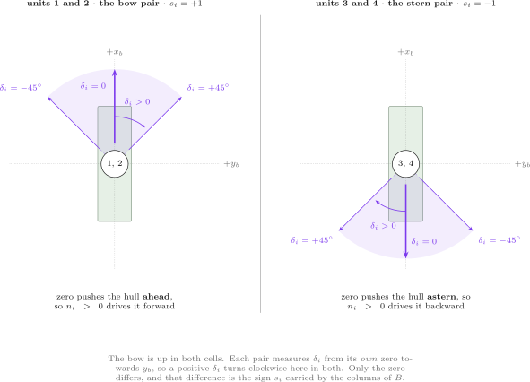

**The result.** Write $s_i = +1$ when unit $i$'s zero points ahead and $s_i = -1$ when it points astern. The thrust direction and the force of unit $i$ are then

$$
\mathbf{e}_i \;=\; s_i\begin{bmatrix}\cos\delta_i \\[2pt] \sin\delta_i\end{bmatrix},
\qquad
\mathbf{f}_i \;=\; T_i\begin{bmatrix}\cos\delta_i \\[2pt] \sin\delta_i\end{bmatrix},
\qquad
s = \begin{bmatrix}+1 & +1 & -1 & -1\end{bmatrix}
$$

The sign is deliberately kept out of $\mathbf{f}$ and placed in $B$, so that $\mathbf{f}$ holds only what the hardware reports.

Which direction is called the zero of a servo is a **convention**, not a property of the hull. Calling the other direction zero at all four units gives $s = \begin{bmatrix}-1 & -1 & +1 & +1\end{bmatrix}$ and therefore $-B$, and a source written that way is not wrong — it is a different labelling of the same four thrusters. What is not free is **consistency**: $B$, the servo zeros drawn in the figures, the commanded $\delta_i$ and every measured number of §12-3 must come from one choice. This course fixes that choice once, in the `mount` field of `otter_config.m`, and `_tools/otter_B.m` builds $B$ from that field by the column rule, so the matrix and the convention cannot drift apart.

With the column rule applied to each component separately, the force on the hull is linear in those eight numbers:

$$
\boldsymbol{\tau} \;=\; \begin{bmatrix} X \\ Y \\ N \end{bmatrix} \;=\; B\,\mathbf{f},
\qquad
\mathbf{f} = \begin{bmatrix} T_1\cos\delta_1 \\ T_1\sin\delta_1 \\ \vdots \\ T_4\cos\delta_4 \\ T_4\sin\delta_4\end{bmatrix},
\qquad
\mathbf{b}^{c}_i = s_i\!\begin{bmatrix} 1 \\ 0 \\ -y_i\end{bmatrix},
\quad
\mathbf{b}^{s}_i = s_i\!\begin{bmatrix} 0 \\ 1 \\ x_i\end{bmatrix}
$$

$$
B \;=\;
\begin{bmatrix}
1 & 0 & 1 & 0 & -1 & 0 & -1 & 0 \\
0 & 1 & 0 & 1 & 0 & -1 & 0 & -1 \\
d_1 & l_f & -d_2 & l_f & -d_3 & l_a & d_4 & l_a
\end{bmatrix}
$$

The first two rows carry only the mounting sign, because a force adds to $X$ and $Y$ whatever point it acts at. The third row is where the geometry enters, and **every entry in it is a moment arm**: a length, in metres, and never anything else. Two arms exist on this hull, one for each kind of column.

| Column of $B$ | It multiplies | Its entry in row 3 | What that length measures |
|---|---|---|---|
| $\mathbf{b}^{c}_i$, the $\cos$ column | $T_i\cos\delta_i$, the part of unit $i$'s thrust along $x_b$ | $-s_i y_i = \pm d_i$ | **transverse** arm: centreline to unit $i$'s pontoon, $d_i = 0.395$ m |
| $\mathbf{b}^{s}_i$, the $\sin$ column | $T_i\sin\delta_i$, the part of the same thrust along $y_b$ | $s_i x_i = l_f$ or $l_a$ | **longitudinal** arm: midships CO to the thrust station, $l_f = 1.50$ m forward, $l_a = 1.00$ m aft |

A moment arm is always measured **perpendicular to the force it multiplies**. A thrust along $x_b$ can only turn the hull by acting off the centreline, so its arm is the transverse half-separation $d_i$; a thrust along $y_b$ can only turn the hull by acting away from midships, so its arm is the longitudinal station $l_f$ or $l_a$. This is why the two arms of one unit are different lengths although they belong to the same thruster.

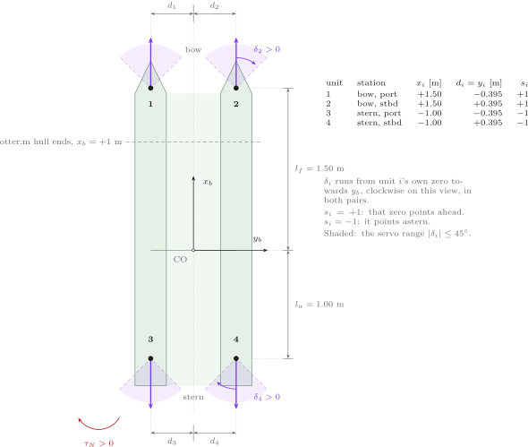

Two readings of row 3 follow directly, and both are measured in §12-3.

- the four $\sin$ entries are **all positive** — at the bow $s_i = +1$ and $x_i = +l_f$, at the stern $s_i = -1$ and $x_i = -l_a$, and the two negatives cancel. A positive $\delta$ at any of the four units therefore turns the hull the same way, which is why S3 tilts all four alike and gets a pure yaw
- the four $\cos$ entries alternate $+d, -d, -d, +d$ across the diagonal of the hull. Port-bow and starboard-stern thrust turn the bow to starboard; the other diagonal turns it to port

All four pontoons sit at the same half-separation, so $d_1 = d_2 = d_3 = d_4 = d = 0.395$ m, and row 3 becomes the eight numbers the code holds:

$$
\begin{bmatrix} d & l_f & -d & l_f & -d & l_a & d & l_a \end{bmatrix}
=
\begin{bmatrix} 0.395 & 1.500 & -0.395 & 1.500 & -0.395 & 1.000 & 0.395 & 1.000 \end{bmatrix}\ \text{m}
$$

| Symbol | Quantity | Value · source |
|---|---|---|
| $x_i$ | longitudinal station of unit $i$ | $+1.50, +1.50, -1.00, -1.00$ m — `otter_config.m`, field `pos` |
| $y_i = d_i$ | transverse station of unit $i$ | $-0.395, +0.395, -0.395, +0.395$ m — same |
| $s_i$ | mounting sign: which way the zero points | $+1, +1, -1, -1$ — `otter_config.m`, field `mount` |
| $\delta_i$ | tilt angle, from unit $i$'s own zero towards $y_b$ | commanded, clipped to $\pm 45^\circ$ |
| $T_i$ | thrust magnitude of unit $i$ | $k_{pos}n_i\lvert n_i\rvert$ for $n_i \ge 0$, $k_{neg}n_i\lvert n_i\rvert$ otherwise |
| $\mathbf{b}^{c}_i, \mathbf{b}^{s}_i$ | the two columns unit $i$ owns | the $\cos$ column and the $\sin$ column |
| $B$ | allocation matrix | $3\times 8$, rank 3 — built by `_tools/otter_B.m` from the column rule |
| $l_f, l_a$ | longitudinal moment arms, CO to the forward and aft stations | $1.50$ m, $1.00$ m — `otter_config.m`, fields `l_f`, `l_a` |

**Derivation, one line at a time.**

1. The force–moment triple produced by a planar force $\mathbf{g} = [\,g_x\;\;g_y\,]^{\mathsf T}$ applied at $(x, y)$ in body axes is $[\,g_x,\;g_y,\;x g_y - y g_x\,]^{\mathsf T}$. This is Week 3's column rule, and it is the only definition of $B$ this course uses.
2. For a **fixed** thruster, $\mathbf{e}_i$ is a constant of the hull. The single unknown is $T_i$, the rule returns one column, and four fixed thrusters give $B \in \mathbb{R}^{3\times 4}$.
3. For a **tilting** thruster, $\mathbf{e}_i = \mathbf{e}_i(\delta_i)$. The map $(T_i, \delta_i) \mapsto T_i\mathbf{e}_i$ is polar-to-Cartesian, invertible wherever $T_i > 0$, so the unit carries two independent numbers rather than one.
4. Applying line 1 to the two components of $s_i T_i [\cos\delta_i\;\;\sin\delta_i]^{\mathsf T}$ separately gives the columns $s_i[1, 0, -y_i]^{\mathsf T}$ and $s_i[0, 1, x_i]^{\mathsf T}$. Four units give $B \in \mathbb{R}^{3\times 8}$, written above with its third row in symbols.
5. $B$ has rank 3: rows 1 and 2 are independent by inspection, and row 3 is not a combination of them because the $x_i$ and $y_i$ are not all zero. Its null space has dimension $8 - 3 = 5$.
6. Five null-space dimensions are five independent ways to change the eight numbers without changing the force. Choosing among them is allocation — the minimum-norm choice is $\mathbf{f} = B^{\dagger}\boldsymbol{\tau}$ with $B^{\dagger} = B^{\mathsf T}(BB^{\mathsf T})^{-1}$ — and it is next stage's subject, not this one's.
7. Multiplying out $B\mathbf{f}$ gives the scalar form the motion model evaluates:

$$
X = \sum_{i=1}^{4} s_i T_i\cos\delta_i,
\qquad
Y = \sum_{i=1}^{4} s_i T_i\sin\delta_i,
\qquad
N = \sum_{i=1}^{4} s_i\bigl(x_i T_i\sin\delta_i - y_i T_i\cos\delta_i\bigr)
$$

8. Writing $f_{i,x} = T_i\cos\delta_i$ and $f_{i,y} = T_i\sin\delta_i$ and substituting the four stations turns the moment sum into eight separate terms, each one a force times its own arm:

$$
N \;=\; \bigl(d_1 f_{1,x} - d_2 f_{2,x} - d_3 f_{3,x} + d_4 f_{4,x}\bigr)
\;+\; l_f\bigl(f_{1,y} + f_{2,y}\bigr) \;+\; l_a\bigl(f_{3,y} + f_{4,y}\bigr)
$$

   The first bracket collects the transverse arms, the other two the longitudinal ones. This is the form to read when a commanded manoeuvre comes out wrong: each term names one thruster, one component of its thrust, and the one length that turns it into yaw.

9. Two consequences follow at $\delta = 0$, and Experiment 12-1 measures both. Every sine dies, so $Y = 0$ and $N = -\sum s_i y_i T_i$: the differential-thrust yaw of `otter.m`, with four stations in place of two. And because $s_3 = s_4 = -1$, the aft pair alone reproduces `otter.m` with $\boldsymbol{\tau}$ reversed.

### Experiment 12-1 · The new model contains the old one (15 min)

**What it measures.** Lines 1, 7 and 9 of the derivation: that the column rule and the scalar form agree, and that $\delta = 0$ returns `otter.m` — forward with $\boldsymbol{\tau}$ as it stands, aft with $\boldsymbol{\tau}$ reversed.

**The model.** None. `verify_otter_tilt4` calls `otter_tilt4` and `otter` directly, over 200 random states, so the check is on the equations and not on any wiring.

**Opening and running.**

```matlab
verify_otter_tilt4            % 네 가지 항등식 / four identities
```

Expected output:

```
  verify_otter_tilt4
    stations   x = [+1.50 +1.50 -1.00 -1.00] m
               y = [-0.395 +0.395 -0.395 +0.395] m
    tilt limit +-45 deg each
    B          3 x 8, rank 3, null space 5

  (a) aft mounting sign flips tau exactly :  3.55e-15
  (b) fore pair, delta 0 == otter.m       :  0.00e+00
  (c) tau                == otter_B * f   :  7.19e-14
  (d) saturation clamps n AND delta       :  0.00e+00

  thrust at +-60 rad/s   +39.888 N ahead, -23.202 N astern  (k_neg/k_pos = 0.5817)
  cancelling astern speed   -78.670 rad/s   (not -60)
  limits                   -101.737 .. +103.931 rad/s

  PASS  (tol 1e-09, 200 random states)
```

**Reading the output against the derivation.**

| Where to look | What is there | Which line predicts it |
|---|---|---|
| `(b)` | exactly zero, not merely small | line 9 — at $\delta = 0$ the forward pair evaluates the arithmetic of `otter.m`, in the same order |
| `(a)` | $3.55\times10^{-15}$, one rounding step | line 9 — $s_3 = s_4 = -1$, so the aft pair gives `otter.m` with every component of $\boldsymbol{\tau}$ reversed |
| `(c)` | $7.19\times10^{-14}$ over 200 random states | line 7 — the scalar form and $B\mathbf{f}$ are one expression in two floating-point orders |
| `(d)` | zero | the model clips **both** $n$ and $\delta$, so a command outside the envelope is received at the envelope |
| `rank 3, null space 5` | printed, not asserted | lines 5 and 6 |

**What the output says**

- The four-unit model is a strict extension: nothing in it changes what the first eleven weeks measured.

| What to try | What to watch |
|---|---|
| `verify_otter_tilt4` twice in a row | only `(c)` changes, in its last digits — the random states feed the $B\mathbf{f}$ comparison alone |

> [!tip] In class
> - **Purpose** — fix two ideas: a tilting unit is two unknowns, and the mounting sign lives in $B$.
> - **Point to** — the third row of $B$: each pair contributes $s_i(-y_i)$ then $s_i(+x_i)$, and that is the whole of the column rule.
> - **Ask** — "Eight unknowns and three equations. How many solutions?" Five dimensions of them, which is why an allocator is a choice and not a calculation.
> - **Take away** — the forward pair at $\delta = 0$ **is** `otter`, to the last bit; the aft pair is `otter` running backwards.

## 12-2. What had to change inside the motion model

This section answers: which lines of `otter.m` carry the thruster configuration, and which lines carry the hull?

**What is observed.** `_tools/otter_tilt4.m` is MSS `otter.m` copied and changed in four places, each marked in the file with `% ---- CHANGED (i of 4)`. The four marks sit in the same four places as Week 6's `otter_bow.m`.

- the rigid-body and added-mass matrices, the Coriolis terms, the restoring forces, the linear and cross-flow damping, the nonlinear yaw damping $N_h = N_r(1 + 10\lvert r\rvert)r$ and the kinematics are character-for-character identical
- the hull is the same hull, and the file has to show that

**The result.** Four changes, and nothing else.

| | `otter.m` | `otter_tilt4.m` | Why |
|---|---|---|---|
| 1 · input check | `length(n) ~= 2` | `length(n) ~= 4` and `length(delta) ~= 4`, plus an eighth argument `quad` | the configuration arrives as data, so the stations and tilt limits are not hard-coded in the plant |
| 2 · thruster data | $l_1$, $l_2$ | `px`, `py`, `d_max`, `smount` read out of `quad`, and $B$ built from them | with four stations a pair of signed arms is not enough, and the mounting sign has to reach the columns |
| 3 · thrust loop | `for i = 1:1:2`, $n$ saturated | `for i = 1:1:4`, $n$ **and** $\delta$ saturated | derivation line 3 below — the servo is part of the vessel, not of the controller |
| 4 · the force vector | `tau = [T1+T2  0  0 0 0  -l1*T1-l2*T2]'` | `tau3 = B_thr * f` | derivation lines 4 to 6 — one matrix product in place of a literal |

**Derivation, one line at a time.**

1. The propellers are unchanged. $k_{pos} = 0.02216/2$ and $k_{neg} = 0.01289/2$ stay at the values `otter.m` sets, because the same propeller is fitted four times rather than twice.
2. The shaft limits are therefore also unchanged: $n_{max} = +103.931$ rad/s and $n_{min} = -101.737$ rad/s, derived in `otter.m` from the maximum thrust each way.
3. The tilt servo belongs inside the plant. A servo that refuses $70^\circ$ refuses it whatever asked, so the clip must be in the motion model; a clip placed only in the controller would let a mis-wired command produce a force the vessel cannot make.
4. `otter.m` writes its $\boldsymbol{\tau}$ as a literal six-row vector because two fixed thrusters reach only two of the six rows. Here every unit reaches rows 1, 2 and 6 at once, so the literal is replaced by the product $\boldsymbol{\tau}_3 = B\mathbf{f}$ of §12-1.
5. The split is deliberate. $B$ is built once, from geometry and mounting alone, and holds every sign; $\mathbf{f}$ is rebuilt each step and holds only $T_i$ and $\delta_i$. Nothing in the force code can disagree with the figure, because the figure is $B$.
6. Rows 3, 4 and 5 stay zero. No thruster on this vessel acts in heave, roll or pitch, and the trim moment that does act in pitch is applied elsewhere in the file, exactly as in `otter.m`.

The second change, which is the column rule and the mounting sign written as code:

```matlab
% ---- CHANGED (2 of 4) ---------------------------------------------------
px     = quad(1,:);                     % x stations (m)
py     = quad(2,:);                     % y stations (m)
d_max  = quad(3,:);                     % tilt limits, both ways (rad)
smount = quad(4,:);                     % mounting signs, +1 forward, -1 aft

% 유효행렬을 열 규칙(3주차)으로 **여기서** 만든다. 이름이 B_thr 인 것은
% otter.m 의 B 가 이미 **선폭**이라서다 — 그 줄은 고치지 않는다.
% The effectiveness matrix, built here from the Week 3 column rule. It is named
% B_thr because B is already the beam in otter.m, and that line is not touched.
B_thr = zeros(3,8);
for i = 1:1:4
    for k = 1:1:2                       % k = 1 gives e = s(1,0), k = 2 e = s(0,1)
        e    = zeros(2,1);
        e(k) = smount(i);
        B_thr(:, 2*i-2+k) = [ e(1)
                              e(2)
                              px(i)*e(2) - py(i)*e(1) ];
    end
end
% -------------------------------------------------------------------------
```

The fourth change, which is the matrix product itself:

```matlab
% ---- CHANGED (4 of 4) ---------------------------------------------------
% Control forces and moments — written as a matrix product
% otter.m:  tau = [T1+T2  0  0 0 0  -l1*T1 - l2*T2]'      <- sway is zero
% here:     tau_3 = B f.  Each tilting thruster contributes TWO columns of B
%           and two entries of f, so the 3-by-8 B is constant and the whole
%           dependence on the commands sits in f.
%
%     f = [ T_1 cos d_1 ; T_1 sin d_1 ; ... ; T_4 cos d_4 ; T_4 sin d_4 ]
%
% 쌍마다 0 도가 다른 것은 B 안에 있다 — otter_B 가 거치 부호 s = [1 1 -1 -1]
% 을 열에 실어 두었다. 그래서 여기에는 부호가 하나도 없다.
% The per-pair zero lives inside B: otter_B has already carried the mounting
% sign s = [1 1 -1 -1] into the columns, so no sign appears here.
f = reshape([Thrust(:) .* cos(delta(:)), ...
             Thrust(:) .* sin(delta(:))].', 8, 1);

tau3 = B_thr * f;                       % [X ; Y ; N]

tau = [tau3(1)
       tau3(2)
       0
       0
       0
       tau3(3)];
% -------------------------------------------------------------------------
```

| In the code | In the derivation | Note |
|---|---|---|
| `e(k) = smount(i)` | $\mathbf{e}_i = s_i[\cos\delta_i\;\;\sin\delta_i]^{\mathsf T}$ | the only place the mounting sign is applied |
| `px(i)*e(2) - py(i)*e(1)` | $x_i e_{iy} - y_i e_{ix}$ | §12-1 line 1 — the column rule, third entry |
| `B_thr(:, 2*i-2+k)` | the two columns unit $i$ owns | $k = 1$ is $\mathbf{b}^{c}_i$, $k = 2$ is $\mathbf{b}^{s}_i$ |
| the `reshape(...,8,1)` | $\mathbf{f}$ of §12-1 | the cosine and the sine of each unit, interleaved in that order |
| `tau3 = B_thr * f` | $\boldsymbol{\tau} = B\mathbf{f}$ | no sign and no station appears here: both are already in $B$ |
| rows 3, 4, 5 left at zero | line 6 | heave, roll and pitch carry no thruster |

Change 3 is the loop that fills `Thrust` and clips both commands. It keeps `otter.m`'s shaft-speed clip and its $k_{pos}$ / $k_{neg}$ branch unaltered, and adds the servo clip `delta(i) > d_max(i)` — which §12-4 measures as the third asymmetry.

> [!note] The sway row is no longer structurally zero
> Week 6 made the same point about `otter_bow.m`. A motion model whose $\tau_y$ is identically zero describes an under-actuated vessel, however a sway force is added to it afterwards. The four-unit model earns a non-zero second row from the geometry itself, which is why the eight numbers of §12-3 can be given directly to the plant with no allocator between.

## 12-3. The force eight numbers make

This section answers: given eight numbers by hand, is the resulting force the one the column rule predicts?

**What is observed.** Experiment 12-3 commands eight sets of eight numbers and compares two independent computations of $\boldsymbol{\tau}$: the product $B\mathbf{f}$ of §12-1, and the force measured back out of `otter_tilt4` from the acceleration it produces. The worst disagreement over the eight scenarios is $2.8\times10^{-14}$ N or N·m.

- the eight scenarios isolate one effect each, and are reused by §12-4, §12-5 and §12-6
- S8 asks for $70^\circ$, and the table records what the model received

**The result.** The model is driven open loop: eight constants on the canvas, a saturation stage, the plant, and the log.

$$
\boldsymbol{\tau}_{\text{measured}} \;=\; M\bigl(\dot{\mathbf{x}}_{\text{on}} - \dot{\mathbf{x}}_{\text{off}}\bigr)_{1:6}
$$

| Symbol | Quantity | Value · source |
|---|---|---|
| $M$ | $6\times 6$ mass matrix, rigid body plus added mass | from `otter_tilt4` at the same state |
| $\dot{\mathbf{x}}_{\text{on}}$ | acceleration with the commanded $(n, \delta)$ | `otter_tilt4(x, n, delta, …)` |
| $\dot{\mathbf{x}}_{\text{off}}$ | acceleration with $n = 0$ | the same call with the thrust removed |
| residual | $\max\lvert B\mathbf{f} - [X\;Y\;N]^{\mathsf T}\rvert$ | asserted below $10^{-12}$ inside the script |

**Derivation, one line at a time.**

1. The six-row acceleration of the vessel is $\dot{\boldsymbol{\nu}} = M^{-1}(\boldsymbol{\tau} - \mathbf{d}(\boldsymbol{\nu}, \mathbf{x}))$, where $\mathbf{d}$ collects damping, Coriolis and restoring terms. Those terms depend on the state but not on the thrust.
2. Evaluating the same state twice, once with the thrust and once with $n = 0$, therefore differences $\mathbf{d}$ away: $\dot{\boldsymbol{\nu}}_{\text{on}} - \dot{\boldsymbol{\nu}}_{\text{off}} = M^{-1}\boldsymbol{\tau}$.
3. Multiplying back by $M$ recovers $\boldsymbol{\tau}$ exactly, not approximately, because acceleration is affine in the thrust. This is the same argument Week 6 used to show its superposition had been exact.
4. The comparison is run **at rest**, $\mathbf{x} = \mathbf{0}$, so that no state-dependent term can hide a sign error by cancelling it.
5. The tilt command is clipped before it reaches the column rule, so the table prints the clipped angle. A case that asks for more than $45^\circ$ must therefore produce the row of the case that asked for exactly $45^\circ$.

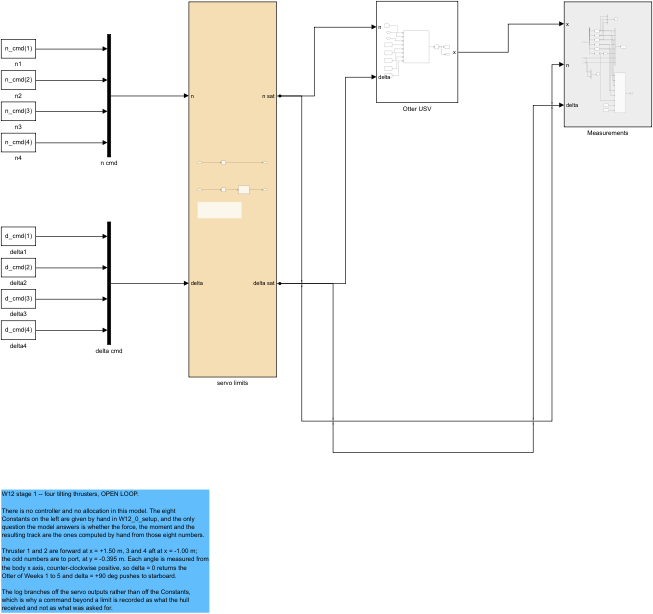

Eight Constant blocks carry the eight numbers, two Mux bars gather them into vectors, the tan subsystem applies the physical envelope, the green block is `otter_tilt4`, and the grey block logs `[u v r N E psi]` followed by the post-servo $(n, \delta)$ tapped from the branches below.

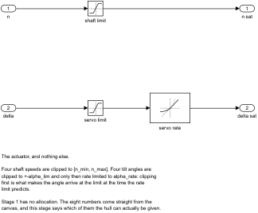

The upper lane clips the shaft speed to $[-101.737, +103.931]$ rad/s. The lower lane clips the angle to $\pm 45^\circ$ and only then rate-limits it to $90^\circ$/s. The two lanes never meet, because shaft speed and tilt angle are independent commands.

> [!important] The angle is clipped before it is rate-limited, not after
> Rate-limiting first would let the limiter chase a $70^\circ$ target through the legal range and sit at $45^\circ$ only on arrival, so the recorded angle would depend on how long the run lasted. Clipping first makes the target legal, and the rate limiter then describes only how fast the servo gets there.

### Experiment 12-3 · Eight commands, and the force each one makes (20 min)

**What it measures.** Lines 3 and 5: that the force measured out of the plant is the force the column rule predicts, and that the servo clip is visible in the table.

**The model.** `W12_openloop.slx`. Between runs only the eight constants change; the wiring does not.

**Opening and running.** The runner takes a selection, so one scenario can be re-examined without redrawing the other seven.

```matlab
W12_0_setup
open_system('W12_openloop')    % Run — 궤적과 상태량이 뜬다 / the track appears
W12_V_openloop                 % 여덟 전부 / all eight, and the three tables
W12_V_openloop('S5')           % 하나만 / one of them, its own sheet redrawn
W12_V_openloop({'S5','S6'})    % 둘을 견준다 / two, to be compared
```

Expected output, the first of three tables printed by that script:

```
  (1) hand formula against the motion model, at rest

      tau from the hand formula    X = sum si Ti cos di
                                   Y = sum si Ti sin di
                                   N = sum si (xi sin di - yi cos di) Ti
                                   s = [+1 +1 -1 -1], the mounting signs
      tau measured out of otter_tilt4's acceleration, same state

    case  n [rad/s] after clip       delta [deg] clipped       X [N]    Y [N]  N [N m]    resid
    -------------------------------------------------------------------------------------------
    S1    [ 60.0  60.0 -60.0 -60.0]  [   0    0    0    0]   126.180    0.000    0.000  0.0e+00
    S2    [-60.0 -60.0  60.0  60.0]  [   0    0    0    0]  -126.180   -0.000    0.000  1.4e-14
    S3    [ 60.0  60.0  60.0  60.0]  [  45   45   45   45]     0.000    0.000  141.025  2.8e-14
    S4    [ 60.0  60.0  60.0  60.0]  [ -45  -45  -45  -45]     0.000    0.000 -141.025  2.8e-14
    S5    [ 60.0  60.0  60.0  60.0]  [  45   45  -45  -45]     0.000  112.820   28.205  1.4e-14
    S6    [ 60.0  60.0  73.5  73.5]  [  45   45  -45  -45]   -28.205  141.025    0.000  2.2e-14
    S7    [ 60.0  60.0 -60.0 -60.0]  [  45   45    0    0]   102.814   56.410   84.615  2.8e-14
    S8    [ 60.0  60.0  60.0  60.0]  [  45   45  -45  -45]     0.000  112.820   28.205  1.4e-14
    -------------------------------------------------------------------------------------------
    worst residual 2.8e-14 N or N m over the 8 scenarios
```

**Reading the table against the derivation.**

| Where to look | What is there | Which line predicts it |
|---|---|---|
| the `resid` column | at most $2.8\times10^{-14}$ | line 3 — the two computations are the same expression, so only rounding separates them |
| S1, $X = 126.180$ N | $2(39.888 + 23.202)$ | §12-1 line 9 at $\delta = 0$: the bow pair ahead, and the stern pair ahead too, because $s_i = -1$ reverses a negative shaft speed |
| S2, $X = -126.180$ N | the same magnitude, mirrored | the mounting sign swaps which pair runs astern, so the asymmetric thrust curve cancels out of the total |
| S3, $X = Y = 0$ with $N = 141.025$ N·m | $2(l_f + l_a)T\sin 45^\circ$ | §12-1 line 7 — the four force vectors sum to zero and only their moments survive |
| S5, $N = 28.205$ N·m although a pure sway was asked | $2(l_f - l_a)T\sin 45^\circ$ | §12-4 — the stations are not symmetric about CO |
| S6, the commanded $73.5$ rad/s | $60\sqrt{1.5}$ | §12-4 — the stern speed that cancels that moment, at the price of $-28.205$ N of surge |
| S8 identical to S5 | the `delta` column reads 45, although 70 was asked | line 5, and §12-2 |

**What the table says**

- The eight numbers reach the hull as the column rule says they will, and nothing in the wiring alters them.

| What to try | What to watch |
|---|---|
| `W12_V_openloop('S1')` | the S1 sheet alone: surge only, and the vessel of Weeks 1 to 11 is back |
| `W12_V_openloop({'S5','S6'})` | two sheets and a two-curve overlay: the leftover moment, and the same crab with that moment cancelled |

> [!tip] In class
> - **Purpose** — separate "the equations are right" from "the vessel does what was wanted".
> - **Point to** — the S1 and S2 rows. Both reach $126.180$ N although the thrust curve is far from symmetric, because the mounting sign decides which pair runs astern.
> - **Ask** — "S8 asked for $70^\circ$. Which column shows that it did not get it?" The `delta` column, which prints what the plant received.
> - **Take away** — a residual of $10^{-14}$ says the arithmetic is right; it says nothing about whether the force was the right force.

## 12-4. Three asymmetries that break the symmetric guess

This section answers: why does a command that looks symmetric produce a motion that is not?

**What is observed.** Three asymmetries run through the eight rows of table (1), and each one is a property of the vessel rather than of the command.

- the thrust curve: $+60$ rad/s gives $+39.888$ N, $-60$ rad/s gives only $-23.202$ N
- the stations: $l_f = 1.50$ m forward against $l_a = 1.00$ m aft
- the servo: $70^\circ$ asked, $45^\circ$ given

**The result.** Each has a closed form, and each predicts a number in the table.

$$
\underbrace{n_{rev} = -n\sqrt{\frac{k_{pos}}{k_{neg}}} = -78.670\ \text{rad/s}}_{\text{thrust curve}},
\qquad
\underbrace{N = \bar{x}\,Y, \quad \bar{x} = \frac{l_f - l_a}{2} = 0.25\ \text{m}}_{\text{stations}}
$$

| Symbol | Quantity | Value · source |
|---|---|---|
| $k_{pos}$ | thrust coefficient, ahead | $0.02216/2 = 0.011080$ — `otter.m`, unchanged |
| $k_{neg}$ | thrust coefficient, astern | $0.01289/2 = 0.006445$ — same |
| $k_{neg}/k_{pos}$ | the asymmetry ratio | $0.5817$ — printed by `W12_0_setup` |
| $n_{rev}$ | astern speed matching $+60$ rad/s | $-78.670$ rad/s — printed by `verify_otter_tilt4` |
| $\bar{x}$ | longitudinal centroid of the four stations | $0.25$ m |
| $N$ | residual yaw of a four-unit symmetric crab | $+28.205$ N·m — table (1), row S5 |

**Derivation, one line at a time.**

1. The thrust of one propeller is the signed square $T = k n\lvert n\rvert$, with $k = k_{pos}$ for $n \geq 0$ and $k = k_{neg}$ for $n < 0$. Both coefficients are positive, and $k_{neg} < k_{pos}$ because a propeller designed to push ahead is less efficient in reverse.
2. Running one unit at $+n$ and another at $-n$ therefore does not cancel: $T(+n) + T(-n) = (k_{pos} - k_{neg})n^2$.
3. Row S1 runs the bow pair at $+60$ rad/s and the stern pair at $-60$. Each stern unit returns $-23.202$ N, which its mounting sign $s_i = -1$ turns into $+23.202$ N of ahead force, so the four push ahead in unequal shares — $39.888$ N forward against $23.202$ N aft, a ratio of $1.72$. Row S2 swaps which pair runs astern, so $\lvert X\rvert$ is the same $126.180$ N in both. The thrust curve does not break the fore–aft symmetry of the total; it breaks **the split between the pairs**, and that split decides each pair's moment as soon as the units tilt.
4. Setting $k_{pos}n^2 + k_{neg}n_{rev}\lvert n_{rev}\rvert = 0$ with $n_{rev} < 0$ gives the astern speed at which a unit matches a forward one: $n_{rev} = -n\sqrt{k_{pos}/k_{neg}} = -60 \times 1.3112 = -78.670$ rad/s. `verify_otter_tilt4` prints it as `cancelling astern speed`.
5. The second asymmetry needs no thrust curve at all. Take row S5 — the bow pair at $\delta = +45^\circ$, the stern pair at $-45^\circ$, all four at the same thrust $T$. With the mounting signs every unit makes the **same** sway force $f_y = T\sin 45^\circ = 28.205$ N, while the surge forces alternate: $+f_x$ forward, $-f_x$ aft. Then

$$
N \;=\; \sum_i \bigl(x_i f_y - y_i f_{ix}\bigr) \;=\; f_y\sum_i x_i \;-\; \sum_i y_i f_{ix}
$$

6. The second sum is zero: inside each pair the two units sit at $\pm y$ with the same $f_{ix}$, so their two contributions cancel. The first sum is not zero: $\sum x_i = 2l_f - 2l_a = 1.0$ m, so $N = 2(l_f - l_a)f_y$.
7. Dividing by $Y = 4f_y$ puts it in the form that explains itself: $N = \bar{x}Y$ with $\bar{x} = \tfrac14\sum x_i = (l_f - l_a)/2 = 0.25$ m. Four equal sway forces are one sway force acting at the centroid of the four stations, and that centroid is $0.25$ m ahead of $o_b$. With $Y = 112.820$ N this is $N = 112.820 \times 0.25 = 28.205$ N·m, the S5 and S8 reading.

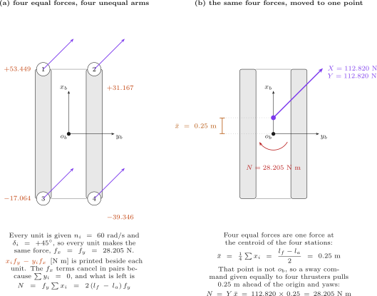

8. The condition that removes it follows from the same sum with the bow pair at $T_f$ and the stern pair at $T_a$, all at $\lvert\delta\rvert = 45^\circ$: $\sum x_i T_i = 3.0T_f - 2.0T_a = 0$, hence $T_a = 1.5T_f$. With $T_f = 39.888$ N this needs $T_a = 59.832$ N, that is $n_a = \sqrt{59.832/k_{pos}} = 60\sqrt{1.5} = 73.485$ rad/s. Row S6 runs it and reads $N = 0.000$ N·m — at the price of $X = 2\cos 45^\circ\,(T_f - T_a) = -28.205$ N. The moment did not vanish; it became a surge of the same number.
9. The third asymmetry is the servo, and it is not a sign or a ratio but a wall. $\delta$ is clipped before the column rule sees it, so the force is computed from $45^\circ$ whatever was asked. A command of $70^\circ$ and a command of $45^\circ$ are the same command to this vessel.
10. All three together are the argument for an allocator. The eight numbers a person would guess from symmetry are not the eight numbers that produce the wanted force, and solving for them by hand — as line 8 did, for one condition — does not scale to three conditions and a changing state.

> [!warning] No equal-thrust sway inside $\pm 45^\circ$ is free of yaw
> A symmetric crab leaves $28.205$ N·m, and no common shaft speed removes it, because the asymmetry is in the geometry, not in the command. Line 8 buys the moment back with a surge of exactly $-28.205$ N. Unequal thrusts can do better — Assignment requirement 2 asks for such a set — but four equal ones never can.

### Experiment 12-4 · The three asymmetries, measured (20 min)

**What it measures.** Lines 3, 4, 7, 8 and 9, each against a row of table (1).

**The model.** The same `W12_openloop.slx`. `W12_tab_track` prints the three asymmetries below table (3), from the same eight runs.

**Opening and running.**

```matlab
W12_V_openloop                 % 여덟 줄 전부 / all eight rows
W12_V_openloop({'S5','S6'})    % 두 번째 비대칭만 / the second asymmetry alone
```

Expected output, the block printed below table (3):

```
      the three asymmetries this week turns on
        thrust curve   +60 rad/s gives +39.888 N, -60 rad/s gives -23.202 N, so
                       the pair running forward carries 1.72 times the pair
                       running astern -- and yet S1 and S2 reach the SAME
                       +126.180 N, because the mirrored mounting swaps which
                       pair is the one running astern
        the stations   l_f = 1.50 m forward, l_a = 1.00 m aft, so S5 crabs with
                        +28.205 N m of yaw left over, and S6 cancels that moment
                       at n = 73.485 rad/s only by letting  -28.205 N of surge
                       appear: no EQUAL-thrust sway inside +-45 deg is yaw-free
        the servo      S8 asks for 70 deg and is given 45 deg, so its row of
                       table (1) is S5's row exactly
```

**Reading the output against the derivation.**

| Where to look | What is there | Which line predicts it |
|---|---|---|
| `1.72 times` | the $39.888/23.202$ split inside S1 | line 3 — $k_{pos}/k_{neg}$ |
| `the SAME +126.180 N` | the S1 and S2 $X$ columns | line 3 — the mounting signs swap which pair runs astern |
| `+28.205 N m of yaw` | the S5 and S8 $N$ columns | line 7 — $\bar{x}Y$ with $\bar{x} = 0.25$ m |
| `-28.205 N of surge` | the S6 $X$ column, with $N = 0.000$ | line 8 — the moment traded for a surge |
| `given 45 deg` | the S8 `delta` column | line 9 |

| What to try | What to watch |
|---|---|
| `W12_V_openloop('S6')` alone | $N = 0.000$ N·m against S5's $+28.205$, and $X$ going from $0$ to $-28.205$ N |
| `d_deg = [90 90 -90 -90]'` in `W12_0_setup`, expecting a pure sway | the table returns S5's row. The servo refuses the extra $45^\circ$ — line 9, not a sway |

> [!tip] In class
> - **Purpose** — show that the obstacle to commanding this vessel is the vessel, not the arithmetic.
> - **Point to** — cell (b) of the figure: one arrow, offset $0.25$ m, and the yaw follows from the offset alone.
> - **Ask** — "Which of the three would disappear if the hull were symmetric fore and aft?" Only the second. The thrust curve and the servo belong to the hardware.
> - **Take away** — $\bar{x} = (l_f - l_a)/2 = 0.25$ m, and $N = \bar{x}Y$.

## 12-5. The track those forces produce

This section answers: does the vessel go where eight hand-chosen numbers send it?

**What is observed.** Experiment 12-5 runs each of the eight cases for 30 s from rest and reads four quantities at the end. S1 runs straight at $1.627$ m/s; S5 crabs at $74.28^\circ$ while turning; S8 lies exactly on S5.

- the readings are taken at $t = 30$ s, by when all eight have settled
- the crab angle is $\beta = \operatorname{atan2}(v, u)$ and the speed is $U = \sqrt{u^2 + v^2}$
- turn radius is $U/\lvert r\rvert$, reported as `straight` when $\lvert r\rvert < 10^{-4}$ rad/s

**The result.** A force held constant in body axes produces a steady body-frame velocity, and a steady velocity with a steady yaw rate is a circle.

$$
U = \sqrt{u^2 + v^2},
\qquad
\beta = \operatorname{atan2}(v, u),
\qquad
R = \frac{U}{\lvert r \rvert}
$$

| Symbol | Quantity | Value · source |
|---|---|---|
| $U$ | total speed over the water | read at $t = 30$ s |
| $\beta$ | crab angle, body $x$ to the velocity | positive to starboard |
| $R$ | radius of the steady turn | $U/\lvert r\rvert$; infinite when $r = 0$ |
| $T_{final}$ | run length for these readings | 30 s, set inside `W12_tab_reint` |

**Derivation, one line at a time.**

1. With $(n, \delta)$ held constant, $\boldsymbol{\tau}$ is constant in body axes, so the body-frame equation $M\dot{\boldsymbol{\nu}} + \mathbf{d}(\boldsymbol{\nu}) = \boldsymbol{\tau}$ is autonomous and settles on an equilibrium $\boldsymbol{\nu}^\star$ where damping balances thrust.
2. That equilibrium is reached in a few seconds for surge and sway, and in rather longer for yaw, because the nonlinear yaw damping $N_h = N_r(1 + 10\lvert r\rvert)r$ stiffens as $r$ grows.
3. At equilibrium the body-frame velocity is fixed but the heading is not: $\dot\psi = r \neq 0$ rotates the velocity in the Earth frame, which traces a circle of radius $U/\lvert r\rvert$.
4. The crab angle $\beta$ is a property of that equilibrium, not of the command. Row S7's force stands at $\operatorname{atan2}(56.410, 102.814) = 28.74^\circ$ in body axes, yet the hull crabs at only $5.89^\circ$, because sway damping on this hull is far larger than surge damping.
5. A case with $r = 0$ runs straight in the direction $\beta$, and three rows do: S1 at $\beta = 0$, S2 at $180^\circ$, and S6 at $114.0^\circ$ — a heading held while the hull travels sideways and slightly astern.
6. S8 must trace S5's circle exactly, since §12-4 line 9 showed the two commands reach the plant identically. The overlay draws S8 dashed so the coincidence is visible rather than hidden by overdrawing.

### Experiment 12-5 · Eight tracks from eight commands (20 min)

**What it measures.** Lines 3 to 6: that each command settles, that the settled state is a circle or a straight line, and that S8 and S5 coincide.

**The model.** The same `W12_openloop.slx`, run eight times at $T_{final} = 30$ s. Each run gets **its own sheet** — `img/W12_result_S1.png` … `_S8.png` — because eight curves in one axes erase each other and the question of this section is whether each scenario did what was written down for it.

**Opening and running.**

```matlab
W12_V_openloop                 % 여덟 장 전부 / all eight sheets
W12_V_openloop('S5')           % 한 장만 다시 / that one sheet again
```

Expected output, the third table:

```
  (3) the motion those forces produce, scenario by scenario

      every value is read at t = 30 s, by when all 8 have settled

    case  command                      U [m/s]  crab [deg]  r [deg/s]  radius [m]
    ----------------------------------------------------------------------------
    S1    surge ahead                    1.627        0.00      0.000    straight
    S2    surge astern                   1.627      180.00      0.000    straight
    S3    yaw to starboard               0.030      -21.14     28.397        0.06
    S4    yaw to port                    0.030       21.14    -28.397        0.06
    S5    sway to starboard              0.747       74.28      7.589        5.64
    S6    sway, moment cancelled         0.895      113.99     -0.000    straight
    S7    turn while making way          1.464        5.89     20.239        4.15
    S8    tilt beyond the servo limit    0.747       74.28      7.589        5.64
    ----------------------------------------------------------------------------
```

Each sheet carries the six states on the left, **the command drawn as four force arrows** at the top right, and the track with hull and heading below it. The arrow panel is what makes a wrong command distinguishable from a wrongly followed one.

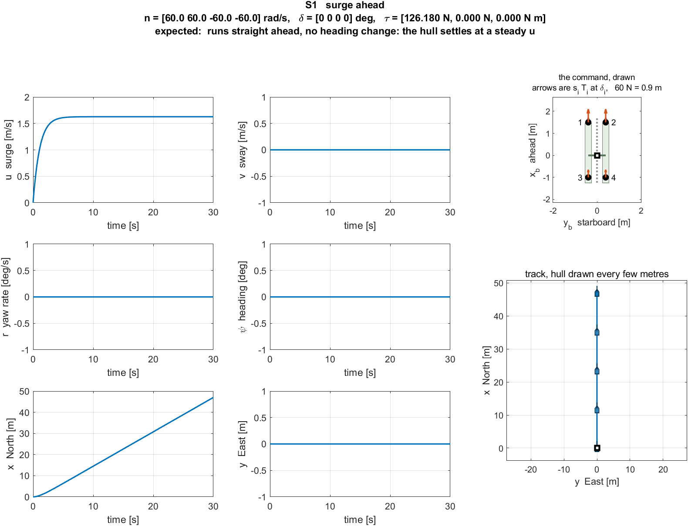

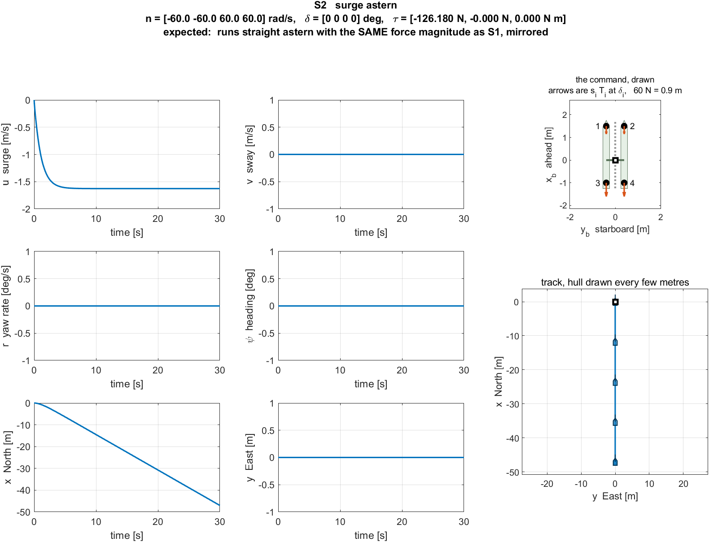

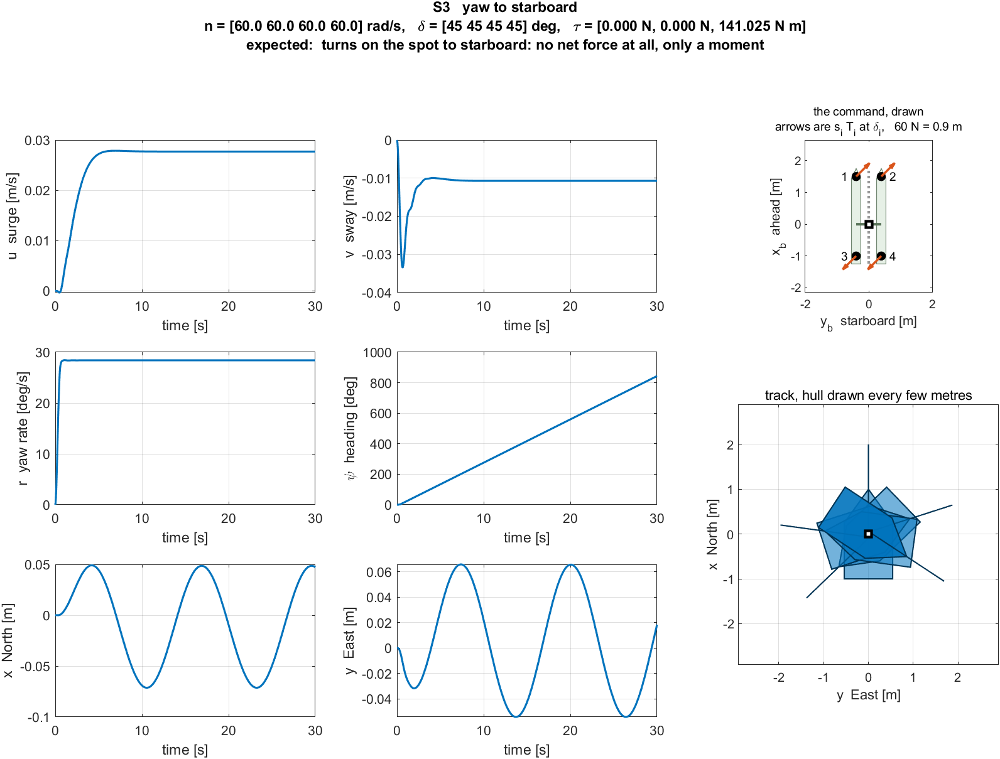

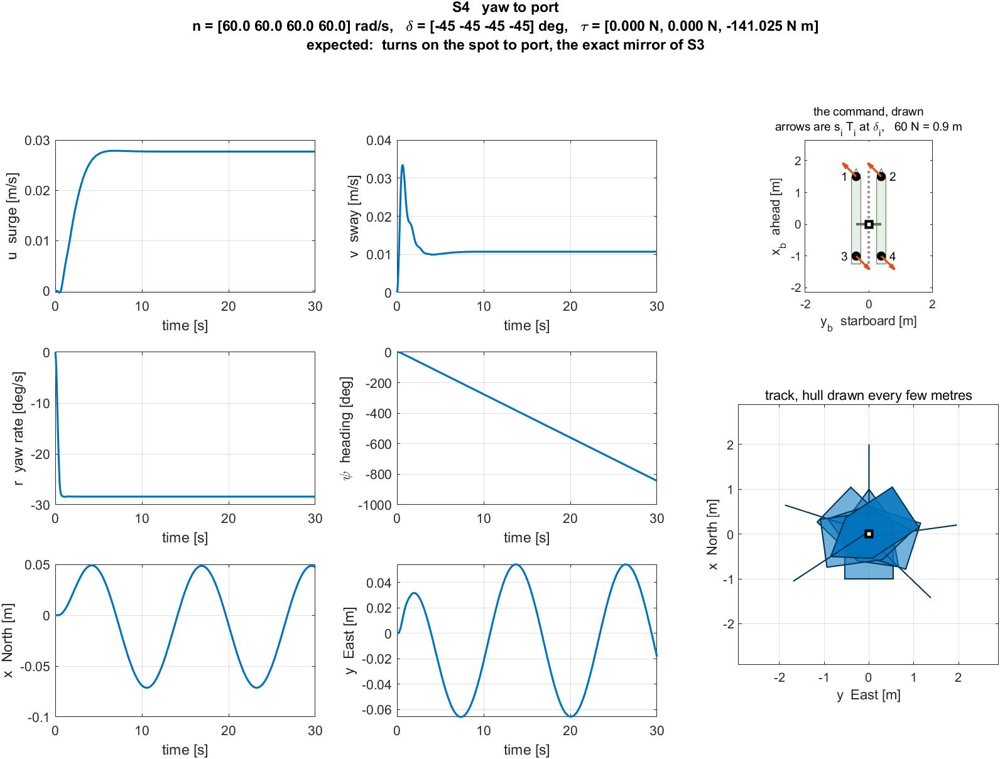


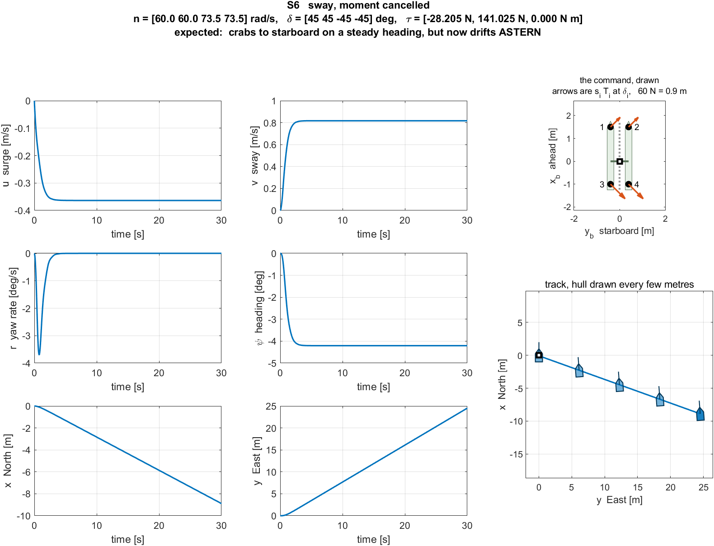

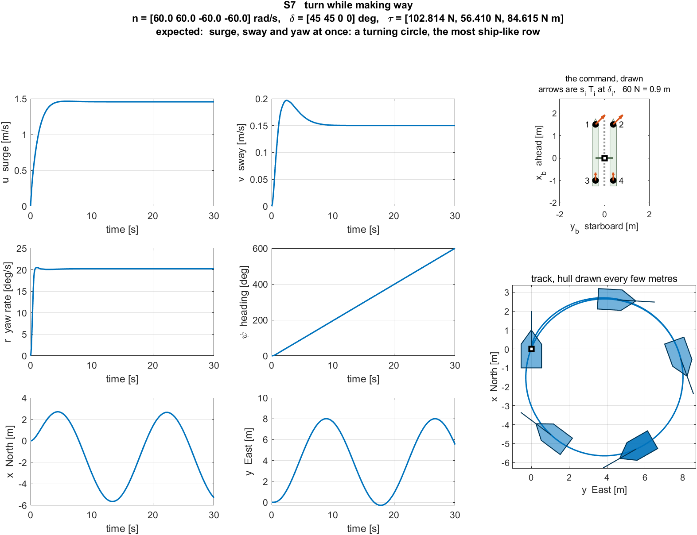

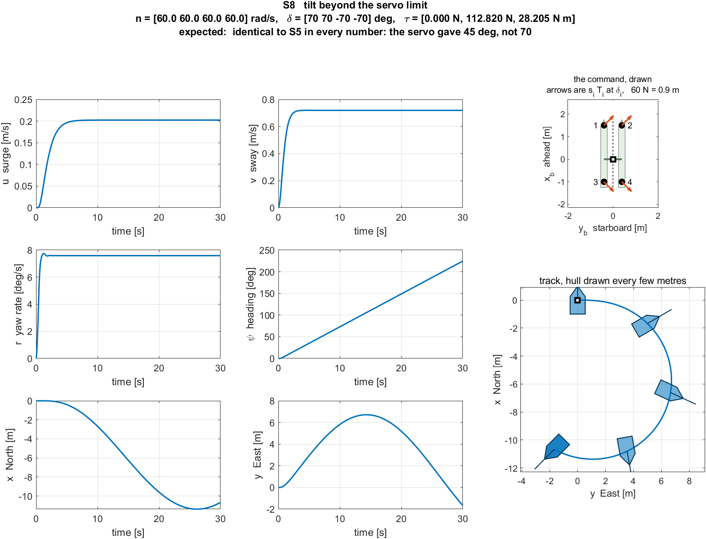

The overlay below is kept for comparison only. S8 is drawn dashed over S5, and the two curves coincide.

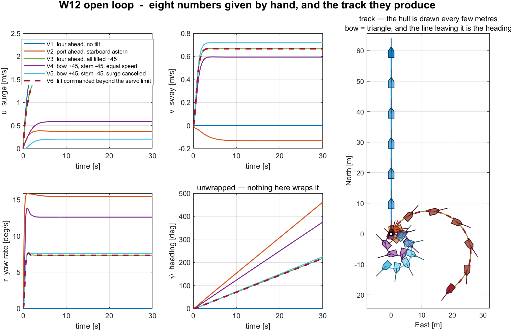

| What to try | What to watch |
|---|---|
| `T_final = 120; animate = 1;` then Run | the hull drawn along the circle; S5 closes its $5.64$ m circle in about 47 s |
| `W12_V_openloop({'S5','S6'})` | two sheets and no overlay file written — a partial run never overwrites the figure this section embeds |

> [!tip] In class
> - **Purpose** — connect a force in body axes to a track on the water, with nothing in between.
> - **Point to** — the S5 hull symbols on the track: the bow points well off the direction of travel.
> - **Ask** — "S7's force is at $28.74^\circ$. Why does the hull crab at only $5.89^\circ$?" Because sway is damped far harder than surge; the equilibrium is not the force direction.
> - **Take away** — an open-loop command gives a repeatable circle, and a circle is not a mission.

## 12-6. Whether the model is the equations

This section answers: table (1) showed the equations are right — what shows that the Simulink model evaluates those equations?

**What is observed.** Experiment 12-6 re-integrates each of the eight 30-s runs outside Simulink, with the same fixed-step `ode4` and the same step, driven at every step by the $(n, \delta)$ the model actually applied. The worst disagreement in position or speed over all eight runs is exactly $0.00\mathrm{e}{+}00$.

- the driving signal is the **post-servo** pair read back from the log, not the command
- the heading column disagrees at $1.02\times10^{-13}$ deg at worst, which is the unwrapping, not the dynamics

**The result.** Two different checks, and neither substitutes for the other.

| Check | What it would catch | What it cannot catch |
|---|---|---|
| table (1) — hand formula against `otter_tilt4` | a wrong column, a wrong sign, a wrong arm | a model wired to the wrong signal, a wrong solver, a wrong step |
| table (2) — the model against independent re-integration | wiring, solver, step, saturation order | an error present in `otter_tilt4` itself, which both sides share |

**Derivation, one line at a time.**

1. Table (1) compares two evaluations of the same function at one state. It therefore tests the function and nothing downstream of it.
2. A test of the model must re-run the model's own trajectory from an independent integrator. Writing the integrator by hand, in four lines of Runge–Kutta, removes Simulink from the comparison entirely.
3. The independent run must be given the same input the model received, which is **not** the command: the servo clipped it. Reading $(n, \delta)$ back out of the log, where they are tapped after the saturation stage, supplies the input actually applied.
4. The same fixed-step `ode4` at $h = 0.02$ s must be used. A variable-step solver on one side and a fixed step on the other would disagree at the step-error level and say nothing about the wiring.
5. A single-instant acceleration comparison would not do this job. The log carries 6 of the 12 states — $[u\;v\;r\;N\;E\;\psi]$ — and under sway the missing six, among them $w$, $p$, $q$ and $\phi$, are not zero. An acceleration reconstructed from the logged six would be evaluated at a state the vessel was never in.
6. Re-integration avoids that trap because it never reads the model's state: it starts from the same $\mathbf{x}_0$, which is known in full, and advances its own twelve states.
7. Agreement to $0.00\mathrm{e}{+}00$ in position therefore says the two integrations performed bit-identical arithmetic, which is the strongest statement available: same equations, same inputs, same solver, same step.
8. The heading residual of $1.02\times10^{-13}$ deg is not a dynamics disagreement. The log stores $\psi$ in degrees and the comparison takes the smallest signed angle, so the residual is the cost of two conversions.

### Experiment 12-6 · The model against an integrator written by hand (20 min)

**What it measures.** Lines 3, 4 and 7: that the wiring, the solver and the saturation order are what the equations assume.

**The model.** The same eight runs. The comparison lives in `W12_tab_reint`, which calls `otter_tilt4` directly inside its own Runge–Kutta loop.

**Opening and running.**

```matlab
W12_V_openloop                 % 블록 (2) 가 재적분을 한다 / block (2) re-integrates
```

Expected output, the second table:

```
  (2) the Simulink model against the same equations, integrated outside it

      the same fixed-step ode4 and the same step 0.020 s, started from x0,
      driven at every step by the (n, delta) the model actually applied —
      the post-servo values read back from the log

    case   max |dN| [m]  max |dE| [m]  max |dpsi| [deg]  max |du| [m/s]   clip
    ------------------------------------------------------------------------------
    S1        0.00e+00      0.00e+00          0.00e+00        0.00e+00   n 0  d 0
    S2        0.00e+00      0.00e+00          0.00e+00        0.00e+00   n 0  d 0
    S3        0.00e+00      0.00e+00          1.02e-13        0.00e+00   n 0  d 1
    S4        0.00e+00      0.00e+00          1.02e-13        0.00e+00   n 0  d 1
    S5        0.00e+00      0.00e+00          2.54e-14        0.00e+00   n 0  d 1
    S6        0.00e+00      0.00e+00          0.00e+00        0.00e+00   n 0  d 1
    S7        0.00e+00      0.00e+00          1.02e-13        0.00e+00   n 0  d 1
    S8        0.00e+00      0.00e+00          2.54e-14        0.00e+00   n 0  d 1
    ------------------------------------------------------------------------------
    worst 0.0e+00 m or m/s over the 8 30 s runs
```

**Reading the table against the derivation.**

| Where to look | What is there | Which line predicts it |
|---|---|---|
| `max dN`, `max dE`, `max du` | exactly zero, all eight runs | line 7 |
| `max dpsi` | at most $1.02\times10^{-13}$ deg | line 8 — the conversion, not the dynamics |
| `d 1` on S3 to S8 | the tilt saturation bound during those runs | line 3 — the input re-integrated is the clipped one |
| `n 0` everywhere | the shaft limit never bound | $60 < 103.931$ and $73.485 < 103.931$ |

| What to try | What to watch |
|---|---|
| `h = 0.05;` then `W12_V_openloop` | still zero. The agreement is between two integrators, so a coarser step moves both together |
| drive the re-integration with `n_cmd` instead of the logged `n` | S8 stops agreeing, because the command is $70^\circ$ and the plant received $45^\circ$ — line 3 |

> [!tip] In class
> - **Purpose** — separate a check of the equations from a check of the model, and show that this week has both.
> - **Point to** — the `clip` column. The re-integration agrees **because** it was given the clipped input.
> - **Ask** — "Why not just compare accelerations at one instant?" Because the log carries six of twelve states, and the other six are not zero under sway.
> - **Take away** — zero is a stronger result than small, and it is only available when both sides run the same solver on the same input.

---

## 12-7. Three numbers in, eight numbers out

**What is observed.** Every control law of Weeks 2 to 10 ends in a demanded force: a surge force $X$, a sway force $Y$, a yaw moment $N$. The hull of this week does not accept those three numbers. It accepts four shaft speeds and four servo angles. The stage that stands between them is **control allocation**.

From here to the end of the week the controller is **assumed given**. No gain is tuned and no error signal appears. The demand

$$\boldsymbol{\tau}_d = \begin{bmatrix} X \\ Y \\ N \end{bmatrix}$$

arrives from outside the stage under study, exactly as a measurement arrives from outside a filter. What is studied is the map from those three numbers to the eight the hardware needs.


**The result.** The stage has one input, one output, and a fixed table of things it knows in advance.

| Symbol | Quantity | Size and units |
|---|---|---|
| $\boldsymbol{\tau}_d$ | demanded surge force, sway force, yaw moment | $3\times1$, [N, N, N·m] |
| $\mathbf{f}$ | per-unit thrust components $[f_{x,1}; f_{y,1}; \dots; f_{x,4}; f_{y,4}]$ | $8\times1$, [N] |
| $\mathbf{B}$ | configuration matrix of §12-1, from the Week 3 column rule | $3\times8$, [--, --, m] |
| $\mathbf{W}$ | weight matrix — the price put on each component | $8\times8$, diagonal |
| $\alpha_{\max}$ | servo limit of each unit, $45^\circ$ for all four | $4\times1$, [rad] |
| $\mathbf{n}$ | shaft speeds handed to the plant | $4\times1$, [rad/s] |
| $\boldsymbol{\delta}$ | servo angles handed to the plant | $4\times1$, [rad] |
| $\boldsymbol{\tau}$ | **achieved** force, $\mathbf{B}\mathbf{f}$, which is compared with $\boldsymbol{\tau}_d$ | $3\times1$, [N, N, N·m] |

Two facts fix everything that follows.

1. §12-1 established that a tilting unit at station $(x_i, y_i)$ contributes **two** columns to $\mathbf{B}$, one for its forward component and one for its sideways component, so that the force the four units make is linear in the eight components:

$$\mathbf{B}\mathbf{f} = \boldsymbol{\tau}, \qquad
\mathbf{B} = \begin{bmatrix}
1 & 0 & 1 & 0 & -1 & 0 & -1 & 0 \\
0 & 1 & 0 & 1 & 0 & -1 & 0 & -1 \\
d & l_f & -d & l_f & -d & l_a & d & l_a
\end{bmatrix}$$

2. The equation to be solved therefore has **three rows and eight unknowns**. It is not a matrix inversion. Three equations cannot pin down eight numbers, and the deficit is exactly what the null space counts:

$$\operatorname{rank}\mathbf{B} = 3, \qquad \dim\ker\mathbf{B} = 8 - 3 = 5$$

3. Five dimensions of freedom means that for **any** reachable $\boldsymbol{\tau}_d$ there are infinitely many eight-number commands that achieve it exactly. If $\mathbf{f}^\star$ is one of them and $\mathbf{z}$ is any vector with $\mathbf{B}\mathbf{z} = \mathbf{0}$, then $\mathbf{f}^\star + \mathbf{z}$ achieves the same force.

4. Allocation is therefore not the problem of finding **a** solution. It is the problem of **choosing among** the solutions. Every method in §12-8 to §12-10 differs only in what it decides to make small, and in which walls it refuses to cross.

> [!important] What makes this a design problem and not an algebra problem
> An under-determined system has no single answer, so the engineer must supply the missing statement of what a good answer is. The three statements used in this course, in the order they are introduced: **use as little thrust as possible** (§12-8), **use the cheap components before the expensive ones** (§12-9), and **never ask a servo for an angle it does not have** (§12-10).

---

## 12-8. The smallest solution: the pseudo-inverse

**What is observed.** Among the infinitely many commands that achieve a demanded force, one is shorter than all the others. Making that choice turns an under-determined equation into a formula with no iteration in it.

**The result.** The choice is written as a minimisation, solved once with Lagrange multipliers, and the answer is a constant matrix times the demand.

**Derivation.**

1. Choose what to make small. The sum of squares of the eight components is the natural first choice, because it is the square of the total thrust vector's length:

$$J(\mathbf{f}) = \mathbf{f}^\top\mathbf{f} = \sum_{i=1}^{4}\left(f_{x,i}^2 + f_{y,i}^2\right) = \sum_{i=1}^{4} T_i^2$$

2. State the problem. Minimise $J$ subject to achieving the demand exactly:

$$\min_{\mathbf{f}} \ \mathbf{f}^\top\mathbf{f} \quad \text{subject to} \quad \mathbf{B}\mathbf{f} = \boldsymbol{\tau}_d$$

3. Attach the constraint with a multiplier $\boldsymbol{\lambda} \in \mathbb{R}^3$, one entry for each row of $\mathbf{B}$:

$$L(\mathbf{f}, \boldsymbol{\lambda}) = \mathbf{f}^\top\mathbf{f} + \boldsymbol{\lambda}^\top\!\left(\boldsymbol{\tau}_d - \mathbf{B}\mathbf{f}\right)$$

4. Set the gradient in $\mathbf{f}$ to zero. This is where the eight unknowns collapse onto three:

$$\frac{\partial L}{\partial \mathbf{f}} = 2\mathbf{f} - \mathbf{B}^\top\boldsymbol{\lambda} = \mathbf{0}
\quad\Longrightarrow\quad
\mathbf{f} = \tfrac{1}{2}\mathbf{B}^\top\boldsymbol{\lambda}$$

5. The solution is thus constrained to lie in the three-dimensional row space of $\mathbf{B}$. Substituting it back into the constraint gives the multiplier:

$$\mathbf{B}\!\left(\tfrac{1}{2}\mathbf{B}^\top\boldsymbol{\lambda}\right) = \boldsymbol{\tau}_d
\quad\Longrightarrow\quad
\boldsymbol{\lambda} = 2\left(\mathbf{B}\mathbf{B}^\top\right)^{-1}\boldsymbol{\tau}_d$$

6. Put the multiplier back into line 4:

$$\boxed{\ \mathbf{f} = \mathbf{B}^\top\left(\mathbf{B}\mathbf{B}^\top\right)^{-1}\boldsymbol{\tau}_d\ }$$

7. The inverse exists. $\mathbf{B}\mathbf{B}^\top$ is only $3\times3$, and it is non-singular precisely because $\operatorname{rank}\mathbf{B} = 3$, which §12-1 verified for this geometry. The matrix $\mathbf{B}^\top(\mathbf{B}\mathbf{B}^\top)^{-1}$ is the Moore–Penrose pseudo-inverse $\mathbf{B}^{+}$ of a matrix with full row rank.

8. The residual is zero by construction, not approximately zero:

$$\mathbf{B}\mathbf{f} = \mathbf{B}\mathbf{B}^\top\left(\mathbf{B}\mathbf{B}^\top\right)^{-1}\boldsymbol{\tau}_d = \boldsymbol{\tau}_d$$

9. The solution is orthogonal to the null space. For any $\mathbf{z}$ with $\mathbf{B}\mathbf{z} = \mathbf{0}$, line 4 gives $\mathbf{f}^\top\mathbf{z} = \tfrac{1}{2}\boldsymbol{\lambda}^\top\mathbf{B}\mathbf{z} = 0$, so $\lVert\mathbf{f} + \mathbf{z}\rVert^2 = \lVert\mathbf{f}\rVert^2 + \lVert\mathbf{z}\rVert^2 \ge \lVert\mathbf{f}\rVert^2$. **Adding anything from the null space can only cost thrust.** This is the measurable prediction the derivation makes, and Experiment 12-8 tests it.

| Symbol | Quantity | Value or source |
|---|---|---|
| $\mathbf{B}^{+}$ | $\mathbf{B}^\top(\mathbf{B}\mathbf{B}^\top)^{-1}$, pseudo-inverse of $\mathbf{B}$ | $8\times3$, built from `cfg.B` |
| $\boldsymbol{\lambda}$ | Lagrange multiplier, one entry per demanded component | $3\times1$ |
| $\mathbf{z}$ | any null-space vector, $\mathbf{B}\mathbf{z} = \mathbf{0}$ | $8\times1$, 5 free dimensions |
| $\mathbf{B}\mathbf{B}^\top$ | the $3\times3$ matrix actually inverted | non-singular, $\operatorname{rank}\mathbf{B} = 3$ |

**From eight components to eight commands.** The plant of §12-2 takes shaft speeds and servo angles, not components, so one more stage is needed. It is pure trigonometry and the inverse of the thrust curve, and it contains no choices.

1. The sign of each unit's thrust is read off its forward component, so that a unit pushing astern is described as negative thrust at a small angle rather than positive thrust at $180^\circ$:

$$\sigma_i = \operatorname{sign}(f_{x,i}), \qquad
T_i = \sigma_i\sqrt{f_{x,i}^2 + f_{y,i}^2}$$

2. The servo angle is the direction of the component pair, measured in the frame the sign choice fixes:

$$\delta_i = \operatorname{atan2}\!\left(\sigma_i f_{y,i},\ \sigma_i f_{x,i}\right)$$

3. The thrust curve of §12-1 is inverted with the branch that matches the sign of the thrust, because the two coefficients differ:

$$n_i = \operatorname{sign}(T_i)\sqrt{\frac{\lvert T_i\rvert}{k_i}}, \qquad
k_i = \begin{cases} k_{\text{pos}} = 0.011080 & T_i \ge 0\\[2pt] k_{\text{neg}} = 0.006445 & T_i < 0 \end{cases}$$

4. The thrust cap needs **no constraint inside the allocation**. Because $\mathbf{B}$ is linear, scaling the whole command by one scalar $\rho$ scales the achieved force by the same scalar and **leaves its direction unchanged**:

$$\rho = \min\!\left(1,\ \min_i \frac{T_{\max,i}}{\lvert T_i\rvert}\right), \qquad
\mathbf{B}(\rho\,\mathbf{f}) = \rho\,\boldsymbol{\tau}_d$$

5. So a shaft limit weakens the demand but does not bend it, and one line after the solve is enough. The servo limit of §12-10 is **not** of this kind: clipping an angle changes the direction of $\boldsymbol{\tau}$, which is why it has to be handled inside the allocation and not after it.

### Experiment 12-8 · The smallest of infinitely many (15 min)

```matlab
W12_G_allocation
```

```
=== §12-7  배분 문제 ===
B 는 3x8,  rank 3,  영공간 차원 5

요구  tau_d = [80 N, 30 N, 20 Nm]

(1) 같은 tau 를 내는 해 둘
    최소노름  ||f|| =   42.99 N   ||B f - tau|| = 0.00e+00
    영공간 더한 것      58.72 N                7.94e-15
    -> 같은 힘을 내면서 추진기는 37 % 더 쓴다

(2) 최소노름 해  f = B^T (B B^T)^{-1} tau
    unit      f_x [N]   f_y [N]
     1         20.718     9.773
     2         19.282     9.773
     3        -20.718    -5.227
     4        -19.282    -5.227

(3) 하드웨어 명령
    unit     T [N]   delta [deg]    n [rad/s]   |delta|<=45?
     1      22.908       25.25        45.47        true
     2      21.617       26.88        44.17        true
     3     -21.367       14.16       -57.58        true
     4     -19.978       15.17       -55.68        true
    rho = 1.0000   (1 이면 추력 한계에 걸리지 않았다)
    실제 tau = [80.000 30.000 20.000]   요구와의 차이 0.00e+00
```

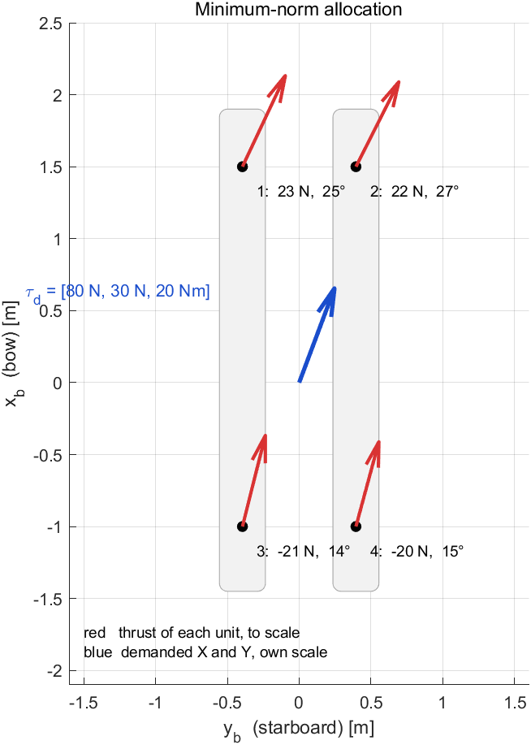

| Where to look | What is there | Which line predicts it |
|---|---|---|
| the two residuals in block (1) | $0.00\text{e}{+}00$ and $7.94\text{e}{-}15$ | line 8 — both solutions achieve the demand exactly |
| $42.99$ N against $58.72$ N | the null-space solution costs $37\%$ more thrust for the same force | line 9 — adding $\mathbf{z}$ can only add length |
| $f_{y}$ equal within each pair, $9.773$ and $-5.227$ | the sideways components split by pair, not by unit | §12-7 line 1 — the $f_y$ columns carry both $Y$ and the long moment arms |
| $\lvert f_{x,1}\rvert = \lvert f_{x,3}\rvert = 20.718$ | the forward components are antisymmetric about the beam | the $\pm d$ entries in row 3 of $\mathbf{B}$ |
| signs of $n_3$ and $n_4$ | negative, and larger in magnitude than $n_1$, $n_2$ | $k_{\text{neg}} < k_{\text{pos}}$, so reverse thrust needs more shaft speed |
| $\rho = 1.0000$ | no shaft limit was reached, so the demand was met in full | line 4 — $\rho$ is the only thing that can shrink it |

| What to try | What to watch |
|---|---|
| raise the demand to `tau_d = [300; 100; 60]` | $\rho$ drops below 1 and the achieved force shrinks **along the same direction** — line 4 |
| set `tau_d = [0; 0; 20]` | all four $f_x$ vanish; a pure moment is carried on the long $f_y$ arms alone |
| compare `B'*((B*B')\tau)` with `pinv(B)*tau` | the same numbers. `pinv` forms a singular-value decomposition, which is unnecessary when $\mathbf{B}$ has full row rank |

> [!tip] In class
> - **Purpose** — show that allocation is a choice, and that one specific choice has a closed form.
> - **Point to** — the $37\%$ figure. It is the price of a solution that is correct but not minimal.
> - **Ask** — "Why is $\mathbf{B}\mathbf{B}^\top$ only $3\times3$ when there are eight unknowns?" Because line 4 restricts the answer to three directions before the inverse is ever taken.
> - **Take away** — a formula, not an iteration: $\mathbf{f} = \mathbf{B}^{+}\boldsymbol{\tau}_d$.

---

## 12-9. The weight matrix, and how it is tuned

**What is observed.** The minimum-norm solution treats all eight components as equally desirable. They are not. Sideways thrust means a tilted servo, and a hull may prefer to keep its servos near zero, or to spare one tired thruster, or to load the bow pair rather than the stern pair. The weight matrix is where such a preference is written down.

> [!warning] Two matrices are both called $\mathbf{W}$ in this course, and they weight different things
> Week 7 §7-7 priced the **force error** $\mathbf{B}\mathbf{T}-\boldsymbol{\tau}_d$, which is how a solver is told that a newton-metre of lost yaw matters more than a newton of lost surge. This section prices the **effort** $\mathbf{f}$ itself, which is how it is told that one component or one unit is dearer than another. Both appear together in §12-10, where the error weight is written $\mathbf{Q}$ to keep them apart.

**The result.** Attaching a price to each component changes the closed form in one place, and the resulting matrix is still constant. Measuring the sweep then shows something that the formula alone does not: **the price list cannot override what the demand itself has already fixed.**

**Derivation.**

1. Replace the plain sum of squares with a **weighted** sum, where $w_j > 0$ is the price of component $j$:

$$J(\mathbf{f}) = \mathbf{f}^\top\mathbf{W}\mathbf{f} = \sum_{j=1}^{8} w_j f_j^2,
\qquad \mathbf{W} = \operatorname{diag}(w_1,\dots,w_8)$$

2. Repeating §12-8 lines 3 to 6 with this cost changes two things and nothing else. The gradient becomes $2\mathbf{W}\mathbf{f} - \mathbf{B}^\top\boldsymbol{\lambda} = \mathbf{0}$, so $\mathbf{f} = \tfrac{1}{2}\mathbf{W}^{-1}\mathbf{B}^\top\boldsymbol{\lambda}$, and the constraint then gives:

$$\boxed{\ \mathbf{f} = \mathbf{W}^{-1}\mathbf{B}^\top\left(\mathbf{B}\mathbf{W}^{-1}\mathbf{B}^\top\right)^{-1}\boldsymbol{\tau}_d\ }$$

3. Setting $\mathbf{W} = \mathbf{I}$ recovers §12-8 exactly, so the pseudo-inverse is the special case in which everything costs the same.

4. **Only ratios matter.** Replacing $\mathbf{W}$ by $c\mathbf{W}$ for any $c > 0$ leaves the formula unchanged, because $c$ cancels between $\mathbf{W}^{-1}$ and $(\mathbf{B}\mathbf{W}^{-1}\mathbf{B}^\top)^{-1}$. A weight has no unit and no absolute size; $\operatorname{diag}(1, 10)$ and $\operatorname{diag}(100, 1000)$ are the same price list.

5. **What a price list can change is who pays, not how much is owed.** This is the part the formula hides, and the geometry of $\mathbf{B}$ decides it. Row 2 of $\mathbf{B}$ is $[0\ 1\ 0\ 1\ 0\ {-1}\ 0\ {-1}]$, so the sway force is produced by the $f_y$ components **and by nothing else**:

$$Y = f_{y,1} + f_{y,2} - f_{y,3} - f_{y,4}
\quad\Longrightarrow\quad
\sum_i \lvert f_{y,i}\rvert \ \ge\ \lvert Y \rvert$$

6. The demand therefore **pins** the total sideways thrust from below. Pricing $f_y$ at a hundred times $f_x$ cannot reduce $\sum_i\lvert f_{y,i}\rvert$ below $\lvert Y\rvert$, and in this geometry the weighted solution sits exactly on that bound.

7. What a high $f_y$ price does instead is move the **yaw moment** off the $f_y$ columns. Row 3 of $\mathbf{B}$ shows two kinds of moment arm: the $f_y$ components act on the long arms $l_f = 1.5$ m and $l_a = 1.0$ m, the $f_x$ components only on the half-beam $d = 0.395$ m. Taking the moment away from the long arms and onto the short one needs a **larger** differential in $f_x$.

8. So the prediction is counter-intuitive and sharp: raising the price of the sideways component leaves $\sum\lvert f_{y,i}\rvert$ unchanged, makes the forward components lopsided, and therefore makes the worst servo angle **larger**, not smaller. Experiment 12-9 sweeps the price over three decades and measures all three quantities.

9. The preference a diagonal $\mathbf{W}$ **can** express is between **units**. Pricing the aft pair above the bow pair moves the thrust share forward, because the four units are genuinely interchangeable in a way that $f_x$ and $f_y$ are not.

| Symbol | Quantity | Value or source |
|---|---|---|
| $\mathbf{W}$ | price list, diagonal and positive | $8\times8$, `P.W` |
| $w$ | price put on every $f_y$ in the sweep | $1 \dots 1000$, dimensionless |
| $l_f$, $l_a$ | moment arms of the $f_y$ components | $1.5$ m, $1.0$ m — §12-1 |
| $d$ | moment arm of the $f_x$ components | $0.395$ m — half beam, §12-1 |
| $\mathbf{K}_W$ | $\mathbf{W}^{-1}\mathbf{B}^\top(\mathbf{B}\mathbf{W}^{-1}\mathbf{B}^\top)^{-1}$ | $8\times3$, constant — see §12-11 |

> [!important] How a weight matrix is tuned
> The tuning rule follows from lines 4, 6 and 9, and it is short.
> - **Set the ratios, not the magnitudes.** Start from $\mathbf{W} = \mathbf{I}$ and raise one entry at a time; a common factor does nothing (line 4).
> - **Price what is genuinely redundant.** Two units that can do each other's work respond to a price. A component that is the only source of a demanded axis does not (line 6).
> - **Each change must be measured, not assumed.** The sweep below moves the worst servo angle the opposite way from the intuition behind it.
> - **A hard limit is not a price.** A servo that must never pass $45^\circ$ belongs in a constraint (§12-10), not in $\mathbf{W}$. A large weight discourages; only a constraint forbids.

### Experiment 12-9 · What the price list can and cannot do (20 min)

```matlab
W12_H_weights
```

```
=== §12-9  가중행렬 W ===
요구 tau_d = [80 N, 30 N, 20 Nm],  W = diag([1 w 1 w 1 w 1 w])
Y 는 f_y 열만이 낸다 (B 둘째 줄 = [0 1 0 1 0 -1 0 -1]) -> sum|f_y| 는 묶여 있다

       w   sum|f_y| [N]   f_x spread [N]   max|delta| [deg]   ||f|| [N]   ||B f - tau||
       1         30.00             1.44              26.88        42.99         0.0e+00
       3         30.00             3.65              27.40        43.05         7.1e-15
      10         30.00             7.91              28.60        43.52         7.1e-15
      30         30.00            11.86              30.01        44.35         7.1e-15
     100         30.00            14.38              31.10        45.08         0.0e+00
     300         30.00            15.31              31.55        45.38         0.0e+00
    1000         30.00            15.67              31.73        45.50         3.6e-15

W 와 1000*W 의 해 차이 : 2.81e-15 N   (비율만이 뜻을 가진다)

값표가 바꿀 수 있는 것 — 몫의 배분
  앞뒤 같은 값   : |T| = [ 25.50  18.28  24.75  17.22] N   뒤 두 대 몫 48.9 %
  뒤를 5배 비싸게: |T| = [ 27.44  43.39   6.02   9.02] N   뒤 두 대 몫 17.5 %

값표가 바꿀 수 없는 것 — 요구가 정한 것
  sum|f_y| : 30.00 N 과 30.00 N  (Y = 30 N 이 정한다)
```


| Where to look | What is there | Which line predicts it |
|---|---|---|
| the $\Sigma\lvert f_y\rvert$ column | $30.00$ N at every price, equal to the demanded $Y$ | line 6 — the bound $\sum\lvert f_{y,i}\rvert \ge \lvert Y\rvert$, met with equality |
| the spread column | $1.44 \to 15.67$ N as the price rises | line 7 — the moment moves onto the $0.395$ m arm |
| the worst-angle column | $26.88^\circ \to 31.73^\circ$, rising | line 8 — the counter-intuitive prediction, confirmed |
| the dashed line on the left panel | the $45^\circ$ wall, never reached by this demand | §12-10 uses a demand that does reach it |
| $\mathbf{W}$ against $1000\mathbf{W}$, $2.81\text{e}{-}15$ N | the same solution to solver precision | line 4 — a common factor cancels |
| the right panel, $48.9\%$ against $17.5\%$ | the load does move between units | line 9 — units are interchangeable, components are not |
| the last column of the table | residual at machine precision throughout | the constraint $\mathbf{B}\mathbf{f} = \boldsymbol{\tau}_d$ is still exact |

| What to try | What to watch |
|---|---|
| `P.W = diag([1 1 1 1 1 1 1 1])` in the sweep | the first row of the table reappears: $\mathbf{W} = \mathbf{I}$ is §12-8 — line 3 |
| price only unit 1, `diag([5 5 1 1 1 1 1 1])` | unit 1's thrust falls and the other three absorb it; $\Sigma\lvert f_y\rvert$ does not move |
| set the demand to `[80; 0; 20]` and sweep again | with $Y = 0$ the bound of line 6 is slack, and now the price **does** reduce the sideways thrust |

> [!tip] In class
> - **Purpose** — give the weight matrix a meaning that survives measurement, and show how to tune it.
> - **Point to** — the $\Sigma\lvert f_y\rvert$ column. Seven different price lists, one number.
> - **Ask** — "A reference implementation prices $f_y$ a thousand times above $f_x$ to keep the servos near zero. What does the table say it achieves?" A worse worst angle, on this geometry.
> - **Take away** — a weight redistributes among genuine alternatives. What one axis alone can supply is not an alternative.

---

## 12-10. The servo wall, and the shape of the feasible set

**What is observed.** The demand $\boldsymbol{\tau}_d = [15\ \text{N};\ 70\ \text{N};\ 10\ \text{N·m}]$ pushes mostly sideways. The weighted minimum norm answers it with a worst servo angle of $85.68^\circ$. No servo on this hull turns past $45^\circ$. The closed form has produced a command the hardware cannot execute, and the question of what to do instead is the question of this section.

**The result.** The limit is written as a constraint, the constrained problem is solved by a quadratic program, and the shape of the constraint set decides how many quadratic programs are needed. The honest answer for this hull is sixteen, and the reason is worth more than the number.

**Derivation.**

1. State the limit on the quantity the hardware actually limits:

$$\lvert\delta_i\rvert \le \alpha_{\max}, \qquad
\delta_i = \operatorname{atan2}\!\left(\sigma_i f_{y,i},\ \sigma_i f_{x,i}\right), \qquad
\alpha_{\max} = 45^\circ$$

2. As written this is nonlinear, which is why a reference implementation reaches for a general nonlinear solver. It need not be. Taking the tangent of both sides, with the per-unit thrust sign $\sigma_i$ **held fixed**, turns it into two linear inequalities:

$$\lvert f_{y,i}\rvert \le \tan(\alpha_{\max})\,\sigma_i f_{x,i}
\quad\Longleftrightarrow\quad
\begin{cases}
\ \ \ f_{y,i} - \tan(\alpha_{\max})\,\sigma_i f_{x,i} \le 0\\[2pt]
-f_{y,i} - \tan(\alpha_{\max})\,\sigma_i f_{x,i} \le 0
\end{cases}$$

3. Two inequalities per unit, eight rows in all, assembled into $\mathbf{A}(\boldsymbol{\sigma})\mathbf{f} \le \mathbf{0}$. For $\alpha_{\max} = 45^\circ$ the tangent is $1$ and the walls are simply $f_{y,i} = \pm f_{x,i}$.


4. **The set is convex only after the sign is fixed.** The figure's right panel draws the proof: take a point in the forward wedge and a point in the reverse wedge, and the straight segment between them passes through the sideways region that both wedges exclude. A convex solver cannot represent the union; it can only be told which half to work in.

5. The union of the two half-cones, over four units, is covered **exactly** by $2^4 = 16$ convex pieces, one for each sign pattern $\boldsymbol{\sigma} \in \{+1,-1\}^4$. This is a complete description, not an approximation — every feasible command lies in at least one piece.

6. **The wall is hard and the force demand is soft.** Requiring $\mathbf{B}\mathbf{f} = \boldsymbol{\tau}_d$ while also enforcing the wall can be infeasible, and an infeasible problem returns nothing at all, which is useless to a controller running at 50 Hz. The demand is therefore moved into the cost, where it can be approached rather than met:

$$\min_{\mathbf{f}} \ \left\lVert \mathbf{Q}\left(\mathbf{B}\mathbf{f} - \boldsymbol{\tau}_d\right)\right\rVert^2
+ \varepsilon\,\left\lVert \mathbf{W}^{1/2}\mathbf{f} \right\rVert^2
\quad\text{subject to}\quad \mathbf{A}(\boldsymbol{\sigma})\,\mathbf{f} \le \mathbf{0}$$

7. This is the **weighted least-squares** form of control allocation. The first term asks for the demanded force, the second keeps the command small among the many that achieve the first equally well, and $\varepsilon \ll 1$ states which of the two matters. Because the feasible set always contains $\mathbf{f} = \mathbf{0}$, a solution always exists.

8. Both terms are quadratic in $\mathbf{f}$ and the constraints are linear, so each of the sixteen pieces is a convex **quadratic program** — the class of problem for which `quadprog` and `lsqlin` are written, and for which a global optimum is guaranteed in finitely many steps.

9. Three ways to use this, and what each costs:

$$\text{clip} \longrightarrow
\text{one guessed piece} \longrightarrow
\text{all sixteen pieces}$$

   - **Clip.** Solve unconstrained, then force each angle back to the wall. Always returns something, never violates the wall, but the clipped command achieves a different force than the one demanded, and nothing controls the error.
   - **One guessed piece.** Read $\boldsymbol{\sigma}$ from the weighted minimum-norm solution and solve that single quadratic program. Fast, and correct when the guess is right. Line 4 is the reason it can be wrong, and line 10 is the measurement.
   - **All sixteen pieces.** Solve every piece and keep the cheapest feasible one. The result is the true optimum over the exact feasible set, at sixteen times the cost.

10. The guess is not a technicality. For the demand of this section the weighted minimum norm points at $\boldsymbol{\sigma} = [{+}1\ {+}1\ {-}1\ {-}1]$, and **that piece has no feasible point**: `quadprog` exits $-2$. The best of the sixteen is $\boldsymbol{\sigma} = [{-}1\ {-}1\ {-}1\ {-}1]$ at cost $1.3950$, which achieves the demand to $0.020$ N. The demand was reachable all along, in a piece the guess never looked at.

11. The thrust cap is still handled by the scalar $\rho$ of §12-8 line 4 after the solve, and for the same reason: it scales $\boldsymbol{\tau}$ without turning it.

| Symbol | Quantity | Value or source |
|---|---|---|
| $\boldsymbol{\sigma}$ | per-unit thrust sign, one of 16 patterns | $\pm1$, `info.sigma` |
| $\mathbf{A}(\boldsymbol{\sigma})$ | the eight wall rows of line 3 | $8\times8$, built per piece |
| $\mathbf{Q}$ | relative importance of $X$, $Y$, $N$ | $3\times3$, $\mathbf{I}$ here |
| $\varepsilon$ | weight of the regularising term | $10^{-4}$, `P.eps_reg` |
| $\tan\alpha_{\max}$ | slope of each wall | $1.0$ at $45^\circ$ |
| cost | the objective value of line 6 at the optimum | `info.cost` |

> [!important] Which MathWorks solver, and why
> All three functions below are in Optimization Toolbox, and the course uses version 24.2 on R2024b.
>
> | Function | What it is given | Documentation |
> |---|---|---|
> | [`lsqlin`](https://www.mathworks.com/help/optim/ug/lsqlin.html) | a residual $\lVert \mathbf{C}\mathbf{f} - \mathbf{d}\rVert^2$ and linear constraints | the form of line 6, written directly |
> | [`quadprog`](https://www.mathworks.com/help/optim/ug/quadprog.html) | an explicit $\tfrac{1}{2}\mathbf{f}^\top\mathbf{H}\mathbf{f} + \mathbf{c}^\top\mathbf{f}$ and linear constraints | used here with $\mathbf{B}\mathbf{f} = \boldsymbol{\tau}_d$ as a hard equality |
> | [`fmincon`](https://www.mathworks.com/help/optim/ug/fmincon.html) | a general nonlinear cost and nonlinear constraints | what line 1 needs if line 2 is not noticed |
> | [`optimoptions`](https://www.mathworks.com/help/optim/ug/optimoptions.html) | solver settings, `'Display','off'` among them | built once and reused, §12-11 |
>
> `lsqlin` and `quadprog` solve the **same** problem here; `lsqlin` is preferred because line 6 is already a least-squares residual and needs no squaring by hand. `fmincon` is the honest comparison point: it is given the nonlinear constraint of line 1 rather than the linear one of line 2, and §12-11 measures what that costs. See also the toolbox's own [quadratic programming overview](https://www.mathworks.com/help/optim/quadratic-programming.html).

### Experiment 12-10 · Five answers to one impossible command (25 min)

```matlab
W12_I_limits
```

```
=== §12-10  서보 벽 ===
벽을 넘기는 요구  tau = [15 N, 70 N, 10 Nm]
  (옆으로 미는 힘이 앞으로 가는 힘보다 크다 -> 각이 커진다)

  method       max|delta| [deg]   ||B f - tau|| [N]   ||f|| [N]   QPs   exit
  wpinv              85.68              0.000        36.14      0      1
  clip               45.00             40.728        36.14      0      1
  qp                 83.78              0.000        36.01      1     -2
  wls                45.00             38.891        30.05      1      1
  wls16              45.00              0.020        53.17     16      1

짐작한 조각  sigma = [ 1  1 -1 -1]  -> quadprog exit -2
열여섯 중 최선 sigma = [-1 -1 -1 -1]  -> 비용 1.3950
  -> 이 요구는 **풀 수 있다.** 다만 가중 최소노름이 가리킨 조각에서는 아니다

궤적  tau = [100 sin0.5t ; 60 cos0.3t ; 30 sin0.7t],  t = 0..20 s, 201 점

  method     solved   wall broken   max|delta|   mean |tau err|   max |tau err|   rho<1
           [% of k]      [% of k]       [deg]             [N]             [N]   [% of k]
  pinv         100.0          43.8        89.61           0.000           0.000        0.0
  wpinv        100.0          50.7        89.38           0.000           0.000        0.0
  clip         100.0           0.0        45.00           5.570          33.158        0.0
  qp            85.6           0.0        45.00           0.000           0.000        0.0
  wls          100.0           0.0        45.00           2.135          31.688        0.0
  wls16        100.0           0.0        45.00           0.010           0.018        0.0

  (벽·오차 통계는 **해가 나온 점에서만** 냈다 — qp 는 그러지 못한 점이 있다)
```


| Where to look | What is there | Which line predicts it |
|---|---|---|
| `wpinv` at $85.68^\circ$ | the closed form ignores the wall entirely | §12-9 has no constraint in it |
| `clip` at $45.00^\circ$ and $40.728$ N | inside the wall, but the force is no longer the demanded one | line 9, first bullet |
| `qp` exit $-2$ | the guessed piece is **empty**, so nothing is returned | line 4 — a convex solver sees one piece only |
| `wls16` at $0.020$ N | the demand was reachable, in a different piece | line 10 — the guess never looked there |
| `wls` at $38.891$ N against `wls16` at $0.020$ N | same solver, same cost function, sixteen pieces instead of one | line 9, second and third bullets |
| the `solved` column, `qp` at $85.6\%$ | one in seven instants of the trajectory has no answer | line 5 — the union is not covered by any single piece |
| `pinv` and `wpinv`, wall broken $43.8\%$ and $50.7\%$ | half the trajectory asks for angles that do not exist | the wall is a physical limit, not a preference |
| the upper panel, flat tops at $\pm45^\circ$ | every constrained law rides the wall rather than crossing it | line 3 — the constraint is active there |
| `wls16` mean error $0.010$ N | not exactly zero | the $\varepsilon$ term of line 6, not the wall |

| What to try | What to watch |
|---|---|
| `P.eps_reg = 1e-8` | the `wls16` residual falls further; the command becomes less well conditioned in exchange |
| `P.Q = diag([1 1 5])` | yaw is now bought before sway, and the force error moves from $N$ into $Y$ |
| `P.alpha_max = deg2rad(90)` | every method agrees, because the wall no longer binds and line 1 is vacuous |
| in `W12_alloc`, make `'wls16'` try only patterns $0..7$ | the pattern of line 10 is excluded and the residual jumps — the enumeration is not padding |

> [!tip] In class
> - **Purpose** — show that a hard limit changes the problem's **shape**, not just its numbers.
> - **Point to** — `qp` exit $-2$ beside `wls16` at $0.020$ N. Same wall, same demand, opposite verdicts.
> - **Ask** — "Why not simply put a large weight on $f_y$ instead of a constraint?" §12-9 line 8 measured that: the worst angle gets worse.
> - **Take away** — the wall is hard, the force demand is soft, and the sign pattern is a discrete choice that no convex solver will make.

---

## 12-11. What runs at 50 Hz

**What is observed.** A controller sampling at 50 Hz has $20$ ms between demands. Allocation is one stage inside that budget, sharing it with the control law, the filters and the logging. A method that is correct and too slow has not solved the problem.

**The result.** The closed forms are two to three orders of magnitude faster than any solver, because the only matrix inversion in them does not depend on the demand and can be done once, before the loop starts.

**Derivation.**

1. In the weighted closed form of §12-9 line 2, every factor except $\boldsymbol{\tau}_d$ is built from $\mathbf{B}$ and $\mathbf{W}$, both of which are fixed by the hull and the design. Group them:

$$\mathbf{K}_W = \mathbf{W}^{-1}\mathbf{B}^\top\left(\mathbf{B}\mathbf{W}^{-1}\mathbf{B}^\top\right)^{-1}
\in \mathbb{R}^{8\times3},
\qquad \mathbf{f} = \mathbf{K}_W\,\boldsymbol{\tau}_d$$

2. $\mathbf{K}_W$ is computed **once**, offline. What the loop executes is one $8\times3$ matrix times a $3\times1$ vector: 24 multiplications and 16 additions, with no division, no factorisation and no iteration.

3. A solver cannot be precomputed in this way, because which constraints are active depends on $\boldsymbol{\tau}_d$ and therefore changes every step. An active-set method walks from one candidate set to another; the number of steps is bounded but not fixed, so the **worst** case, not the mean, is what a real-time budget must accommodate.

4. The sixteen-piece method of §12-10 multiplies that cost by sixteen. Whether this is affordable is a measurement, not an opinion, and Experiment 12-11 makes it.

5. The nonlinear form of §12-10 line 1 is the slowest of all, because `fmincon` must estimate gradients of an $\operatorname{atan2}$ constraint by finite differences at every iteration. Noticing that line 2 makes the same constraint linear is worth more than any amount of solver tuning.

| Symbol | Quantity | Value or source |
|---|---|---|
| $\mathbf{K}_W$ | precomputed allocation matrix | $8\times3$, built once |
| $h_c$ | controller period at 50 Hz | $20$ ms $= 20\,000$ µs |
| QPs | quadratic programs solved per demand | $0$, $1$ or $16$ |

### Experiment 12-11 · The 50 Hz budget, measured (15 min)

```matlab
W12_J_timing
```

```
=== §12-11  한 번 푸는 데 걸리는 시간 ===
101 개 요구를 차례로 배분.  50 Hz 예산 = 20000 us

  method       QPs   mean [us]   max [us]   x pinv   budget used [%]
  pinv           0        11.2      264.6        1              0.06
  wpinv          0         8.0       15.1        1              0.04
  clip           0         9.7       21.8        1              0.05
  qp             1       345.2      676.8       31              1.73
  wls            1       206.3      504.1       18              1.03
  wls16         16      2760.6     4333.3      247             13.80
  fmincon        1      5147.7    20056.3      460             25.74

  미리 만든 8x3 행렬 하나로 : 0.52 us  (곱셈 24 번)
  Kw*tau 와 wpinv 의 차이    : 5.62e-15 N
```

| Where to look | What is there | Which line predicts it |
|---|---|---|
| `wpinv` at $8.0$ µs mean | a closed form, with the inverse still formed inside the call | §12-9 line 2 |
| the precomputed matrix at $0.52$ µs | fifteen times faster again, for the same answer | line 2 — 24 multiplications and nothing else |
| the difference $5.62\text{e}{-}15$ N | precomputing changes the cost, not the result | line 1 — the grouping is algebraic |
| `qp` and `wls`, mean against max | $345.2 \to 676.8$ µs and $206.3 \to 504.1$ µs | line 3 — the active set is demand-dependent |
| `wls16` at $13.80\%$ of the budget | sixteen pieces fit, with room for the rest of the loop | line 4 — affordable, and measured to be so |
| `fmincon` worst case $20\,056$ µs | **past** the $20\,000$ µs deadline on its own | line 5 — finite differences on an $\operatorname{atan2}$ |
| the `x pinv` column | $1$, $31$, $247$, $460$ | the three orders of magnitude between a formula and a solver |

> [!warning] A timing is a measurement of one machine
> These figures were taken on the laboratory machine with MATLAB R2024b and nothing else running, and they move by tens of per cent between runs. What does **not** move is the ordering and the orders of magnitude: a closed form is microseconds, one quadratic program is hundreds of microseconds, sixteen are milliseconds, and a nonlinear solver on the same problem is at the edge of a 50 Hz budget. A deployed allocator must be timed on its own target, under load, and judged on its worst case.

| What to try | What to watch |
|---|---|
| raise the demand count to $1001$ points | the mean settles; the maximum does not, because it is a tail |
| time `Kw*tau` against `wpinv` inside a tight loop | the gap is the cost of forming $(\mathbf{B}\mathbf{W}^{-1}\mathbf{B}^\top)^{-1}$ every step |
| add `'Algorithm','active-set'` to the `quadprog` options | the mean moves; the conclusion of line 3 does not |

> [!tip] In class
> - **Purpose** — make real-time feasibility a measured quantity rather than an assertion.
> - **Point to** — the two numbers $0.52$ µs and $20\,056$ µs. Both solve a version of the same problem.
> - **Ask** — "Which column matters for a 50 Hz loop, mean or max?" The max, every time; a deadline missed once is a deadline missed.
> - **Take away** — the fastest allocator and the most correct allocator are not the same one, and the choice is now a numbered table rather than a preference.

> [!note] What this week does not do
> Three things are deliberately left out, and each has a reason.
> - **Rate limits on the servos.** The angle is constrained, its rate is not. A rate limit couples one instant to the next and makes allocation a problem over time rather than over one demand.
> - **Singularity-free azimuth handling.** Nothing here prevents an angle from sweeping the long way round between two demands, because the sign pattern is chosen afresh each step.
> - **Explicit optimal solutions computed offline.** The sixteen pieces of §12-10 are enumerated at run time. Pre-solving the parametric problem and storing the pieces is the standard way to buy back the factor of sixteen.

---

# Part 2 · Laboratory run order

The experiments of Part 1 are worked through in order; this table is the index of what was run, for repeating the week at home.

| Experiment | Model | Script | What it shows |
|---|---|---|---|
| 12-0 | `W12_openloop` | `W12_1_build_openloop`, `W12_0_setup` | the model written from code, and every constant |
| 12-1 | none | `verify_otter_tilt4` | four identities; $\delta = 0$ returns `otter.m` |
| 12-3 | `W12_openloop` | `W12_V_openloop` → `W12_tab_formula` | table (1) — force against the column rule |
| 12-4 | `W12_openloop` | `W12_V_openloop` → `W12_tab_track` | the three asymmetries, each against a row |
| 12-5 | `W12_openloop` | `W12_V_openloop` → `W12_plot_scenario` | the eight sheets `img/W12_result_S1.png` … `_S8.png` |
| 12-6 | `W12_openloop` | `W12_V_openloop` → `W12_tab_reint` | table (2) — the model against hand re-integration |
| 12-8 | none | `W12_G_allocation` | the pseudo-inverse, and the $37\%$ a null-space solution costs |
| 12-9 | none | `W12_H_weights` | the price sweep: what $\mathbf{W}$ moves and what it cannot |
| 12-10 | none | `W12_I_limits` | five laws at the $45^\circ$ wall, and the sixteen pieces |
| 12-11 | none | `W12_J_timing` | the 50 Hz budget, measured for every law |

Selecting runs: `W12_V_openloop` for all eight, `W12_V_openloop('S5')` for one, `W12_V_openloop({'S5','S6'})` for a pair, `W12_V_openloop(1:4)` by number. A partial run writes only the sheets it ran and leaves the overlay file alone.

The four allocation scripts need no model. Each calls `W12_alloc` — the seven laws of §12-8 to §12-10 behind one `method` flag — and `W12_hw`, which turns eight components into four shaft speeds and four servo angles by §12-8 lines 1 to 4. They run in any order and in isolation, because the demand $\boldsymbol{\tau}_d$ is supplied by the script rather than by a controller. Each keeps only its measurement and its printed table: the figures are drawn by `W12_plot_alloc`, `W12_plot_weights` and `W12_plot_limits`, the 201-point sweep of §12-10 is run by `W12_sweep_laws`, and all three figures are written to `img/` by the one `W12_save_fig`.

> [!note] One run order, four sections
> Sections 12-3 to 12-6 share the **same eight 30-s runs**: table (1) measures the force at the start of each, table (2) re-integrates the whole of each, table (3) reads the end of each, and `W12_plot_scenario` draws each. Splitting them would send the vessel out thirty-two times for eight trajectories, and the tables would then be read against runs only nominally the same. The runs happen once, in `W12_V_openloop`, and each section's block is a file of its own — `W12_cases` fixes the eight commands, `W12_tab_formula` is §12-3, `W12_tab_track` is §12-4 and §12-5, `W12_tab_reint` is §12-6. The arrow names the file to open for that section.

---

# Summary

## Week Summary

| Step | What was done | How it was verified |
|---|---|---|
| 1 | $B$ built for four tilting units from the Week 3 column rule, with the mounting signs | `verify_otter_tilt4` prints $3\times 8$, rank 3, null space 5 |
| 2 | `otter.m` changed in four marked places into `otter_tilt4.m` | identities (a) and (b) exactly zero: $\delta = 0$ reproduces `otter.m` |
| 3 | the trigonometric form checked against $B\mathbf{f}$ | identity (c), $7.19\times10^{-14}$ over 200 random states |
| 4 | an open-loop model built, eight hand constants to the plant | `W12_1_build_openloop` prints overlaps 0, diagonals 0 |
| 5 | the force of eight commands measured out of the plant | table (1), worst residual $2.8\times10^{-14}$ N or N·m |
| 6 | the mirrored mounting shown to make surge symmetric | S1 and S2 both reach $\lvert X\rvert = 126.180$ N despite $k_{pos} \neq k_{neg}$ |
| 7 | the residual yaw of a symmetric sway derived | $N = \bar{x}Y = 28.205$ N·m, matching S5 and S8 exactly |
| 8 | the thrust ratio that removes that yaw derived and run | $T_a = 1.5T_f$, i.e. $n_a = 73.485$ rad/s: $N = 0.000$ N·m at $X = -28.205$ N |
| 9 | the servo limit shown to act inside the plant | S8 asks $70^\circ$, table (1) records $45^\circ$, and S8 lies on S5 |
| 10 | the eight tracks read at $t = 30$ s, one sheet each | table (3) and `img/W12_result_S1.png` … `_S8.png` |
| 11 | the model checked against an independent integrator | table (2), $0.00\mathrm{e}{+}00$ m and m/s over eight 30-s runs |
| 12 | allocation stated as a choice among infinitely many solutions | $42.99$ N against $58.72$ N for the same $\boldsymbol{\tau}$: the null space costs $37\%$ |
| 13 | the minimum-norm solution derived and inverted to hardware | residual $0.00\mathrm{e}{+}00$, $\rho = 1$, worst angle $26.88^\circ$ |
| 14 | the weight matrix measured over three decades | $\Sigma\lvert f_y\rvert$ fixed at $30.00$ N; the worst angle **rises** $26.88^\circ \to 31.73^\circ$ |
| 15 | the servo limit shown to be two straight lines per sign | five laws compared: `wls16` meets a demand at $0.020$ N where one-guess `qp` returns nothing |
| 16 | every law timed against the 50 Hz budget | $0.52$ µs precomputed against `fmincon`'s worst case $20\,056$ µs |

---

## Progress Check

> [!important] Minimum condition for following the next week

### Theory

- [ ] Able to state the column rule and apply it to one tilting unit, obtaining both of its columns
- [ ] Able to say why $B$ is $3\times 8$ and what the five null-space dimensions mean for an allocator
- [ ] Able to say where the mounting sign $s_i$ sits in $B$, and why the two pairs have different zeros but the same sense
- [ ] Able to name the four places `otter.m` changes, and say why the damping is not one of them
- [ ] Able to derive $N = \bar{x}Y$ with $\bar{x} = (l_f - l_a)/2$, and predict $28.205$ N·m without the script
- [ ] Able to say why re-integrating the logged input is a different check from table (1), and why a single-instant acceleration comparison is neither
- [ ] Able to name the input and the output of the allocation stage, and say what it knows in advance
- [ ] Able to derive $\mathbf{f} = \mathbf{B}^\top(\mathbf{B}\mathbf{B}^\top)^{-1}\boldsymbol{\tau}_d$ with a Lagrange multiplier, and say why the inverted matrix is $3\times3$
- [ ] Able to say why the thrust cap needs one scalar after the solve while the servo limit does not
- [ ] Able to say what a weight matrix changes, what it cannot change on this geometry, and why only ratios matter
- [ ] Able to turn $\lvert\delta_i\rvert \le \alpha_{\max}$ into two linear inequalities, and state what has to be fixed first
- [ ] Able to say why there are sixteen convex pieces, and what a single guessed piece risks
- [ ] Able to say why the force demand belongs in the cost while the servo limit belongs in the constraints

### Laboratory

- [ ] `verify_otter_tilt4` ran and printed `PASS` with identities (a), (b) and (d) exactly zero
- [ ] `W12_1_build_openloop` ran and printed overlaps 0, diagonals 0
- [ ] `W12_V_openloop` ran and wrote all three tables and the eight sheets
- [ ] `W12_V_openloop('S5')` ran alone and rewrote only that one sheet
- [ ] A ninth case was commanded by hand from `W12_0_setup`, and its $X$, $Y$ and $N$ were predicted before the run
- [ ] `W12_G_allocation` ran and printed a residual of exactly $0$ and $\rho = 1$
- [ ] `W12_H_weights` ran and printed the seven-row price sweep and the two share figures
- [ ] `W12_I_limits` ran and printed both the single hard demand and the 201-point trajectory
- [ ] `W12_J_timing` ran and printed the microseconds each law costs against the $20\,000$ µs budget

### Recorded observations

- [ ] The residual yaw measured for a symmetric $45^\circ$ sway command, and the arm it comes from
- [ ] The crab angle of S7, and why it is not the $28.74^\circ$ of its own force
- [ ] The thrust the null-space solution of §12-8 wastes, as a percentage of the minimum-norm solution
- [ ] The value of $\sum_i\lvert f_{y,i}\rvert$ at $w = 1$ and at $w = 1000$, and why the two are equal
- [ ] The sign pattern a weighted minimum norm pointed at for $\boldsymbol{\tau} = [15;\,70;\,10]$, and the one that is actually feasible
- [ ] The worst-case time `fmincon` took, and whether it fits inside one 50 Hz step

---

## Assignment 12

- **Due**: before the Week 13 session
- **Submit**: code, results, and a short analysis

### ① Requirements

Requirements 1 to 3 are three runs, each one eight numbers given by hand in `W12_0_setup`: no allocator and no controller. Requirement 4 reverses the direction of the arithmetic and lets the allocator of §12-8 to §12-10 choose the eight numbers instead.

1. **Reproduce the yaw-free crab.** Apply §12-4 line 8 to obtain the stern shaft speed that cancels the residual yaw of a $45^\circ$ four-unit sway command. Derive it rather than copying $73.485$ rad/s: show the step from $\sum x_i T_i = 0$ to $T_a = 1.5T_f$ and the conversion to shaft speed, including which thrust coefficient applies and why. Report the surge force the cancellation costs.
2. **Find a motion that is neither.** Choose eight numbers for which $X = 0$ **and** $N = 0$ while $Y \neq 0$ — a pure sway, with no surge and no yaw. Keep $\delta_i \in \{+45^\circ, -45^\circ\}$ so that only the four shaft speeds are free. State the two linear conditions on $T_1 \ldots T_4$, solve them by hand, convert each $T_i$ to a shaft speed with the correct sign-dependent coefficient, and check every value against the shaft limits before running.
3. **Break it deliberately.** Take the solution of requirement 2 and change one shaft speed by 10 %. Report what appears in $X$, $Y$ and $N$, and say which of the three asymmetries the change exposed.
4. **Let the allocator choose, and audit it.** Take the pure-sway demand solved by hand in requirement 2 as $\boldsymbol{\tau}_d$, scale its sway component until the servo wall is broken, and allocate that demand with `W12_alloc` under `'wpinv'`, `'clip'`, `'wls'` and `'wls16'` in turn, with $\mathbf{W} = \operatorname{diag}([1\ 10\ 1\ 10\ 1\ 10\ 1\ 10])$. For each law report $\max_i\lvert\delta_i\rvert$, $\lVert\mathbf{B}\mathbf{f}-\boldsymbol{\tau}_d\rVert$ and the exit flag returned in `info.exit`, then feed the eight numbers of the law with the smallest force error into `W12_hw` and command the resulting $n_i$ and $\delta_i$ to the plant. State whether the measured $X$, $Y$ and $N$ match $\mathbf{B}\mathbf{f}$ and, where a law broke the wall, say what the plant did with the command it could not execute.

### ② Verification — mandatory

> [!important] A claim is not a result. Numbers are required, with the averaging window stated

| What to report | How |
|---|---|
| hand-predicted $X$, $Y$, $N$ for each of the three runs | from §12-1 line 7, before running anything |
| measured $X$, $Y$, $N$ | table (1) of `W12_V_openloop`, or the same arithmetic in a script written for the purpose |
| the residual between the two | one number per run, and it must be below $10^{-12}$ |
| $U$, $\beta$ and $r$ at $t = 30$ s | read at $t = 30$ s, as table (3) does; state the instant, not an average |
| the clip flags | whether the shaft or the servo limit bound during the run |
| for requirement 4, one row per law | $\max_i\lvert\delta_i\rvert$, $\lVert\mathbf{B}\mathbf{f}-\boldsymbol{\tau}_d\rVert$, `info.exit` and the number of quadratic programs solved |
| the achieved force of the chosen law | $\mathbf{B}\mathbf{f}$ computed from the eight components, against the plant's measured $X$, $Y$, $N$ |

A run whose predicted and measured forces disagree by more than rounding is a mistake in the prediction, not in the model. Find it before reporting. A law reporting a non-positive `info.exit` has returned no solution, and its angle and error figures are not results: report the flag rather than the numbers beside it.

### ③ Analysis (5–10 lines)

Requirement 2 asked for a pure sway and the vessel can produce one, while requirement 1's command cannot. Explain which freedom made the difference, counting it against the five null-space dimensions of §12-1. Then compare requirement 4 against requirements 1 to 3: state which of the two directions of arithmetic has a unique answer and which does not, name what `'wls16'` searched that `'wls'` did not, and say what the hand solution would have to be redone for if the demanded force changed every 20 ms.

### Grading

| Criterion | Weight |
|---|---|
| The model runs and produces the requested output | 25% |
| **Verification performed and numbers reported** | 40% |
| Correctness of the analysis | 25% |
| Readability of the code | 10% |

---

## Troubleshooting

- Only faults that have actually occurred. Hypothetical entries are not included

| Symptom | Cause | Fix |
|---|---|---|
| A tilt of $70^\circ$ or $90^\circ$ produces exactly the $45^\circ$ result | the servo clip inside `otter_tilt4`, §12-2 change 3 | expected. Read the `delta` column of table (1), which prints what the plant received |
| Four equal $\delta_i = +45^\circ$ at four equal $n_i$ produce no force at all, only a spot turn | the mounting signs: $s_3 = s_4 = -1$ reverses the stern pair's force, so the four cancel in surge and sway | expected, and it is row S3. A sway needs the two pairs at **opposite** $\delta$, which is S5 |
| A $B$ copied from another drawing or script has **every** sign reversed from the one in §12-1 | the convention is not in the matrix but in $s_i$: a source that lets the bow zero push astern, $s = [-1, -1, +1, +1]$, produces exactly $-B$, and its third row reads $[-d_1, -l_f, +d_2, -l_f, \ldots]$ | neither labelling is wrong, but the two cannot be mixed. Rebuild $B$ from the column rule rather than importing it: the course, `_tools/otter_B.m` and every measured number of §12-3 use $s = [+1, +1, -1, -1]$, and taking $B$ from one convention while commanding $\delta$ in the other reverses every manoeuvre |
| A symmetric four-unit sway command yaws at $7.589$ deg/s | $\bar{x} = 0.25$ m, §12-4 line 7 | expected. Apply the ratio of §12-4 line 8 to cancel it, and accept the surge it costs |
| `W12_result_openloop.png` does not change after a run | a run of fewer than eight scenarios deliberately does not overwrite it, so the figure §12-5 embeds always carries all eight | run `W12_V_openloop` with no argument |
| A Constant block shows `-C-` instead of its value | `mss_style` sets Constant width to 55 px, and a longer expression does not fit | keep the Value expression short — the model uses `d_cmd`, not `delta_cmd` |
| `n_cmd = 600` saturates immediately | the command is rad/s, not rpm | 60 rad/s is about 573 rpm; the limit is 103.931 rad/s |
| `W12_V_openloop` runs but no figure appears | the script was called before `W12_0_setup` | run `W12_0_setup` first; it defines `animate`, `pace` and `h` |
| A single-piece quadratic program reports an angle and a force error that look reasonable, while the demand is in fact unreachable in that piece | `quadprog` and `lsqlin` return their last iterate together with a non-positive exit flag, and an iterate of an infeasible problem satisfies nothing | read `info.exit` before reading anything else, and exclude those instants from every statistic. Experiment 12-10 does this, which is why its wall and error columns are computed over the solved points only |
| Multiplying $\mathbf{W}$ by a constant changes nothing | $\mathbf{W}^{-1}\mathbf{B}^\top(\mathbf{B}\mathbf{W}^{-1}\mathbf{B}^\top)^{-1}$ is unchanged by a scalar factor: only the ratios between the eight entries enter the solution | change the ratio, not the magnitude. Measured in Experiment 12-9: $\mathbf{W}$ and $1000\mathbf{W}$ agree to $2.81\mathrm{e}{-}15$ N |
| Raising the price of the sideways components does not reduce the tilt | row 2 of $\mathbf{B}$ is $[0\ 1\ 0\ 1\ 0\ {-1}\ 0\ {-1}]$, so $\sum_i\lvert f_{y,i}\rvert$ is pinned by the demanded $Y$ and the price can only move the yaw onto the short $f_x$ arms | a hard limit is not a price. Put $\alpha_{\max}$ in the constraints, as §12-10 does, and use $\mathbf{W}$ for what it can do — moving load between units |
| Two timing runs of `W12_J_timing` disagree by tens of per cent | the solver timings include allocation, interpreter and operating-system load | expected. The ordering of the laws and the orders of magnitude between them are reproducible; a single figure is not. Report the run, not a remembered number |
| A script named `W12_H_weights` appears to do nothing | a `.slx` of the same name takes precedence and MATLAB opens the model instead | never let a `.m` and a `.slx` share a name; the builders append `_run` where a collision is possible |

---

## References

### Primary

- Fossen, T. I. *Handbook of Marine Craft Hydrodynamics and Motion Control*, §11.2 (thrust allocation and the configuration matrix), §7.3 (manoeuvring models and damping)
- MSS toolbox, `Tools/MSS/VESSELS/otter.m` — the hull, the propeller coefficients and the shaft limits used unchanged
- MSS toolbox, `demoOtterUSVPathFollowingHeadingControl` — the block-level conventions this course's models follow
- Johansen, T. A. and Fossen, T. I. "Control allocation — A survey", *Automatica* **49**(5):1087–1103, 2013. DOI [10.1016/j.automatica.2013.01.035](https://doi.org/10.1016/j.automatica.2013.01.035) — the source for the classification §12-8 to §12-10 follows: unconstrained closed form, weighted pseudo-inverse, and constrained quadratic programming
- Härkegård, O. "Efficient active set algorithms for solving constrained least squares problems in aircraft control allocation", *41st IEEE Conference on Decision and Control*, 2002, pp. 1295–1300. DOI [10.1109/CDC.2002.1184694](https://doi.org/10.1109/CDC.2002.1184694) — the weighted least squares formulation of §12-10, with the force demand in the cost and the limits in the constraints
- Härkegård, O. *Backstepping and Control Allocation with Applications to Flight Control*, PhD thesis, Linköping University, 2003 — the longer treatment of the same formulation, including why an active-set method is preferred to a general-purpose solver when the problem is solved every step

### Optimization Toolbox documentation

| Function | What it solves here | Link |
|---|---|---|
| `lsqlin` | the least-squares form of §12-10 directly, without forming $\mathbf{C}^\top\mathbf{C}$ | [lsqlin](https://www.mathworks.com/help/optim/ug/lsqlin.html) |
| `quadprog` | the same problem written as a quadratic program | [quadprog](https://www.mathworks.com/help/optim/ug/quadprog.html) |
| `fmincon` | the nonlinear form, with $\lvert\delta_i\rvert$ kept as `atan2` | [fmincon](https://www.mathworks.com/help/optim/ug/fmincon.html) |
| `optimoptions` | silencing the solver and fixing its algorithm before the loop | [optimoptions](https://www.mathworks.com/help/optim/ug/optimoptions.html) |

- Quadratic programming, the problem class §12-10 reduces the servo limit to — [overview](https://www.mathworks.com/help/optim/quadratic-programming.html)

### In this course

- Week 3 — the column rule, and the only definition of $B$ this course uses
- **Week 7 — allocation for the base hull**: the square rule, least squares when $\mathbf{B}$ has fewer columns than demands, the propeller-curve inversion, clipping against scaling, and the error-weighted quadratic program of §7-7. Week 7 closes by promising that an optimiser earns its place once there is a null space to spend; §12-7 to §12-11 are that case
- Week 5 — saturation, and what a limit does to a command
- Week 6 — `otter_bow.m`: changing the motion model rather than adding to its input
- `_tools/otter_tilt4.m` — the four changes, each marked `% ---- CHANGED (i of 4)`
- `_tools/verify_otter_tilt4.m` — the four identities of Experiment 12-1
- `W12_simulink/W12_alloc.m` — the seven allocation laws of §12-8 to §12-10 behind one `method` flag
- `W12_simulink/W12_hw.m` — the thrust-curve inversion of §12-8 lines 1 to 5, including the scalar $\rho$

---

## Next Week

- **The closed loop, and what the allocator owes it.** §12-7 to §12-11 assumed the three demanded numbers arrived from outside. Closing the loop puts a controller in front of the allocator, and two of this week's measurements then become the controller's problem: the force error a constrained law pays (§12-10) is a disturbance the controller did not ask for, and the worst-case solve time (§12-11) is dead time inside the loop
- The five null-space dimensions counted in §12-1 are now spent three ways — minimum norm, a price list, and sixteen convex pieces — and none of the three asked what the hull was trying to do
- What must be prepared: the three asymmetries of §12-4 stated from memory with the numbers $0.5817$, $0.25$ m and $45^\circ$ attached to the right one, and the four allocation laws of §12-10 ranked by what each one gives up
- What is deliberately left open: servo rate limits, singularity-free azimuth handling, and solving the sixteen pieces offline rather than every step
